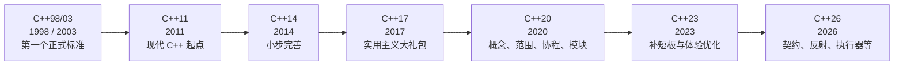
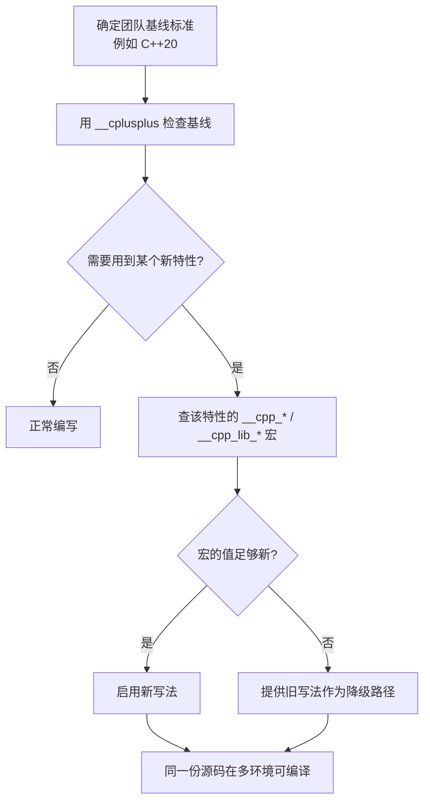
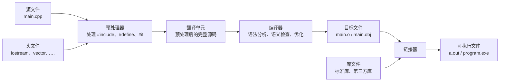
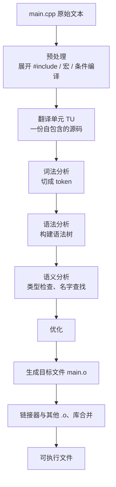
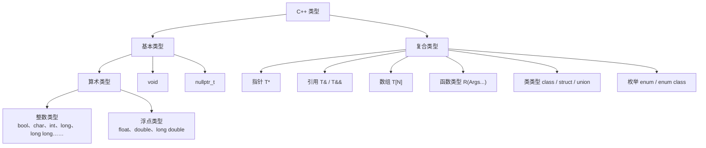
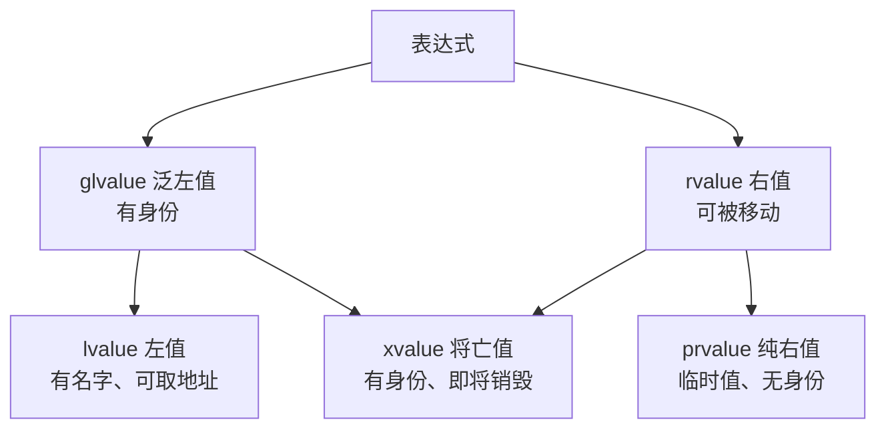
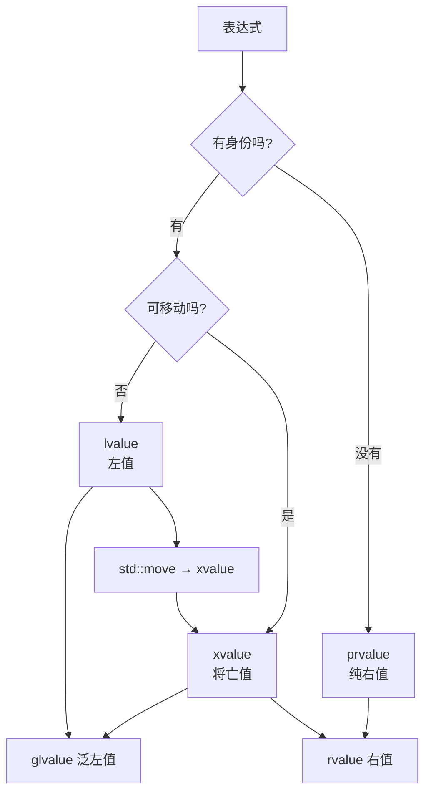
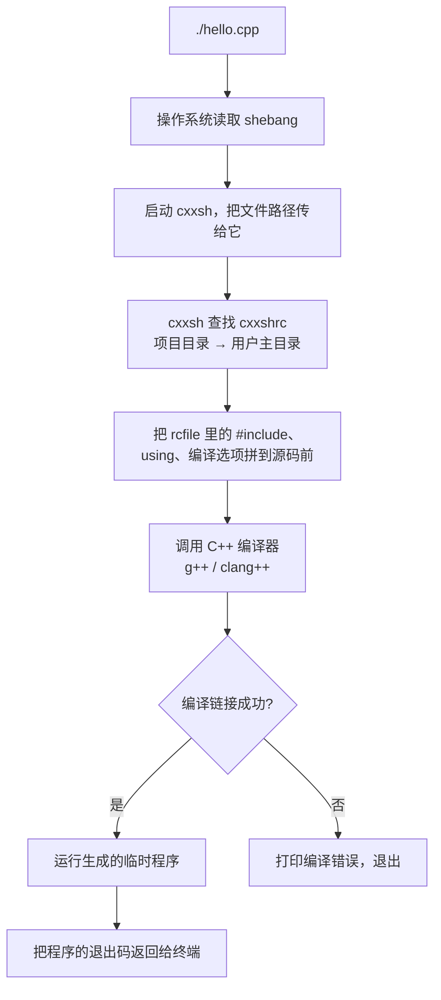

# 第 1 章 现代 C++ 的定位与工具链

在正式开始写代码之前，我们先把三件事说清楚：现代 C++ 到底“现代”在哪里，一个 C++ 程序从一行文字变成能运行的程序要经历什么，以及这本书为什么先用一个叫 `cxxsh` 的小工具来跑示例。

这一章不要求你记住多少语法，它的作用更像是一张地图。地图本身不能代替走路，但没有地图，你很容易在后面的章节里迷失方向：为什么同样的代码在别人的电脑上编译不过？为什么头文件写错会报出几百行看不懂的错误？为什么一个赋值语句会“偷走”另一个变量的内容？这些问题的答案，都藏在本章的概念里。

如果你完全没有编程经验，也不用紧张。这一章出现的所有代码，都会逐行解释；真正动手运行程序，放在 1.5 节。你可以先把前面的内容当作“看说明书”，到 1.5 节再亲手按下第一个回车。

---

## 1.1 从 C++11 到 C++26：标准演进脉络与兼容性策略

### 1.1.1 C++ 标准到底是什么

先打一个比方。C++ 标准就像一份“普通话规范”：它规定了哪些字可以怎么用、一句话怎样组织才算合法、同一个意思应该怎样表达。至于每个人说话的声音好不好听、语速快不快，那是“编译器”的事。

具体来说，C++ 标准由 ISO（国际标准化组织）下属的 WG21 委员会维护。委员会定期发布新的标准文本，编译器厂商（GCC、Clang、MSVC 等）再按照这份文本去实现。只要一个编译器把标准里的规则都实现对了，那么同一段符合标准的 C++ 代码，在 GCC、Clang、MSVC 上应该产生一样的行为。

这里有两个关键词需要区分：

- **标准（standard）**：纸面上的规则，规定“应该怎样”。
- **实现（implementation）**：编译器厂商实际做出来的东西，决定“实际怎样”。

标准是理想，实现是现实。现实中的编译器多少会有滞后、扩展和缺陷，所以我们才需要关心“这个编译器支持到哪个标准版本”。

### 1.1.2 版本时间线：为什么会有 C++11、C++14、C++17……

C++ 最早在 1998 年标准化，2003 年做了一次小修订。那之后很长一段时间没有大动作，直到 2011 年发布了被称为“现代 C++ 起点”的 C++11。从那以后，委员会改成大约每三年发布一版：



每一版的主题并不一样，理解它们的定位，比背特性列表更有用：

| 版本 | 大致定位 | 对初学者最直观的变化 |
|---|---|---|
| C++98/03 | 打地基 | 类、模板、异常、STL 都有了，但写法比较啰嗦 |
| C++11 | 现代 C++ 的分水岭 | `auto`、移动语义、Lambda、智能指针、右值引用 |
| C++14 | 给 C++11 补细节 | 泛型 Lambda、放宽的 `constexpr`、返回类型推导 |
| C++17 | 工程实用主义 | 结构化绑定、`if constexpr`、`std::optional`、`std::filesystem` |
| C++20 | 一次大升级 | 概念、范围、协程、模块、`std::format`、三路比较 |
| C++23 | 修体验、补缺口 | `std::expected`、`std::print`、`std::generator`、扁平容器 |
| C++26 | 正在落地 | 契约、反射、`std::execution`、危险指针/RCU 等 |

这本书的写作基线是 **C++20**：绝大多数示例默认用 C++20 能编译。涉及 C++23 的内容会明确标注；涉及 C++26 的内容统一标注“前瞻”，意思是“方向已经明确，但不同编译器支持程度不一，生产环境要谨慎”。

你可能会问：为什么不直接用最新标准？原因很现实。第一，操作系统自带的编译器往往比较旧；第二，团队里每个人的开发环境不一定同步；第三，新标准的新特性需要时间被编译器完整实现。工程上更常见的做法是：**选一个团队能统一支持的标准作为基线，再用特性测试宏去探测个别新特性**。这就是接下来要讲的内容。

### 1.1.3 `__cplusplus`：编译器在说“我支持到哪一版”

C++ 编译器会预定义一个宏 `__cplusplus`，它的值是一个形如 `202002L` 的整数，代表当前编译时使用的标准版本。常见取值如下：

| 标准 | `__cplusplus` 的值 |
|---|---|
| C++98/03 | `199711L` |
| C++11 | `201103L` |
| C++14 | `201402L` |
| C++17 | `201703L` |
| C++20 | `202002L` |
| C++23 | `202302L` |
| C++26 | 尚未正式定稿，草稿实现可能报告 `202400L` 等值 |

注意最后一行：C++26 在写作时还在收尾阶段，不同编译器可能报告不同的实验值。所以**不要用 `__cplusplus` 来判断“是不是 C++26”**，那个数字目前不可靠。

写一段代码看一看：

```cpp
// version_probe.cpp
#include <iostream>
#include <version>   // 标准库特性宏集中在这个头文件里

int main() {
    std::cout << "__cplusplus = " << __cplusplus << '\n';

#ifdef __cpp_lib_format
    std::cout << "__cpp_lib_format = " << __cpp_lib_format << '\n';
#else
    std::cout << "当前标准库没有 <format> 特性宏\n";
#endif

#ifdef __cpp_lib_print
    std::cout << "__cpp_lib_print = " << __cpp_lib_print << '\n';
#else
    std::cout << "当前标准库没有 <print> 特性宏\n";
#endif
}
```

这段代码逐行解释一下：

- `#include <iostream>`：把标准库里的输入输出设施“拿进来”，后面的 `std::cout` 才能用。
- `#include <version>`：这个头文件专门用来提供标准库特性测试宏。它本身不定义什么类型，只是把一堆“我支持某某特性”的宏摆出来。
- `std::cout`：标准输出流，可以理解成“屏幕”。
- `<<`：把右边的值送到左边的流里。可以连着写，像流水线一样。
- `'\n'`：换行符。它和 `std::endl` 都能换行，但 `'\n'` 通常更轻量，因为它不会额外刷新缓冲区。
- `#ifdef ... #else ... #endif`：预处理阶段的“如果定义了某个宏，就编译这一段；否则编译另一段”。注意，这是**编译前**做的选择，不是程序运行时做的判断。

如果你在 GCC 13 上以 `-std=c++20` 编译，可能会看到 `__cplusplus = 202002`；如果标准库版本较新，还会看到 `__cpp_lib_format = 201907`。这些数字的含义是“该特性在 2019 年 7 月被并入工作草案”，不是版本号，也不是质量评分。

### 1.1.4 特性测试宏：比“猜编译器版本”靠谱得多

很多老代码会这样写：

```cpp
#if __GNUC__ >= 13
    // 认为 GCC 13 一定支持某个特性
#endif
```

这种写法很脆弱。因为“GCC 13 支持某特性”只是经验，不是保证；不同发行版打的补丁、标准库版本、编译选项都可能让结论失效。C++20 起，标准提供了一套更可靠的机制：**特性测试宏（feature-test macro）**。

它分两类：

1. **语言特性宏**，形如 `__cpp_xxx`，由编译器预定义。例如：
   - `__cpp_constexpr`：`constexpr` 支持到什么程度；
   - `__cpp_lambdas`：是否支持 Lambda；
   - `__cpp_concepts`：是否支持概念；
   - `__cpp_modules`：是否支持模块。
2. **标准库特性宏**，形如 `__cpp_lib_xxx`，由标准库头文件（通常通过 `<version>`）提供。例如：
   - `__cpp_lib_format`：是否支持 `std::format`；
   - `__cpp_lib_print`：是否支持 `std::print`；
   - `__cpp_lib_expected`：是否支持 `std::expected`；
   - `__cpp_lib_ranges`：范围库支持程度。

另外还有一个很实用的运算符 `__has_include`，用来问“这个头文件存在吗”：

```cpp
#if __has_include(<print>)
#    include <print>
#    define HAS_PRINT_HEADER 1
#else
#    define HAS_PRINT_HEADER 0
#endif
```

它的好处是：你不用知道编译器叫什么名字、版本是多少，直接问“你有没有这个头文件”。这比猜版本可靠得多。

一个典型的兼容性写法是“能力探测 + 降级”：

```cpp
#include <version>

#if defined(__cpp_lib_format) && __cpp_lib_format >= 201907L
#    include <format>
#    define CAN_USE_FORMAT 1
#else
#    define CAN_USE_FORMAT 0
#endif

#include <iostream>

int main() {
#if CAN_USE_FORMAT
    std::cout << std::format("1 + 1 = {}\n", 1 + 1);
#else
    std::cout << "1 + 1 = " << (1 + 1) << '\n';
#endif
}
```

这段代码的含义是：如果标准库支持格式化库，就用更现代的 `std::format`；否则退回传统的 `<<` 拼接。同一份源码，在新旧环境里都能编译，这就是“兼容性策略”的核心。

### 1.1.5 编译器支持矩阵怎么读

cppreference 等网站会维护“编译器支持表”，每一行是一项特性，每一列是 GCC、Clang、MSVC、Apple Clang 等编译器，单元格里写着“从哪个版本开始支持”。读这种表时，注意三件事：

1. **语言特性和库特性要分开看**。编译器可能已经支持 `if constexpr`，但标准库还没实现 `std::format`。前者看编译器版本，后者看标准库版本。
2. **“支持”不等于“默认开启”**。有些特性需要显式加 `-std=c++20` 或 `/std:c++20`，有些实验特性还要加额外开关。
3. **注意标准库实现**。Clang 常搭配 libstdc++（GCC 的库）或 libc++；同一个 Clang 版本，换一个标准库，库特性支持情况可能完全不同。

工程上的建议可以总结成一句话：**先用特性测试宏探测，再决定走哪条代码路径；不要靠编译器版本号硬猜。**

### 1.1.6 兼容性策略：基线 + 探测 + 降级

把上面的内容串起来，可以形成一套很实用的写作习惯：



这套策略看起来有点啰嗦，但它能帮你避免一个非常常见的问题：代码在自己电脑上跑得好好的，换到同事的电脑、CI 服务器、用户的老系统上就编译失败。后面第 7 章讲 CMake 时，我们会把“标准版本”写进构建脚本；第 31 章还会给出完整的跨版本迁移地图。

> **小结**：C++ 标准大约每三年一版；`__cplusplus` 告诉你基线版本；`__cpp_*` 和 `__cpp_lib_*` 告诉你具体能力；`__has_include` 告诉你头文件是否存在。写跨版本代码时，优先“探测能力”，不要“猜版本”。

---

## 1.2 编译、链接与翻译阶段：现代构建的最小知识

### 1.2.1 从一行源码到可执行文件

你写下的 `.cpp` 文件，编译器并不能直接“理解”。它要经过一系列加工，才变成 CPU 能执行的机器指令。这个过程大致可以分成三大步：**预处理、编译、链接**。展开一点，是下面这条流水线：



下面逐段解释。

**第一步：预处理（preprocessing）。**

预处理器是一个“文本搬运工”，它不懂 C++ 语法，只做几类机械操作：

- 遇到 `#include <iostream>`，就把 `iostream` 这个头文件的全部内容**原样抄进来**；
- 遇到 `#define PI 3.14`，就把后面出现的 `PI` 替换成 `3.14`；
- 遇到 `#if`、`#ifdef`、`#else`、`#endif`，就根据条件决定保留哪一段文本；
- 删掉注释，把连续的空行压一压。

所以，`#include` 的本质不是“导入一个模块”，而是“把那个文件的内容复制粘贴到当前位置”。一个 `#include <iostream>` 背后可能又包含几十个头文件，展开后动辄几万行。这也是 C++ 编译慢的重要原因之一。

**第二步：编译（compilation）。**

预处理完成后，得到的是一份没有 `#include`、没有宏、没有条件编译指令的完整源码，这份源码叫做一个**翻译单元（translation unit，简称 TU）**。编译器对翻译单元做词法分析、语法分析、类型检查、优化，最后生成**目标文件**（Linux/macOS 上通常是 `.o`，Windows 上是 `.obj`）。目标文件里是机器指令，但还不是完整程序，因为有些函数只有声明、没有定义，地址还没填上。

**第三步：链接（linking）。**

链接器把多个目标文件和库文件拼在一起，解决“这个函数到底在哪里”的问题，生成最终的可执行文件。比如你的代码调用了 `std::cout`，它的实现不在你的源文件里，而在标准库里；链接器负责把标准库对应的部分接进来。

### 1.2.2 声明与定义：编译器为什么有时“认识”一个函数，有时又不认识

这里要引入两个非常重要的概念：

- **声明（declaration）**：告诉编译器“有这么个东西，它长这样”。比如 `int add(int a, int b);` 只是说“有一个叫 `add` 的函数，接收两个 `int`，返回 `int`”，但没给出函数体。
- **定义（definition）**：真正给出实现。比如 `int add(int a, int b) { return a + b; }`。

声明让编译器“知道名字”，定义让链接器“找得到实体”。这两件事发生在不同阶段，所以错误也分两种：

- **编译错误**：编译器在翻译单元里找不到某个名字的声明，或者类型对不上。典型信息是 `'xxx' was not declared in this scope`。
- **链接错误**：编译器知道名字，但链接器在所有目标文件和库里都找不到它的定义。典型信息是 `undefined reference to 'add(int, int)'`（GCC/Clang）或 `unresolved external symbol`（MSVC）。

看一个最小的多文件例子：

```cpp
// add.h
#pragma once

int add(int a, int b);   // 只有声明，没有函数体
```

```cpp
// add.cpp
#include "add.h"

int add(int a, int b) {  // 这里是定义
    return a + b;
}
```

```cpp
// main.cpp
#include <iostream>
#include "add.h"          // 让 main.cpp 知道 add 的声明

int main() {
    std::cout << add(2, 3) << '\n';
}
```

这三个文件的关系是：

- `add.h` 负责“广播声明”，谁想用 `add` 就包含它；
- `add.cpp` 负责“提供定义”，编译成 `add.o`；
- `main.cpp` 只看到声明，编译成 `main.o`；
- 链接器把 `main.o` 和 `add.o` 接起来，程序才能运行。

如果你只编译 `main.cpp`、忘了把 `add.cpp` 交给链接器，编译器会顺利通过（因为它见过声明），但链接器会报 `undefined reference to 'add(int, int)'`。这就是“编译通过、链接失败”的典型场景。

`#pragma once` 的作用是防止同一个头文件在同一个翻译单元里被重复包含。传统写法是“头文件保护宏”：

```cpp
#ifndef MY_PROJECT_ADD_H
#define MY_PROJECT_ADD_H

int add(int a, int b);

#endif
```

两种写法目的相同，现代编译器普遍支持 `#pragma once`，写起来更短。

### 1.2.3 翻译单元与“单一定义规则”

一个 `.cpp` 文件经过预处理后形成一个翻译单元。编译器是**一个一个翻译单元独立编译**的，它不会同时看到所有 `.cpp` 文件。这带来两个后果：

第一，**每个翻译单元都必须自己“自给自足”**。你在 `main.cpp` 里想用 `add`，就必须在 `main.cpp` 的翻译单元里看到它的声明；光在 `add.cpp` 里定义是不够的。

第二，**同一个实体在整个程序里只能有一份定义**，这叫**单一定义规则（One Definition Rule，ODR）**。函数、变量、类通常只能定义一次；如果两个 `.cpp` 都定义了同一个非内联函数，链接器会报“重复定义”（multiple definition）。头文件里通常只放声明，就是为了避免每个包含它的翻译单元都产生一份定义。

当然，规则也有例外：`inline` 函数、类定义、模板、`constexpr` 变量等允许在多个翻译单元里出现相同定义，链接器会把它们合并。这些细节后面讲到类和模板时还会再提，现在只需要记住大原则：**头文件放声明，源文件放定义；同一个东西不要定义两遍。**

### 1.2.4 头文件模型与模块模型

传统的 C++ 代码组织方式是“头文件 + 源文件”：

- 头文件（`.h` / `.hpp`）放声明、类定义、模板、常量；
- 源文件（`.cpp`）放函数实现；
- 用 `#include` 把头文件的内容复制进源文件。

这套模型用了几十年，问题也很明显：

1. **编译慢**：每个源文件都要把一堆头文件重新展开、重新解析。
2. **宏会泄漏**：头文件里定义的宏会影响所有包含它的源文件，命名冲突防不胜防。
3. **包含顺序敏感**：有时候换个 `#include` 顺序就编译不过。
4. **难以做工具化**：编译器很难判断“这个头文件到底导出了什么”。

C++20 引入了**模块（modules）**，试图从根上解决这些问题。模块的基本形态是这样：

```cpp
// math.cppm —— 模块接口单元
export module math;          // 声明这是一个名为 math 的模块

export int add(int a, int b) {
    return a + b;
}
```

```cpp
// main.cpp —— 使用模块
import math;                 // 导入模块，而不是 #include
#include <iostream>

int main() {
    std::cout << add(1, 2) << '\n';
}
```

注意几个关键词：

- `export module math;`：定义一个模块，模块名是 `math`。
- `export`：把后面的实体“导出”，其他文件 `import` 之后才能使用。没写 `export` 的东西是模块私有的。
- `import math;`：导入模块。它不像 `#include` 那样做文本复制，而是让编译器去读模块编译好的接口信息。

模块和头文件的差别，可以先这样理解：

| 对比项 | 头文件 `#include` | 模块 `import` |
|---|---|---|
| 本质 | 文本复制 | 编译器层面的导入 |
| 编译速度 | 每个翻译单元重复解析 | 模块只编译一次，可复用 |
| 宏泄漏 | 会泄漏 | 默认不泄漏 |
| 包含顺序 | 可能敏感 | 不敏感 |
| 工具支持 | 较弱 | 更强 |
| 成熟度 | 几十年 | 仍在普及中 |

C++23 还引入了 `import std;`，用来一次性导入整个标准库，替代一堆 `#include`。不过目前各编译器和构建系统对模块的支持程度参差不齐，本书只在第 6 章和第 29 章做概念性介绍，日常示例仍以头文件为主。你现在只需要建立这个印象：**头文件是“复制粘贴”，模块是“真正的导入”**。

### 1.2.5 一个翻译单元里发生了什么

把前面的内容压缩成一张图：



这张图里，**预处理之后**的产物才是编译器真正处理的输入。理解这一点，你就能明白很多“奇怪”的现象：宏替换为什么不分作用域、`#include` 为什么会引入命名冲突、为什么一个头文件写错会导致几百行错误信息。那些错误信息里的行号，往往是“头文件展开后”的行号，不一定对应你写的源文件。

> **小结**：`#include` 是文本包含，不是模块导入；声明和定义是两件事，分别对应编译期和链接期；一个 `.cpp` 形成一个翻译单元，独立编译，最后由链接器拼成程序。头文件模型简单但笨重，模块模型更先进但仍在普及。

---

## 1.3 类型系统鸟瞰：基本类型、复合类型与类型属性

### 1.3.1 类型是什么

在编程语言里，**类型（type）** 可以理解成一份“合同”，它规定了三件事：

1. 这个值在内存里占多少字节、怎么解释这些字节；
2. 这个值能做哪些操作（能不能相加、能不能取地址、能不能调用）；
3. 这个值能参与哪些转换（能不能隐式变成另一种类型）。

比如 `int` 和 `double` 在大多数机器上都占 4 字节和 8 字节，但它们的“解释方式”完全不同：同样一串二进制，按整数解释是一个数，按浮点数解释可能是另一个数。类型就是告诉编译器“请按哪种方式解释”。

C++ 是**静态类型语言**：每个变量、每个表达式在编译时就有确定的类型，编译器会在编译阶段检查类型是否匹配。这和 Python 这类动态类型语言不同——Python 到运行时才检查。静态类型的好处是错误发现得早、运行效率高；代价是写代码时要多写一些类型信息（现代 C++ 用 `auto` 和类型推导减轻了这个负担）。

### 1.3.2 类型分类地图

C++ 的类型可以粗略分成两大类：**基本类型（fundamental types）** 和 **复合类型（compound types）**。



下面逐类解释。

**算术类型**是最基础的一类，分整数和浮点：

| 类型 | 典型大小（x86-64） | 说明 |
|---|---|---|
| `bool` | 1 字节 | 只有 `true` / `false` 两个值 |
| `char` | 1 字节 | 存一个字符的编码，通常是有符号的 |
| `signed char` / `unsigned char` | 1 字节 | 明确有符号/无符号的字节 |
| `short` | 2 字节 | 短整数，至少 16 位 |
| `int` | 4 字节 | 最常用的整数，至少 16 位（实际几乎都是 32 位） |
| `long` | 4 或 8 字节 | 至少 32 位，Windows 上通常是 4 字节，Linux 64 位上通常是 8 字节 |
| `long long` | 8 字节 | 至少 64 位 |
| `float` | 4 字节 | 单精度浮点，大约 7 位有效数字 |
| `double` | 8 字节 | 双精度浮点，大约 15 位有效数字 |
| `long double` | 8、12 或 16 字节 | 扩展精度，具体取决于平台 |

这里一定要强调：**上表只是“典型值”，不是标准保证**。C++ 标准只保证“至少多少位”和“相对大小关系”，不保证 `int` 一定是 4 字节。如果你需要固定宽度，应该用 `<cstdint>` 里的 `std::int32_t`、`std::uint64_t` 等类型。第 13 章会详细讲。

另外，整数还可以加 `signed` / `unsigned` 修饰。`unsigned` 表示“只存非负数”，代价是同样位数下正数范围更大，但一旦减过头会“回绕”成一个很大的正数。初学者最容易踩的坑之一，就是把 `unsigned` 和 `int` 混着比较：

```cpp
#include <iostream>

int main() {
    unsigned int a = 1;
    int b = -1;
    if (a > b) {
        std::cout << "1 > -1\n";
    } else {
        std::cout << "这里才是实际会走到的分支\n";
    }
}
```

这段代码的实际输出是 `这里才是实际会走到的分支`。原因是 `b` 在和 `a` 比较时被转换成了 `unsigned int`，`-1` 变成了 `4294967295`，所以 `1 > 4294967295` 为假。这个坑很经典，后面讲类型转换时还会再遇到。

**`void`** 表示“没有类型”。函数的返回类型可以是 `void`，表示不返回值；`void*` 表示“指向未知类型的指针”，不能直接解引用。

**`nullptr_t`** 是空指针字面量 `nullptr` 的类型。它比老式的 `NULL`（通常是 `0`）更安全，因为 `nullptr` 不会和整数混淆。

**复合类型**由基本类型或其他复合类型组合而成：

- **指针 `T*`**：存的是地址。`int* p = &x;` 表示 `p` 里存着 `x` 的地址，`*p` 就是 `x` 本身。指针可以是空指针，也可以指向别的对象，还可以做算术（`p + 1` 表示下一个元素）。
- **引用 `T&`**：是对象的“别名”，必须绑定到一个已存在的对象，之后不能改绑。`int& r = x;` 之后，`r` 和 `x` 是同一个对象，对 `r` 的修改就是对 `x` 的修改。引用没有“空引用”这种合法状态。
- **数组 `T[N]`**：连续存放 `N` 个同类型元素。数组名在大多数表达式里会“退化”成指向首元素的指针，这是很多初学者困惑的来源。
- **函数类型 `R(Args...)`**：描述“接收哪些参数、返回什么”。函数指针就是指向函数类型的指针。
- **类类型**：`class`、`struct`、`union` 定义的类型，可以包含数据成员和成员函数。
- **枚举**：一组具名常量的集合；`enum class` 是作用域枚举，不会隐式转换成整数。

### 1.3.3 `const` 与 `volatile`：类型上的“标签”

`const` 表示“只读”。它可以修饰对象，也可以修饰指针指向的内容：

```cpp
int x = 10;
const int a = x;        // a 不能改
int* p1 = &x;           // 可以通过 p1 改 x
const int* p2 = &x;     // 不能通过 p2 改 x（指向常量）
int* const p3 = &x;     // p3 本身不能改指向（常量指针）
const int* const p4 = &x; // 两者都不能改
```

读法有个小技巧：**从右往左读**。`const int* p2` 读作“p2 是一个指针，指向 const int”；`int* const p3` 读作“p3 是一个 const 指针，指向 int”。

`volatile` 告诉编译器“这个对象可能被程序之外的东西修改，不要随便优化对它的读写”。它主要用于硬件寄存器、信号处理等场景，日常业务代码很少用。初学者不要把它和 `const` 混为一谈：`const` 是“我不改”，`volatile` 是“别人可能改”。

### 1.3.4 `decltype`：从表达式反推类型

`decltype` 是 C++11 引入的“类型查询”工具：给它一个表达式，它告诉你这个表达式的类型。

```cpp
#include <iostream>
#include <type_traits>

int main() {
    int x = 0;
    int& rx = x;
    const int cx = 42;

    static_assert(std::is_same_v<decltype(x), int>);
    static_assert(std::is_same_v<decltype(rx), int&>);
    static_assert(std::is_same_v<decltype(cx), const int>);
    static_assert(std::is_same_v<decltype((x)), int&>);   // 注意多了一层括号

    std::cout << "所有 static_assert 都通过了\n";
}
```

这里有几条规则需要记住：

1. 如果 `decltype` 里是一个**没有加括号的变量名**或**类成员访问**，它返回这个变量“声明的类型”。所以 `decltype(rx)` 是 `int&`，`decltype(cx)` 是 `const int`。
2. 如果 `decltype` 里是一个**加了括号的表达式**，则按值类别推导：
   - 表达式是左值 → 返回 `T&`；
   - 表达式是将亡值 → 返回 `T&&`；
   - 表达式是纯右值 → 返回 `T`。
3. `decltype` 不会真正“计算”表达式，它只在编译期做类型分析。所以哪怕表达式里有函数调用，也不会被执行。

`static_assert` 是编译期断言：条件为假时直接编译失败。它非常适合用来验证类型推导结果，因为错误在编译阶段就暴露了，不会等到运行时。

和 `decltype` 容易混淆的是 `auto`：

```cpp
int x = 0;
int& rx = x;
const int cx = 42;

auto a = rx;        // a 是 int（auto 会丢掉引用）
auto b = cx;        // b 是 int（auto 会丢掉顶层 const）
decltype(auto) c = rx;  // c 是 int&（保留引用）
decltype(auto) d = cx;  // d 是 const int（保留 const）
```

一句话总结：**`auto` 按“值”推导，默认丢掉引用和顶层 `const`；`decltype(auto)` 按“表达式”推导，原样保留。** 第 2 章会展开讲。

### 1.3.5 类型特征：在编译期问“这个类型是什么”

标准库 `<type_traits>` 提供了一堆“类型特征（type traits）”，用来在编译期回答关于类型的问题。它们通常以 `std::is_xxx_v` 的形式提供布尔值：

```cpp
#include <iostream>
#include <type_traits>

template <class T>
void describe() {
    std::cout << "sizeof(T) = " << sizeof(T) << '\n';
    std::cout << "  is_integral   = " << std::is_integral_v<T> << '\n';
    std::cout << "  is_floating   = " << std::is_floating_point_v<T> << '\n';
    std::cout << "  is_pointer    = " << std::is_pointer_v<T> << '\n';
    std::cout << "  is_const      = " << std::is_const_v<T> << '\n';
}

int main() {
    describe<int>();
    describe<double>();
    describe<int*>();
    describe<const int>();
}
```

输出大致是：

```
sizeof(T) = 4
  is_integral   = 1
  is_floating   = 0
  is_pointer    = 0
  is_const      = 0
sizeof(T) = 8
  is_integral   = 0
  is_floating   = 1
  is_pointer    = 0
  is_const      = 0
sizeof(T) = 8
  is_integral   = 0
  is_floating   = 0
  is_pointer    = 1
  is_const      = 0
sizeof(T) = 4
  is_integral   = 1
  is_floating   = 0
  is_pointer    = 0
  is_const      = 1
```

这段代码里出现了 `template`，你现在不用深究它的语法，只要知道“它让同一段代码可以套用不同类型”就够了。第 5 章会系统讲模板。这里重点看 `std::is_integral_v<T>` 这类写法：它们不是函数，而是编译期的常量，结果为 `true` 或 `false`。

类型特征在泛型编程里非常重要。比如你想写一个函数，只允许整数类型调用，就可以用 `static_assert(std::is_integral_v<T>)` 或 C++20 的概念来约束。第 5 章会讲概念，第 16 章会系统整理 `<type_traits>`。

### 1.3.6 类型系统带来的第一个直觉

学到这里，你应该建立三个直觉：

1. **类型决定解释方式**：同样的字节，按 `int` 解释和按 `float` 解释完全不同。
2. **类型决定操作集合**：指针能解引用，整数不能；数组能下标，函数不能。
3. **类型在编译期确定**：编译器在运行前就知道每个表达式的类型，所以能提前发现很多错误。

这三个直觉会贯穿全书。后面讲移动语义、模板、概念、范围，本质上都是在更精细地操作“类型”和“值类别”。

> **小结**：C++ 的类型分基本类型和复合类型；`const` 是只读标签；`decltype` 从表达式反推类型，`auto` 按值推导；`std::is_*_v` 让你在编译期查询类型属性。

---

## 1.4 值类别与对象生命周期：理解移动、转发和所有权的钥匙

### 1.4.1 对象、作用域、生命周期

在 C++ 里，**对象（object）** 不是“面向对象编程里的对象”那个狭义概念，而是“一块有类型、有存储空间的东西”。一个 `int` 变量是对象，一个 `std::string` 是对象，一个数组也是对象。

每个对象都有三个容易混淆的属性：

- **作用域（scope）**：名字在源码的哪个范围内可见。比如函数里定义的变量，出了函数就看不见了。
- **存储期（storage duration）**：对象的存储空间什么时候分配、什么时候释放。分为自动存储期（栈上，函数结束自动释放）、静态存储期（全局/静态变量，程序结束释放）、动态存储期（`new` 出来的，手动或智能指针释放）、线程存储期（`thread_local`）。
- **生命周期（lifetime）**：对象从“构造完成”到“析构开始”的这段时间。生命周期不等于作用域：一个对象可能作用域已经结束，但生命周期还没结束（比如引用延长了临时对象）；也可能作用域还在，但对象已经被移动得“空空如也”。

打个比方：作用域是“你的名字在哪个办公室能被叫到”，存储期是“这间办公室什么时候被分配和收回”，生命周期是“你本人从入职到离职的时间”。三者有关联，但不是一回事。

### 1.4.2 值类别：左值、纯右值、将亡值

**值类别（value category）** 是 C++ 里最抽象、但也最重要的概念之一。它回答的问题是：一个表达式产生的“东西”，能不能被取地址？能不能被移动？能不能放在赋值号左边？

C++11 之后，值类别分成三个基本类别和两个组合类别：



先解释“身份”和“可移动”这两个维度：

- **有身份（has identity）**：这个表达式对应一个具体的对象，能取地址、能比较是不是同一个。比如变量 `x`、解引用 `*p`、数组元素 `a[i]`。
- **可移动（movable）**：这个表达式表示的对象“快要死了”，编译器允许把它的资源“偷”走。比如 `std::move(x)` 的结果、临时对象。

三个基本类别：

1. **lvalue（左值）**：有身份、不可移动。最常见的就是具名变量：`int x;` 里的 `x` 是左值。函数返回引用时，结果也是左值。
2. **prvalue（纯右值）**：没有身份、可移动。字面量 `42`、`3.14`、临时对象 `std::string("hi")`、返回值的函数调用（返回非引用）都是纯右值。
3. **xvalue（将亡值）**：有身份、可移动。典型代表是 `std::move(x)` 的结果，以及返回右值引用的函数调用。

组合类别：

- **glvalue = lvalue + xvalue**：所有“有身份”的表达式。
- **rvalue = prvalue + xvalue**：所有“可移动”的表达式。

用一张表总结：

| 类别 | 有身份 | 可移动 | 典型例子 |
|---|---|---|---|
| lvalue 左值 | 是 | 否 | 变量名 `x`、`*p`、`a[i]` |
| prvalue 纯右值 | 否 | 是 | `42`、`std::string("hi")`、`f()`（返回值） |
| xvalue 将亡值 | 是 | 是 | `std::move(x)`、`static_cast<T&&>(x)` |
| glvalue 泛左值 | 是 | 不一定 | lvalue 或 xvalue |
| rvalue 右值 | 不一定 | 是 | prvalue 或 xvalue |

### 1.4.3 `std::move` 到底做了什么

这是初学者最容易误解的地方：**`std::move` 本身不移动任何东西。**

它只是一个类型转换，把左值转换成右值引用（更准确地说，转换成 xvalue），相当于：

```cpp
template <class T>
constexpr std::remove_reference_t<T>&& move(T&& t) noexcept {
    return static_cast<std::remove_reference_t<T>&&>(t);
}
```

你可以先把它理解成 `static_cast<T&&>(x)`。真正“搬运资源”的动作，发生在**移动构造函数**或**移动赋值运算符**里；`std::move` 只是告诉编译器：“我愿意把这个对象当成临时值处理，你可以调用移动版本。”

看一个例子：

```cpp
#include <iostream>
#include <string>
#include <utility>

int main() {
    std::string a = "hello, modern C++";
    std::string b = a;              // 复制：a 和 b 各有一份
    std::string c = std::move(a);   // 移动：资源从 a 转到 c

    std::cout << "b = " << b << '\n';
    std::cout << "c = " << c << '\n';
    std::cout << "a.size() = " << a.size() << '\n';  // 通常是 0，但标准只保证“有效”
}
```

运行后，`b` 和 `c` 都打印出 `hello, modern C++`。`a` 在移动之后处于“有效但未指定（valid but unspecified）”的状态：你可以安全地销毁它、给它重新赋值、查询它的 `size()`，但不应该假设它一定为空。不同标准库实现可能有不同表现，所以打印 `a` 的内容是不可移植的写法。

为什么需要移动？因为复制一个很大的 `std::string` 或 `std::vector` 要重新分配内存、逐元素拷贝，代价很高。移动只是把内部指针“接管”过来，通常常数时间完成。C++11 引入移动语义，就是为了让“返回一个大对象”“把对象放进容器”这类操作不再昂贵。

### 1.4.4 重载决议：编译器如何选择左值版和右值版

有了值类别，函数就可以根据“实参是左值还是右值”选择不同重载：

```cpp
#include <iostream>
#include <string>
#include <utility>

void consume(const std::string& s) {
    std::cout << "复制版本: " << s << '\n';
}

void consume(std::string&& s) {
    std::cout << "移动版本: " << s << '\n';
}

int main() {
    std::string name = "Alice";
    consume(name);              // name 是左值 → 调用 const& 版本
    consume(std::string("Bob"));// 临时对象是纯右值 → 调用 && 版本
    consume(std::move(name));   // std::move 产生 xvalue → 调用 && 版本
}
```

输出：

```
复制版本: Alice
移动版本: Bob
移动版本: Alice
```

注意第三次调用：`std::move(name)` 并没有真的移动，只是把 `name` 转成了 xvalue，于是编译器选了 `std::string&&` 版本。如果那个函数内部真的去“偷”资源，才会发生移动。

这就是移动语义的完整链条：**值类别决定重载选择，重载选择决定调用移动构造还是复制构造，移动构造决定资源是否被接管。** `std::move` 只是第一环。

### 1.4.5 引用折叠与完美转发

模板里有一个绕不开的规则：**引用折叠（reference collapsing）**。当类型推导产生“引用的引用”时，编译器按下面的规则把它压成一个引用：

- `T& &` → `T&`
- `T& &&` → `T&`
- `T&& &` → `T&`
- `T&& &&` → `T&&`

记忆口诀：**只要有一个是左值引用 `&`，结果就是左值引用；只有两个都是 `&&`，结果才是 `&&`。**

这条规则是“转发引用（forwarding reference）”的基础。看这个函数模板：

```cpp
#include <iostream>
#include <string>
#include <utility>

void consume(const std::string& s) {
    std::cout << "复制版本: " << s << '\n';
}

void consume(std::string&& s) {
    std::cout << "移动版本: " << s << '\n';
}

template <class T>
void relay(T&& value) {
    // 传左值时 T 推导为 std::string&，T&& 折叠为 std::string&
    // 传右值时 T 推导为 std::string，T&& 就是 std::string&&
    consume(std::forward<T>(value));
}

int main() {
    std::string name = "Alice";
    relay(name);                 // T = std::string&，转发为左值
    relay(std::string("Bob"));   // T = std::string，转发为右值
}
```

`T&&` 在模板参数推导的语境下叫**转发引用**，它既能绑定左值，也能绑定右值：

- 传左值 `name` 时，`T` 推导为 `std::string&`，`T&&` 折叠成 `std::string&`；
- 传右值临时对象时，`T` 推导为 `std::string`，`T&&` 就是 `std::string&&`。

但这里有个陷阱：**在函数内部，具名参数 `value` 本身是左值**，哪怕它的类型是 `T&&`。所以不能直接 `consume(value)`，否则永远选左值版本。必须用 `std::forward<T>(value)` 把“原来的值类别”转发出去。这就是“完美转发”：左值进、左值出；右值进、右值出。

第 3 章会详细讲完美转发在工厂函数、`emplace_back`、包装器里的应用。现在你只需要记住：**`std::move` 是无条件转成右值，`std::forward` 是有条件保持原值类别。**

### 1.4.6 临时对象、复制消除与生命周期延长

临时对象是“没有名字的对象”，比如 `std::string("hi")`、`1 + 2` 的结果、函数返回的临时值。它们通常活到“包含它们的完整表达式结束”为止。

C++17 起，有一条非常重要的规则：**复制消除（copy elision）是强制的**。看这个例子：

```cpp
#include <iostream>

struct Widget {
    Widget() { std::cout << "构造\n"; }
    Widget(const Widget&) = delete;   // 禁止复制
    Widget(Widget&&) = delete;        // 禁止移动
    ~Widget() { std::cout << "析构\n"; }
};

Widget make_widget() {
    return Widget{};   // 返回纯右值
}

int main() {
    Widget w = make_widget();  // C++17 起保证不调用复制/移动构造
    std::cout << "main 结束\n";
}
```

在 C++17 之前，这段代码可能编译失败，因为标准要求复制/移动构造函数“可访问”，即使编译器实际会优化掉。C++17 把“临时对象直接构造到目标位置”写进了标准，所以即使复制和移动构造都被 `= delete`，代码也能编译。这就是“保证的复制消除”。

另一条规则是**临时对象的生命周期延长**：

```cpp
#include <iostream>
#include <string>

int main() {
    const std::string& r = std::string("temp");  // 临时对象被延长到 r 的生命周期
    std::cout << r << '\n';                      // 安全
}
```

但注意，这种延长只对“直接绑定到引用”的临时对象有效，而且不能穿过函数返回：

```cpp
#include <string_view>
#include <string>

std::string_view bad() {
    std::string s = "temporary";
    return s;   // 危险：返回后 s 已销毁，string_view 悬空
}
```

`std::string_view` 不拥有字符数据，它只是一个“指针 + 长度”的视图。如果它指向的字符串已经销毁，访问它就是未定义行为。第 10 章会专门讲 `string_view` 的生命周期陷阱。

### 1.4.7 一张图串起来



这张图值得反复看。后面讲移动构造、`emplace_back`、`std::optional`、协程的 `co_await`，都会回到“这个表达式是什么值类别”这个问题上。

> **小结**：值类别由“有没有身份”和“能不能移动”两个维度决定；`std::move` 只是类型转换，真正移动发生在移动构造/赋值里；引用折叠规则是完美转发的基础；C++17 起复制消除是保证的；临时对象的生命周期延长有条件，`string_view` 尤其要小心。

---

## 1.5 第一个项目：用 c99sh 像脚本一样运行 Hello World

### 1.5.1 为什么不先学编译命令

传统 C++ 入门的第一课通常是：

```bash
g++ hello.cpp -o hello
./hello
```

这当然没错，但对零基础读者来说，它一下子引入了太多新东西：编译器叫什么、`-o` 是什么意思、为什么生成的文件没有扩展名、为什么换个系统命令就不一样。更麻烦的是，接下来每写一个小例子，都要重复“保存、编译、运行”三步，节奏很容易被打断。

本书第一篇采用一个折中方案：用一个叫 **c99sh** 的小工具，把“编译 + 链接 + 运行”压缩成一步，让单文件程序像 Python 脚本一样直接执行。它的 C++ 模式通过一个叫 **cxxsh** 的名字启用。这样你可以先把注意力放在语言本身，等第 7 章讲 CMake 时，再回到真实的工程化构建。

需要说明的是：c99sh 是一个 POSIX shell 脚本，主要运行在 Linux、macOS 和 Windows 的 WSL2 环境里。如果你用的是原生 Windows 命令提示符，建议先装 WSL2；本书后面的示例默认你在一个类 Unix 环境里操作。

### 1.5.2 安装 c99sh

c99sh 的源码在 GitHub 上，安装过程就是“下载脚本、给它执行权限、放进 PATH”：

```bash
# 1. 下载源码
git clone https://github.com/RhysU/c99sh.git
cd c99sh

# 2. 给脚本加执行权限
chmod +x c99sh

# 3. 放到 PATH 里的某个目录（需要 sudo）
sudo cp c99sh /usr/local/bin/c99sh

# 4. 创建一个名为 cxxsh 的符号链接，启用 C++ 模式
sudo ln -s /usr/local/bin/c99sh /usr/local/bin/cxxsh

# 5. 验证
cxxsh --help
```

如果你没有 `sudo` 权限，也可以放到自己的 `~/bin` 目录，只要确保 `~/bin` 在 `PATH` 里：

```bash
mkdir -p ~/bin
cp c99sh ~/bin/c99sh
chmod +x ~/bin/c99sh
ln -s ~/bin/c99sh ~/bin/cxxsh
export PATH="$HOME/bin:$PATH"   # 建议写进 ~/.bashrc 或 ~/.zshrc
```

这里的几个命令解释一下：

- `git clone`：把远程仓库复制到本地。
- `chmod +x`：给文件加上“可执行”权限。在 Unix 里，一个文本文件默认只能读、不能直接运行；加上执行权限后，系统才允许把它当程序执行。
- `cp`：复制文件。
- `ln -s`：创建符号链接（可以理解成 Windows 的快捷方式）。`cxxsh` 指向 `c99sh`，c99sh 会根据“自己被叫什么名字”来判断用 C 还是 C++ 编译。
- `PATH`：系统查找命令的目录列表。把 `~/bin` 加进去，终端才能直接敲 `cxxsh`。

### 1.5.3 配置 cxxshrc：把常用选项固定下来

c99sh 支持“rcfile”：一个存放编译选项和常用头文件的文本文件。对 C++ 模式来说，项目目录下的文件叫 `cxxshrc`；如果没有，就去用户主目录找全局配置（README 里写作 `~/.c99shrc`，部分版本也接受 `~/.cxxshrc`，以你安装的版本为准）。

一个典型的 `cxxshrc` 长这样：

```
// 编译选项：使用 C++20，打开常用警告和优化
-std=c++20 -Wall -Wextra -O2

// 自动包含常用头文件，省得每个示例都写一遍
#include <iostream>
#include <string>
#include <vector>
#include <utility>

// 自动使用标准命名空间（示例代码里就可以直接写 cout、string）
using namespace std
```

注意 rcfile 的语法比较特殊：

- 以 `//` 开头的是注释；
- 以 `-` 开头的是编译器/链接器选项；
- 以 `#include` 开头的是预处理指令，会被自动加到每个脚本前面；
- `using ...` 和 `namespace ...` 是 C++ 指令，结尾**不要加分号**；
- 以 `pkg-config` 开头的是第三方库查询；
- 其他路径会被当成要一起编译的源文件或库。

`-Wall -Wextra` 打开常用警告，`-O2` 打开优化。对初学者来说，警告非常重要：它们经常能在程序出错之前提醒你“这里可能有问题”。不要养成“能跑就行、警告不管”的习惯。

### 1.5.4 Hello World：三步变成一步

新建一个文件 `hello.cpp`：

```cpp
#!/usr/bin/env cxxsh
#include <iostream>

int main() {
    std::cout << "Hello, modern C++!\n";
}
```

然后：

```bash
chmod +x hello.cpp
./hello.cpp
```

你应该看到：

```
Hello, modern C++!
```

就这两步，没有 `g++`，没有 `-o`，也没有单独的可执行文件。下面逐行解释：

- `#!/usr/bin/env cxxsh`：这叫 **shebang**（也叫 hashbang）。它必须是文件的第一行，作用是告诉操作系统“请用 `cxxsh` 这个程序来解释本文件”。`/usr/bin/env` 会去 `PATH` 里找 `cxxsh`，这样不管你把它装在哪里都能找到。
- `#include <iostream>`：引入标准输入输出设施。
- `int main()`：程序的入口。操作系统运行程序时，会从这里开始执行。
- `std::cout << "Hello, modern C++!\n";`：把字符串送到标准输出。`std::` 是标准库的命名空间前缀；`<<` 是流插入运算符；`\n` 是换行。
- `}`：`main` 函数结束。C++ 规定，如果 `main` 走到结尾而没有 `return`，编译器会自动补一个 `return 0;`，表示“正常退出”。你也可以显式写 `return 0;`，但在 `main` 里不是必须的。

如果你不想加 shebang，也可以直接：

```bash
cxxsh hello.cpp
```

效果一样。加上 shebang 的好处是，文件本身就可以执行，更接近“脚本”的体验。

### 1.5.5 cxxsh 背后发生了什么

当你在终端敲 `./hello.cpp` 时，大致发生了这些事：



几个实用技巧：

- 加 `-v` 可以看到 cxxsh 实际执行的编译命令：`cxxsh -v hello.cpp`。这对理解“它到底在干什么”很有帮助。
- 加 `-x hello` 可以把编译好的可执行文件保存下来，避免每次重复编译：`cxxsh -x hello hello.cpp`，然后直接 `./hello`。
- c99sh 还支持从标准输入读代码、用 `-e` 追加一行等玩法，感兴趣可以看它的 `--help`。本书主要用“文件 + shebang”这一种方式。

### 1.5.6 第二个例子：`string_view`、`constexpr` 与 `std::format`

第一个例子只用了最传统的 `std::cout`。下面这个例子把 1.1 节讲的“能力探测 + 降级”真正用起来，同时展示三个现代设施：

```cpp
#!/usr/bin/env cxxsh
#include <iostream>
#include <string_view>
#include <version>

#if defined(__cpp_lib_format) && __cpp_lib_format >= 201907L
#    include <format>
#    define HAS_FORMAT 1
#else
#    define HAS_FORMAT 0
#endif

#if defined(__cpp_lib_print) && __cpp_lib_print >= 202207L
#    include <print>
#    define HAS_PRINT 1
#else
#    define HAS_PRINT 0
#endif

constexpr int square(int x) {
    return x * x;
}

static_assert(square(7) == 49, "square(7) 应该是 49");

int main() {
    std::string_view name = "现代 C++";

#if HAS_PRINT
    std::println("你好，{}！7 的平方是 {}", name, square(7));
#elif HAS_FORMAT
    std::cout << std::format("你好，{}！7 的平方是 {}\n", name, square(7));
#else
    std::cout << "你好，" << name << "！7 的平方是 " << square(7) << '\n';
#endif
}
```

逐段解释：

- `std::string_view`：一个“只读的字符串视图”，内部只有指针和长度，不拥有字符数据。它比 `const std::string&` 更轻量，但要求背后的字符串活得足够久。这里用字符串字面量初始化，字面量有静态存储期，所以安全。
- `constexpr int square(int x)`：声明这个函数“可以在编译期求值”。当参数是编译期常量时，编译器可以直接算出结果，不生成运行时调用。
- `static_assert(square(7) == 49, "...")`：编译期断言。如果 `square(7)` 不等于 49，编译直接失败，并打印后面的提示。这比运行时才发现问题早得多。
- `__cpp_lib_format` 和 `__cpp_lib_print`：1.1 节讲过的标准库特性宏。注意要先 `#include <version>`，这些宏才会被定义。
- `std::format`：C++20 的格式化库，用 `{}` 占位，类型安全，不需要手写 `<<` 拼接。
- `std::println`：C++23 的打印函数，自动换行，比 `std::format` + `std::cout` 更简洁。
- `#if ... #elif ... #else`：根据编译器能力选择不同的实现路径。同一份源码，在只支持 C++20 的环境里走 `format`，在更老的环境里退回 `cout`，在支持 C++23 的环境里用 `println`。

这段代码体现了现代 C++ 的一个典型写法：**核心逻辑不变，外围用特性宏做适配**。你不需要为了兼容老编译器而放弃新写法，也不需要在每个地方手写 `#ifdef` 的大段重复代码。

> 注意：`std::print` / `std::println` 对编译器版本要求较高（大致是 GCC 14+、Clang 18+ 配合较新的标准库、MSVC 19.37+）。如果你的环境暂时不支持，走 `format` 或 `cout` 分支完全没问题，不影响学习。

### 1.5.7 常见问题

第一次使用 cxxsh，可能会遇到这些情况：

**问题一：`bash: ./hello.cpp: Permission denied`**

原因：文件没有执行权限。解决：`chmod +x hello.cpp`。

**问题二：`bad interpreter: No such file or directory`**

原因：shebang 里的 `cxxsh` 找不到，通常是没装好、没加进 `PATH`，或者 shebang 行末尾有 Windows 换行符（`\r`）。解决：确认 `which cxxsh` 能找到；如果在 Windows 上编辑过文件，用 `dos2unix hello.cpp` 转换一下换行符。

**问题三：`std::format` 相关代码编译不过**

原因：编译器或标准库版本不够。解决：用 1.1 节的特性宏做判断，走降级分支；或者升级编译器。不要为了一个示例去折腾生产环境。

**问题四：中文输出乱码**

原因：终端编码和源文件编码不一致。解决：确保源文件是 UTF-8，终端也设置为 UTF-8；Windows 上可以试 `chcp 65001`，但更推荐直接用 WSL2。

**问题五：第一次运行特别慢**

原因：C++ 编译本身比脚本语言慢，第一次还要编译标准库头文件。解决：耐心等几秒；如果反复运行同一个例子，可以用 `cxxsh -x` 保存可执行文件。

---

## 本章小结

这一章我们建立了五块地基：

1. **标准演进**：C++11 是现代 C++ 的起点，之后大约每三年一版；`__cplusplus` 表示基线版本，`__cpp_*` / `__cpp_lib_*` 表示具体能力，`__has_include` 表示头文件是否存在。跨版本代码要“探测能力”，不要“猜版本”。
2. **翻译与链接**：`#include` 是文本复制；一个 `.cpp` 形成一个翻译单元，独立编译；声明和定义分属编译期和链接期；链接器负责把目标文件和库拼成可执行文件。
3. **类型系统**：类型决定内存解释方式、可执行操作和转换规则；基本类型、复合类型、`const`、`decltype`、类型特征是后续所有内容的基础。
4. **值类别与生命周期**：lvalue / prvalue / xvalue 由“有没有身份”和“能不能移动”决定；`std::move` 只是类型转换；引用折叠和 `std::forward` 支撑完美转发；C++17 起复制消除是保证的。
5. **工具链**：c99sh / cxxsh 让单文件 C++ 像脚本一样运行；`cxxshrc` 固定编译选项和常用头文件；shebang 让文件本身可执行。第一篇的示例都用这套工具，第 7 章再切换到 CMake。

## 练习

1. 用 `version_probe.cpp` 打印你当前环境的 `__cplusplus`、`__cpp_lib_format`、`__cpp_lib_print`，查一查这些数字分别对应哪个标准版本。
2. 把 1.2 节的 `add.h` / `add.cpp` / `main.cpp` 三个文件手动编译一次（先用 `g++` 或 `clang++` 体验真实流程），然后故意删掉 `add.cpp`，观察链接错误信息。
3. 写一个函数 `describe<T>()`，用 `std::is_*_v` 打印 `int`、`double`、`int*`、`const int` 的类型特征。
4. 修改 1.4 节的 `consume` 例子，增加一个 `consume(std::string&)` 重载，观察左值、右值、`std::move` 三种调用分别选中哪个版本。
5. 用 cxxsh 写一个脚本，接收命令行参数并打印问候语。提示：`main(int argc, char* argv[])`，`argc` 是参数个数，`argv` 是参数字符串数组。

下一章我们会正式进入“声明、初始化与作用域”，从 `auto` 和 `decltype` 开始，把这一章埋下的类型推导线索接上。
