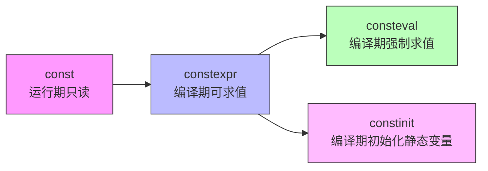

# 第 2 章 声明、初始化与作用域

这一章回答一个最基础的问题：**怎么在 C++ 里“拥有”一个名字，并给它一个初始值？**

对零基础读者来说，变量的定义、初始化、作用域看起来都是“声明一些东西，然后用它们”，但在 C++ 里，这些细节之间差异很大。比如：

- `int x = 1;` 和 `int x{1};` 看起来几乎一样，但在某些情况下会产生完全不同的结果；
- `auto y = 3;` 让编译器帮你猜类型，但它猜的是什么、何时能猜、何时猜不出来，容易掉进坑里；
- 在 `{}` 里定义的变量，离开那个 `{}` 就再也找不到了，但如果你用引用把它“拎”出来，就可能引用到一块已经被销毁的内存。

这些不是小问题，它们直接决定程序对不对、安全不安全。这一章就把这些问题一条条拆开来讲。

> **工具约定（回顾）**：本章及第 7 章之前的所有单文件示例，都可以用 `cxxsh` 像脚本一样运行（见 1.5 节）。你不需要每次都手动调用编译器，直接 `cxxsh 文件名` 或给文件加上 `#!/usr/bin/env cxxsh` 的 shebang 后直接执行即可。第 7 章开始，示例会切换到 CMake + vcpkg 的工程化构建。

---

## 2.1 `auto`、`decltype` 与返回类型推导

### 2.1.1 为什么要“让编译器猜类型”

在 C++ 早期，每个变量都必须写明类型：

```cpp
int age = 25;
double score = 89.5;
std::string name = "张三";
std::vector<int> numbers;
```

看起来没问题，但如果类型名很长，或者类型是某个模板实例化后的复杂名字，代码就会变得非常啰嗦，而且每次修改类型都要改很多地方。更麻烦的是，有些类型你根本写不出来（比如 Lambda 表达式产生的匿名类型）。

C++11 引入了 `auto` 关键字，意思是：**由编译器根据初始化表达式自动推导变量的类型**。

```cpp
auto age = 25;          // 编译器推导为 int
auto score = 89.5;      // 编译器推导为 double
auto name = std::string("张三");  // 推导为 std::string
```

从读者角度理解：`auto` 不是“任何类型都能接受”的万能型，也不是动态类型语言里的“变量”，它只是一个**占位符**，真正的类型在编译时就确定下来了，一旦确定就不能再改。

### 2.1.2 `auto` 的基本规则

使用 `auto` 时，必须在声明的同时进行初始化，因为编译器需要一个“样本”来推导类型：

```cpp
auto x;          // 错误！没有初始值，编译器无从推导
auto x = 10;     // 正确，x 是 int
```

推导过程大致等价于“去掉 `auto`，把初始值的类型套在变量名上”，但有一些**丢弃**规则需要注意：

| 样本表达式 | 推导后类型 | 说明 |
|---|---|---|
| `int a = 5;` | `auto x = a;` → `int` | 普通左值，推导为值类型 |
| `const int b = 5;` | `auto x = b;` → `int` | 顶层 `const` 被丢弃 |
| `int& r = a;` | `auto x = r;` → `int` | 引用被丢弃，推导为 `int` |
| `int* p = &a;` | `auto x = p;` → `int*` | 指针类型保留 |
| `auto x = {1, 2, 3};` | → `std::initializer_list<int>` | 花括号初始化有特殊规则 |

看一段可以直接运行的例子：

```cpp
// auto_basic.cpp
#include <iostream>
#include <string>
#include <vector>

int main() {
    auto a = 42;                    // int
    auto b = 3.14;                  // double
    auto c = std::string("hello");  // std::string
    auto d = {1, 2, 3};             // std::initializer_list<int>

    std::cout << "a = " << a << ", b = " << b << ", c = " << c << '\n';
    for (auto x : d) {
        std::cout << x << ' ';
    }
    std::cout << '\n';
}
```

这里最后的 `for (auto x : d)` 是**基于范围的 for 循环**，它会遍历 `d` 里的每个元素，每次把当前元素的类型推导给 `x`。这是 `auto` 最常用的场景之一。

### 2.1.3 `decltype`：从表达式反推类型

如果你已经有一个表达式，想要新声明一个变量，并且想让新变量的类型与该表达式**完全一致**（包括引用、const 等），就该用 `decltype` 了。

`decltype` 的读音大致是“declare type”的缩写，意思是“声明类型”。它不计算表达式的值，只查表达式的类型。

```cpp
int x = 0;
decltype(x) y = 1;        // y 的类型是 int，与 x 相同
```

和 `auto` 最核心的区别在于：**`auto` 丢弃引用和顶层 const，而 `decltype` 原样保留。**

```cpp
int a = 0;
int& r = a;
const int c = 0;

auto  a1 = r;             // int，引用被丢弃
decltype(r) a2 = a;       // int&，必须初始化为某个左值
auto  a3 = c;             // int，顶层 const 被丢弃
decltype(c) a4 = c;       // const int，const 被保留
```

`decltype` 还有另一种用法：加括号的表达式 `decltype((expr))`，会根据表达式的**值类别**（第 1 章讲过的 lvalue / prvalue / xvalue）推导出引用类型：

```cpp
int x = 0;
decltype(x)    y = x;     // int
decltype((x)) z = x;      // int&，（x）是左值表达式，所以推导为引用
```

加括号的 `(x)` 不再是一个简单的变量名，而是一个“表达式”，表达式 `x` 是个左值，所以 `decltype((x))` 得到 `int&`。这点很绕，初学者记住一个口诀即可：**`decltype(变量名)` 得声明类型；`decltype((表达式))` 看表达式是左值还是右值，左值就加引用。**

### 2.1.4 函数返回类型推导

`auto` 不仅可以用于变量，也可以用于函数的返回类型。这叫**返回类型推导**，C++14 引入：

```cpp
auto add(int a, int b) {
    return a + b;   // 编译器看到返回的是 int，就把函数返回类型推导为 int
}
```

这里有一个关键限制：**函数体里所有的 `return` 语句推导出的类型必须一致**。如果分支里返回了不同类型，编译就会失败：

```cpp
auto bad(bool flag) {
    if (flag) {
        return 1;       // int
    } else {
        return 3.14;    // double，和上面的 int 不一致，编译错误
    }
}
```

### 2.1.5 `decltype(auto)`：两者的结合

C++14 还引入了 `decltype(auto)`，它结合了 `auto` 的推导语法和 `decltype` 的规则：**按照初始化表达式的值类别，原样保留类型，不丢弃引用，不丢弃 const。**

```cpp
int& get_ref();           // 返回引用

auto  a = get_ref();      // a 是 int（引用被丢弃，还可能发生复制）
decltype(auto) b = get_ref();  // b 是 int&（原样保留，真正的引用）
```

什么时候该用 `decltype(auto)`？当你写泛型代码（比如模板包装器、完美转发），希望“进来什么，原样传出去”，不希望意外发生复制或丢掉 const 时，`decltype(auto)` 是更精确的选择。第 3 章和第 5 章还会反复提到它。

### 2.1.6 什么时候该用 `auto`，什么时候不该用

`auto` 很方便，但不是到处都要用。一个简单的准则：

| 情况 | 建议 | 原因 |
|---|---|---|
| 类型名很长（如模板实例、Lambda） | 用 `auto` | 避免写出冗长难读的类型 |
| 初始值右边已经很明显（如 `= 42`） | 可用 `auto` | 读起来自然 |
| 初始值类型不明确，需要显式文档 | 显式写类型 | 让代码自我解释，不用鼠标悬停才知道类型 |
| 需要精确控制引用/const（如引用成员） | 用 `decltype(auto)` 或显式类型 | `auto` 会丢弃引用和顶层 const |
| 需要在声明和初始化分开进行 | 不能用 `auto` | `auto` 必须立即初始化 |

**不建议滥用 `auto` 到“连变量是什么类型都看不出来”的程度。** 好的代码既利用 `auto` 减少样板，又保留足够的类型信息让阅读代码的人一目了然。

> **小结**：`auto` 由初始值推导类型，会丢弃引用和顶层 const；`decltype` 原样保留表达式类型；`decltype(auto)` 二者结合，适合泛型转发。返回类型推导要求所有分支返回类型一致。

---

## 2.2 统一初始化与列表初始化

### 2.2.1 旧式初始化的问题

在 C++11 之前，初始化的写法五花八门：

```cpp
int a = 1;              // 赋值式初始化
int b(2);               // 函数式初始化
std::string c("hi");    // 构造函数初始化
int d[] = {1, 2, 3};    // 数组初始化
struct Point { int x, y; };
Point p = {3, 4};       // 聚合初始化
```

这些写法看起来差不多，但背后的规则不同，而且容易出现**窄化转换（narrowing conversion）**问题：把一个较大范围的数赋给较小范围的类型，比如把 `double` 赋给 `int`，小数部分会被静默截断，程序员可能完全没察觉。

C++11 引入了**统一初始化（uniform initialization）**：用花括号 `{}` 统一表示初始化，不管是什么类型。这种初始化也叫**列表初始化（list-initialization）**。

### 2.2.2 花括号初始化的基本形式

```cpp
int a{42};                    // 直接列表初始化
int b = {42};                 // 复制列表初始化
std::string s{"hello"};       // 调用 string 的构造函数
int arr[]{1, 2, 3, 4, 5};     // 数组，长度自动推导为 5
struct Point { int x, y; };
Point p{3, 4};                // 聚合初始化
```

同样的例子，如果不用花括号：

```cpp
int a(42);          // 也可以，但跟函数声明长得像（见下面的“最烦析断”）
std::string s("hello");
```

花括号写法的一个最大好处是**禁止窄化转换**。如果初始值可能丢失信息，编译会直接报错：

```cpp
int a = 3.14;       // 旧式：静默变成 3，编译通过，潜伏 bug
int b{3.14};        // 新式：编译错误，窄化转换不允许
double c = 3.14;
int d{c};           // 编译错误：double 到 int 可能丢失小数部分
```

这对初学者非常友好：很多“莫名其妙的数字不对”问题，在编译阶段就被拦截了。

### 2.2.3 `std::initializer_list` 与构造函数优先级

当你用 `{}` 初始化一个类对象，而这个类有一个接受 `std::initializer_list` 的构造函数时，编译器会**优先**考虑这个构造函数：

```cpp
#include <iostream>
#include <vector>
#include <initializer_list>

class Bag {
public:
    // 接受 initializer_list 的构造函数
    Bag(std::initializer_list<int> list) {
        std::cout << "走了 initializer_list 构造函数，元素个数：" << list.size() << '\n';
    }

    // 普通构造函数
    Bag(int count, int value) {
        std::cout << "走了普通构造函数，count=" << count << ", value=" << value << '\n';
    }
};

int main() {
    Bag b1{1, 2, 3};      // 调用 initializer_list 构造函数
    Bag b2(10, 0);        // 调用普通构造函数
}
```

注意：`Bag b1{1, 2, 3}` 里的 `{1, 2, 3}` 会被当作 `std::initializer_list<int>` 传给第一个构造函数，而不是把 `1`、`2`、`3` 分别传给三个参数。因为 C++ 规定，如果类有 `std::initializer_list` 构造函数，列表初始化会优先匹配它。

`std::initializer_list` 本身是一个轻量的代理对象，内部只持有指向数组的指针和长度，不拥有数据。它常用于让容器（如 `std::vector`）支持 `std::vector<int> v = {1, 2, 3};` 这样的写法。

### 2.2.4 聚合体与聚合初始化

**聚合体（aggregate）** 是一种特殊的类类型：它没有用户声明的构造函数、没有私有/保护的非静态数据成员、没有虚函数、没有虚拟基类。简单的 `struct` 默认通常就是聚合体：

```cpp
struct Person {
    std::string name;
    int age;
};

Person p{"张三", 25};   // 聚合初始化：按成员顺序依次初始化
```

聚合初始化不需要构造函数，直接把花括号里的值按顺序填入成员。C++14 起还允许给成员提供**默认成员初始值**：

```cpp
struct Person {
    std::string name = "未知";
    int age = 0;
};

Person p{"李四"};   // name = "李四"，age 使用默认值 0
```

C++20 进一步放宽了聚合体的定义，允许聚合体拥有**默认成员初始值**（C++14 已支持）以及**基类**（C++20 新增），使得更多结构体可以享受聚合初始化的便利。

### 2.2.5 最烦析断（Most Vexing Parse）

初学者最容易遇到的一个奇怪现象叫“最烦析断”。看这段代码：

```cpp
#include <iostream>
#include <string>

class Widget {
public:
    Widget(int x) { std::cout << "Widget 构造，x=" << x << '\n'; }
};

int main() {
    Widget w(Widget());   // 程序员想：创建一个临时 Widget，用它构造 w
                          // 实际：编译器认为这是一个函数声明！
}
```

`Widget w(Widget());` 在编译器眼里，不是“对象定义”，而是**一个函数声明**：函数名叫 `w`，返回类型是 `Widget`，参数是一个 unnamed 的、返回 `Widget` 的函数指针。编译器宁愿把它当成函数声明，也不愿当成对象定义，这是 C++ 语法规则里的一个历史遗留问题。

用花括号初始化可以彻底避免这个问题：

```cpp
Widget w{Widget()};   // 明确是对象定义，不会被误解为函数声明
```

或者更简单：

```cpp
Widget w{};           // 默认构造（如果 Widget 有默认构造函数）
```

所以，现代 C++ 的推荐做法是：**优先使用 `{}` 初始化**，既能防止窄化，又能避开最烦析断，写法还统一。

### 2.2.6 列表初始化的局限

虽然 `{}` 很好用，但不是万能药：

1. 有些类只提供特定构造函数，不接受 `initializer_list`，这时候 `{} ` 里的内容必须能匹配某个构造函数，否则编译失败。
2. `auto` 配合 `{}` 时，推导结果是 `std::initializer_list`，而不是你可能期望的 `std::vector`。如果想得到 `std::vector`，需要显式写类型：`std::vector<int> v = {1, 2, 3};`。
3. 列表初始化在模板、重载决议中可能让规则变复杂，遇到编译错误时，错误信息可能比较难读。

> **小结**：`{}` 是现代 C++ 的统一初始化语法，能防窄化、避最烦析断、适用面广；`std::initializer_list` 是花括号初始化背后的重要机制；聚合体可以用聚合初始化按成员顺序赋值；优先 `{} `，但遇到复杂模板或需要明确类型时，显式写类型更稳妥。

---

## 2.3 结构化绑定与聚合体

### 2.3.1 从“拆包”说起

日常编程里，经常需要把一个组合对象里的几个成员取出来，分别用。最常见的组合对象是 `std::pair` 和 `std::tuple`，还有数组、结构体。

传统写法：

```cpp
std::pair<std::string, int> p{"张三", 25};
std::string name = p.first;
int age = p.second;
```

这有几个不便：`first`、`second` 这种名字没有业务含义，读起来费劲；如果是 `std::tuple`，还得用 `std::get<0>(t)`，更晦涩。

C++17 引入了**结构化绑定（structured binding）**，允许一次性把对象拆开，绑定到多个名字上：

```cpp
auto [name, age] = std::pair<std::string, int>{"张三", 25};
// name 是 "张三"，age 是 25
```

读作“自动推导，把 name 和 age 绑定到 p 的两个成员上”。代码立刻变得像解包一样直观。

### 2.3.2 结构化绑定能拆什么

结构化绑定支持三种底层类型，对应三种“拆包”方式：

| 类型 | 绑定方式 | 例子 |
|---|---|---|
| 数组 | 按元素拆 | `auto [a, b] = arr;` |
| `std::pair` / `std::tuple` | 按成员拆 | `auto [x, y] = p;` |
| 聚合体（聚合结构体） | 按数据成员拆 | `auto [name, age] = person;` |

下面是一个可以直接运行的例子，覆盖数组、pair、结构体：

```cpp
// structured_binding.cpp
#include <iostream>
#include <string>
#include <vector>
#include <tuple>

struct Point {
    int x;
    int y;
};

int main() {
    // 1. 数组
    int arr[] = {10, 20, 30};
    auto [a, b, c] = arr;
    std::cout << "数组: " << a << ", " << b << ", " << c << '\n';

    // 2. std::pair
    std::pair<std::string, int> person{"王五", 30};
    auto [name, years] = person;
    std::cout << "pair: " << name << ", " << years << '\n';

    // 3. 聚合体（结构体）
    Point pt{1, 2};
    auto [x, y] = pt;
    std::cout << "Point: x=" << x << ", y=" << y << '\n';

    // 4. std::tuple
    std::tuple<int, double, std::string> t{1, 3.14, "hello"};
    auto [i, d, s] = t;
    std::cout << "tuple: " << i << ", " << d << ", " << s << '\n';
}
```

输出：

```
数组: 10, 20, 30
pair: 王五, 30
Point: x=1, y=2
tuple: 1, 3.14, hello
```

### 2.3.3 结构化绑定的本质：别名，而非复制

结构化绑定看起来像是“复制了一份”，但事实上它更接近于**别名（绑定）**，具体行为取决于绑定的对象：

- 如果绑定的是数组或聚合体的成员，绑定名字相当于该成员的**引用**（在满足条件时），修改绑定名字会修改原对象；
- 如果绑定的是 `std::pair`、`std::tuple`，行为与 `auto` 类似，通常是对元素的拷贝或引用，取决于绑定方式（可以加 `&` 显式声明为引用）。

显式声明引用：

```cpp
Point pt{1, 2};
auto& [x, y] = pt;   // x, y 都是 pt.x, pt.y 的引用
x = 100;             // pt.x 变成 100
```

如果不加 `&`，`x`、`y` 就是副本，修改它们不影响 `pt`。

### 2.3.4 作用域与生命周期

结构化绑定引入的名字，作用域从声明处开始，直到所在的块（`{}`）结束。如果你在 `if` 或 `for` 里用了结构化绑定，离开那个块，名字就失效了。

另外，结构化绑定会先创建一个隐藏的临时变量来保存初始化表达式的结果，然后绑定名字到这个临时变量的子对象上。这意味着：**初始化表达式返回的临时对象，其生命周期会被延长到结构化绑定的作用域结束。**

看这个陷阱：

```cpp
#include <string_view>
#include <string>
#include <iostream>

std::string make_string() {
    return "temporary";
}

int main() {
    auto [sv] = std::pair<std::string_view, int>{std::string_view(make_string()), 0};
    // 危险：make_string() 返回的临时 std::string 在整条语句结束后销毁，
    // string_view 指向的内存已释放，访问 sv 是未定义行为
    // std::cout << sv << '\n';
}
```

这个例子比较高级，涉及 `std::string_view`（第 10 章讲），这里你只需要知道一个原则：**结构化绑定虽然方便，但不要把它绑定到一个即将销毁的临时对象的引用上，然后在作用域外使用。**

### 2.3.5 结构化绑定 vs 聚合体

聚合体（aggregate）是结构化绑定的重要应用场景。一个聚合体通常是一个简单的 `struct`，里面只有公共数据成员，没有构造函数：

```cpp
struct Color {
    int r, g, b;
};

Color c{255, 128, 0};
auto [red, green, blue] = c;
```

结构化绑定让聚合体的使用变得和 `std::tuple` 一样方便，但又保留了成员名的语义（通过你自己命名的绑定名字）。它也让“函数返回多个值”变得自然：

```cpp
std::pair<int, int> minmax(int a, int b) {
    return a < b ? std::pair{a, b} : std::pair{b, a};
}

auto [mn, mx] = minmax(3, 7);   // mn = 3, mx = 7
```

> **小结**：结构化绑定用 `auto [a, b, c] = ...` 一次拆开多个值，适用于数组、pair/tuple 和聚合体；它本质是绑定/别名，可加 `&` 声明引用；名字的作用域限制在所在块内；注意不要绑定到即将销毁的临时对象。

---

## 2.4 命名空间、内联命名空间与嵌套命名空间简化

### 2.4.1 命名空间解决什么问题

想象你在写一个大型项目，你定义了一个函数叫 `print()`，某个第三方库也定义了一个函数叫 `print()`。如果两个都放在全局作用域，链接时就会冲突，编译器不知道你调用的是哪一个。

**命名空间（namespace）** 就是给代码划“地盘”，让同名的标识符可以和平共处：

```cpp
namespace my_lib {
    void print() {
        // 我的打印逻辑
    }
}

namespace other_lib {
    void print() {
        // 别人的打印逻辑
    }
}

int main() {
    my_lib::print();       // 调用我的
    other_lib::print();    // 调用别人的
}
```

命名空间可以嵌套，也可以在多个文件中扩展同一个命名空间。它是 C++ 管理大型代码库的基础机制。

### 2.4.2 嵌套命名空间的简化写法（C++17）

在 C++17 之前，定义嵌套命名空间要一层层写：

```cpp
namespace company {
    namespace project {
        namespace module {
            void func() {}
        }
    }
}
```

这看起来很啰嗦，而且缩进越来越深。C++17 起，允许用 `::` 直接写嵌套路径：

```cpp
namespace company::project::module {
    void func() {}
}
```

这两种写法完全等价，编译器处理的方式也一样，只是第二种更简洁。推荐在新代码中使用 C++17 的简化写法。

### 2.4.3 内联命名空间：库版本控制的秘密武器

**内联命名空间（inline namespace）** 是一个比较高级但非常实用的特性。被标记为 `inline` 的命名空间，里面的名字会“提升”到外层命名空间，可以直接访问，不需要写内联命名空间的名字。

```cpp
namespace version {
    inline namespace v2 {
        void do_something() {
            // 新版本实现
        }
    }

    namespace v1 {
        void do_something() {
            // 旧版本实现
        }
    }
}

int main() {
    version::do_something();   // 自动调用 v2 里的版本（内联命名空间优先）
}
```

`version::do_something()` 会直接命中 `v2` 里的版本，因为 `v2` 是 `inline` 的，它的内容仿佛直接属于 `version`。如果你想调用旧版本，必须显式写 `version::v1::do_something()`。

这个特性在**库版本演进**中非常有用。比如一个库先发布 v1，后来发布 v2，库作者可以把 v2 放进内联命名空间，这样老代码如果只写了 `library::do_something()`，编译器会自动绑定到 v2 的实现；而需要明确使用 v1 的用户，可以写 `library::v1::do_something()`。这提供了一种平滑的升级路径。

### 2.4.4 `using` 指令和 `using` 声明

如果你不想每次都写 `my_lib::print()`，可以用 `using` 让名字直接可用：

```cpp
using my_lib::print;   // using 声明：把 print 引入当前作用域
print();               // 直接调用，不用加 my_lib::

// 或者
using namespace my_lib;   // using 指令：把整个命名空间的名字都引入
print();                  // 直接调用
```

两者的区别：

- `using my_lib::print;`：只引入一个名字，如果和当前作用域的其他名字冲突，编译器会报错，比较安全。
- `using namespace my_lib;`：引入整个命名空间，方便但容易引起名字冲突，尤其是多个库都用 `using namespace` 时。

**最佳实践**：在头文件里，不要写 `using namespace`（否则会把污染扩散到所有包含这个头文件的地方）；在源文件的局部作用域里，可以谨慎使用。

### 2.4.5 匿名命名空间：内部链接的替代

在 C 语言里，如果想让一个全局函数只在当前文件可见，会加 `static` 关键字。C++ 里更推荐的做法是**匿名命名空间**：

```cpp
namespace {
    void helper() {
        // 只在本文件可见
    }
}
```

匿名命名空间里的名字，外部文件无法访问，它的链接属性相当于 `static`，但语法更规范，也适用于类和变量。

### 2.4.6 一个完整的命名空间示例

```cpp
// namespace_demo.cpp
#include <iostream>
#include <string>

namespace company {
    inline namespace v2 {
        std::string greet() {
            return "你好，这是 v2 版本";
        }
    }

    namespace v1 {
        std::string greet() {
            return "你好，这是 v1 版本";
        }
    }
}

namespace {
    void log(const std::string& msg) {
        std::cout << "[log] " << msg << '\n';
    }
}

int main() {
    // 内联命名空间：直接调用 v2
    std::cout << company::greet() << '\n';
    
    // 显式调用 v1
    std::cout << company::v1::greet() << '\n';
    
    // 匿名命名空间：只在本文件可见
    log("程序运行结束");
}
```

运行输出：

```
你好，这是 v2 版本
你好，这是 v1 版本
[log] 程序运行结束
```

> **小结**：命名空间防止名字冲突；C++17 起支持 `namespace a::b::c` 的简化嵌套写法；`inline namespace` 适合库版本切换，外部可以无缝切到新版本；`using` 声明比 `using namespace` 指令更安全；匿名命名空间替代 `static` 实现文件内部可见。

---

## 2.5 `const`、`constexpr`、`consteval` 与 `constinit`

### 2.5.1 四个限定符的边界

C++ 里跟“常量”和“编译期”相关的关键字有四个，容易混淆：

| 关键字 | 含义 | 大白话 |
|---|---|---|
| `const` | 只读 | “这份数据我承诺不修改” |
| `constexpr` | 编译期可求值 | “这个值/函数，编译器能在编译时算出结果” |
| `consteval` | 编译期必须求值 | “这个函数只能在编译时跑，不能在运行时调用” |
| `constinit` | 编译期初始化 | “这个静态变量必须在编译期初始化完成” |

它们的关系可以这样理解：



### 2.5.2 `const`：只读承诺

`const` 修饰变量，表示“只读，不能修改”。它发生在**运行期**，变量可以在运行时才获得值，但一旦初始化，就不能再改。

```cpp
const int max_retry = 3;
// max_retry = 5;  // 编译错误：不能修改 const 变量
```

`const` 也可以修饰成员函数、指针指向的对象等，第 4 章讲类的时候会详细展开。这里只需要知道最核心的一点：**`const` 是关于“可不可以修改”的承诺，和“编译期还是运行期”无直接关系。**

### 2.5.3 `constexpr`：编译期可求值

`constexpr` 是“constant expression”的缩写。被 `constexpr` 修饰的变量或函数，编译器会尝试在**编译阶段**就算出结果。

```cpp
constexpr int max_retry = 3;            // 编译期常量
constexpr double pi = 3.141592653589793; // 编译期常量

constexpr int square(int x) {
    return x * x;
}

constexpr int result = square(5);       // 编译期就算出 25
```

`constexpr` 变量必须用编译期常量初始化，也就是说，编译器必须在编译时就知道它的值。如果初始化表达式里有运行期才知道的内容（比如从用户输入读取），`constexpr` 就会编译失败。

`constexpr` 函数在 C++11 里限制很多（函数体只能有一条 return 语句），但从 C++14 起放宽了很多，可以写循环、局部变量，几乎像普通函数一样。C++20 又进一步放宽，允许在 `constexpr` 函数里用 `try`、`dynamic_cast`、虚函数调用等（在常量求值上下文中）。

```cpp
constexpr int factorial(int n) {
    int result = 1;
    for (int i = 2; i <= n; ++i) {
        result *= i;
    }
    return result;
}

constexpr int f5 = factorial(5);  // 编译期算出 120
```

注意：`constexpr` 函数**可以**在运行期被调用，只是如果参数是编译期常量且上下文要求常量表达式，编译器会优先在编译期求值。

### 2.5.4 `consteval`：编译期必须求值

`consteval` 是 C++20 引入的，**即时函数（immediate function）**。它和 `constexpr` 的区别在于：`consteval` 函数**每次调用都必须在编译期求值**，不能在运行期调用。

```cpp
consteval int square(int x) {
    return x * x;
}

constexpr int a = square(4);  // OK：编译期求值
// int b = square(runtime_input);  // 编译错误：consteval 不能在运行期调用
```

什么时候用 `consteval`？当你希望强制某个函数“绝对不能产生运行期开销”，必须在编译期完成计算，用 `consteval` 比 `constexpr` 更严格，也能让意图更明确。

### 2.5.5 `constinit`：编译期初始化静态变量

`constinit` 是 C++20 引入的，用于**静态存储期的变量**（全局变量、静态局部变量、类的静态成员变量）。它要求该变量必须用**编译期常量**初始化。

```cpp
constinit int global_counter = 0;   // OK：编译期初始化
// constinit int bad = read_config();  // 错误：read_config 是运行期函数
```

`constinit` 和 `constexpr` 的区别：`constexpr` 变量不仅初始化在编译期，而且它本身也是 `const` 的（只读）；`constinit` 只要求**初始化**在编译期完成，变量之后**仍然可以修改**。

```cpp
constinit int counter = 0;
counter = 5;   // 允许：constinit 只约束初始化，不约束后续修改

constexpr int limit = 100;
// limit = 200;  // 错误：constexpr 变量是只读的
```

`constinit` 主要解决一个问题：**静态初始化阶段的初始化顺序问题**（所谓“静态初始化阶段纠葛”）。如果一个全局变量的初始化依赖另一个全局变量，而编译器无法保证谁先初始化，就会出现未定义行为。用 `constinit` 强制编译期初始化，就可以避免这个陷阱。

### 2.5.6 四个关键字对比示例

```cpp
// const_specifier.cpp
#include <iostream>

const int runtime_const = 42;               // 运行期初始化，只读
constexpr int compile_const = 42;           // 编译期常量，只读

constexpr int square(int x) {               // 编译期可求值函数
    return x * x;
}

consteval int cube(int x) {                 // 编译期强制求值函数
    return x * x * x;
}

constinit int global_counter = 100;         // 编译期初始化的静态变量

int main() {
    std::cout << "runtime_const = " << runtime_const << '\n';
    std::cout << "compile_const = " << compile_const << '\n';
    std::cout << "square(5) = " << square(5) << '\n';
    std::cout << "cube(3) = " << cube(3) << '\n';
    std::cout << "global_counter = " << global_counter << '\n';
    
    global_counter = 200;                   // constinit 允许修改
    std::cout << "after modify: " << global_counter << '\n';
    
    // compile_const = 99;                 // 编译错误：constexpr 是只读
}
```

### 2.5.7 选型建议

| 场景 | 推荐 |
|---|---|
| 普通只读变量，运行期初始化 | `const` |
| 编译期常量，如数组大小、模板参数 | `constexpr` |
| 函数想在编译期求值，但允许运行期调用 | `constexpr` |
| 函数强制要求编译期求值，零运行期开销 | `consteval` |
| 静态变量，强制编译期初始化，避免初始化顺序问题 | `constinit` |

一个常见的误区是把 `constexpr` 和 `const` 混为一谈。记住：**`const` 是“只读承诺”，`constexpr` 是“编译期求值能力”**。`constexpr` 变量必然是 `const` 的，但 `const` 变量不一定是 `constexpr` 的。

> **小结**：`const` 表示只读；`constexpr` 表示编译期可求值，变量只读且函数可在编译期调用；`consteval` 更严格，每次调用都必须在编译期完成；`constinit` 只约束静态变量的初始化必须在编译期完成，后续仍可修改。选用时先问自己：“我要的是只读，还是编译期算出结果？”

---

## 本章小结

本章我们学习了 C++ 里最基础、也最容易踩坑的声明与初始化知识：

1. **`auto` / `decltype`**：`auto` 由初始值推导类型，会丢弃引用和顶层 `const`；`decltype` 原样保留表达式类型；`decltype(auto)` 二者结合，适合泛型转发。函数返回类型推导要求所有分支返回类型一致。
2. **统一初始化 `{}`**：花括号初始化统一了各种初始化写法，能防止窄化转换、避免“最烦析断”。`std::initializer_list` 是花括号初始化背后的重要机制；聚合体支持按成员顺序的聚合初始化。
3. **结构化绑定**：`auto [a, b, c] = ...` 一次拆开多个值，适用于数组、pair/tuple 和聚合体，名字的作用域限制在所在块内。
4. **命名空间**：防止名字冲突；C++17 支持 `namespace a::b::c` 简化嵌套；`inline namespace` 适合库版本切换；`using` 声明比 `using namespace` 指令更安全；匿名命名空间替代 `static` 实现文件内可见。
5. **`const` / `constexpr` / `consteval` / `constinit`**：从“运行期只读”到“编译期强制求值”四个层次，分别对应不同的设计意图。

下一章我们将进入“函数、Lambda 与可调用对象”，学习如何定义函数、写匿名函数，以及把函数当成对象来传递。

## 练习

1. 写一个程序，用 `auto` 和 `decltype` 分别推导 `int`、`double*`、`const std::string`、`std::vector<int>&` 的类型，并用 `static_assert` 验证推导结果。
2. 尝试用 `{}` 初始化一个 `double` 到 `int` 的窄化转换，观察编译器报错；再把 `{}` 改成 `()` 或 `=`，观察是否仍然报错。
3. 定义一个聚合体 `struct Point { int x, y; };`，用结构化绑定把它拆成 `x`、`y` 两个变量，再用 `auto& [x, y] = p;` 修改原对象，验证修改是否生效。
4. 写两个命名空间，里面都定义一个 `print()` 函数，用 `using` 声明引入其中一个，调用时不加前缀；再把 `using` 声明换成 `using namespace`，观察是否有歧义。
5. 写一个 `constexpr` 函数计算斐波那契数列的第 N 项，在 `constexpr` 变量里调用它；再试着把它改成 `consteval`，观察运行期调用是否报错。
