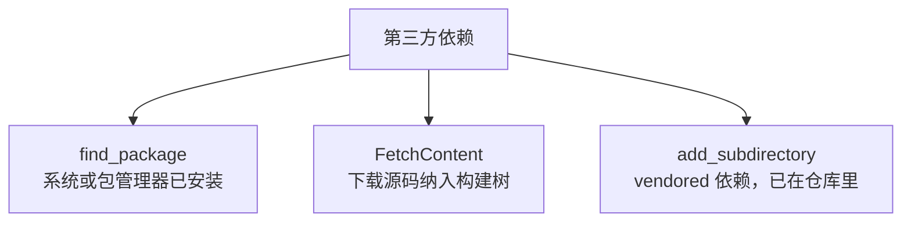
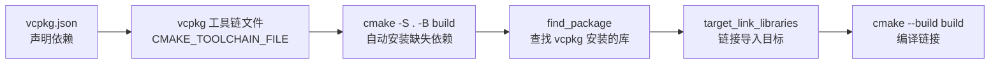

# 第 7 章 CMake 与 vcpkg：现代 C++ 工程化基础

> **工具分水岭**：从本章起，本书的示例告别 cxxsh 单文件脚本模式，进入真实项目的工程化构建。后续所有章节（第 8 章及以后）的示例均默认使用本章建立的 CMake + vcpkg 工程模板。你不再需要在每个文件里写 `#!/usr/bin/env cxxsh`，而是写 `CMakeLists.txt`、`vcpkg.json`、`CMakePresets.json` 等构建配置，再用 `cmake` 和 `cmake --build` 来编译运行。

本章目标不是培养 CMake 专家，而是让你写出**目标化、可复现、可移植**的构建脚本，并用 vcpkg 以声明式方式管理第三方依赖。本章覆盖：

- 7.1 最小现代 CMake 工程；
- 7.2 目标化构建与 `target_*` 命令；
- 7.3 生成器表达式；
- 7.4 第三方依赖的三种获取方式；
- 7.5 vcpkg 集成；
- 7.6 `CMakePresets.json` 可复现预设；
- 7.7 完整工程模板（后续章节的示例基线）。

---

## 7.1 最小现代 CMake 工程：从 `cmake_minimum_required` 到可执行文件

### 7.1.1 CMake 是什么

CMake 不是编译器，也不是构建工具（它不直接调用 `g++` 把代码变成可执行文件）。CMake 是**构建系统生成器**：你写一份 `CMakeLists.txt` 描述“要构建什么目标、依赖哪些库、用什么标准”，CMake 根据你的平台和编译器生成真正的构建文件（Unix Makefile、Ninja 构建文件、Visual Studio 解决方案等），然后你再用底层构建工具（如 `make`、`ninja`、`msbuild`）来编译。

大致流程：


### 7.1.2 最小 `CMakeLists.txt`

新建一个项目目录 `hello_cmake`，结构如下：

```
hello_cmake/
├── CMakeLists.txt
└── src/
    └── main.cpp
```

`main.cpp` 内容（普通的 C++20 源码，不再需要 shebang）：

```cpp
// src/main.cpp
#include <iostream>
#include <format>

int main() {
    std::cout << "Hello, CMake!\n";
    std::print("1 + 1 = {}\n", 1 + 1);   // C++23，视编译器支持情况而定
    return 0;
}
```

`CMakeLists.txt`：

```cmake
cmake_minimum_required(VERSION 3.20)   # 声明最低 CMake 版本

project(hello_cmake                    # 声明项目
    VERSION 1.0
    LANGUAGES CXX                      # 说明这是 C++ 项目
)

# 设置 C++ 标准为 C++20，且强制要求（不能降级）
set(CMAKE_CXX_STANDARD 20)
set(CMAKE_CXX_STANDARD_REQUIRED ON)
set(CMAKE_CXX_EXTENSIONS OFF)          # 关闭编译器特有扩展，保证标准严格性

# 创建可执行目标 hello_cmake，源文件是 src/main.cpp
add_executable(hello_cmake src/main.cpp)
```

几个关键命令的含义：

| 命令 | 作用 |
|---|---|
| `cmake_minimum_required(VERSION 3.20)` | 声明最低 CMake 版本，旧版本 CMake 拒绝处理这个文件，避免语法不兼容 |
| `project(...)` | 声明项目名称、版本、使用的语言 |
| `CMAKE_CXX_STANDARD` | 设置 C++ 标准版本 |
| `CMAKE_CXX_STANDARD_REQUIRED ON` | 如果编译器不支持该标准，直接报错，而不是静默降级 |
| `CMAKE_CXX_EXTENSIONS OFF` | 关闭 GNU 扩展等，使用纯标准模式 |
| `add_executable(名字 源文件...)` | 创建一个可执行目标 |

### 7.1.3 配置与构建

CMake 推荐**内源外构建**：不要在源码目录里直接生成文件，而是新建一个 `build` 目录，把所有中间文件和输出文件都放进去。这样源码目录保持干净，想重构建时直接删掉 `build` 目录即可。

```bash
# 在项目根目录执行
cmake -S . -B build        # 配置：读取 CMakeLists.txt，生成 build/ 里的构建文件
cmake --build build        # 构建：调用底层工具编译链接
./build/hello_cmake        # 运行（Linux/macOS）
# Windows 下可能是 build\Debug\hello_cmake.exe 或 build\hello_cmake.exe
```

`-S .` 表示源码目录是当前目录，`-B build` 表示构建目录是 `build`。配置完成后，`build/` 里会生成大量文件（Makefile、缓存、临时目标等），这些都是 CMake 自动产生的，不需要手动管理，提交版本控制时通常把 `build/` 加入 `.gitignore`。

### 7.1.4 从 cxxsh 到 CMake 的心智转换

| 方面 | cxxsh（第 1–6 章） | CMake（本章起） |
|---|---|---|
| 单文件 vs 多文件 | 一个 `.cpp` 就能跑 | 多个源文件、头文件，由 `CMakeLists.txt` 组织 |
| 编译器命令 | 透明，不需要关心 | 由 CMake 根据平台自动选择 |
| 标准设置 | rcfile 里写 `-std=c++20` | `CMakeLists.txt` 里写 `CMAKE_CXX_STANDARD` |
| 依赖管理 | 手动或 rcfile | vcpkg 清单或 `find_package` |
| 适合场景 | 学习语法、快速验证 | 真实项目、多人协作、CI 集成 |

> **小结**：`cmake_minimum_required`、`project()`、`CMAKE_CXX_STANDARD`、`add_executable` 是现代 CMake 工程的四大基石；推荐内源外构建，用 `cmake -S . -B build` 和 `cmake --build build` 两步完成配置与构建。

---

## 7.2 目标化构建：`target_*` 命令与 PUBLIC / PRIVATE / INTERFACE

### 7.2.1 为什么要“目标化”

传统的构建系统（如早期的 Makefile）常在“目录”或“全局”层面设置头文件路径、宏定义、编译选项。这会导致一个目录里的设置意外泄漏到另一个目录，难以维护。

现代 CMake 的核心思想是**目标化（target-based）**：所有属性都附着在“目标”（可执行文件或库）上，而不是附着在目录上。每个目标独立声明自己需要什么头文件、定义什么宏、链接什么库。

相关命令都以 `target_` 开头：

- `target_include_directories`：头文件搜索路径
- `target_compile_definitions`：预处理宏
- `target_compile_options`：编译器选项
- `target_link_libraries`：链接的库
- `target_compile_features`：所需的 C++ 标准特性
- `target_sources`：为目标添加源文件

### 7.2.2 三种传播范围：PUBLIC / PRIVATE / INTERFACE

`target_link_libraries`（以及其他 `target_*` 命令）可以指定传播范围，决定这个属性不仅对当前目标生效，还会不会传递给“链接当前目标”的其他目标。

| 范围 | 含义 | 是否传递给依赖当前目标的目标 |
|---|---|---|
| `PRIVATE` | 只对当前目标本身有效 | 否 |
| `PUBLIC` | 当前目标有效，且传递给所有链接它的目标 | 是 |
| `INTERFACE` | 只传递给依赖它的目标，当前目标本身不使用 | 是（单向传递） |

用一个具体的项目结构理解：

```
project/
├── CMakeLists.txt
├── lib/
│   ├── CMakeLists.txt
│   └── mylib.hpp       # 头文件，用户需要包含它
└── app/
    ├── CMakeLists.txt
    └── main.cpp        # 包含 mylib.hpp
```

`lib/CMakeLists.txt`（一个库目标 `mylib`）：

```cmake
add_library(mylib INTERFACE)   # INTERFACE 库：只有接口，不产生二进制文件

target_include_directories(mylib INTERFACE ${CMAKE_CURRENT_SOURCE_DIR})
```

这里 `INTERFACE` 表示：`mylib` 本身不需要编译任何源码，但任何链接 `mylib` 的目标，都会自动获得 `mylib` 所在目录作为头文件搜索路径。

`app/CMakeLists.txt`（一个可执行目标 `myapp`）：

```cmake
add_executable(myapp main.cpp)
target_link_libraries(myapp PRIVATE mylib)   # myapp 依赖 mylib
```

因为 `mylib` 把头文件路径声明为 `INTERFACE`，`myapp` 链接 `mylib` 后会自动继承这个头文件路径，`main.cpp` 里的 `#include "mylib.hpp"` 就能找到文件。

如果把 `INTERFACE` 改成 `PRIVATE`，那么 `mylib` 自己的头文件路径不会传递给 `myapp`，`main.cpp` 编译就会报找不到 `mylib.hpp`。

### 7.2.3 一个完整的多目标示例

根 `CMakeLists.txt`：

```cmake
cmake_minimum_required(VERSION 3.20)
project(demo LANGUAGES CXX)

set(CMAKE_CXX_STANDARD 20)
set(CMAKE_CXX_STANDARD_REQUIRED ON)
set(CMAKE_CXX_EXTENSIONS OFF)

add_subdirectory(lib)
add_subdirectory(app)
```

`lib/CMakeLists.txt`：

```cmake
add_library(mylib src/mylib.cpp)

# mylib 的公开头文件路径，供依赖它的目标使用
target_include_directories(mylib PUBLIC
    $<BUILD_INTERFACE:${CMAKE_CURRENT_SOURCE_DIR}/include>
    $<INSTALL_INTERFACE:include>
)

# mylib 自己需要的编译选项，不对外传递
target_compile_options(mylib PRIVATE -Wall -Wextra)
```

`app/CMakeLists.txt`：

```cmake
add_executable(myapp src/main.cpp)

target_link_libraries(myapp PRIVATE mylib)
```

> **最佳实践**：尽量使用 `target_*` 命令，避免使用目录级的 `include_directories()`、`add_definitions()` 等旧命令；链接库时显式指定 `PUBLIC`/`PRIVATE`/`INTERFACE`，不要省略。

> **小结**：目标化构建把属性附着在目标上而非目录上；`PRIVATE` 只对自己生效，`PUBLIC` 对自己和依赖者都生效，`INTERFACE` 只对依赖者生效；头文件路径通常用 `PUBLIC` 或 `INTERFACE`，编译选项通常用 `PRIVATE`。

---

## 7.3 生成器表达式：编译期条件化的目标属性

### 7.3.1 什么是生成器表达式

有些属性的值在“配置时”（运行 `cmake`）就确定了，但有些值需要等到“真正构建”时才知道，比如：

- 当前是 Debug 还是 Release 构建类型？
- 编译器是 GCC、Clang 还是 MSVC？
- 这是构建树里的路径，还是安装后的路径？

CMake 提供了**生成器表达式（generator expression）**，形式为 `$<...>`，在构建系统生成阶段求值，可以根据条件插入不同的字符串。

### 7.3.2 常用生成器表达式

| 表达式 | 含义 |
|---|---|
| `$<CONFIG:Debug>` | 如果当前构建类型是 Debug，展开为 1（真），否则为 0 |
| `$<CXX_COMPILER_ID:GNU>` | 如果 C++ 编译器是 GCC，展开为 1 |
| `$<BUILD_INTERFACE:...>` | 只在构建树（未安装）中有效，常用于头文件路径 |
| `$<INSTALL_INTERFACE:...>` | 只在安装后使用时有效，常用于头文件路径 |
| `$<IF:condition,true_value,false_value>` | 条件表达式 |

### 7.3.3 示例：按编译器区分警告选项

GCC/Clang 用 `-Wall -Wextra`，MSVC 用 `/W4`。可以用生成器表达式分别指定：

```cmake
target_compile_options(mylib PRIVATE
    $<$<CXX_COMPILER_ID:GNU>:-Wall -Wextra>
    $<$<CXX_COMPILER_ID:Clang>:-Wall -Wextra>
    $<$<CXX_COMPILER_ID:MSVC>:/W4>
)
```

语法 `$<$<CXX_COMPILER_ID:GNU>:-Wall -Wextra>` 的意思是：外层 `$<...>` 是条件表达式，内层 `$<CXX_COMPILER_ID:GNU>` 是条件，如果为真，则展开后面的 `-Wall -Wextra`。

### 7.3.4 示例：构建树与安装树的头文件路径

```cmake
target_include_directories(mylib INTERFACE
    $<BUILD_INTERFACE:${CMAKE_CURRENT_SOURCE_DIR}/include>
    $<INSTALL_INTERFACE:include>
)
```

- 开发时（未安装），依赖 `mylib` 的项目会去源码树的 `include/` 目录找头文件；
- 安装后，依赖 `mylib` 的项目会去安装目录的 `include/` 子目录找头文件。

这样同一个 `CMakeLists.txt` 既支持开发阶段，也支持发布阶段。

> **小结**：生成器表达式 `$<...>` 让目标属性可以根据编译器 ID、构建类型、是否已安装等条件做差异化处理，避免写死平台相关的假设。

---

## 7.4 第三方依赖的三种获取方式

在工程中，你的项目几乎总会依赖第三方库（如 fmt、spdlog、nlohmann_json 等）。CMake 提供三种主要方式获取依赖，适用场景不同。



### 7.4.1 `find_package`：查找已安装的库

适用场景：库已经通过系统包管理器（apt、brew、vcpkg）安装，或者自行编译安装到了系统路径。

```cmake
find_package(fmt REQUIRED)   # REQUIRED 表示找不到直接报错

add_executable(myapp src/main.cpp)
target_link_libraries(myapp PRIVATE fmt::fmt)   # 使用 fmt 提供的 CMake 目标
```

`fmt::fmt` 是 fmt 库通过 CMake 配置文件提供的“导入目标”，链接它会自动带上头文件路径和库名，不用手动指定 `include_directories`。

### 7.4.2 `FetchContent`：下载并纳入构建树

适用场景：库没有安装到系统，但你希望构建时自动从 GitHub 下载源码并编译，无需手动准备。

```cmake
include(FetchContent)

FetchContent_Declare(
    spdlog
    GIT_REPOSITORY https://github.com/gabime/spdlog.git
    GIT_TAG        v1.11.0
)
FetchContent_MakeAvailable(spdlog)

add_executable(myapp src/main.cpp)
target_link_libraries(myapp PRIVATE spdlog::spdlog)
```

首次构建时，CMake 会下载 spdlog 源码到构建目录，和你的项目一起编译。适合“拿来即用”的开源库，但构建时间会增加，且依赖网络。

### 7.4.3 `add_subdirectory`：vendored 依赖

适用场景：第三方库的源码已经复制到了你的项目仓库里（通常放在 `third_party/` 或 `vendor/` 目录），属于“本地依赖”。

```cmake
add_subdirectory(third_party/foobar)   # 把 foobar 的 CMakeLists.txt 纳入当前构建

add_executable(myapp src/main.cpp)
target_link_libraries(myapp PRIVATE foobar)
```

优点是完全离线、版本完全可控；缺点是仓库体积变大，需要手动维护第三方源码的更新。

### 7.4.4 三种方式怎么选

| 方式 | 适用场景 | 优点 | 缺点 |
|---|---|---|---|
| `find_package` | 库已安装到系统 | 构建快，不下载源码 | 依赖环境，不同机器可能版本不一 |
| `FetchContent` | 想自动下载指定版本 | 版本统一，无需手动维护源码 | 构建需联网，首次构建慢 |
| `add_subdirectory` | 源码已 vendored 到仓库 | 离线构建，版本完全可控 | 仓库体积大，需手动更新第三方代码 |

> **小结**：`find_package` 适合系统已安装的库；`FetchContent` 适合想自动下载指定版本的开源库；`add_subdirectory` 适合已 vendored 到仓库的依赖。生产项目中常混合使用。

---

## 7.5 vcpkg 集成：工具链文件、清单模式与 `vcpkg.json`

### 7.5.1 什么是 vcpkg

vcpkg 是微软维护的 C++ 跨平台包管理器。它可以从源码编译安装各种 C++ 库，支持 Windows、Linux、macOS。vcpkg 与 CMake 的集成方式是通过**CMake 工具链文件（toolchain file）**：告诉 CMake“去 vcpkg 的安装目录里找库和头文件”。

### 7.5.2 启用 vcpkg

假设你已经把 vcpkg 克隆到了某个目录（例如 `~/vcpkg` 或 `C:\vcpkg`），其下有一个 `vcpkg toolchain` 文件：`scripts/buildsystems/vcpkg.cmake`。

配置项目时，通过 `CMAKE_TOOLCHAIN_FILE` 指定：

```bash
cmake -S . -B build -DCMAKE_TOOLCHAIN_FILE=/路径/to/vcpkg/scripts/buildsystems/vcpkg.cmake
```

加上这一行后，CMake 会自动去 vcpkg 的安装目录查找库，你不需要手动设置头文件路径和库路径。

### 7.5.3 清单模式与 `vcpkg.json`

vcpkg 有两种使用模式：**全局模式**（手动 `vcpkg install xxx`）和**清单模式（manifest mode）**。清单模式更适合项目：在项目根目录放一个 `vcpkg.json`，声明项目依赖哪些库，CMake 配置时 vcpkg 会自动安装缺失的依赖。

项目根目录 `vcpkg.json` 示例：

```json
{
  "name": "my-project",
  "version-string": "1.0.0",
  "dependencies": [
    "fmt",
    "spdlog",
    "nlohmann-json"
  ]
}
```

对应的 `CMakeLists.txt` 里只需 `find_package`：

```cmake
find_package(fmt REQUIRED)
find_package(spdlog REQUIRED)
find_package(nlohmann_json REQUIRED)

add_executable(myapp src/main.cpp)
target_link_libraries(myapp PRIVATE fmt::fmt spdlog::spdlog nlohmann_json::nlohmann_json)
```

`vcpkg.json` 还可以声明 `features`（可选特性）和 `default-features`，用于控制某些库的可选编译选项，初学者先以 `dependencies` 为主即可。

### 7.5.4 vcpkg 与 CMake 的协作流程



> **小结**：vcpkg 通过工具链文件透明注入包搜索路径；清单模式下 `vcpkg.json` 声明直接依赖，配置阶段自动安装；CMake 端通过 `find_package` + `target_link_libraries` 使用导入目标。

---

## 7.6 `CMakePresets.json`：可复现的配置、构建与测试预设

### 7.6.1 为什么需要预设

每次都敲完整的 `cmake -S . -B build -DCMAKE_TOOLCHAIN_FILE=... -DCMAKE_BUILD_TYPE=Release` 很容易出错，而且团队成员之间容易不一致。`CMakePresets.json` 可以把这些配置固化成命名预设，以后用 `cmake --preset <名称>` 即可。

CMake 3.19+ 支持预设。预设分三类：

- `configurePresets`：配置预设（对应 `cmake --preset`）
- `buildPresets`：构建预设（对应 `cmake --build --preset`）
- `testPresets`：测试预设（对应 `ctest --preset`）

`CMakeUserPresets.json` 是开发者本地覆盖文件，不提交版本控制，用于个人环境差异。

### 7.6.2 示例 `CMakePresets.json`

放在项目根目录：

```json
{
  "version": 4,
  "cmakeMinimumRequired": {
    "major": 3,
    "minor": 20,
    "patch": 0
  },

  "configurePresets": [
    {
      "name": "default",
      "displayName": "Default Configuration",
      "description": "使用 vcpkg + C++20 的标准构建",
      "generator": "Ninja",
      "binaryDir": "${sourceDir}/build/${presetName}",
      "cacheVariables": {
        "CMAKE_TOOLCHAIN_FILE": "/路径/to/vcpkg/scripts/buildsystems/vcpkg.cmake",
        "CMAKE_BUILD_TYPE": "Release"
      }
    },
    {
      "name": "debug",
      "displayName": "Debug Configuration",
      "description": "调试构建，启用 sanitizer",
      "generator": "Ninja",
      "binaryDir": "${sourceDir}/build/${presetName}",
      "cacheVariables": {
        "CMAKE_TOOLCHAIN_FILE": "/路径/to/vcpkg/scripts/buildsystems/vcpkg.cmake",
        "CMAKE_BUILD_TYPE": "Debug",
        "CMAKE_CXX_FLAGS": "-g -O0 -fsanitize=address"
      }
    }
  ],

  "buildPresets": [
    {
      "name": "default",
      "configurePreset": "default",
      "description": "构建 default 预设对应的目标"
    },
    {
      "name": "debug",
      "configurePreset": "debug",
      "description": "构建 debug 预设对应的目标"
    }
  ],

  "testPresets": [
    {
      "name": "default",
      "configurePreset": "default",
      "description": "运行 default 预设的测试"
    }
  ]
}
```

使用方式：

```bash
cmake --preset default        # 按 default 预设配置
cmake --build --preset default  # 按 default 预设构建
ctest --preset default        # 按 default 预设运行测试
```

`${sourceDir}` 是预设里的内置变量，指向 `CMakePresets.json` 所在目录；`${presetName}` 是当前预设名称。`binaryDir` 用 `${presetName}` 区分不同预设的输出目录，避免互相覆盖。

> **小结**：`CMakePresets.json` 把配置、构建、测试命令固化为命名预设，团队成员共享同一个文件即可保证构建一致性；`CMakeUserPresets.json` 供个人本地覆盖，不纳入版本控制。

---

## 7.7 完整工程模板：从零到可构建、可测试、可安装

### 7.7.1 模板目录结构

下面是后续章节示例的基线模板，推荐直接复制使用：

```
my_project/
├── CMakeLists.txt            # 根构建文件
├── CMakePresets.json         # 构建预设（团队共享）
├── vcpkg.json                # vcpkg 依赖清单
├── .gitignore                # 忽略 build/ 等
├── src/
│   ├── main.cpp              # 可执行程序入口
│   └── mylib.cpp             # 库源文件
├── include/
│   └── mylib.hpp             # 公开头文件
├── tests/
│   ├── CMakeLists.txt        # 测试目标构建
│   └── test_mylib.cpp        # 测试源文件
└── cmake/                    # 可选：自定义 CMake 模块
```

### 7.7.2 根 `CMakeLists.txt`

```cmake
cmake_minimum_required(VERSION 3.20)
project(my_project
    VERSION 1.0.0
    LANGUAGES CXX
)

set(CMAKE_CXX_STANDARD 20)
set(CMAKE_CXX_STANDARD_REQUIRED ON)
set(CMAKE_CXX_EXTENSIONS OFF)

# 输出目录约定（可选，让可执行文件和库集中到特定目录）
set(CMAKE_RUNTIME_OUTPUT_DIRECTORY ${CMAKE_BINARY_DIR}/bin)
set(CMAKE_LIBRARY_OUTPUT_DIRECTORY ${CMAKE_BINARY_DIR}/lib)
set(CMAKE_ARCHIVE_OUTPUT_DIRECTORY ${CMAKE_BINARY_DIR}/lib)

# 包含子目录
add_subdirectory(src)
add_subdirectory(tests EXCLUDE_FROM_ALL)   # 测试默认不构建，手动开启

# 安装规则
include(GNUInstallDirs)
install(TARGETS my_project_lib my_project_app
    RUNTIME DESTINATION ${CMAKE_INSTALL_BINDIR}
    LIBRARY DESTINATION ${CMAKE_INSTALL_LIBDIR}
    ARCHIVE DESTINATION ${CMAKE_INSTALL_LIBDIR}
)

install(FILES include/mylib.hpp
    DESTINATION ${CMAKE_INSTALL_INCLUDEDIR}
)

# 导出目标，供其他项目 find_package 使用
include(CMakePackageConfigHelpers)
write_basic_package_version_file(${CMAKE_CURRENT_BINARY_DIR}/my_projectConfigVersion.cmake VERSION 1.0.0)
configure_package_config_file(my_projectConfig.cmake.in
    ${CMAKE_CURRENT_BINARY_DIR}/my_projectConfig.cmake
    INSTALL_DESTINATION ${CMAKE_INSTALL_LIBDIR}/cmake/my_project
)
install(FILES
    ${CMAKE_CURRENT_BINARY_DIR}/my_projectConfig.cmake
    ${CMAKE_CURRENT_BINARY_DIR}/my_projectConfigVersion.cmake
    DESTINATION ${CMAKE_INSTALL_LIBDIR}/cmake/my_project
)
```

### 7.7.3 `src/CMakeLists.txt`

```cmake
add_library(my_project_lib
    src/mylib.cpp
)

target_include_directories(my_project_lib PUBLIC
    $<BUILD_INTERFACE:${CMAKE_CURRENT_SOURCE_DIR}/../include>
    $<INSTALL_INTERFACE:include>
)

target_compile_features(my_project_lib PUBLIC cxx_std_20)

add_executable(my_project_app
    src/main.cpp
)

target_link_libraries(my_project_app PRIVATE my_project_lib)
```

### 7.7.4 `include/mylib.hpp` 与 `src/mylib.cpp`

```cpp
// include/mylib.hpp
#pragma once

#include <string>

namespace mylib {

std::string greet(const std::string& name);

} // namespace mylib
```

```cpp
// src/mylib.cpp
#include "mylib.hpp"
#include <format>

namespace mylib {

std::string greet(const std::string& name) {
    return std::format("Hello, {}!", name);
}

} // namespace mylib
```

```cpp
// src/main.cpp
#include <iostream>
#include "mylib.hpp"

int main() {
    std::cout << mylib::greet("CMake") << '\n';
    return 0;
}
```

### 7.7.5 `tests/CMakeLists.txt`

```cmake
find_package(GTest REQUIRED)

add_executable(test_mylib
    test_mylib.cpp
)

target_link_libraries(test_mylib PRIVATE
    my_project_lib
    GTest::gtest_main
    GTest::gtest
)

include(GoogleTest)
gtest_discover_tests(test_mylib)
```

### 7.7.6 `vcpkg.json`

```json
{
  "name": "my-project",
  "version-string": "1.0.0",
  "dependencies": [
    "fmt"
  ]
}
```

### 7.7.7 构建与运行

```bash
# 配置（需替换成你实际的 vcpkg 路径）
cmake --preset default

# 构建
cmake --build --preset default

# 运行可执行文件
./build/default/bin/my_project_app

# 运行测试（先切到 debug 或开启测试预设）
ctest --preset default
```

安装到本地目录：

```bash
cmake --install build/default --prefix ./install
```

之后其他项目就可以用 `find_package(my_project REQUIRED)` 找到并链接这个库了。

> **小结**：本章给出的模板包含库目标、可执行目标、vcpkg 依赖、预设配置、安装规则和目标导出，是后续第 8–31 章示例的统一基线。你可以直接复制这套目录结构和文件，把自己的源码填进去即可。

---

## 本章小结

本章是全书的工程化分水岭，我们学习了：

1. **最小现代 CMake 工程**：`cmake_minimum_required`、`project()`、`CMAKE_CXX_STANDARD`、`add_executable`，以及内源外构建的 `cmake -S . -B build` / `cmake --build build` 工作流。
2. **目标化构建**：所有属性附着在目标上，`target_*` 命令替代旧的目录级命令；`PUBLIC` / `PRIVATE` / `INTERFACE` 控制属性传播范围。
3. **生成器表达式**：`$<...>` 在构建期求值，按编译器 ID、构建类型、是否已安装做条件化处理。
4. **第三方依赖三种方式**：`find_package`（系统已安装）、`FetchContent`（自动下载）、`add_subdirectory`（vendored 本地）。
5. **vcpkg 集成**：通过 `CMAKE_TOOLCHAIN_FILE` 注入 vcpkg 路径；清单模式下 `vcpkg.json` 声明依赖，配置时自动安装。
6. **`CMakePresets.json`**：把配置、构建、测试固化为命名预设，保证团队构建一致性。
7. **完整工程模板**：7.7 节给出了含库目标、可执行目标、测试目标、vcpkg 依赖、安装与导出的基线项目，后续章节示例均基于此模板。

下一章（第 8 章）开始进入第二篇“标准库常用基础设施”，先从通用工具库（`pair`、`tuple`、`optional`、`variant`、`expected` 等）讲起。

## 练习

1. 手动创建一个只含 `main.cpp` 和 `CMakeLists.txt` 的最小项目，用 `cmake -S . -B build` 和 `cmake --build build` 构建并运行，观察 `build/` 目录生成了哪些文件。
2. 在上述项目中，故意把 `CMAKE_CXX_STANDARD` 设成 98，再用 C++20 语法（如 `std::format`），观察配置或编译阶段的错误。
3. 创建一个静态库目标和一个可执行目标，库目标把头文件路径声明为 `PUBLIC`，可执行目标用 `target_link_libraries` 链接它，验证头文件能被正确找到。
4. 写一个 `CMakePresets.json`，包含 `debug` 和 `release` 两个预设，分别对应不同的 `CMAKE_BUILD_TYPE`，并用 `cmake --preset` 分别构建。
5. 用 vcpkg 清单模式给项目加上一个依赖（如 `fmt`），并在代码里调用 `fmt::print`，验证 `find_package` 能找到 vcpkg 安装的库。
