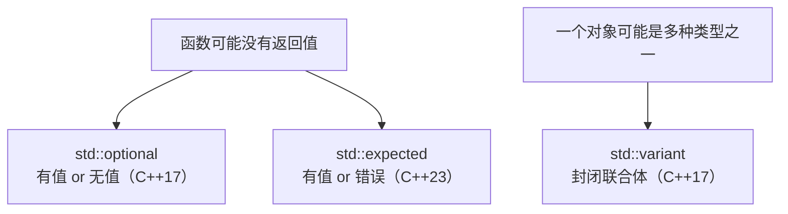

# 第 8 章 通用工具库

前面的章节讲完了语言核心（声明、初始化、函数、类、模板、模块、工程化构建）。从本章起，我们进入第二篇“标准库常用基础设施”，学习实际开发中天天要用的标准库设施。

本章覆盖通用工具库：

- 8.1 `std::pair`、`std::tuple` 与 `std::apply` / `std::make_from_tuple`；
- 8.2 `std::optional`、`std::variant`、`std::expected` 的词汇类型设计；
- 8.3 `std::bitset`、位操作与 `std::byteswap`；
- 8.4 `std::hash`、函数对象与引用包装器。

本篇贯穿一个核心原则：**以“选型”而非“API 罗列”驱动**。每一节都会给出该设施适合什么场景、不适合什么场景，以及常见的反例。

> **工具约定**：第 7 章起，示例默认采用 CMake + vcpkg 工程模板。本章的代码片段可以用 `cxxsh` 单文件运行验证语法，但若你要把它们放进真实项目，请套用第 7.7 节的工程模板。涉及 C++23 专有设施（`std::expected`、`std::byteswap`、单子操作等）的示例，会标注编译器要求，并尽量提供 C++20 降级写法。

---

## 8.1 `pair`、`tuple` 与 `apply` / `make_from_tuple`

### 8.1.1 `std::pair`：两个值的组合

`std::pair` 是标准库最简单的“两个值打包”容器，定义在 `<utility>` 头文件里。它常用于函数返回两个相关值、或者作为映射容器（`std::map`）的元素类型。

```cpp
// pair_basic.cpp
#include <iostream>
#include <string>
#include <utility>   // std::pair, std::make_pair

int main() {
    std::pair<std::string, int> person{"张三", 25};

    std::cout << person.first << " 的年龄是 " << person.second << '\n';

    // 结构化绑定（C++17），一次拆开两个成员
    auto [name, age] = person;
    std::cout << name << "，" << age << " 岁\n";

    // make_pair 辅助创建，类型自动推导
    auto p2 = std::make_pair(std::string("李四"), 30);
    std::cout << p2.first << "，" << p2.second << '\n';
}
```

输出：

```
张三 的年龄是 25
张三，25 岁
李四，30
```

`std::pair` 只有两个成员，分别叫 `first` 和 `second`，名字没有业务语义。如果这两个值有明确含义（比如“姓名”和“年龄”），更好的做法是定义一个小结构体，而不是滥用 `pair`。`pair` 适合临时性的、不需要命名语义的两值组合。

### 8.1.2 `std::tuple`：多个值的组合

当需要打包超过两个值时，用 `std::tuple`（定义在 `<tuple>`）。它可以看作 `pair` 的泛化版本，支持任意数量、任意类型的元素。

```cpp
// tuple_basic.cpp
#include <iostream>
#include <string>
#include <tuple>

int main() {
    std::tuple<std::string, int, double> student{"王五", 20, 89.5};

    // std::get<I> 按下标取元素，下标必须是编译期常量
    std::cout << std::get<0>(student) << "，"
              << std::get<1>(student) << "岁，"
              << std::get<2>(student) << "分\n";

    // 结构化绑定拆开
    auto [name, age, score] = student;
    std::cout << name << "，" << age << "岁，" << score << "分\n";
}
```

输出：

```
王五，20岁，89.5分
王五，20岁，89.5分
```

`std::tuple` 的元素通过 `std::get<0>(t)`、`std::get<1>(t)` 等按编译期下标访问，也可以按类型访问（当类型唯一时）：`std::get<double>(student)`。

### 8.1.3 `std::apply`：把 tuple 当参数展开调用函数

有时候你有一个 `std::tuple`，想把它的每个元素分别作为实参传给一个函数。这时候不用手写 `std::get<0>`、`std::get<1>`，而是用 `std::apply`（C++17，`<tuple>`）：

```cpp
// apply_basic.cpp
#include <iostream>
#include <tuple>
#include <string>

void greet(const std::string& name, int age, double score) {
    std::cout << name << "，" << age << "岁，成绩 " << score << "分\n";
}

int main() {
    std::tuple<std::string, int, double> student{"赵六", 22, 91.0};

    // 把 tuple 里的三个元素展开，作为 greet 的三个实参
    std::apply(greet, student);
}
```

输出：

```
赵六，22岁，成绩 91分
```

`std::apply(f, tuple)` 大致等价于 `f(std::get<0>(t), std::get<1>(t), ...)`，它把 tuple 当成“参数包”展开，适合“参数已经打包好，现在要调用某个函数”的场景。

### 8.1.4 `std::make_from_tuple`：用 tuple 构造对象

与 `std::apply` 相对，`std::make_from_tuple<T>(tuple)`（C++17，`<tuple>`）把 tuple 的元素展开，作为构造函数的实参来构造一个 `T` 类型的对象：

```cpp
// make_from_tuple_basic.cpp
#include <iostream>
#include <string>
#include <tuple>

struct Point {
    int x;
    int y;
    Point(int x, int y) : x(x), y(y) {}
    void print() const { std::cout << "(" << x << ", " << y << ")\n"; }
};

int main() {
    std::tuple<int, int> coords{3, 4};
    Point p = std::make_from_tuple<Point>(coords);
    p.print();   // (3, 4)
}
```

### 8.1.5 选型建议

| 设施 | 适合场景 | 不适合场景 |
|---|---|---|
| `std::pair` | 仅两个相关值的临时组合，如函数返回两个结果 | 语义需要明确命名时（应用结构体） |
| `std::tuple` | 三个及以上值的组合，元素类型已知且固定 | 需要按名字访问成员（应用结构体或类） |
| `std::apply` | 已有一个 tuple，要把元素展开当函数实参 | 参数本身就没有打包成 tuple |
| `std::make_from_tuple` | 已有一个 tuple，要用它构造某个类对象 | 构造逻辑复杂，不宜由构造函数直接完成 |

> **反例**：不要为了“少定义一个结构体”而把有明确业务含义的字段塞进 `pair` 或 `tuple`，然后到处写 `p.first`、`std::get<1>(t)`。代码读起来会很晦涩，一旦字段顺序调整，所有调用处都要改。该定义结构体时就定义结构体。

> **小结**：`pair` 打包两个值，`tuple` 打包多个值；`std::apply` 把 tuple 展开为函数实参，`std::make_from_tuple` 把 tuple 展开为构造函数实参；有明确语义的多字段数据优先用结构体。

---

## 8.2 `optional`、`variant`、`expected` 的词汇类型设计

这三个类型都叫“词汇类型（vocabulary type）”，意思是它们不携带具体业务逻辑，只表达一种“值的存在形态”，在函数接口之间传递时，能让意图一目了然。



### 8.2.1 `std::optional<T>`：有值或无值（C++17）

`std::optional` 表示“一个类型 `T` 的值，可能存在，也可能不存在”。它最典型的用途是：**函数查找失败时，不返回垃圾值，也不抛异常，而是返回一个空的 optional**。

```cpp
// optional_basic.cpp
#include <iostream>
#include <optional>
#include <string>
#include <vector>

std::optional<std::string> find_name(const std::vector<std::string>& names, int target_age) {
    for (const auto& n : names) {
        // 这里假设 names 里每个元素其实是 "姓名:年龄"，简化示例
        (void)n;
    }
    if (target_age == 25) {
        return std::string("张三");   // 有值
    }
    return std::nullopt;              // 无值
}

int main() {
    auto result = find_name({"张三:25", "李四:30"}, 25);
    if (result) {
        std::cout << "找到：" << *result << '\n';
    } else {
        std::cout << "未找到\n";
    }

    auto missing = find_name({"张三:25", "李四:30"}, 99);
    if (!missing) {
        std::cout << "确实没有\n";
    }
}
```

输出：

```
找到：张三
确实没有
```

`std::optional` 的常用操作：

| 操作 | 含义 |
|---|---|
| `bool(opt)` / `opt.has_value()` | 判断是否包含值 |
| `*opt` / `opt->` | 访问值，若无值行为未定义 |
| `opt.value()` | 访问值，若无值抛 `std::bad_optional_access` |
| `opt.value_or(default)` | 有值返回值，无值返回默认值 |
| `opt = std::nullopt` | 清空 optional |

C++23 起，`optional` 还支持单子式操作 `and_then`、`transform`、`or_else`，可以把多个“可能失败”的步骤链式组合，避免层层嵌套的 `if`。

### 8.2.2 `std::variant<T, U, ...>`：封闭的类型安全联合体（C++17）

`std::variant` 表示“一个值，可能是多种类型中的一种”。它是 C 风格 `union` 的类型安全升级版： variant 自己知道当前存的是哪种类型，访错类型会抛出 `std::bad_variant_access`，而不是未定义行为。

```cpp
// variant_basic.cpp
#include <iostream>
#include <variant>
#include <string>

int main() {
    std::variant<int, double, std::string> value;

    value = 42;                    // 现在存 int
    std::cout << std::get<int>(value) << '\n';

    value = 3.14;                  // 现在存 double
    std::cout << std::get<double>(value) << '\n';

    value = std::string("hello");  // 现在存 string
    std::cout << std::get<std::string>(value) << '\n';

    // 判断当前类型
    if (std::holds_alternative<std::string>(value)) {
        std::cout << "当前是字符串\n";
    }

    // std::visit：根据当前类型调用不同逻辑
    std::visit([](auto&& arg) {
        std::cout << "visit 看到： " << arg << '\n';
    }, value);
}
```

输出：

```
42
3.14
hello
当前是字符串
visit 看到： hello
```

`std::variant` 的关键工具：
- `std::get<T>(v)` / `std::get<I>(v)`：按类型或索引取值，类型不对抛异常；
- `std::get_if<T>(&v)`：安全尝试取，不对返回 `nullptr`；
- `std::holds_alternative<T>(v)`：判断当前是不是类型 `T`；
- `std::visit`：访问者模式，根据当前实际类型分派处理。

`variant` 是**封闭集合**：创建时就指定了所有可能的类型，不能之后再追加新类型。

### 8.2.3 `std::expected<T, E>`：值或错误（C++23）

`std::expected` 表示“要么是一个成功的值 `T`，要么是一个错误 `E`”。它把“返回值或错误”封装成一个类型，调用者必须显式处理错误才能取出值。

`std::expected` 是 C++23 才标准化的，需要较新的编译器（GCC 14.1+、Clang 17+、MSVC 19.37+ 配合标准库）。如果你的环境暂时不支持，可以先用 `std::optional` + 错误码，或者自定义一个简单的 `Result` 类型。

```cpp
// expected_basic.cpp
#include <iostream>
#include <expected>
#include <string>
#include <system_error>

// 返回整数倒数，除数为零时返回错误码
std::expected<double, std::errc> safe_divide(double a, double b) {
    if (b == 0.0) {
        return std::unexpected(std::errc::result_out_of_range);
    }
    return a / b;
}

int main() {
    auto r1 = safe_divide(10.0, 2.0);
    if (r1) {
        std::cout << "10 / 2 = " << *r1 << '\n';
    } else {
        std::cout << "错误：" << r1.error() << '\n';
    }

    auto r2 = safe_divide(10.0, 0.0);
    if (!r2) {
        std::cout << "10 / 0 错误：" << r2.error() << '\n';
    }
}
```

可能的输出：

```
10 / 2 = 5
10 / 0 错误：结果超出范围
```

`std::expected` 的核心操作：
- `bool(exp)` / `exp.has_value()`：是否有值；
- `*exp`：取值，无值时行为未定义；
- `exp.value()`：取值，无值时抛 `std::bad_expected_access`；
- `exp.error()`：取出错误对象；
- C++23 的单子式操作：`and_then`、`or_else`、`transform`、`transform_error`。

### 8.2.4 三者对比与选型

| 设施 | 表达的含义 | 适合场景 | 典型反例 |
|---|---|---|---|
| `std::optional<T>` | “有值，或者没有值” | 查找可能失败、可选参数、可空字段 | 需要告诉调用者“为什么失败”（应用 expected 或 error_code） |
| `std::variant<T, U, …>` | “是多种类型中的一种” | 接受多种类型的输入、状态机、AST 节点 | 只有两种可能且一种是“错误”（应用 expected） |
| `std::expected<T, E>` | “成功的值 T，或者失败的错误 E” | 函数可能失败，且需要携带失败原因 | 失败不会发生，或者失败原因不重要（应用 optional 或直接返回 T） |

**选型口诀**：
- 只关心“有没有”，不关心“为什么没有” → `std::optional`；
- 关心“是哪一种类型” → `std::variant`；
- 关心“成功或失败，失败原因是什么” → `std::expected`。

**混用反例**：不要在函数签名里同时返回 `std::optional` 和 `std::error_code`（比如 `std::pair<std::optional<T>, std::error_code>`），这让调用者很困惑。该用 `optional` 时用 `optional`，该用 `expected` 时用 `expected`，保持接口单一。

> **小结**：`optional` 表达“有值或无值”，`variant` 表达“是多种类型之一”，`expected` 表达“成功的值或失败的错误”。它们都是 C++ 接口设计中的“词汇类型”，用来让函数的意图在签名层面就表达清楚。`expected` 是 C++23 特性，旧编译器可用 `optional` + 错误码过渡。

---

## 8.3 `std::bitset`、位操作与 `std::byteswap`

### 8.3.1 `std::bitset`：固定大小的位序列

`std::bitset<N>`（`<bitset>`）表示一个固定长度的二进制位序列，适合表示标志位集合、掩码等。它不是容器，不支持动态增删，大小 `N` 必须是编译期常量。

```cpp
// bitset_basic.cpp
#include <iostream>
#include <bitset>
#include <string>

int main() {
    std::bitset<8> flags(std::string("10110010"));

    std::cout << "原始位串： " << flags << '\n';
    std::cout << "第 0 位： " << flags[0] << '\n';   // 最低位
    std::cout << "位数： " << flags.size() << '\n';
    std::cout << "置 1 的个数： " << flags.count() << '\n';
    std::cout << "是否全为 0： " << flags.none() << '\n';
    std::cout << "是否全为 1： " << flags.all() << '\n';

    flags.set(3);       // 把第 3 位置 1
    flags.reset(1);     // 把第 1 位置 0
    flags.flip(0);      // 把第 0 位取反
    std::cout << "修改后： " << flags << '\n';
}
```

`bitset` 适合位数固定且在编译期可知的场景；如果位数在运行期才确定，应使用 `std::vector<bool>` 或第三方动态位集（如 Boost.DynamicBitset）。

### 8.3.2 C++20 位操作函数

`<bit>` 头文件（C++20）提供了一组位操作函数，替代手写位移和掩码：

```cpp
// bit_ops_basic.cpp
#include <iostream>
#include <bit>

int main() {
    unsigned x = 0b00010100;  // 二进制 10100

    std::cout << "有效位个数（popcount）： " << std::popcount(x) << '\n';   // 2
    std::cout << "前导零个数： " << std::countl_zero(x) << '\n';
    std::cout << "后导零个数： " << std::countr_zero(x) << '\n';           // 2
    std::cout << "最高有效位： " << std::bit_floor(x) << '\n';             // 16
    std::cout << "最小 2 的幂 >= x： " << std::bit_ceil(x) << '\n';        // 32
    std::cout << "字节序交换： " << std::byteswap(x) << '\n';              // C++23，见下文
}
```

这些函数通常会被编译器映射到 CPU 的专用指令（如 POPCNT、LZCNT），比手写循环快得多。

### 8.3.3 `std::byteswap`：字节序交换（C++23）

`std::byteswap`（C++23，`<bit>`）交换整数的字节序（大端 ↔ 小端），用于网络协议、文件格式等跨平台二进制数据交换：

```cpp
// byteswap_basic.cpp
#include <iostream>
#include <bit>
#include <cstdint>

int main() {
    std::uint32_t value = 0x12345678;
    std::cout << std::hex << value << '\n';           // 12345678
    std::cout << std::hex << std::byteswap(value) << '\n';  // 78563412
}
```

> **注意**：`std::byteswap` 是 C++23 特性，旧编译器需要手写位移交换或使用平台相关函数（如 `ntohl`/`htonl`）。

### 8.3.4 选型建议

| 需求 | 推荐设施 | 备注 |
|---|---|---|
| 固定数量的标志位/掩码 | `std::bitset<N>` | `N` 是编译期常量 |
| 统计 1 的个数、前导/后导零 | `std::popcount`、`std::countl_zero` 等（C++20） | 映射到 CPU 指令，高效 |
| 网络/文件字节序交换 | `std::byteswap`（C++23） | 旧标准用平台 API |
| 运行期位数可变的动态位集 | `std::vector<bool>` 或 Boost.DynamicBitset | `bitset` 不支持动态大小 |

> **小结**：`std::bitset` 处理固定长度位串；`<bit>` 提供高效的位操作函数；`std::byteswap`（C++23）用于字节序交换。位操作优先用标准库函数，不要手写位移掩码，既不易读又容易错。

---

## 8.4 `std::hash`、函数对象与引用包装器

### 8.4.1 `std::hash`：标准哈希函数对象

`std::hash<T>`（`<functional>`）是一个函数对象类，调用 `std::hash<T>{}(value)` 会返回 `value` 的哈希值（`std::size_t`）。标准库为内置类型、`std::string`、`std::string_view` 等提供了特化版本。

如果你要把自定义类型放进 `std::unordered_map` 或 `std::unordered_set` 作为键，就需要为它提供 `std::hash` 特化，或者在构造容器时传入自定义哈希函数。

```cpp
// hash_basic.cpp
#include <iostream>
#include <functional>
#include <string>
#include <unordered_map>

struct Point {
    int x;
    int y;
    bool operator==(const Point&) const = default;
};

// 为 Point 特化 std::hash，放在 std 命名空间里（标准允许为自定义类型特化 std::hash）
namespace std {
    template <>
    struct hash<Point> {
        std::size_t operator()(const Point& p) const noexcept {
            // 组合两个字段的哈希值
            std::size_t h1 = std::hash<int>{}(p.x);
            std::size_t h2 = std::hash<int>{}(p.y);
            return h1 ^ (h2 + 0x9e3779b9 + (h1 << 6) + (h1 >> 2));
        }
    };
}

int main() {
    std::unordered_map<Point, std::string> points;
    points[{1, 2}] = "原点附近";
    points[{3, 4}] = "第一象限";

    std::cout << points[{1, 2}] << '\n';
}
```

哈希函数的要求：同一个对象多次哈希结果应一致；相等的对象哈希值应相等（但不相等的对象哈希值可以碰撞，好的哈希函数应尽量减少碰撞）。

### 8.4.2 函数对象（仿函数）

重载了 `operator()` 的类对象叫**函数对象（function object）或仿函数（functor）**，它可以像函数一样被调用，但同时可以保存状态：

```cpp
// functor_basic.cpp
#include <iostream>

class Multiplier {
public:
    explicit Multiplier(int factor) : factor_(factor) {}
    int operator()(int value) const { return value * factor_; }

private:
    int factor_;
};

int main() {
    Multiplier times3(3);
    Multiplier times10(10);

    std::cout << times3(5) << '\n';   // 15
    std::cout << times10(5) << '\n';  // 50
}
```

函数对象比普通函数的优势是：可以携带状态（`factor_`），可以内联优化，可以作为模板参数传递。

### 8.4.3 `std::ref` / `std::cref`：引用包装器

默认情况下，把变量传给模板或函数对象时，会发生值拷贝。如果你想“传引用”，可以用 `std::ref` / `std::cref`（`<functional>`）创建引用包装器：

```cpp
// ref_basic.cpp
#include <iostream>
#include <functional>

void increment(int& value) {
    ++value;
}

int main() {
    int x = 0;

    // std::ref 把 x 的引用包装起来，increment 会修改真正的 x
    std::function<void()> f = [&] { increment(std::ref(x)); };
    // 更直接：std::ref 在 bind/thread/函数对象场景里常用
    increment(std::ref(x));
    std::cout << x << '\n';   // 1，x 被修改了
}
```

`std::ref(x)` 得到一个 `std::reference_wrapper<int>`，它表现得像 `int&`，但可以被拷贝、放进容器、作为模板参数。`std::cref` 是 const 引用版本。

常见用途：`std::thread` 传参、带状态的函数对象、需要引用语义的模板实例化。

### 8.4.4 选型建议

| 需求 | 推荐设施 | 备注 |
|---|---|---|
| 计算哈希值（如用作 unordered_map 键） | `std::hash<T>` | 自定义类型需特化 `std::hash` |
| 需要带状态的“可调用对象” | 函数对象（重载 `operator()` 的类） | 比普通函数更灵活 |
| 把引用当值传递（避免拷贝） | `std::ref` / `std::cref` | 线程参数、函数对象绑定场景常用 |
| 需要类型擦除的可调用包装 | `std::function` / `std::move_only_function` | 见第 3 章 |

> **小结**：`std::hash` 提供标准哈希，自定义键类型需自行特化；函数对象可携带状态并像函数一样调用；`std::ref`/`std::cref` 以引用包装器形式传递引用，避免不必要的拷贝。

---

## 本章小结

本章我们学习了标准库通用工具库的核心设施：

1. **`std::pair` / `std::tuple`**：打包两个或多个值；`std::apply` 把 tuple 展开为函数实参，`std::make_from_tuple` 把 tuple 展开为构造函数实参。有明确业务语义的字段优先用结构体，不要滥用 pair/tuple。
2. **`optional` / `variant` / `expected`**：三种词汇类型，分别表达“有值或无值”“是多种类型之一”“成功的值或失败的错误”。按语义选型，不要混用。
3. **`std::bitset` 与位操作**：固定长度位串用 `bitset`；高效位操作用 `<bit>` 的 `popcount`、`countl_zero` 等；字节序交换用 `std::byteswap`（C++23）。
4. **`std::hash`、函数对象、`std::ref/cref`**：哈希函数对象用于无序容器键；函数对象带状态；引用包装器避免拷贝。

下一章（第 9 章）我们进入容器库，学习 `vector`、`map`、`unordered_map` 等容器的选型与使用。

## 练习

1. 写一个函数，接受 `std::tuple<int, double, std::string>`，用 `std::apply` 把元素展开后打印。
2. 用 `std::optional` 实现一个“在整数向量中查找第一个偶数”的函数，没找到时返回 `std::nullopt`。
3. 用 `std::variant<int, std::string>` 存储不同类型的值，用 `std::visit` 根据实际类型打印不同描述。
4. 用 `std::bitset<16>` 表示一组标志位，设置某几位后打印二进制串和置 1 的个数。
5. 为一个自定义结构体特化 `std::hash`，把它放进 `std::unordered_map` 并查询。
