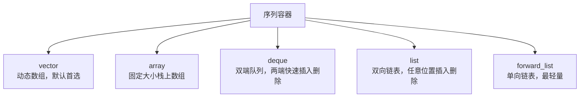
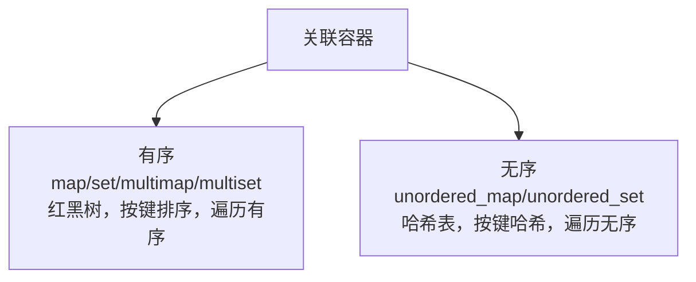
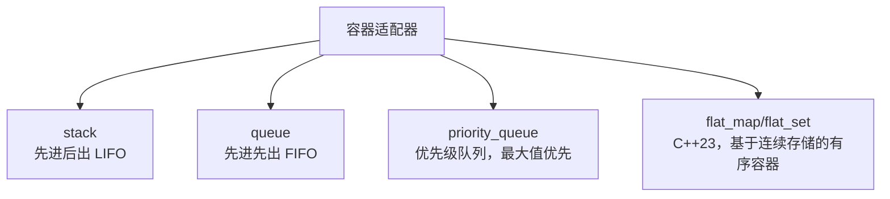

# 第 9 章 容器库

容器是 C++ 标准库最常用的设施之一。几乎每个程序都需要存储一组数据，而选择哪种容器，直接影响代码的简洁度、运行速度和内存占用。

本章按“序列容器 → 关联容器 → 容器适配器 → 非拥有视图型容器”的顺序展开，覆盖：

- 9.1 `vector`、`array`、`deque`、`list`、`forward_list`；
- 9.2 有序 `map`/`set` 与无序 `unordered_*`；
- 9.3 `stack`、`queue`、`priority_queue` 与 C++23 `flat_map`/`flat_set`；
- 9.4 `span` 与 `mdspan`。

贯穿本章的核心原则依然是**选型而非 API 罗列**：每种容器适合什么场景、不适合什么场景、常见的误用反例是什么。

> **工具约定**：示例以 C++20 为基线；使用 C++23 的 `flat_map`/`flat_set`、`mdspan` 等时会注明编译器要求。代码片段可用 `cxxsh` 单文件验证，放入真实项目时请套用第 7.7 节的 CMake + vcpkg 工程模板。

---

## 9.1 序列容器：`vector`、`array`、`deque`、`list`、`forward_list`

序列容器的元素按**插入顺序**排列，而不是按值排序。你可以在任意位置插入、删除元素（不同容器的代价不同）。



### 9.1.1 `std::vector`：动态数组，默认首选

`std::vector` 是最常用的容器，本质是一个可动态增长的数组。元素在内存中连续存放，支持随机访问（`v[i]`），在尾部插入删除（`push_back`/`pop_back`）的均摊代价是 O(1)。

如果你不知道该选哪个容器，先选 `vector`。

```cpp
// vector_basic.cpp
#include <iostream>
#include <vector>

int main() {
    std::vector<int> nums = {1, 2, 3, 4, 5};

    // 随机访问
    std::cout << "第一个元素：" << nums[0] << '\n';

    // 尾部插入
    nums.push_back(6);
    nums.push_back(7);

    // 遍历
    for (int x : nums) {
        std::cout << x << ' ';
    }
    std::cout << '\n';

    // 尾部删除
    nums.pop_back();
    std::cout << "大小：" << nums.size() << '\n';
}
```

输出：

```
第一个元素：1
1 2 3 4 5 6 7 
大小：6
```

`vector` 的注意事项：

- **中间插入删除代价高**：在 vector 中间插入或删除元素，会导致该位置之后的所有元素整体搬移，代价是 O(n)。如果频繁在中间修改，`vector` 不合适。
- **迭代器失效**：当 `vector` 扩容（重新分配内存）时，所有已有的迭代器、指针、引用都会失效。在循环里用 `push_back` 同时持有迭代器，是常见的 bug 来源。

### 9.1.2 `std::array`：固定大小的栈上数组

`std::array<T, N>`（`<array>`）是 C 风格数组 `T[N]` 的轻量包装，大小 `N` 是编译期常量，元素存放在栈上（如果作为局部变量），不堆分配。

```cpp
// array_basic.cpp
#include <iostream>
#include <array>

int main() {
    std::array<int, 5> arr = {10, 20, 30, 40, 50};

    std::cout << "大小：" << arr.size() << '\n';
    std::cout << "第三个元素：" << arr[2] << '\n';

    for (int x : arr) {
        std::cout << x << ' ';
    }
    std::cout << '\n';
}
```

`array` 不能动态增删，适合“大小固定、性能敏感、不想堆分配”的场景，比如固定长度的坐标点、颜色分量（RGBA）等。

### 9.1.3 `std::deque`：双端队列

`std::deque`（double-ended queue，`<deque>`）支持在**两端**快速插入删除（O(1)），也支持随机访问。它的内部不是一块连续内存，而是分段存储，所以元素之间不一定内存相邻。

```cpp
// deque_basic.cpp
#include <iostream>
#include <deque>

int main() {
    std::deque<int> d = {1, 2, 3};

    d.push_back(4);       // 尾部插入
    d.push_front(0);      // 头部插入
    d.pop_back();         // 尾部删除
    d.pop_front();        // 头部删除

    for (int x : d) {
        std::cout << x << ' ';
    }
    std::cout << '\n';
}
```

`deque` 比 `vector` 更重，随机访问稍慢（多一次间接寻址），且元素不保证内存连续。除非你明确需要“两端都快速插入”，否则一般优先选 `vector`。

### 9.1.4 `std::list`：双向链表

`std::list`（`<list>`）是双向链表，元素在内存中可以不连续。它在**任意位置**插入删除都很快（只要你已经有指向该位置的迭代器），但不支持随机访问，不能用 `lst[i]`。

```cpp
// list_basic.cpp
#include <iostream>
#include <list>

int main() {
    std::list<int> nums = {1, 2, 3, 4, 5};

    // 找到值为 3 的位置
    auto it = std::find(nums.begin(), nums.end(), 3);
    if (it != nums.end()) {
        nums.insert(it, 99);   // 在 3 前面插入 99，不搬移其他元素
    }

    for (int x : nums) {
        std::cout << x << ' ';
    }
    std::cout << '\n';
}
```

输出：

```
1 2 99 3 4 5 
```

`list` 的缺点：每个元素都要额外存储前驱/后继指针，内存占用大，缓存局部性差（遍历时 CPU 缓存命中率低）。现代硬件上，即使理论复杂度有优势，`list` 的实际运行速度往往不如 `vector`（因为 `vector` 的连续内存更缓存友好）。除非你确实需要频繁中间插入且元素很大，否则优先 `vector`。

### 9.1.5 `std::forward_list`：单向链表

`std::forward_list`（`<forward_list>`）是单向链表，比 `list` 更轻量，只能向前遍历，支持在插入点之前快速插入（`insert_after`）。

```cpp
// forward_list_basic.cpp
#include <iostream>
#include <forward_list>

int main() {
    std::forward_list<int> fl = {1, 2, 3, 4, 5};

    fl.push_front(0);   // 头部插入，O(1)
    fl.remove(3);         // 删除值为 3 的元素

    for (int x : fl) {
        std::cout << x << ' ';
    }
    std::cout << '\n';
}
```

`forward_list` 不支持反向遍历，也不支持 `size()`（C++11 起为 O(1) 的 `size` 被移除，需要遍历计算）。它适合对内存极其敏感且只需要单向遍历的场景，使用频率较低。

### 9.1.6 序列容器选型对照

| 容器 | 随机访问 | 尾部插入/删除 | 中间插入/删除 | 内存连续 | 推荐场景 |
|---|---|---|---|---|---|
| `vector` | O(1) | 均摊 O(1) | O(n)，会搬移 | 是 | 默认首选，绝大多数场景 |
| `array` | O(1) | 不支持（大小固定） | 不支持 | 是 | 大小固定、栈上分配、性能敏感 |
| `deque` | O(1) | O(1) | O(n) | 否 | 两端都要快速插入删除 |
| `list` | 不支持 | O(1) | O(1)（有迭代器时） | 否 | 频繁中间插入、元素很大 |
| `forward_list` | 不支持 | O(1)（头部） | O(1)（有迭代器时） | 否 | 内存极度敏感、单向遍历 |

> **反例**：不要因为 `list` 的“中间插入 O(1)”看上去很美，就默认用 `list` 存储一万个整数。在现代 CPU 上，`vector` 的连续内存和缓存友好性通常能抵消 O(n) 的搬移代价，除非元素非常大或插入频率极高。

> **小结**：序列容器按插入顺序存储；`vector` 是默认首选，`array` 适合固定大小，`deque` 适合两端操作，`list`/`forward_list` 只在真正需要频繁中间插入时才考虑。

---

## 9.2 关联容器：有序 `map`/`set` 与无序 `unordered_*`

关联容器按**键（key）**组织数据，支持按键快速查找、插入、删除。分成两大家族：

- **有序关联容器**（`map`、`set`、`multimap`、`multiset`）：基于红黑树，按键的排序顺序组织，遍历时有序。
- **无序关联容器**（`unordered_map`、`unordered_set` 等）：基于哈希表，按哈希值组织，遍历无序，但查找平均 O(1)。



### 9.2.1 `std::map`：有序键值对

`std::map<Key, Value>`（`<map>`）存储键值对，键唯一，自动按键从小到大排序。

```cpp
// map_basic.cpp
#include <iostream>
#include <map>
#include <string>

int main() {
    std::map<std::string, int> scores = {
        {"张三", 85},
        {"李四", 92},
        {"王五", 78}
    };

    // 按键查找
    auto it = scores.find("李四");
    if (it != scores.end()) {
        std::cout << "李四的成绩：" << it->second << '\n';
    }

    // 插入或修改
    scores["张三"] = 90;      // 修改已有键
    scores["赵六"] = 88;      // 插入新键

    // 遍历：自动按键字典序输出
    for (const auto& [name, score] : scores) {
        std::cout << name << ": " << score << '\n';
    }
}
```

输出：

```
李四的成绩：92
赵六: 88
王五: 78
张三: 90
李四: 92
```

注意遍历是按键字母顺序（`赵六`、`王五`、`张三`、`李四`），而不是插入顺序。

`map` 的常见操作：
- `m[key]`：访问或插入，如果键不存在会**默认构造一个值**并插入（可能不是你想要的）。
- `m.at(key)`：访问，键不存在抛 `std::out_of_range`，不会插入。
- `m.insert()`、`m.erase()`、`m.find()`、`m.count()`。

**避坑**：`m[key]` 在只读查询时如果键不存在，会悄悄插入一个默认值，改变容器状态。只读查找优先用 `m.at(key)` 或 `m.find(key)`。

### 9.2.2 `std::set`：有序唯一键集合

`std::set<Key>` 只存键，不存值，键唯一且自动排序。适合“去重”和“有序集合”场景。

```cpp
// set_basic.cpp
#include <iostream>
#include <set>

int main() {
    std::set<int> s = {3, 1, 2, 2, 5, 3};

    // 自动去重，自动排序
    for (int x : s) {
        std::cout << x << ' ';
    }
    std::cout << '\n";   // 输出：1 2 3 5 

    std::cout << "包含 3 吗？ " << s.count(3) << '\n';   // 1
    std::cout << "包含 4 吗？ " << s.count(4) << '\n';   // 0
}
```

### 9.2.3 `std::unordered_map` / `std::unordered_set`：无序哈希容器

无序容器基于哈希表，查找、插入、删除平均复杂度 O(1)，但遍历顺序不可预测。使用时，键类型必须支持 `std::hash` 和 `operator==`。

```cpp
// unordered_map_basic.cpp
#include <iostream>
#include <unordered_map>
#include <string>

int main() {
    std::unordered_map<std::string, int> scores = {
        {"张三", 85},
        {"李四", 92},
        {"王五", 78}
    };

    std::cout << "李四的成绩：" << scores.at("李四") << '\n';

    // 遍历顺序不固定，跟插入顺序和字典序都无关
    for (const auto& [name, score] : scores) {
        std::cout << name << ": " << score << '\n';
    }
}
```

如果你不需要遍历有序，只关心查找速度，优先选 `unordered_map`/`unordered_set`。

### 9.2.4 节点句柄：`extract` / `merge`（C++17）

C++17 为有序和无序关联容器引入了**节点句柄（node handle）**。`extract` 可以把一个元素从容器里“取出”而不销毁它，`merge` 可以把另一个兼容容器的元素全部移过来，都不触发元素的拷贝或移动，只调整链接。

```cpp
// extract_merge_basic.cpp
#include <iostream>
#include <map>
#include <string>

int main() {
    std::map<std::string, int> src = {{"a", 1}, {"b", 2}};
    std::map<std::string, int> dst = {{"c", 3}};

    // 把 src 的 "a" 节点移到 dst
    auto node = src.extract("a");
    dst.insert(std::move(node));

    // 把 src 剩下的全部移到 dst
    dst.merge(src);

    std::cout << "dst 大小：" << dst.size() << '\n';   // 3
    std::cout << "src 大小：" << src.size() << '\n';   // 0
}
```

节点句柄在“移动节点而不拷贝元素”的场景很有用，比如元素构造代价很高，或者你想在两个容器间转移所有权。

### 9.2.5 有序 vs 无序怎么选

| 维度 | 有序 (`map`/`set`) | 无序 (`unordered_map`/`unordered_set`) |
|---|---|---|
| 底层结构 | 红黑树 | 哈希表 |
| 遍历顺序 | 按键排序，固定 | 未指定，不可预测 |
| 查找复杂度 | O(log n) | 平均 O(1)，最坏 O(n) |
| 键的要求 | 必须支持 `<` 比较（或自定义比较器） | 必须支持 `std::hash` 和 `==` |
| 内存占用 | 较低 | 较高（哈希桶） |

选型口诀：需要遍历有序、或键只有 `<` 没有好哈希函数 → 选有序；只关心查找速度、遍历顺序无所谓 → 选无序。

> **小结**：`map`/`set` 有序且键唯一，遍历按键排序；`unordered_map`/`unordered_set` 基于哈希表，查找快但遍历无序；只读查找优先用 `at`/`find`，避免 `operator[]` 悄悄插入默认值；`extract`/`merge` 可在容器间转移节点而不拷贝元素。

---

## 9.3 容器适配器：`stack`、`queue`、`priority_queue` 与 `flat_map`/`flat_set`

容器适配器不是独立的数据结构，而是基于其他序列容器（如 `deque`、`list`、`vector`）封装出来的，只暴露受限的接口。



### 9.3.1 `std::stack`：先进后出（LIFO）

`std::stack`（`<stack>`）只能在栈顶插入和删除，默认基于 `std::deque` 实现。

```cpp
// stack_basic.cpp
#include <iostream>
#include <stack>

int main() {
    std::stack<int> st;

    st.push(10);
    st.push(20);
    st.push(30);

    std::cout << "栈顶：" << st.top() << '\n';   // 30
    st.pop();                                     // 删除 30
    std::cout << "弹出后栈顶：" << st.top() << '\n'; // 20
    std::cout << "大小：" << st.size() << '\n';   // 2
}
```

适合“撤销操作”“函数调用栈”“括号匹配”等后进先出场景。

### 9.3.2 `std::queue`：先进先出（FIFO）

`std::queue`（`<queue>`）在尾部插入，在头部删除，默认基于 `std::deque`。

```cpp
// queue_basic.cpp
#include <iostream>
#include <queue>

int main() {
    std::queue<int> q;

    q.push(10);
    q.push(20);
    q.push(30);

    std::cout << "队头：" << q.front() << '\n';   // 10
    std::cout << "队尾：" << q.back() << '\n';    // 30
    q.pop();                                      // 删除 10
    std::cout << "弹出后队头：" << q.front() << '\n'; // 20
}
```

适合“任务队列”“缓冲区”“BFS 遍历”等先进先出场景。

### 9.3.3 `std::priority_queue`：优先级队列

`std::priority_queue`（`<queue>`）每次弹出的是**优先级最高**的元素（默认是最大值），底层通常基于 `std::vector` + 堆算法。

```cpp
// priority_queue_basic.cpp
#include <iostream>
#include <queue>
#include <vector>

int main() {
    // 默认大顶堆：弹出最大值
    std::priority_queue<int> pq;

    pq.push(10);
    pq.push(30);
    pq.push(20);

    while (!pq.empty()) {
        std::cout << pq.top() << ' ';   // 30 20 10
        pq.pop();
    }
    std::cout << '\n';

    // 小顶堆：弹出最小值
    std::priority_queue<int, std::vector<int>, std::greater<int>> min_pq;
    min_pq.push(10);
    min_pq.push(30);
    min_pq.push(20);
    std::cout << "小顶堆顶：" << min_pq.top() << '\n';   // 10
}
```

输出：

```
30 20 10 
小顶堆顶：10
```

`priority_queue` 只能访问顶元素，不能遍历或按任意位置访问，适合“始终取当前最大/最小”的调度场景。

### 9.3.4 `std::flat_map` / `std::flat_set`：扁平有序容器（C++23）

C++23 引入了 `std::flat_map` 和 `std::flat_set`（`<flat_map>`、`<flat_set>`）。它们的接口和 `map`/`set` 几乎一样，但底层不是红黑树，而是**连续存储的有序数组**（默认基于 `std::vector`）。

优点：
- 内存更紧凑，没有树节点的指针开销；
- 缓存局部性好，遍历和查找通常更快；
- `find` 依然是 O(log n)（二分查找）。

缺点：
- 插入删除需要搬移元素，O(n)，比 `map` 慢；
- 迭代器在插入删除时更容易失效。

适合“构建后很少修改、但需要频繁查找和遍历”的场景，比如配置表、字典查找。

```cpp
// flat_map_basic.cpp
// 需要 C++23 编译器支持
#include <iostream>
#include <flat_map>
#include <string>

int main() {
    std::flat_map<std::string, int> scores = {
        {"张三", 85},
        {"李四", 92}
    };

    std::cout << "李四：" << scores.at("李四") << '\n';

    for (const auto& [name, score] : scores) {
        std::cout << name << ": " << score << '\n';
    }
}
```

`flat_map`/`flat_set` 是 C++23 特性，若编译器不支持，可退回使用 `std::map`/`std::set`，或者自行维护一个排序后的 `std::vector<std::pair<Key, Value>>` 配合二分查找。

> **小结**：`stack`/`queue`/`priority_queue` 是适配器，只暴露受限接口，分别对应 LIFO、FIFO、优先级出队；`flat_map`/`flat_set`（C++23）用连续存储替代红黑树，查找遍历快但插入删除慢，适合读多写少的场景。

---

## 9.4 非拥有视图型容器：`span` 与 `mdspan`

前面的容器（`vector`、`array` 等）都**拥有**元素的内存，容器销毁时元素会被释放。有时候你只想“看”一段已有的内存，不想拥有它、也不想复制它，这时候用**非拥有视图（non-owning view）**。

### 9.4.1 `std::span`：连续内存的轻量视图（C++20）

`std::span<T>`（`<span>`）表示一段连续内存的视图，内部只有指针 + 长度，不拥有内存。它可以绑定到 `std::vector`、`std::array`、原始数组、甚至堆分配的内存上。

```cpp
// span_basic.cpp
#include <iostream>
#include <span>
#include <vector>

void print_span(std::span<int> data) {
    std::cout << "元素个数：" << data.size() << '\n';
    for (int x : data) {
        std::cout << x << ' ';
    }
    std::cout << '\n';
}

int main() {
    std::vector<int> v = {1, 2, 3, 4, 5};
    print_span(v);                    // vector 隐式转换为 span

    int arr[] = {10, 20, 30};
    print_span(arr);                  // 原始数组也可以

    // 只看前三个元素
    print_span(std::span<int>{v.data(), 3});
}
```

`span` 常用于函数参数：你不关心调用方传的是 `vector` 还是 `array`，只关心“一段连续的 `int`”。

### 9.4.2 `std::mdspan`：多维数组视图（C++23）

`std::mdspan<T, Extents...>`（`<mdspan>`）是多维版的 `span`，表示一段连续内存上的多维数组视图，同样不拥有内存。你可以指定行数、列数、布局策略（行优先或列优先），按 `mdspan[i][j]` 访问元素。

```cpp
// mdspan_basic.cpp
// 需要 C++23 编译器支持
#include <iostream>
#include <mdspan>
#include <vector>

int main() {
    std::vector<int> data = {1, 2, 3, 4, 5, 6};

    // 把一维数据看成 2 行 3 列的矩阵（行优先）
    std::mdspan<int, std::extents<2, 3>> matrix(data.data());

    std::cout << matrix(0, 1) << '\n';   // 2
    std::cout << matrix(1, 2) << '\n';   // 6
}
```

`mdspan` 适合科学计算、图像处理等多维数组场景，避免多维数据的重复拷贝。它是 C++23 特性，编译器支持情况需留意。

### 9.4.3 视图的生命周期陷阱

`span` 和 `mdspan` 不拥有内存，所以**底层内存的生命周期必须比视图长**。如果底层容器被销毁或重新分配，视图就会悬空。

```cpp
// 危险示例
std::span<int> make_bad_span() {
    std::vector<int> v = {1, 2, 3};
    return std::span<int>(v);   // v 在函数返回时销毁，span 悬空！
}
```

> **反例**：永远不要返回指向局部容器的 `span`/`mdspan`。调用方使用视图前，必须确保底层数据还活着。

### 9.4.4 选型建议

| 需求 | 推荐设施 | 备注 |
|---|---|---|
| 函数参数，接受任意连续内存序列 | `std::span<T>` | 不拥有内存，零拷贝 |
| 多维数组视图 | `std::mdspan`（C++23） | 行优先/列优先，零拷贝 |
| 拥有且管理元素生命周期 | `vector`、`array` 等拥有型容器 | 视图不适合长期持有数据 |

> **小结**：`std::span`（C++20）和 `std::mdspan`（C++23）是非拥有的内存视图，只存指针+长度，适合函数参数和零拷贝场景；使用时必须注意底层内存的生命周期，避免悬空视图。

---

## 本章小结

本章我们学习了标准库容器库的核心设施：

1. **序列容器**：`vector`（默认首选，动态数组）、`array`（固定大小栈上数组）、`deque`（两端快速操作）、`list`（双向链表，中间插入快但缓存不友好）、`forward_list`（单向链表，最轻量）。
2. **关联容器**：有序 `map`/`set`（红黑树，遍历有序）和无序 `unordered_map`/`unordered_set`（哈希表，查找快但遍历无序）；只读查找优先用 `at`/`find`，避免 `operator[]` 悄悄插入默认值；`extract`/`merge` 支持节点转移。
3. **容器适配器**：`stack`（LIFO）、`queue`（FIFO）、`priority_queue`（优先级队列）；C++23 的 `flat_map`/`flat_set` 基于连续存储，读多写少场景更优。
4. **非拥有视图**：`std::span`（C++20）和 `std::mdspan`（C++23）不拥有内存，适合函数参数和零拷贝，但要注意底层数据生命周期。

选型口诀：**不确定就用 `vector`；需要按键查找用 `map`/`unordered_map`；需要去重或有序集合用 `set`；先进先出用 `queue`，后进先出用 `stack`；只看不拥有用 `span`。**

下一章（第 10 章）我们进入字符串、文本与正则库，学习 `std::string`、`std::string_view`、`std::format`/`std::print` 以及正则表达式。

## 练习

1. 写一个程序，用 `std::vector<int>` 存储 1 到 10，删除所有偶数，再按逆序打印。
2. 用 `std::map<std::string, int>` 统计一段文本中每个单词出现的次数，按字母顺序输出。
3. 用 `std::unordered_set<int>` 对一组整数进行去重，输出去重后的元素（顺序不固定）。
4. 用 `std::stack<int>` 实现一个简单的括号匹配检查器，判断输入字符串的圆括号是否配对。
5. 写一个接受 `std::span<int>` 的函数，计算并返回这段连续内存里所有元素的和；分别用 `std::vector` 和原始数组调用它，验证都能工作。
