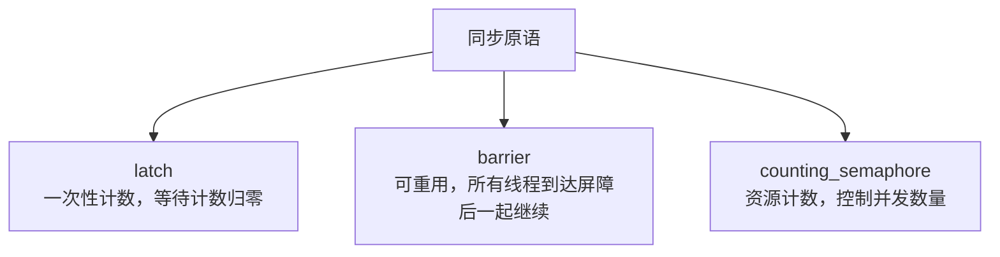

# 第 12 章 并发支持库

并发编程是现代 C++ 最强大、也最容易踩坑的部分之一。多核 CPU 已经是常态，程序若不能利用多核，性能就白白浪费。但多线程会带来数据竞争、死锁、竞态条件等问题，调试起来非常困难。

本章是全书唯一的并发专章，完整覆盖从基础到前沿的并发设施：

- 12.1 线程生命周期与协作取消：`thread`、`jthread` 与停止令牌；
- 12.2 互斥量、条件变量与锁管理；
- 12.3 闩锁、屏障与信号量；
- 12.4 原子操作与内存序；
- 12.5 原子智能指针、危险指针与 RCU（C++26 前瞻）；
- 12.6 协程与异步执行：`generator` 与 `std::execution`（C++26 前瞻）。

> **工具约定**：并发示例可以用 `cxxsh` 单文件运行，但链接时通常需要加线程库（Linux 上 `-pthread`）。放入真实项目时请套用第 7.7 节的 CMake + vcpkg 模板，并在 `target_link_libraries` 中按平台链接线程库。C++26 的内容统一标注“前瞻”，生产环境请谨慎。

---

## 12.1 线程生命周期与协作取消：`thread`、`jthread` 与停止令牌

### 12.1.1 `std::thread`：创建和管理线程

`std::thread`（`<thread>`）是 C++11 引入的标准线程类。创建一个 `std::thread` 对象，就会启动一个新线程并执行指定的函数。

```cpp
// thread_basic.cpp
#include <iostream>
#include <thread>

void worker(int id) {
    std::cout << "线程 " << id << " 开始工作\n";
    std::this_thread::sleep_for(std::chrono::milliseconds(100));
    std::cout << "线程 " << id << " 工作结束\n";
}

int main() {
    std::thread t1(worker, 1);
    std::thread t2(worker, 2);

    std::cout << "主线程等待子线程完成\n";

    t1.join();   // 等待 t1 结束
    t2.join();   // 等待 t2 结束

    std::cout << "所有线程结束，主线程退出\n";
}
```

可能的输出：

```
主线程等待子线程完成
线程 1 开始工作
线程 2 开始工作
线程 1 工作结束
线程 2 工作结束
所有线程结束，主线程退出
```

`std::thread` 有两种结束方式：
- **`join()`**：主线程等待子线程执行完毕，回收其资源。调用 `join()` 后，该线程对象不再可joinable。
- **`detach()`**：子线程脱离主线程，在后台独立运行，主线程不再关心它。detach 后的线程对象不再可joinable，也不能再 join。

**关键规则**：一个 `std::thread` 对象在析构前，必须是非 joinable 状态（即已经 join 或 detach 过）。如果析构时它仍是 joinable，程序会调用 `std::terminate()` 直接崩溃。这是 C++ 线程库最容易犯的错误之一：

```cpp
void bad() {
    std::thread t(worker, 1);
    // 没有 join 或 detach，t 析构时崩溃！
}
```

### 12.1.2 `std::jthread`：自动汇合的线程（C++20）

C++20 引入了 `std::jthread`（joining thread），它在析构时**自动调用 `join()`**，彻底消除了“忘记 join 导致崩溃”的问题。

```cpp
// jthread_basic.cpp
#include <iostream>
#include <jthread>
#include <chrono>

void worker(int id) {
    std::cout << "jthread " << id << " 开始\n";
    std::this_thread::sleep_for(std::chrono::milliseconds(50));
    std::cout << "jthread " << id << " 结束\n";
}

int main() {
    {
        std::jthread t1(worker, 1);
        std::jthread t2(worker, 2);
        // t1、t2 作用域结束时自动 join，无需手动调用
    }
    std::cout << "所有 jthread 已自动汇合\n";
}
```

`jthread` 除了自动 join，还内置了**停止状态（stop state）**，支持协作取消，这是后面要讲的内容。

### 12.1.3 停止令牌：`stop_source`、`stop_token`、`stop_callback`

有时候我们想请求一个后台线程“停止工作”，但不能强行杀死它（强行终止会导致资源泄漏、锁没释放等问题）。C++20 提供了**协作取消（cooperative cancellation）**机制：

- `std::stop_source`：请求停止的源，调用 `request_stop()` 发出停止请求；
- `std::stop_token`：接收停止请求的令牌，线程内部定期检查 `stop_requested()`；
- `std::stop_callback`：在停止请求到达时执行回调函数。

```cpp
// stop_token_basic.cpp
#include <iostream>
#include <jthread>
#include <stop_token>
#include <chrono>

void worker(std::stop_token st) {
    int count = 0;
    while (!st.stop_requested()) {
        std::cout << "工作中... " << ++count << '\n';
        std::this_thread::sleep_for(std::chrono::milliseconds(100));
    }
    std::cout << "收到停止请求，线程正常退出\n";
}

int main() {
    std::jthread t(worker);   // jthread 会自动传入 stop_token

    std::this_thread::sleep_for(std::chrono::milliseconds(350));
    t.request_stop();         // 请求线程停止（jthread 成员函数）

    // t 析构时自动 join，线程已经看到停止请求并正常退出
    std::cout << "主线程结束\n";
}
```

`jthread` 的 `request_stop()` 会关联到内部的 `stop_source`，传给线程函数的 `stop_token` 会反映停止状态。线程函数收到请求后，应该尽快清理并退出，而不是无视它。

### 12.1.4 线程生命周期状态机

```mermaid
stateDiagram-v2
    [*] --> 就绪：创建 std::thread/std::jthread
    就绪 --> 运行中：操作系统调度
    运行中 --> 就绪：时间片耗尽，重新调度
    运行中 --> 阻塞：等待锁、I/O、睡眠
    阻塞 --> 就绪：事件发生，唤醒
    运行中 --> 已终止：函数返回或抛出未捕获异常
    已终止 --> [*]：join() 或 detach() 回收资源
    就绪 --> 请求停止：stop_source.request_stop()
    请求停止 --> 已终止：线程检查 stop_requested 并自行退出
```

> **小结**：`std::thread` 是基本线程，必须手动 `join()` 或 `detach()`，析构前若仍 joinable 会崩溃；`std::jthread`（C++20）析构时自动 join，并内置停止令牌；`stop_source`/`stop_token`/`stop_callback` 实现协作取消，线程收到请求后应自行退出，不可强行杀死。

---

## 12.2 互斥量、条件变量与锁管理

### 12.2.1 互斥量：保护共享资源

多个线程同时访问同一份数据，且至少有一个线程在写，就会发生**数据竞争（data race）**，这是未定义行为。互斥量（mutex）用来保护共享资源，同一时刻只能有一个线程持有锁。

C++ 常用的互斥量：

| 类型 | 头文件 | 特点 |
|---|---|---|
| `std::mutex` | `<mutex>` | 最基本，不可递归 |
| `std::recursive_mutex` | `<mutex>` | 同一线程可重复加锁 |
| `std::timed_mutex` | `<mutex>` | 支持带超时的尝试加锁 |
| `std::shared_mutex` | `<shared_mutex>` | 共享锁（多读单写），C++17 |

```cpp
// mutex_basic.cpp
#include <iostream>
#include <mutex>
#include <thread>

int counter = 0;
std::mutex mtx;

void increment(int id, int times) {
    for (int i = 0; i < times; ++i) {
        std::lock_guard<std::mutex> lock(mtx);  // RAII：构造加锁，析构解锁
        ++counter;
    }
    std::cout << "线程 " << id << " 完成\n";
}

int main() {
    std::thread t1(increment, 1, 10000);
    std::thread t2(increment, 2, 10000);
    t1.join();
    t2.join();
    std::cout << "最终 counter = " << counter << '\n';  // 应该是 20000
}
```

如果不加锁，两个线程对 `counter` 同时 `++`，最终结果通常小于 20000，因为读-修改-写不是原子的。

### 12.2.2 锁守卫：`lock_guard`、`unique_lock`、`scoped_lock`

手动调用 `mtx.lock()` / `mtx.unlock()` 很危险：中间如果抛出异常或提前返回，`unlock()` 可能不执行，导致死锁。C++ 提供了 RAII 风格的锁守卫：

| 锁守卫 | 特点 |
|---|---|
| `std::lock_guard` | 构造加锁、析构解锁，最简单，不可手动解锁 |
| `std::unique_lock` | 可延迟加锁、可手动 `unlock()`/`lock()`、可移动，支持条件变量 |
| `std::scoped_lock`（C++17）| 可一次性锁住多个互斥量，采用死锁避免算法 |

```cpp
// scoped_lock_basic.cpp
#include <iostream>
#include <mutex>
#include <thread>

int a = 0, b = 0;
std::mutex mtx_a, mtx_b;

void thread_func() {
    // C++17 scoped_lock：一次性锁住两个 mutex，自动避免死锁
    std::scoped_lock lock(mtx_a, mtx_b);
    ++a;
    ++b;
    // 析构时按相反顺序自动解锁
}
```

**死锁避免**：两个线程分别锁住 `mtx_a` 和 `mtx_b`，然后各自去等对方的锁，就会死锁。`std::scoped_lock` 会一次性尝试锁住所有传入的 mutex，如果失败则释放已持有的锁并重试，从根上避免这种经典死锁。

### 12.2.3 条件变量：线程间等待与通知

互斥量只能保证“同一时刻只有一个线程访问”，但不能实现“线程等待某个条件成立”。这时需要**条件变量（condition variable）**。

经典场景是**生产者-消费者**：生产者往队列放东西，消费者从队列取东西。队列空时，消费者应该等待，而不是空转（忙等，浪费 CPU）。

```cpp
// producer_consumer.cpp
#include <iostream>
#include <queue>
#include <mutex>
#include <condition_variable>
#include <thread>
#include <chrono>

std::queue<int> queue;
std::mutex mtx;
std::condition_variable cv;
bool done = false;

void producer() {
    for (int i = 1; i <= 5; ++i) {
        {
            std::lock_guard<std::mutex> lock(mtx);
            queue.push(i);
            std::cout << "生产者生产：" << i << '\n';
        }
        cv.notify_one();   // 唤醒一个等待的消费者
        std::this_thread::sleep_for(std::chrono::milliseconds(100));
    }
    {
        std::lock_guard<std::mutex> lock(mtx);
        done = true;
    }
    cv.notify_all();       // 唤醒所有消费者，通知结束
}

void consumer() {
    while (true) {
        std::unique_lock<std::mutex> lock(mtx);
        // 等待：队列非空 或 生产结束
        cv.wait(lock, [] { return !queue.empty() || done; });

        if (queue.empty() && done) {
            break;   // 没东西了，且生产结束，退出
        }

        int val = queue.front();
        queue.pop();
        lock.unlock();   // 处理时释放锁，不阻塞生产者
        std::cout << "  消费者消费：" << val << '\n';
        std::this_thread::sleep_for(std::chrono::milliseconds(150));
    }
    std::cout << "消费者退出\n";
}

int main() {
    std::thread t1(producer);
    std::thread t2(consumer);
    t1.join();
    t2.join();
}
```

可能的输出：

```
生产者生产：1
  消费者消费：1
生产者生产：2
  消费者消费：2
...
消费者退出
```

条件变量的关键用法：
- `cv.wait(lock, predicate)`：原子地释放锁并挂起线程，直到 `predicate` 为真；被唤醒后重新获取锁，再次检查条件（防止虚假唤醒）。
- `cv.notify_one()`：唤醒一个等待线程。
- `cv.notify_all()`：唤醒所有等待线程。

**虚假唤醒（spurious wakeup）**：线程可能在没有被通知的情况下从 `wait` 中返回，所以条件变量必须配合谓词循环使用，不要只调用一次 `wait`。

### 12.2.4 锁管理的选型与反例

| 需求 | 推荐 | 原因 |
|---|---|---|
| 作用域内自动加解锁 | `std::lock_guard` | 最简单，不易错 |
| 需要手动控制加解锁时机、或配合条件变量 | `std::unique_lock` | 灵活，可移动 |
| 一次性锁多个 mutex | `std::scoped_lock`（C++17）| 自动避免死锁 |
| 同一线程重复加锁 | `std::recursive_mutex` | 谨慎使用，容易掩饰设计问题 |

**反例**：不要在持有锁时调用可能抛异常或阻塞很久的操作（如网络 I/O、文件 I/O），否则会长时间占用锁，导致其他线程饥饿。应该“先取数据、释放锁、再处理数据”。

> **小结**：`std::mutex` 保护共享资源；`lock_guard`/`unique_lock`/`scoped_lock` 用 RAII 自动管理锁，避免手动 unlock 的遗漏；`condition_variable` 实现线程间等待/通知，必须配合谓词处理虚假唤醒；`scoped_lock` 可一次性锁多个 mutex 并避免经典死锁。

---

## 12.3 闩锁、屏障与信号量

C++20 引入了三种轻量级同步原语，分别对应三种不同的同步模式：



### 12.3.1 `std::latch`：一次性计数（C++20）

`std::latch` 是一个一次性的倒计数同步原语。创建时指定一个计数，多个线程调用 `count_down()` 递减，其他线程调用 `wait()` 阻塞直到计数归零。计数归零后，latch 状态不可逆，不能重置。

典型场景：等待多个工作线程都初始化完毕，主线程才继续。

```cpp
// latch_basic.cpp
#include <iostream>
#include <latch>
#include <thread>
#include <vector>

int main() {
    const int worker_count = 3;
    std::latch latch(worker_count);

    std::vector<std::thread> threads;
    for (int i = 0; i < worker_count; ++i) {
        threads.emplace_back([&latch, i] {
            std::cout << "工作线程 " << i << " 初始化中...\n";
            std::this_thread::sleep_for(std::chrono::milliseconds(50 * (i + 1)));
            std::cout << "工作线程 " << i << " 初始化完成\n";
            latch.count_down();  // 计数减 1
        });
    }

    std::cout << "主线程等待所有工作线程初始化完成\n";
    latch.wait();  // 阻塞直到计数归零
    std::cout << "所有就绪，主线程继续\n";

    for (auto& t : threads) t.join();
}
```

### 12.3.2 `std::barrier`：可重用的阶段性同步（C++20）

`std::barrier` 与 latch 类似，但可重用。一组线程到达屏障点后，全部阻塞，直到**所有**线程都到达，才一起继续。每个阶段结束后，屏障自动重置，可用于下一阶段。还可以提供一个**合并函数（completion function）**，在所有线程到达、释放前执行一次。

典型场景：并行计算的多阶段迭代，每阶段结束后需要所有线程同步。

```cpp
// barrier_basic.cpp
#include <iostream>
#include <barrier>
#include <thread>
#include <vector>

int main() {
    const int thread_count = 3;
    std::barrier sync_point(thread_count, [] {
        std::cout << "  [屏障] 所有线程到达，进入下一阶段\n";
    });

    auto worker = [&](int id) {
        for (int phase = 0; phase < 2; ++phase) {
            std::cout << "线程 " << id << " 第 " << (phase + 1) << " 阶段工作\n";
            std::this_thread::sleep_for(std::chrono::milliseconds(50));
            sync_point.arrive_and_wait();  // 到达屏障并等待
        }
    };

    std::vector<std::thread> threads;
    for (int i = 0; i < thread_count; ++i) threads.emplace_back(worker, i);
    for (auto& t : threads) t.join();
}
```

### 12.3.3 `std::counting_semaphore`：资源计数（C++20）

信号量维护一个计数，表示可用资源的数量。`acquire()` 尝试获取一个资源（计数减 1，若为 0 则阻塞）；`release()` 释放一个资源（计数加 1，唤醒等待线程）。

典型场景：限制并发访问某个有限资源的线程数量（如数据库连接池）。

```cpp
// semaphore_basic.cpp
#include <iostream>
#include <semaphore>
#include <thread>
#include <vector>
#include <chrono>

std::counting_semaphore<3> pool(3);  // 最多 3 个线程并发

void worker(int id) {
    pool.acquire();      // 获取资源
    std::cout << "线程 " << id << " 开始使用资源\n";
    std::this_thread::sleep_for(std::chrono::milliseconds(100));
    std::cout << "线程 " << id << " 释放资源\n";
    pool.release();      // 释放资源
}

int main() {
    std::vector<std::thread> threads;
    for (int i = 0; i < 6; ++i) threads.emplace_back(worker, i);
    for (auto& t : threads) t.join();
}
```

### 12.3.4 三者选型对照

| 原语 | 可重用 | 核心语义 | 典型场景 |
|---|---|---|---|
| `std::latch` | 否 | 等待计数归零 | 一次性分阶段初始化 |
| `std::barrier` | 是 | 所有线程齐达后一起继续 | 多阶段并行迭代 |
| `std::counting_semaphore` | 是 | 控制可用资源数量 | 限制并发连接数、连接池 |

> **小结**：`latch` 适合一次性等待多个任务完成；`barrier` 适合多阶段循环同步；`counting_semaphore` 适合限制并发资源数量。三者都比手动用条件变量实现同步更简洁、更不易错。

---

## 12.4 原子操作与内存序

### 12.4.1 `std::atomic`：无锁的原子操作

互斥量能保证线程安全，但加解锁有开销，且可能导致线程阻塞。对于简单的共享变量（如计数器、标志位），可以用 **`std::atomic<T>`**（`<atomic>`）进行无锁的原子操作。原子操作要么完全执行，要么完全不执行，不会被其他线程看到中间状态。

```cpp
// atomic_basic.cpp
#include <iostream>
#include <atomic>
#include <thread>
#include <vector>

std::atomic<int> counter{0};

void increment(int times) {
    for (int i = 0; i < times; ++i) {
        ++counter;   // 原子自增，等价于 counter.fetch_add(1)
    }
}

int main() {
    std::vector<std::thread> threads;
    for (int i = 0; i < 10; ++i) threads.emplace_back(increment, 1000);
    for (auto& t : threads) t.join();
    std::cout << "最终 counter = " << counter.load() << '\n';  // 10000，准确无误
}
```

常用原子操作：
- `store(value)`：原子写入；
- `load()`：原子读取；
- `fetch_add(n)` / `fetch_sub(n)`：原子加/减，返回旧值；
- `exchange(value)`：原子替换，返回旧值；
- `compare_exchange_weak(expected, desired)`：如果当前值等于 `expected`，则写入 `desired`，并返回 true；否则把当前值写回 `expected`，返回 false。这是实现无锁数据结构的基础。

### 12.4.2 六种内存序：直观类比

原子操作不仅关心“操作本身是否原子”，还关心**操作之间的顺序可见性**：线程 A 写入了变量 X 和 Y，线程 B 什么时候能看到？这时候就要用到**内存序（memory order）**。

C++ 定义六种内存序，从弱到强：

| 内存序 | 含义 | 强度 |
|---|---|---|
| `memory_order_relaxed` | 只保证原子性，不保证顺序 | 最弱 |
| `memory_order_consume` | 依赖顺序（实际很少用） | 较弱 |
| `memory_order_acquire` | 获取语义：此操作之前的读写不会被重排到此操作之后 | 中 |
| `memory_order_release` | 释放语义：此操作之后的读写不会被重排到此操作之前 | 中 |
| `memory_order_acq_rel` | 获取+释放，用于 read-modify-write | 中强 |
| `memory_order_seq_cst` | 顺序一致性：所有线程观察到的操作顺序一致 | 最强，默认 |

用“快递”来类比这些内存序：

- **`relaxed`**：只关心这个包裹本身送不送到，不关心它和其他包裹的相对顺序。
- **`release`**：像“发货扫描”，保证发货扫描之前的所有打包工作都已完成，发货扫描后的操作不能提前到扫描前。
- **`acquire`**：像“签收扫描”，保证签收扫描之后的所有操作都在签收之后，签收前的操作不能滞后到签收后。
- **`seq_cst`**：像“全球统一的快递单”，所有线程看到的所有操作顺序完全一致，最强但开销也最大。

#### 释放-获取模式（release-acquire）

这是最常用的同步模式。线程 A 用 `release` 写入，线程 B 用 `acquire` 读取，如果 B 读到了 A 写入的值，那么 A 在写入前做的所有修改，对 B 都可见。

```cpp
// release_acquire.cpp
#include <iostream>
#include <atomic>
#include <thread>
#include <string>

std::atomic<std::string*> ptr{nullptr};
std::atomic<int> data{0};
std::atomic<bool> ready{false};

void producer() {
    data.store(42, std::memory_order_relaxed);      // 1. 写数据（relaxed 即可）
    ptr.store(new std::string("hello"), std::memory_order_release);  // 2. 发布指针（release）
    ready.store(true, std::memory_order_release);   // 3. 发布就绪标志
}

void consumer() {
    while (!ready.load(std::memory_order_acquire)) {  // 4. 等待就绪（acquire）
        std::this_thread::yield();
    }
    std::string* p = ptr.load(std::memory_order_acquire);  // 5. 获取指针（acquire）
    // 此时保证能看到 data = 42 和 ptr 指向的字符串内容
    std::cout << "data = " << data.load(std::memory_order_relaxed) << ", ptr = " << *p << '\n';
}

int main() {
    std::thread t1(producer);
    std::thread t2(consumer);
    t1.join();
    t2.join();
}
```

这里 `release` 和 `acquire` 配对，形成“同步与释放序（synchronizes-with）”，保证 `consumer` 看到 `ready == true` 时，也一定能看到 `data` 和 `ptr` 指向的内容。

#### `seq_cst`：最强但最慢

`memory_order_seq_cst` 是默认内存序，如果不指定，所有原子操作都用 `seq_cst`。它保证所有线程对所有原子变量的操作，观察到的顺序是一致的全局总序。这最容易正确，但性能开销最大，因为编译器和硬件需要插入内存屏障，禁止很多重排序优化。

选型建议：
- 默认不用指定，用 `seq_cst`（最安全）；
- 如果性能分析表明原子操作是瓶颈，且只关心单个变量的原子性，用 `relaxed`；
- 如果要建立线程间的“先行发生”关系，用 `release`/`acquire` 配对。

### 12.4.3 `atomic::wait/notify`：原子等待/通知（C++20）

C++20 为原子类型增加了 `wait()`、`notify_one()`、`notify_all()`，允许一个线程高效地等待原子变量变成某个值，而不需要忙等或配合条件变量。

```cpp
// atomic_wait_notify.cpp
#include <iostream>
#include <atomic>
#include <thread>

std::atomic<int> value{0};

void waiter() {
    std::cout << "等待 value 变为 100...\n";
    value.wait(0);  // 阻塞直到 value != 0
    std::cout << "检测到 value = " << value.load() << '\n';
}

void setter() {
    std::this_thread::sleep_for(std::chrono::milliseconds(100));
    value.store(100, std::memory_order_release);
    value.notify_one();  // 唤醒一个等待线程
}

int main() {
    std::thread t1(waiter);
    std::thread t2(setter);
    t1.join();
    t2.join();
}
```

`wait(old_value)` 会阻塞直到原子变量的值不等于 `old_value`，避免了轮询。

> **小结**：`std::atomic` 提供无锁原子操作；六种内存序从弱到强分别是 `relaxed`、`consume`、`acquire`、`release`、`acq_rel`、`seq_cst`；`release`/`acquire` 配对可以建立线程间的同步关系，`seq_cst` 最强但最慢；C++20 的 `wait/notify` 让原子等待不再需要忙等。

---

## 12.5 原子智能指针、危险指针与 RCU（C++26 前瞻）

### 12.5.1 `std::atomic<std::shared_ptr<T>>`：无锁安全共享

`std::shared_ptr` 本身的引用计数是线程安全的（不同线程拷贝/销毁不同的 `shared_ptr` 实例是安全的），但**同一个 `shared_ptr` 实例被多个线程同时读写（如一个线程 `store`，另一个线程 `load`）**是不安全的，需要外部加锁。

C++20 提供了 `std::atomic<std::shared_ptr<T>>` 的特化，支持对 `shared_ptr` 本身进行原子 load/store/exchange/compare_exchange，实现无锁的指针共享。

```cpp
// atomic_shared_ptr_basic.cpp
#include <iostream>
#include <atomic>
#include <memory>
#include <thread>

std::atomic<std::shared_ptr<int>> global_ptr;

void writer() {
    auto p = std::make_shared<int>(42);
    global_ptr.store(p, std::memory_order_release);
}

void reader() {
    auto p = global_ptr.load(std::memory_order_acquire);
    if (p) {
        std::cout << "reader 看到: " << *p << '\n';
    }
}

int main() {
    std::thread t1(writer);
    std::thread t2(reader);
    t1.join();
    t2.join();
}
```

### 12.5.2 危险指针（Hazard Pointer，C++26 前瞻）

在无锁数据结构中，有一个经典难题：**ABA 问题**和**内存回收**。一个线程从无锁栈弹出一个节点，要 `delete` 它；但另一个线程可能正持有这个节点的指针并在访问，提前 `delete` 会导致悬空指针。

**危险指针（Hazard Pointer）** 是一种线程本地的“保护标记”：线程在访问一个共享节点前，先把节点指针发布到自己的危险指针槽里；回收者在释放内存前，先扫描所有线程的危险指针，如果目标节点正被某个线程保护，就推迟释放。

C++26 正在标准化危险指针（`std::hazard_pointer` 等，基于 P0899 等提案），当前属于**前瞻**，编译器支持有限。

### 12.5.3 RCU（Read-Copy-Update，C++26 前瞻）

**RCU（读-复制-更新）** 是 Linux 内核中广泛使用的一种同步技术：读取方几乎无开销（不加锁、不原子操作），更新方复制一份数据、修改后再原子地替换指针，旧数据在一段“宽限期”后安全回收。

RCU 适合“读多写极少”的场景，比如配置表、路由表。C++26 的 RCU 支持仍在提案阶段，属于**前瞻**。

> **小结**：`std::atomic<std::shared_ptr<T>>` 可无锁地共享 `shared_ptr`；危险指针和 RCU 是 C++26 前瞻，用于解决无锁数据结构的安全内存回收问题，生产环境请谨慎。

---

## 12.6 协程与异步执行：`generator` 与 `std::execution`

### 12.6.1 协程基础：`co_await` / `co_yield` / `co_return`

C++20 引入了协程（coroutine），允许函数在执行过程中**挂起**和**恢复**，而不像普通函数那样“调用即运行到结束”。

关键字：
- `co_await`：挂起当前协程，等待某个操作完成，恢复后继续；
- `co_yield`：产出一个值并挂起，用于生成惰性序列；
- `co_return`：从协程返回并结束。

协程需要配合**承诺类型（promise type）**和**awaiter**，标准库提供了基础设施，但直接写一个完整协程比较繁琐。C++23 引入了 `std::generator<T>`（`<generator>`），让编写惰性生成器变得简单。

```cpp
// generator_basic.cpp
// 需要 C++23 编译器支持 std::generator
#include <iostream>
#include <generator>

std::generator<int> count_up_to(int n) {
    for (int i = 1; i <= n; ++i) {
        co_yield i;   // 产出 i，挂起；调用方再次请求时继续
    }
}

int main() {
    for (int x : count_up_to(5)) {
        std::cout << x << ' ';   // 1 2 3 4 5
    }
    std::cout << '\n';
}
```

`std::generator` 是惰性的：只有在 `for` 循环请求下一个值时，协程才会恢复并计算。适合表示可能很长甚至无限的序列，而不需要预先分配内存存全部元素。

### 12.6.2 `std::execution`：sender/receiver 异步执行（C++26 前瞻）

C++26 正在标准化 `std::execution`（发送方/接收方模型，基于 P2300 等提案），这是一种更底层、更可组合的异步执行抽象：
- **sender**：表示一个异步操作，会在未来产出一个值、错误或完成信号；
- **receiver**：接收 sender 的结果并继续处理；
- 操作如 `then`、`upon_error`、`upon_stopped`、`bulk`、`split` 等可对异步流水线进行组合。

与 `std::thread` 和 `std::async` 不同，`std::execution` 不强制绑定具体的线程模型，可以配合线程池、GPU、协程调度器等多种执行资源。

当前属于**C++26 前瞻**，编译器和标准库支持有限，生产环境不要依赖。

### 12.6.2 协程 vs 线程：直观区别

| 维度 | 线程（`std::thread`/`jthread`） | 协程（`co_await`/`co_yield`） |
|---|---|---|
| 调度 | 操作系统内核抢占式调度 | 程序员显式挂起/恢复，协作式 |
| 上下文切换 | 内核态切换，开销较大 | 用户态切换，开销很小 |
| 数量 | 通常几十到几百 | 可以成千上万个轻量协程 |
| 适合场景 | CPU 密集并发、阻塞 I/O | 高并发 I/O、惰性序列、异步流水线 |

> **小结**：`std::generator`（C++23）让协程生成惰性序列变得简单；`std::execution`（C++26 前瞻）提供 sender/receiver 异步执行模型。协程和线程不是替代关系，而是不同抽象层级：线程由 OS 调度，协程由程序员在用户态控制挂起点。

---

## 本章小结

本章是全书的并发专章，我们学习了：

1. **线程生命周期**：`std::thread` 需手动 `join()`/`detach()`，析构前若仍 joinable 会崩溃；`std::jthread`（C++20）析构时自动 join，并内置停止令牌；
2. **协作取消**：`stop_source`/`stop_token`/`stop_callback`，线程收到请求后应自行退出；
3. **锁管理**：`std::mutex`、`std::recursive_mutex`、`std::shared_mutex`；`lock_guard`/`unique_lock`/`scoped_lock` RAII 管理，`scoped_lock` 可一次锁多个 mutex 并避免死锁；
4. **条件变量**：`condition_variable` / `condition_variable_any` 实现等待/通知，必须配合谓词处理虚假唤醒；
5. **轻量同步原语**：`latch`（一次性计数）、`barrier`（可重用阶段同步）、`counting_semaphore`（资源计数）；
6. **原子与内存序**：`std::atomic` 无锁操作；六种内存序 `relaxed`/`consume`/`acquire`/`release`/`acq_rel`/`seq_cst`，`release`/`acquire` 配对建立同步关系，`seq_cst` 最强最慢；`wait/notify` 支持原子等待；
7. **原子智能指针与无锁内存回收**：`std::atomic<std::shared_ptr<T>>`；危险指针和 RCU 属于 C++26 前瞻；
8. **协程与异步执行**：`std::generator`（C++23）产出惰性序列；`std::execution`（C++26 前瞻）提供 sender/receiver 模型。

下一章（第 13 章）我们进入第三篇“标准库底层支撑与计算专项”，从语言支持库（`numeric_limits`、`type_info`、`feature_test` 等）讲起。

## 练习

1. 用 `std::jthread` 和 `stop_token` 写一个可被请求停止的后台计数器线程，主线程等待 500ms 后请求停止，观察线程是否正常退出。
2. 用 `std::mutex` + `std::condition_variable` 实现生产者-消费者队列，生产者放入 1 到 10，消费者取出并打印，队列空时消费者应等待而非忙等。
3. 用 `std::latch` 等待 3 个工作线程完成初始化后，主线程再打印“全部就绪”。
4. 用 `std::atomic<int>` 和 10 个线程分别累加 1000 次，验证最终结果为 10000；对比用 `relaxed` 和 `seq_cst` 的行为（在单变量场景下应相同）。
5. 用 `std::generator` 写一个斐波那契数列生成器，前 20 项惰性产出。
