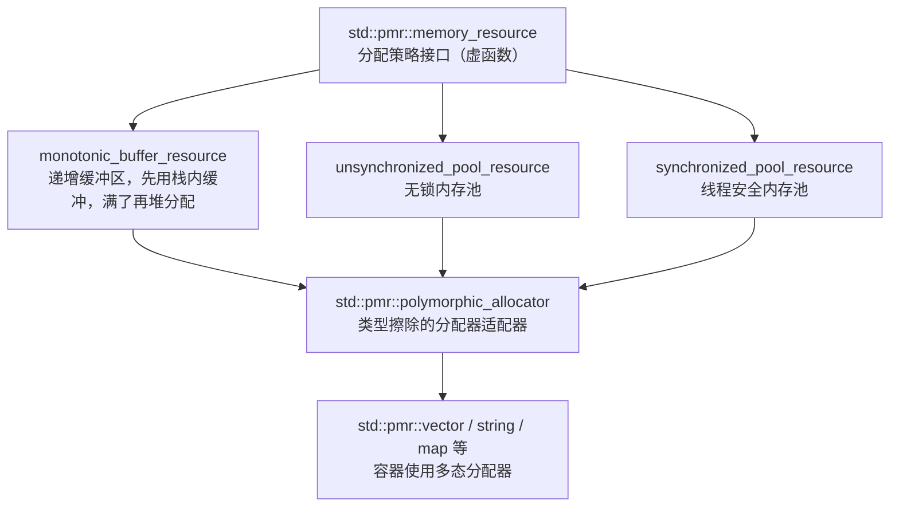

# 第 15 章 内存管理库

内存是程序最基本的资源之一。前面的章节我们已经学过了智能指针（`unique_ptr`、`shared_ptr`），它们是现代 C++ 管理动态内存的首选。但智能指针底层依赖更基础的设施：`new`/`delete` 运算符、`std::allocator`、以及各种内存分配策略。

本章覆盖内存管理库的底层部分：

- 15.1 低级内存管理：`new`/`delete` 与 `std::allocator`；
- 15.2 多态分配器与 `std::pmr`：`memory_resource`、`polymorphic_allocator`、`monotonic_buffer_resource`；
- 15.3 未初始化内存算法：`uninitialized_copy`、`uninitialized_default_construct` 等。

核心原则依然是**选型**：日常业务代码优先智能指针和容器，直接操作 `new`/`delete` 或自定义分配器应该是特殊场景下的选择。

> **工具约定**：示例以 C++20 为基线；`std::pmr` 是 C++17 特性；未初始化内存算法在 `<memory>` 头文件。代码片段可用 `cxxsh` 单文件验证，放入真实项目时请套用第 7.7 节的 CMake + vcpkg 工程模板。

---

## 15.1 低级内存管理：`new`/`delete` 与 `std::allocator`

### 15.1.1 `new` 与 `delete`：动态内存的最底层接口

C++ 用 `new` 运算符在堆上分配内存并**构造对象**，用 `delete` 运算符**析构对象并释放内存**。这是 C++ 内存管理的最底层接口。

```cpp
// new_delete_basic.cpp
#include <iostream>

class Widget {
public:
    Widget(int id) : id_(id) {
        std::cout << "Widget " << id_ << " 构造\n";
    }
    ~Widget() {
        std::cout << "Widget " << id_ << " 析构\n";
    }
    void say() const { std::cout << "我是 Widget " << id_ << '\n'; }

private:
    int id_;
};

int main() {
    // 分配单个对象并构造
    Widget* w = new Widget(42);
    w->say();

    // 析构并释放内存
    delete w;
    w = nullptr;   // 养成好习惯：delete 后置空，避免野指针
}
```

输出：

```
Widget 42 构造
我是 Widget 42
Widget 42 析构
```

`new` 做了两件事：分配原始内存，然后在该内存上调用构造函数；`delete` 做了两件事：调用析构函数，然后释放原始内存。它们必须成对出现，否则会导致内存泄漏（只 new 不 delete）或未定义行为（只 delete 不 new，或 delete 两次）。

如果需要分配一个数组，用 `new T[N]` 和 `delete[]`（注意方括号）：

```cpp
int* arr = new int[10];   // 分配 10 个 int，默认初始化
delete[] arr;             // 释放数组，必须用 delete[]
// delete arr;           // 错误：数组必须用 delete[]，行为未定义
```

### 15.1.2 为什么现代 C++ 尽量避免直接用 `new`/`delete`

直接管理 `new`/`delete` 容易出问题：
- **忘记 `delete`** → 内存泄漏；
- **`delete` 两次** → 未定义行为，通常崩溃；
- **`delete` 后继续使用指针** → 悬空指针，未定义行为；
- **异常在 `new` 和 `delete` 之间抛出** → 中间资源泄漏，除非手动处理。

这就是为什么第 4 章强调：**默认用 `std::unique_ptr` / `std::shared_ptr`，配合 `std::make_unique` / `std::make_shared`**，让 RAII 自动处理 `delete`。只有在实现自己的容器、智能指针或内存池时，才需要直接碰 `new`/`delete`。

### 15.1.3 `std::allocator`：标准库的默认分配器

`std::allocator<T>`（`<memory>`）是标准库容器（`vector`、`string` 等）默认使用的分配器。它封装了对原始内存的申请和释放，但**不构造也不析构对象**——对象的构造/析构由容器自己负责。

```cpp
// allocator_basic.cpp
#include <iostream>
#include <memory>
#include <string>

int main() {
    std::allocator<std::string> alloc;

    // 分配原始内存（不构造对象）
    std::string* p = alloc.allocate(2);

    // 在分配的内存上构造对象
    alloc.construct(p, std::string("hello"));
    alloc.construct(p + 1, std::string("world"));

    std::cout << p[0] << ' ' << p[1] << '\n';

    // 析构对象
    alloc.destroy(p);
    alloc.destroy(p + 1);

    // 释放原始内存
    alloc.deallocate(p, 2);
}
```

输出：

```
hello world
```

`std::allocator` 的常用成员：
- `allocate(n)`：分配 `n` 个 `T` 的原始内存，不构造；
- `deallocate(p, n)`：释放之前分配的原始内存；
- `construct(p, args...)`：在内存 `p` 上就地构造一个 `T` 对象（C++17 起 `construct` 已被标记废弃，建议直接用 `::new (p) T(args...)` 定位 new）；
- `destroy(p)`：析构 `p` 指向的对象，但不释放内存。

在现代 C++ 中，直接使用 `std::allocator` 的场景已经很少了，除非你在写自定义容器。日常开发中，容器内部已经自动使用了 `std::allocator`，你不需要显式关心。

### 15.1.4 定位 new（placement new）

`new` 还有一种用法叫**定位 new（placement new）**：在一块已经分配好的内存上构造对象，不重新申请内存。

```cpp
// placement_new.cpp
#include <iostream>
#include <new>   // 定位 new 的头文件

class Widget {
public:
    Widget(int id) : id_(id) { std::cout << "Widget " << id_ << " 构造\n"; }
    ~Widget() { std::cout << "Widget 析构\n"; }
    int id_;
};

int main() {
    // 先分配一块原始内存（足够大）
    void* memory = ::operator new(sizeof(Widget));

    // 在该内存上构造 Widget，不申请新内存
    Widget* w = new (memory) Widget(42);
    w->id_ = 99;

    // 只析构，不释放内存（内存由外部管理）
    w->~Widget();

    ::operator delete(memory);
}
```

输出：

```
Widget 42 构造
Widget 析构
```

定位 new 是实现自定义分配器、内存池、容器底层的基础，但对应用层开发者来说，很少需要直接写。

> **小结**：`new`/`delete` 是动态内存的最底层接口，成对使用且容易出错，日常优先智能指针；`std::allocator` 封装原始内存申请释放，容器默认使用；定位 new 允许在已分配内存上构造对象，是构建自定义内存管理的基础。

---

## 15.2 多态分配器与 `std::pmr`

### 15.2.1 为什么需要“多态分配器”

`std::allocator<T>` 是个模板，`std::allocator<int>` 和 `std::allocator<std::string>` 是**不同的类型**。这意味着：如果你写一个函数接受一个分配器参数，必须在编译期知道它到底是哪种类型的分配器，无法在运行期“换一个分配器策略”。

C++17 引入了 `std::pmr`（polymorphic memory resource，多态内存资源，`<memory_resource>`），解决了这个问题。它把“分配策略”从类型系统中解耦出来，使得`std::pmr::vector<int>` 和 `std::pmr::string` 可以在运行期共享同一个分配器对象。



### 15.2.2 核心组件

| 组件 | 作用 |
|---|---|
| `std::pmr::memory_resource` | 抽象基类，定义 `allocate`/`deallocate` 虚函数，是分配策略的接口 |
| `std::pmr::monotonic_buffer_resource` | 递增缓冲区分配器：先用一块内置缓冲区，用完了再向上游申请，只增不释放，析构时一次性释放 |
| `std::pmr::unsynchronized_pool_resource` | 无锁内存池，单线程或外部已同步场景 |
| `std::pmr::synchronized_pool_resource` | 线程安全内存池 |
| `std::pmr::polymorphic_allocator<T>` | 类型擦除的分配器，持有一个 `memory_resource*` 指针，适配给标准容器 |
| `std::pmr::vector<T>` 等 | 容器的别名，实际是 `std::vector<T, std::pmr::polymorphic_allocator<T>>` |

### 15.2.3 基本用法：`monotonic_buffer_resource`

`monotonic_buffer_resource` 非常适合“短期、大量、小块内存分配”的场景：比如处理一个请求时需要临时分配很多小对象，请求处理完一次性全部释放。

```cpp
// pmr_basic.cpp
// 需要 C++17 及以上
#include <iostream>
#include <memory_resource>
#include <pmr/vector>
#include <string>

int main() {
    // 准备一块 256 字节的栈上缓冲区作为初始池
    char buffer[256];
    std::pmr::monotonic_buffer_resource pool(buffer, sizeof(buffer));

    // 用多态分配器构造 vector，所有分配都走 pool
    std::pmr::vector<int> vec(&pool);

    for (int i = 0; i < 100; ++i) {
        vec.push_back(i);   // 前面的分配可能都在 buffer 里，满了再向堆申请
    }

    std::cout << "vec 大小：" << vec.size() << '\n';

    // vec 析构时元素被销毁，pool 析构时所有申请的内存一次性释放
    // 不需要逐个 delete 每个元素的内存
}
```

`monotonic_buffer_resource` 的特点：
- 只向一个方向分配（monotonic），不支持单独释放某个已分配块；
- 析构时一次性回收所有内存，适合“批量分配、批量释放”的短生命周期场景；
- 如果初始缓冲区够用，可以完全避免堆分配，性能很好。

### 15.2.4 `polymorphic_allocator`：给容器用的适配器

`std::pmr::polymorphic_allocator<T>` 是一个普通的分配器类（满足分配器概念），它内部持有一个 `memory_resource*` 指针。标准容器可以用它作为分配器参数，从而在运行期决定“用哪个内存资源分配”。

```cpp
// polymorphic_allocator_basic.cpp
// 需要 C++17
#include <iostream>
#include <memory_resource>
#include <pmr/vector>
#include <pmr/string>
#include <vector>
#include <string>

int main() {
    std::pmr::monotonic_buffer_resource pool;
    std::pmr::polymorphic_allocator<int> alloc(&pool);

    // 显式传入分配器
    std::vector<int, std::pmr::polymorphic_allocator<int>> vec(alloc);
    vec.push_back(1);
    vec.push_back(2);

    // 或者直接用 pmr::vector 别名，构造时传入 resource 指针
    std::pmr::vector<int> vec2(&pool);
    vec2.push_back(3);
    vec2.push_back(4);

    std::cout << "vec: ";
    for (int x : vec) std::cout << x << ' ';
    std::cout << "\nvec2: ";
    for (int x : vec2) std::cout << x << ' ';
    std::cout << '\n';
}
```

输出：

```
vec: 1 2 
vec2: 3 4 
```

### 15.2.5 `pmr` 容器选型建议

| 场景 | 推荐 | 原因 |
|---|---|---|
| 日常业务代码 | `std::vector`、`std::string`（默认 `std::allocator`） | 简单，够用 |
| 短期大量小块分配，请求处理完一次性释放 | `std::pmr::` 容器 + `monotonic_buffer_resource` | 避免频繁堆分配，批量释放 |
| 频繁分配/释放中等大小块，多线程共享 | `std::pmr::` 容器 + `synchronized_pool_resource` | 内存池复用，线程安全 |
| 频繁分配/释放中等大小块，单线程 | `std::pmr::` 容器 + `unsynchronized_pool_resource` | 无锁，更快 |

> **反例**：不要为了“用上新特性”而把所有容器都改成 `pmr::` 版本。`pmr` 带来的是运行期分配器切换能力，日常业务中这个能力通常用不上，反而增加了代码复杂度（需要管理 `memory_resource` 的生命周期，确保容器不比 resource 活得更久）。

> **小结**：`std::pmr` 把分配策略从类型中解耦，运行期可换分配器；`monotonic_buffer_resource` 适合批量分配/批量释放；`polymorphic_allocator` 是适配标准容器的桥梁。日常代码优先默认分配器，`pmr` 留给有明确内存分配性能需求的场景。

---

## 15.3 未初始化内存算法

### 15.3.1 什么是“未初始化内存”

标准容器（如 `vector`）在扩容时，需要先分配原始内存，然后在内存上逐个构造对象。这中间有一段“已分配但尚未构造对象”的原始内存，叫**未初始化内存**。

直接对未初始化内存做赋值（如 `p[i] = value`）是未定义行为，因为那里还没有合法的对象。标准库提供了一组**未初始化内存算法**（`<memory>`），专门安全地在这类内存上构造和销毁对象。

### 15.3.2 常用未初始化内存算法

| 算法 | 作用 |
|---|---|
| `std::uninitialized_copy` | 将一个范围的元素复制到未初始化内存 |
| `std::uninitialized_copy_n` | 复制 N 个元素到未初始化内存 |
| `std::uninitialized_fill` | 用一个值填充未初始化内存 |
| `std::uninitialized_fill_n` | 用一个值填充 N 个未初始化位置 |
| `std::uninitialized_default_construct` | 在未初始化内存上默认构造对象 |
| `std::uninitialized_value_construct` | 在未初始化内存上值构造对象（如 int 初始化为 0） |
| `std::destroy` / `std::destroy_n` / `std::destroy_at` | 析构对象但不释放内存 |

```cpp
// uninitialized_basic.cpp
#include <iostream>
#include <memory>
#include <vector>
#include <string>

int main() {
    // 分配原始内存，不构造对象
    std::allocator<std::string> alloc;
    std::string* p = alloc.allocate(3);

    // 在未初始化内存上构造 3 个 string
    std::vector<std::string> source = {"apple", "banana", "cherry"};
    std::uninitialized_copy(source.begin(), source.end(), p);

    for (int i = 0; i < 3; ++i) {
        std::cout << p[i] << ' ';
    }
    std::cout << '\n';

    // 析构对象，不释放内存
    std::destroy(p, p + 3);
    alloc.deallocate(p, 3);
}
```

输出：

```
apple banana cherry 
```

### 15.3.3 典型应用：自定义容器的扩容

如果你要实现一个简化版的 `vector`，扩容时大致要这样做：

1. 用 `allocator::allocate` 申请更大的原始内存；
2. 用 `std::uninitialized_move` 或 `std::uninitialized_copy` 把旧元素移动/复制到新内存；
3. 用 `std::destroy` 销毁旧对象；
4. 用 `allocator::deallocate` 释放旧内存。

这套组合拳保证了在任何步骤出现异常时，已经构造的对象都能被正确析构，不会泄漏。

> **反例**：不要在原始内存上直接写 `p[i] = std::string("x")`，因为 `p[i]` 指向的内存里还没有 `string` 对象，调用赋值运算符是未定义行为。必须先用 `construct`/`uninitialized_*` 算法把对象构造起来。

> **小结**：未初始化内存算法（`uninitialized_copy`、`uninitialized_fill`、`destroy` 等）在已分配原始内存但尚未构造对象的内存上安全地构造和析构对象，是实现自定义容器和分配器的基础，日常业务代码很少直接用到。

---

## 本章小结

本章我们学习了标准库内存管理库的底层设施：

1. **`new`/`delete`**：动态内存的最底层接口，分配+构造、析构+释放，必须成对使用，日常优先智能指针；
2. **`new[]`/`delete[]`**：数组形式，释放时必须带方括号；
3. **`std::allocator<T>`**：标准库默认分配器，封装原始内存申请释放，不负责对象构造/析构；
4. **定位 new**：在已分配内存上就地构造对象，是自定义内存管理的基础；
5. **`std::pmr`（C++17）**：多态内存资源，把分配策略从类型中解耦，运行期可换分配器；`monotonic_buffer_resource` 适合批量分配/释放，`polymorphic_allocator` 适配标准容器；
6. **未初始化内存算法**：`uninitialized_copy`/`uninitialized_fill`/`destroy` 等，在原始内存上安全构造和析构对象，是自定义容器的基础。

选型口诀：**日常用 `unique_ptr`/`shared_ptr` 和标准容器；实现自定义容器或内存池才碰 `allocator`、`pmr`、未初始化算法和定位 new；尽量不要直接写 `new`/`delete`。**

下一章（第 16 章）我们进入概念库与元编程库，学习 `std::same_as`、`std::convertible_to`、`std::integral_constant`、`std::ratio` 等编译期设施。

## 练习

1. 写一个程序，用 `new` 分配一个 `int` 数组，初始化后打印，再用 `delete[]` 释放，释放后将指针置为 `nullptr`。
2. 用 `std::allocator<int>` 分配 5 个 `int` 的原始内存，用 `std::uninitialized_default_construct` 构造它们，打印值，再用 `std::destroy` 销毁并释放内存。
3. 用 `std::pmr::monotonic_buffer_resource` 和 `std::pmr::vector<int>` 存储 1000 个整数，观察是否能在不频繁堆分配的情况下工作（可尝试给不同大小的初始缓冲区）。
4. 写一个简化版的 `MyVector` 类，内部用 `std::allocator` 管理内存，扩容时用 `std::uninitialized_copy` 移动旧元素，析构时用 `std::destroy` 清理。
5. 对比 `std::vector<int>`（默认分配器）和 `std::pmr::vector<int>`（`monotonic_buffer_resource`）在频繁 `push_back` 场景下的代码复杂度差异。
