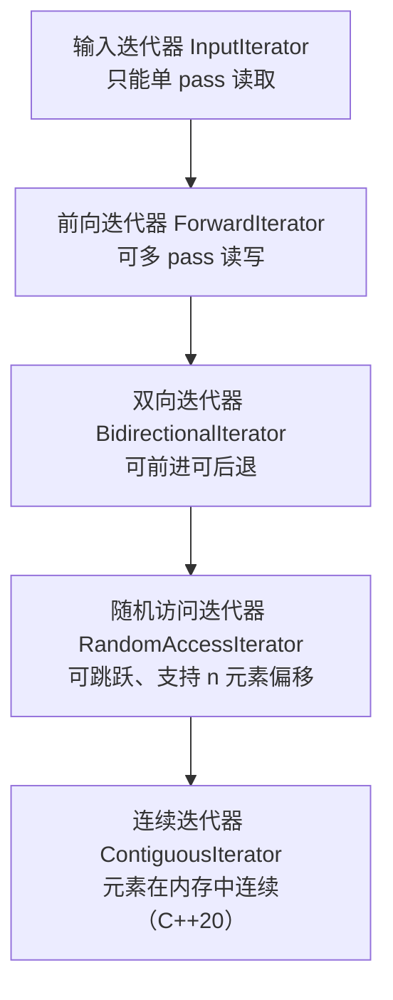
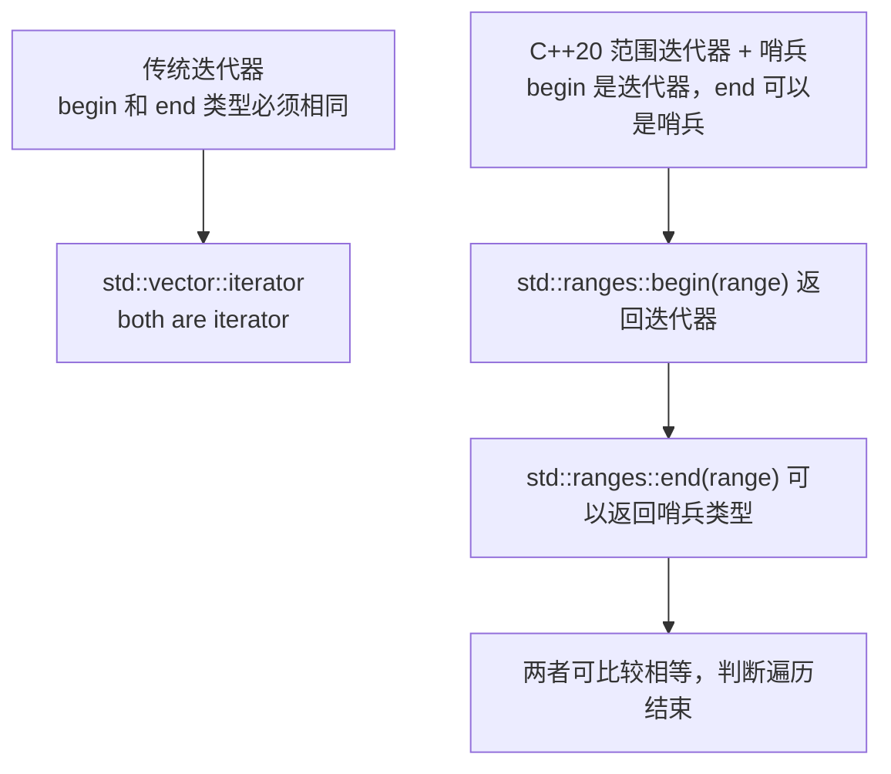

# 第 17 章 迭代器库

迭代器是 C++ 标准库里“连接容器与算法”的胶水。你不需要知道容器内部是怎么存储数据的，只要拿到它的迭代器，就可以统一地遍历、读取、修改元素。标准库的绝大多数算法（`std::sort`、`std::find`、`std::copy` 等）都是按迭代器范围工作的，而不是按具体容器类型工作的。

本章覆盖：

- 17.1 迭代器类别与 `iterator_traits`；
- 17.2 迭代器适配器：`reverse_iterator`、`move_iterator`、插入迭代器；
- 17.3 范围迭代器与哨兵（C++20）。

> **工具约定**：示例以 C++20 为基线；迭代器与哨兵（sentinel）是 C++20 范围库的一部分。代码片段可用 `cxxsh` 单文件验证，放入真实项目时请套用第 7.7 节的 CMake + vcpkg 工程模板。

---

## 17.1 迭代器类别与 `iterator_traits`

### 17.1.1 什么是迭代器

迭代器可以理解为“容器元素的光标”或“指针的泛化”。它指向容器里的某个元素，支持 `++` 移动到下一个，`*` 解引用访问当前元素。不同容器的迭代器能力不同：`std::vector` 的迭代器可以随意跳跃（随机访问），`std::list` 的迭代器只能一步步走（双向），某些输入流迭代器只能前进一次（输入）。

为了让算法能根据迭代器的能力选择合适的实现，C++ 把迭代器分成了五个类别，从弱到强：



| 类别 | 能力 | 典型容器 |
|---|---|---|
| 输入迭代器 | 单向遍历、只能读一次 | `std::istream_iterator` |
| 前向迭代器 | 单向遍历、可多次读写 | `std::forward_list` |
| 双向迭代器 | 可 `++` 也可 `--` | `std::list`、`std::map`、`std::set` |
| 随机访问迭代器 | 支持 `+`、`-`、`[]`、`<` 等，像指针一样跳跃 | `std::vector`、`std::deque`、`std::array` |
| 连续迭代器 | 元素在内存中严格连续，可当指针用 | `std::vector`、`std::string`、`std::array`（C++20） |

类别越强，能做的操作越多，算法也能优化得越多。比如 `std::sort` 要求随机访问迭代器，因为它需要随机跳跃来交换元素；而 `std::find` 只需要输入迭代器，因为它只是顺序查找。

### 17.1.2 `iterator_traits`：从迭代器查属性

算法怎么知道一个迭代器属于哪个类别？它通过 **`std::iterator_traits<Iter>`**（`<iterator>`）来查询。这是一个类模板，针对每种迭代器类型，提供以下成员类型：

| 成员 | 含义 |
|---|---|
| `iterator_category` | 迭代器类别标签（如 `std::random_access_iterator_tag`） |
| `value_type` | 迭代器指向的元素类型 |
| `difference_type` | 两个迭代器相减的类型（通常是 `ptrdiff_t`） |
| `pointer` | 指向元素的指针类型 |
| `reference` | 指向元素的引用类型 |

```cpp
// iterator_traits_basic.cpp
#include <iostream>
#include <iterator>
#include <vector>
#include <list>
#include <type_traits>

template <typename Iter>
void print_category(Iter) {
    using category = typename std::iterator_traits<Iter>::iterator_category;
    if constexpr (std::is_same_v<category, std::random_access_iterator_tag>) {
        std::cout << "随机访问迭代器\n";
    } else if constexpr (std::is_same_v<category, std::bidirectional_iterator_tag>) {
        std::cout << "双向迭代器\n";
    } else if constexpr (std::is_same_v<category, std::forward_iterator_tag>) {
        std::cout << "前向迭代器\n";
    } else {
        std::cout << "其他迭代器\n";
    }
}

int main() {
    std::vector<int> v = {1, 2, 3};
    std::list<int> lst = {1, 2, 3};

    print_category(v.begin());   // 随机访问迭代器
    print_category(lst.begin()); // 双向迭代器
}
```

输出：

```
随机访问迭代器
双向迭代器
```

算法内部可以根据 `iterator_category` 选择不同的实现：随机访问迭代器用快速跳跃，双向迭代器只能一步步走。

### 17.1.3 自定义迭代器（简要）

如果你要实现自己的容器，就需要提供自己的迭代器，并让 `iterator_traits` 能正确识别它。现代做法是让迭代器类型包含上述成员类型，或者直接继承 `std::iterator`（C++17 已废弃，不推荐），更推荐直接定义成员类型并重载 `operator*`、`operator++` 等。

日常应用开发中，很少需要手写迭代器，标准容器的迭代器已经足够用。了解 `iterator_traits` 主要是为了看懂算法的要求和编译错误信息。

> **小结**：迭代器分五类（输入→前向→双向→随机访问→连续），能力递增；`std::iterator_traits<Iter>` 提供迭代器的类别、值类型等信息，算法据此选择优化策略。

---

## 17.2 迭代器适配器：`reverse_iterator`、`move_iterator`、插入迭代器

迭代器适配器是“包装一个现有迭代器，改变其行为”的迭代器。标准库提供了几种常用适配器。

### 17.2.1 `std::reverse_iterator`：反向遍历

`std::reverse_iterator` 把一个正向迭代器包装成反向迭代器，`++` 时实际是向后退一步。容器的 `rbegin()`/`rend()` 返回的就是反向迭代器。

```cpp
// reverse_iterator_basic.cpp
#include <iostream>
#include <vector>
#include <iterator>

int main() {
    std::vector<int> v = {1, 2, 3, 4, 5};

    // 反向遍历
    for (auto it = v.rbegin(); it != v.rend(); ++it) {
        std::cout << *it << ' ';
    }
    std::cout << '\n';
}
```

输出：

```
5 4 3 2 1 
```

### 17.2.2 `std::move_iterator`：移动语义的迭代

`std::move_iterator` 包装一个迭代器，解引用时返回右值引用（`T&&`），配合 `std::uninitialized_move` 或容器扩容时使用，可以把元素从一个容器“移动”到另一个容器，而不发生拷贝。

```cpp
// move_iterator_basic.cpp
#include <iostream>
#include <vector>
#include <string>
#include <iterator>
#include <memory>

int main() {
    std::vector<std::string> source = {"apple", "banana", "cherry"};
    std::vector<std::string> dest;

    // 预分配内存
    dest.reserve(source.size());

    // 把 source 里的元素移动构造到 dest 的未初始化内存
    std::uninitialized_move(
        std::make_move_iterator(source.begin()),
        std::make_move_iterator(source.end()),
        std::back_inserter(dest)  // 稍后介绍插入迭代器
    );

    std::cout << "dest 大小：" << dest.size() << '\n';
    for (const auto& s : dest) {
        std::cout << s << ' ';
    }
    std::cout << '\n';
}
```

输出：

```
dest 大小：3
apple banana cherry 
```

`std::make_move_iterator(it)` 把普通迭代器包装成 `move_iterator`，解引用时产生右值，触发移动构造。

### 17.2.3 插入迭代器：边遍历边插入

普通迭代器只能读写已有元素，不能向容器里“插入”新元素。插入迭代器解决了这个问题：通过它赋值，会触发容器的插入操作（`push_back`、`push_front` 或 `insert`）。

| 插入迭代器 | 对应容器操作 | 头文件 |
|---|---|---|
| `std::back_insert_iterator`（`std::back_inserter`） | `push_back` | `<iterator>` |
| `std::front_insert_iterator`（`std::front_inserter`） | `push_front` | `<iterator>` |
| `std::insert_iterator`（`std::inserter`） | `insert`（在指定位置） | `<iterator>` |

```cpp
// insert_iterator_basic.cpp
#include <iostream>
#include <vector>
#include <list>
#include <iterator>
#include <algorithm>

int main() {
    std::vector<int> src = {1, 2, 3};
    std::vector<int> dst;

    // 把 src 拷贝到 dst，dst 通过 back_inserter 动态增长
    std::copy(src.begin(), src.end(), std::back_inserter(dst));

    for (int x : dst) {
        std::cout << x << ' ';
    }
    std::cout << '\n';

    // front_inserter 会反转顺序（每次插到最前面）
    std::list<int> lst;
    std::copy(src.begin(), src.end(), std::front_inserter(lst));
    for (int x : lst) {
        std::cout << x << ' ';
    }
    std::cout << '\n';
}
```

输出：

```
1 2 3 
3 2 1 
```

`back_inserter(dst)` 返回一个迭代器，往它上面写东西等价于 `dst.push_back(value)`。这让 `std::copy` 这样的算法可以直接往容器里“追加”元素，而不需要 dst 事先有足够大小。

> **小结**：`reverse_iterator` 反向遍历；`move_iterator` 配合移动语义避免拷贝；插入迭代器（`back_inserter`/`front_inserter`/`inserter`）让算法能向容器边遍历边插入新元素。

---

## 17.3 范围迭代器与哨兵（C++20）

### 17.3.1 传统迭代器的局限：成对的 begin/end

传统的 C++ 迭代器总是成对出现：`begin()` 和 `end()`，**两个迭代器的类型必须相同**。`end()` 是一个指向“最后一个元素之后位置”的迭代器，实际可能是一个构造出来的哨兵迭代器。

这个设计在大多数情况下没问题，但有两个痛点：

1. **空终止字符串**：C 风格字符串 `const char*` 以 `\0` 结束，没法用一个“同类型的 end 迭代器”优雅地表示“到 `\0` 为止”。
2. **惰性生成的序列**：比如一个斐波那契数列生成器，不知道什么时候结束，很难提前构造一个 `end` 迭代器。

### 17.3.2 范围迭代器与哨兵：begin 和 end 可以是不同类型

C++20 范围库（`<ranges>`）引入了**哨兵（sentinel）**概念：`begin()` 返回一个迭代器，`end()` 可以返回一个**不同类型**的哨兵对象。只要迭代器和哨兵之间能比较相等（`it == sentinel`），遍历就可以继续。



最典型的例子是 `std::istream` 范围或空终止字符串。下面用一个自定义的“整数范围”来演示哨兵的思想：

```cpp
// sentinel_basic.cpp
// 需要 C++20，编译器支持 ranges
#include <iostream>
#include <ranges>

// 一个从 0 递增的整数迭代器，到达 max 值时停止
struct int_sentinel {};

struct int_iterator {
    int value;
    int max;

    int operator*() const { return value; }
    int_iterator& operator++() { ++value; return *this; }
    void operator++(int) { ++value; }

    // 迭代器与哨兵比较：相等则停止
    bool operator==(int_sentinel) const { return value >= max; }
    bool operator!=(int_sentinel) const { return value < max; }
};

struct int_range {
    int max;
    int_iterator begin() const { return {0, max}; }
    int_sentinel end() const { return {}; }  // 哨兵类型不同于迭代器类型
};

int main() {
    for (int x : int_range{5}) {  // 基于范围的 for 循环，C++20 支持 begin/end 类型不同
        std::cout << x << ' ';
    }
    std::cout << '\n';
}
```

输出：

```
0 1 2 3 4 
```

这里 `int_range::end()` 返回的是 `int_sentinel`，而 `begin()` 返回的是 `int_iterator`，两者类型不同。`for (int x : int_range{5})` 在 C++20 下可以工作，因为编译器会用 `std::ranges::begin` 和 `std::ranges::end` 来获取范围边界，并只要求它们可比较。

### 17.3.3 `std::common_range`：把哨兵范围转成普通迭代器范围

有些老式算法只接受“begin 和 end 类型相同”的迭代器对。如果你有一个基于哨兵的范围，想传给老式算法，可以用 `std::ranges::common_range` 把它包装成一个 begin/end 类型相同的常见范围：

```cpp
#include <ranges>
// std::ranges::common_view 可以把哨兵范围包成普通迭代器范围
auto common = int_range{5} | std::views::common;
```

这部分内容与第 18 章范围库紧密相关，这里只需要知道“哨兵让 begin 和 end 可以是不同类型，`common_range`/`common_view` 可将其兼容回旧式算法”即可。

### 17.3.4 选型与应用建议

| 需求 | 推荐做法 |
|---|---|
| 遍历标准容器 | 用容器自带的 `begin()`/`end()`，或范围 for |
| 反向遍历 | 用 `rbegin()`/`rend()` |
| 边遍历边插入新元素 | 用 `back_inserter`/`front_inserter`/`inserter` |
| 需要移动元素而非拷贝 | 用 `make_move_iterator` |
| 自定义惰性序列或空终止字符串遍历 | 用 C++20 范围迭代器 + 哨兵 |
| 把哨兵范围传给老式算法 | 用 `std::views::common` / `std::ranges::common_range` |

> **小结**：迭代器适配器改变现有迭代器的行为；C++20 的哨兵机制允许 `begin` 和 `end` 是不同类型，适合惰性序列和空终止结构，`common_view` 可将其兼容回传统算法。

---

## 本章小结

本章我们学习了标准库迭代器设施的核心内容：

1. **迭代器类别**：输入、前向、双向、随机访问、连续五类，能力递增，算法根据类别选择优化策略；
2. **`std::iterator_traits`**：查询迭代器的类别标签、值类型、差值类型等，是算法内部做类型分发的基础；
3. **迭代器适配器**：`reverse_iterator` 反向遍历、`move_iterator` 移动语义遍历、插入迭代器（`back_inserter` 等）边遍历边插入；
4. **范围迭代器与哨兵（C++20）**：`begin` 和 `end` 可以是不同类型，适合惰性序列和空终止结构；`common_view` 可兼容回传统算法。

选型口诀：**正向遍历用 `begin/end`，反向用 `rbegin/rend`，边插边遍历用 `back_inserter`，移动元素用 `make_move_iterator`，自定义惰性序列用 C++20 哨兵。**

下一章（第 18 章）我们进入范围库，学习 `std::ranges` 算法、视图（`filter`、`transform` 等）、惰性求值以及 `std::generator` 和 `ranges::to`。

## 练习

1. 写一个程序，分别用 `std::vector<int>` 和 `std::list<int>` 的迭代器，通过 `std::iterator_traits` 打印它们的迭代器类别（随机访问 vs 双向）。
2. 用 `std::reverse_iterator`（或 `rbegin/rend`）把一个 `std::vector<int>` 逆序打印。
3. 用 `std::back_inserter` 和 `std::copy` 把一个 `std::list<int>` 的内容复制到一个初始为空的 `std::vector<int>` 中。
4. 用 `std::make_move_iterator` 把一个 `std::vector<std::string>` 的内容移动到另一个 vector，验证移动后源 vector 里的字符串已被清空（或处于未指定状态）。
5. 用 C++20 的范围 for 遍历一个自定义的哨兵范围（如上面的 `int_range`），打印 0 到 N-1。
