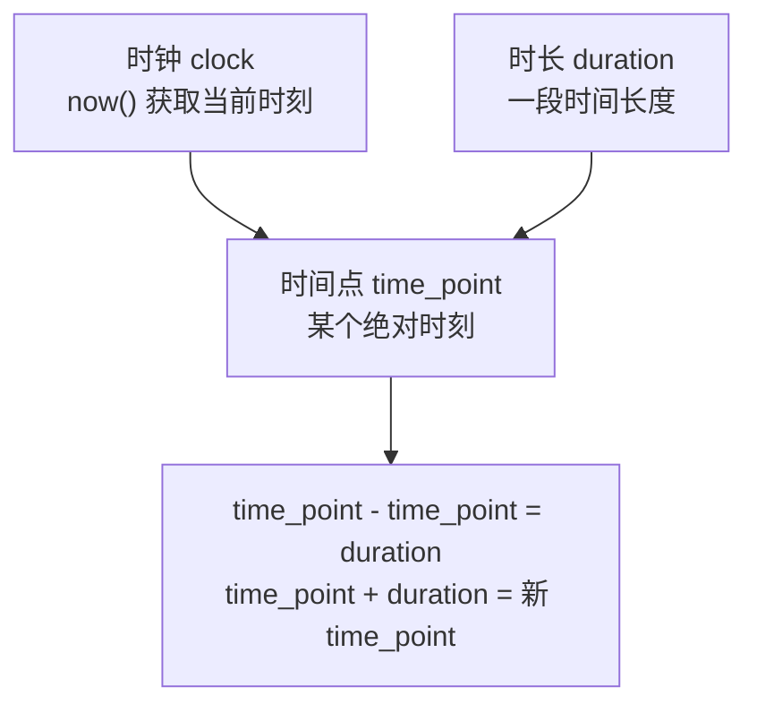

# 第 21 章 时间库

程序处理时间时，常见的需求有：测量一段代码运行了多久、安排一个任务在 5 秒后执行、把“2026 年 11 月 11 日 9 点 12 分”转成时间戳、处理不同时区的会议时间……如果用整数秒或毫秒手写这些逻辑，极易出错（比如闰年、时区偏移、夏令时）。

C++11 的 `<chrono>` 和 C++20 的日历/时区扩展，提供了类型安全、可编译期配置的时间模型。本章覆盖：

- 21.1 `chrono` 基础：`duration`、`time_point`、`clock`；
- 21.2 日历与时区（C++20）：`year_month_day`、`weekday`、`zoned_time`。

> **工具约定**：示例以 C++20 为基线；日历与时区是 C++20 特性，部分编译器/标准库仍需较新版本才能完整支持。代码片段可用 `cxxsh` 单文件验证，放入真实项目时请套用第 7.7 节的 CMake + vcpkg 工程模板。

---

## 21.1 `chrono` 基础：`duration`、`time_point`、`clock`

### 21.1.1 三个核心概念

`<chrono>` 把时间建模成三个分离的概念，避免把“时间长度”和“时间点”混淆：

| 概念 | 含义 | 类型 |
|---|---|---|
| `duration` | 时间长度/间隔（如“5 秒”、“200 毫秒”） | `std::chrono::duration` |
| `time_point` | 时间点（如“某个时刻”） | `std::chrono::time_point` |
| `clock` | 时钟，提供 `now()` 获取当前时间点 | `std::chrono::system_clock` 等 |



### 21.1.2 `duration`：时间长度

`std::chrono::duration` 表示一段时间，由**数值**和**周期**组成。周期是一个编译期有理数（`std::ratio`，见第 16 章），表示每个数值单位是多少秒。标准库提供了常用的别名：

| 别名 | 含义 |
|---|---|
| `std::chrono::nanoseconds` | 纳秒 |
| `std::chrono::microseconds` | 微秒 |
| `std::chrono::milliseconds` | 毫秒 |
| `std::chrono::seconds` | 秒 |
| `std::chrono::minutes` | 分钟 |
| `std::chrono::hours` | 小时 |

```cpp
// duration_basic.cpp
#include <iostream>
#include <chrono>

int main() {
    using namespace std::chrono;

    milliseconds ms(2500);       // 2500 毫秒
    seconds s = ms;              // 隐式转换，2 秒（无损缩小）
    microseconds us = 1s;        // 1 秒 = 1 000 000 微秒（放大，需显式或字面量）

    std::cout << "2500 ms = " << duration_cast<seconds>(ms).count() << " 秒\n";   // 2 秒（截断）
    std::cout << "1 s = " << duration_cast<microseconds>(1s).count() << " 微秒\n"; // 1000000

    // C++14 起支持字面量：使用 "s"、"ms" 等后缀（需 using namespace std::chrono_literals）
    using namespace std::chrono_literals;
    auto half_second = 500ms;
    std::cout << "half_second = " << half_second.count() << " 毫秒\n";
}
```

输出：

```
2500 ms = 2 秒
1 s = 1000000 微秒
half_second = 500 毫秒
```

关键点：
- 不同单位的 `duration` 之间可以转换，**向大单位转换可能截断**（如 2500 ms → 2 s，丢失 500 ms），应显式用 `std::duration_cast`；
- **向小单位转换不会丢失精度**，可以隐式转换；
- C++14 起支持 `using namespace std::chrono_literals`，然后写 `1s`、`500ms` 等字面量，代码更易读。

### 21.1.3 `time_point`：时间点

`std::chrono::time_point` 表示某个绝对时刻，它绑定到某个时钟。两个时间点相减，得到一个 `duration`：

```cpp
// time_point_basic.cpp
#include <iostream>
#include <chrono>
#include <thread>

int main() {
    using namespace std::chrono;

    auto start = steady_clock::now();   // 记录开始时刻

    std::this_thread::sleep_for(100ms); // 停顿 100 毫秒

    auto end = steady_clock::now();     // 记录结束时刻
    auto elapsed = end - start;         // 两个时间点相减，得到时长

    std::cout << "经过时间： " << duration_cast<milliseconds>(elapsed).count() << " 毫秒\n";
}
```

输出（大致）：

```
经过时间： 100 毫秒
```

`time_point` 也可以加减 `duration`，得到新的时间点，这常用于实现“超时”和“定时任务”。

### 21.1.4 `clock`：三种时钟

C++ 提供三种标准时钟，语义各不相同，选错会导致测量结果诡异：

| 时钟 | 含义 | 是否随系统时间调整而跳变 | 适用场景 |
|---|---|---|---|
| `std::chrono::system_clock` | 墙钟时间，可与日历日期对应 | 是（NTP 同步、用户修改时间都会影响） | 获取“当前是什么时间”、打印时间戳 |
| `std::chrono::steady_clock` | 单调时钟，只增不减 | 否 | 测量代码运行耗时、间隔、超时 |
| `std::chrono::high_resolution_clock` | 最高分辨率时钟 | 实现定义（可能是 steady_clock 的别名） | 需要高精度计时 |

**测量耗时必须用 `steady_clock`，不要用 `system_clock`**。因为 `system_clock` 可能因 NTP 同步或用户手动修改系统时间而跳变，导致测得的“经过时间”为负或异常巨大。

```cpp
// clock_selection.cpp
#include <iostream>
#include <chrono>
#include <thread>

int main() {
    using namespace std::chrono;

    // 错误示范：用 system_clock 测量耗时
    auto sys_start = system_clock::now();
    std::this_thread::sleep_for(100ms);
    auto sys_end = system_clock::now();
    // 如果在此期间系统时间被调回，sys_end - sys_start 可能为负或异常

    // 正确示范：用 steady_clock 测量耗时
    auto steady_start = steady_clock::now();
    std::this_thread::sleep_for(100ms);
    auto steady_end = steady_clock::now();
    auto elapsed = duration_cast<milliseconds>(steady_end - steady_start).count();

    std::cout << "steady_clock 测得耗时： " << elapsed << " 毫秒\n";
}
```

输出（大致）：

```
steady_clock 测得耗时： 100 毫秒
```

### 21.1.5 选型建议

| 需求 | 推荐时钟/类型 | 原因 |
|---|---|---|
| 测量代码运行耗时、超时控制 | `steady_clock` + `duration` | 单调，不受系统时间修改影响 |
| 获取“当前日期时间”、打印日志时间戳 | `system_clock` + `time_point` | 能与日历时间对应 |
| 需要最高精度计时 | `high_resolution_clock` | 实现定义，通常是 steady_clock 别名 |
| 时间单位转换 | `duration_cast` | 显式控制截断行为 |
| 写代码时指定时间长度 | `std::chrono_literals`（`1s`、`500ms`）| 可读性高 |

---

## 21.2 日历与时区（C++20）

### 21.2.1 日历类型

C++20 在 `<chrono>` 中引入了日历类型，可以表示“年-月-日”“星期”“月周日”等日历概念，独立于时区。

| 类型 | 含义 |
|---|---|
| `std::chrono::year` | 年 |
| `std::chrono::month` | 月 |
| `std::chrono::day` | 日 |
| `std::chrono::year_month_day` | 完整日期（年-月-日） |
| `std::chrono::weekday` | 星期 |
| `std::chrono::month_day` | 月-日（无年份，如“每年的 3 月 8 日”） |
| `std::chrono::weekday_indexed` | 第几个星期几（如“这个月的第二个星期一”） |

```cpp
// calendar_basic.cpp
// 需要 C++20
#include <iostream>
#include <chrono>

int main() {
    using namespace std::chrono;

    year_month_day today{2026_y, November, 11d};
    std::cout << "日期： " << today.year() << "年"
              << static_cast<unsigned>(today.month()) << "月"
              << static_cast<unsigned>(today.day()) << "日\n";

    // 获取星期
    weekday wd = today;
    std::cout << "星期：" << static_cast<unsigned>(wd) << '\n';  // 0=周日, 1=周一, ...

    // 日期运算：今天 + 100 天
    auto future = today + days(100);
    std::cout << "100 天后： " << future.year() << "年"
              << static_cast<unsigned>(future.month()) << "月"
              << static_cast<unsigned>(future.day()) << "日\n";

    // 判断是否是月底
    std::cout << "是否是该月最后一天？ " << (today.day() == last) << '\n';
}
```

输出：

```
日期： 2026年11月11日
星期： 3
100 天后： 2027年2月19日
是否是该月最后一天？ 0
```

注意：`2026_y`、`November`、`11d` 是 C++20 的日历字面量（需要 `using namespace std::chrono`），`year_month_day` 会自动处理月份进位和闰年。

### 21.2.2 时区与 `zoned_time`

日历类型只表示“本地日期时间”，不包含时区信息。要处理“真实世界的时区”，需要 `std::chrono::zoned_time`（C++20），它把一个 `time_point`（通常是 `system_clock` 的 UTC 时间）与一个时区名称（如 `"Asia/Shanghai"`、`"America/New_York"`）绑定在一起。

```cpp
// timezone_basic.cpp
// 需要 C++20，且标准库需提供时区数据库支持（如 ICU、tzdata）
#include <iostream>
#include <chrono>

int main() {
    using namespace std::chrono;

    // 获取当前 UTC 时间点
    auto now_utc = system_clock::now();

    // 绑定到上海时区
    zoned_time zt_shanghai{"Asia/Shanghai", now_utc};
    std::cout << "上海时间： " << zt_shanghai.get_local_time() << '\n';

    // 绑定到纽约时区
    zoned_time zt_ny{"America/New_York", now_utc};
    std::cout << "纽约时间： " << zt_ny.get_local_time() << '\n';

    // 同一时刻，不同时区显示不同
}
```

时区数据依赖系统或编译器附带的 IANA 时区数据库（tzdata）。如果编译器或标准库版本较旧，`zoned_time` 可能无法编译或运行时找不到时区数据。

### 21.2.3 从 `system_clock` 时间点到日历

要把 `system_clock::now()` 转成可读的年月日，需要先转成 `time_t`（C 风格时间），或者用 C++20 的 `floor<days>` 把时间点“取整”到天，再转成 `year_month_day`：

```cpp
// calendar_from_clock.cpp
// 需要 C++20
#include <iostream>
#include <chrono>
#include <ctime>

int main() {
    using namespace std::chrono;

    auto now = system_clock::now();

    // 把 time_point 转成 time_t，再用 C 风格 localtime（简单但不够现代）
    std::time_t now_c = system_clock::to_time_t(now);
    std::cout << "当前时间（C 风格）： " << std::ctime(&now_c);

    // C++20 现代做法：floor 到天，转 year_month_day
    auto today = floor<days>(now);
    year_month_day ymd = today;
    std::cout << "今天： " << ymd.year() << "年"
              << static_cast<unsigned>(ymd.month()) << "月"
              << static_cast<unsigned>(ymd.day()) << "日\n";
}
```

### 21.2.4 选型建议

| 需求 | 推荐 | 原因 |
|---|---|---|
| 测量代码耗时、超时、间隔 | `steady_clock` + `duration` | 单调，不受系统时间影响 |
| 获取“当前几点几分”、日志时间戳 | `system_clock` + `time_point` | 可转成日历时间 |
| 日期计算（加天数、判断月底、闰年） | `year_month_day`（C++20） | 类型安全，自动处理月份进位 |
| 不同时区时间转换 | `zoned_time`（C++20） | 绑定 IANA 时区名称，处理夏令时 |
| 与旧 C API 互操作 | `time_t`、`std::ctime` | 与 `system_clock` 可互相转换 |

> **反例**：不要用 `system_clock` 测量代码耗时（可能因系统时间调整导致负耗时）；不要用整数秒手动处理闰年和月份进位（易错，用 `year_month_day`）。

> **小结**：`std::chrono` 的核心是 `duration`（时间长度）、`time_point`（时间点）、`clock`（时钟）；测量耗时用 `steady_clock`，获取墙钟时间用 `system_clock`；C++20 的日历和时区设施（`year_month_day`、`zoned_time`）让日期计算和时区转换类型安全，但依赖编译器和时区数据库支持。

---

## 本章小结

本章我们学习了标准库时间设施的核心内容：

1. **`std::chrono::duration`**：时间长度，有 `nanoseconds`/`microseconds`/`milliseconds`/`seconds`/`minutes`/`hours` 等别名，单位转换用 `duration_cast`；
2. **`std::chrono::time_point`**：绝对时刻，两个时间点相减得到 `duration`，时间点加 `duration` 得到新时间点；
3. **三种时钟**：`system_clock`（墙钟时间，可跳变，适合获取当前日期时间）、`steady_clock`（单调时钟，适合测量耗时和超时）、`high_resolution_clock`（高分辨率，实现定义）；
4. **C++20 日历**：`year_month_day`、`weekday` 等，表示年月日和星期，支持日期运算；
5. **C++20 时区**：`zoned_time` 把时间点与 IANA 时区名称绑定，支持不同时区显示和夏令时；
6. **字面量**：`std::chrono_literals` 提供 `1s`、`500ms` 等可读的时长写法。

选型口诀：**测耗时用 `steady_clock`，取当前时间用 `system_clock`，做日期计算用 `year_month_day`，跨时区用 `zoned_time`，单位转换用 `duration_cast`。**

至此，第三篇“标准库底层支撑与计算专项”（第 13–21 章）全部完成。下一篇（第四篇）进入 Boost 准标准库精要（第 22–28 章）。

## 练习

1. 用 `steady_clock` 测量一个简单循环（如累加 1 亿次）的运行耗时，打印毫秒数。
2. 用 `system_clock::now()` 获取当前时间，转成 `time_t` 再用 `std::ctime` 打印可读字符串。
3. 用 `year_month_day` 构造“2026 年 2 月 29 日”，观察是否自动处理非闰年（2026 年不是闰年，2 月 29 日会自动进位到 3 月 1 日）。
4. 若你的编译器支持 `zoned_time`，把当前 UTC 时间分别转成“亚洲/上海”和“美洲/纽约”时间，打印对比。
5. 用 `std::chrono_literals` 的 `1s`、`500ms` 写一个简单的倒计时，每秒打印剩余秒数，用 `std::this_thread::sleep_for` 控制节奏。
