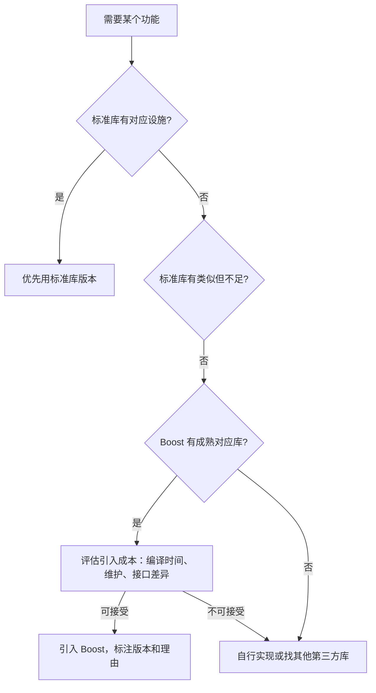

# 第 22 章 Boost 的定位、生态与选型原则

Boost 是 C++ 标准库的“预备役”和“补充层”。很多标准库设施（如 `std::optional`、`std::variant`、`std::filesystem`、`std::thread`）最初都在 Boost 里打磨过，经过标准化委员会的改进后才进入标准。学习 Boost 不只是为了用更多库，更是为了理解 C++ 标准库的演进方向，以及在标准库暂未覆盖某个领域时，有什么成熟的替代方案可选。

本章覆盖：

- 22.1 Boost 与 C++ 标准库的共生关系；
- 22.2 现代 C++ 项目中引入 Boost 的决策框架；
- 22.3 获取、构建与链接模式：header-only 与 compiled 库。

核心原则：**标准库优先，Boost 补位**。每一节都会按“已被标准化 / 部分标准化 / 纯 Boost 独有”三分法标注设施的定位。

> **工具约定**：第 7 章起，示例默认采用 CMake + vcpkg 工程模板。Boost 依赖可以通过 `find_package(Boost)` 或 vcpkg 清单引入。代码片段可用 `cxxsh` 单文件验证（需链接 compiled Boost 库时按实际平台添加库路径），放入真实项目时请套用第 7.7 节的工程模板。

---

## 22.1 Boost 与 C++ 标准库的共生关系

### 22.1.1 Boost 是什么

Boost（https://www.boost.org）是一个由 C++ 社区驱动的开源库集合，涵盖智能指针、正则、线程、文件系统、协程、图算法、多精度数值、单元测试等几十个子库。它成立于 1998 年，早期许多成员后来成为 C++ 标准化委员会（WG21）的成员，Boost 因而成为了 C++ 标准库的“试验场”。

典型的“从 Boost 到标准”的迁移例子：

| Boost 库 | 对应标准设施 | 标准版本 |
|---|---|---|
| Boost.Optional | `std::optional` | C++17 |
| Boost.Variant | `std::variant` | C++17 |
| Boost.Any | `std::any` | C++17 |
| Boost.Filesystem | `std::filesystem` | C++17 |
| Boost.Thread | `std::thread` 等 | C++11 |
| Boost.Chrono | `std::chrono` | C++11 |
| Boost.Bimap | 标准中无直接对应（纯 Boost 独有）| — |
| Boost.MultiIndex | 标准中无直接对应（纯 Boost 独有）| — |

可以看到，标准库往往“借鉴” Boost 的接口设计，但标准化后会有所精简或调整。例如 `boost::optional` 和 `std::optional` 用法很像，但 `std::optional` 做了一些 API 微调；`boost::filesystem` 的路径操作与 `std::filesystem` 基本一致，迁移成本低。

### 22.1.2 三种定位：已标准化 / 部分标准化 / 纯 Boost 独有

在本书的 Boost 篇中，每个设施会按下面三类标注：

1. **已被标准化**：Boost 里有，标准库里也有（如 `optional`、`variant`、`filesystem`）。优先用标准版本，Boost 版本只在需要旧编译器兼容或标准版本缺少某些扩展时考虑。
2. **部分标准化**：标准库有类似功能，但 Boost 版本更强大或接口不同（如 Boost.Asio vs 标准网络尚未标准化、Boost.Container 扩展容器 vs 标准容器）。
3. **纯 Boost 独有**：标准库完全没有对应设施（如 Boost.MultiIndex、Boost.Bimap、Boost.Graph、Boost.Spirit）。只有在这些领域有明确需求时，才引入 Boost。

### 22.1.3 为什么不直接全部用 Boost

Boost 库质量普遍很高，但引入 Boost 不是零成本：
- 编译时间：部分 Boost 库模板极重，编译变慢；
- 二进制体积：需要额外维护 Boost 源码或二进制包；
- 接口差异：Boost 接口和标准库接口可能不完全一致，团队需学习两套习惯；
- 标准化风险：某些 Boost 特性可能永远不会进入标准，或进入标准后接口发生变化，旧代码需迁移。

因此，现代 C++ 项目的选型纪律是：**标准库能做的，就不引入 Boost；只有标准库做不到、做得不够好，或明确需要 Boost 独有特性时，才谨慎引入。**

> **小结**：Boost 是 C++ 标准库的“预备役”，许多标准设施源自 Boost；设施按“已标准化 / 部分标准化 / 纯 Boost 独有”三分法定位；选型遵循“标准库优先，Boost 补位”。

---

## 22.2 现代 C++ 项目中引入 Boost 的决策框架

### 22.2.1 基本纪律

在决定是否引入某个 Boost 库之前，按顺序问三个问题：

1. **标准库（C++11/14/17/20/23）里有没有对应设施？** 有的话，优先用标准版本。
2. **标准库版本能不能满足需求？** 如果标准库有但功能不足（例如需要的特性标准里还没加，或性能/接口有差距），考虑 Boost。
3. **Boost 里有没有成熟、活跃维护的对应库？** 有的话，评估引入成本；没有的话，考虑自己实现或找其他第三方库。



### 22.2.2 必须引入 Boost 的三类情形

尽管“标准库优先”，但下面三类情形通常值得引入 Boost：

1. **标准库完全没有对应设施**：如需要多索引容器（`boost::multi_index`）、双向映射（`boost::bimap`）、图算法（`boost::graph`）、解析器生成（`boost::spirit`），标准库都没有直接对应，Boost 是几乎唯一的成熟选择。
2. **需要比标准库更强的扩展**：如标准容器缺少 `circular_buffer`（环形缓冲），`boost::circular_buffer` 填补了这个空白；标准 `std::variant` 是 C++17 才有的，旧项目若用 C++14 则可用 `boost::variant` 过渡。
3. **跨平台底层能力**：如异步网络 I/O（Boost.Asio），标准库直到 C++20/26 才有初步网络提案，成熟的异步网络能力目前仍依赖 Boost.Asio。

### 22.2.3 选型文档化

引入 Boost 时，建议在项目文档或 `CMakeLists.txt` 附近记录：
- 引入的 Boost 库名和版本；
- 引入理由（标准库缺什么、标准版本不够什么）；
- 预计迁移路径（未来标准化后如何替换）。

这有助于团队后续判断某个 Boost 依赖是否还可以移除。

> **小结**：引入 Boost 前先问三个问题（标准库有没有、够不够用、Boost 有没有成熟库）；必须引入的三类情形是“标准库完全没有”“标准库不够用”“纯 Boost 独有能力”；引入时文档化理由和版本，便于未来迁移。

---

## 22.3 获取、构建与链接模式：header-only 与 compiled 库

Boost 的子库分成两大类：**纯头文件库（header-only）** 和 **需要编译链接的库（compiled library）**。获取和构建方式不同。

### 22.3.1 header-only 库

纯头文件库只需把 Boost 的 `include` 目录加到编译器的头文件搜索路径，不需要单独编译 Boost 库文件，也不需要链接 `.lib`/`.a`。大多数 Boost 工具类库（如 `boost::optional`、`boost::variant2`、`boost::lexical_cast`、`boost::spirit`）都是 header-only 的。

使用方式（以 `boost::lexical_cast` 为例）：

```cpp
// boost_header_only.cpp
#include <iostream>
#include <string>
#include <boost/lexical_cast.hpp>

int main() {
    int i = boost::lexical_cast<int>("42");   // 字符串转 int
    double d = boost::lexical_cast<double>("3.14");
    std::string s = boost::lexical_cast<std::string>(100);  // int 转字符串
    
    std::cout << i << ", " << d << ", " << s << '\n';
}
```

CMake 集成示例（header-only，只需头文件路径）：

```cmake
find_package(Boost REQUIRED COMPONENTS ...)  # 即使不需要编译，通常也用 find_package 定位 Boost 根目录
target_include_directories(myapp PRIVATE ${Boost_INCLUDE_DIRS})
target_link_libraries(myapp PRIVATE Boost::headers)  # Boost 提供的 header-only 目标
```

### 22.3.2 compiled 库

部分 Boost 库需要单独编译成静态库或动态库，然后链接到项目。典型的 compiled 库包括 `boost::system`、`boost::filesystem`（C++17 之前版本）、`boost::thread`（旧版本）、`boost::program_options`、`boost::regex` 等。

使用 Boost 的传统构建工具是 `b2`（Boost.Build），但现代 CMake 项目更常用 `find_package(Boost)` 定位已安装的 Boost 库文件。

CMake 集成示例（compiled 库，如 `boost::system`）：

```cmake
find_package(Boost 1.74 REQUIRED COMPONENTS system filesystem)
target_link_libraries(myapp PRIVATE Boost::system Boost::filesystem)
```

`Boost::system` 和 `Boost::filesystem` 是 CMake 提供的“导入目标”，链接它们会自动带上库路径和头文件路径，无需手动指定。

### 22.3.3 vcpkg 集成（推荐）

如果项目已经使用 vcpkg（见第 7 章），引入 Boost 更简单：在 `vcpkg.json` 的 `dependencies` 里声明需要的 Boost 库，vcpkg 会自动下载编译并安装；CMake 配置时通过工具链文件自动找到。

```json
{
  "name": "my-project",
  "version-string": "1.0.0",
  "dependencies": [
    "boost-system",
    "boost-filesystem",
    "boost-lexical-cast"
  ]
}
```

对应的 `CMakeLists.txt`：

```cmake
find_package(Boost REQUIRED COMPONENTS system filesystem)
target_link_libraries(myapp PRIVATE Boost::system Boost::filesystem)

# boost::lexical_cast 是 header-only，直接包含头文件即可
target_include_directories(myapp PRIVATE ${Boost_INCLUDE_DIRS})
```

### 22.3.4 header-only vs compiled 怎么选

| 模式 | 获取方式 | 编译链接 | 典型代表 |
|---|---|---|---|
| header-only | 加入头文件搜索路径 | 无需链接库文件 | `boost::lexical_cast`, `boost::spirit`, `boost::variant2` |
| compiled | `find_package(Boost)` 或 vcpkg 安装 | 需链接 `.lib`/`.a` | `boost::system`, `boost::filesystem`, `boost::thread`（旧版） |

> **小结**：Boost 库分 header-only 和 compiled 两类；header-only 只需头文件路径，compiled 需要 `find_package(Boost)` 或 vcpkg 链接；现代项目推荐用 vcpkg 统一管理 Boost 依赖，CMake 端通过 `find_package(Boost)` 和 `Boost::xxx` 导入目标使用。

---

## 本章小结

本章我们学习了 Boost 的整体定位和选型原则：

1. **Boost 与标准库的共生关系**：Boost 是 C++ 标准库的“试验场”，许多标准设施（`optional`、`variant`、`filesystem`、`thread` 等）源自 Boost；
2. **三种定位**：已标准化、部分标准化、纯 Boost 独有，选型时按此分类判断；
3. **决策框架**：标准库优先，只有标准库没有、不够用，或需要 Boost 独有能力时才引入，并文档化理由；
4. **构建与链接**：header-only 库只需头文件路径，compiled 库需通过 `find_package(Boost)` 或 vcpkg 链接，现代项目推荐 vcpkg 清单模式。

下一章（第 23 章）我们进入 Boost 容器与数据结构，学习 `boost::multi_index`、`boost::intrusive`、`boost::circular_buffer`、`boost::bimap`、`boost::variant2`。

## 练习

1. 用 `boost::lexical_cast` 把字符串 `"3.14"` 转成 `double`，把整数 `42` 转成字符串，打印结果。
2. 在 `CMakeLists.txt` 中用 `find_package(Boost REQUIRED COMPONENTS system)` 定位 Boost.System，并链接 `Boost::system`。
3. 用 vcpkg 清单模式给项目添加 `boost-lexical-cast` 依赖，验证 `find_package(Boost)` 能找到 vcpkg 安装的 Boost 头文件。
4. 查阅 Boost 官方文档，列出三个“已被标准化”（标准库有对应设施）和三个“纯 Boost 独有”（标准库无对应）的 Boost 库。
