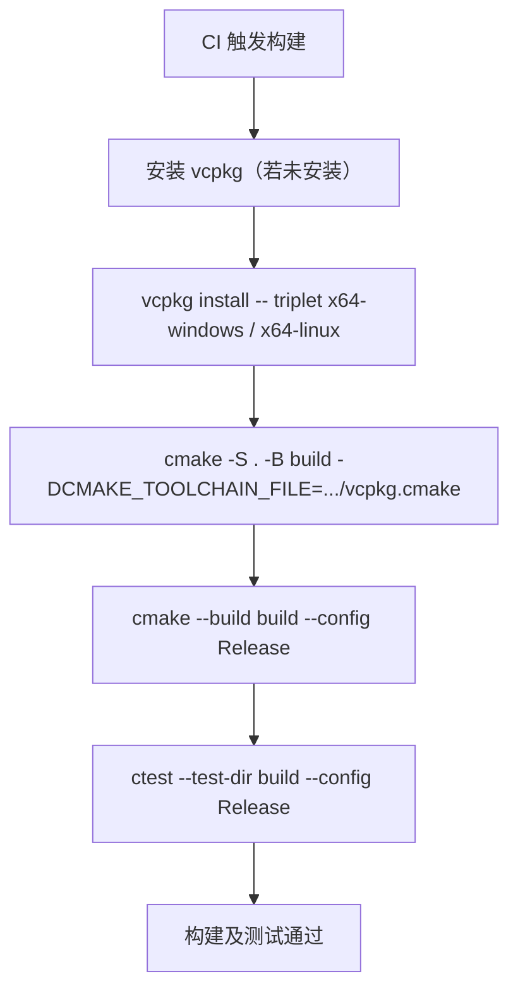

# 第 29 章 模块化工程与构建

前面第 7 章已经介绍了 CMake 和 vcpkg 的基础：最小工程、`target_*` 命令、依赖获取、vcpkg 集成、`CMakePresets.json` 以及完整工程模板。本章作为第五篇的开篇，进一步深入模块化工程的落地问题，重点讨论：

- 29.1 C++20 模块在工程中的落地：接口与实现分离、模块分区、全局模块片段、与头文件库互操作、构建系统依赖扫描；
- 29.2 CMake 对模块与包管理的进阶支持：CMake 的 C++ 模块依赖扫描、`install(EXPORT)` 与 `find_package` 的配合，以及 CMake 与 vcpkg 在持续集成中的协同。

> **工具约定**：本章涉及 C++20 模块，目前 GCC/Clang/MSVC 对模块的支持仍在完善中，且构建系统对模块依赖扫描的支持程度不一。示例代码若需真正编译，请确认编译器版本（GCC 11+、Clang 14+、MSVC 19.29+）和 CMake 版本（3.24+ 对模块支持更完善）。代码片段可用 `cxxsh` 单文件验证非模块部分，放入真实项目时请套用第 7.7 节的工程模板。

---

## 29.1 C++20 模块在工程中的落地

### 29.1.1 模块的基本回顾

第 6 章已经介绍了模块的基本语法：`export module` 声明模块接口单元，`import` 导入模块，`export` 控制对外可见性。模块试图解决头文件模型的问题（编译慢、宏泄漏、包含顺序敏感、接口不清）。

下面是一个最小的模块工程示例：

```
math_module/
├── CMakeLists.txt
├── src/
│   ├── math.cppm      // 模块接口单元
│   └── math.cpp       // 模块实现单元
└── main.cpp           // 使用模块的主程序
```

```cpp
// src/math.cppm —— 模块接口单元
export module math;

export int add(int a, int b) {
    return a + b;
}

export double multiply(double a, double b) {
    return a * b;
}
```

```cpp
// src/math.cpp —— 模块实现单元
module math;   // 不加 export，属于 math 模块的实现部分

// 这里可以放置不需要对外暴露的实现细节
```

```cpp
// main.cpp —— 导入模块
import math;

#include <iostream>

int main() {
    std::cout << add(2, 3) << '\n';
    std::cout << multiply(2.5, 4.0) << '\n';
}
```

CMake 集成示例（CMake 3.24+ 对模块支持更完善）：

```cmake
cmake_minimum_required(VERSION 3.24)
project(math_module LANGUAGES CXX)

set(CMAKE_CXX_STANDARD 20)
set(CMAKE_CXX_STANDARD_REQUIRED ON)

add_executable(math_app main.cpp src/math.cppm src/math.cpp)
target_compile_features(math_app PRIVATE cxx_std_20)
```

### 29.1.2 模块接口单元 vs 实现单元

在工程中，模块通常拆成两部分：

- **模块接口单元（`.cppm`）**：声明模块名、导出接口（`export` 的函数、类、变量、模板），是模块对外的“公开面”；
- **模块实现单元（`.cpp`）**：提供具体的函数定义、类成员函数实现，使用 `module 模块名;`（不加 `export`）声明自己属于哪个模块。

这种拆分和头文件/源文件的拆分类似，但关键区别在于：接口单元里的非 `export` 内部实现细节不会泄漏给导入方，且模块只编译一次，后续导入该模块的翻译单元可以复用编译结果，显著加快构建速度。

### 29.1.3 模块分区（Partitions）

大型模块可以拆成多个**分区（partition）**，每个分区是一个独立的翻译单元，但共享同一个模块名。例如：

```
export module mylib.core;        // 主接口
export module mylib.io;          // 分区：IO 相关
export module mylib.math;        // 分区：数学相关
```

导入方可以整体导入模块（`import mylib;`），也可以只导入某个分区（`import mylib.io;`）。模块分区有助于缩短单个接口文件的编译时间，并允许按功能粒度组织代码。

需要注意的是，分区的命名使用点号分隔（如 `mylib.io`），但点号在模块名中没有固有的层级含义，只是约定俗成的组织方式。

### 29.1.4 全局模块片段（Global Module Fragment）

在模块接口单元或实现单元中，`module` 声明之前出现的代码属于**全局模块片段**。这里可以放置：

- 需要被模块内所有单元共享的 `#include`（如标准库头文件、C 风格头文件）；
- 宏定义（但宏不会被导出，只在模块内部可见）；
- 其他预处理指令。

```cpp
// math.cppm
#include <iostream>              // 全局模块片段：模块内部共享头文件
#define INTERNAL_DEBUG 1         // 宏仅在模块内可见，不会泄漏给 import 方

export module math;

export int add(int a, int b) {
    std::cout << "debug: " << INTERNAL_DEBUG << '\n';
    return a + b;
}
```

全局模块片段解决了模块中“如何包含旧式头文件”的问题，同时避免了宏泄漏到导入方。

### 29.1.5 与头文件库的互操作

现实工程中，模块和头文件库会长期共存。一个模块可以 `import` 另一个模块，也可以 `#include` 一个传统头文件；反过来，一个传统源文件（`.cpp`）也可以 `import` 一个模块。关键准则：

- 新代码优先用模块，旧代码保持头文件；
- 模块里可以 `#include` 头文件，但头文件里不能 `import` 模块（头文件不认识模块概念）；
- 公开的 API 若希望被模块导入方使用，应提供模块接口单元，或至少保证头文件能被模块安全包含。

### 29.1.6 构建系统依赖扫描

模块最大的构建挑战是**依赖扫描**：在编译前，构建系统需要知道“哪个源文件导入了哪个模块”，才能按正确顺序编译模块接口单元。这与头文件的 `#include` 依赖扫描不同，因为模块依赖关系可能跨越翻译单元，且模块接口本身需要先编译。

CMake 3.24+ 引入了更完善的 C++ 模块支持，可以自动扫描模块依赖并生成正确的构建顺序。但各编译器和构建系统的实现进度不一，实际落地时需：

1. 确认编译器支持模块（GCC 11+、`-fmodules-ts`；Clang 14+、`-fmodules-ts`；MSVC 19.29+、`/std:c++20`）；
2. 确认 CMake 版本足够新（推荐 3.24+）；
3. 在 `CMakeLists.txt` 中显式列出模块接口文件（`.cppm`），让构建系统知道哪些目标产出模块。

> **小结**：模块工程落地需要关注接口/实现拆分、模块分区、全局模块片段、与头文件库共存，以及构建系统的模块依赖扫描。模块是 C++20 起的新特性，工具链支持仍在完善，实际项目中建议先在非核心模块试点。

---

## 29.2 CMake 对模块与包管理的进阶支持

### 29.2.1 CMake 的 C++ 模块依赖扫描

CMake 3.24 引入了对 C++20 模块的原生支持：在配置阶段，CMake 会调用编译器扫描源文件中的 `import` 声明，识别出模块间的依赖关系，从而在构建阶段按正确顺序编译模块接口单元。

使用时，关键是正确声明模块接口文件：

```cmake
add_executable(my_app main.cpp src/mylib.cppm src/mylib.cpp)

# 指定模块接口文件，让 CMake 知道 mylib.cppm 产出 mylib 模块
set_target_properties(my_app PROPERTIES
    CXX_MODULES_DIRECTORY "${CMAKE_CURRENT_BINARY_DIR}/modules"
)
```

不同编译器的模块编译命令不同（GCC/Clang 用 `-fmodules-ts`，MSVC 用 `/std:c++20` 等），CMake 会根据编译器自动生成相应命令，用户通常不需要手动干预。

### 29.2.2 `install(EXPORT)` 与 `find_package`：库的导出与查找

当你的库要被其他项目依赖时，需要通过 `install(EXPORT)` 把构建好的目标（target）导出为 CMake 配置文件，这样依赖方才能用 `find_package(MyLib)` 找到并链接它。

```cmake
# 在你的库项目 CMakeLists.txt 中
include(CMakePackageConfigHelpers)
include(GNUInstallDirs)

install(TARGETS mylib
    EXPORT mylibTargets
    RUNTIME DESTINATION ${CMAKE_INSTALL_BINDIR}
    LIBRARY DESTINATION ${CMAKE_INSTALL_LIBDIR}
    ARCHIVE DESTINATION ${CMAKE_INSTALL_LIBDIR}
)

install(FILES include/mylib.hpp
    DESTINATION ${CMAKE_INSTALL_INCLUDEDIR}
)

# 导出 CMake 配置文件
export(EXPORT mylibTargets
    FILE "${CMAKE_CURRENT_BINARY_DIR}/mylibTargets.cmake"
    NAMESPACE MyLib::
)

write_basic_package_version_file(
    "${CMAKE_CURRENT_BINARY_DIR}/mylibConfigVersion.cmake"
    VERSION 1.0.0
)

configure_package_config_file(mylibConfig.cmake.in
    "${CMAKE_CURRENT_BINARY_DIR}/mylibConfig.cmake"
    INSTALL_DESTINATION ${CMAKE_INSTALL_LIBDIR}/cmake/mylib
)

install(FILES
    "${CMAKE_CURRENT_BINARY_DIR}/mylibTargets.cmake"
    "${CMAKE_CURRENT_BINARY_DIR}/mylibConfig.cmake"
    "${CMAKE_CURRENT_BINARY_DIR}/mylibConfigVersion.cmake"
    DESTINATION ${CMAKE_INSTALL_LIBDIR}/cmake/mylib
)
```

依赖方项目则通过 `find_package` 查找：

```cmake
find_package(MyLib 1.0 REQUIRED)
target_link_libraries(my_app PRIVATE MyLib::mylib)
```

`install(EXPORT)` 生成的 `mylibTargets.cmake` 里定义了 `MyLib::mylib` 导入目标，包含头文件路径、链接库、编译选项等信息，依赖方无需关心库具体安装在哪里。

### 29.2.3 CMake 与 vcpkg 在持续集成中的协同

vcpkg（见第 7.5 节）负责下载和编译第三方库，CMake 负责构建项目。在持续集成（CI）中，两者的典型协同流程是：



关键点：
- `vcpkg install` 可以预先安装项目 `vcpkg.json` 中声明的依赖，也可以在 CMake 配置时由 vcpkg 工具链自动安装缺失依赖（清单模式）；
- CI 任务应固定 vcpkg 的基准提交（baseline），避免依赖版本意外升级导致构建不可复现；
- `CMAKE_TOOLCHAIN_FILE` 指向 vcpkg 的 `scripts/buildsystems/vcpkg.cmake`，让 CMake 透明地找到 vcpkg 安装的库；
- 构建产物（`build/` 目录）不应提交版本控制，CI 每次从干净的检出开始构建。

### 29.2.4 模块与包管理的结合：当前局限

需要诚实地说明：C++20 模块与包管理（vcpkg、`find_package`）的结合仍处于早期阶段。当前主要局限包括：

- vcpkg 安装的 Boost、spdlog 等库多以头文件或传统已编译库形式提供，**模块接口单元（`.cppm`）尚未普遍随包一同安装**；
- `find_package` 找到的导入目标通常对应传统已编译库，而非模块；
- 构建系统的模块依赖扫描对跨项目模块依赖（如导入 vcpkg 安装的另一个库的模块）支持有限。

因此，短期内模块更适合**项目内部**的代码组织，跨项目的第三方库依赖仍以头文件 + 已编译库的方式为主。随着 C++23 `import std;` 和各工具链对模块支持的成熟，这一局限预计会逐渐改善。

> **小结**：CMake 对 C++20 模块的依赖扫描在 3.24+ 得到改善；`install(EXPORT)` 配合 `find_package` 可将库导出供他人依赖；CI 中 vcpkg 负责依赖安装，CMake 负责构建，两者通过 `CMAKE_TOOLCHAIN_FILE` 协同。模块与包管理的深度结合仍在演进中，近期以项目内部模块化为主。

---

## 本章小结

本章我们学习了模块化工程与构建的进阶内容：

1. **模块接口单元与实现单元**：`.cppm` 提供 `export` 接口，`.cpp` 提供实现，非 `export` 内容不泄漏给导入方；
2. **模块分区**：大型模块可拆成 `mylib.core`、`mylib.io` 等分区，按功能粒度组织，缩短单文件编译时间；
3. **全局模块片段**：`module` 声明前的 `#include` 和宏仅在模块内可见，不泄漏；
4. **与头文件库互操作**：模块可包含头文件，新旧代码共存，公开 API 优先提供模块接口；
5. **构建系统依赖扫描**：CMake 3.24+ 支持扫描模块依赖，需正确声明 `.cppm` 文件和模块输出目录；
6. **库的导出与查找**：`install(EXPORT)` 生成 CMake 配置文件，依赖方用 `find_package` 查找并链接导入目标；
7. **CI 中的 CMake + vcpkg 协同**：vcpkg 安装依赖，CMake 通过工具链文件集成，固定 vcpkg 基准保证构建可复现；
8. **当前局限**：模块与包管理的结合尚早期，跨项目第三方模块依赖支持有限，近期以项目内部模块化为主。

下一章（第 30 章）我们进入测试、诊断与静态分析，学习单元测试框架选型、Sanitizer、静态分析与 `std::stacktrace` 的配合。

## 练习

1. 写一个包含模块接口单元（`.cppm`）和实现单元（`.cpp`）的最小模块工程，用 CMake 3.24+ 配置并构建，观察 `import` 是否正常工作。
2. 在模块接口单元中加入全局模块片段（`#include <iostream>` 和一个宏定义），验证宏在模块外不可见。
3. 为一个静态库写 `install(EXPORT)` 规则，生成 `mylibTargets.cmake` 和 `mylibConfig.cmake`，并在另一个 CMake 项目中用 `find_package` 链接它。
4. 在 `vcpkg.json` 中添加一个依赖（如 `fmt`），在 CI 风格的脚本里用 `vcpkg install` + `cmake -DCMAKE_TOOLCHAIN_FILE=...` 一次性完成依赖安装和项目构建。
