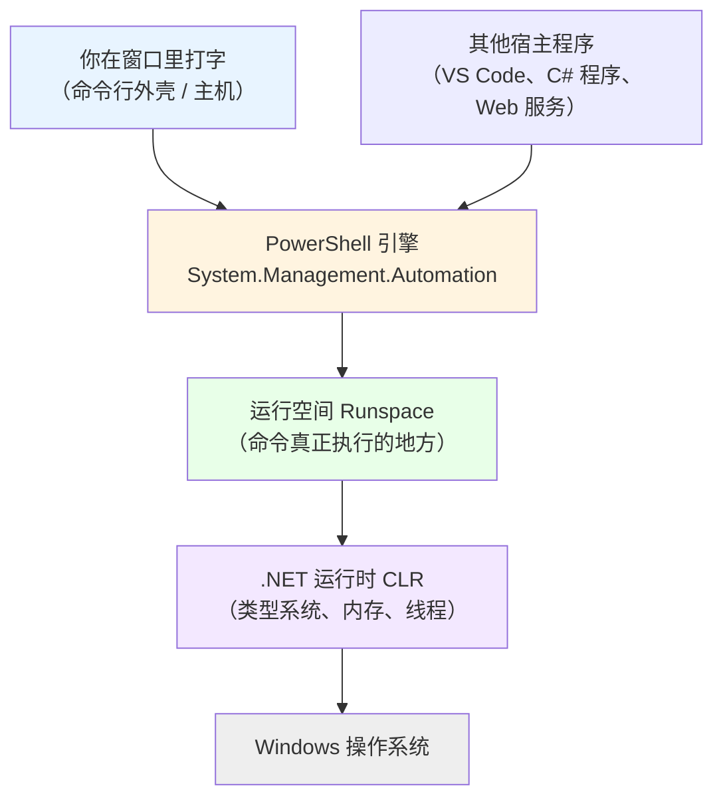
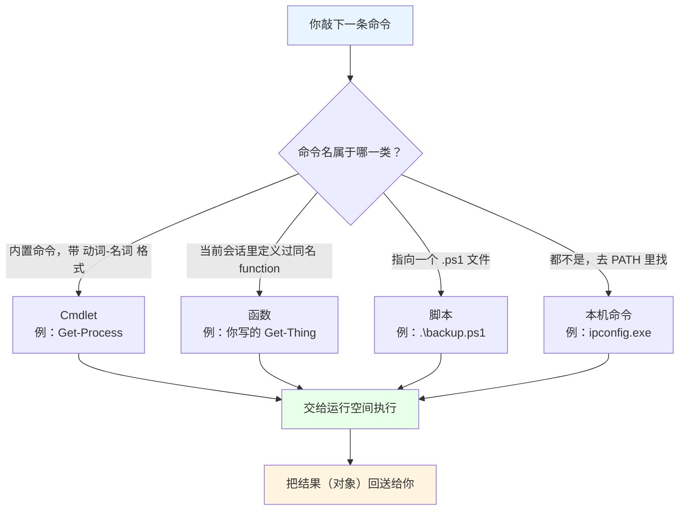
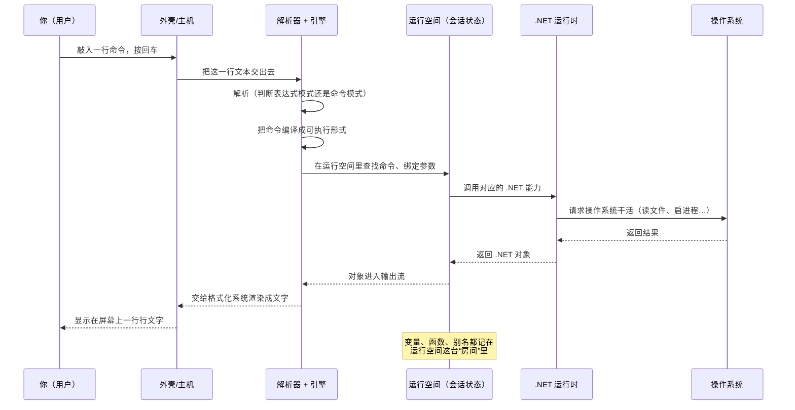
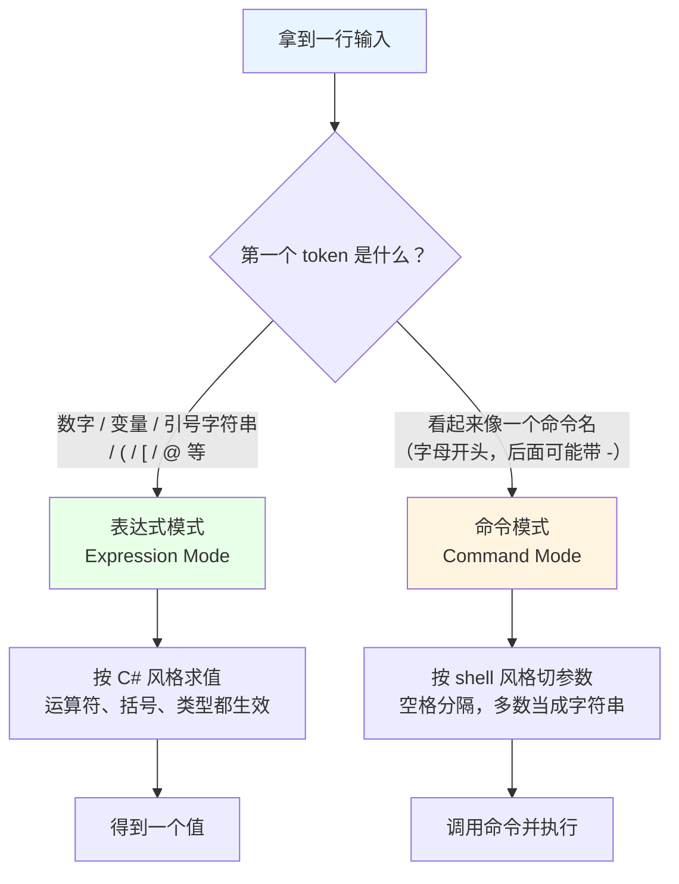
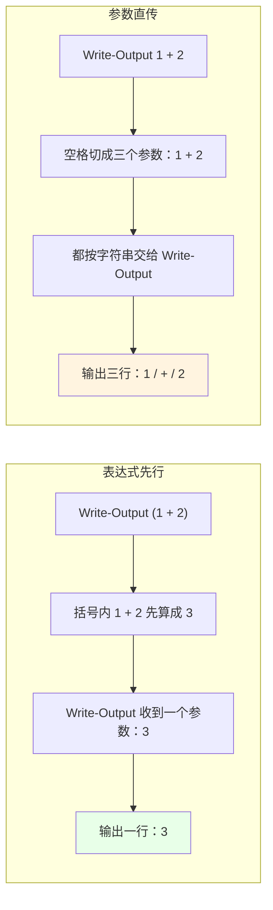
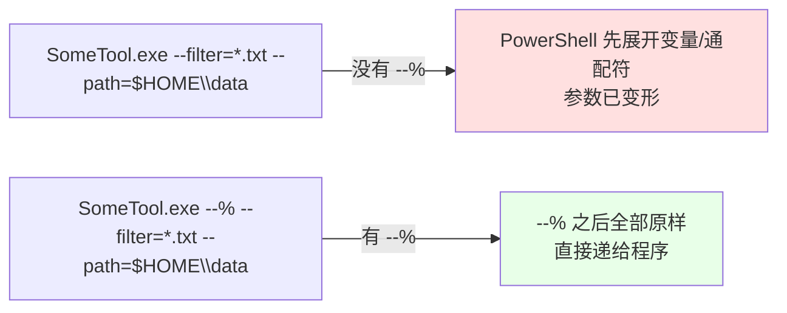

# 第 1 章 PowerShell 执行模型与程序结构

> **本章定位**：这是全书的第一章，也是整座大厦的地基。在学“变量怎么写”“管道怎么串联”“类怎么定义”之前，我们必须先搞清楚一个更根本的问题：**你敲下的那一行字，究竟是在什么容器里、被谁、按什么规矩执行的？** 这就好比学开车，在踩油门之前，得先知道方向盘连着哪儿、发动机在哪个舱。本章不教你多少“能做事的命令”，而是帮你建立一张“运行时地图”。后面的每一章，都会在这张地图上找到一个位置。

如果你从来没有接触过编程，甚至连“命令行”“脚本”这些词都觉得陌生，完全没关系。本章会从最朴素的生活经验讲起，一步步把你带到 PowerShell 的内部。我们先把几个名词用大白话揉碎了说清楚，再谈技术细节。

---

## 本章导读：先认识几个词

在正式开讲之前，先花几分钟把几个天天要用的词弄明白，后面就不会云里雾里了。

**图形界面（GUI）**：就是你平时用的窗口、图标、按钮。想打开一个程序，用鼠标双击一下；想复制文件，右键、复制、粘贴。图形界面很友好，但它有个毛病——**你点十次，它就得让你点十次**。假如你要把一千个文件名里带“2023”的挑出来改名，用鼠标点就太折磨人了。

**命令行（Command Line）**：一个纯文字的黑窗口。你在里面打字，按回车，电脑执行，然后把结果用文字吐给你。它没有按钮，全靠“打字下命令”。看起来很“原始”，但正因为它是文字的，所以**可以被记录、被复制、被批量执行**——这才有了自动化。

**Shell（壳）**：这个词很有意思，直译就是“外壳”。在计算机里，它指的是“包在操作系统外面的一层壳”，专门负责接收你打的字、翻译成操作系统听得懂的话、再把结果转述给你。你可以把它理解成一位**翻译官兼秘书**：你对着秘书说“帮我把这个月的报表都打印出来”，秘书去安排，然后回来告诉你“办好了，一共 12 份”。Windows 自带的 `cmd.exe` 是一个壳，Linux 上的 Bash 是一个壳，而 **PowerShell 是微软推出的一个更强大的壳**。

**脚本（Script）**：如果你把一大串命令提前写进一个文本文件里，让电脑照着顺序一条条执行，这个文件就叫脚本。好比你把“早上七点起床、七点半吃饭、八点出门”写在一张纸上贴墙上，以后每天照着做，不用再想。PowerShell 的脚本文件，扩展名是 `.ps1`。

**程序（Program）**：一段能完成特定任务、可以被反复执行的代码。脚本是程序的一种，只是它通常比较“轻”，不用编译成 `.exe`，由壳当场解释执行。

记住这五个词，本章剩下的内容就都能读懂了。

---

## 1.1 会话、运行空间与脚本生命周期

先设想一个再普通不过的场景：你在 Windows 的“开始菜单”里搜到一个叫 “Windows PowerShell” 的蓝色图标，点开它，弹出一个蓝底白字的窗口，光标在一行 `PS C:\Users\你的用户名>` 后面一闪一闪，等你打字。

从这一刻起，一直到你关掉这个窗口，中间发生的所有事——你敲的每一条命令、定义的每一个变量、运行的每一个脚本——都发生在一个**特定的容器**里。这个容器，PowerShell 管它叫“**运行空间**”（Runspace），而你和这个容器之间那一来一回的交互过程，叫“**会话**”（Session）。

本节要做两件事：第一，把 PowerShell 到底是个什么东西说清楚——它不是“另一个黑窗口”那么简单，它是一套“能被程序调用的自动化引擎”；第二，把“一条命令从你手里出发，到结果回到你屏幕”这条完整链路拆开给你看，让你知道 `.ps1` 脚本在这条链路里处在什么位置。

学完这一节，你再看后面所有章节的代码，心里都会有一个底：**这些代码究竟在哪儿跑、谁在跑、跑完结果去哪儿了。**

### PowerShell 不是“一个程序”，而是“一套引擎 + 若干外壳”

很多人对 PowerShell 的第一印象，是“一个黑色的窗口”。这个印象不算错，但只看到了冰山一角。

准确地说，PowerShell 由三大部分组成：

1. **命令行外壳（Shell）**：就是那个窗口，负责和你打交道。
2. **脚本语言（Scripting Language）**：一套完整的编程语法，能写变量、循环、函数、类。
3. **配置管理框架（Configuration Management）**：一套管理电脑配置的机制（这一块和本书关系不大，了解即可）。

更要紧的是：**这三样东西的核心，是一个可以被“别的程序”调用的引擎**，名字叫 `System.Management.Automation`（简称 SMA）。那个蓝色窗口，只是这个引擎的“默认外壳”之一。换句话说，PowerShell 的引擎就像发动机，蓝色窗口只是其中一款车身。你还可以把同一台发动机装进别的车身里——比如装进 Visual Studio 里、装进你自己的 C# 程序里、甚至装进一个网页后台服务里。

这一点非常关键，因为它解释了一个常见困惑：“为什么书里老说 PowerShell 构建在 .NET 之上？”——因为这台引擎本身就是用 .NET（准确地说是 CLR，公共语言运行时）写的。**PowerShell 处理的对象，本质上是 .NET 对象；它调用的底层能力，本质上是 .NET 类库的能力。** 后面第三、四部分的很多内容，都是在这句话上做文章。

我们用一张图把“外壳—引擎—运行时—操作系统”的层次关系摆出来：



看懂这张图，你就明白：**窗口 ≠ PowerShell 的全部**。窗口只是“入口”，真正的活儿是中间的引擎和运行空间干的。

### PowerShell 处理的是“对象”，不是“文本”

这是 PowerShell 区别于老式壳（比如 `cmd.exe`、Bash）最核心的一点，也是全书反复强调的一句话。

老式壳的世界里，一切皆**文本**。你运行 `dir`，它吐给你一坨字符；你想从中挑出“大于 1MB 的文件”，得用一堆字符串处理工具（`findstr`、`awk`、`grep`）去“啃”这些字符，啃错了就前功尽弃。

PowerShell 的世界里，一切皆**对象**。你运行 `Get-ChildItem`（相当于新版 `dir`），它吐给你的不是一坨字符，而是一串**文件对象**。每个对象自带属性：`.Name`（名字）、`.Length`（大小，单位是字节）、`.LastWriteTime`（最后修改时间）……你想挑出大于 1MB 的文件，直接写“找出 `.Length` 大于 1MB 的对象”就行，不用去数第几个字符。

打个比方：老式壳给你的是**一张打印好的报表**，你想找某个数，只能拿眼睛一行行扫；PowerShell 给你的是**一个 Excel 表格**，每一列都有名字，你可以直接对“大小”这一列做筛选、求和、排序。

我们马上就能亲眼看到“对象”长什么样：

```powershell
# 取当前目录下的文件/文件夹对象
Get-ChildItem

# 每个对象都有属性；看其中一个对象“长什么样”
(Get-ChildItem | Select-Object -First 1) | Get-Member

# 直接访问属性：名字和大小（字节）
(Get-ChildItem | Select-Object -First 1).Name
(Get-ChildItem | Select-Object -First 1).Length
```

至于“对象”到底是怎么被 `PSObject` 包起来的、为什么 `Get-ChildItem` 的结果看起来“属性比想象的还多”，那是第 2 章的内容。这里你只要记住这句话：**对象，是一堆有名字的属性和能做的事情的集合。**

### 四种命令类型：PowerShell 的“命令家族谱”

在 PowerShell 里，“命令”这两个字涵盖的东西，比你想象的要多。你敲的每一样东西，最终都会落到下面四种类型之一：

| 类型 | 英文 | 通俗解释 | 长相/来源 |
|---|---|---|---|
| **Cmdlet**（命令小程序） | cmdlet，读“command-let” | PowerShell 自带的、用 C# 写好的“内置指令” | 形如 `Get-Process`，动词-名词命名 |
| **函数 / 方法** | function / method | 你自己在脚本里用 `function` 定义的小工具 | 形如 `function Get-Thing { ... }` |
| **脚本** | script | 一个 `.ps1` 文件，里面装着一串命令 | 形如 `.\myscript.ps1` |
| **本机命令** | native command | 系统里原本就有的外部程序（`.exe`、`.bat`、`.cmd`） | 形如 `ipconfig`、`ping`、`notepad.exe` |

它们之间的调用关系，可以用一张图表示。当你敲下一行命令，PowerShell 会先“翻家底”，看这条命令到底是哪家的：



这里有几个界限要特别说清楚，因为它们直接决定了后面很多“为什么会这样”的问题：

- **Cmdlet 和函数的区别**：Cmdlet 是“编译好”的，天生带一整套标准能力（比如 `-Verbose` 详细输出、`-ErrorAction` 错误处理）；函数是“运行时才解释”的，默认就是个光秃秃的小工具。但别急——第 5 章会教你把函数“升级”成“高级函数”，让它也能拥有 Cmdlet 那套标准能力。所以两者并不是老死不相往来。
- **脚本和函数的关系**：一个 `.ps1` 文件本身就是一个“命令”，你可以在里面定义一堆函数，也可以直接写一串命令。你把脚本“点源”（`.` 运算符）进当前会话，里面的函数就跑到了你手边。
- **本机命令是“外来的”**：`ipconfig`、`ping`、`notepad.exe` 这些不是 PowerShell 亲生的，它们是 Windows 本来就有的程序。PowerShell 调用它们时，需要把对象“降级”成文本传过去，再把它们的文本输出“勉强”包装成对象收回来。这一去一回的“翻译损耗”，是后文讲外部命令时经常要面对的坑。

想亲手分辨一下吗？用 `Get-Command` 查一下就知道它是哪一类：

```powershell
Get-Command Get-Process      # CommandType: Cmdlet
Get-Command ipconfig         # CommandType: Application
Get-Command Get-ChildItem    # CommandType: Cmdlet（同时也可能是别名/函数包装）
```

记住这张“家族谱”。以后你看到一条命令，第一反应应该是：“它是这四类里的哪一类？”——这个判断习惯，能帮你省下无数个抓破头的夜晚。

### 运行空间（Runspace）：命令真正执行的地方

现在进入本节最核心的概念：**运行空间**。

刚才说“命令交给运行空间执行”，那运行空间到底是个啥？

一句话：**运行空间是 PowerShell 引擎在内存里开辟出来的一块“执行环境”**。它就像一个装了家具的房间：

- 房间里摆着目录（当前在哪个文件夹）、摆着记事本（`$Error` 错误记录）、摆着各式小抽屉（`$PSVersionTable` 版本信息）；
- 更重要的是，房间里有一整套“家规”：你定义过的变量、函数、别名，都记在这个房间的账本上——这本账，专业叫**会话状态**（Session State）。

所以，**同样的命令，在不同的运行空间里跑，结果可能完全不同**。因为一个运行空间里可能定义了一个叫 `Get-Thing` 的函数，另一个运行空间里压根没有。这也解释了为什么“关闭窗口再打开，刚才定义的变量就没了”——不是变量消失了，是你换了一个全新的空房间。

你可以用下面几个命令亲手“看到”运行空间：

```powershell
# 查看当前进程里有哪些运行空间
Get-Runspace

# 挑几个关键信息看：编号、名字、可用状态
Get-Runspace | Select-Object Id, Name, Availability, RunspaceStateInfo

# 当前线程默认使用的运行空间（静态属性）
[System.Management.Automation.Runspaces.Runspace]::DefaultRunspace
```

典型输出如下（不同机器、不同版本会略有差别）：

```text
 Id Name        Availability RunspaceStateInfo
 -- ----        ------------ ------------------
  1 Runspace1   None         Opened
```

那条 `Availability` 是 `None`、状态是 `Opened` 的记录，通常就是**你正在用的这个运行空间**。注意它的编号是 1——绝大多数交互式会话，默认就只有一个主运行空间（除非你手动创建）。

那“我能不能自己造一个运行空间，用来专门跑一段脚本，不影响主窗口？” 可以。这正是 PowerShell 作为“引擎”而不仅是“窗口”的价值所在。第 17 章讲并发的时候会大用特用，这里先做一个最小演示，让你有个感性认识：

```powershell
# 用 .NET 的 PowerShell 类创建一个独立的“执行器”
$ps = [System.Management.Automation.PowerShell]::Create()

try {
    # 往这个执行器里塞一段脚本
    $null = $ps.AddScript('1 + 1')

    # 执行，并拿到结果集合
    $result = $ps.Invoke()

    # 结果是一个集合，这里只有一个元素：2
    $result          # 输出 2
}
finally {
    # 用完必须释放，否则会占用资源
    $ps.Dispose()
}
```

这段代码看起来有点“吓人”，其实拆开就是三句话：**造一个执行器 → 塞一段脚本进去 → 执行并收结果**。`[System.Management.Automation.PowerShell]` 这个长长的类型名，就是“PowerShell 引擎”在 .NET 里的正式名字。你暂时不用背它，但要知道：**你在窗口里做的每一件事，底层都可以用这种“程序调用”的方式完成**。这就是 PowerShell 能被嵌入到别的程序里的原因。

### 会话（Session）：运行空间之上的交互上下文

“运行空间”和“会话”经常被混着用，但严格说，它们不是一回事。我们用一个比喻来区分：

- **运行空间**是“**房间**”——硬件层面的执行环境，装的是执行所需的全部机制。
- **会话**是“**你和这个房间之间的一段关系**”——你是第几次进这个房间、这次带没带远程连接、当前是不是处于交互式输入状态。

更精确一点：**一个运行空间**负责“执行”，它是一台机器的核心部件；**一个会话**负责“交互”，它是建立在一个运行空间之上的上下文。

在本地交互式场景里，你看不出两者的差别，因为你就是一个人、一个房间、一直在里面。但一旦涉及**远程**，区别就出来了：你可以用 `New-PSSession` 在另一台电脑上开一个会话，本地窗口还是本地窗口，但命令实际是在远端那台电脑的运行空间里执行的。本地只是“遥控器”，远端才是“执行现场”。

```powershell
# 在远端电脑 Server01 上开一个会话（需要目标机开启远程管理）
# 注意：这只是演示，没有配置过的机器会失败
$session = New-PSSession -ComputerName Server01

# 在这个远端会话里执行命令，结果会回到本地
Invoke-Command -Session $session -ScriptBlock { Get-Date }

# 用完后清理
Remove-PSSession $session
```

这段代码你现在不用能跑通，只要读出这个意思就行：**会话是“交互关系的句柄”，运行空间是“执行现场”**。你拿 `$session` 这个句柄去发号施令，实际动手的是远端那个运行空间。

还有一个自动变量，是“当前宿主”的化身，叫 `$Host`。它代表“正在和你打交道的那个外壳程序”，你可以问它叫什么名字、是什么版本：

```powershell
$Host.Name        # 例如：ConsoleHost
$Host.Version     # 外壳版本号
$Host.UI          # 这个外壳提供的用户界面能力（读写、弹提示等）
```

`$Host` 之所以有用，是因为**同一个引擎可以装在不同外壳里**（控制台、VS Code 集成终端、Windows Terminal……），`$Host` 能告诉你“我现在到底待在哪副车身里”，从而让脚本做出适配。

还有一个 `$PSCmdlet`，它只在**高级函数内部**才有意义（第 5 章会细讲），代表“当前正在执行的那个命令自身”。你现在知道有这么个东西即可：

```powershell
function Test-Cmdlet {
    [CmdletBinding()]
    param()

    # 只有在加了 [CmdletBinding()] 的高级函数里，$PSCmdlet 才有值
    $PSCmdlet.GetType().Name      # 通常是 PSScriptCmdlet
    $PSCmdlet.MyInvocation.Line   # 本次调用的原始行
}
```

### `.ps1` 脚本：把命令写进文件

前面讲“脚本”时提过一嘴，这里正式说明。

PowerShell 的脚本文件，扩展名固定是 **`.ps1`**（那个 `1` 是历史原因，表示 PowerShell 1.0，虽然现在早就到 7 了，名字没改）。它不是二进制程序，就是**一个纯文本文件**，你用记事本就能打开、编辑。

一个最小的脚本长这样：

```powershell
# 文件名：hello.ps1
# 这是注释，以 # 开头的行不会被当作命令执行

param(
    [string]$Name = '世界'
)

Write-Output "你好，$Name！"
```

这段脚本做了三件事：第一行 `#` 后面是注释（给人看的，电脑忽略）；`param(...)` 声明了一个“参数”，叫 `$Name`，默认值是“世界”；最后一行输出一句问候。

怎么运行它？假设这个文件在 `D:\demo\hello.ps1`，你在这个目录下打开 PowerShell，这样调用：

```powershell
.\hello.ps1
# 输出：你好，世界！

.\hello.ps1 -Name 'PowerShell'
# 输出：你好，PowerShell！
```

那个 `.\` 前缀是必须的——它的意思是“**当前目录下的**”。PowerShell 出于安全考虑，不让你直接敲一个脚本名就运行（否则可能被恶意的同名程序冒充），必须明确告诉它“我就要跑当前目录的这个文件”。

> **小提示**：第一次运行脚本，你可能会遇到一段红字，说什么“禁止运行脚本”。这不是你的脚本写错了，而是 Windows 默认的“执行策略”在挡路。执行策略是第 31 章的主题，这里先给你一个能继续往下学的办法：以管理员身份打开 PowerShell，运行
> ```powershell
> Set-ExecutionPolicy -Scope CurrentUser -ExecutionPolicy RemoteSigned
> ```
> 然后按 `Y` 确认。这只影响你自己这个账户，风险可控。记住，执行策略**不是安全边界**，它只是防止你不小心双击了来路不明的脚本。

`.ps1` 文件之所以重要，是因为它是**把一个“动作”固化成一个“命令”** 的最小单位。你写好一个脚本，以后就可以像用 `Get-Process` 一样用它——它正式加入了前面那张“命令家族谱”，成了“脚本类”的一员。

### 一次执行的完整生命周期

到这里，零件的名字都认全了。我们把它们串成一条线：**从你敲下回车，到结果出现在屏幕上，中间发生了什么？**



这条线里有两个地方，初学者最容易被绊住，值得提前打个预防针：

1. **“显示成文字”是最后一步，不是对象本身**。屏幕上你看到的是“文字”，那是因为最终得给你看；但在管道中间流动的，一直是对象。第 11、12 章会把“对象流”和“格式化输出”彻底拆开讲。
2. **解析器要判断“这行用哪套语法”**。这就是我们下一节要讲的重点——表达式模式与命令模式。你现在已经在第 3 步看到它冒了个头。

### 1.1 小结

这一节的内容可以浓缩成一张“心智图”：

- **PowerShell 是引擎，不只是窗口**。窗口是外壳，引擎是 `System.Management.Automation`，运行空间是执行现场。
- **它处理对象，不处理文本**。这是它和 `cmd.exe`／Bash 的分水岭。
- **命令有四类**：Cmdlet、函数、脚本、本机命令。认清类型，才能预判行为。
- **运行空间是会话语义的房间**，变量、函数、别名都存在房间里；换个房间，一切重来。
- **`.ps1` 脚本是“可复用的命令”**，用 `.\` 调用，受执行策略管理。
- **一次执行 = 解析 → 编译 → 绑定 → 执行 → 输出对象 → 渲染成文字**。

把这张图记在心里，下一节我们就把“解析”这一步放大，看看 PowerShell 那套让无数初学者抓狂的“两套语法”到底是怎么回事。

---

## 1.2 表达式模式与命令模式

如果你之前用过 C、C#、Java 或者 JavaScript，第一章可能让你觉得“还好嘛，都看得懂”。但只要你亲手敲过几行 PowerShell，迟早会冒出这样的困惑：

> “为什么 `Write-Output (1 + 2)` 输出 3，而 `Write-Output 1 + 2` 却输出了三行东西？”
>
> “为什么 `$x = Get-Date` 这个等号就正常，而 `2 + 3` 直接敲在命令提示符后面又能算出 5？”
>
> “为什么有的地方要加括号，有的地方加了括号反而报错？”

所有这些问题，根子是同一个：**PowerShell 的解析器内部有“两套语法”，它会在两套之间来回切换**。一套叫**表达式模式**（Expression Mode），长得像数学公式、像 C# 代码；另一套叫**命令模式**（Command Mode），长得像老式 shell 那样“用空格隔开参数”。

这一节，我们就把这个“双面人”彻底讲透。讲透之后，你再看那些“怪怪的语法”，不但不觉得怪，反而会觉得——它这么设计是有道理的。

### 一个解析器，两副面孔

想象一位**双面翻译官**。你递给他一句话，他得先判断：这句话是“**一段可以被计算的式子**”，还是“**一条命令加一串参数**”？

- 如果判断是“式子”，他就切换成**表达式模式**，按数学规则算出一个值；
- 如果判断是“命令”，他就切换成**命令模式**，把命令名和参数分开，交给命令去执行。

判断的依据，说穿了很简单：**看这行的第一个“词”是什么**。

- 第一个词如果是**数字、变量、引号字符串、`(`、`[`、`@` 这类“值”**，那它八成是一段表达式；
- 第一个词如果**既不是数字、也不是变量、也不是引号，而像是“命令名”**（`Write-Output`、`Get-Date`、`ping` 之类），那它就按命令模式处理。

我们可以用一张图把这个判定过程画出来：



这张图要看仔细，因为**它是本章最有价值的一张图**。后面你遇到的绝大多数“为什么语法怪”的问题，都能拿这张图去对照。

### 命令模式——“空格就是分界线”

我们先看命令模式，因为它更接近你印象中的“命令行”。

在命令模式下，PowerShell 的规矩非常朴素：

1. **第一个词是命令名**；
2. **后面用空格隔开的每一段，都是一个参数**；
3. **参数默认被当作字符串**，除非命令自己声明“我要一个数字/布尔值”；
4. **引号用来“抱住”带空格的参数**，让它们不被空格切开。

举个最直白的例子：

```powershell
# 命令名是 Write-Output，后面跟一个参数 "hello"
Write-Output hello
# 输出：hello

# 命令名是 Write-Output，后面跟两个参数 "hello" 和 "world"
Write-Output hello world
# 输出：
# hello
# world
```

看到了吗？`hello world` 中间那个空格，在命令模式下就是“分界线”，它把一段话切成了两个参数，所以 `Write-Output` 分两次输出了两行。这就是“命令模式以空格切分”的含义。

如果你就是想让 `Write-Output` 输出“hello world”这一整句（带空格），怎么办？用引号把它抱起来：

```powershell
Write-Output 'hello world'
# 输出：hello world（一整句）
```

或者用双引号（双引号还能做变量展开，第 3.3 节细讲）：

```powershell
$who = 'world'
Write-Output "hello $who"
# 输出：hello world
```

### 表达式模式——“像算数学题一样”

再看表达式模式。在这种模式下，PowerShell 表现得就像 C#、像 JavaScript、像你中学的数学课：

- `+`、`-`、`*`、`/`、`%` 是四则运算；
- `(` `)` 是括号，优先计算；
- `-eq`、`-gt` 这类比较运算符可用；
- 变量、类型转换 `[int]`、属性访问 `$obj.Name` 都能用；
- 等等。

最典型的触发场景，就是在提示符后面直接敲一个算式：

```powershell
2 + 3
# 输出：5

(1 + 2) * 3
# 输出：9

$name = 'PowerShell'
$name.Length
# 输出：10
```

请注意：`2 + 3` 里的 `+` 是被**当作真正的加法**来算的，而不是被当成一个普通参数字符串。这就是表达式模式的本事。

还有一个特别常见的场景：**赋值**。`$x = ...` 里的等号后面，默认就是表达式模式。

```powershell
$count = 1 + 2
$count
# 输出：3（而不是 "1"、"+"、"2"）
```

### 核心差异：同一段字，两种解读

现在我们把本节开头那个“怪现象”拿出来，认认真真解剖一遍：

```powershell
Write-Output (1 + 2)
# 输出：3

Write-Output 1 + 2
# 输出：
# 1
# +
# 2
```

为什么差这么远？

**第一行 `Write-Output (1 + 2)`**：
- 第一个词是 `Write-Output`，是命令名 → 进入**命令模式**；
- 命令模式下，参数一共有几个？`(1 + 2)` 外面有一对括号，括号在命令模式里意味着“**这里是一段表达式，先把它算出来再说**”；
- 于是 PowerShell 先把 `1 + 2` 按表达式算成 `3`，再把 `3` 作为**一个参数**交给 `Write-Output`；
- 所以输出一个 `3`。

**第二行 `Write-Output 1 + 2`**：
- 第一个词还是 `Write-Output`，还是**命令模式**；
- 命令模式下，没有括号“包住”的话，空格就是分界线；
- 于是它把后面的 `1`、`+`、`2` 当成了**三个独立参数**，通通按字符串处理；
- `Write-Output` 收到三个参数，就依次输出三行：`1`、`+`、`2`。

用一张图对比一下最清楚：



**结论要背下来**：**在命令模式下，想让一段表达式“先算出来再作为参数传进去”，就用括号把它包起来。** 括号就是“表达式模式”的通行证。

这也是为什么很多老脚本里，参数外面总是套一层 `(...)`——不是作者啰嗦，是在给解析器打信号：“**嘿，先算这个，再把结果递过去。**”

### 什么时候“自动”进表达式模式

除了“第一个词是命令名”这条规则，还有一些地方会**强制**进入表达式模式，不管你写成什么样。常见的有：

1. **括号内部**：`(` 后面的内容永远是表达式模式。
2. **赋值号右边**：`$x = ...` 的右边默认是表达式。
3. **方括号 `[]` 内部**：那是“类型”标记，比如 `[int]`、`[datetime]`，天然是表达式。
4. **数组字面量 `@(...)` / `@{}`** 的内部：分别是数组和哈希表，内部按表达式处理。
5. **`if`、`while`、`for` 的条件部分**：`if (条件)` 里的条件按表达式算。

反过来，**在命令模式下，如果一个参数想临时“变成表达式”**，就加括号。这就是前面反复强调的那一招。

我们多练几个例子，把肌肉记忆建立起来：

```powershell
# 例一：命令模式，参数用括号包住表达式
Write-Output (Get-Date).Year
# 先把 Get-Date 执行，再取 .Year，最后把年份当成一个参数输出

# 例二：表达式模式，第一个词是变量
$date = Get-Date
$date.Year
# 输出年份；$date 是变量，整行被当成表达式

# 例三：命令模式里混入变量
Write-Output $date
# 变量本身在命令模式里会被“展开”，输出日期对象

# 例四：命令模式下，算式不加括号就散了
Write-Output (3 * 4)
# 输出 12

Write-Output 3 * 4
# 输出三行：3 / * / 4
```

### `--%`：“停！后面的一切原样交给它”

有时候，你会遇到一种特别别扭的情况：你要调用一个**本机程序**（`.exe`），而它要的参数里带有一堆对 PowerShell 来说“有特殊含义”的字符，比如 `$`、引号、通配符、`;` 等等。PowerShell 一看到这些字符，就忍不住要“翻译”一下，结果传过去的参数全乱了。

举个现实中的例子：你想调用一个假设叫 `SomeTool.exe` 的程序，它今天要的参数是这样的：

```text
--filter=*.txt --path=$HOME\data
```

如果你直接写：

```powershell
SomeTool.exe --filter=*.txt --path=$HOME\data
```

PowerShell 会把 `$HOME` 当成**变量**去展开（变成你的用户目录），把 `*.txt` 当成**通配符**去理解（某些命令会做路径扩展），结果程序收到的和你想要的完全不是一回事。

这时候，就该 `--%` 登场了。

**`--%` 是“停止解析标记”（stop-parsing token）**。它的意思是：

> “**从我这里开始，后面的一整行，别再做任何 PowerShell 的解释了，原封不动地交给前面的那个外部程序。**”

用法很简单，在命令名后面放上 `--%`，然后再写参数：

```powershell
SomeTool.exe --% --filter=*.txt --path=$HOME\data
```

加了这个标记后：

- `$HOME` **不会被展开**，程序收到的是字面量 `$HOME`；
- `*.txt` **不会被通配符扩展**，程序收到的是 `*.txt`；
- 引号也按程序自己的规矩来，PowerShell 不再插手；
- 整行原样传递。

我们把差异画成图：



关于 `--%`，有几个必须记牢的边界：

1. **它只对“调用外部程序”有意义**。对 `Get-Process` 这种 PowerShell 自家命令用 `--%` 是没意义的。
2. **它必须出现在命令名之后、参数之前**，并且整个“原样传递”只覆盖这一行剩下的部分。
3. **平台限制**：`--%` 是 Windows PowerShell 的经典机制。在 Windows 上的 Windows PowerShell 和 PowerShell 7 中都能用；但在 **PowerShell 7 运行于 Linux / macOS 时并不支持**（因为它是按 Windows 外部程序的调用约定设计的）。本书以 Windows 为主，所以正常可用。
4. **它是“应急手段”，不是“日常手段”**。能用更干净的方式就用更干净的方式——也就是下面要讲的“参数数组 + splatting”。

推荐做法：先把参数装进一个数组，再用 `@` 展开（这叫 splatting，第 5 章会详细讲）。这样既没有 `--%` 的平台限制，也更容易维护：

```powershell
# 把参数拆进数组，逐个明确
$arguments = @(
    '--filter=*.txt'
    '--path=C:\Users\me\data'
)

# 用 @arguments 把数组“摊开”成一个一个参数传进去
SomeTool.exe @arguments
```

这样，`$arguments` 里的内容在进入数组时已经被明确地当作字符串保存，调用时 PowerShell 也不会再对它们做额外解释。这比 `--%` 更清晰，也更不容易在不同版本上翻车。

### `$MyInvocation.Line`——查看解析结果的“照妖镜”

理论讲完了，给你一个“照妖镜”：`$MyInvocation`。

`$MyInvocation` 是一个自动变量，记录“当前这段脚本/函数是**被谁、用什么方式调用**的”。其中 `.Line` 属性返回的是**调用它的那一整行原始文本**，一字不差——包括空格、括号、引号。用它来排查“解析到底怎么理解了我这行字”，非常有用。

```powershell
function Show-WhatHappened {
    # 打印调用本函数的那一整行原始文本
    "调用行：$($MyInvocation.Line)"
    # 打印调用本函数时用到的命令名
    "命令名：$($MyInvocation.MyCommand.Name)"
}

# 试试用不同的写法调用它，观察 Line 的变化
Show-WhatHappened

Write-Output (Show-WhatHappened)
```

运行后你会发现，`.Line` 返回的就是你当时敲的那一整行。它不会“帮你美化”，也不会“帮你解释”——它就是那串原始的字符。这在写复杂脚本、调试别人留下的老代码时，是很有用的“证物”。

> 小提示：`$MyInvocation.Line` 里用到了 `$()` 子表达式，这其实是第 3.3 节的内容。这里你只需要理解它的效果：“把括号里的东西**先算出来，再塞进字符串**”。至于 `$()` 背后的机制，我们留到讲字符串插值时再细说。

### 1.2 小结

这一节的核心，其实就是一句话：

> **PowerShell 的解析器有两副面孔——表达式模式按“算”的规矩来，命令模式按“空格分隔参数”的规矩来；括号是把一段表达式从命令模式里“捞”出来的通行证。**

我们把关键结论整理成一张对照表，方便随时回看：

| 场景 | 进入的模式 | 关键规则 |
|---|---|---|
| 第一个词是命令名（如 `Get-Date`） | 命令模式 | 空格切分参数，参数默认是字符串 |
| 第一个词是数字、变量、引号、括号 | 表达式模式 | 运算符、类型、属性访问都生效 |
| 括号 `(...)` 内部 | 表达式模式 | 先算值，再作为整体参数传给外层命令 |
| 赋值号右侧 | 表达式模式 | `$x = 1 + 2` 得到 3 |
| 要调用外部程序、参数里有特殊字符 | 用 `--%` | 后续内容原样传递；平台有限制，优选参数数组 |
| 想搞清“这行到底怎么解析的” | 用 `$MyInvocation.Line` | 得到原始调用文本 |

最后再强调一次那句最重要的口诀：

> **命令模式下，想让一段东西“先算再传”，就给它套括号。**

记住这一句，你在 PowerShell 里 80% 的“语法怪异”困惑，都会立刻烟消云散。剩下的 20%，我们会在后面的章节里逐一攻破。

---

## 本章总结

第一章我们没写多少“能干活的代码”，而是把地基铺好。回顾一下本章的两条主线：

1. **PowerShell 是一台可以被程序调用的引擎**，窗口只是外壳；命令在“运行空间”这个房间里执行，变量、函数、别名都记在房间的“会话状态”里；`.ps1` 脚本是把一串命令固化成“命令家族”成员的载体；四种命令类型（Cmdlet、函数、脚本、本机命令）共同构成了命令生态。
2. **PowerShell 的解析器有双面性**：表达式模式负责“算”，命令模式负责“调”；括号是两套模式之间的切换器；`--%` 是调用外部程序时的“原样传递”应急阀；`$MyInvocation.Line` 是诊断解析结果的照妖镜。

从下一章开始，我们要正式踏上“语言”的台阶：先搞清楚 PowerShell 里的数字、字符串、布尔值这些“值”到底是什么类型，再一步步走向变量、运算符、流程控制、函数、类……直到对象管道和 .NET、Win32 的深处。

**下一章预告**：第 2 章《类型基础——CLR 类型在 PowerShell 中的“第一层皮肤”》。我们会回答一个你现在可能还没意识到的问题：**你在 PowerShell 里敲的 `1`、`"hello"`、`$true`，背后究竟是 .NET 里的什么类型？为什么每个对象外面还包着一层叫 `PSObject` 的东西？** 那层“皮肤”，就是理解 PowerShell 一切“怪脾气”的钥匙。

---

> **动手练习**
>
> 1. 打开 PowerShell，依次运行 `Write-Output (1 + 2)` 和 `Write-Output 1 + 2`，观察输出的行数差异，并用自己的话解释原因。
> 2. 建一个 `hello.ps1`，在里面写 `param([string]$Name = '世界')` 和一句问候，然后用 `.\hello.ps1 -Name 你的名字` 运行它。
> 3. 运行 `Get-Runspace` 和 `$Host.Name`，看看你正待在哪个运行空间、哪个外壳里。
> 4. 定义一个 `function Show-Caller { "调用行：$($MyInvocation.Line)" }`，然后分别用 `Show-Caller` 和 `Write-Output (Show-Caller)` 调用它，比较两次 `.Line` 的内容差异。
