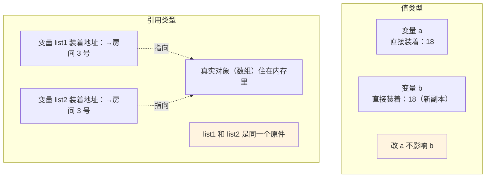
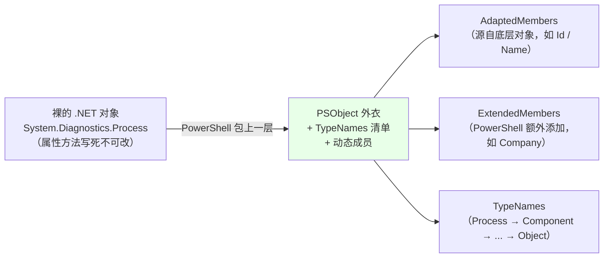
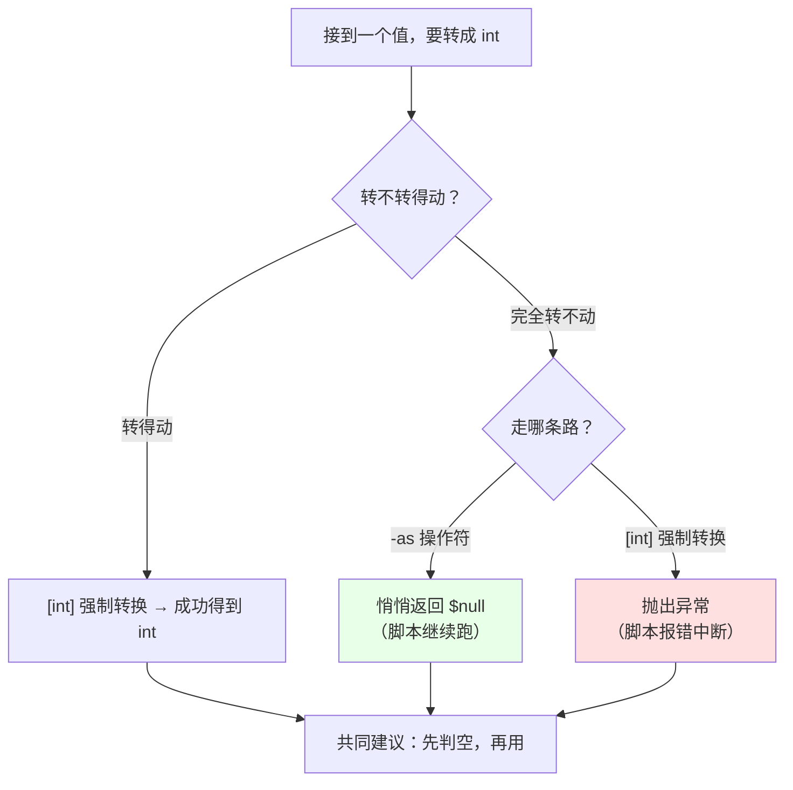
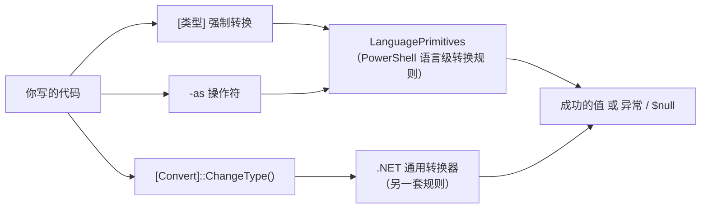

# 第 2 章 类型基础：CLR 类型在 PowerShell 中的“第一层皮肤”

> **本章定位**：上一章我们认识了“运行空间”“命令模式”这些容器和规矩。从这一章起，我们要开始研究“容器里装的东西”了。PowerShell 里的一切——数字、文字、日期、文件、进程——都是“**对象**”，而每个对象都有一个“**类型**”。类型决定了：这个对象能存什么、能干什么、跟别的对象打交道时按什么规矩来。
>
> 这一章是全书里“最像 C# 教科书”的一章，但我们的教学重点不是复述 C# 的类型系统，而是回答三个 PowerShell 特有的大问题：
>
> 1. **PowerShell 里的字面量默认都是哪些 .NET 类型？** 数字、字符串、布尔值背后到底是谁？
> 2. **为什么每个对象外面都包着一层叫 `PSObject` 的“皮”？** 这是 PowerShell 一切“能添加属性、能改显示样式”的黑魔法来源。
> 3. **类型转换是怎么“翻译”的？** 什么时候静默成功、什么时候抛出异常、什么时候悄悄变成 `$null`？

带着这三个问题往下读，你会发现自己对“对象”的理解在迅速成型。

---

## 2.1 基元类型、值类型与引用类型在 PowerShell 中的表现

假设你要在 PowerShell 里保存一个数字：`$age = 18`。就这一行，背后发生了很多事：`18` 被识别成一个**数字字面量**，PowerShell 要决定它“到底是哪种数字”，然后才把它装进变量 `$age`。

如果放到 C# 里，程序员必须自己声明类型：“`int age = 18;`”。但在 PowerShell 里你什么都不用写——PowerShell 会**自动**帮你挑一个合适的类型。这种“自动挑类型”的能力带来了极大的便利，但如果你不了解它背后的规则，迟早会在“咦，怎么变成字符串了？”“怎么多了一堆小数位？”这类问题上栽跟头。

这一节就把 PowerShell 底层的“选类型”规则讲清楚，并且补上两个伴随的硬知识：**值类型 vs 引用类型**到底差在哪，以及特别诡异的 **`$null`** 到底是个什么鬼。

### 字面量默认映射到 .NET 类型——“每一个字都有户口”

先说结论：**PowerShell 里的每一个字面量（literal）背后，都有一个确切的 .NET 类型**。所谓字面量，就是你在代码里“直接写出来”的那些值——数字、带引号的文字、`$true`/`$false` 这些。

我们直接开一个 PowerShell 窗口，亲手验证。验证的工具是 `GetType()` 方法——它是每个对象都自带的方法，能回答“我的类型是谁”：

```powershell
1.GetType().FullName       # 输出：System.Int32   （32 位整数）
1L.GetType().FullName      # 输出：System.Int64   （64 位整数，L 后缀）
1.0.GetType().FullName     # 输出：System.Double  （双精度浮点数）
1d.GetType().FullName      # 输出：System.Decimal （高精度十进制数，d 后缀）
"x".GetType().FullName     # 输出：System.String  （字符串）
$true.GetType().FullName   # 输出：System.Boolean （布尔值：真/假）
```

对照表如下：

| 你写的字面量 | 背后类型 | 全名 | 说明 |
|---|---|---|---|
| `1` | `[int]` | System.Int32 | 32 位整数 |
| `1L`（大小写皆可） | `[long]` | System.Int64 | 64 位整数，能装更大的数 |
| `1.0` | `[double]` | System.Double | 带小数点的数字 |
| `1d` | `[decimal]` | System.Decimal | 高精度小数（金融计算常用） |
| `"x"` / `'x'` | `[string]` | System.String | 一串文字 |
| `$true` / `$false` | `[bool]` | System.Boolean | 真或假 |

你可能会问：**“我记住这些有啥用？”** 用处很大。举三个现实例子：

1. **带来的数字太大**：`2147483648` 已经超出 32 位整数 `[int]` 能装的最大值（21 亿左右）。PowerShell 很聪明，会自动“升级”成 `[long]`：
   ```powershell
   2147483647.GetType().Name   # Int32（还没超）
   2147483648.GetType().Name   # Int64（超了，自动升级）
   ```

2. **除法结果有小数，丢了**：`5 / 2` 在 PowerShell 里结果是 `2.5`（因为 PowerShell 默认用“能装下结果的类型”做运算——这正是它友好的一面）。但如果你把 5 和 2 都声明成整数再算，或者遇到某些严格场景，就可能是 2 而不是 2.5。遇到“结果不知道为什么被截断了”的怪问题，先想想“是不是类型不合适”。

3. **拼字符串 vs 算加法**：`1 + 2` 是 3，`"1" + "2"` 是 `"12"`——同样是 `+`，因为操作数的类型不同，含义完全不同。掌握了“类型”概念，这类现象一眼就能看穿。

> 顺便说一句：文里的 `[int]`、`[long]`、`[double]`、`[string]`、`[bool]` 这些带方括号的名字，在 PowerShell 里叫**类型加速器**（type accelerator）。它们是那些长得吓人的完整 .NET 类型名的“小名”，写起来方便。`[int]` 就是 `[System.Int32]`，两者是同一个东西。

### `GetType()`——随时查看对象的“户口本”

刚才我们已经用到了 `GetType()`。这里再把它当成一个小工具彻底掌握。

- `$obj.GetType()`：返回一个 `System.Type` 对象，也就是“类型”这个事物的本身。
- `.Name`：类型的短名，比如 `Int32`。
- `.FullName`：类型的全名，比如 `System.Int32`。
- `.IsValueType`：是不是值类型（这个概念马上讲）。
- `.BaseType`：类型的父类型（继承体系中往上一级）。

```powershell
$a = 1
$a.GetType().Name              # Int32
$a.GetType().FullName          # System.Int32
$a.GetType().BaseType.Name     # ValueType —— 数字的爸爸是 ValueType
$a.GetType().IsValueType       # True

$s = "hello"
$s.GetType().Name              # String
$s.GetType().IsValueType       # False
```

还有一个“反向”工具：`[类型名]::GetType()` 或者更常用 `[类型]` 本身。当你想知道“某个类型的正式名字”或“把一个字符串名字解析成类型对象”时用它：

```powershell
# 用字符串名字拿到类型对象
$t = [type]::GetType('System.Int32')
$t.FullName                   # System.Int32

# [int] 本身就是那个类型对象，可以直接查
[int].FullName                # System.Int32
[int].IsValueType             # True
[string].IsValueType          # False
```

另外，常用的类型加速器可以混着用，记住几个高频的就够：

```powershell
[int]        # System.Int32    32 位整数
[long]       # System.Int64    64 位整数
[double]     # System.Double   双精度小数
[decimal]    # System.Decimal  高精度小数
[string]     # System.String   字符串
[bool]       # System.Boolean  布尔值
[datetime]   # System.DateTime 日期时间
[object]     # System.Object   一切类型的“老大哥”
```

### 值类型 vs 引用类型——“东西”和“地址”

这是 .NET 的世界观里最基础、也最关键的一对概念。用大白话讲：

- **值类型（Value Type）**：变量里**直接装着那个值本身**。比如 `$a = 18`，那 `$a` 这个变量里直接就是“18”这个数。
- **引用类型（Reference Type）**：变量里装的**不是值本身，而是指向某个地方的“地址”**。比如字符串、数组、对象，真正的“内容”住在内存的某个房间里，变量里只放了一张写着房间号码的“门牌号”。

为什么这个区别要命？因为**赋值时的行为完全不同**。看两个例子：

**值类型：复制的是“值”**

```powershell
$a = 1
$b = $a          # 把 $a 里的值“复制”一份给 $b
$a = 99
$b               # 还是 1 —— 因为 $b 拿到的是独立的副本
```

**引用类型：复制的是“门牌号”**

```powershell
$list1 = @('苹果', '香蕉')
$list2 = $list1          # 复制的只是“门牌号”，两个变量其实指向同一个数组
$list1[0] = '橘子'       # 改的是那块真正的内容
$list2[0]               # 也变成“橘子”了！因为它们俩是同一个东西
```

看到区别了吗？值类型是“**给你一份复印件**”，引用类型是“**把地址抄给你，大家共用一个原件**”。数组、对象、字符串（字符串有点特殊，我们第 15 章细说不可变性）都属于“门牌号”家族。

我们用一张图把这两种“装东西的方式”画出来：



那么，**什么时候会碰上“复制门牌号”的坑？** 最常见的就是第 16 章要讲的数组和集合操作。这里你先建立一个直觉：**数组、哈希表、对象这类东西，赋给新变量并不产生“备份”，而是多了个“替身”**。想要真正的备份，得主动克隆（Copy）——那是后话。

另外提一个相关名词：**装箱（boxing）**。值类型（比如数字）在 PowerShell 的管道里流通时，为了能“裹上 PSObject 外皮”（2.2 节会讲），偶尔会被装进一个盒子变成引用式的东西，这个动作叫装箱；需要取回数字时再“拆箱”。普通脚本里你几乎感觉不到它，但处理海量数字时它是有代价的。这里知道这个词存在即可。

### `$null`——“自动化空值”的特殊语义

最后是一个让无数新手（和不少老手）挠头的东西：`$null`。

直觉上你会觉得 `$null` = “什么都没有”。这个理解没错，但 PowerShell 里 `$null` 是一个**实实在在的值**，它具有下面这些脾气：

1. **`$null` 是单个值，而且只有这一个**。它不等于 `""`（空字符串），也不等于 `0`，更不等于 `$false`。

   ```powershell
   $null -eq ""          # False
   $null -eq 0           # False
   $null -eq $false      # False
   ```

2. **未赋值的变量，默认就是 `$null`**：

   ```powershell
   $name                # 没有任何输出，因为它的值是 $null
   $null -eq $name      # True
   ```

3. **在布尔判断里，`$null` 是“假”**（第 4 章讲 `if` 时会大量用到）：

   ```powershell
   if ($null) { '真的' } else { '假的' }    # 输出：假的
   ```

4. **`$null` 在管道里会产生“缝隙”**：它本身不产生任何输出。这导致一个著名陷阱：当你把一个集合里的某个元素设成 `$null` 然后输出整个集合，那个位置会被“跳过”。

5. **`$null` 不属于任何类型**：

   ```powershell
   $val = $null
   $null -eq $val        # True
   $val -is [string]     # False
   ```

对脚本健壮性来说，`$null` 最重要的是养成“**拿到可能为空的值，先判断是不是 `$null` 再说**”的习惯：

```powershell
$result = Find-Something        # 假设这可能返回 $null
if ($null -eq $result) {
    '没找到任何东西，处理一下这个情况'
}
else {
    "找到了：$result"
}
```

> **提示**：判断是否为空，建议写成 `$null -eq $result`（把 `$null` 放在左边）而不是 `$result -eq $null`。虽然两者结果一样，但把 `$null` 放左边有一个好处：**你永远不会因为漏掉一个 `-eq` 而把整个比较写成“给变量赋值”**。

### 2.1 小结

1. **字面量都映射到明确的 .NET 类型**：`1`→`[int]`、`1L`→`[long]`、`1.0`→`[double]`、`"x"`→`[string]`。数字超大时会自动升级。
2. **`GetType()` 是查看类型户口本的工具**，字段有 `Name`、`FullName`、`IsValueType`、`BaseType`。
3. **值类型“装值”，引用类型“装地址”**。赋值时，值类型复制值，引用类型复制地址（共享原件）。数组、对象、哈希表都是“地址党”。
4. **装箱**就是把值类型“包个盒子”扔进对象世界，是管道里数字背后的隐形操作。
5. **`$null` 是物，不是空**。它不等于空字符串、0、false；未赋值的变量是 `$null`；拿到的值要养成先判空再使用的习惯。

---

## 2.2 PSObject 与扩展类型系统（ETS）

上一节讲的是“类型的户口”。这一节要讲的，是 PowerShell 里最让初学者“看不透”的一层机制——**为什么明明是一个普普通通的 .NET 对象，到了 PowerShell 里就像穿了魔术外衣，能被随便添加新属性？**

想想看：`Get-Process` 返回的是一个进程对象（.NET 里叫 `System.Diagnostics.Process`）。按理说这类对象有哪些属性、哪些方法，是 .NET 早就定死的，普通人不能随便改。可是在 PowerShell 里，你却能给**每一个**进程对象都加一个新属性，比如加个“内存占用MB”——这在传统的、**静态**的 .NET 世界里是不可想象的。

答案就藏在 `PSObject` 这个名字里。**PowerShell 里流通的每一个对象，都不是“裸奔”的 .NET 对象，而是被一层叫 `PSObject` 的“外衣”包裹过的对象。** 这层外衣才是 PowerShell 一切“动态扩展”能力的根源。

这一节我们把这层“外衣”脱下来研究明白。理解它，你就理解了 PowerShell 为什么是 PowerShell，而不是“另一个 C# 解释器”。

### 每一个对象都穿着一件 `PSObject` 外衣

先看怎么“脱衣服”：

```powershell
$p = Get-Process -Id $PID
$p.PSObject          # 这就是那层外衣，一个 System.Management.Automation.PSObject
```

`$p.PSObject` 是一个很特殊的属性：**每个对象上都有它**（这是扩展类型系统给所有对象“加”的一个总入口）。通过它，你能看到这个对象里里外外的一切：

- `$p.PSObject.TypeNames`：这个对象的类型名列表（注意是复数，等下讲为什么）；
- `$p.PSObject.Properties`：所有属性；
- `$p.PSObject.Methods`：所有方法；
- `$p.PSObject.Members`：属性和方法的合集。

我们验证一下，看看一个进程对象的“家底”有多厚：

```powershell
$p = Get-Process -Id $PID
$p.PSObject.TypeNames
# 输出：
# System.Diagnostics.Process
# System.ComponentModel.Component
# System.MarshalByRefObject
# System.Object

$p.PSObject.Properties.Name | Sort-Object
# 一大串名字：BasePriority、Handle、Id、Name、PriorityClass、ProcessName、WorkingSet64……
```

看到关键了吗？**一个对象的“类型”，在 PowerShell 眼里不是“一个”，而是一串名字**——从它自己一路到最顶层的 `System.Object`。这就是扩展类型系统（ETS，Extended Type System）的核心思想：

> **PowerShell 看对象，不只看它“本来的类型”，还看它“应该被看作哪些类型”**。类型不再是写死在代码里的唯一身份，而是一个可以**动态扩展的清单**。

我们画个图表示这层“外衣 + 类型清单”：



从这张图你能读出三层含义：

1. **底层 .NET 对象的“原生”属性方法照常能用**——`$p.Id`、`$p.WorkingSet64` 这些都是本来就有、被“适配”过来的（叫 **AdaptedMembers**）；
2. **PowerShell 可以额外加东西**——比如每个进程对象都有个 `Company` 属性，但 .NET 的 `Process` 类里根本没有这个属性，它是 PowerShell 从类型配置里“补”上去的（叫 **ExtendedMembers**）；
3. **类型名单可以扩展**——你可以让一个类型“看起来”还是原来的类型（这样 `-is` 判断照样成立），同时又能多出很多新成员。

除了直接访问 `PSObject`，你天天用的 `Get-Member` 其实就是这层外衣的“平民版操作界面”：

```powershell
Get-Process -Id $PID | Get-Member                       # 属性/方法列表
Get-Process -Id $PID | Get-Member -MemberType Property  # 只要属性
Get-Process -Id $PID | Get-Member -MemberType Method    # 只要方法
```

### ETS——不改原类型，只加“外衣”

现在回答开头的疑问：PowerShell 是怎么做到“给每个进程对象都添加新属性”的？

答案：**它完全没有去改 .NET 的 `Process` 类**。它只改了“外衣”——在 `PSObject` 这个层面，按“类型名”登记额外的成员，凡是穿了这件外衣的对象就都能“看见”这些新成员。这个“在类型层面给对象加成员”的系统机制，就叫**扩展类型系统**。

我们做两个实验。第一个：**给某个具体对象运行时加属性**（用 `Add-Member`，影响“这一个”对象）：

```powershell
$p = Get-Process -Id $PID

# 给这个具体的进程对象添加一个叫 Source 的属性
$p | Add-Member -NotePropertyName Source -NotePropertyValue '我的脚本.ps1'

# 现在它有这个属性了
$p.Source                                          # 我的脚本.ps1

# 但它仍然是原来的类型
$p -is [System.Diagnostics.Process]                # True
$p.GetType().Name                                  # Process
```

第二个：**在类型层面给所有同类对象加属性**（用 `Update-TypeData`，影响“这一类所有对象”）。比如你希望当前会话里所有进程对象都能直接看“占用内存（MB）”，本来要写 `$_.WorkingSet64 / 1MB`，现在直接加个属性：

```powershell
Update-TypeData `
    -TypeName System.Diagnostics.Process `
    -MemberName 内存MB `
    -MemberType ScriptProperty `
    -Value { [math]::Round($this.WorkingSet64 / 1MB, 2) }

# 现在，当前会话里任何进程对象，都能直接 .内存MB
(Get-Process -Id $PID).内存MB     # 例如：213.45
```

请注意那个脚本块 `{ [math]::Round($this.WorkingSet64 / 1MB, 2) }`：它不是马上算，而是“**规则**”——每当有人访问 `.内存MB` 才去算，并且用 `$this` 指向“当前这个对象”。这种“懒计算属性”是 ETS 最强大的能力之一，后面大量自定义格式化都会用到。

关于 `Update-TypeData` 有几个点要记住：

- 它**只影响当前会话**，关掉窗口就没了。想持久化，用 `.ps1xml` 配置文件（下面讲）；
- 名字不同的话，需要 `-Force` 才能覆盖（`Update-TypeData -Force`）；
- 它可以加属性（`-MemberType ScriptProperty` / NoteProperty）、方法（`ScriptMethod`）、别名（`AliasProperty`），还能改默认显示属性等。这里先知道它能“给类加成员”即可，第 12 章格式化部分会再见面。

顺便，管理这些类型数据的命令也记一下：

```powershell
Get-TypeData                                   # 查看当前会话所有类型数据
Get-TypeData -TypeName System.Int32            # 查看单个类型
```

### ATS——连“非 .NET 世界”也能套上外衣

ETS 只解决“给 .NET 对象加东西”。但如果对象压根不是 .NET 的——比如经典的 **COM 组件**（老 Office、WScript）、**WMI 对象**、Excel 的单元格——又该怎么办？

PowerShell 的回答更绝：**给它们也套上外衣，通过“适配器”翻译成 PowerShell 看得懂的成员**。这套把异构对象系统“适配”进来的机制，叫 **适配类型系统（ATS，Adaptation Type System）**。

举例：`Get-Item C:\Windows` 返回的其实是一个 `DirectoryInfo` 对象，但 PowerShell 文件系统提供程序会把它“适配”出 `PSPath`、`PSParentPath`、`PSChildName` 这些“假属性”——它们不是 .NET 里真实存在的成员，而是适配器加的。看：

```powershell
$item = Get-Item 'C:\Windows'
$item.PSObject.AdaptedMembers |
    Where-Object MemberType -ne ScriptProperty |
    Select-Object -First 6 Name, MemberType

# 你会看到 PSPath、PSParentPath、PSChildName、PSDrive、PSProvider、PSIsContainer
# 这些全是提供程序适配器加上去的“外衣成员”
```

对 COM 也一样。比如用 `New-Object -ComObject WScript.Shell` 创建一个老的 COM 对象，`$ws.PSObject.Members` 里就能看到通过适配器暴露出来的一大堆属性和方法。这些对你日常脚本来说，通常“可用即可”，不用深究底层，但知道“**PowerShell 连不同类型世界都能统一成对象**”这一点，能帮你理解为什么几乎所有东西都能 `.属性`、能进管道、能被 `Where-Object` 筛选。

### Types.ps1xml——类型扩展的“配置文件”

刚才的 `Update-TypeData` 是“改在内存里”。如果想让类型扩展**每次打开 PowerShell 都有**，就得写配置文件——`Types.ps1xml`。

PowerShell 自己就带着一份：你装 PowerShell 的目录（`$PSHOME`）下有 `types.ps1xml` 等若干 `.ps1xml` 文件，PowerShell 启动时会自动加载它们。刚才提到“每个进程对象都有 `Company` 属性”——其实就来自这份内置配置里的“类型定义”。

一个典型的 `.ps1xml` 片段长这样（结构比看起来简单）：

```xml
<Types>
  <Type>
    <Name>System.Diagnostics.Process</Name>
    <Members>
      <ScriptProperty>
        <Name>内存MB</Name>
        <GetScriptBlock>
          [math]::Round($this.WorkingSet64 / 1MB, 2)
        </GetScriptBlock>
      </ScriptProperty>
    </Members>
  </Type>
</Types>
```

写好后，让当前会话加载它：

```powershell
Update-TypeData -AppendPath .\mytypes.ps1xml
```

（放进 `$PSHOME` 可以让所有会话加载，但一般不建议改系统文件。）这一节你只要知道：**类型扩展有“临时（命令）”和“持久（文件）”两条路，`.ps1xml` 是持久那份的载体**。第 12 章格式化输出时，我们会再次见到它的兄弟 `format.ps1xml`。

### 2.2 小结

1. **PowerShell 里的每个对象都穿一层 `PSObject` 外衣**，透过这层外衣你才能看到 `PSObject.Properties/Methods/TypeNames`。
2. **ETS（扩展类型系统）让类型可以“动态加成员”**：不改底层 .NET 类，只在外衣上登记——`Add-Member` 加给单个对象，`Update-TypeData` 加给整个类型。
3. **ATS（适配类型系统）把 COM、WMI 等异构世界统一成对象**，所以一切皆可 `.属性`。
4. **`.ps1xml` 是持久化的类型扩展文件**，PowerShell 启动时自动加载内置那份。

记住一个判断技巧：**以后看到“这个对象为什么多了一个本来没有的属性”，第一反应就去找 ETS**。

---

## 2.3 类型转换、强制转换与 `-as` / `[type]` 操作符

上一节我们学会了“给对象加衣裳”。这一节回到类型本身，讲一个更日常、更实用的主题：**类型转换**。

你在 PowerShell 里不可能永远只用“刚刚好”的类型。最常见的场景就是：**从外部拿到的几乎都是字符串**。配置文件里读出来的是字符串、网页上下载下来的是字符串、用户在输入框里敲的还是字符串。可你往往需要把它们当成数字或日期用。这时候就得做“翻译先生”——把字符串翻译成数字、翻译成日期。PowerShell 的翻译规则，比 C# 宽松得多，也隐晦得多。**什么时候静默成功、什么时候直接报错、什么时候悄悄变成 `$null`**，是脚本健壮性的关键分水岭。

本节把三条“翻译通道”讲清楚：显式转换 `[int]`、安全带 `-as`、以及底层的 `LanguagePrimitives` 机制。

### 两条主通道——`[type]`（抛错）和 `-as`（给你 `$null`）

**通道一：`[类型]` 强制转换（cast）**

把右边的东西强制“变”成括号里的类型。成功就返回新类型，失败就**抛出异常**（异常是第 8 章的主题，现在只要知道“报错”即可）。

```powershell
[int]'42'            # 42 （字符串"42"变成了数字 42）
[int]'4.8'           # 5  （先解析成 double 4.8，再就近取整）
[int]'abc'           # 抛异常：无法将值"abc"转换为类型"System.Int32"
[double]'3.14'       # 3.14
[bool]'true'         # True
```

注意上表的 `[int]'4.8'`：字符串转整数并不要求字符串“绝对干净”——PowerShell 会先按“最合适的数值类型”解析（这里解析成 double `4.8`），再就近取整得到 `5`。所以 `'4.9'` 转成 5、`'4.4'` 转成 4，都是这个道理。而 `'abc'` 这种完全不是数字的，就会抛出转换异常。

**通道二：`-as` 操作符（失败给 `$null`）**

`-as` 是 PowerShell 独有的“安全转换”操作符：**能转就转，转不了就返回 `$null`，绝不抛异常**。

```powershell
'42' -as [int]       # 42
'abc' -as [int]      # $null （不会报错！）
'3.14' -as [int]     # 3 （能转：先转 double 再取整）
'3.99' -as [int]     # 4
$null -eq ('abc' -as [int])   # True
```

我们把两条通道的差异画在一张决策图里，这是本节最重要的图：



**怎么选？** 给一个实用准则：

- 如果你的脚本是“用户脚本”性质，转不过去就“让它报错叫醒你”，用 `[int]`；
- 如果你的脚本是“数据管道”性质，一行坏数据不该让整个流程崩掉，用 `-as`，然后判断“是不是 `$null`”。

实战中“`-as` + 判空”是防御性脚本的标配：

```powershell
$raw = 'abc'
$number = $raw -as [int]
if ($null -eq $number) {
    '数据不是合法数字，走异常分支处理'
} else {
    "转换成功，数字是 $number"
}
```

### 数字与字符串混合运算时的自动转换

细心的你可能会问：那 `1 + 2` 是数字相加，`'1' + '2'` 是字符串拼接，那把**数字和字符串**加在一起呢？

```powershell
1 + '2'          # 3 —— 数字能“吃下”字符串时，悄悄把 '2' 变成数字再相加
'1' + 2          # '12' —— 字符串占主导时，把 2 变成字符串再拼接
```

PowerShell 会按“谁更能容纳对方”的方向自动转换，这背后的执行者就是 `LanguagePrimitives`（语言原语，见下一个知识点）。这个“自动翻译”很方便，但也会埋雷——比如你从文件里读回一个 `'2'`（字符串），习惯性写 `$total = $total + $value`，一旦某天读到的不是数字，你就得到字符串拼接而不是加法。**所以重要数值，先显式 `[int]` 或 `-as [int]` 再运算**，别依赖默契。

比较时同理，类型会让结果出乎意料：

```powershell
"5" -eq 5        # True —— 比较时会把右边转换成能匹配左边的类型
```

### 转换的底层执行者——`LanguagePrimitives` 与 `Convert`

如果你想知道“PowerShell 到底按什么优先级转换”，答案是：它有一套自己的“语言级”转换逻辑，核心类叫 `LanguagePrimitives`（在 `System.Management.Automation` 命名空间里）。它处理：

- 数字之间的转换（高位到低位、精度取舍）；
- 字符串 ↔ 数字/日期/布尔的解析；
- 字符串 ↔ 枚举；
- 数组的展开与折叠；
- 转换优先级（能无损转就选最合适的，而不是机械地“碰瓷”）。

你可以显式调用它：

```powershell
[System.Management.Automation.LanguagePrimitives]::ConvertTo('42', [int])
# 42

[System.Management.Automation.LanguagePrimitives]::ConvertTo('abc', [int])
# 抛异常（它走的是“严格”路线）
```

而 .NET 里的通用转换器 `[System.Convert]::ChangeType()` 则是另一条路线（不带 PowerShell 的语言级约定，更“原生态”）：

```powershell
[System.Convert]::ChangeType('42', [int])    # 42
[System.Convert]::ChangeType($true, [int])   # 1 （布尔 true 变成 1）
```

对初学者来说，记住 `[int]`、`-as` 这两个内置通道就够用；`LanguagePrimitives` 和 `[Convert]::ChangeType` 更多是“万一你好奇/需要精细控制”时的进阶入口。三条路的关系如下图：



### 字符串转数字的区域性（文化）问题

最后提醒一个“潜伏的坑”：**同一个“数字的写法”，在不同国家/语言环境下含义可能不同。**

在某些语言的区域设置下，小数点用的是逗号：德语里 `1,5` 表示“一点五”，而 `1.5` 反而是“1500”。如果脚本在配置了不同区域性的机器上运行，字符串转数字就可能转错或者报错。

PowerShell 在多数解析场景下会按**不区分区域（invariant）**的方式处理，所以跨机器问题不大；但如果你是**显式**走 `CultureInfo` 的代码，就要小心。这里先建立一个意识：**只要字符串里的数字格式是“咱们平时写的格式”，PowerShell 一般能安全解析；一旦出现“别人的 locale”，记得显式指定区域性**。第 15.4 节会系统讲 `CultureInfo` 与格式化，这里点到为止。

### 2.3 小结

类型转换这节就一句话总结：

> **`[int]` 是“严格要求翻译官”——转不过去就报错；`-as` 是“随和翻译官”——转不过去就递给你一个 `$null`。**

二者共同服务于同一个原则：**转换前先想清楚“转不转得动”，转换后先判断“是不是 `$null`”**。至于底层，认 `LanguagePrimitives` 这个“语言级总规则”即可。字符串转数字还要留个心眼：区域性（文化）不同，小数点写法可能不同。

---

## 本章总结

第二章的主题是“类型”，三节浑然一体地讲了一条主线：**PowerShell 里的对象，其“本质类型”来自 .NET（CLR），但其“表现形态”由 PowerShell 的类型系统二次塑造。**

1. **2.1 节**：字面量背后是确定的 .NET 类型；值类型“装值”、引用类型“装地址”；`$null` 是“物”不是“空”。
2. **2.2 节**：每个对象都套着 `PSObject` 外衣，ETS 允许动态加成员，ATS 把 COM/WMI 也统一成对象，`.ps1xml` 是持久化配置文件。
3. **2.3 节**：`[type]` 转不动就抛错，`-as` 转不动给 `$null`；底层由 `LanguagePrimitives` 定规则，字符串↔数字要留意区域性。

这三节合起来，回答了一个贯穿全书的根本问题：**PowerShell 里你摸到的每一个“对象”，都是“CLR 类型 + PSObject 外衣 + 转换规则”三者共同作用的结果。** 理解了这三层，你就拿到了解读 PowerShell 一切行为之门的钥匙。

**下一章预告**：第 3 章《变量、作用域与运算符》。类型有了，接下来要解决“怎么存、放在哪个抽屉、怎么比较、怎么拼接”。我们会讲清 `$script:`/`$global:` 这些作用域限定符是什么意思、`-eq` 在集合面前会变成“过滤器”、以及 `-f` 格式化那点“怎么把数字排版漂亮”的功夫。

---

> **动手练习**
>
> 1. 依次运行 `1.GetType().Name`、`1L.GetType().Name`、`1.0.GetType().Name`、`$true.GetType().Name`，把四次输出抄下来，对照 2.1 节的类型映射表。
> 2. 用数组实验证“引用类型共享原件”：`$a = @(1,2,3); $b = $a; $a[0] = 9; $b[0]`，观察结果并解释。
> 3. 对 `Get-Process -Id $PID` 的结果依次运行 `$_.PSObject.TypeNames`、`$_.PSObject.Properties.Name`（用 `| Select-Object -First 10` 限制行数），感受“外衣”的存在。
> 4. 用自己的话解释 `Update-TypeData` 加的属性和 `Add-Member` 加的属性有什么区别。
> 5. 练习两条转换通道：`[int]'42'` 与 `'42' -as [int]` 成功；`[int]'abc'`（报错）与 `'abc' -as [int]`（得 `$null`），体会“报错 vs 静默”的差别，并写一个 `if ($null -eq $n)` 的安全转换片段。
