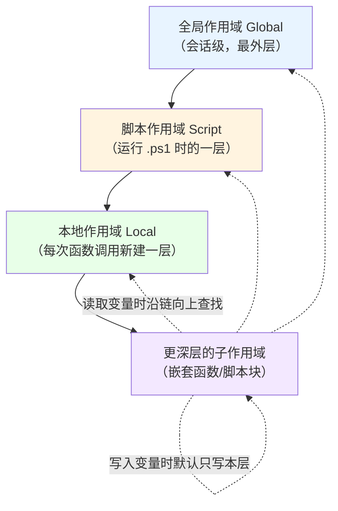
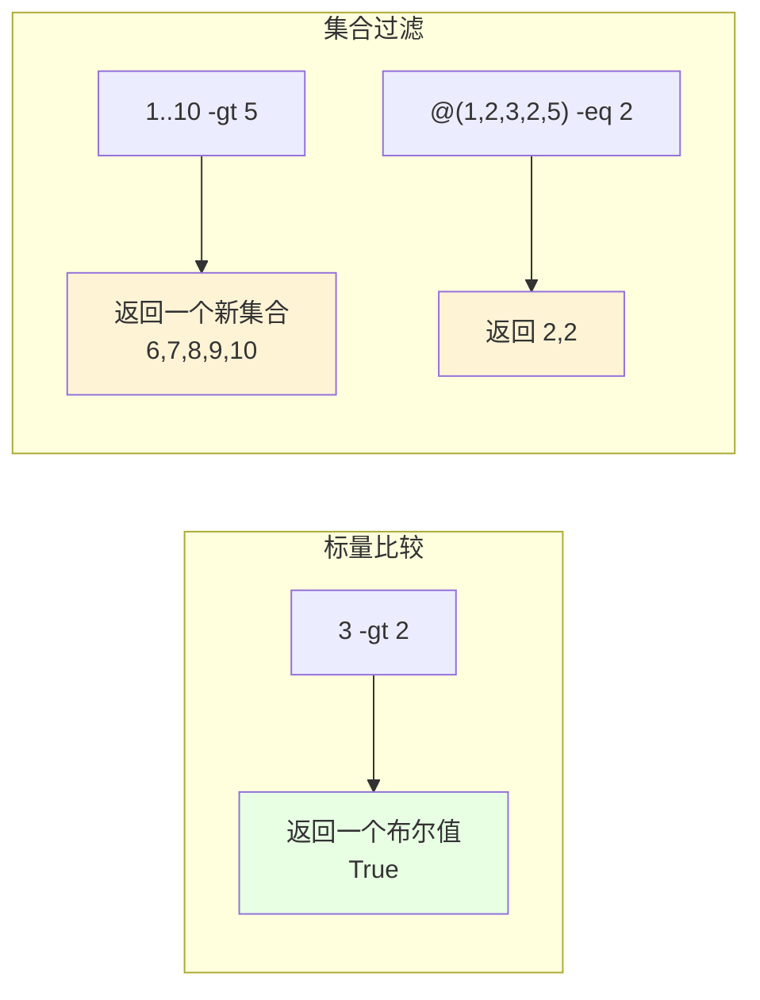

# 第 3 章 变量、作用域与运算符

> **本章定位**：上一章我们弄清了“对象是什么类型”。这一章解决“对象存在哪、怎么取、怎么算”。变量是给值起的名字，作用域决定这个名字在“哪些房间”里能被看见，运算符则是一整套“怎么比较、怎么拼接、怎么计算”的规矩。三者合起来，构成你写任何一行 PowerShell 语句时最常打交道的底层设施。
>
> 对零基础的读者来说，这一章会出现比前两章更多的“小符号”——`$`、`-eq`、`-and`、`-f`、`$($...)`。别怕，它们看起来吓人，其实每一个都对应一个非常朴素的意思。我们会把每一个都拆开、配上能直接复制运行的例子，让你边看边试。

---

## 3.1 变量声明、作用域链与自动化变量

假设你正在写一个整理文件的脚本：先记下文件夹路径，再数一数里面有多少文件，最后把数量打印出来。这中间，“文件夹路径”和“文件数量”得有个地方暂时存着，随用随取。这个“有名字的存储位置”，就是**变量**。

在 C# 里，声明变量要写类型：“`string path = "D:\\demo";`”“`int count = 0;`”。在 PowerShell 里，你只要写 `$path = 'D:\demo'`、`$count = 0` 就够了。那个 `$` 就是“我要定义一个变量”的记号。看起来简单，但变量背后还牵着一个更大的问题：**这个名字，在脚本的哪些地方能被看见？** 这就是**作用域**。本节我们就把这两件事，连同 PowerShell 早就替你准备好的一堆“自动化变量”，一次讲清楚。

### 变量怎么声明：`$` 加名字，运行时才定类型

PowerShell 声明变量，语法简单到近乎“随便”：

```powershell
$name = 'PowerShell'
$count = 3
$price = 19.9
$isReady = $true
```

几条规矩要记牢：

1. **变量名以 `$` 开头**，后面可以跟字母、数字、下划线。
2. **变量名不区分大小写**：`$name` 和 `$Name`、`$NAME` 是同一个变量。这一点和 Linux shell 不同，别搞混。
3. **不用声明类型**。赋什么值，变量就是什么类型；同一个变量可以先后装不同类型的东西：

   ```powershell
   $x = 1
   $x.GetType().Name        # Int32
   $x = 'hello'
   $x.GetType().Name        # String —— 类型可以被随时换掉
   ```

4. **想看变量里现在装的啥，直接写变量名**：

   ```powershell
   $name
   # 输出：PowerShell
   ```

5. **删掉一个变量**，用 `Remove-Variable`（第 3 个知识点会讲），或者直接把它设成 `$null`：

   ```powershell
   $name = $null
   ```

如果你希望某个变量“定死类型、不许乱变”，也可以显式声明类型，这叫**强类型变量**（后面讲。但对初学者来说，先用默认的动态类型就够了，灵活、省心。

> 顺便提醒一个初学者常犯的错：PowerShell 里**不需要**也**不能**用 `var`、`int` 这类 C# 关键字声明变量。写 `int x = 1` 会直接被当成命令 `int` 去执行，然后报错。正确的写法永远是 `$x = 1`。

### 作用域与作用域链：`$script:` / `$global:` / `$local:` / `$private:`

变量有了名字，下一步就要问：**这个名字在哪些代码里能看见？**

在 C# 里，变量有一种“块级作用域”：你在 `{}` 里定义的变量，出了这层括号就失效了。PowerShell **没有这种块级作用域**，它换了一套更朴素的层级——**按“执行容器”分房间**：

- **全局作用域（Global）**：整个会话最外层，所有地方都看得见。
- **脚本作用域（Script）**：当你运行一个 `.ps1` 脚本时，脚本内部有自己的一个作用域。
- **本地作用域（Local）**：每次调用函数（或执行一个脚本块）时，会新建一个属于这次调用的作用域。
- **私有作用域（Private）**：当前作用域的一个“只对自己可见”版本，子作用域看不到。

它们之间不是彼此隔绝的，而是像楼层一样叠起来，形成一条**作用域链**。子作用域能“抬头”看见父作用域里的变量，但**默认改不到**父作用域的变量——你一赋值，PowerShell 会就近在当前层新建一个同名变量，形成“遮住”的效果。

我们用一张图把这条链画出来：



在代码里，怎么明确“我要的是哪个作用域的变量”？用**作用域限定符**，也就是变量名前面加一段带冒号的前缀：

| 限定符 | 含义 | 例子 |
|---|---|---|
| `$global:` | 全局作用域 | `$global:config = 'x'` |
| `$script:` | 脚本作用域 | `$script:counter = 0` |
| `$local:` | 当前作用域（默认就是这个） | `$local:temp = 1` |
| `$private:` | 当前作用域，且子作用域不可见 | `$private:secret = 1` |

我们用一个函数来验证“读得到、但默认改不到”这个关键行为：

```powershell
$count = 10          # 在最外层（全局）定义

function Try-Change {
    # 读：能看见外面的 $count
    "函数里读到的 count：$count"      # 输出 10

    # 写：这里其实是在函数自己的本地作用域新建了一个 $count
    $count = 99
    "函数里写完后读到的 count：$count"  # 输出 99
}

Try-Change
"函数外面再看 count：$count"           # 还是 10！
```

想让函数真正改到外面那个变量，就必须显式点名作用域：

```powershell
$count = 10

function Change-Global {
    $global:count = 99        # 明确指定“我要改全局的”
}

Change-Global
$count                        # 99
```

同样的道理，脚本作用域用 `$script:`。这个区分在“脚本里套函数”的时候尤其重要：函数里想改脚本级的累计变量，要写 `$script:sum = $script:sum + 1`，否则你改的只是函数自己的本地副本。

还有一个“暂时借用”的写法，很实用：**点源（dot-source）**。用 `.` 后跟脚本路径，会让脚本里的变量和函数“落进”当前作用域，而不是新建一层：

```powershell
# 假设 lib.ps1 里定义了 $sharedValue = 42
. .\lib.ps1
$sharedValue            # 42 —— 因为它被点源进了当前作用域
```

而用 `&` 调用则会新建一层作用域，变量就“带不出来”：

```powershell
& .\lib.ps1
$sharedValue            # 没有值（$null），因为它是另一个房间里的
```

### 变量提供程序：用统一的“变量盘”管理变量

PowerShell 有一个很妙的设计：**变量也像文件一样，放在一个“盘”里管理**。这个盘叫 `Variable:`。你平时用的 `Get-ChildItem`、`Get-Item` 这些命令，在 `Variable:` 盘上一样能用：

```powershell
# 看当前作用域里所有的变量
Get-ChildItem Variable:

# 看某一个变量“这条记录”
Get-Item Variable:PSVersionTable
```

这就是**变量提供程序（Variable provider）**。它的好处是：**变量、文件、注册表、环境变量，都能用同一套命令风格来操作**（第 10 章会系统讲“提供程序”）。另外，PowerShell 还给了几个专门管变量的 cmdlet：

```powershell
# 新建变量（还能顺便设为只读/常量）
New-Variable -Name appName -Value 'MyApp'
New-Variable -Name appVersion -Value '1.0' -Option ReadOnly

# 修改（ReadOnly 的可以用 -Force 改，Constant 的改不了）
Set-Variable -Name appName -Value 'NewApp'

# 读取
Get-Variable -Name appName

# 删除
Remove-Variable -Name appName
```

`New-Variable` 的 `-Option` 很有用：`ReadOnly` 防误改（要改得加 `-Force`），`Constant` 则彻底锁死，连 `-Force` 都改不动。

如果你想从“程序”的角度操作变量（比如在 .NET 代码里），会碰到一个类 `System.Management.Automation.PSVariable`。`Get-Variable` 返回的就是它：

```powershell
$v = Get-Variable -Name appName
$v.GetType().Name        # PSVariable
$v.Name                  # appName
$v.Value                 # NewApp
$v.Options               # 选项（None / ReadOnly / Constant...）
```

还有一个更底层的入口，叫 `$ExecutionContext.SessionState.PSVariable`，它可以在**不经过 cmdlet** 的情况下直接读写变量：

```powershell
$ExecutionContext.SessionState.PSVariable.GetValue('appName')   # 读
$ExecutionContext.SessionState.PSVariable.Set('appName', 'X')   # 写
```

这些“底层入口”平时用不到，但你要写高级脚本、模块或调试器时，它们能让你精确控制“在哪个作用域读写哪个变量”。先混个脸熟即可。

### 自动化变量：PowerShell 替你准备好的“现成变量”

PowerShell 会在特定时刻自动往变量里填值，这些叫**自动化变量**（automatic variables）。你不用声明、不用赋值，它们自己就在那儿。下面是最常用的几个，以及它们“什么时候被注入”：

**1）`$_` 和 `$PSItem`：当前正在处理的那个对象**

它们俩是同一个东西的两种写法（`$PSItem` 是后来加的可读版）。每当管道把一个对象交给 `Process` 块或脚本块时，`$_` 就指向它：

```powershell
# 管道里逐个对象处理，$_ 就是当前这个
1..3 | ForEach-Object { "当前是：$_" }
# 当前是：1
# 当前是：2
# 当前是：3

# Where-Object 的脚本块里也是同样的道理
Get-Process | Where-Object { $_.CPU -gt 10 }
```

**2）`$args`：没有名字的那堆参数**

当一个函数或脚本没有用 `param()` 明确声明参数时，传给它的所有参数都会进 `$args` 这个数组：

```powershell
function Show-Args {
    "一共收到 $($args.Count) 个参数"
    $args | ForEach-Object { "参数：$_" }
}

Show-Args apple banana cherry
# 一共收到 3 个参数
# 参数：apple
# 参数：banana
# 参数：cherry
```

**3）`$input`：管道输入流的“枚举器”**

在没有 `process` 块的简单函数/脚本里，管道输入不是一个个“喂”给你，而是被塞进一个叫 `$input` 的枚举器里，你可以手动遍历：

```powershell
function Read-All {
    foreach ($item in $input) {
        "收到：$item"
    }
}

1..3 | Read-All
# 收到：1
# 收到：2
# 收到：3
```

> 注意：一旦函数用了 `process` 块（第 11 章会讲），就用 `$_` 拿当前对象，不用 `$input` 了。两者是不同“时代的产物”，别用混。

**4）`$Error`：错误记录的“最近优先”环形缓冲区**

`$Error` 是一个数组，`$Error[0]` 是**最近一次**错误，`$Error[1]` 是上一次，以此类推。它像一个只保留最近若干条的“历史记录本”：

```powershell
# 故意制造一个错误
Get-Item 'C:\一个不存在的路径'
$Error[0]                 # 查看最近一条错误记录
$Error[0].Exception.Message
$Error.Count              # 目前记录了多少条
```

**5）`$PSCmdlet`：当前高级函数自己的“句柄”**

只有当函数加了 `[CmdletBinding()]`（变成高级函数，第 5 章讲）时，`$PSCmdlet` 才有值。它代表“当前正在执行的这个命令”，可以调用 `ShouldProcess`、`WriteVerbose` 等标准能力：

```powershell
function Test-Advanced {
    [CmdletBinding()]
    param()

    $PSCmdlet.GetType().Name      # PSScriptCmdlet
    $PSCmdlet.MyInvocation.Line   # 本次调用的原始行
}
Test-Advanced
```

**6）还有一批“常驻”的自动化变量**

它们随时可用，顺手记住几个高频的：

```powershell
$PSVersionTable      # PowerShell 版本信息
$PWD                 # 当前目录
$HOME                # 用户主目录
$PID                 # 当前进程 ID
$MyInvocation        # 当前调用信息
$PSBoundParameters   # 实际绑定到参数的键值对（高级函数里用）
$PSScriptRoot        # 当前脚本所在目录
$true / $false       # 布尔值
$null                # 空值（第 2 章讲过）
```

关于“注入时机”，你只要建立一个直觉：**自动化变量不是一开始就都填好值的，而是在对应事件发生时被 PowerShell 临时放进去的**。`$_` 每处理一个对象就换一次；`$args` 在函数被调用那一刻确定；`$Error` 每出一次错就往前插一条；`$PSCmdlet` 只在高级函数内部才有意义。理解了“谁在什么时候来”，你就不会写出“在函数外访问 `$PSCmdlet`”这类必错的代码。

### 3.1 小结

1. **变量**用 `$名字 = 值` 声明，名字不区分大小写，类型随值动态变化。
2. **作用域是一条链**：全局 → 脚本 → 本地 → 更深子层。**子层读得到父层，但默认改不到父层**；要改就用 `$global:` / `$script:` 点名。
3. **变量提供程序**把变量变成 `Variable:` 盘上的“条目”，配合 `New-/Set-/Get-/Remove-Variable` 统一管理；底层类是 `PSVariable`。
4. **自动化变量**是 PowerShell 按事件注入的“现成变量”：`$_`/`$PSItem`（当前对象）、`$args`（无名参数）、`$input`（管道枚举器）、`$Error`（错误记录）、`$PSCmdlet`（高级函数句柄）。

---

## 3.2 运算符体系：比较、逻辑、位运算与空合并

变量会把值存起来，但光存不够，你还得**判断、计算、拼接**。这些都靠**运算符**。

PowerShell 的运算符有个鲜明特点：**用“减号 + 英文单词”表示**，而不是 C# 那种符号。比如“等于”不写 `==`，写 `-eq`；“大于”不写 `>`，写 `-gt`。这看起来啰嗦，但好处是**自解释、不会和重定向符号打架**（`>` 在 PowerShell 里是“输出重定向”，不能再当“大于”用）。

这一节的重点，不是把运算符罗列一遍（那是查手册的活），而是讲清两个最容易让人翻车的机制：**比较运算符在“集合”面前会变成过滤器**，以及**真值转换规则**。这两点，是从别的语言转来的程序员最常误判的地方。

### 比较运算符：当左边是集合时，它们变成“过滤器”

先看最普通的情况——左边是**单个值**时，比较运算符就是老老实实返回“真/假”：

```powershell
1 -eq 1        # True
1 -ne 2        # True
3 -gt 2        # True
3 -ge 3        # True
'abc' -like 'a*'    # True（通配符匹配）
'abc' -match '^a'   # True（正则匹配）
```

注意两个细节：

- **字符串比较默认不区分大小写**：`'ABC' -eq 'abc'` 返回 `True`。想区分大小写，在运算符前加 `c`（`-ceq`）；想强制不区分，加 `i`（`-ieq`）。
- **`-like` 用通配符**（`*`、`?`），**`-match` 用正则**（第 15 章细讲），两者别混。

但真正精彩的地方来了：**当左边的值是“集合”（数组）时，`-eq` 系列的行为会突然改变——它们不再返回一个布尔值，而是把集合里“符合条件”的元素都筛出来还给你。**

```powershell
# 左边是数组，-eq 返回“所有等于 2 的元素”
@(1, 2, 3, 2, 5) -eq 2
# 输出：2, 2（两个 2）

# -ne 返回“所有不等于某个值的元素”
@(1, 2, 3, 2, 5) -ne 2
# 输出：1, 3, 5

# -gt 返回“所有大于 3 的元素”
1..10 -gt 5
# 输出：6, 7, 8, 9, 10
```

我们重点看最后这个 `1..10 -gt 5`：`1..10` 生成了一个 1 到 10 的数组，然后 `-gt 5` 把里面大于 5 的元素全部留下。**这不是“在问『1 到 10 大于 5 吗』”，而是在“从 1 到 10 里筛出大于 5 的”。** 这个差别，是 PowerShell 集合语义的精髓。

用一张图对比“标量比较”和“集合过滤”：



**怎么判断“我到底会拿到布尔值还是集合”？** 看**左边是不是集合**。左边是单个值 → 布尔值；左边是集合 → 过滤结果。

这带来一个非常实用的“骚操作”：你甚至可以用比较运算符来代替 `Where-Object` 做简单筛选：

```powershell
# 这两种写法效果类似
@(1, 2, 3, 4, 5) -gt 3
@(1, 2, 3, 4, 5) | Where-Object { $_ -gt 3 }
```

不过也别滥用——`-eq` 系列适合“单条件、值比较”，条件一复杂（比如要 `-and`、要调方法），还是 `Where-Object` 更清晰。第 12 章会详细对比。

**还有一点极易踩坑**：正因为集合上的 `-eq` 会返回“空集合”或“非空集合”，当结果为空时，它在 `if` 里会被当成“假”：

```powershell
if (@(1,2,3) -gt 10) {
    '有大于 10 的'          # 不会执行
} else {
    '没有大于 10 的'        # 会执行，因为过滤结果为空集合
}
```

这恰好符合你的直觉，但请记住：它“为真”是因为“结果非空”，而不是因为“比较成立”。这个细微差别，在返回结果恰好是 `0` 时会坑人，详见下一节的真值转换。

### `-contains` / `-in`：判断“有没有”，而不是“筛出来”

上一节 `-eq` 在集合上会“筛出一堆元素”。可很多时候你只想知道“**这个集合里有没有某个值**”，答案就该是一个干脆的“真/假”。这时候用 `-contains` 或 `-in`：

```powershell
# -contains：左边是集合，右边是要找的值
@('苹果', '香蕉', '橘子') -contains '香蕉'      # True
@('苹果', '香蕉', '橘子') -contains '西瓜'      # False

# -in：正好反过来，左边是要找的值，右边是集合
'香蕉' -in @('苹果', '香蕉', '橘子')            # True
'西瓜' -notin @('苹果', '香蕉', '橘子')          # True
```

三者的区别，用一张表说清楚最省事：

| 写法 | 左边 | 右边 | 返回什么 |
|---|---|---|---|
| `$集合 -eq $值` | 集合 | 值 | **筛出所有匹配的元素**（可能是空集合） |
| `$集合 -contains $值` | 集合 | 值 | **一个布尔值**：有没有 |
| `$值 -in $集合` | 值 | 集合 | **一个布尔值**：在不在 |

再强调一次最容易混的一点：

```powershell
@(1,2,3) -eq 2        # 输出 2（这是元素本身，不是 True）
@(1,2,3) -contains 2  # 输出 True（这是布尔值）
```

如果你写 `if (@(1,2,3) -eq 2) {...}`，它碰巧也能工作（因为结果 `2` 非空、为真）；但如果换成 `if (@(1,2,3) -eq 0) {...}`，结果就是空集合，判断为假——即使 `0` 确实“不在这里”，逻辑也没错，但这种“靠非空为真”的间接判断很容易让你自己绕晕。**想要布尔值，就明确用 `-contains` / `-in`。**

### 逻辑运算符：短路与真值转换

`-and`（与）、`-or`（或）、`-not`（非，也可以用 `!`）、`-xor`（异或）用来组合条件。它们和 C# 的 `&&`、`||`、`!` 是一一对应的：

```powershell
$age = 20
$hasTicket = $true

if ($age -ge 18 -and $hasTicket) {
    '可以入场'
}

if ($age -lt 18 -or -not $hasTicket) {
    '不能入场'
}
```

**短路行为**和 C# 一样：`-and` 左边为假时，右边不再计算；`-or` 左边为真时，右边不再计算。这在“右边可能有副作用或很耗时”时很有用：

```powershell
# 如果 $file 为空，右边的属性访问根本不会执行（避免报错）
if ($null -ne $file -and $file.Length -gt 0) { ... }
```

接下来是最容易出错的：**真值转换**。在 `if (...)`、`while (...)` 里，PowerShell 会把任何值“翻译”成真或假。规则如下：

| 值 | 真值 |
|---|---|
| `$null` | 假 |
| `0`（数字零） | 假 |
| `""`（空字符串） | 假 |
| `@()`（空数组） | 假 |
| 其他一切 | 真 |

尤其注意这两个“反直觉”的：

```powershell
[bool]'0'     # True —— "0" 是非空字符串，所以为真！
[bool]@(0)    # True —— 数组里有一个元素（哪怕是 0），非空就为真！
```

所以，如果你从配置文件里读回来一个字符串 `'0'`，直接 `if ($value)` 会得到“真”，而不是你以为的“假”。**要判断数字零，请明确写 `if ($value -eq 0)`**，别指望真值转换。

如果你想知道“PowerShell 官方到底按什么规则判断真值”，可以直接调用底层那个判断函数：

```powershell
[System.Management.Automation.LanguagePrimitives]::IsTrue($null)   # False
[System.Management.Automation.LanguagePrimitives]::IsTrue(0)       # False
[System.Management.Automation.LanguagePrimitives]::IsTrue('')      # False
[System.Management.Automation.LanguagePrimitives]::IsTrue('0')     # True
[System.Management.Automation.LanguagePrimitives]::IsTrue(@())     # False
[System.Management.Automation.LanguagePrimitives]::IsTrue(@(0))    # True
```

它就是你 `if` 判断背后那位“裁判”。写脚本时偶尔调它验证一下，能省掉很多猜。

### 位运算与移位：和数字的二进制打交道

位运算直接操作整数的二进制位，日常脚本偶尔用得上（比如权限掩码、颜色通道、标志位）。PowerShell 的位运算符同样是“减号 + 单词”：

```powershell
5 -band 3     # 1    （按位与：0101 & 0011 = 0001）
5 -bor  3     # 7    （按位或：0101 | 0011 = 0111）
5 -bxor 3     # 6    （按位异或：0101 ^ 0011 = 0110）
-bnot 5       # -6   （按位取反）

1 -shl 4      # 16   （左移 4 位：1 << 4）
16 -shr 2     # 4    （右移 2 位：16 >> 2）
```

它们只对整数有意义。一个典型用途是“检查某个标志位是否被设置”：

```powershell
# 假设 4 代表“可写”标志
$flags = 6              # 二进制 110：可读(2) + 可写(4)
$canWrite = ($flags -band 4) -ne 0
$canWrite               # True
```

移位常用来做“乘以/除以 2 的幂”的快速运算，或者从打包的数值里“抠”出某几位。对零基础读者，这一块混个眼熟即可，真正用到时再回来查。

### 空合并与空条件：`??` / `?.`（PowerShell 7+）

这是 PowerShell 7 带来的一批“现代语法糖”，专门用来对付 `$null` 引发的报错。

**空合并 `??`**：左边是 `$null` 就用右边，否则用左边。它只看“是不是 `$null`”，**不看真假**，这点和 JavaScript 的 `||` 不一样：

```powershell
$name = $null
$display = $name ?? '匿名用户'     # 匿名用户

$count = 0
$count ?? '默认值'                 # 0 —— 0 不是 $null，所以保留 0
```

**空合并赋值 `??=`**：左边是 `$null` 才赋值：

```powershell
$config = $null
$config ??= '默认配置'
$config                            # 默认配置
```

**空条件 `?.`**：只有对象不是 `$null` 时才去访问成员，否则直接返回 `$null`，不报错：

```powershell
$obj = $null
$obj?.Name                         # $null，不会报“空引用”错误

$obj2 = [pscustomobject]@{ Name = 'PowerShell' }
$obj2?.Name                        # PowerShell
```

> **版本提醒**：`??`、`??=` 和三元运算符 `? :` 是 PowerShell 7.0 引入的；`?.` 和 `?[]`（空条件索引）是 7.1 引入的。Windows 自带的 Windows PowerShell 5.1 **不支持**这些写法。如果你的脚本要兼容 5.1，就别用它们，老老实实写 `if ($null -ne $x)`。

三元运算符顺便也演示一下（它也是 7.0+）：

```powershell
$age = 20
$label = $age -ge 18 ? '成年' : '未成年'
$label                             # 成年
```

### 3.2 小结

1. **比较运算符 `-eq` 系列，在集合上会“过滤”而不是“判真假”**：左边是集合 → 返回匹配元素；左边是标量 → 返回布尔值。
2. **`-contains` / `-in` 才是“判断有没有”的正确工具**，它们稳定地返回布尔值。
3. **逻辑运算符会短路**；真值转换里 `$null`、`0`、`""`、`@()` 为假，**但 `'0'` 和 `@(0)` 为真**。
4. **位运算** `-band`/`-bor`/`-bxor`/`-shl`/`-shr` 操作二进制位，标志位和掩码场景常用。
5. **`??` / `??=` / `?.`** 是 PowerShell 7 的空值友好语法，注意 5.1 不支持。

---

## 3.3 格式化运算符 `-f` 与字符串插值

写脚本时，输出几乎都是“拼接字符串”：把名字、数量、时间塞进一句话里。PowerShell 给了你三套工具来做这件事：

1. **双引号插值**：`"你好，$name"`；
2. **`-f` 格式化**：`"{0} 有 {1} 个" -f $name, $count`；
3. **here-string**：`@"..."@` 多行文本块。

它们各有各的适用场合，也各有各的“坑”。这一节我们把三套都过一遍，再补上 `[string]` 里几个最实用的“检查空串”的方法。

### `-f`：C# 风格的位置占位符格式化

`-f` 是**格式化运算符**（format operator），它对标 .NET 的 `String.Format()`。左边是一个带 `{0}`、`{1}` 占位符的模板字符串，右边是若干个要填进去的值：

```powershell
"{0} 有 {1} 个文件" -f 'D:\demo', 12
# 输出：D:\demo 有 12 个文件
```

占位符的编号从 0 开始，`{0}` 对应右边第一个值，`{1}` 对应第二个，以此类推。它的好处是**模板和数据分离得干净**，尤其适合“把一条消息做成可复用的模板”。

`-f` 真正的威力在于**格式说明符**——也就是占位符里冒号后面的那部分：

```powershell
"{0:N2}" -f 3.14159            # 3.14   （保留 2 位小数，带千分位）
"{0:D4}" -f 42                 # 0042   （整数，补足 4 位）
"{0:X}"  -f 255                # FF     （十六进制）
"{0:P1}" -f 0.2567             # 25.7%  （百分比，1 位小数）
"{0:yyyy-MM-dd}" -f (Get-Date) # 2026-11-08（日期模板）
"{0:C}"  -f 1234.5             # 按当前区域货币格式
```

还能控制**对齐宽度**（正数右对齐、负数左对齐）：

```powershell
"{0,10}|" -f 'abc'      # "       abc|"（宽度 10，右对齐）
"{0,-10}|" -f 'abc'     # "abc       |"（宽度 10，左对齐）
```

如果字符串里想输出“字面的大括号”，用**双大括号**转义：

```powershell
"{0} 的价格是 {{面议}}" -f '这本书'
# 输出：这本书 的价格是 {面议}
```

`-f` 的本质其实就是 `String.Format`，你完全可以显式调用：

```powershell
[string]::Format("{0} + {1} = {2}", 1, 2, 3)
# 输出：1 + 2 = 3
```

### 双引号插值：`$var` 与 `$($expression)`

**双引号**里的字符串会“展开”变量。这是写简短消息时最顺手的方式：

```powershell
$name = 'PowerShell'
"你好，$name"
# 输出：你好，PowerShell
```

但双引号插值有两个必须掌握的“加深写法”。

**第一，`$()` 子表达式。** 双引号里的 `$name` 只能展开“变量本身”。如果你想在字符串里做计算、访问属性、调用方法，就必须用 `$()` 把一段表达式包起来，让它**先算、再塞进去**：

```powershell
$name = 'PowerShell'

# 错误示范：PowerShell 只展开 $name，然后原样接上 .Length
"长度：$name.Length"           # 长度：PowerShell.Length

# 正确示范：用 $() 先算出长度
"长度：$($name.Length)"        # 长度：10

# 在字符串里调用命令也行
"今年是：$((Get-Date).Year)"
```

`$()` 你已经见过好几次了（第一章的 `$MyInvocation.Line` 示例就用了），现在你知道它为什么存在：**它是“在这次字符串拼接里，先跑一段完整表达式”的开关。**

**第二，`${}` 花括号写法。** 当变量名后面紧跟的字符会让 PowerShell 分不清“名字到哪儿结束”时，用花括号把名字括起来：

```powershell
$my-var = 'x'          # 这种带连字符的名字平时不推荐，但可以用
"${my-var} 没问题"

# 更常见的场景：变量名后面直接接文字
$name = 'PowerShell'
"${name}7 是版本号"    # 而 "$name7" 会被当成一个叫 name7 的变量
```

**双引号 vs 单引号**，这是新手第一课，必须对照记住：

```powershell
$name = 'World'

'Hello $name'      # 输出：Hello $name   （单引号：原样，不展开）
"Hello $name"      # 输出：Hello World   （双引号：展开变量）
```

一个简单口诀：**单引号“所见即所得”，双引号“会翻译变量”。** 如果你不确定该用哪个，优先用单引号——它更“安全”，不会被 `$` 意外展开。

### 单引号、here-string 与转义规则

日常短字符串用单/双引号就够了，但如果你要写**多行长文本**（比如一段 SQL、一段 HTML、一份配置说明），就轮到 **here-string** 上场了。

here-string 的写法很特别：**用 `@"` 或 `@'` 开头，换行，写内容，最后用 `"@` 或 `'@` 单独占一行收尾**：

```powershell
# 双引号 here-string：会展开变量
$name = 'PowerShell'
$text = @"
你好，$name
这是第二行
今天是 $((Get-Date).ToString('yyyy-MM-dd'))
"@

# 单引号 here-string：原样保留，不展开
$sql = @'
SELECT *
FROM Users
WHERE Name = '$name'
'@
```

规则要点（不遵守会直接报语法错）：

1. 开头的 `@"` 或 `@'` 后面**必须紧跟换行**，不能在同一行写内容；
2. 结尾的 `"@` 或 `'@` **必须出现在行首**（前面不能有空格缩进）；
3. 双引号版会展开变量，单引号版不会。

至于**转义**，PowerShell 用的是**反引号**（`` ` ``，键盘上数字 1 左边那个键），不是 C 语言的 `\`：

```powershell
"换行符：`n"          # \n
"制表符：`t"          # \t
"双引号：`""          # 转义双引号
"美元符号：`$"        # 让 $ 不被展开
"反引号本身：``"      # 转义反引号
```

单引号字符串里，唯一需要“转义”的是单引号自己——用**两个单引号**表示一个：

```powershell
'It''s a book'        # 输出：It's a book
```

把三套工具放在一起对比，你就能按需选用了：

```mermaid
graph LR
    A["要拼一段文字"] --> B{"内容形态？"}
    B -->|"短、有变量要展开"| C['双引号 "$var" / "$($expr)"']
    B -->|"短、要原样保留"| D["单引号 '原样'"]
    B -->|"多行/大段文本"| E["here-string @\"...\"@ / @'...'@"]
    B -->|"模板复用 + 精细排版"| F["-f 格式化操作符"]
    style C fill:#e8f4ff
    style D fill:#e8ffe4
    style E fill:#fff4e0
    style F fill:#f3e8ff
```

### `[string]` 的实用静态方法：判空与格式化

字符串还有一个隐藏宝库：`[string]` 这个类型自带一批**静态方法**（不用先建对象，直接 `[string]::方法名()` 就能调）。最常用的是“判空”三兄弟：

```powershell
# 是否为 $null 或空字符串
[string]::IsNullOrEmpty($null)      # True
[string]::IsNullOrEmpty('')         # True
[string]::IsNullOrEmpty('   ')      # False（有空格，不算空）
[string]::IsNullOrEmpty('abc')      # False

# 是否为 $null、空字符串，或“只有空白字符”
[string]::IsNullOrWhiteSpace($null) # True
[string]::IsNullOrWhiteSpace('')    # True
[string]::IsNullOrWhiteSpace('   ') # True
[string]::IsNullOrWhiteSpace("`t`n")# True
```

它们为什么值得单独记？因为**用它们判空，比 `if ($s -eq '')` 更稳**——`$s -eq ''` 在 `$s` 是 `$null` 时行为容易让人意外，而 `IsNullOrEmpty` / `IsNullOrWhiteSpace` 会明确地处理 `$null` 和空白，语义清晰。

另外，`[string]::Format(...)` 就是 `-f` 背后的真正实现：

```powershell
[string]::Format("{0} 有 {1} 个", 'D:\demo', 12)   # D:\demo 有 12 个
```

### 3.3 小结

1. **`-f`** 是位置占位符格式化，`{0}`、`{1}` 对应右边参数，支持 `N2`、`D4`、`yyyy-MM-dd`、对齐宽度等格式说明符；本质是 `String.Format`。
2. **双引号插值**会展开变量；访问属性、做计算要包 `$()`；变量名后面紧跟文字要用 `${}`。
3. **单引号原样保留**；**here-string** 适合多行文本，`@"..."@` 展开、`@'...'@` 不展开，收尾符号必须顶格。
4. **反引号 `` ` `` 是转义符**，不是反斜杠；单引号里用 `''` 表示一个单引号。
5. **`[string]::IsNullOrEmpty` / `IsNullOrWhiteSpace`** 是判空的稳妥选择。

---

## 本章总结

第 3 章的三节，其实是“写一行 PowerShell 语句”所需的三块拼图：

- **3.1 变量与作用域**：值要有名字才能复用；名字的可见范围由“全局 → 脚本 → 本地”的作用域链决定，子层读得到父层、却默认改不动父层；`$_`、`$args`、`$Error` 这些自动化变量会在特定时机被自动注入。
- **3.2 运算符**：比较运算符在集合上会“过滤”，`-contains`/`-in` 才返回布尔值；逻辑运算会短路；真值转换里 `'0'` 和 `@(0)` 都是“真”；位运算操作二进制；`??`/`?.` 是 PowerShell 7 的空值友好语法。
- **3.3 字符串构建**：`-f` 管“模板化排版”，双引号管“短句插值”，here-string 管“多行长文本”，`[string]::IsNullOrWhiteSpace` 管“稳妥判空”。

把这三块用熟，你就已经能写出“能读、能算、能输出”的脚本了。从下一章开始，我们让脚本“会拐弯”——进入流程控制。

**下一章预告**：第 4 章《流程控制：与 C# 的“形似”与“神异”》。我们会看到 `if` 的真值规则（正好接上本章）、`switch` 那套“多模式匹配器”的独门绝技，以及 `foreach` 语句和 `ForEach-Object` 这对“同名不同命”的双胞胎，还有管道作为“流控制原语”的思维方式。

---

> **动手练习**
>
> 1. 定义一个全局变量 `$count = 10`，在函数里分别用“直接赋值”和 `$global:count = ...` 各改一次，观察函数外 `$count` 的值有什么不同。
> 2. 运行 `1..20 -gt 10` 和 `1..20 -contains 10`，对比两者输出的形态（一个返回集合，一个返回布尔值）。
> 3. 运行 `[bool]'0'`、`[bool]@(0)`、`[bool]@()`，用 3.2 节的真值规则解释三个结果。
> 4. 用 `-f` 把当前日期格式化成 `2026年11月08日` 这样的形式，再用双引号 `$()` 写出等价的版本，比较两种写法。
> 5. 写一个双引号 here-string，里面包含变量和多行文字，验证变量被正确展开；再写一个单引号 here-string，验证内容原样保留。
