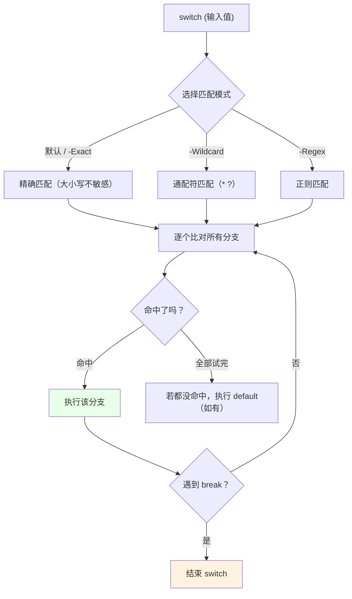
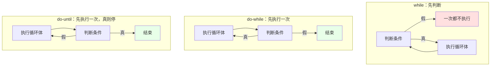

# 第 4 章 流程控制：与 C# 的“形似”与“神异”

> **本章定位**：上一章我们学会了“存值、算值、拼字”。但一个脚本如果只会从上到下一条道走到黑，那它就只是个“长长的命令清单”，没有任何“随机应变”的能力。流程控制就是给脚本装上“岔路口”和“回头路”：条件满足走这条，不满足走那条；这段代码重复做了十次、一百次；或者把一串对象“流”过一个处理站。
>
> 本章的标题里有一个关键词：**“形似神异”**。PowerShell 的 `if`、`for`、`while` 长得几乎和 C# 一模一样，但 `switch` 和 `foreach` 的“内里”却和 C# 大不相同。我们会逐个拆开，重点标出那些“看起来一样、跑起来不一样”的地方——这些地方，恰恰是初学者最容易摔跤的。

---

## 4.1 条件分支：`if` / `elseif` / `else` 与 `switch`

条件分支要解决的问题非常朴素：**“如果……就……，否则就……”**。PowerShell 的 `if` 语法几乎和 C# 一致，学起来很轻松；而 `switch` 则完全是另一个物种——它在 PowerShell 里不是“常量分支”，而是一台**多模式匹配器**。我们一个一个看。

### `if` / `elseif` / `else`：以真值转换为地基

`if` 的写法是：

```powershell
$age = 20

if ($age -ge 18) {
    '已成年'
}
elseif ($age -ge 6) {
    '未成年'
}
else {
    '学龄前'
}
```

几点说明：

1. **条件必须包在圆括号 `()` 里**，执行体包在花括号 `{}` 里。
2. `elseif` 和 `else` 都是可选的，可以一个都不写。
3. `elseif` 可以写多个，从上往下依次判断，**命中一个就跳过剩下的**。
4. **花括号在 PowerShell 里是“必需的”**，哪怕执行体只有一行，也不能像 C/C++ 那样省略。

这些和 C# 几乎一样。真正需要反复咀嚼的是那个老问题：**括号里的东西，到底怎么算“真”、怎么算“假”？** 答案是第 3.2 节讲过的那张真值表，这里再贴一次，因为 `if` 全靠它吃饭：

| 值 | 真值 |
|---|---|
| `$null` | 假 |
| `0` | 假 |
| `""`（空字符串） | 假 |
| `@()`（空数组） | 假 |
| 其他一切 | 真 |

```powershell
if (0)        { '假' } else { '真→实际走了 else' }
if ('0')      { '真→实际走了 if' }
if (@())      { '假' } else { '真→实际走了 else' }
if (@(0))     { '真→实际走了 if' }
```

记住那个坑：**字符串 `'0'` 是非空字符串，所以为真；数组 `@(0)` 有一个元素，所以也为真。** 要判断“数字是不是零”，请老老实实写 `$x -eq 0`，别用 `if ($x)` 去猜。

### `switch`：一个“多模式匹配器”，而不是 C# 的常量分支

如果你带着 C# 的印象来看 PowerShell 的 `switch`，会吓一跳。C# 的 `switch` 是“拿一个值，去和一堆**常量**比对，命中一个就 `break`”；PowerShell 的 `switch` 则是“拿一个值，去和一堆**模式**比对，而且**所有匹配的分支默认都会执行**”。它更像一台“分类过滤器”，而不是“单行道岔路口”。

先看最基础的用法：

```powershell
$value = 'apple'

switch ($value) {
    'apple'  { '这是一个苹果' }
    'banana' { '这是香蕉' }
    default  { '不知道是什么' }
}
# 输出：这是一个苹果
```

默认情况下，`switch` 进行的是**大小写不敏感的精确匹配**。也就是说，`switch ('APPLE') { 'apple' { ... } }` 是会命中的。想区分大小写，加 `-CaseSensitive`：

```powershell
switch -CaseSensitive ('APPLE') {
    'apple' { '区分大小写：命中' }
    default { '区分大小写：没命中' }
}
# 输出：区分大小写：没命中
```

`switch` 的“多模式”能力，体现在它可以切换三种匹配模式：

- **`-Wildcard`**：按通配符匹配（`*`、`?`）。
- **`-Regex`**：按正则表达式匹配。
- **`-Exact`**：精确匹配（其实和默认差不多，只是把话说死）。

我们分别看一眼：

```powershell
# 通配符匹配
switch -Wildcard ('report_2026.txt') {
    '*.txt'     { '是文本文件' }
    'report_*'  { '是报告文件' }
}
# 输出：
# 是文本文件
# 是报告文件      ← 两个分支都命中了！

# 正则匹配
switch -Regex ('ERROR: 磁盘已满') {
    '^ERROR' { '错误日志' }
    '^WARN'  { '警告日志' }
}
# 输出：错误日志
```

注意第一个例子里的关键现象：**`'report_2026.txt'` 同时匹配 `*.txt` 和 `report_*`，于是两个分支都执行了。** 这就是 PowerShell `switch` 和 C# `switch` 最大的不同之一——**它不是“命中即停”，而是“全部扫一遍，谁命中执行谁”**。

想让它“命中一个就停”，你得自己加 `break`：

```powershell
switch -Wildcard ('report_2026.txt') {
    'report_*'  { '是报告文件'; break }
    '*.txt'     { '是文本文件' }
    'other'     { '其他' }
}
# 输出：是报告文件（第一个命中后 break，后面不再看）
```

用一张图把“匹配模式 + 多个分支都可能执行”这件事画出来：



`switch` 还有三个非常实用的特性，值得单独拎出来：

**第一，`switch` 能直接迭代集合。** 如果你把数组交给 `switch`，它会**对每个元素各跑一遍**：

```powershell
switch (1..5) {
    { $_ % 2 -eq 0 } { "$_ 是偶数" }
    default          { "$_ 是奇数" }
}
# 输出：
# 1 是奇数
# 2 是偶数
# 3 是奇数
# 4 是偶数
# 5 是奇数
```

这里的 `{ $_ % 2 -eq 0 }` 是**脚本块形式的 case**——不是常量，而是一个“条件”，只要它返回真就算命中。这是 C# `switch` 完全做不到的灵活。

**第二，`continue` 和 `break` 在 `switch` 里都有意义。** `break` 退出整个 `switch`；`continue` 则“跳过当前这个元素，去看下一个元素”：

```powershell
switch (1..4) {
    2 { '跳过 2'; continue }
    default { "处理 $_" }
}
# 输出：
# 处理 1
# 跳过 2
# 处理 3
# 处理 4
```

**第三，`switch` 本身能“产出值”。** 你可以把 `switch` 的结果赋给变量，它会把所有执行分支的输出收集起来：

```powershell
$result = switch (3) {
    1 { '一' }
    3 { '三' }
    default { '其他' }
}
$result        # 三
```

对零基础读者来说，`switch` 最实用的场景是**“日志分级”**和**“文件分类”**——一堆文本进来，按开头几个字或后缀决定怎么处理。记住“默认精确、`-Wildcard`/`-Regex` 切换、多个命中都会执行、`break` 才停”这四句话，你就掌握了它。

### 4.1 小结

1. **`if / elseif / else` 的地基是真值转换**：`$null`、`0`、`""`、`@()` 为假，`'0'` 和 `@(0)` 为真。
2. **`switch` 是“多模式匹配器”**，不是 C# 的常量分支：默认精确（大小写不敏感），`-Wildcard` 换通配符，`-Regex` 换正则。
3. **`switch` 默认会把所有命中的分支都执行**，要“命中即停”必须自己加 `break`。
4. **`switch` 能迭代集合，也能用脚本块充当 case 条件**；`break` 退出整个 switch，`continue` 跳到下一个元素。

---

## 4.2 循环：`for`、`foreach`、`while`、`do-while` 与 `do-until`

循环要解决的问题是：**“同一段代码，我想重复做很多次。”** PowerShell 提供了五种循环写法，它们长得像 C#，但有一对“双胞胎”需要特别小心。我们把五种都过一遍，重点看两个东西：**条件在什么时候判断**，以及 **`foreach` 语句和 `ForEach-Object` 到底差在哪**。

### `for`：最经典的计数循环

`for` 的语法和 C# 几乎一模一样：初始化、条件、迭代，三段用分号隔开。

```powershell
for ($i = 1; $i -le 5; $i++) {
    "第 $i 次"
}
# 第 1 次
# 第 2 次
# 第 3 次
# 第 4 次
# 第 5 次
```

三段的意思分别是：`$i = 1` 只在开始时执行一次；`$i -le 5` 每轮开始前判断，为真才继续；`$i++` 每轮结束后执行。当你**明确知道要跑多少次**、或者需要用“计数器”控制时，`for` 是最直接的选择。

### `foreach` 语句：把集合“抱进内存”逐个枚举

`foreach` 语句专门用来“遍历一个集合”：

```powershell
$fruits = @('苹果', '香蕉', '橘子')

foreach ($fruit in $fruits) {
    "我喜欢$fruit"
}
# 我喜欢苹果
# 我喜欢香蕉
# 我喜欢橘子
```

它的意思是：把 `$fruits` 里的每个元素，依次取出来放进 `$fruit` 这个变量，然后执行一遍花括号里的代码。

这里藏着一个**很重要的性能与内存特性**：`foreach` 语句会**先把整个集合读进来**，再开始遍历。对数组这种“本来就在内存里”的东西无所谓；但如果你写 `foreach ($file in Get-ChildItem -Recurse)`，它其实会先把递归查到的**所有**文件都收集完，才开始一个个处理。文件一多，内存就吃不消。这一点，正是它和 `ForEach-Object` 的分水岭（下面细说）。

`foreach` 的背后，其实是 .NET 的**枚举器**（enumerator）在工作。你可以手动模拟它，理解“遍历”到底是怎么回事：

```powershell
$enumerator = (1..3).GetEnumerator()

while ($enumerator.MoveNext()) {
    $enumerator.Current
}
# 1
# 2
# 3
```

`MoveNext()` 负责“挪到下一个”，挪得动返回 `$true`，挪不动（到底了）返回 `$false`；`Current` 则是“当前这个元素”。`foreach` 语句就是这套动作的语法糖。

### `while` / `do-while` / `do-until`：条件求值时机的差异

这三种循环长得很像，差别全在**“条件什么时候判断”**上。

**`while`：先判断，再执行。** 条件一开始就是假的话，一次都不执行。

```powershell
$i = 0
while ($i -lt 3) {
    "i = $i"
    $i++
}
# i = 0
# i = 1
# i = 2
```

**`do-while`：先执行一次，再判断；条件为真就继续。** 至少执行一次。

```powershell
$i = 0
do {
    "至少执行一次：$i"
    $i++
} while ($i -lt 3)
# 至少执行一次：0
# 至少执行一次：1
# 至少执行一次：2
```

**`do-until`：先执行一次，再判断；条件为真就停止。** 它和 `do-while` 正好相反——一个“直到为真才停”，一个“只要真就继续”。别记混了：

```powershell
$i = 0
do {
    "i = $i"
    $i++
} until ($i -ge 3)
# i = 0
# i = 1
# i = 2
```

用一张图把“判断时机”的差异摆清楚：



一个记忆窍门：**`while` 和 `until` 读起来就像英文句子——“while 条件成立就继续”“until 条件成立就停”。** 而 `do-while` / `do-until` 前面多了个 `do`，意思是“先把事儿做一遍再说”。

### `foreach` 语句 vs `ForEach-Object`：一对“同名不同命”的双胞胎

这是本章最需要划重点的地方。PowerShell 里有两个东西都叫“foreach”：

- **`foreach` 语句**：语言关键字，`foreach ($x in $集合) { ... }`；
- **`ForEach-Object` cmdlet**：管道命令，`$集合 | ForEach-Object { ... }`。

它们看起来都在“遍历”，但执行模型天差地别：

| 对比项 | `foreach` 语句 | `ForEach-Object` |
|---|---|---|
| 性质 | 语言关键字 | 管道 cmdlet |
| 数据来源 | 现成的集合（变量、数组） | 管道上游流下来的对象 |
| 内存 | **先把整个集合读进内存** | **一次只处理一个，流式** |
| 适用 | 已知集合、小数据量 | 管道输出、大数据量 |
| 循环控制 | `break` / `continue` 正常使用 | 脚本块里用 `return` 跳过当前项 |
| 并行 | 不支持 | `-Parallel`（PowerShell 7+） |

看两个等价但“吃内存方式不同”的写法：

```powershell
# 写法一：foreach 语句 —— 先收集，再遍历（文件多时占用大）
foreach ($file in Get-ChildItem -Path C:\Windows -Recurse) {
    $file.Name
}

# 写法二：ForEach-Object —— 边查边处理（内存平稳）
Get-ChildItem -Path C:\Windows -Recurse | ForEach-Object {
    $_.Name
}
```

第一种写法，`Get-ChildItem` 的全部结果要先攒成一个完整集合，才开始 `foreach`；第二种写法，`Get-ChildItem` 找到一个就交给 `ForEach-Object` 处理一个，处理完的立刻可以丢掉。**在大数据量场景下，第二种的内存优势非常明显。** 这就是第 4.3 节要讲的“管道流式模型”。

不过也别矫枉过正：如果你手里已经是一个小数组（比如 `1..10`），`foreach` 语句往往更快、更直观。**选型口诀：数据在管道里流 → 用 `ForEach-Object`；数据已经在内存里 → 用 `foreach` 语句。**

### `break` / `continue` 的作用范围

`break` 和 `continue` 是循环的“方向盘”：

- **`break`**：立刻跳出**当前这一层**循环。
- **`continue`**：跳过本轮剩下的代码，直接进入**下一轮**。

```powershell
for ($i = 1; $i -le 5; $i++) {
    if ($i -eq 3) {
        break          # 到 3 就整个结束
    }
    "i = $i"
}
# i = 1
# i = 2
```

```powershell
for ($i = 1; $i -le 5; $i++) {
    if ($i -eq 3) {
        continue       # 到 3 就跳过这一轮，继续 4
    }
    "i = $i"
}
# i = 1
# i = 2
# i = 4
# i = 5
```

这里有个“作用范围”的细节：**它们只影响“最近的那层循环或 switch”**。如果你在嵌套循环里用 `break`，它只会跳出内层，不会把外层也一起停掉：

```powershell
foreach ($i in 1..3) {
    foreach ($j in 1..3) {
        if ($j -eq 2) { break }     # 只跳出内层 foreach
        "i=$i, j=$j"
    }
}
# i=1, j=1
# i=2, j=1
# i=3, j=1
```

想跳出外层，需要给它贴个“标签”（label），或者用别的控制手段。初学者先记住“就近原则”即可。

### 4.2 小结

1. **`for`** 适合“知道次数、需要计数器”的场景。
2. **`foreach` 语句**先把整个集合读进内存再遍历；它的底层是 `MoveNext()` / `Current` 这个枚举器模型。
3. **`while` 先判断后执行**（可能一次都不跑）；**`do-while` / `do-until` 先执行一次再判断**，一个“真则续”，一个“真则停”。
4. **`foreach` 语句 vs `ForEach-Object`**：前者吃内存、快而直观，后者流式、省内存；数据在管道里就用后者。
5. **`break` 跳出当前层，`continue` 跳到下一轮**，它们只管“最近的那层”。

---

## 4.3 管道作为“流控制原语”：`ForEach-Object` / `Where-Object` / `Select-Object`

在别的语言里，处理一个集合通常是“写个循环，把元素一个个拿出来，判断、变换、收集”。在 PowerShell 里，这套动作被**管道**接管了：你把对象送进管道，`Where-Object` 负责“筛”，`ForEach-Object` 负责“改”，`Select-Object` 负责“挑列/截断”。它们不是普通函数，而是**流控制的语法**——对象一边流，一边被加工。

这一节我们把这三根“管道主角”讲透，并且建立一个贯穿全书的直觉：**管道不是“先算完再传”，而是“上游产一个、下游吃一个”。**

### 管道的流式模型：一个对象一个对象地处理

这是理解 PowerShell 的关键中的关键。看下面这条管道：

```powershell
Get-Process | Where-Object { $_.CPU -gt 10 } | Select-Object Name, CPU
```

它不是“先把所有进程都取出来，再统一筛选，再统一选列”。真实过程是：

1. `Get-Process` 产出**第一个**进程对象；
2. 这个对象立刻流进 `Where-Object`，判断 CPU 是否大于 10；
3. 如果通过，立刻流进 `Select-Object`，被投影成 `Name`、`CPU` 两列；
4. 然后 `Get-Process` 产出第二个……如此往复。

也就是说，**对象是“流水线”上的零件，一个接一个被加工**，而不是“整批搬运”。我们把这种模型和 C# LINQ 的延迟执行放在一起看：


这种流式模型带来两个直接好处：

1. **内存省**：不需要先把整个集合加载完，就能开始处理，适合大文件、大目录、源源不断的日志。
2. **可以“提前收工”**：下游一旦说“够了”（比如 `Select-Object -First 3`），上游会收到“停止”信号，不再继续产出。这在第 4.3 节末尾会详细讲。

它也和 C# 的 LINQ 有相似的精神——`Where` 对应 `Where-Object`，`Select` 对应 `Select-Object`，`ForEach` 对应 `ForEach-Object`。区别在于：LINQ 建立的是“查询表达式树/迭代器”，PowerShell 走的是“真实的对象流”。

### `Where-Object`：两种形态与取舍

`Where-Object` 负责“筛选”——只让满足条件的对象继续往下流。它有两种写法。

**写法一：脚本块（script block）**，最通用：

```powershell
Get-Process | Where-Object { $_.CPU -gt 10 }
Get-Process | Where-Object { $_.Status -eq 'Running' -and $_.WorkingSet64 -gt 100MB }
```

花括号里的 `$_` 就是“当前这个对象”，条件为真就放行。

**写法二：简化语法（comparison statement）**，PowerShell 3.0 起支持：

```powershell
# 属性名 运算符 值
Get-Process | Where-Object Status -EQ 'Running'
```

它的好处是**短**；坏处是**只能表达“一个属性、一个运算符、一个值”**，做不了 `-and` 组合，也不能调用方法。所以取舍很清楚：

- 单个属性比较、图省事 → 简化语法；
- 复合条件、需要调方法/做计算 → 脚本块。

```powershell
# 简化语法做不到这种复合条件，必须用脚本块
Get-Process | Where-Object {
    $_.Status -eq 'Running' -and $_.CPU -gt 10
}
```

简化语法支持的运算符是 `-EQ`、`-NE`、`-GT`、`-GE`、`-LT`、`-LE`、`-Like`、`-NotLike`、`-Match`、`-NotMatch`、`-Contains`、`-NotContains`、`-In`、`-NotIn` 这些（大小写随意）。它们的含义和你第 3 章学过的比较运算符完全一致。

### `Select-Object`：属性投影与对象塑形

`Select-Object` 是“改造对象形状”的主力。它至少能干四件事：

**第一，挑列（属性投影）：**

```powershell
Get-Process | Select-Object Name, CPU, WorkingSet64
```

**第二，计算属性（用哈希表定义“新列”）：**

```powershell
Get-Process | Select-Object Name,
    @{Name = 'MemMB'; Expression = { [math]::Round($_.WorkingSet64 / 1MB, 2) }}
```

那个 `@{Name='MemMB'; Expression={...}}` 的意思是：“新建一列，叫 MemMB，值由右边这段脚本块算出来”。这是 PowerShell 里“从现有属性派生新属性”的标准姿势。

**第三，改变数量：**

```powershell
Get-Process | Select-Object -First 5      # 前 5 个
Get-Process | Select-Object -Last 3       # 后 3 个
Get-Process | Select-Object -Skip 2 -First 3   # 跳过前 2 个，再取 3 个
Get-Process | Select-Object -Unique ProcessName # 去重
```

**第四，把某一列“展开”成管道里的裸值：**

```powershell
# 返回的是“字符串”，而不是只有 Name 属性的对象
Get-Process | Select-Object -ExpandProperty Name
```

`-ExpandProperty` 和 `-Property Name` 的区别值得说清楚：`-Property Name` 得到的是“一个只剩 Name 属性的 **对象**”；`-ExpandProperty Name` 得到的是“**字符串本身**”。当你下游要的是“纯粹的值”（比如拿去做字符串拼接），用后者更合适。

### `Select-Object` 的“提前终止”：管道的“急刹车”

`Select-Object -First N` 有一个非常重要的连带效果：**它会在拿够 N 个之后，向上游发一个“停止”信号。** 上游如果支持“被打断”（大多数 cmdlet 都支持），就会真的停下来。

这意味着：

```powershell
# 在一个有十万个文件的目录里找前 3 个 .log 文件
Get-ChildItem -Path C:\ -Recurse -Filter *.log |
    Select-Object -First 3
```

它**不会**先把十万个文件全查完再取前 3 个——`Get-ChildItem` 查到第 3 个符合条件的 .log 时，就会收到停止信号，后面的目录根本不去遍历。这就是流式管道 + 提前终止带来的“白捡的性能”。

把“筛选 → 变换 → 截断 → 提前终止”画成一条流水线：


这个机制在“大目录找文件”“读大日志找前几条报错”“探查网络资源”时极其有用。反过来说，如果下游没有 `-First` 这种“刹车”，上游就会老老实实把所有东西吐完——所以写管道时，**越早收窄数据，越省时间**。

### `ForEach-Object`：对一个对象做“动作”

`ForEach-Object` 负责“加工”每个对象。最少见的用法是“对每个对象执行副作用”，最常见的用法是“变换出新的值”：

```powershell
# 对每个数字翻倍
1..5 | ForEach-Object { $_ * 2 }
# 2 4 6 8 10

# 对每个字符串做处理
@('a', 'b', 'c') | ForEach-Object { $_.ToUpper() }
# A B C
```

它和 `Select-Object` 的分工是：`Select-Object` 侧重于“**换形状/挑属性**”，`ForEach-Object` 侧重于“**对每个对象做点什么/算出新值**”。当然两者有重叠，很多时候你选哪个都能完成任务，看可读性即可。

在 `ForEach-Object` 的脚本块里，想“跳过当前项”用 `return`：

```powershell
1..5 | ForEach-Object {
    if ($_ -eq 3) { return }   # 跳过 3，不输出
    $_
}
# 1 2 4 5
```

### `ForEach-Object -Parallel`：把“加工”并行起来（PowerShell 7+）

当每个对象的加工都很耗时（比如每个都要下载一次网页、算一次哈希），串行处理就太慢了。PowerShell 7 给 `ForEach-Object` 加了 `-Parallel`，让多个对象**同时**被处理：

```powershell
1..10 | ForEach-Object -Parallel {
    Start-Sleep -Milliseconds 100
    $_ * 2
} -ThrottleLimit 5
```

几个要点：

- `-ThrottleLimit` 控制“同时最多几个线程在跑”，默认是 5。
- 管道里的 `$_` 照样可用。
- **外部变量不能直接读**，要通过 `$using:` 传进去（它传的是**只读快照**）：

  ```powershell
  $factor = 2
  1..5 | ForEach-Object -Parallel {
      $_ * $using:factor
  }
  ```

- 并行脚本块运行在不同的线程/运行空间里，**不要在里面直接改共享的普通集合**（第 16、17 章会讲并发集合），否则会出现竞态。

`-Parallel` 是个“重型武器”，用对了能成倍提速，用错了会引入难查的并发 bug。初学阶段先知道“有这么个东西、要配 `$using:`、要防共享状态”即可，第 17 章会系统展开。

### 4.3 小结

1. **管道是流式的**：上游产一个、下游吃一个，不是“整批搬运”；因此省内存、可提前终止。
2. **`Where-Object`** 筛：简化语法短但只能单条件，复杂逻辑必须用脚本块。
3. **`Select-Object`** 塑形：挑列、计算属性、`-First/-Last/-Skip/-Unique`、`-ExpandProperty`。
4. **`-First N` 会向上游发停止信号**，这是“提前终止”带来的性能红利。
5. **`ForEach-Object`** 加工每个对象，脚本块里 `return` 跳过当前项；`-Parallel`（7+）可并行，但要用 `$using:` 传外部变量并警惕共享状态。

---

## 本章总结

第 4 章把“脚本会拐弯、会重复、会流动”这三件事讲完了：

- **4.1 条件分支**：`if` 以真值转换为地基（记住 `'0'` 和 `@(0)` 都为真）；`switch` 是“多模式匹配器”——默认精确、`-Wildcard`/`-Regex` 切换、**多个命中都执行、`break` 才停**、还能迭代集合和用脚本块做 case。
- **4.2 循环**：`for` 管计数，`foreach` 语句管“内存里的现成集合”，`while` 先判断、`do-while`/`do-until` 先执行一次；`break`/`continue` 只管最近一层。
- **4.3 管道流控制**：对象一个个流过 `Where-Object`（筛）、`Select-Object`（塑形/截断）、`ForEach-Object`（加工）；流式模型省内存，`-First` 能提前终止上游。

如果说第 1–3 章是“认零件”，那第 4 章就是“让零件动起来”。从下一章开始，我们要把这些动作**打包成可复用的“工具”**——也就是函数。

**下一章预告**：第 5 章《函数与脚本块：PowerShell 的“方法”与“委托”》。我们会看到：函数怎么定义、参数怎么传、`$args` 和 `param()` 怎么共存；怎么用 `[CmdletBinding()]` 把普通函数升级成“自己写的 cmdlet”；以及 `{ ... }` 这个“脚本块”为什么既是代码、又是可以传来传去的“值”。

---

> **动手练习**
>
> 1. 用 `switch -Wildcard` 写一个“按扩展名分类”的小脚本：输入 `report.docx`，输出“Word 文档”；输入 `photo.jpg`，输出“图片”。再故意让两个模式同时命中，观察是否两个分支都执行。
> 2. 分别用 `for`、`foreach` 语句、`while` 打印 1 到 5，比较三种写法。
> 3. 用 `do-until` 写一个“猜数字”的小循环：从 1 开始每次加 1，直到加到 5 就停，并把每一步打印出来。
> 4. 用 `Get-Process | Where-Object { $_.CPU -gt 0 } | Select-Object Name, CPU -First 3` 观察管道结果；再把 `Where-Object` 换成简化语法 `Where-Object CPU -GT 0`，对比写法。
> 5. 在 PowerShell 7 里运行 `1..10 | ForEach-Object -Parallel { $_ * 2 } -ThrottleLimit 3`，然后改成用 `$using:` 引入一个外部倍数变量，验证它能被正确读取。
