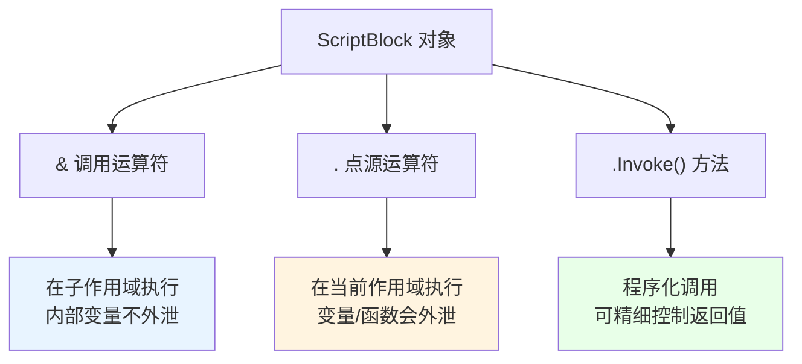

# 第 5 章 函数与脚本块：PowerShell 的“方法”与“委托”

> **本章定位**：前四章，我们把“值、变量、运算、控制流”这些零件都认全了。现在要把它们**打包**起来：一段反复用到的逻辑，不该每次都复制粘贴，而应该写成一个有名字的“工具”，随叫随用——这就是**函数**。而在 PowerShell 里，还有一样比函数更灵活的东西：**脚本块**（`{ ... }`）。它既是“一段待执行的代码”，又是“一个可以传来传去的值”，在能力上覆盖了 C# 里**委托、Lambda 表达式、甚至一部分反射调用**的角色。
>
> 这一章分三步走：先写最朴素的函数，把参数怎么传、返回值怎么来搞清楚；再给函数装上“标准配件”，让它变成“自己写的 cmdlet”；最后把脚本块当成“一等公民”来研究，顺便揭开第 4 章里那些 `{ ... }` 的真面目。

---

## 5.1 基本函数、参数传递与 `$args`

函数解决的是“复用”问题。假设你每天都要输出一句格式固定的问候，每次手写一遍太傻；把它包成函数，以后一行调用就行。在 C# 里你会写 `static string Greet(string name) { ... }`，在 PowerShell 里，语法是这样的：

```powershell
function Get-Greeting {
    param(
        [string]$Name = '世界'
    )
    "你好，$Name！"
}

Get-Greeting
# 你好，世界！

Get-Greeting -Name 'PowerShell'
# 你好，PowerShell！
```

看起来很简单，但函数里藏着几个特别容易踩的坑：参数到底怎么绑定？没被接住的参数去哪了？函数的“返回值”到底是怎么回事？这一节我们一个个说透。

### `function` 与 `param`：把一串命令打包成可复用的“工具”

定义一个函数，最标准的写法是：

```powershell
function 动词-名词 {
    param(
        [类型]$参数名 = 默认值,
        ...
    )
    函数体
}
```

几点说明：

1. **函数名推荐用“动词-名词”格式**（比如 `Get-Greeting`、`Test-Path`）。这不是语法强制，而是 PowerShell 的命名约定（第 9 章会细讲），遵循它能让你的函数“看起来像内置命令”。
2. **`param(...)` 块是可选的**。不写参数就用 `$args` 接收（下面讲）；写参数，参数就“有名字、有类型、有默认值”。
3. **参数用 `[类型]$名字` 声明**，可以给默认值 `= 值`。默认值在“调用时没传这个参数”的情况下生效。
4. **函数体就是花括号里的命令**，函数的“输出”就是函数体里所有写到输出流的东西（不是 `return`，这点下面专门讲）。

除了 `param` 块，你也可以把参数直接写在函数名后面的括号里：

```powershell
function Get-Greeting([string]$Name) {
    "你好，$Name！"
}
```

两种写法效果等价，但**推荐用 `param()` 块**——它更清晰，而且高级函数的各种 `[Parameter()]` 特性只能写在 `param()` 里（5.2 节会用到）。

### 参数怎么传：位置参数、命名参数与默认值

调用函数时，传参有两种方式：

**命名参数**：用 `-参数名 值` 的形式，明确点出“这个值给谁”。不依赖顺序，最不容易出错：

```powershell
function Get-Box {
    param(
        [string]$Name,
        [int]$Width = 10,
        [int]$Height = 5
    )
    "$Name：宽 $Width，高 $Height"
}

Get-Box -Name '盒子A' -Width 20 -Height 8
# 盒子A：宽 20，高 8
```

**位置参数**：按声明的顺序依次传值，不写参数名：

```powershell
Get-Box '盒子B' 30 15
# 盒子B：宽 30，高 15
```

位置参数省事，但可读性差——尤其参数一多，你自己都记不住谁是谁。**建议：参数超过两个就用命名参数；位置参数留给“最自然的第一参数”。**

**默认值**：声明时用 `= ` 给出。调用时没传，就用默认值：

```powershell
Get-Box -Name '盒子C'
# 盒子C：宽 10，高 5
```

还有个很实用的细节：**在函数内部，你可以用参数名对应的变量直接读取**，比如 `$Name`、`$Width`。它们就是普通的局部变量，和函数里临时定义的变量没有区别。

### `$args`：没被 `param` 接住的那堆参数

如果你调用函数时给了“比声明的参数更多”的值，多出来的那些去哪了？答案是：进了自动变量 `$args`。

```powershell
function Show-Param {
    param(
        [string]$Name,
        [int]$Count = 1
    )

    "Name = $Name；Count = $Count"
    "接住的参数个数：$($PSBoundParameters.Count)"

    "没被接住的参数（$args）有 $($args.Count) 个："
    $args | ForEach-Object { "  额外参数：$_" }
}

Show-Param -Name 'demo' -Count 3 extra1 extra2
# Name = demo；Count = 3
# 接住的参数个数：2
# 没被接住的参数（$args）有 2 个：
#   额外参数：extra1
#   额外参数：extra2
```

这里要理解“**`param` 块和 `$args` 的优先级**”：

- 有 `param` 块时，PowerShell **先按名字/位置把参数塞给声明的参数**；
- 塞完之后还剩下的，才进 `$args`；
- 如果函数根本没写 `param`，那所有参数都会进 `$args`。

一个纯 `$args` 的函数长这样：

```powershell
function Show-All {
    "一共收到 $($args.Count) 个参数"
    $args | ForEach-Object { "参数：$_" }
}

Show-All apple banana cherry
# 一共收到 3 个参数
# 参数：apple
# 参数：banana
# 参数：cherry
```

对零基础读者，`$args` 最实用的场景是“**写一个能接收任意个参数的简单工具**”，比如“把传进来的所有字符串都变大写”。但一旦你开始在意“参数有名字、要验证、要提示”，就该升级到 `param` 块和高级函数了。

### `$PSBoundParameters`：到底哪些参数是“真被传了”

`$PSBoundParameters` 是一个“记录本”，里面**只装那些本次调用真正传进来的参数**（包括用位置传的），那些“靠默认值生效”的参数不算。

```powershell
function Test-Bound {
    param(
        [string]$Name = '默认名',
        [int]$Age = 18
    )

    "实际传了哪些参数："
    $PSBoundParameters.GetEnumerator() |
        ForEach-Object { "  $($_.Key) = $($_.Value)" }

    "有没有传 Name？$($PSBoundParameters.ContainsKey('Name'))"
}

Test-Bound -Name '小明'
# 实际传了哪些参数：
#   Name = 小明
# 有没有传 Name？True
```

它有什么用？**当“默认值”和“用户明确传了默认值”必须区分开时**。比如你写一个“合并配置”的函数：用户没传某个参数，就用配置文件里的值；用户明确传了，就必须用用户的。这时候只看 `$Name` 是分不清“没传”和“传了默认值”的，但 `$PSBoundParameters.ContainsKey('Name')` 能精确回答。

### 函数的“返回值”其实就是输出流

这是 PowerShell 和 C# 差别最大的地方之一，必须掰开说。

在 C# 里，`return` 就是“把某个值交回去”。在 PowerShell 里，**函数体里任何“没有被接住”的输出，都会自动成为函数的返回值**。而 `return` 关键字，主要作用是“**提前结束函数**”，它后面跟着的东西也只是“顺便输出”而已。

看几个例子：

```powershell
function Get-Double {
    param([int]$Value)
    $Value * 2          # 这一行的结果，就是函数的输出
}

$result = Get-Double -Value 21
$result                 # 42
```

再看“多个输出”的情况：

```powershell
function Get-Pair {
    1
    2
}

$pair = Get-Pair
$pair.GetType().Name    # Object[]
$pair.Count             # 2
$pair                   # 1 2
```

看到没？函数体里先后输出了 `1` 和 `2`，它们**都被收集进一个数组**交给你。所以“函数返回多个值”在 PowerShell 里根本不用特殊语法——你多写几行输出就行。

>`return` 的正确用法是“提前退出”：
>```powershell
>function Test-Positive {
>    param([int]$N)
>    if ($N -le 0) { return '不是正数' }
>    '是正数'
>}
>```
>它碰到 `return` 就结束，后面的代码不再执行。

**这里有个经典大坑**：很多 .NET 方法“顺手”会返回一个值（比如集合的 `Add()` 返回新元素的索引），如果你在函数里调用了它却没“接住”那个返回值，它就会**悄悄混进函数的输出流**，让你拿到一堆莫名其妙的数字。

```powershell
function Bad-Add {
    $list = [System.Collections.ArrayList]::new()
    $list.Add('x')        # Add 返回索引 0，它会“漏”成函数输出！
}

Bad-Add
# 输出：0  ← 不是我们想要的
```

解决办法很简单：用 `[void]` 或 `$null =` 把“不想要的返回值”吃掉：

```powershell
function Good-Add {
    $list = [System.Collections.ArrayList]::new()
    [void]$list.Add('x')   # 明确表示“我不要这个返回值”
    $list                  # 只输出列表本身
}

Good-Add
```

记住这条铁律：**在 PowerShell 函数里，只要一行“有输出”，它就会成为函数输出的一部分。** 不想要，就用 `[void]`、`$null =`，或者赋给一个变量。

### 5.1 小结

1. **函数用 `function 名字 { param(...) ... }` 定义**，参数有类型、有默认值。
2. **传参**：命名参数最稳，位置参数最省事；没接住的参数进 `$args`。
3. **`$PSBoundParameters`** 只记录“真正被传了”的参数，可以用来区分“没传”和“传了默认值”。
4. **函数的返回值就是它的输出流**；`return` 主要用来提前结束；用 `[void]`/`$null =` 吃掉不需要的返回值。
5. 这就是“简单函数”；想让它拥有 cmdlet 那套标准能力，就要升级成高级函数。

---

## 5.2 高级函数：`[CmdletBinding()]`、参数验证与通用参数

“简单函数”已经能用了，但它缺了 cmdlet 身上的一大堆“标准配件”：没有 `-Verbose` 详细输出、没有 `-ErrorAction` 错误控制、没有 `-WhatIf` 预演、参数也不做强制校验。这些“配件”不是可有可无的装饰——**它们是一个脚本从“能跑”走向“能交付”的第一道门**。

升级的办法，就是在函数体最前面加一行 `[CmdletBinding()]`。加上它，函数就变成了**高级函数**（advanced function），本质上等于“用 PowerShell 写的 cmdlet”。这一节我们看看它到底给你装上了什么。

### `[CmdletBinding()]`：给函数装上 cmdlet 的“标准配件”

最简形态：

```powershell
function Test-Demo {
    [CmdletBinding()]
    param(
        [string]$Name = 'demo'
    )
    "Name = $Name"
}
```

仅仅加上这一行，函数就自动拥有了下面这批**通用参数**（common parameters）：

- `-Verbose`：详细输出
- `-Debug`：调试输出
- `-ErrorAction`：出错时怎么办（`Stop` / `Continue` / `SilentlyContinue` 等）
- `-WarningAction` / `-WarningVariable`
- `-OutVariable` / `-OutBuffer`
- `-InformationAction` / `-InformationVariable`
- `-PipelineVariable`

也就是说，你的函数现在可以这样被调用：

```powershell
Test-Demo -Name 'abc' -Verbose
Test-Demo -ErrorAction SilentlyContinue
```

**`[CmdletBinding()]` 必须是函数体里的第一条语句**（在 `param` 之前），写在别处会直接报错。这一点务必记牢。

高级函数还有一个隐藏的“结构性变化”：它内部会自动拥有 **`begin` / `process` / `end`** 三个代码块的语义（第 11 章会详细展开）。现在你只需要知道：**一旦用了 `ValueFromPipeline` 这类“从管道接参数”的特性，就必须把处理逻辑放进 `process {}` 块里**，否则它不会对每个对象都执行。

### `[Parameter()]`：把参数绑定规则写清楚

`[Parameter()]` 是加在 `param` 块里每个参数前面的“属性”，用来声明这个参数该怎么绑定。最常用的几个：

```powershell
function Test-Parameter {
    [CmdletBinding()]
    param(
        # 必填：不传就报错（或交互式提示）
        [Parameter(Mandatory = $true)]
        [string]$Name,

        # 位置参数：允许按顺序传，0 表示第一个位置
        [Parameter(Position = 0)]
        [string]$First,

        # 从管道按“值”接收（整个对象赋给这个参数）
        [Parameter(ValueFromPipeline = $true)]
        [object]$InputObject,

        # 从管道按“属性名”接收（对象的同名属性赋给这个参数）
        [Parameter(ValueFromPipelineByPropertyName = $true)]
        [string]$Path
    )

    process {
        "Name=$Name, First=$First, Path=$Path"
    }
}
```

我们分别说明：

- **`Mandatory = $true`**：必填。不传的话，PowerShell 会**交互式提示**你输入；在非交互场景（比如后台任务）里则会直接失败。
- **`Position = 0`**：允许按位置传。`0` 是第一个位置，`1` 是第二个，以此类推。不写 `Position` 的参数默认只能按名字传（除非 PowerShell 自动给它排了位置——高级函数的自动位置分配比较复杂，显式写最稳）。
- **`ValueFromPipeline = $true`**：允许管道把“整个对象”绑到这个参数上。
- **`ValueFromPipelineByPropertyName = $true`**：允许管道把“对象的同名属性”绑到这个参数上。这一条是 PowerShell 管道自动化的灵魂，第 11.2 节会深入讲。

看两个管道绑定的例子：

```powershell
# 按值绑定：管道里的每个字符串，整体交给 $Name
function Show-Value {
    [CmdletBinding()]
    param(
        [Parameter(ValueFromPipeline = $true)]
        [string]$Name
    )
    process { "值：$Name" }
}

'apple', 'banana' | Show-Value
# 值：apple
# 值：banana
```

```powershell
# 按属性名绑定：进程对象的 Name 属性，自动塞给 $Name
function Show-Proc {
    [CmdletBinding()]
    param(
        [Parameter(ValueFromPipelineByPropertyName = $true)]
        [string]$Name
    )
    process { "进程：$Name" }
}

Get-Process | Show-Proc
# 进程：System
# 进程：svchost
# …
```

注意第二个例子里，我们**没有手写**“把每个进程的 Name 取出来传给函数”——`ValueFromPipelineByPropertyName` 让 PowerShell 自动做了这件事。这就是“延迟绑定”的威力。

### 验证属性：在赋值入口就拦住坏数据

参数传进来的值，可能不合法：端口传了负数、环境传了“Production”这种拼错的值、路径传了个不存在的目录。与其让函数体里到处写 `if` 去检查，不如在**参数声明处**就把“合法范围”钉死。这就用到**验证特性**（validation attributes）：

```powershell
function Test-Validation {
    [CmdletBinding()]
    param(
        [ValidateSet('Dev', 'Test', 'Prod')]
        [string]$Environment,

        [ValidateRange(1, 65535)]
        [int]$Port,

        [ValidatePattern('^\d{3}-\d{4}$')]
        [string]$Phone,

        [ValidateScript({ Test-Path $_ })]
        [string]$Path,

        [ValidateNotNullOrEmpty()]
        [string]$Name,

        [ValidateLength(2, 10)]
        [string]$Code,

        [ValidateCount(1, 5)]
        [string[]]$Tags
    )

    '全部参数通过验证'
}
```

常用验证特性一览：

| 特性 | 作用 | 例子 |
|---|---|---|
| `[ValidateSet(...)]` | 只能取列出的值 | `[ValidateSet('Dev','Prod')]` |
| `[ValidateRange(min,max)]` | 数值范围 | `[ValidateRange(1,65535)]` |
| `[ValidatePattern(...)]` | 必须匹配正则 | `[ValidatePattern('^\d+$')]` |
| `[ValidateScript({...})]` | 必须让脚本块返回真 | `[ValidateScript({Test-Path $_})]` |
| `[ValidateNotNullOrEmpty()]` | 不能是 `$null` 或空串 | `[ValidateNotNullOrEmpty()]` |
| `[ValidateLength(min,max)]` | 字符串长度范围 | `[ValidateLength(2,10)]` |
| `[ValidateCount(min,max)]` | 集合元素个数范围 | `[ValidateCount(1,5)]` |

一旦验证不通过，PowerShell 会**在参数绑定阶段**就抛出错误，函数体根本不会执行。这比你自己在函数里写一堆 `if` 判断要干净得多，而且错误消息统一、清晰。

```powershell
Test-Validation -Environment 'Prod' -Port 443 -Phone '123-4567' -Path 'C:\Windows' -Name 'a' -Code 'AB' -Tags 'x'
# 全部参数通过验证

Test-Validation -Environment 'Production' -Port 443 -Phone '123-4567' -Path 'C:\Windows' -Name 'a' -Code 'AB' -Tags 'x'
# 报错：无法验证参数“Environment”的参数。参数“Production”不属于集合 {Dev, Test, Prod}。
```

### `ShouldProcess` 与 `-WhatIf` / `-Confirm`：危险操作的“后悔药”

写“删除文件”“停止服务”“修改注册表”这一类危险函数时，最怕的是“手一抖就执行了”。PowerShell 给了一个非常优雅的机制：**`SupportsShouldProcess`**。开启后，你的函数自动获得 `-WhatIf`（只演示不执行）和 `-Confirm`（执行前先问你）两个开关。

```powershell
function Remove-MyFile {
    [CmdletBinding(SupportsShouldProcess = $true, ConfirmImpact = 'High')]
    param(
        [Parameter(Mandatory = $true)]
        [string]$Path
    )

    if ($PSCmdlet.ShouldProcess($Path, '删除文件')) {
        Remove-Item -Path $Path -Force
        "已删除：$Path"
    }
}
```

用的时候：

```powershell
# -WhatIf：只告诉你“我会删哪个文件”，并不真的删
Remove-MyFile -Path 'C:\temp\a.txt' -WhatIf
# What if: 对目标 "C:\temp\a.txt" 执行操作 "删除文件"。

# -Confirm：执行前弹确认
Remove-MyFile -Path 'C:\temp\a.txt' -Confirm
```

关键在那句 `if ($PSCmdlet.ShouldProcess($Path, '删除文件'))`：**真正的危险动作，必须放在 `ShouldProcess` 返回真的分支里**。当用户加了 `-WhatIf` 时，`ShouldProcess` 返回假（并打印“What if: ...”），危险动作就不会执行；当用户加了 `-Confirm` 或 `ConfirmImpact` 达到阈值时，它会先征求确认。

`ConfirmImpact` 用来声明“这个操作有多危险”，取值为 `None` / `Low` / `Medium` / `High`。默认的 `$ConfirmPreference` 是 `High`，所以 `High` 级别的操作会默认要求确认。

> **为什么要这么麻烦？** 因为这是 cmdlet 生态的“礼貌规范”。你写的高级函数只要遵守它，用户就能用统一的方式“先看后做”。这也是第 5.2 节开头说的“从能跑到能交付”的体现。

### 高级函数的“标准输出通道”：`Write-Verbose` 与 `$PSCmdlet`

高级函数里，推荐用标准的“输出通道”来报告信息，而不是随手 `Write-Host`：

```powershell
function Test-Output {
    [CmdletBinding()]
    param()

    Write-Verbose '这是详细输出（默认不显示，加 -Verbose 才看得到）'
    Write-Warning '这是一个警告'
    Write-Error '这是一个错误'
    Write-Information '这是一条信息' -InformationAction Continue

    $PSCmdlet.WriteVerbose('用 $PSCmdlet 写详细输出，效果一样')
}

Test-Output -Verbose
```

`Write-Verbose` 和 `$PSCmdlet.WriteVerbose()` 效果相同，前者更常用。重点是：**这些通道的输出，用户可以按需开关**（`-Verbose`、`-WarningAction SilentlyContinue` 等）。如果你用 `Write-Host`，它就绕过了这套机制，用户想静音都静音不了。

### 5.2 小结

1. **`[CmdletBinding()]`** 把普通函数升级成“自己写的 cmdlet”，自动获得 `-Verbose`、`-ErrorAction` 等通用参数；它必须是函数体第一条语句。
2. **`[Parameter()]`** 声明必填（`Mandatory`）、位置（`Position`）、管道按值（`ValueFromPipeline`）、管道按属性名（`ValueFromPipelineByPropertyName`）。
3. **验证特性**（`ValidateSet` / `ValidateRange` / `ValidatePattern` / `ValidateScript` 等）在参数入口就挡住非法数据。
4. **`SupportsShouldProcess` + `$PSCmdlet.ShouldProcess()`** 给危险操作装上 `-WhatIf` / `-Confirm` 的“后悔药”。
5. 用 `Write-Verbose` / `Write-Warning` / `Write-Error` 这些标准通道输出，别用 `Write-Host` 绕过机制。

---

## 5.3 脚本块作为一等值与延迟绑定

在 PowerShell 里，`{ ... }` 这个花花绿绿的东西，你已经在 `Where-Object`、`ForEach-Object`、`switch` 的 case 里见过无数次了。但你可能没意识到：**它本身就是一个对象**，类型叫 `ScriptBlock`。它可以被赋值给变量、可以当参数传给别人、可以被“延迟”到某个时刻才执行。

如果说函数是“有名字的工具”，那脚本块就是“**没有名字、随用随丢的工具**”。它同时承担了 C# 里**委托、Lambda、以及一部分反射调用**的角色。这一节我们把它的三种玩法讲透。

### `{ ... }` 不只是代码块，而是 `ScriptBlock` 对象

把一段花括号赋给变量，它就变成了一个 `ScriptBlock`：

```powershell
$sb = { param($x) $x * 2 }

$sb.GetType().Name      # ScriptBlock
$sb                     # 显示脚本块的内容（不执行）
```

注意：**赋值的时候它并不会执行**。`$sb` 只是“拿着这段代码”。要执行，必须“调用”它。

### 三种调用方式：`&`、`.`、`.Invoke()`

执行一个脚本块，有三种常见写法，它们的差别只在**作用域**：

**第一种，调用运算符 `&`**：在**子作用域**里执行。脚本块里定义的变量，执行完就丢了。

```powershell
$sb = { $inner = 42; "内部：$inner" }

& $sb
# 内部：42
$inner        # 没有值（$null），因为它是子作用域里的变量
```

**第二种，点源运算符 `.`**：在**当前作用域**里执行。脚本块里定义的变量、函数，会“漏”到外面。

```powershell
$sb = { $inner = 42; "内部：$inner" }

. $sb
# 内部：42
$inner        # 42 —— 点源之后，变量留在了当前作用域
```

这两种的区别，和第一章讲“脚本”时的 `& .\script.ps1` 与 `. .\script.ps1` 是同一回事：**`&` 是“另起一间房”，`.` 是“就在这间房里干”。**

**第三种，`.Invoke()` 方法**：脚本块对象自带的方法，功能上类似 `&`，但能更精细地控制参数和返回方式：

```powershell
$sb = { param($x) $x * 2 }

& $sb 3              # 6
$sb.Invoke(3)        # 6
$sb.InvokeReturnAsIs(3)   # 6（不把结果包成集合）
```

日常用 `&` 最顺手；需要“程序化地调用”时，用 `.Invoke()`。

三种方式用一张图对比：



**动态创建脚本块**：有时候代码是“运行时才拼出来的字符串”，这时用 `[scriptblock]::Create()` 把字符串变成可执行的脚本块：

```powershell
$code = '1 + 1'
$dynamic = [scriptblock]::Create($code)

& $dynamic        # 2
```

这个能力很强大（相当于“运行时写代码”），但也要慎用——**如果字符串内容来自用户输入，就有代码注入的风险**。日常脚本里，优先用字面量 `{ ... }`。

### 延迟绑定：脚本块在管道里的“隐式触发”

这是 PowerShell 最有“魔法感”的机制之一：**某些参数，你传给它一个脚本块，它不会立刻执行，而是对管道里的每个对象“延迟绑定、逐个求值”。**

最典型的例子是 `Rename-Item -NewName`：

```powershell
# 把所有 .txt 文件改名成 .log
Get-ChildItem *.txt | Rename-Item -NewName { $_.Name -replace '\.txt$', '.log' }
```

我们**没有**写“循环每个文件、算出新名字、再改名”，只是把 `{ $_.Name -replace '\.txt$', '.log' }` 这个脚本块交给了 `-NewName`。`Rename-Item` 会对管道里的**每一个**文件对象，分别执行一次这个脚本块，用 `$_` 指代“当前这个文件”，算出它的新名字。

这就是**延迟绑定脚本块**（delay-bind scriptblock）：**脚本块不是“一个值”，而是“一段针对每个对象都要算一遍的规则”。**

再看第 4 章用过的“计算属性”，本质也是这样：

```powershell
Get-Process | Select-Object Name,
    @{ Name = 'MemMB'; Expression = { [math]::Round($_.WorkingSet64 / 1MB, 2) } }
```

`Expression` 后面那个 `{ ... }` 就是脚本块，`Select-Object` 会对每个进程对象执行一次，`$_` 就是当前进程。

延迟绑定能生效，通常要满足两个条件：

1. 参数**从管道接收输入**（`ValueFromPipeline` 或 `ValueFromPipelineByPropertyName`）；
2. 参数的类型**不是 `[object]`、也不是 `[scriptblock]`**（否则 PowerShell 会以为你只是想“把这个脚本块本身当值传进去”）。

这个机制之所以叫“延迟”，是因为：**脚本块在“绑定”的那一刻不执行，而是等每个对象流过来时，才针对它执行一次。** 这就把“遍历”这件事从你手里接了过去，让管道替你完成。

### 计算属性与闭包：脚本块会“记住”它的环境

最后讲一个稍微进阶、但非常有用的特性：**闭包（closure）**。

默认情况下，脚本块执行时，用的是“执行那一刻”的变量值。但你可以用 `.GetNewClosure()` 让脚本块“**记住创建它时的环境**”：

```powershell
$factor = 2
$sb = { param($x) $x * $factor }.GetNewClosure()

$factor = 100          # 后来把外面的变量改了
& $sb 3                # 6 —— 因为闭包记住的是创建时的 factor = 2
```

如果没有 `.GetNewClosure()`，`& $sb 3` 会读到“当时的 `$factor`”，也就是 100。加了它，脚本块就像“打包带走”了创建时的变量快照。

这个特性在“生成一批行为各异的脚本块”时特别有用。比如你有一个列表，想为每个名字生成一个“问候脚本块”，每个脚本块里带着自己那个名字——如果不加闭包，最后所有脚本块读到的都会是循环结束时的那个值。

### 5.3 小结

1. **`{ ... }` 是一个 `ScriptBlock` 对象**，可以赋值、传参、延迟执行；赋值时不执行。
2. **调用有 `&`（子作用域）、`.`（当前作用域）、`.Invoke()`（程序化）三种方式**，作用域差异是关键。
3. **`[scriptblock]::Create()`** 能把字符串变成可执行脚本块，但要注意代码注入风险。
4. **延迟绑定脚本块**：把 `{ ... }` 交给某些管道参数（如 `Rename-Item -NewName`），PowerShell 会对每个对象执行一次，`$_` 指代当前对象。
5. **`GetNewClosure()`** 让脚本块“记住”创建时的变量环境，是生成“带状态的小行为”的利器。

---

## 本章总结

第 5 章把“复用”讲完了，而且是由浅入深的三级跳：

- **5.1 简单函数**：`function` + `param` 打包命令；命名/位置/默认参数；没接住的进 `$args`；`$PSBoundParameters` 记录实际传参；**返回值就是输出流**，小心方法返回值“漏”出来。
- **5.2 高级函数**：`[CmdletBinding()]` 注入标准配件；`[Parameter()]` 声明绑定规则；验证特性在入口拦坏数据；`ShouldProcess` 给危险操作配“后悔药”。
- **5.3 脚本块**：`{ ... }` 是对象；`&` / `.` / `.Invoke()` 三种调用方式；延迟绑定让脚本块成为“逐对象的规则”；`GetNewClosure()` 让它记住环境。

一句话把本章串起来：**函数是“有名字、有契约、有配件的工具”，脚本块是“没名字、可传递、可延迟的代码值”。** 这两样东西，是你后面写模块、写工具、写并发脚本时最常打交道的“积木”。

**下一章预告**：第 6 章《面向对象编程：类、对象、属性、继承、多态与接口》。这是第一部分的重头戏。我们会看到 PowerShell 的 `class` 语法和 C# 有多像，又有多“不一样”——`hidden` 不是 `private`、没有自动属性、没有 `virtual`/`override`、接口实现没有编译期检查。理解了这些差异，你才不会写出“看起来对、跑起来不对”的 PowerShell 类。

---

> **动手练习**
>
> 1. 写一个 `Get-Box` 函数，接收 `Name`、`Width`、`Height` 三个参数（后两个有默认值），分别用命名参数和位置参数调用一次。
> 2. 写一个 `Show-Param` 函数，声明两个参数，然后故意多传几个额外参数，观察 `$PSBoundParameters` 和 `$args` 各自装了什么。
> 3. 写一个函数，内部调用 `[System.Collections.ArrayList]::new().Add('x')` 但不加 `[void]`，观察“漏出来的返回值”；再加上 `[void]` 修正它。
> 4. 把第 3 题的函数升级成高级函数：加 `[CmdletBinding()]`、`[Parameter(Mandatory)]`、`[ValidateRange]`，并用 `-Verbose` 跑一次。
> 5. 写一个 `Remove-MyFile` 高级函数，开启 `SupportsShouldProcess`，先用 `-WhatIf` 预演，再用 `-Confirm` 执行。
> 6. 定义一个脚本块 `$sb = { $x = 42; $x }`，分别用 `& $sb` 和 `. $sb` 调用，再检查 `$x` 是否留在当前作用域。
