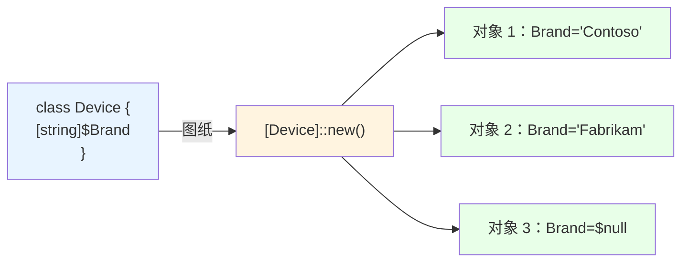
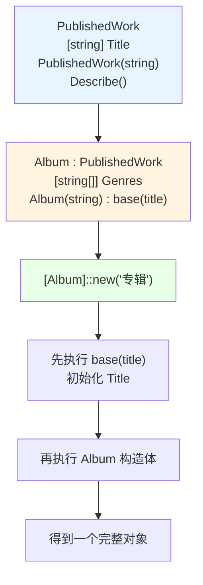
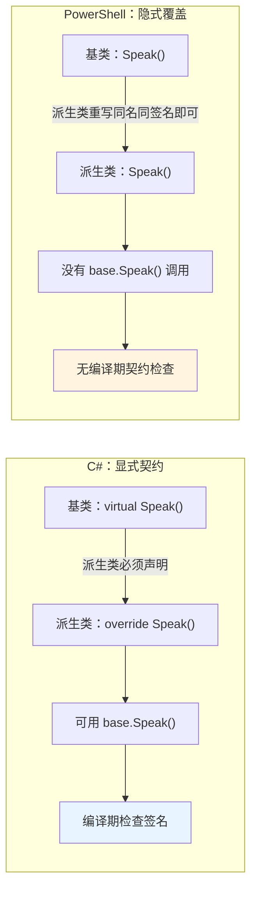
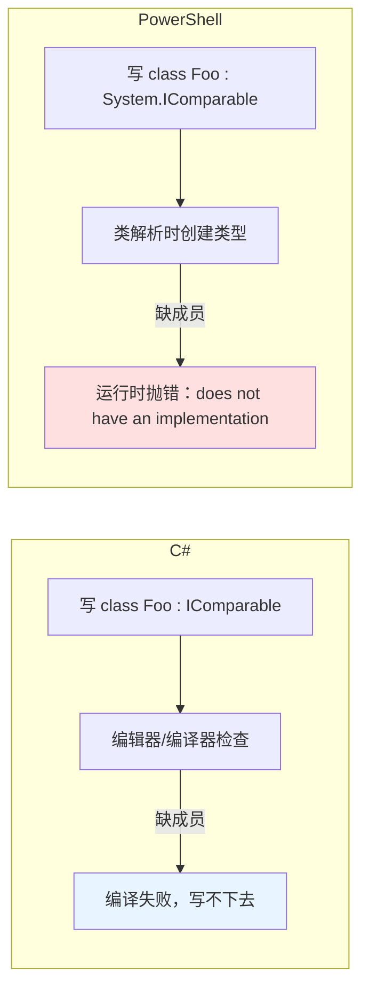
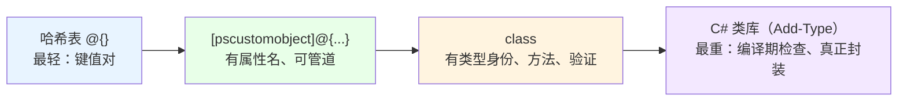
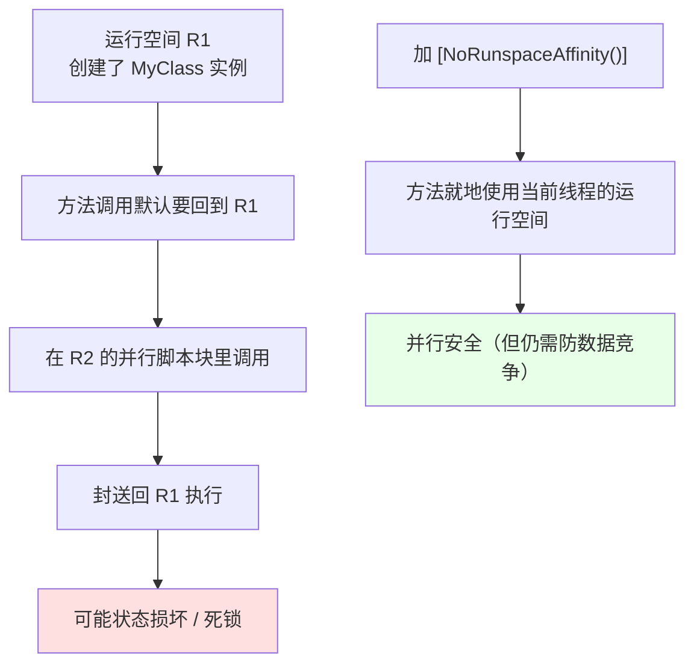

# 第 6 章 面向对象编程：类、对象、属性、继承、多态与接口

> **章内定位**：对标《C# 本质论》第 5–9 章“类与面向对象编程”和《CLR via C#》第 6 章“类型和成员基础”。但本章的核心教学任务不是“教 OOP”——两本参照著作已经完成——而是教 **PowerShell 的 OOP 与 C# 的 OOP 之间的系统性差异**：`hidden` 不是 `private`，属性不是字段但也没有自动实现，重写是隐式的因而没有编译期契约检查，接口实现一旦遗漏就是类解析时的错误而非编辑器里的红线提示。不理解这些差异，从 C# 转来的开发者会持续写出“看起来对但行为不对”的 PowerShell 类。
>
> 本章的每一个结论，都建议你亲手敲一遍——因为 PowerShell 类的很多“怪脾气”，光看文字是记不住的，跑一遍才会真正“疼”一下，然后记住。

---

## 6.1 类定义与对象实例化

先回顾一个朴素的事实：**“类”是造对象的图纸，“对象”是按图纸造出来的实物。** 在 C# 里，你写 `class Device { public string Brand; }`，然后 `new Device()` 造一个。PowerShell 从 5.0 起也支持 `class` 关键字，语法和 C# 高度相似——但“相似”之下，藏着几处会让人栽跟头的地方。

### 6.1.1 `class` 关键字、类型定义与 `[ClassName]::new()`

定义一个最简单的类：

```powershell
class Device {
    [string]$Brand
}
```

这就够了。类名叫 `Device`，里面有一个 `Brand` 属性，类型是字符串。造一个实例：

```powershell
$d = [Device]::new()
$d.Brand = 'Contoso'
$d.Brand
# 输出：Contoso
```

注意那个 `[Device]`——方括号是 PowerShell 的“类型标记”。`Device` 这个名字，此刻已经成了一个**类型**，你可以像用 `[int]`、`[string]` 一样用它。

造对象有三条路径（本机 PowerShell 7.6 实测均可用）：

```powershell
# 路径一：类型标记 + ::new()（最推荐）
$d1 = [Device]::new()

# 路径二：New-Object（等价，但更啰嗦）
$d2 = New-Object -TypeName Device

# 路径三：转换式构造（要求类有无参构造函数）
$d3 = [Device]@{ Brand = 'Fabrikam' }
```

三条路径都能造出 `Device` 实例。日常最推荐第一条——它最短、最明确，而且能配合 `::new(参数)` 调带参构造。

一个普通对象（比如 `PSCustomObject`）长什么样，一个类实例又长什么样？看它的类型：

```powershell
$d = [Device]::new()
$d.GetType().FullName       # Device
$d -is [Device]             # True

$p = [pscustomobject]@{ Brand = 'x' }
$p.GetType().FullName       # System.Management.Automation.PSCustomObject
$p -is [Device]             # False
```

这就引出了**类与 `PSCustomObject` 的根本区别**：

- **类**是“编译期”类型（虽然 PowerShell 类是运行时编译的，但对会话来说它是个正式类型）。它有类型身份，能用 `-is` 判断，能做泛型类型参数，能声明方法。
- **`PSCustomObject`** 是“运行时成员包”。它没有你定义的“类型身份”，只是一堆属性的临时容器。

再强调两个“会话级”的坑：

1. **类一旦定义，就不能在同一会话里重新定义或卸载。** 你在同一个会话里再写一遍 `class Device { ... }`，会直接报“类型已定义”。想改类，只能**开一个新会话**，或者把类名改掉。
2. **在模块里定义的类默认不会被导出**。要在别的脚本里用模块里的类，得写 `using module 模块名`（第 30 章细讲）。

把“类—对象”的关系画成一张图：



### 6.1.2 构造函数、`$this` 与构造函数重载

构造函数（constructor）是“造对象时自动执行的那段代码”，用来给属性赋初值。PowerShell 类的构造函数**名字必须和类名相同**，没有返回值类型：

```powershell
class Device {
    [string]$Brand

    # 无参构造
    Device() {
        $this.Brand = '未知'
    }

    # 带参构造：按参数类型签名区分（重载）
    Device([string]$brand) {
        $this.Brand = $brand
    }

    [string] Describe() {
        return "设备：$($this.Brand)"
    }
}

[Device]::new().Brand                 # 未知
[Device]::new('Contoso').Describe()   # 设备：Contoso
```

这里出现了 `$this`。它等价于 C# 的 `this`：**在实例方法、属性访问、构造函数里，指代“当前这个对象”**。`$this.Brand` 就是“当前对象的 Brand 属性”。

**构造函数重载**按“参数类型签名”选择：`Device()` 和 `Device([string])` 是两个不同的构造，传不传参、传什么类型，决定走哪个：

```powershell
[Device]::new()            # 走 Device()，Brand = 未知
[Device]::new('Contoso')   # 走 Device([string])，Brand = Contoso
```

**静态构造函数**长这样，用来初始化“类级别”的共享状态，它在**第一次使用这个类之前**自动执行一次：

```powershell
class Counter {
    static [int]$Created = 0
    static Counter() {
        [Counter]::Created = 0     # 类级初始化
    }
    Counter() {
        [Counter]::Created++       # 每造一个实例就 +1
    }
}

$c1 = [Counter]::new()
$c2 = [Counter]::new()
[Counter]::Created     # 2
```

还有几个必须记住的差异，它们后面在“继承”里会放大：

1. **构造函数不会被继承。** 派生类**必须自己定义**构造函数。
2. **没有 `private` 构造函数。** `hidden` 只能让构造函数“不出现在智能提示里”，但**挡不住别人调用**——这和 6.2.2 节要讲的 `hidden` 语义是一回事。
3. **PowerShell 类方法声明了返回类型时，必须显式 `return`。** 这一点和函数不同：函数可以靠“隐式输出”返回值，类方法不行。比如 `[string] Describe() { 'x' }` 会报“并非所有代码路径都会返回值”，必须写成 `[string] Describe() { return 'x' }`。

第 3 条是很多初学者第一次写 PowerShell 类时必踩的坑，务必记牢。

### 6.1 小结

1. **`class 类名 { ... }` 定义类**，类名即类型；`[类名]::new()` 是推荐实例化方式，`New-Object`、`[类名]@{...}` 也等价（后者要求有无参构造）。
2. **类是会话级类型**：同一会话不可重定义、不可卸载；模块里的类要用 `using module` 导入。
3. **构造函数名与类名相同**，可按参数类型签名重载；`$this` 指代当前对象；**静态构造函数**初始化类级状态。
4. **构造函数不继承**；`hidden` 挡不住构造函数的调用；**类方法有返回类型时必须显式 `return`**。

---

## 6.2 属性、方法与成员控制

类里能装两样东西：**属性**（存数据）和**方法**（做事）。这一节的重点，不是教你“怎么声明”，而是揭示 PowerShell 类在“属性”和“访问控制”上的几个系统性缺失——这些缺失，正是它和 C# 类最不像的地方。

### 6.2.1 类型化属性、验证特性与“属性即字段”的语义

声明一个带类型的属性，就是这样：

```powershell
class Config {
    [string]$Mode = 'Dev'      # 有类型、有默认值
    [int]$Port = 8080
}
```

注意它的**语义**：PowerShell 类里的 `[type]$Name`，虽然在语法上像“字段”，但在 PowerShell 眼里它就是一个**属性**——**赋值即直接写入存储，没有 getter/setter 过程**。也就是说：

- **没有 `public int X { get; set; }` 这种自动属性语法**；
- **没有 `get { }` / `set { }` 访问器块**；
- 属性赋值就是“直接写进去”，不会触发任何自定义逻辑。

这听起来很“简陋”，但它有一个非常实用的补偿：**属性可以挂验证特性，在赋值入口就做检查**。

```powershell
class Config {
    [ValidateSet('Dev', 'Test', 'Prod')]
    [string]$Mode = 'Dev'

    [ValidateRange(1, 65535)]
    [int]$Port = 8080

    [ValidatePattern('^[A-Z]{2}\d{3}$')]
    [string]$Code = 'AB123'

    [ValidateNotNullOrEmpty()]
    [string]$Name = 'default'
}
```

赋值时，验证会真正生效：

```powershell
$c = [Config]::new()
$c.Mode = 'Prod'          # 通过
$c.Mode = 'Production'    # 报错：不属于集合 {Dev, Test, Prod}

$c.Port = 443             # 通过
$c.Port = 70000           # 报错：超出范围 1..65535
```

两个“成员可见性”的关键字：

- **`hidden`**：让成员**不出现在默认的 `Get-Member` 输出和智能提示里**。但注意——**它不改变可访问性**！隐藏的成员照样能从外部访问（这是 6.2.2 的重点）。
- **`static`**：类级共享，所有实例共用一份，用 `[类名]::属性名` 访问。

```powershell
class Config {
    hidden [string]$InternalState = 'secret'
    static [int]$InstanceCount = 0

    Config() { [Config]::InstanceCount++ }
}

$c = [Config]::new()
$c.InternalState                    # secret —— hidden 也能直接访问！
$c | Get-Member -Name InternalState # 默认看不到
$c | Get-Member -Force -Name InternalState   # -Force 能看到
[Config]::InstanceCount             # 1（所有实例共享）
```

**那如果需要“只读属性”怎么办？** 由于没有访问器，PowerShell 类给不了 C# 那样的 `{ get; private set; }`。常见变通是：用 `hidden` 的后备字段 + 一个只读方法，或者在 `PSCustomObject` 上用 `PSScriptProperty` 造一个“只读脚本属性”。这属于“PowerShell 类的封装边界”问题，我们留到 6.5 节总结。

### 6.2.2 实例方法、静态方法与 `hidden` 方法

方法的声明格式是 `[返回类型] 方法名([参数]) { ... }`：

```powershell
class Calculator {
    # 实例方法：靠 $this 访问当前对象
    [int] Add([int]$a, [int]$b) {
        return $a + $b
    }

    # 静态方法：用 static 修饰，属于“类”而不是“实例”
    static [int] Multiply([int]$a, [int]$b) {
        return $a * $b
    }

    # hidden 方法：不出现在 Get-Member 默认输出里
    hidden [int] InternalHelper() {
        return 42
    }
}

$calc = [Calculator]::new()
$calc.Add(1, 2)                  # 3
[Calculator]::Multiply(3, 4)     # 12
```

要点：

1. **实例方法**通过 `$this` 访问当前对象的属性和其他方法。
2. **静态方法**属于类，不能使用 `$this`；要访问静态成员，用 `[类名]::成员`。
3. **方法可以重载**：同名方法按参数类型签名区分。

```powershell
class Printer {
    [string] Show([int]$n)    { return "int：$n" }
    [string] Show([string]$s) { return "string：$s" }
}

$p = [Printer]::new()
$p.Show(42)       # int：42
$p.Show('abc')    # string：abc
```

**然后是本章最重要的一句话——`hidden` 不是 `private`。**

很多人看到 `hidden`，下意识以为“这是私有的，外部访问不了”。**错。** `hidden` 只做一件事：**在默认的“成员发现界面”里把你藏起来**（`Get-Member`、IntelliSense、tab 补全）。但它**完全不改变可访问性**——隐藏方法照样能从外部调用：

```powershell
class Vault {
    hidden [string] GetSecret() {
        return 'top-secret'
    }
}

$v = [Vault]::new()

# Get-Member 默认看不见
$v | Get-Member | Where-Object Name -eq 'GetSecret'          # 没有结果

# 但你能直接调用它！
$v.GetSecret()     # top-secret
```

这就是本章开头说的那件事：**PowerShell 类无法实现真正的封装边界**。没有 `public` / `private` / `protected` / `internal` 这些访问修饰符，`hidden` 只是“发现性控制”，不是“访问控制”。做安全敏感的事情时，绝对不能靠 `hidden` 来“藏”机密——它藏不住。

### 6.2 小结

1. **属性就是“带类型的成员”**，赋值直接写入存储：**没有自动属性，也没有 getter/setter 块**。
2. **验证特性**（`ValidateSet`、`ValidateRange`、`ValidatePattern` 等）在属性赋值入口做检查。
3. **`hidden` 只控制“发现性”**（默认 `Get-Member`、智能提示看不到），**不改变可访问性**——外部照样能调。
4. **`static` 成员**属于类，用 `[类名]::成员` 访问。
5. **实例方法、静态方法都能重载**；静态方法里不能用 `$this`。

---

## 6.3 继承、方法重写与多态的“隐式”形态

继承让“子类”自动拥有“父类”的属性和方法，还能在此基础上加东西、改行为。PowerShell 支持继承，但它**没有** C# 那套 `virtual` / `override` 的“编译期契约”。这一节的重点，就是把“隐式重写”这件事讲透，并且把那些“你以为会有、其实没有”的东西一个个点出来。

### 6.3.1 单一继承、基类构造调用与成员继承

继承的语法是 `class 派生类 : 基类 { ... }`：

```powershell
class PublishedWork {
    [string]$Title

    PublishedWork([string]$title) {
        $this.Title = $title
    }

    [string] Describe() {
        return "作品：$($this.Title)"
    }
}

class Album : PublishedWork {
    [string[]]$Genres

    # 派生类必须自己定义构造函数，并通过 : base(...) 调基类构造
    Album([string]$title) : base($title) {
    }
}

$album = [Album]::new('第一张专辑')
$album.Title          # 第一张专辑（继承自 PublishedWork）
$album.Describe()     # 作品：第一张专辑（继承来的方法）
```

几个要点：

1. **单一继承**：一个类只能有一个基类。`class D : A, B` 是错的——`B` 只能以“接口”的身份出现（6.4 节）。
2. **继承可传递**：`D : C : B : A`，D 自动拥有 A、B、C 的所有成员。
3. **构造函数不继承**。如果基类只定义了带参构造（没有无参构造），派生类**必须自己定义构造函数**，并用 `: base(...)` 显式调用基类构造。否则会直接在类解析时报“基类不包含无参构造函数”。
4. **属性和方法（包括 `hidden` 成员）会被继承**。派生类能通过 `$this` 访问继承来的隐藏方法。

用一张图把继承链和构造调用画出来：



### 6.3.2 隐式重写：重新定义即覆盖，没有 `virtual` / `override`

这是 **PowerShell 类与 C# 类差异最剧烈的地方**，请慢慢看。

在 C# 里，重写是“有契约”的：

- 基类必须用 `virtual` 显式声明“这个方法允许被重写”；
- 派生类必须用 `override` 显式声明“我要重写它”；
- 编译器会检查签名是否匹配；
- 基类可以拒绝某个方法被重写（不加 `virtual` 就行）；
- 派生类里可以用 `base.Method()` 调基类版本。

**PowerShell 类这些统统没有。** 它的规则是：

> **在派生类里，定义一个“同名 + 参数类型序列相同”的方法，就自动覆盖了基类的那个方法。** 没有 `virtual`、没有 `override`、没有 `abstract`，也没有任何编译期检查。

```powershell
class Animal {
    [string] Speak() {
        return '...'
    }
}

class Dog : Animal {
    # 同名同签名 → 自动覆盖 Animal.Speak
    [string] Speak() {
        return '旺'
    }
}

$d = [Dog]::new()
$d.Speak()     # 旺
```

这带来几个直接后果：

**后果一：基类无法“禁止”某个方法被重写。** 因为根本没有 `virtual` 这个概念，任何方法都可能被子类重新定义覆盖。

**后果二：重写是“完全替换”，同一签名上没有 `base.Method()` 可用。** 如果派生类的方法里想复用基类的**同一个签名**的逻辑，PowerShell 没给你 `base.Speak()` 这种入口。唯一的变通办法是：**把基类逻辑抽到一个 `hidden` 辅助方法里，让基类和派生类都去调它。**

```powershell
class Animal2 {
    hidden [string] Core() { return '基础叫声' }

    [string] Speak() {
        return $this.Core()      # 基类版本调辅助方法
    }
}

class Dog2 : Animal2 {
    [string] Speak() {
        return "汪汪（$($this.Core())）"   # 派生类也能调这个辅助方法
    }
}

$d2 = [Dog2]::new()
$d2.Speak()      # 汪汪（基础叫声）
```

**后果三：只替换“同签名”的那个重载，基类的其他重载仍然可用。** 这一点要特别澄清——很多人以为“派生类重定义了方法名，就把基类的所有重载都盖掉了”，**其实不是**。实测（PowerShell 7.6）表明：派生类重新定义 `M([int])`，基类的 `M([string])` 仍然能通过派生类实例调用。

```powershell
class BOver {
    [string] M([int]$x)    { return "B-int" }
    [string] M([string]$x) { return "B-str" }
}
class DOver : BOver {
    [string] M([int]$x)    { return "D-int" }   # 只覆盖 int 版本
}

$d = [DOver]::new()
$d.M(1)       # D-int
$d.M('a')     # B-str —— 基类的 string 重载还在！
```

**后果四：静态方法也能被“重写”，但走的是“按类名解析”，不是“多态”。** 在派生类里重新定义同签名的静态方法后：

```powershell
class SB { static [string] Who() { return 'Base' } }
class SD : SB { static [string] Who() { return 'Derived' } }

[SB]::Who()     # Base —— 通过基类名调用，执行基类版本
[SD]::Who()     # Derived —— 通过派生类名调用，执行派生类版本
```

这其实不是“多态”（静态方法本来就没有虚分派），而是“两个类各自有一份同名静态方法”。理解成“按你点名的那个类去找方法”就对了。

我们把 C# 的显式契约和 PowerShell 的隐式覆盖画成对比图：



一句话总结：**PowerShell 的重写是“重新定义即覆盖”，是隐式的、无契约的；你需要自己承担“签名写错没覆盖上”的风险。** 这也是第 33 章“什么时候该下沉到 C#”的一个重要理由。

### 6.3 小结

1. **`class 派生类 : 基类`** 声明继承，**只支持单一继承**，但可传递。
2. **构造函数不继承**，派生类必须自己定义并用 `: base(...)` 调基类构造；基类没有无参构造时尤其如此。
3. **`hidden` 成员也会被继承**，能通过 `$this` 访问。
4. **重写是隐式的**：派生类定义“同名 + 同参数签名”的方法即覆盖，没有 `virtual`/`override`/`abstract`，没有编译期检查。
5. **只替换同签名重载**，基类其他重载仍可用；**没有 `base.Method()`**，复用基类逻辑靠 `hidden` 辅助方法；静态方法按“点名的类”解析，不是多态。

---

## 6.4 接口：契约的声明与实现

接口（interface）是“只规定‘要有什么’，不规定‘怎么做’的契约”。在 C# 里，`class Foo : IComparable` 表示“我承诺实现 IComparable 的所有成员”。PowerShell 类也能实现 .NET 接口，但它的检查是“**运行时**”的，而且**你不能在 PowerShell 里定义新接口**。这一节看看它到底怎么用、有什么用。

### 6.4.1 接口继承语法与运行时契约检查

实现接口的语法是：**在基类之后、用逗号分隔**列出接口名：

```powershell
class Temperature : System.IFormattable {
    [double]$Celsius

    Temperature([double]$c) {
        $this.Celsius = $c
    }

    # IFormattable 要求这个签名
    [string] ToString([string]$format, [System.IFormatProvider]$provider) {
        if ($format -eq 'F') {
            return ('{0:F1}°F' -f ($this.Celsius * 9 / 5 + 32))
        }
        return "$($this.Celsius)°C"
    }

    # 顺便重写默认 ToString
    [string] ToString() {
        return "$($this.Celsius)°C"
    }
}
```

多个接口就逗号隔开（基类必须放最前）：

```powershell
class MyType : System.Object, System.IComparable, System.IFormattable { ... }
```

**这里最重要的差异是：接口实现没有“编辑器里的红线”。** 在 C# 里，你声明了 `: IComparable` 却忘了 `CompareTo`，编译器当场报错，代码根本编译不过。在 PowerShell 里，**错误发生在“类被解析/创建类型”的那一刻**——也就是你运行到这段 `class` 定义时，才会报：

```text
创建类型 "BadComp" 时出错。错误消息: Method 'CompareTo' in type 'BadComp'
... does not have an implementation.
```

也就是说，**它不会在你“写”的时候提示，而是在你“跑”的时候炸**。这在写长脚本时很要命——你可能写完一整章才发现某个类少实现了一个接口成员。

另外还有一条边界：**PowerShell 不支持在脚本里定义新接口**。你只能实现 .NET 已经存在的接口（`IComparable`、`IFormattable`、`IEqualityComparer`、`IDisposable` 等），不能自己 `interface IFoo { ... }`。要定义新接口，只能下沉到 C#（`Add-Type`，第 13、33 章）。

我们用一张图把“C# 编译期检查”和“PowerShell 运行时检查”对比一下：



### 6.4.2 接口在 PowerShell 中的实际用途：运算符、格式化与集合协议

在 C# 里，实现接口多半是为了“设计模式”和“多态契约”。在 PowerShell 里，实现接口的首要动机更实在：**让你的自定义类“参与进 PowerShell 语言的既有协议”**——比较运算符、字符串格式化、集合的相等性判断。

**用途一：`IComparable` 让 `-gt` / `-lt` 能作用于你的对象。**

PowerShell 的比较运算符，在遇到“非标量、非内置类型”的对象时，会去找 `IComparable`。实现了它，`-gt` / `-lt` / `Sort-Object` 就都能用了：

```powershell
class Temp : System.IComparable {
    [int]$Value

    Temp([int]$v) { $this.Value = $v }

    [int] CompareTo([object]$obj) {
        return $this.Value.CompareTo($obj.Value)
    }
}

$a = [Temp]::new(5)
$b = [Temp]::new(3)

$a -gt $b      # True
$a -lt $b      # False
```

**如果不实现 `IComparable` 会怎样？** 实测结果是直接报错：

```text
无法比较“NoComp”，因为它不是 IComparable。
```

这就是第 6.4.1 节说的“接口让类型获得第一等公民身份”。没有 `IComparable` 的类，在比较运算符面前就是“二等公民”。

**用途二：`IFormattable` 让 `-f` 和 `ToString('格式')` 能用。**

实现了 `IFormattable`，你的对象就能接受格式字符串：

```powershell
$t = [Temperature]::new(100)
$t.ToString('F', $null)     # 212.0°F（按上面 6.4.1 的实现）
'{0:F}' -f $t               # 也走 IFormattable
```

`IFormattable` 的契约签名是 `ToString([string]$format, [System.IFormatProvider]$provider)`。实现了它，PowerShell 的 `-f` 格式化、`ToString('格式')` 调用就都能落到你的实现上。

**用途三：`IEqualityComparer` 影响集合的相等性判断。**

当你把自定义类放进 `HashSet<T>`、`Dictionary<TKey,TValue>` 这类泛型集合时，集合需要知道“两个对象算不算相等”。默认比较的是“引用是否相同”，但你可以实现 `IEqualityComparer` 来定义自己的相等规则：

```powershell
class NameComparer : System.Collections.IEqualityComparer {
    [bool] Equals([object]$x, [object]$y) {
        return ($x.Name -eq $y.Name)
    }
    [int] GetHashCode([object]$obj) {
        return $obj.Name.GetHashCode()
    }
}
```

然后把它作为“比较器”传给集合（第 16 章会展开用法）。

这一类“接口让自定义类型参与语言协议”的思想，在 `PSObject` 身上体现得最极致——`PSObject` 本身就实现了 `IComparable`、`IFormattable` 等一堆接口。你的类是“自己和 PowerShell 语言打交道”，`PSObject` 是“替所有对象和语言打交道”。

### 6.4 小结

1. **`class Foo : 基类, 接口1, 接口2`** 声明接口实现；基类必须在最前；**PowerShell 不能定义新接口**。
2. **接口缺成员不是编译期错误，而是“类解析/创建类型时”的运行时错误**（“does not have an implementation”）。
3. **`IComparable`** 让 `-gt`/`-lt`/`Sort-Object` 可用；不实现就直接报“不是 IComparable”。
4. **`IFormattable`** 让 `-f` 和 `ToString(格式, provider)` 可用。
5. **`IEqualityComparer`** 定义集合里的相等性规则。接口是 PowerShell 类获得“第一等 .NET 类型身份”的主要途径。

---

## 6.5 PowerShell OOP 的边界与替代方案

学到这里，你可能会觉得“PowerShell 类处处不如 C# 类”。但它存在的意义，不是替代 C# 的领域模型，而是**在脚本里提供一个“比 PSCustomObject 重一点、比 C# 轻很多”的中间选项**。这一节帮你建立“什么时候用 class、什么时候用更轻的东西”的判断力，并揭示 PowerShell 类在并发场景下的运行时约束。

### 6.5.1 何时用 `class`，何时用 `PSCustomObject` / 哈希表

PowerShell 提供了一条从“最轻”到“最重”的对象构造光谱：



它们的取舍：

| 方式 | 有类型身份 | 有方法 | 有验证 | 可做泛型参数 | 有真正封装 |
|---|---|---|---|---|---|
| `@{}` 哈希表 | 否 | 否 | 否 | 否 | 否 |
| `[pscustomobject]` | 否（只是成员包） | 否 | 否 | 否 | 否 |
| `class` | 是 | 是 | 是 | 是 | 否（`hidden` 非 private） |
| C# 类（`Add-Type`） | 是 | 是 | 是 | 是 | 是 |

实用判断信号：

- **只是“读一读、传一传”的数据** → `[pscustomobject]@{}` 就够了。它轻，而且进管道、`Select-Object`、`ConvertTo-Json` 都很顺。
- **需要在多个函数之间作为“有契约的参数类型”** → 用 `class`。类型身份、验证、方法都有，而且能在函数签名里写 `[MyClass]$x`。
- **需要“真正的封装和继承契约”** → 下沉到 C#。因为 PowerShell 类 `hidden` 挡不住访问、没有 `virtual`/`override`、接口没有编译期检查——这些“缺的”恰好是大型领域模型最看重的。

看一个“轻 vs 重”的对照：

```powershell
# 轻：一次性输出塑形
$result = [pscustomobject]@{ Name = 'x'; Value = 1 }

# 重：跨函数复用的契约
class Config {
    [ValidateSet('Dev', 'Test', 'Prod')]
    [string]$Mode = 'Dev'
    [ValidateRange(1, 65535)]
    [int]$Port = 8080
}

function Start-App {
    param([Config]$Config)      # 参数类型写死成 Config，契约清晰
    "以 $($Config.Mode) 模式在 $($Config.Port) 端口启动"
}
Start-App -Config ([Config]::new())
```

还有两个现实约束别忽略：

1. **`PSCustomObject` 不能当泛型参数/`Add-Type` 的类型实参**，而 `class` 可以。
2. **`class` 在模块导出里更麻烦**（要 `using module`），而 `PSCustomObject` 进出自由。

**一句话决策**：**数据搬运用 `PSCustomObject`，跨函数契约用 `class`，大型领域模型下沉 C#。**

### 6.5.2 PowerShell 类的运行时约束：`NoRunspaceAffinity` 与并行脚本块

最后一个坑，也是最“隐蔽”的一个：**PowerShell 类默认和“创建它的运行空间”绑定。**

回忆第 1 章：命令是在运行空间里执行的。PowerShell 类有一个特殊的运行时属性——**运行空间关联性（runspace affinity）**。每个类实例默认“认”它最初被创建时所在的那个运行空间。方法调用必须回到那个运行空间去执行。

这在单线程脚本里毫无感觉。但一旦你用了 `ForEach-Object -Parallel`（第 4.3 节），每个并行脚本块跑在**不同的运行空间/线程**上，此时调用一个“绑定了别的运行空间”的类方法，就会被“**封送**”（marshal）回原运行空间——这可能带来状态损坏，甚至死锁。

从 **PowerShell 7.4** 起，引入了一个类级别特性 `[NoRunspaceAffinity()]` 来解除这层绑定：

```powershell
[NoRunspaceAffinity()]
class ParallelSafe {
    [int]$N
    ParallelSafe([int]$n) { $this.N = $n }
    [int] Double() { return $this.N * 2 }
}
```

加上它之后，这个类的实例和静态方法，会“就地”使用当前线程的运行空间和会话状态，可以在并行脚本块里安全使用：

```powershell
1..4 | ForEach-Object -Parallel {
    $obj = [ParallelSafe]::new($_)
    $obj.Double()
}
```

要点与边界：

1. **不加 `[NoRunspaceAffinity()]` 的类，在 `ForEach-Object -Parallel` 里调用方法是不安全的**，可能被封送回原运行空间。
2. **`[NoRunspaceAffinity()]` 是 PowerShell 7.4+ 的特性**，在 Windows PowerShell 5.1 里不存在。
3. **即使加了它，类的“可变共享状态”仍然需要并发集合或同步原语**（第 16、17 章）。`NoRunspaceAffinity` 解决的是“线程关联性”，不是“数据竞争”。

用一张图把这个问题画出来：



### 6.5 小结

1. **对象构造光谱**：哈希表 → `PSCustomObject` → `class` → C# 类库。
2. **决策信号**：数据搬运用 `PSCustomObject`；跨函数契约用 `class`；要大封装/编译期契约就下沉 C#。
3. **PowerShell 类默认有运行空间关联性**，在 `ForEach-Object -Parallel` 里直接调方法是危险的。
4. **`[NoRunspaceAffinity()]`（7.4+）** 能解除关联，让类实例在并行脚本块里可用；但它**不解决数据竞争**，共享可变状态仍要用并发集合/同步原语。

---

## 本章总结

第 6 章是全书里“差异密度”最高的一章。我们把 PowerShell 的 OOP 拆成了五个层面，并且每一层都对应一个“与 C# 不同”的记忆点：

- **6.1 类与实例化**：`class` + `[类名]::new()`；类是会话级类型，不可重定义；构造函数用 `$this`、可重载、静态构造初始化类级状态；**类方法有返回类型必须显式 `return`**。
- **6.2 属性与方法**：属性即字段，无自动属性、无访问器；验证特性在赋值入口检查；**`hidden` 只隐藏“发现性”，不限制访问**（`hidden` ≠ `private`）。
- **6.3 继承与重写**：单一继承；构造函数不继承；**隐式重写**——同签名即覆盖，没有 `virtual`/`override`，没有 `base.Method()`；只换同签名重载，其他重载还在。
- **6.4 接口**：可实现 .NET 接口，不能定义新接口；**缺成员在类解析时报错**；`IComparable` 撑起比较运算，`IFormattable` 撑起格式化，`IEqualityComparer` 撑起集合相等性。
- **6.5 边界**：`PSCustomObject` 轻、`class` 中、C# 重；PowerShell 类无法真正封装；并行场景要留意运行空间关联性，必要时用 `[NoRunspaceAffinity()]`（7.4+）。

如果要用一句话概括整章：**PowerShell 的类，是“在 CLR 类型系统之上、但受 PowerShell 运行时约束的轻量级 OOP 子集”。** 它够用，但别拿它当 C# 用；当它不够用时，记住第 33 章那条后路——把核心逻辑下沉到 C#，PowerShell 只留编排。

**下一章预告**：第 7 章《泛型、集合与 LINQ 风格查询》。本章的 `class` 让我们有了“自定义类型”，下一章要解决“**很多个对象怎么装、怎么查、怎么排、怎么分组**”。我们会讲 `List<T>`、`Dictionary<TKey,TValue>`、`HashSet<T>` 在 PowerShell 里怎么用，`Where-Object` / `Select-Object` / `Sort-Object` / `Group-Object` / `Measure-Object` 这套“管道版 LINQ”怎么组合，以及为什么 PowerShell 的查询是“流式管道”而不是“表达式树编译”。

---

> **动手练习**
>
> 1. 定义一个 `Device` 类，含 `[string]$Brand`，分别用 `[Device]::new()`、`New-Object`、`[Device]@{Brand='X'}` 造三个实例，验证三者等价。
> 2. 给 `Device` 加一个无参构造和一个 `Device([string])` 构造，观察调用不同构造时 `Brand` 的初值。
> 3. 给一个属性加 `[ValidateRange(1,100)]`，故意赋一个 200，观察报错发生在“赋值那一刻”。
> 4. 定义一个类，写一个 `hidden` 方法，验证：`Get-Member` 默认看不到，但**直接调用能成功**。
> 5. 定义 `Animal` 和 `Dog : Animal`，用同名同签名的方法演示“隐式覆盖”；再故意把参数类型写错，观察“看起来像重写、其实没覆盖上”会发生什么。
> 6. 实现 `System.IComparable`，验证 `-gt`/`-lt` 能用；再定义一个不实现它的类，验证比较时会不会报“不是 IComparable”。
> 7. 在 PowerShell 7.4+ 里，给一个类加 `[NoRunspaceAffinity()]`，在 `ForEach-Object -Parallel` 中创建实例并调用方法，对比不加该特性时的行为差异（注意：不要在并行块里共享可变状态）。
