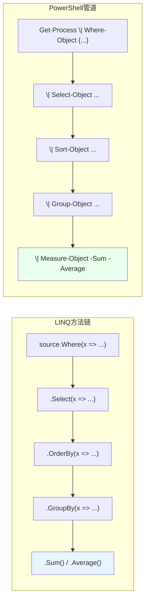

# 第 7 章 泛型、集合与 LINQ 风格查询

> **本章定位**：上一章我们用 `class` 造出了“自定义类型”。可现实里的对象从来不是“一个、两个”，而是一个进程有几百个线程、一个目录有几千个文件、一台服务器有过万个服务。这一章解决的就是：**很多个对象怎么装、怎么查、怎么筛、怎么拍序、怎么分组、怎么聚合。**
>
> 对标《C# 本质论》第 12 章“泛型”和《CLR via C#》第 12 章，但我们的落点是 PowerShell 的三个特有现实：
>
> 1. PowerShell **没有泛型语法的“发明权”**，但能完整地**使用** .NET 的泛型集合；
> 2. PowerShell 最常打交道的三样“容器”——哈希表、有序字典、`PSCustomObject`——各有各的性格；
> 3. “查询集合”这件事，在 PowerShell 里自然长成了 **管道 + cmdlet** 的形态（`Where-Object`、`Sort-Object`、`Group-Object`…），它和 C# 的 LINQ 方法语法一一对应，但执行模型是“流式管道”而非“表达式树编译”。

---

## 7.1 .NET 泛型集合在 PowerShell 中的使用

“泛型”这个词听着吓人，其实意思很朴素：**“我先定义一个‘装着某种类型 T 的容器’，具体装什么，等你用的时候再说。”** `List<int>` 就是“装着 int 的列表”，`Dictionary<string,int>` 就是“键是字符串、值是 int 的字典”。C# 用它来获得类型安全；PowerShell 虽然写不了泛型定义，但**用起来一点不怵**。

### `List<T>`、`Dictionary<TKey,TValue>`、`HashSet<T>`：先“叫出它们的名字”

在 PowerShell 里“叫出”一个泛型类型的方式，是把类型参数写进方括号里：

```powershell
$list = [System.Collections.Generic.List[string]]::new()
```

长长的 `System.Collections.Generic` 是命名空间，`List` 是类型名，`[string]` 是类型参数。你也可以用 `New-Object` 写同样的东西（实测等价）：

```powershell
$list2 = New-Object 'System.Collections.Generic.List[string]'
```

我们逐个看看三个最常用的泛型集合。

**`List<T>`：有顺序、可增删的“动态数组”**

```powershell
$list = [System.Collections.Generic.List[string]]::new()
$list.Add('苹果')
$list.Add('香蕉')
$list.Add('橘子')

$list.Count        # 3
$list[0]           # 苹果（按下标访问）
$list[1] = '草莓'  # 按下标改

foreach ($item in $list) {
    "水果：$item"
}
```

注意 `$list.Add(...)` **返回 `void`（没有返回值）**——这一点和后面的 `ArrayList` 完全不同，也是 `List<T>` 更“干净”的原因之一：它不会往你的输出流里漏东西。

还有一批“批量/查找”方法很常用：

```powershell
$list = [System.Collections.Generic.List[int]]::new()
$list.AddRange([int[]]@(5, 3, 8, 1, 3))

$list.Contains(8)      # True

# FindAll 需要 Predicate 委托：PowerShell 里用脚本块转
$big = $list.FindAll({ param($x) $x -gt 4 })     # 5, 8

$list.Sort()           # 就地升序排序：1,3,3,5,8
$list.Reverse()        # 就地反转
$list                 # 8,5,3,3,1
```

`Sort()`、`Reverse()` 是**就地修改**，直接改变原来的列表。

**`Dictionary<TKey,TValue>`：键值对查找，快**

```powershell
$dict = [System.Collections.Generic.Dictionary[string,int]]::new()
$dict['apple'] = 3
$dict['banana'] = 5
$dict['apple']                # 3
$dict.Count                   # 2
$dict.ContainsKey('banana')   # True

# 安全取值：先给变量一个初值，再用 [ref] 接住（[ref] 要求变量已存在）
$value = $null
$found = $dict.TryGetValue('banana', [ref]$value)
$found        # True
$value        # 5
```

遍历字典，一般是“遍历键”或“遍历键值对”：

```powershell
foreach ($key in $dict.Keys) {
    "$key 的数量是 $($dict[$key])"
}

$dict.GetEnumerator() | ForEach-Object {
    "$($_.Key) => $($_.Value)"
}
```

**`HashSet<T>`：去重集合，“有没有”查询**

`HashSet<T>` 里**不允许重复元素**，而且判断“某个值在不在里面”特别快：

```powershell
$set = [System.Collections.Generic.HashSet[string]]::new()
$null = $set.Add('a')   # HashSet.Add 返回 bool（是否添加成功），用 $null = 吃掉
$null = $set.Add('a')   # 重复，添加失败，返回 False
$set.Count              # 1
$set.Contains('a')     # True
$set.Contains('b')     # False
```

### 泛型类型在管道中的“展开”行为

这是初学者最容易懵的一点：**当你把集合“输出”到管道里时，PowerShell 默认会把集合拆开，一个元素一个元素地送出去**——它不会把整个 `List` 当“一个东西”交接。

```powershell
$list = [System.Collections.Generic.List[int]]::new()
$list.AddRange([int[]]@(1, 2, 3))

$list | Measure-Object      # Count = 3（被拆成 1、2、3 三个对象）
```

那“我就想把这个列表当**一个**对象传过去”怎么办？两个办法：

```powershell
# 办法一：一元逗号（unary comma）
(, $list) | Measure-Object   # Count = 1（保持为一个整体）

# 办法二：Write-Output -NoEnumerate
Write-Output -NoEnumerate $list
```

衡量一下这个行为的意义：**管道天然“偏爱”扁平的对象流**。所以当你需要“循环一套复杂逻辑，处理一堆名字”时，与其用 `foreach` 去遍历一个 `List`，不如直接把它“拆”到管道里，后面接 `ForEach-Object`——这正是 PowerShell 的思维方式。

### `ArrayList` 与 `List<T>` 的选型边界

`ArrayList` 是 .NET 早期的**非泛型**列表，PowerShell 的历史脚本里到处都是它。但它有两个毛病：

1. **不检查类型**，往里塞什么都能塞；
2. **对值类型有“装箱”开销**（第 2.1 节提过）；
3. **`Add()` 会返回索引号**，在函数/管道里会污染输出流。

```powershell
$al = [System.Collections.ArrayList]::new()
$al.Add('x')        # 返回 0（索引），这个 0 会“漏”到输出里！
[void]$al.Add('y')  # 用 [void] 吃掉返回值
```

而 `List<T>` 的类型安全 + `Add()` 返回 void，让它的行为“干净”得多。**选型纪律：新写的脚本一律优先用 `List<T>`；只有对接老代码（比如某个接口死活要 `ArrayList`）时才退回 `ArrayList`。**

### PowerShell 不能定义泛型类型

使用泛型是一回事，**发明**泛型是另一回事：**PowerShell 不提供“定义泛型类型”的语法**。你不能写 `class Box<T> { ... }` 这样的东西。需要自定义泛型时，只能通过 `Add-Type` 把 C# 源码编译进来（第 13、33 章），或者干脆用“存 object”的非泛型容器凑合。

### LINQ 扩展方法在 PowerShell 里的可调用性

C# 的 LINQ 方法（`Where`、`Select`、`Sum`、`OrderBy`…）都是 `System.Linq.Enumerable` 上的静态扩展方法，PowerShell 里可以**直接调用**，但有一个门槛：接受委托的参数（如 `Where` 的谓词）需要你把脚本块**显式转成委托**：

```powershell
$nums = [int[]]@(1, 2, 3, 4, 5)

# 需要 [Func[int,bool]] 这样的类型转换
[System.Linq.Enumerable]::Where($nums, [Func[int,bool]]{ param($x) $x -gt 2 })
# 输出：3, 4, 5

# 不需要委托的操作（Sum 等）直接可用
[System.Linq.Enumerable]::Sum($nums)       # 15
```

**为什么更推荐 `Where-Object`？** 三个理由：不用写委托转换那套（短）、可读性好、完全融入管道流式模型。`[System.Linq.Enumerable]` 适合“只有一个集合在手里、想用某个具体 LINQ 方法”的精简场景（比如 `Sum`、`Distinct`），不适合在管道里每步都绕 LINQ。

### 7.1 小结

1. 泛型集合用 `[System.Collections.Generic.类型[T]]::new()` 实例化，`New-Object '...List[string]'` 等价。
2. **`List<T>`**：有序动态数组，`Add()` 返回 void；`Dictionary<TKey,TValue>`：键值查找，`TryGetValue` 要预声明 `$value`；`HashSet<T>`：去重 + 快速“有没有”。
3. **集合进管道默认被“拆开”**；想保持整体用一元逗号 `, $list` 或 `Write-Output -NoEnumerate`。
4. **`List<T>` 优先于 `ArrayList`**；PowerShell **不能定义**泛型类型。
5. LINQ 方法可调用，但带委托的要显式转 `[Func[...]...]`；日常查询仍推荐管道 cmdlet。

---

## 7.2 哈希表、有序字典与自定义对象

如果说泛型集合是“工业级容器”，那这一节的三个东西就是 PowerShell 日常脚本里的“生活用品”：**哈希表**（`@{}`）、**有序字典**（`[ordered]@{}`）、**`PSCustomObject`**。它们长得像，但性格不同，分别对应 C# 里“字典”、“有序字典”和“匿名类型/简单 DTO”的用途。

### `@{}` 哈希表：最常用的轻量数据结构

哈希表是一堆“键 → 值”的配对，用 `@{}` 创建：

```powershell
$server = @{
    Name = 'WEB-01'
    IP   = '192.168.1.10'
    Port = 8080
}

$server['Name']        # WEB-01
$server.IP             # 192.168.1.10（键名如果“像属性名”，可以直接点号访问）
$server.Port           # 8080
```

几个高频操作：

```powershell
$server['Role'] = 'web'          # 新增键值对
$server.Remove('Port')           # 删除
$server.ContainsKey('Name')      # True

# 遍历
foreach ($key in $server.Keys) {
    "$key = $($server[$key])"
}

# 看键或值
$server.Keys
$server.Values
```

哈希表的两个“性格”要记住：

1. **键大小写不敏感**：`$server['name']` 和 `$server['Name']` 是同一个键（实测确认）。
2. **不保证顺序**：你写键的顺序，它不保证按那个顺序给你看——这也正是下面 `[ordered]` 出场的原因。

### `[ordered]@{}` 与 `OrderedDictionary`：保住插入顺序

如果你在乎“键的先后顺序”（比如要按固定顺序输出到 CSV、生成配置块），用 `[ordered]@{}`：

```powershell
$cfg = [ordered]@{
    Host  = 'localhost'
    Port  = 5432
    User  = 'app'
}

$cfg.Keys          # Host, Port, User —— 保持插入顺序
```

`[ordered]@{}` 产生的类型是 `System.Collections.Specialized.OrderedDictionary`（底层是一个有序字典）。**保序能力是它存在的唯一理由**；如果只是查找数据、不在乎顺序，普通的 `@{}` 更快。

### `[pscustomobject]`：无类定义的记录类型

`[pscustomobject]@{}` 是“一张快照”：把一些属性名和值打包成一个对象，但没有“类”那套类型身份和价值方法。它是最常用来“塑造管道输出”的东西：

```powershell
$result = [pscustomobject]@{
    Name  = '报表.xlsx'
    Size  = 2048
    Date  = Get-Date
}
```

它和哈希表的区别很根本：**哈希表是“键值对”，`PSCustomObject` 是“带属性的对象”**。哈希表查数据，`PSCustomObject` 进管道、被 `Select-Object` 投影、被 `ConvertTo-Json` 序列化都更顺。

一点注意：**`[pscustomobject]` 的成员是 `NoteProperty`**，没有类型约束、没有方法、没有验证。要“有契约的类型”，回到第 6 章的 `class`；这里只是“装着数据的信封”。

### `Select-Object` 计算属性与 `Add-Member`：给对象“加戏”

日常最常造 `PSCustomObject` 的两个入口：

**入口一：`Select-Object` 的计算属性。**

```powershell
Get-Process -Id $PID |
    Select-Object Name,
        @{ Name = 'MemMB'; Expression = { [math]::Round($_.WorkingSet64 / 1MB, 2) } }
```

结果就是一个 `PSCustomObject`，包含 `Name` 和 `MemMB` 两个 NoteProperty（实测确认类型为 `System.Management.Automation.PSCustomObject`）。

**入口二：`Add-Member` 给现有对象“贴标签”。**

```powershell
$o = [pscustomobject]@{ Name = 'x' }
$o | Add-Member -MemberType NoteProperty -Name Source -Value '脚本A.ps1'
$o.Source            # 脚本A.ps1
```

`Add-Member` 也能给普通 .NET 对象加属性（第 2.2 节讲过），这里的用法对 `PSCustomObject` 同样适用。

### 7.2 小结

1. **`@{}` 哈希表**：键值对、键大小写不敏感、不保证顺序，是“查字典”的首选。
2. **`[ordered]@{}`**：保序版本，底层是 `OrderedDictionary`，适合“按固定顺序输出”。
3. **`[pscustomobject]@{...}`**：无类定义的记录类型，成员是 NoteProperty，适合“塑造管道输出”。
4. **`Select-Object` 计算属性 + `Add-Member`** 是生成/扩展 `PSCustomObject` 的两条日常路径。

---

## 7.3 LINQ 风格操作：`Where-Object` / `Select-Object` / `Sort-Object` / `Group-Object` / `Measure-Object`

C# 里处理集合靠 LINQ 的方法链：`.Where(...).Select(...).OrderBy(...).GroupBy(...).Sum(...)`。PowerShell 里，这些“方法”变成了**管道里的 cmdlet**，而且一脉相承地流式。这一节把这套“聚合三件套 + 过滤投影”完整过一遍，并在最后给你一张“LINQ 对照表”。

### 过滤与投影：`Where-Object` / `Select-Object`

这两个第 4.3 节已经讲过，这里从“查询”角度再看一眼它们和大集合配合的样子：

```powershell
# 过滤：只要运行中的、且内存超过 100MB 的进程
Get-Process |
    Where-Object { $_.Status -eq 'Running' -and $_.WorkingSet64 -gt 100MB } |
    Select-Object Name, CPU, WorkingSet64
```

- `Where-Object` ≈ LINQ 的 `Where`
- `Select-Object` ≈ LINQ 的 `Select`

二者组合，就得到了“**筛选 → 投影 → 输出**”这条最常见的查询链。

### 排序：`Sort-Object` 与多键排序

`Sort-Object` 对应 LINQ 的 `OrderBy` / `ThenBy`：

```powershell
# 按 CPU 降序
Get-Process | Sort-Object CPU -Descending

# 多键排序：先按大小降序，再按名字升序
Get-ChildItem |
    Sort-Object @{ Expression = 'Length'; Descending = $true }, Name
```

多键排序时，每个键可以用哈希表单独控制升/降序（`@{Expression=...; Descending=$true}`），这在“第一关键字倒序、第二关键字正序”这种场景里是唯一清晰的办法。

### 分组：`Group-Object`

`Group-Object` 对应 LINQ 的 `GroupBy`。它按某个属性的值把对象“归拢成堆”，每堆用 `Name`（分组键）和 `Count`（数量）描述：

```powershell
Get-ChildItem | Group-Object Extension

# 输出类似：
# Count Name
# ----- ----
#    12 .txt
#     5 .log
#     2 .ps1
```

`-NoElement` 可以去掉“堆里具体有哪些对象”，只保留分组键和数量，输出更轻：

```powershell
Get-ChildItem | Group-Object Extension -NoElement
```

一个实战组合：**统计每个扩展名文件占了多少空间**（分组 + 对每堆求和）：

```powershell
Get-ChildItem |
    Group-Object Extension |
    ForEach-Object {
        $bytes = ($_.Group | Measure-Object Length -Sum).Sum
        [pscustomobject]@{
            Ext   = $_.Name
            Count = $_.Count
            SizeMB = [math]::Round($bytes / 1MB, 2)
        }
    }
```

注意这里 `$_.Group`——分组对象自带一个 `Group` 属性，装着这一堆的全部对象，你可以对它们继续做任意管道处理。

### 聚合：`Measure-Object`

`Measure-Object` 对应 LINQ 的聚合方法（`Sum`、`Average`、`Max`、`Min`）以及 `Count`：

```powershell
# 数值聚合
Get-Process | Measure-Object WorkingSet64 -Sum -Average -Maximum -Minimum

# 数个数
Get-ChildItem | Measure-Object

# 统计文本的单词数、行数、字符数
'Hello world' | Measure-Object -Word -Line -Character
```

注意：`Measure-Object` 是“**等所有对象都流完**才出结果的 cmdlet”——它必须把整条管道跑完，才能给你 `Sum`、`Average`。这和 `Where-Object`“逐个放行”不同，它是聚合型的终点站。

### LINQ 对照表：把 C# 的方法链“翻译”成 PowerShell

我们把这一节的内容浓缩成一张“翻译表”，**它是本章最值得背的一张图**：



| 你要做的事 | C# LINQ | PowerShell 管道 |
|---|---|---|
| 筛选 | `Where()` | `Where-Object {...}` |
| 投影 | `Select()` | `Select-Object` / 计算属性 |
| 排序 | `OrderBy()` / `ThenBy()` | `Sort-Object`（多键用哈希表数组） |
| 分组 | `GroupBy()` | `Group-Object` |
| 计数/求和/平均/最大最小 | `Count()` / `Sum()` / `Average()` / `Max()` / `Min()` | `Measure-Object -Count -Sum -Average -Maximum -Minimum` |
| 取前 N 个 | `Take(N)` | `Select-Object -First N` |
| 去重 | `Distinct()` | `Select-Object -Unique` |

最后强调一次执行模型：**LINQ 是“表达式树/迭代器 + 延迟执行”，PowerShell 是“真实的对象流 + 逐对象加工”。** 两者的共同点是“延迟”——它们都尽量不把整个集合一次性算完。而在 PowerShell 里，“尽量不一次性算完”正是第 4.3 节讲的流式管道的价值所在。

### 7.3 小结

1. **过滤投影二件套**：`Where-Object`（筛）→ `Select-Object`（塑形/投影）。
2. **`Sort-Object`** 多键排序用哈希表数组，可逐键控制升/降序。
3. **`Group-Object`** 按属性值归堆；每堆有 `Name`、`Count`、`Group`；`-NoElement` 只要键和数量。
4. **`Measure-Object`** 是聚合终点站：`-Sum -Average -Maximum -Minimum`，也能数文本的 `-Word/-Line/-Character`。
5. **LINQ 对照表**：`Where`→`Where-Object`、`Select`→`Select-Object`、`OrderBy`→`Sort-Object`、`GroupBy`→`Group-Object`、`Sum/Average`→`Measure-Object`、`Take`→`-First`、`Distinct`→`-Unique`。

---

## 本章总结

第 7 章把“集合”这件事讲完了，三节一条主线：

- **7.1 泛型集合**：`List<T>`、`Dictionary<TKey,TValue>`、`HashSet<T>` 都能在 PowerShell 里用；`List<T>`（Add 返回 void）优于 `ArrayList`；集合进管道默认被“拆开”；PowerShell 不能定义泛型，LINQ 方法可调用但带委托的要转 `Func`。
- **7.2 轻量容器**：`@{}` 查字典，`[ordered]@{}` 保顺序，`[pscustomobject]` 塑造输出；`Select-Object` 计算属性和 `Add-Member` 是两条“造对象”的日常入口。
- **7.3 查询操作**：把 C# 的 LINQ 方法链翻译成 `Where-Object → Select-Object → Sort-Object → Group-Object → Measure-Object`，执行模型是流式管道。

一句话记住全章：**“装”用泛型集合和哈希表，“塑”用 `PSCustomObject`，“查”用那五个 `-Object` 结尾的 cmdlet。**

**下一章预告**：第 8 章《异常处理：从 C# 的 try/catch 到 PowerShell 的双错误通道》。这一章回答一个所有脚本都会撞上的问题：**出错了怎么接住、怎么报告、怎么不把整个脚本搞崩。** 你会看到 PowerShell 和 C# 在错误模型上最不一样的地方——它有一个“非终止性错误”通道，而且 `catch` 里的 `$_` 不是异常对象，而是一个叫 `ErrorRecord` 的东西。

---

> **动手练习**
>
> 1. 用 `[System.Collections.Generic.List[int]]::new()` 建一个数字列表，塞进 1..5，跑 `FindAll` 过滤大于 2 的，再 `Sort` 观察就地排序。
> 2. 建一个 `Dictionary[string,string]`，练习 `ContainsKey` 和 `TryGetValue`（记得先 `$v = $null` 再 `[ref]$v`）。
> 3. 用 `[pscustomobject]` 造三个记录，塞进一个 `List[pscustomobject]`，验证“泛型参数也可以是 PowerShell 自定义类型”。
> 4. 写 `@{}`、`[ordered]@{}`、`[pscustomobject]@{}` 三种容器各放三个键，观察 `Keys` 的输出顺序差异。
> 5. 对 `Get-Process` 做一次完整的 LINQ 风格查询：筛选 CPU 大于 0 → 按 WorkingSet64 降序 → 取前 5 → 只留 Name 和内存（用计算属性）。
> 6. 用 `Group-Object Extension` 统计一个目录里每个扩展名的文件数，再配合 `Measure-Object` 算出每个扩展名占用的总字节数。