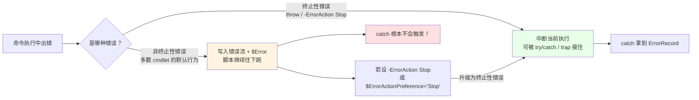
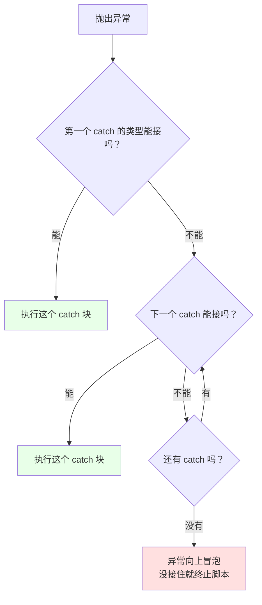

# 第 8 章 异常处理：从 C# 的 `try/catch` 到 PowerShell 的双错误通道

> **本章定位**：对标《CLR via C#》第 20 章“异常和状态管理”与《C# 本质论》第 10 章，但 PowerShell 的异常模型多了一条 **“非终止性错误”通道**——它不打断管道，却会悄悄写进 `$Error`。这是所有从 C# 转来的开发者最容易误判的地方：你以为 `try/catch` 是万能网，其实它只接“终止性”的鱼。
>
> 本章要回答三个问题：**错误有哪两种、怎么把它们收拢、怎么接住并处理。** 顺带把 PowerShell 独有的 `trap` 和“自定义异常类”讲清楚。

---

## 8.1 终止性错误与非终止性错误

在 C# 里，错误基本只有一种形态：**抛异常**。异常一旦抛出，控制流立刻跳到最近的 `catch`，不接住就往上冒泡，最后让程序崩掉。简单、统一。

PowerShell 不一样。它把错误分成了**两条通道**：

- **终止性错误**（terminating error）：像 C# 异常一样，会打断当前执行，**可以被 `try/catch` 或 `trap` 接住**；
- **非终止性错误**（non-terminating error）：**默认只往“错误流”里写一条记录，然后脚本继续往下跑**。它不会打断管道，也不会自动进入 `catch`。

这个区别，是 PowerShell 异常处理的第一道分水岭。不理解它，你就会写出“明明套了 `try/catch`，错误却还是漏出来”的代码。

### 两条错误通道：终止性错误与非终止性错误

先看“非终止性错误”的典型表现：

```powershell
"开始"
Get-Item 'C:\这个路径根本不存在'
"结束"
```

运行结果大致是：

```text
开始
Get-Item: 找不到路径“C:\这个路径根本不存在”……
结束
```

注意：**它报错了，但“结束”照样打印了。** 这就是非终止性错误的默认行为——报个错，然后继续。很多 cmdlet 的“找不到文件”“找不到服务”都走这条通道。

再看“终止性错误”，最典型的是 `throw`：

```powershell
"开始"
throw '出大事了'
"结束"
```

这次“结束”**不会**打印——`throw` 直接中断了当前执行，把错误抛出去。

用一张图把两条通道画清楚：



**最关键的一句话**：默认情况下，`try { Get-Item '不存在' } catch { ... }` 里的 `catch` **不会执行**。因为非终止性错误不会“跳”到 `catch`，它只是往错误流里写了一条，然后继续。

我们实测验证过这个行为：

```powershell
try {
    Get-Item 'C:\nope_xyz'          # 非终止性错误
    'after Get-Item（仍然执行）'
} catch {
    'catch 不会打印'
}
```

输出里既没有 `catch 不会打印`，也没有中断——只有那条错误记录和 `after Get-Item（仍然执行）`。

### `$ErrorActionPreference` 与 `-ErrorAction`：把两条通道“收拢”

那如果我想让非终止性错误“变成”终止性错误、能被 `catch` 接住，怎么办？两个开关：

- **全局/会话级**：`$ErrorActionPreference = 'Stop'`
- **单条命令级**：`-ErrorAction Stop`

```powershell
# 单条命令：只让这一条的错误升级
try {
    Get-Item 'C:\nope_xyz' -ErrorAction Stop
} catch {
    "接住了：$($_.Exception.GetType().Name)"
}
# 输出：接住了：ItemNotFoundException
```

```powershell
# 会话级：影响之后的所有命令（谨慎使用）
$ErrorActionPreference = 'Stop'
try {
    Get-Item 'C:\nope_xyz'
} catch {
    "接住了：$($_.Exception.Message)"
}
```

`$ErrorActionPreference` 的常用取值：

| 值 | 含义 |
|---|---|
| `Continue` | **默认**：显示错误，继续执行 |
| `SilentlyContinue` | 不显示错误，继续执行（但错误仍进 `$Error`） |
| `Stop` | 把错误升级为终止性错误 |
| `Inquire` | 显示错误并询问你是否继续 |
| `Ignore` | 忽略错误（连 `$Error` 都不记） |

再说一个容易忽略的点：**`$ErrorActionPreference` 是“作用域敏感”的**。你在函数里改它，只影响函数内部；想让整个脚本都生效，得在脚本开头改，或者用 `-Scope`/`$script:`。日常最稳的做法，是**尽量用单条命令的 `-ErrorAction Stop`**，而不是全局改偏好——全局改容易“误伤”别的命令。

### `$Error`：错误记录的“最近优先”缓冲区

无论错误是终止性还是非终止性，只要它被“记录”，都会进 `$Error` 这个自动变量。它是一个**环形缓冲区**（只保留最近若干条），`$Error[0]` 是**最近一次**，`$Error[1]` 是上一次，依此类推。

```powershell
$Error.Clear()                                # 先清空，方便观察
Get-Item 'C:\nope_xyz' -ErrorAction SilentlyContinue

$Error.Count                                  # 1
$Error[0].Exception.Message                   # 错误消息
$Error[0].CategoryInfo.Category               # ObjectNotFound 之类的分类
$Error[0].FullyQualifiedErrorId               # 完整的错误标识
```

`$Error` 的实用价值在于：**当你不方便当场处理错误、但事后想“翻旧账”时**，可以从这里捞。比如脚本跑完做一次汇总：查一查 `$Error.Count` 是不是 0，不为 0 就把最近的错误打出来。

### `ErrorRecord`：`catch` 里那个 `$_` 的真面目

这一点必须刻进脑子里：**在 PowerShell 的 `catch` 块里，`$_` 不是“异常对象”，而是 `ErrorRecord`。**

```powershell
try {
    throw 'boom'
} catch {
    $_.GetType().Name                 # ErrorRecord（不是 Exception！）
    $_.Exception.GetType().Name       # RuntimeException
    $_.Exception.Message              # boom
}
```

`ErrorRecord` 是 PowerShell 对“一次错误事件”的完整描述，`Exception` 只是它里面的一个字段。它常用的成员有：

| 成员 | 含义 |
|---|---|
| `$_.Exception` | 底层的 .NET 异常对象 |
| `$_.TargetObject` | 出错时操作的对象（比如那个不存在的路径） |
| `$_.CategoryInfo` | 错误分类信息（Category、Activity、Reason 等） |
| `$_.FullyQualifiedErrorId` | 完整错误标识（排查问题时很有用） |
| `$_.InvocationInfo` | 出错命令的调用信息（谁调的、在哪一行） |
| `$_.ScriptStackTrace` | 脚本调用栈 |

所以，**想拿异常消息要写 `$_.Exception.Message`，而不是 `$_.Message`**（后者在 `ErrorRecord` 上并不存在）。这是新手最常写错的一处。

### 8.1 小结

1. **两条错误通道**：终止性错误会中断并能被 `try/catch`/`trap` 接住；**非终止性错误默认只写错误流、脚本继续，`catch` 不会触发**。
2. **收拢开关**：`-ErrorAction Stop`（单条）或 `$ErrorActionPreference = 'Stop'`（会话级）能把非终止性升级为终止性。
3. **`$Error`** 是“最近优先”的环形缓冲区，`$Error[0]` 是最近一条。
4. **`catch` 里的 `$_` 是 `ErrorRecord`**，异常在 `$_.Exception` 里；别写成 `$_.Message`。

---

## 8.2 `try` / `catch` / `finally` 与 `trap`

把错误“收拢”成终止性之后，就可以用 `try/catch/finally` 来接住并处理了。这一节从基本形态讲到类型过滤、嵌套异常、`finally` 的边界，最后介绍 PowerShell 独有的 `trap` 和“自定义异常类”。

### `try` / `catch` / `finally` 的基本形态

语法和 C# 几乎一致：

```powershell
try {
    # 可能出错的代码
    [System.IO.File]::ReadAllText('C:\no-such-file.txt')
}
catch {
    # 出错了就来这里
    "出错了：$($_.Exception.Message)"
}
finally {
    # 无论成功还是失败，都会执行
    "清理工作完成"
}
```

- `try` 至少要有，`catch` 和 `finally` 可以只出现一个。
- `catch` 里能用 `$_` 拿到 `ErrorRecord`。
- `finally` 用来放“必须执行的收尾”，比如关闭文件、释放句柄、删除临时文件。

### `catch` 的类型过滤：按 .NET 异常层次“挑着接”

一个 `try` 后面可以跟**多个 `catch`**，每个 `catch` 指定它能接的异常类型。PowerShell 会按**从上到下**的顺序匹配，命中一个就进那个块，剩下的不再看：

```powershell
try {
    [System.IO.File]::ReadAllText('C:\no-such-file.txt')
}
catch [System.IO.FileNotFoundException] {
    "文件不存在：$($_.Exception.Message)"
}
catch [System.UnauthorizedAccessException] {
    "没有访问权限"
}
catch {
    "其他异常：$($_.Exception.GetType().Name)"
}
finally {
    "收尾"
}
```

几个要点：

1. **类型过滤写的是 .NET 异常类型**（`[System.IO.FileNotFoundException]` 等），不是 PowerShell 类的名字。
2. **匹配是按继承层次来的**：`catch [System.Exception]` 能接住所有异常，所以它一般放最后，否则后面的 `catch` 永远轮不到。
3. **最后一个不带类型的 `catch` 是“兜底”**，接住前面都没匹配上的异常。

把匹配过程画成图：



### `$_.Exception`、`InnerException` 与 `ScriptStackTrace`

`ErrorRecord` 里的 `Exception` 可能还“裹着”更深层的异常——这就是 `InnerException`。很多 .NET 异常会“包一层”：外层说“操作失败”，内层才是真正的原因。

```powershell
try {
    # 故意触发一个可能带内层异常的操作
    [System.IO.File]::ReadAllText('C:\no-such-file.txt')
}
catch {
    $ex = $_.Exception
    while ($null -ne $ex) {
        "异常类型：$($ex.GetType().FullName)"
        "异常消息：$($ex.Message)"
        $ex = $ex.InnerException
    }
    "脚本调用栈：$($_.ScriptStackTrace)"
}
```

这个“从外往内逐层打印”的循环，在排查第三方库或深层调用链的问题时特别好用——它会把“包装层”和“根因”一层层剥开。`$_.ScriptStackTrace` 则告诉你“这段脚本是怎么被一层层调进来的”，比单纯的异常消息更有定位价值。

### `finally` 的执行保证与边界

`finally` 的承诺是：**只要执行到了 `try`，无论 `try` 里是成功、报错、还是 `return` 提前结束，`finally` 都会执行。** 这正是它适合放“清理”的原因。

```powershell
function Test-Finally {
    try {
        "try 里执行"
        return '函数的返回值'
    }
    finally {
        "finally 一定执行"
    }
}
Test-Finally
```

注意：`finally` 里写出的内容**也会进入函数的输出流**（函数“返回值就是输出流”，第 5 章讲过）。所以如果你只想要清理、不想要多余输出，记得在 `finally` 里用 `[void]` 或 `Write-Verbose`。

至于 **Ctrl+C 中断**：PowerShell 在大多数情况下会尝试执行 `finally`，但**不要把它当成绝对保证**——极端情况（进程被强杀、蓝屏、断电）下任何清理都不可能执行。所以`finally` 适合“尽力而为的清理”，不适合“绝对不能丢的持久化”——后者应该靠“写临时文件 + 原子重命名”之类的机制兜底。

### `trap`：PowerShell 独有的“语句级”错误拦截

`try/catch` 是“块级”的：你得把代码包进 `try {}`。PowerShell 还提供了一个更“老派”的机制——`trap`，它是**语句级**的：只要在同一个作用域里，任何地方出错都会被 `trap` 接住，不用包 `try`。

```powershell
function Test-Trap {
    trap {
        "trap 接住了：$($_.Exception.Message)"
        continue          # 继续执行出错语句之后的代码
    }

    throw '出错了'
    '这一行会继续执行（因为用了 continue）'
}

Test-Trap
# 输出：
# trap 接住了：出错了
# 这一行会继续执行（因为用了 continue）
```

`trap` 的关键在最后那个 `continue` 或 `break`：

- **`continue`**：接住错误后，**从出错语句的下一条继续执行**（实测确认 `throw` 之后的那一行确实会打印）；
- **`break`**：接住错误后，**退出当前作用域**（函数/脚本块），不再往下执行。

`trap` 和 `try/catch` 怎么选？给个实用建议：

- **新代码优先用 `try/catch`**：它界限清晰、能精确控制“哪一段可能出错”、支持类型过滤，可读性也更好。
- **`trap` 适合“整个脚本/函数统一兜底”**：比如一个脚本函数里到处都可能出错，你又不想把每一段都包 `try`，就在函数开头放一个 `trap`，统一记录日志。

### 用 PowerShell 类定义自定义异常

第 6 章讲过 PowerShell 可以继承 .NET 类；异常也是类，所以你可以定义自己的异常类型：

```powershell
class MyAppException : System.Exception {
    MyAppException([string]$message) : base($message) { }

    MyAppException([string]$message, [System.Exception]$inner) : base($message, $inner) { }
}

try {
    throw [MyAppException]::new('业务处理失败')
}
catch [MyAppException] {
    "接住自定义异常：$($_.Exception.Message)"
}
```

要点：

1. **必须继承 `System.Exception`**（直接或间接），否则不是“异常”。
2. **构造函数用 `: base(...)` 调基类构造**（第 6.1.2 节学过），这样 `.Message`、`.InnerException` 才能正常工作。
3. **`catch [MyAppException]` 能按 PowerShell 类过滤**——因为 PowerShell 类本身就是 .NET 类型。但要注意：**catch 的类型过滤走的是 .NET 异常继承层次，不是“PowerShell 类的继承层次”**。也就是说，如果你的自定义异常继承自 `System.Exception`，那它在 catch 眼里就是“一个 Exception 子类”，和你脚本里另外定义的类没有关系。
4. 在高级函数里，还可以用 `$PSCmdlet.ThrowTerminatingError()` 抛出一个带完整上下文的终止性错误（比裸 `throw` 更“像 cmdlet”）。

### 8.2 小结

1. **`try/catch/finally`** 的基本形态：`catch` 里 `$_` 是 `ErrorRecord`；`finally` 负责清理。
2. **`catch` 可写多个、按类型过滤**，从上到下匹配；`catch [System.Exception]` 兜底放最后。
3. **`$_.Exception.InnerException`** 是一层层包装的根因；`$_.ScriptStackTrace` 是调用栈。
4. **`finally` 在成功、失败、`return` 时都执行**，但强杀进程时不保证；Ctrl+C 多数情况执行，别当绝对保证。
5. **`trap` 是语句级拦截**：`continue` 从下一条继续，`break` 退出当前作用域；新代码优先 `try/catch`。
6. **自定义异常继承 `System.Exception`**，构造用 `: base(...)`，`catch [MyException]` 可用。

---

## 本章总结

第 8 章的核心，是让你脑子里那张“错误地图”从 C# 的单通道，升级成 PowerShell 的双通道：

- **8.1 双通道**：终止性错误会中断、能被接住；非终止性错误默认只写错误流、脚本继续，`catch` 不触发。用 `-ErrorAction Stop` 或 `$ErrorActionPreference='Stop'` 把后者“升级”。`$Error` 是最近优先的缓冲区；`catch` 里的 `$_` 是 `ErrorRecord`，异常在 `$_.Exception`。
- **8.2 接住与清理**：`try/catch/finally` + 多 `catch` 类型过滤；`InnerException` 剥根因；`finally` 尽力保证清理；`trap` 做语句级兜底；自定义异常继承 `System.Exception`。

一句话记住全章：**PowerShell 的错误有两条路，`try/catch` 只接“终止性”那条；想让普通 cmdlet 错误也进 `catch`，就把它“提升”为终止性。**

到这里，本书的**第 1 部分（语言基础与类型系统）**就全部讲完了。你已经具备了写一个“结构完整、能处理错误”的 PowerShell 脚本所需的语言能力。从下一章起，我们进入**第 2 部分：对象管道与命令体系**——也就是 PowerShell 之所以是“壳”的核心机制。

**下一章预告**：第 9 章《命令发现与帮助系统》。我们会讲清 `Get-Command`、`Get-Help`、`Get-Member` 这三件“发现工具”怎么用，以及为什么 PowerShell 的命令命名要遵循“动词-名词”的约定——这套约定本身就是一套“可发现、可预测”的 API 设计哲学。

---

> **动手练习**
>
> 1. 分别运行 `Get-Item 'C:\nope'` 和 `throw 'x'`，观察前者“报错但继续”、后者“中断”的差别。
> 2. 把 `Get-Item 'C:\nope'` 放进 `try/catch`，先不加 `-ErrorAction`，观察 `catch` 是否触发；再加上 `-ErrorAction Stop`，观察变化。
> 3. 运行一段会出错的命令，然后查看 `$Error[0].Exception.Message`、`$Error[0].CategoryInfo.Category`、`$Error[0].ScriptStackTrace`。
> 4. 写一个 `try/catch`，用多个 `catch [类型]` 分别处理 `FileNotFoundException` 和 `UnauthorizedAccessException`，最后加一个兜底 `catch`。
> 5. 写一个函数，`try { return 'x' } finally { '清理' }`，观察 `finally` 是否执行、它的输出进了哪里。
> 6. 写一个 `trap { ...; continue }` 的函数，在 `trap` 后面放一条 `throw` 和一条普通语句，验证 `continue` 会让普通语句继续执行；再把 `continue` 换成 `break` 对比。
> 7. 定义一个继承 `System.Exception` 的 `MyAppException`，用 `throw [MyAppException]::new('...')` 抛出并用 `catch [MyAppException]` 接住。
