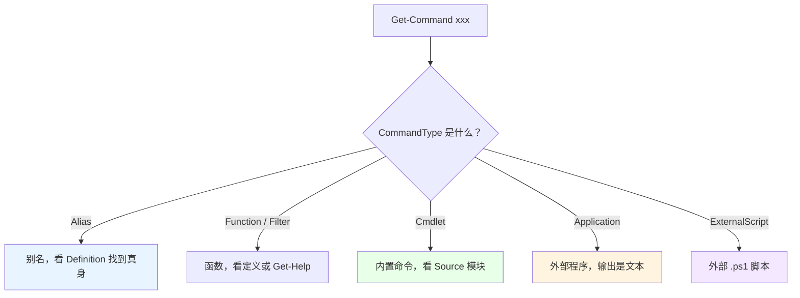

# 第 9 章 命令发现与帮助系统

> **本章定位**：从这一章起，我们进入全书的**第 2 部分：对象管道与命令体系**。前一章（第 8 章）之前，我们讲的是“语言”；从这一章起，我们讲“**壳**”——PowerShell 作为命令行工具，最核心的三件事是：**发现命令、绑定参数、传递对象**。本章先讲第一件：**你面前有几千条命令，你怎么知道自己要的那条叫什么？怎么确认它怎么用？**
>
> 很多初学者学 PowerShell 的方式是“背命令”。这条路走不远——命令太多、版本在变、模块在加。真正高效的方式是**学会“发现”**：用 `Get-Command` 找命令，用 `Get-Help` 查用法，用 `Get-Member` 看对象。这三个命令，是你在 PowerShell 世界里的“地图、说明书和显微镜”。本章把它们讲透。

---

## 9.1 Cmdlet 命名约定与 `Get-Command`

PowerShell 的命令命名有一条几乎从不破例的规矩：**动词-名词**（Verb-Noun），而且名词用**单数**。比如 `Get-Process`、`Set-Service`、`New-Item`、`Remove-Item`。这不是随意的风格偏好，而是一套**“可预测、可发现”的 API 设计哲学**：你只要知道“我要对什么对象做什么”，就能猜出命令大概叫什么，再也不用死记硬背。

### 动词-名词：一套“可预测”的 API 设计哲学

先看几个例子，感受一下这套命名的“ predictability”：

```powershell
Get-Process        # 获取进程
Get-Service        # 获取服务
Get-ChildItem      # 获取子项（文件/文件夹）
Set-Service        # 配置服务
New-Item           # 新建项
Remove-Item        # 删除项
Invoke-WebRequest  # 执行一个 Web 请求
Test-Path          # 测试路径是否存在（返回布尔值）
```

看出规律了吗？

- **动词**说明“做什么动作”：`Get` 取、`Set` 改、`New` 建、`Remove` 删、`Invoke` 执行、`Test` 测试。
- **名词**说明“对什么对象做”：`Process`、`Service`、`Item`、`Path`。
- **名词是单数**：`Get-Process` 而不是 `Get-Processes`；`Get-Service` 而不是 `Get-Services`。

这套约定的好处是“**猜得中**”：你想“获取所有服务”，不用查手册，直接想到 `Get-Service`；你想“停止某个服务”，自然想到 `Stop-Service`。命名本身就是一份“使用说明书”。

### `Get-Verb`：批准动词一览

既然动词有规矩，那“哪些动词是批准的”？PowerShell 给了你一个命令来查：`Get-Verb`。

```powershell
Get-Verb
```

它会输出一张表，包含 `Verb`（动词）和 `Group`（分组）两列。在这台 PowerShell 7.6 上，一共是 **100 个**批准动词（不同版本数量会略有差异）。常用分组包括：

- **Common**（通用）：`Add`、`Clear`、`Close`、`Copy`、`Enter`、`Exit`、`Find`、`Get`、`Hide`、`Join`、`Move`、`New`、`Open`、`Optimize`、`Remove`、`Rename`、`Reset`、`Resize`、`Set`、`Show`、`Split`、`Step`、`Switch`、`Undo`……
- **Data**（数据）：`Backup`、`Checkpoint`、`Compare`、`Compress`、`Convert`、`ConvertFrom`、`ConvertTo`、`Dismount`、`Edit`、`Expand`、`Export`、`Import`、`Initialize`、`Limit`、`Merge`、`Mount`、`Out`、`Publish`、`Restore`、`Save`、`Sync`、`Unpublish`、`Update`……
- **Lifecycle**（生命周期）：`Approve`、`Assert`、`Build`、`Complete`、`Confirm`、`Deny`、`Deploy`、`Disable`、`Enable`、`Install`、`Invoke`、`Register`、`Request`、`Restart`、`Resume`、`Start`、`Stop`、`Submit`、`Suspend`、`Uninstall`、`Unregister`、`Wait`……
- **Diagnostic**（诊断）：`Debug`、`Measure`、`Ping`、`Repair`、`Resolve`、`Test`、`Trace`……
- **Communications**（通信）：`Connect`、`Disconnect`、`Receive`、`Send`……
- **Security**（安全）：`Block`、`Grant`、`Protect`、`Revoke`、`Unblock`、`Unprotect`……

你可能会问：“我非要遵守这套动词吗？”**技术上不是强制**，但你一旦养成“用批准动词”的习惯，别人看你的函数名就能秒懂，而且和内置命令“气质一致”。写高级函数时，`Get-Verb` 还能帮你检查“我这个动词是不是批准的”。

一个很实用的查法：想知道某个动词属于哪个组，或者列出某个组的所有动词：

```powershell
# 看某个动词的分组
Get-Verb -Verb Get

# 只看 Lifecycle 组的动词
Get-Verb | Where-Object Group -eq 'Lifecycle'
```

### `Get-Command`：按名称、模块、类型找命令

`Get-Command` 是“命令发现”的总入口。不传参数时，它列出当前会话里**所有**可用命令（可能上千条）；更常用的是带过滤条件。

**按名字找**（支持通配符）：

```powershell
Get-Command Get-Process
Get-Command '*Service*'
Get-Command Get-*
```

**按动词 + 名词找**（最符合“命名约定”的查法）：

```powershell
# 所有 Get 动词、名词以 Service 结尾的命令
Get-Command -Verb Get -Noun '*Service'
# 输出：Get-Service

Get-Command -Verb Stop
Get-Command -Noun Item
```

**按模块找**：

```powershell
Get-Command -Module Microsoft.PowerShell.Management
Get-Command -Module Microsoft.PowerShell.Utility
```

**按命令类型找**：

```powershell
Get-Command -CommandType Cmdlet
Get-Command -CommandType Function
Get-Command -CommandType Alias
Get-Command -CommandType Application
```

`-CommandType` 的常用取值：

| 值 | 含义 |
|---|---|
| `Cmdlet` | 编译好的内置命令 |
| `Function` | 函数（包括你定义的、模块导出的） |
| `Filter` | 一种特殊函数（带过滤语义） |
| `Alias` | 别名 |
| `ExternalScript` | 外部 `.ps1` 脚本 |
| `Application` | 外部可执行程序（`.exe` 等） |
| `Script` | 脚本块/脚本 |
| `Configuration` | DSC 配置（旧版） |
| `All` | 全部 |

一个特别有用的组合，是“**看这条命令到底是谁**”：

```powershell
Get-Command Get-Process | Select-Object Name, CommandType, Source
# Name        CommandType Source
# ----        ----------- ------
# Get-Process Cmdlet      Microsoft.PowerShell.Management
```

`Source` 告诉你“它来自哪个模块”。这在排查“为什么两台机器上同名命令行为不一样”时非常关键——很可能是模块版本不同。

还有一招“看命令定义”：

```powershell
# 别名/函数能看到它的 Definition
Get-Command ls | Select-Object Name, CommandType, Definition
# Name CommandType Definition
# ---- ----------- ----------
# ls   Alias       Get-ChildItem
```

对 cmdlet，`Definition` 往往显示类名信息；对别名，直接显示它指向谁。

### 别名、函数、外部脚本与 cmdlet 的区分

第 1 章讲过“命令的四种类型”。`Get-Command` 是分辨它们最直接的工具——看 `CommandType` 那一列。

```powershell
# 别名：ls 实际是 Get-ChildItem 的马甲
Get-Command ls
# CommandType: Alias
# Definition : Get-ChildItem

Get-Alias ls
# Name       Definition
# ----       ----------
# ls         Get-ChildItem

# 内置 cmdlet
Get-Command Get-Process
# CommandType: Cmdlet

# Windows 自带的外部程序
Get-Command ipconfig
# Name        CommandType
# ----        -----------
# ipconfig.exe Application
```

为什么这件事重要？因为**不同类型的命令，“行为”不一样**：

- **别名**只是“换个名字”，它本身没有独立逻辑，`Get-Alias` 能顺藤摸瓜找到真身；
- **函数**是脚本里定义的，行为取决于函数体；
- **外部程序**（Application）的输出是**文本**，进 PowerShell 管道后要“降级/升级”转换（第 1 章提过）；
- **cmdlet** 是编译好的，带完整的参数绑定和通用参数。

我们用一张图把“一条命令到底是什么”的判定过程画出来：



### 9.1 小结

1. **动词-名词、名词单数**，是 PowerShell 的命名约定，目的是“可发现、可预测”。
2. **`Get-Verb`** 列出批准动词与分组（本机约 100 个），帮你查词、起名。
3. **`Get-Command`** 是命令发现总入口：可按 `-Name`、`-Verb`、`-Noun`、`-Module`、`-CommandType` 过滤；`Select-Object Name, CommandType, Source` 能看清“它是什么、来自哪”。
4. **别名、函数、cmdlet、外部程序**用 `CommandType` 区分，行为各不相同；`Get-Alias` 可以顺着别名找到真身。

---

## 9.2 帮助系统与参数发现

找到命令只是第一步。真正写脚本时，你更需要知道：**它有哪些参数、参数是什么类型、有没有示例、某个参数到底接不接受管道输入？** 这些答案，藏在帮助系统里。

PowerShell 的帮助系统由三块拼成：**`Get-Help`（命令手册）、`about_*` 主题（概念文档）、`Get-Member`（对象结构）**。这一节逐个讲。

### `Get-Help`：帮助的几种视角

最基础的用法：

```powershell
Get-Help Get-Process
```

默认视图会给你“名称、摘要、语法、描述、参数”等几块。但默认视图往往“点到为止”，想看细节要用“视角开关”：

```powershell
# 只看示例（最实用！）
Get-Help Get-Process -Examples

# 只看某个参数的说明
Get-Help Get-Process -Parameter Id

# 完整视图：所有参数、输入输出类型、备注
Get-Help Get-Process -Full

# 打开在线文档（浏览器）
Get-Help Get-Process -Online
```

`-Parameter` 视图尤其有用。比如 `Get-Help Get-Process -Parameter Id` 会告诉你：`-Id` 的类型是 `int[]`、是否必填、是否支持按管道属性名绑定、有没有别名。**这些正是“参数绑定”的原始元数据**——第 11 章讲参数绑定时，我们会反复回头查它。

还有几个“找帮助”的小技巧：

```powershell
# 通配符找命令帮助
Get-Help '*Service*'

# 找某个模块里的所有帮助
Get-Help -Category Cmdlet -Name '*-Process*'
```

有一个概念要澄清：**`help` 和 `Get-Help` 不完全一样。** `help` 是 `Get-Help` 的别名，但 `help` 会**分页显示**（一屏一屏翻），而 `Get-Help` 一次性全部输出。在脚本里或想把内容重定向到文件时，用 `Get-Help`；在终端里慢慢看，用 `help`。

### `about_*` 主题：从概念到机制

除了“命令手册”，PowerShell 还有一大批以 `about_` 开头的**概念文档**。它们讲的不是“某条命令怎么用”，而是“某个机制是什么”。比如：

- `about_Parsing`：表达式模式与命令模式（第 1.2 节的内容）
- `about_Operators`：运算符全表（第 3.2 节）
- `about_Scopes`：作用域（第 3.1 节）
- `about_Try_Catch_Finally`、`about_Trap`：异常处理（第 8 章）
- `about_Classes`：PowerShell 类（第 6 章）
- `about_Pipeline_Chain`：`&&` / `||` 管道链（PowerShell 7+）

查法就是：

```powershell
Get-Help about_Parsing
Get-Help about_Operators
Get-Help about_Pipeline_Chain
```

> **重要提示**：`about_*` 主题的内容属于“帮助文件”，**有些环境下需要先安装/更新帮助**。如果你运行 `Get-Help about_Parsing` 得到的是空内容（本书写作时的测试机就是这种情况），先执行一次
> ```powershell
> Update-Help
> ```
> （可能需要联网，某些系统还需要管理员权限）。装好之后，`about_*` 就能正常显示了。这也解释了为什么“同一本书在不同机器上，帮助能不能看”会不一样——不是书的问题，是帮助文件装没装。

`about_*` 的价值在于：**它是“机制说明书”，比单条命令的帮助更系统。** 你在本书里学到的很多“为什么”，都能在对应的 `about_*` 里找到官方原话。

### `Get-Command -Syntax`：一眼看清参数签名

有时候你只想知道“这个命令的参数长什么样”，不想翻整篇帮助。用 `-Syntax`：

```powershell
Get-Command Get-Process -Syntax
```

输出是“参数签名”，比如：

```text
Get-Process [[-Name] <string[]>] [-Module] [-FileVersionInfo] [<CommonParameters>]
Get-Process -Id <int[]> [-Module] [-FileVersionInfo] [<CommonParameters>]
...
```

读这种签名的几个约定：

- **`[[-Name] <string[]>]`**：方括号表示“可选”，`[[...]]` 是“连参数名都可以省略”（即支持位置参数）；`<string[]>` 是类型（字符串数组）。
- **`-Id <int[]>`**：没有外层方括号，表示这个参数在这个签名里是**必填**的。
- **`[<CommonParameters>]`**：表示还支持一批“通用参数”（`-Verbose`、`-ErrorAction` 等）。
- **多行**：不同行是“不同的参数集”（parameter set），同一时刻只能用其中一套。

`-Syntax` 是“快速确认参数名和类型”的利器。写脚本时忘了某个参数叫 `-Path` 还是 `-FilePath`，一条 `Get-Command xxx -Syntax` 就能救你。

### `Get-Member`：对象结构发现器

`Get-Help` 告诉你“命令怎么用”，`Get-Member` 告诉你“**对象长什么样**”。这两者互补：一个看“输入”，一个看“输出”。

```powershell
# 看一个进程对象有哪些属性、方法
Get-Process -Id $PID | Get-Member

# 只要属性
Get-Process -Id $PID | Get-Member -MemberType Property

# 只要方法
Get-Process -Id $PID | Get-Member -MemberType Method
```

它输出 `Name`、`MemberType`、`Definition` 三列。比如你会看到 `Name` 是 `Property`、`Kill` 是 `Method`。这让你在“想对对象做点什么”时，能先查它“有什么可做”。

把三者放在一起，就是一套完整的“发现闭环”：


**这三个命令，值得你养成“先查再写”的习惯。** 很多“我记不住这个属性叫什么”“我不知道这个参数接不接受管道”的问题，一条命令就解决了，根本不用背。

### 9.2 小结

1. **`Get-Help`** 有多个视角：默认、`-Examples`（示例）、`-Parameter`（单参数详情）、`-Full`（完整）、`-Online`（在线）；`-Parameter` 是参数绑定的“元数据入口”。
2. **`about_*` 主题**是机制说明书；若为空，先 `Update-Help`。
3. **`Get-Command -Syntax`** 一眼看清参数签名（方括号=可选、`<类型>`=类型、多行=参数集）。
4. **`Get-Member`** 是对象结构显微镜，和 `Get-Help` 形成“输入/输出”互补。
5. **发现闭环**：`Get-Command` → `Get-Help` → `Get-Member` → 再回来查。

---

## 本章总结

第 9 章是第 2 部分的“入口章”，它教你的是**方法**而不是**命令清单**：

- **9.1 命名与发现**：动词-名词、名词单数，是一套可预测的设计哲学；`Get-Verb` 查动词，`Get-Command` 按名字/动词/名词/模块/类型找命令；`CommandType` 区分别名、函数、cmdlet、外部程序。
- **9.2 帮助与发现**：`Get-Help` 的几种视角（尤其 `-Examples`、`-Parameter`）、`about_*` 概念文档（必要时 `Update-Help`）、`Get-Command -Syntax` 看签名、`Get-Member` 看对象结构。

一句话记住全章：**别背命令，学会“发现”。`Get-Command` 找得到、`Get-Help` 看得懂、`Get-Member` 摸得清。**

**下一章预告**：第 10 章《提供程序与驱动器：统一命名空间》。我们会看到 PowerShell 一个非常优雅的设计：**文件系统、注册表、证书、环境变量，在 PowerShell 里共享同一套 `Get-ChildItem` / `Get-Item` / `Set-Item` 命令**。理解了“提供程序（Provider）”和“驱动器（Drive）”，你就明白为什么 `Env:`、`HKLM:`、`Cert:` 这些“盘符”能像文件夹一样被浏览和操作。

---

> **动手练习**
>
> 1. 运行 `Get-Verb`，找出 `Get`、`Set`、`New`、`Remove`、`Invoke`、`Test` 各属于哪个分组。
> 2. 用 `Get-Command -Verb Get -Noun '*Service'` 和 `Get-Command -Module Microsoft.PowerShell.Management` 各找一批命令。
> 3. 用 `Get-Command ls` 和 `Get-Alias ls` 确认 `ls` 是别名、真身是 `Get-ChildItem`；再用 `Get-Command ipconfig` 看它是哪种类型。
> 4. 对 `Get-Process` 分别运行 `Get-Help Get-Process`、`-Examples`、`-Parameter Id`、`-Full`，对比四种视角的信息量。
> 5. 运行 `Get-Command Get-Process -Syntax`，用自己的话解释方括号和 `<类型>` 各代表什么。
> 6. 运行 `Get-Help about_Parsing`；如果内容为空，先执行 `Update-Help` 再试。
> 7. 对 `Get-Process -Id $PID` 的结果运行 `Get-Member`，找出至少三个属性和两个方法。
