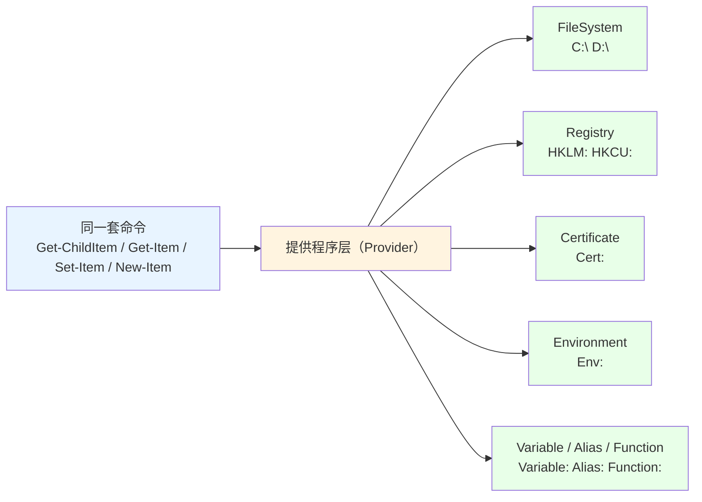

# 第 10 章 提供程序与驱动器：统一命名空间

> **本章定位**：这是 PowerShell 最漂亮的设计之一。在别的脚本环境里，文件是文件、注册表是注册表、环境变量是环境变量，各有各的 API，你得分别学。而 PowerShell 用一套叫 **“提供程序（Provider）”** 的抽象，把这些截然不同的“世界”统一成了**同一套命令**：读文件用 `Get-ChildItem`，读注册表也用 `Get-ChildItem`，看环境变量还是 `Get-ChildItem`。
>
> 本章讲两部分：**10.1 是机制**——提供程序和驱动器（PSDrive）到底是怎么一回事；**10.2 是三大常用提供程序**——文件系统、注册表、环境变量，分别怎么用、以及“什么时候该用 cmdlet、什么时候该直接调 .NET 类”。

---

## 10.1 PSProvider 与 PSDrive 模型

想象你去逛一个“超级商场”，里面既有杂货区，也有服装区，还有家电区。柜台不一样，但你“逛”的动作是一样的——都是“走到货架（路径）、拿东西（Get-Item）、放东西（New-Item）”。提供程序和驱动器，就是 PowerShell 给这些“不同世界”修的“统一货架系统”。

### 提供程序：把“不同世界”统一成“同一套操作”

“提供程序”（provider，也叫 PSProvider）解决的核心问题是：**让命令不关心“我操作的是文件还是注册表”。** 它把每一种资源都“翻译”成 PowerShell 能理解的“条目 + 路径 + 属性”，于是：

- `Get-ChildItem C:\` 列出文件 → 本质是“FileSystem 提供程序在打工”；
- `Get-ChildItem HKLM:\Software` 列出注册表子键 → 本质是“Registry 提供程序在打工”；
- `Get-ChildItem Env:` 列出环境变量 → 本质是“Environment 提供程序在打工”；
- `Get-ChildItem Variable:` 列出变量 → “Variable 提供程序”。

先看看当前会话里有哪些提供程序：

```powershell
Get-PSProvider
```

在这台 PowerShell 7.6 上，输出大致是（不同机器略有差异）：

```text
Name         Drives
----         ------
Registry     {HKLM, HKCU}
Alias        {Alias}
Environment  {Env}
FileSystem   {C, D, E, F, H, Temp}
Function     {Function}
Variable     {Variable}
```

Windows 上常见的提供程序一览：

| 提供程序 | 负责的世界 | 典型驱动器 |
|---|---|---|
| **FileSystem** | 文件系统 | `C:`、`D:` |
| **Registry** | 注册表 | `HKLM:`、`HKCU:` |
| **Certificate** | 证书存储 | `Cert:` |
| **Environment** | 环境变量 | `Env:` |
| **Variable** | PowerShell 变量 | `Variable:` |
| **Alias** | 命令别名 | `Alias:` |
| **Function** | 函数 | `Function:` |
| **WSMan** | WS-Management 配置 | `WSMan:` |

> 注意：`Certificate` 提供程序在 PowerShell 7 里是**按需加载**的——你打开会话时 `Get-PSProvider` 未必列得出它，一旦你访问 `Cert:`（比如 `Get-ChildItem Cert:\CurrentUser\My`），它就会被加载进来。

把这张“统一命名空间”的画出来，是理解本章的关键：



对使用者来说，最大的感受就是：**不需要学“每类资源各自的命令”，只需要会一套“条目操作”，然后学会“切换路径”。** 这正是 PowerShell“以对象为核心”哲学的延展——对象统一了“数据”，提供程序统一了“存储”。

### PSDrive：给提供程序一个“名字”

“提供程序”是机制，但命令里你不直接写“Registry 提供程序”，而是写**驱动器（PSDrive）名字**——就是那个带冒号的名字：`C:`、`HKLM:`、`Env:`、`Cert:`。**驱动器就是某一类资源的“挂载点”**，它告诉命令“从哪个根开始浏览”。

```powershell
# 看当前所有驱动器
Get-PSDrive

# 只看某一种
Get-PSDrive -PSProvider FileSystem

# 浏览：环境变量“盘”
Get-ChildItem Env:
# 输出类似：
# Name                    Value
# ----                    -----
# PATH                    C:\Program Files\...
# USERNAME                Administrator
# ...

# 浏览：当前用户的注册表“盘”
Get-ChildItem HKCU:\Software\Microsoft\Windows\CurrentVersion
```

内置驱动器之外，你还可以**自己造驱动器**——`New-PSDrive`。最常见的用途，是把一个长路径“挂”成短盘符，方便输入和导航：

```powershell
# 把 C:\Windows 挂成 T:
New-PSDrive -Name T -PSProvider FileSystem -Root 'C:\Windows'

Get-ChildItem T:\          # 浏览 C:\Windows
Test-Path 'T:\System32'    # True

# 用完要删（它是一次性的，关窗口也没了）
Remove-PSDrive -Name T
```

`New-PSDrive` 也能用在不同提供程序上（比如把注册表某根挂成自定义盘），但文件系统最常用。要点：**PSDrive 只在当前会话有效，不是永久的磁盘映射**。

### 提供程序特有的“动态参数”

统一带来便利，但不同类型的资源毕竟不同，PowerShell 怎么处理“某个提供程序特有的操作”？

答案：**动态参数（dynamic parameters）**。当你的当前位置（或路径参数）属于某个提供程序时，命令会“临时多出”一些参数。换句话说，**同一个 `Get-ChildItem`，站在 `C:\` 上和站在 `HKLM:\` 上，能用的参数不完全一样。**

举几个例子：

- 在 **FileSystem** 上，`Get-ChildItem` 可以用 `-Attributes`（按文件属性筛）、`-Filter`（名字过滤）等文件系统专属参数；
- 在 **Certificate** 上，`Get-ChildItem Cert:\CurrentUser\My -CodeSigningCert` 只会列出“可用于代码签名”的证书——`-CodeSigningCert` 就是证书提供程序定义的动态参数；
- 在 **Registry** 上，`New-Item` 会多出与注册表键类型相关的动态参数（比如 `-Force` 创建中间键）。

这些参数在 `Get-Help` 和 tab 补全里都会出现。理解“动态参数”这个概念，你就不会困惑“为什么同一个命令在不同盘上的参数不一样”了——**那个不一样的参数，就是当前提供程序“加戏”的成果。**

### 10.1 小结

1. **提供程序（Provider）** 把文件、注册表、证书、环境变量等“不同世界”统一成**同一套“条目操作”命令**。
2. **驱动器（PSDrive）** 是提供程序的“挂载点”，记名的就是 `C:`、`HKLM:`、`Env:`、`Cert:` 这些带冒号的名字；`Get-PSDrive` 看列表，`New-PSDrive` 造新的、`Remove-PSDrive` 删。
3. **动态参数** 是“某个提供程序给命令临时加的参数”，`-Attributes`（文件系统）、`-CodeSigningCert`（证书）都是典型。

---

## 10.2 文件系统、注册表与环境变量操作

机制讲完，落到实操。这一节把最常用的三类提供程序操作集中讲一遍，但每条都配一个“选择题”意识：**这个操作，是用 cmdlet 方便，还是直接调 .NET 基类库更稳？** 这是本书一贯的“何时下沉”判断力的早期训练。

### 路径操作：`New-Item` / `Copy-Item` / `Move-Item` / `Remove-Item` / `Test-Path`

文件系统的“增删改查”五件套：

```powershell
# 新建文件 / 目录
New-Item -Path 'D:\demo\a.txt' -ItemType File
New-Item -Path 'D:\demo\sub' -ItemType Directory

# 复制
Copy-Item -Path 'D:\demo\a.txt' -Destination 'D:\demo\b.txt'

# 移动 / 改名
Move-Item -Path 'D:\demo\b.txt' -Destination 'D:\demo\sub\b.txt'

# 删除（目录要加 -Recurse）
Remove-Item -Path 'D:\demo\b.txt' -Force
Remove-Item -Path 'D:\demo\sub' -Recurse -Force

# 判断存在
Test-Path 'D:\demo\a.txt'          # True
Test-Path 'D:\demo\not-exist'      # False
```

几个细节：

- `New-Item -ItemType` 区分文件还是目录（`File` / `Directory`）。
- 删除是**危险操作**，目录删除记得 `-Recurse`，必要时加 `-WhatIf` 预演。
- `Test-Path` 是“判断路径是否存在”的万能回答器，脚本里到处用。
- 这些都是“条目操作”命令，换到注册表盘上，`New-Item`、`Remove-Item` 依然叫这名字（只是操作对象从文件变成了键）——这就是 10.1 说的“统一”。

### 文本读写：`Get-Content` / `Set-Content` / `Add-Content`

读写文本是最常见需求。三个命令的分工：

```powershell
# 读：逐行产出（流式）
Get-Content 'D:\demo\notes.txt'

# 读：按行号区间（性能好）
Get-Content 'D:\demo\notes.txt' -TotalCount 10     # 前 10 行
Get-Content 'D:\demo\notes.txt' -Tail 5            # 最后 5 行

# 读：整文件一次性读完（小文件专用）
Get-Content 'D:\demo\notes.txt' -Raw
Get-Content 'D:\demo\notes.txt' -ReadCount 0   # 也是“整文件读取”的一种写法

# 写：覆盖
Set-Content -Path 'D:\demo\notes.txt' -Value '第一行'

# 写：追加
Add-Content -Path 'D:\demo\notes.txt' -Value '追加一行'

# 写：把数组写成多行
Set-Content -Path 'D:\demo\notes.txt' -Value @('a', 'b', 'c')
```

要记住的三个点：

1. **`Get-Content` 默认“逐行”**：它把每一行当作一个字符串，通过管道一个个送出去。这非常适合“读大文件 + 流式处理”（配合 `Where-Object` 过滤），因为不用先把整个文件装进内存。
2. **`-Raw` / `-ReadCount 0` 是“整文件读取”**：`-Raw` 返回一个完整的字符串（适合要“整块处理”时）；`-ReadCount 0` 则是把整文件作为一次枚举。小文件这么读没问题，**超大文件请回到逐行**。
3. **编码要显式**：`Set-Content -Encoding UTF8`、`Get-Content -Encoding UTF8`。特别提醒：Windows PowerShell 5.1 对“无 BOM 的 UTF-8”文件读写可能出乱码，跨脚本/跨机器传输文本时，尽量在 `-Encoding` 上写明白。

### 注册表：`Get-Item` vs `Get-ItemProperty`，键与值的区分

注册表是两个“层级”混在一起的东西，新手最容易蒙：**键（key）像是文件夹，值（value）像是文件夹里的属性。**

- **键** → 用 `Get-ChildItem`（列子键）、`Get-Item`（拿键本身）。键是“容器”。
- **值** → 用 `Get-ItemProperty`（把一个键下的所有值读成“属性包”）或 `-Name` 指定单个值。

```powershell
# 列某个键下的所有子键（像列文件夹）
Get-ChildItem 'HKCU:\Software\Microsoft\Windows\CurrentVersion'

# 拿“键”本身（它是个 RegistryKey 对象）
Get-Item 'HKCU:\Software\Microsoft\Windows\CurrentVersion'

# 读“值”：把一个键下的值读成属性包
Get-ItemProperty 'HKCU:\Software\Microsoft\Windows\CurrentVersion'

# 读“单个值”
(Get-ItemProperty 'HKLM:\SOFTWARE\Microsoft\Windows\CurrentVersion').ProgramFilesDir
```

对照表：

| 你想做 | 命令 | 类比 |
|---|---|---|
| 列出子键 | `Get-ChildItem HKCU:\...` | `ls` 列文件夹 |
| 拿键对象 | `Get-Item HKCU:\...` | `dir` 只看文件夹本身 |
| 读键下的值 | `Get-ItemProperty HKCU:\...` | 看文件的“属性标签页” |
| 写键/值 | `New-Item` / `New-ItemProperty` / `Set-ItemProperty` | 建文件夹 / 加属性 |

**写注册表要极度谨慎**——改错键可能让软件甚至系统无法启动。练习时只动 `HKCU:\Software\` 下的自建临时键，用完立刻删：

```powershell
# 在用户软件目录下建一个测试键
New-Item -Path 'HKCU:\Software\PowerShellDeepDiveTest' -Force
# 写一个值
New-ItemProperty -Path 'HKCU:\Software\PowerShellDeepDiveTest' -Name 'Demo' -Value 'hi'
# 读回来
(Get-ItemProperty 'HKCU:\Software\PowerShellDeepDiveTest').Demo
# 清理
Remove-Item 'HKCU:\Software\PowerShellDeepDiveTest' -Recurse -Force
```

### 环境变量：进程级 vs 用户/系统级

环境变量是“给程序看的公共配置”，比如 `PATH`。在 PowerShell 里看和改，分两个境界：

**第一层：`$env:` 和 `Env:` 盘——进程级，仅当前会话。**

```powershell
$env:PATH              # 读
$env:MY_VAR = 'hello'  # 写：只影响当前这个 PowerShell 进程
Get-ChildItem Env:     # 列出全部
```

**第二层：`[System.Environment]`——能触碰“用户/系统”级（持久）。**

```powershell
# 读用户级 / 系统级 / 进程级
[System.Environment]::GetEnvironmentVariable('PATH', 'User')
[System.Environment]::GetEnvironmentVariable('PATH', 'Machine')
[System.Environment]::GetEnvironmentVariable('PATH', 'Process')

# 持久地写一个用户级环境变量（改完要重新开程序才生效）
[System.Environment]::SetEnvironmentVariable('MY_APP_HOME', 'D:\apps\myapp', 'User')
```

关键区别：

| 改法 | 作用范围 | 持久性 |
|---|---|---|
| `$env:XXX = '...'` | 仅当前进程 | 否（关窗口就没了） |
| `SetEnvironmentVariable(..., 'User')` | 当前用户 | 是（写进用户环境变量） |
| `SetEnvironmentVariable(..., 'Machine')` | 整台机器 | 是（需管理员权限） |

日常排障时经常要“看看两台的 PATH 是不是一样”，用 `[System.Environment]::GetEnvironmentVariable('PATH','Machine')` 是跨脚本最稳的读法。

### cmdlet 还是 .NET 类：什么时候该下沉

第 10.2 节最后，把“cmdlet vs .NET 基类”的选择题做一个总结。同是写文件：

```powershell
# cmdlet 路线（方便、有编码封装）
Set-Content -Path 'D:\demo\x.txt' -Value '内容' -Encoding UTF8
Add-Content -Path 'D:\demo\x.txt' -Value '更多'

# .NET 路线（类库直调，精细控制）
[System.IO.File]::WriteAllText('D:\demo\x.txt', '内容', [System.Text.Encoding]::UTF8)
[System.IO.File]::AppendAllText('D:\demo\x.txt', '更多')
```

什么时候用哪条？给个朴素的判断：

- **日常写脚本、追求可读 → cmdlet。** `Set-Content` 语义清楚，还能利用第 5 章的高级函数特性（`-WhatIf` 等）。
- **追求确定性和精细控制 → .NET 类。** 比如你要“原子地写整个文件”、要精确指定 `Encoding` 对象、要拿到文件写入的精确异常类型——`[System.IO.File]::WriteAllText` 更直接。
- **大文件流式 → 都用流（第 18 章专门讲）。** 这里先记住一个信号：`Get-Content` 适合交互，`[System.IO.File]::ReadLines()` 适合“超大文件逐行处理还不爆内存”的工程场景。

一句话准则：**cmdlet 是“封装了细节的便利通道”，.NET 类是“细节全开的手动挡”。能在 cmdlet 层解决的，别急着下沉；cmdlet 满足不了的，再下沉不迟。**

### 10.2 小结

1. **文件五件套**：`New-Item` / `Copy-Item` / `Move-Item` / `Remove-Item` / `Test-Path`；删除目录加 `-Recurse`。
2. **文本读写**：`Get-Content` 逐行流式（大文件友好），`-Raw`/`-ReadCount 0` 整读，`Set-Content`/`Add-Content` 写与追加，注意 `-Encoding`。
3. **注册表**：键用 `Get-ChildItem`/`Get-Item`，值用 `Get-ItemProperty`（`-Name` 指定单个值）；只在自建临时键上练习写入。
4. **环境变量**：`$env:`/`Env:` 盘是进程级（临时）；`[System.Environment]::Get/SetEnvironmentVariable` 能碰用户/系统级（持久）。
5. **下沉判断**：日常脚本用 cmdlet，精细/确定性要求高时用 .NET 类；18 章再展开“流”。

---

## 本章总结

第 10 章讲完了 PowerShell 的“统一命名空间”：

- **10.1 机制**：提供程序把文件、注册表、证书、环境变量统一成一套“条目操作”；驱动器（`C:`、`HKLM:`、`Env:`、`Cert:`）是挂载点；`Get-PSProvider`/`Get-PSDrive`/`New-PSDrive` 管理它们；动态参数是“某类资源给命令临时加的专用参数”。
- **10.2 实操**：文件系统五件套、文本读写（流式 vs 整读、编码）、注册表“键 vs 值”的读写区分、环境变量的“进程级 vs 用户/系统级”、以及“cmdlet 还是 .NET 类”的下沉判断。

一句话记住全章：**“打哪套命令”不用变，变的只是“路径去哪儿”（驱动器）和“资源长什么样”（提供程序）。**

**下一章预告**：第 11 章《管道深入：对象流、参数绑定与 `$input`》。这一章是第二部分的核心中的核心。我们会回答：**管道里的对象到底是怎么“一个接一个”流过去的？cmdlet/函数内部那套 `begin / process / end` 生命周期是怎么回事？上游对象的属性是怎么“自动塞”进下游参数里的（`ValueFromPipelineByPropertyName`）？** 理解了这些，你才算真正摸到了 PowerShell 的“发动机”。

---

> **动手练习**
>
> 1. 运行 `Get-PSProvider` 和 `Get-PSDrive`，把你机器的提供程序、驱动器列出来，对照 10.1 的表。
> 2. 用 `Get-ChildItem Env:` 找找 `PATH`、`USERNAME`、`TEMP` 的值；再运行 `$env:TEMP` 对比。
> 3. 用 `New-PSDrive` 把 `C:\Windows` 挂成 `W:`，用 `Get-ChildItem W:\` 浏览，最后 `Remove-PSDrive W`。
> 4. 在 `D:\` 下建一个测试目录，练习 `New-Item`（文件/目录）、`Copy-Item`、`Move-Item`、`Remove-Item`，全程用 `Test-Path` 验证。
> 5. 读一个文本文件：分别用普通 `Get-Content`、`-Raw`、`-ReadCount 0` 读同一文件，观察三者返回形态的差异。
> 6. 用 `Get-ItemProperty 'HKLM:\SOFTWARE\Microsoft\Windows\CurrentVersion'` 读出一个属性的值（比如 `ProgramFilesDir`），再对比 `Get-Item` 和 `Get-ChildItem` 在这个键上的差异。
> 7. 分别用 `$env:NAME = 'x'` 和 `[System.Environment]::SetEnvironmentVariable('NAME','x','User')` 各设置一个变量，然后在新开的 PowerShell 里验证哪个还在、哪个没了。