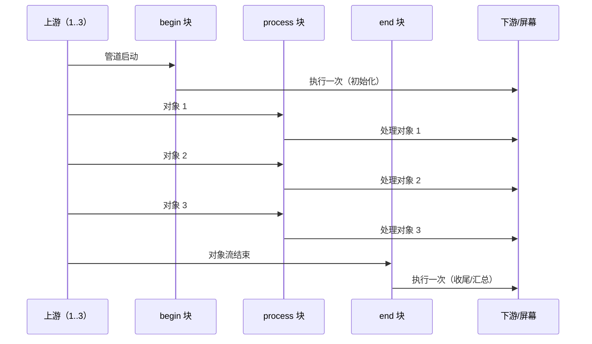
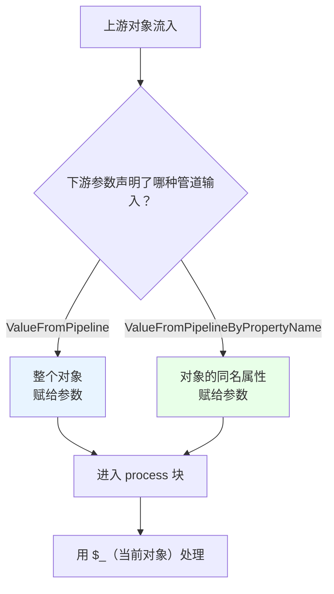
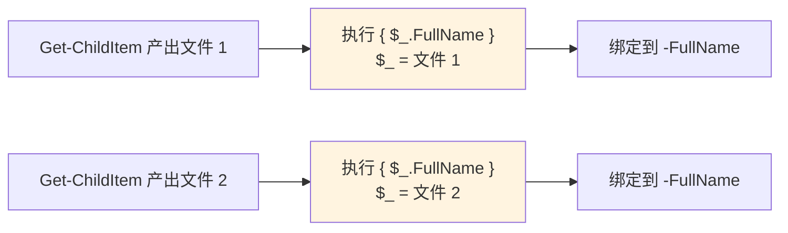

# 第 11 章 管道深入：对象流、参数绑定与 `$input`

> **本章定位**：如果整本书只能精读一章，我会选这一章。因为“管道”是 PowerShell 的**发动机**：前面讲的对象、类型、函数、集合，最终都要通过管道“流动”起来；后面的格式化、IO、网络、并发，本质都是“对象流”的不同玩法。
>
> 本章回答三个“发动机内部”的问题：**第一，管道里的对象是怎么一个接一个流过去的？**（`begin/process/end` 生命周期）**第二，上游对象的属性，怎么自动塞进下游的参数里？**（`ValueFromPipeline` 与 `ValueFromPipelineByPropertyName`）**第三，那个神秘的“延迟绑定脚本块”到底是怎么回事？** 把这三件事吃透，你才算真正会写 PowerShell。

---

## 11.1 管道对象流与 `Begin` / `Process` / `End` 块

先建立一个直觉：**管道不是“先把上游算完，再交给下游”，而是“上游产一个，下游吃一个”。** 第 4.3 节已经提过这个“流式模型”。这一节要往下钻一层：**当下游是一个函数时，它内部是怎么“接住”这些一个个流过来的对象的？**

答案是：PowerShell 给函数准备了**三个“接客时段”**——`begin`、`process`、`end`。

### 管道的“三段式生命周期”：begin → process → end

一个高级函数（或带命名块的函数）可以这样写：

```powershell
function Measure-Stream {
    begin {
        # 管道开始前，执行一次
        $count = 0
        '开始接收'
    }

    process {
        # 每流过来一个对象，执行一次
        $count++
        "收到：$_"
    }

    end {
        # 所有对象流完后，执行一次
        "一共收到 $count 个"
    }
}

1..3 | Measure-Stream
```

输出：

```text
开始接收
收到：1
收到：2
收到：3
一共收到 3 个
```

三个块的职责，用一张时序图看得最清楚：



要点：

1. **`begin` 只执行一次**，在“任何对象到来之前”。适合放“初始化”，比如计数器清零、打开文件/连接。
2. **`process` 每来一个对象执行一次**。它在管道里的“中转站”，逐对象加工。
3. **`end` 只执行一次**，在“所有对象都流完之后”。适合放“汇总/收尾”，比如输出总数、关闭资源。

**一个关键提醒**：如果你写了一个接收管道输入的**高级函数**，但**没有写 `process` 块**，那 PowerShell 会把你的整个函数体当成 `end` 块——也就是说，它**只会执行一次**，而不是对每个对象执行一次。这就是为什么“我的函数明明接收管道输入，却只处理了最后一个对象/只跑了一次”——多半是忘了写 `process`。第 5 章的 `ValueFromPipeline` 示例之所以要配 `process {}`，原因就在这。

### `process` 块里的 `$_`：当前对象

在 `process` 块里，`$_`（和它的别名 `$PSItem`）指向“**当前正在处理的那个对象**”。这是你在管道里“摸到数据”的主要方式：

```powershell
function Show-Name {
    process {
        "当前对象的名字是：$($_.Name)"
    }
}

Get-Process | Select-Object -First 3 | Show-Name
```

注意：`$_` 是**自动变量**（第 3.1 节讲过“注入时机”）——它不是你在函数里定义的，而是 PowerShell 在每次进入 `process` 时“临时塞进来”的。离开 `process`，它就不是那个对象了。所以别在 `end` 块里指望 `$_` 还是“最后一个对象”（它可能是，但不是可靠契约）。

### `$input`：简单函数里的“输入枚举器”

那如果函数**不是**高级函数、没有 `process` 块，怎么拿管道输入？答案是自动变量 `$input`——它是“**当前函数的管道输入枚举器**”。

正确用法是用 `foreach` 逐个取：

```powershell
function Read-All {
    foreach ($item in $input) {
        "收到：$item"
    }
}

1..3 | Read-All
# 收到：1
# 收到：2
# 收到：3
```

> **实测提醒**：在这个场景里，**不要写 `$input | ForEach-Object { ... }`**。我们把这种写法放进测试脚本时，出现了**挂起/死锁**（函数在等 `$input` 关闭，而 `$input` 又依赖函数结束，互相等）。安全的做法就是 `foreach ($item in $input)`。这是本章里一个很实际的“避坑点”。

`$input` 和前面讲的两个块的关系，可以这样理解：

- **有 `process` 块的高级函数**：用 `$_` 拿“当前对象”，一个对象执行一次。
- **没有 `process` 块的简单函数/脚本**：用 `$input`（配 `foreach`）把输入“兜底”地遍历一遍。

### `clean` 块：只管清理，不产生输出（PowerShell 7.3+）

PowerShell 7.3 给函数加了第四个块：`clean`。它的定位是“**无论怎么结束都要执行的清理块**”——正常跑完、出错终止、甚至管道被 `Ctrl+C` 或下游 `-First` 提前掐断，它都会执行。

```powershell
function Test-Clean {
    [CmdletBinding()]
    param([Parameter(ValueFromPipeline = $true)]$x)

    begin   { 'begin' }
    process { "process: $x" }
    end     { 'end' }
    clean   { 'clean（清理动作）' }
}
```

但这里有一个**非常容易误解**的细节，我们实测确认了：

> **`clean` 块会执行，但它自己“写出来的内容”不会进入输出流。**

我们用一个“副作用”来验证：在 `clean` 里改一个全局变量，运行后变量确实变了——说明 `clean` 跑了；但屏幕上并不会出现 `clean` 块里 `"clean（清理动作）"` 这行字。**因为在 PowerShell 里，`clean` 块是“只用来做清理副作用”的，它的输出被有意忽略。**

所以正确的用法是：把“释放资源、删临时文件、关连接”这类**副作用**放进 `clean`，而不要指望它给你打印结果：

```powershell
function With-TempFile {
    [CmdletBinding()]
    param([Parameter(ValueFromPipeline = $true)]$x)

    process {
        $tmp = New-TemporaryFile
        # ……用 $tmp 做点什么……
        # 不在这里删，交给 clean 兜底
    }

    clean {
        # 无论正常结束还是出错，都尝试清理
        if ($tmp) { Remove-Item $tmp -ErrorAction SilentlyContinue }
    }
}
```

一句话：**`clean` 是“清理专用块”，不是“第四个输出块”。**

### 11.1 小结

1. **`begin` / `process` / `end`** 是函数的“三段式生命周期”：begin 一次、process 每对象一次、end 一次。
2. **高级函数接收管道输入却没写 `process`，整个函数体会被当成 `end`**，只执行一次——这是“只处理最后一个对象”的常见原因。
3. **`process` 里用 `$_`/`$PSItem` 拿当前对象**；简单函数里用 `$input` + `foreach`（别用 `$input | ForEach-Object`，可能死锁）。
4. **`clean`（7.3+）是清理块**：正常/出错/中断都会执行，但**输出不外显**，只用于副作用。

---

## 11.2 参数绑定：按值、按属性名与延迟绑定

上一节讲“函数内部怎么接对象”，这一节讲“**对象是怎么被塞进参数的**”。这是 PowerShell 管道自动化的灵魂——正因为有它，你才能写出 `Get-Process | Stop-Process` 这种“一句话联动两条命令”的管道，而不用手动循环。

### 两条绑定通道：`ValueFromPipeline` 与 `ValueFromPipelineByPropertyName`

当上游把一个对象送进下游命令时，PowerShell 会尝试把它“绑定”到下游某个参数上。有两条通道：

**通道一：按值（`ValueFromPipeline`）**——把**整个对象**交给参数。

```powershell
function Show-Value {
    [CmdletBinding()]
    param(
        [Parameter(ValueFromPipeline = $true)]
        [string]$Name
    )
    process { "值：$Name" }
}

'apple', 'banana' | Show-Value
# 值：apple
# 值：banana
```

这里管道里的**每个字符串整体**被赋给 `$Name`。

**通道二：按属性名（`ValueFromPipelineByPropertyName`）**——把对象的**同名属性**交给参数。

```powershell
function Show-Proc {
    [CmdletBinding()]
    param(
        [Parameter(ValueFromPipelineByPropertyName = $true)]
        [string]$Name
    )
    process { "进程：$Name" }
}

Get-Process | Select-Object -First 2 | Show-Proc
# 进程：ABService
# 进程：acrotray
```

这里我们**没有**手动写“把每个进程的 Name 取出来”——`Get-Process` 的对象有 `.Name` 属性，PowerShell 发现下游有个叫 `$Name` 的参数，就自动“按属性名对上号”，把 `.Name` 塞进去。这就是 `Get-Process | Stop-Process` 能工作的原因：`Stop-Process` 的 `-Name` 或 `-Id` 参数声明了 `ValueFromPipelineByPropertyName`。

把两条通道画成图：



### 绑定失败时的“回退”

如果两条通道都匹配不上，会发生什么？

- 如果是**高级函数**（`[CmdletBinding()]`），PowerShell 会报错：“输入对象无法绑定到该命令的任何参数……”；
- 如果是**简单函数**，输入可能被忽略，或者落进 `$input`/`$args` 的兜底逻辑里（取决于写法）。

这解释了一个常见困惑：**“我把 A 的输出管道给 B，B 却报‘无法绑定’。”** 原因通常是：B 的参数没有声明 `ValueFromPipeline` / `ValueFromPipelineByPropertyName`，或者 A 输出对象的属性名和 B 的参数名对不上。**排查方法**：用 `Get-Help B -Parameter 参数名` 看它到底支不支持管道输入、按值还是按属性名。

### 延迟绑定脚本块：把“规则”交给管道

这是管道机制里最有“魔法感”的一招。先看现象：

```powershell
function Show-Paths {
    [CmdletBinding()]
    param(
        [Parameter(ValueFromPipelineByPropertyName = $true)]
        [string]$FullName
    )
    process { "路径：$FullName" }
}

Get-ChildItem -File | Select-Object -First 2 |
    Show-Paths -FullName { $_.FullName }
```

注意那个 `-FullName { $_.FullName }`：我们传给 `-FullName` 的**不是字符串，而是一个脚本块**。按理说 `$FullName` 是 `[string]` 类型，传脚本块应该类型不匹配——但它不但没报错，还对**每个文件**都算出了路径：

```text
路径：D:\docs\self-pub\powershell-deep-dive\.dockerignore
路径：D:\docs\self-pub\powershell-deep-dive\.gitignore
```

这就是**延迟绑定脚本块（delay-bind scriptblock）**：

> 当某个参数**从管道接收输入**（`ValueFromPipeline` 或 `ValueFromPipelineByPropertyName`），且它的类型**不是 `[object]` 或 `[scriptblock]`** 时，你传给它的脚本块不会“当成一个值”，而是被**延迟到每个输入对象上来时，逐个执行一次**，用 `$_` 指代当前对象，把算出的结果绑定给参数。

用图表示：



这也是第 5.3 节讲的 `Rename-Item -NewName { ... }`、以及第 4 章 `Select-Object` 计算属性的底层原理——**脚本块不是“一个值”，而是“一条针对每个对象都要算一遍的规则”**。

延迟绑定的两个生效条件，务必记牢：

1. 参数必须**从管道接收输入**（`ValueFromPipeline` 或 `ValueFromPipelineByPropertyName`）；
2. 参数类型**不能是 `[object]`、也不能是 `[scriptblock]`**（否则 PowerShell 会以为你只是“想把脚本块本身当值传进去”，不会触发延迟执行）。

### `$PSBoundParameters`：确认到底绑了什么

管道绑定是“自动”的，出了问题怎么查？用 `$PSBoundParameters`（第 5.1 节见过）——它记录本次调用**实际绑定**了哪些参数：

```powershell
function Show-Binding {
    [CmdletBinding()]
    param(
        [Parameter(ValueFromPipeline = $true)]
        [string]$Name,
        [int]$Count = 1
    )
    process {
        "本次实际绑定的参数："
        $PSBoundParameters.GetEnumerator() |
            ForEach-Object { "  $($_.Key) = $($_.Value)" }
    }
}

'abc' | Show-Binding
# 本次实际绑定的参数：
#   Name = abc
```

注意 `Count` 没出现在里面——因为它用的是默认值，并没有被“真正绑定”。这在调试“管道到底把值塞进了哪个参数”时非常有用。

### 11.2 小结

1. **两条绑定通道**：`ValueFromPipeline` 把整个对象交给参数；`ValueFromPipelineByPropertyName` 把对象的同名属性交给参数。
2. **绑定失败**在高级函数里会报“无法绑定到任何参数”；排查用 `Get-Help xxx -Parameter 名字` 看它是否支持管道输入。
3. **延迟绑定脚本块**：参数从管道接收输入、且类型不是 `[object]`/`[scriptblock]` 时，脚本块会对每个对象逐次执行，`$_` 指代当前对象。`Rename-Item -NewName { ... }`、`Select-Object` 计算属性都靠它。
4. **`$PSBoundParameters`** 记录“实际绑定了哪些参数”，是调试绑定问题的放大镜。

---

## 本章总结

第 11 章是“管道机制”的心脏，三件事缺一不可：

- **11.1 生命周期**：`begin`（一次）→ `process`（每对象一次）→ `end`（一次）；`process` 里用 `$_` 拿当前对象；简单函数用 `$input` + `foreach`；`clean`（7.3+）是“只做清理、不产生输出”的兜底块。
- **11.2 参数绑定**：`ValueFromPipeline` 按值、`ValueFromPipelineByPropertyName` 按属性名；绑定失败高级函数会报错；**延迟绑定脚本块**让“规则”对每个对象逐次执行；`$PSBoundParameters` 查实际绑定。

一句话记住全章：**管道把对象“流”给下游，函数的 `process` 块“逐口吃下”，参数绑定决定“这一口塞进哪个参数”，延迟绑定脚本块则让“每个对象都按你的规则现算一遍”。**

**下一章预告**：第 12 章《对象筛选、投影、排序与分组》。这一章是第 2 部分的收尾：把 `Where-Object`、`Select-Object`、`Sort-Object`、`Group-Object`、`Measure-Object` 这“五件套”在“管道深入”的基础上再讲一遍，并且补上上一章没展开的重点——**格式化系统**（`Format-Table`/`Format-List`）和**多个输出流**（Success/Error/Warning/Verbose/Debug/Information）。你会明白：为什么 `Format-*` 之后的对象“不再是原来的对象”，以及 `Export-Csv`、`ConvertTo-Json` 这些“序列化”手段和“格式化渲染”根本是两回事。

---

> **动手练习**
>
> 1. 写一个 `begin/process/end` 三块的函数，统计管道里对象的个数，并在 `end` 里输出总数；用 `1..10 | 你的函数` 验证。
> 2. 写一个高级函数，参数 `Name` 声明 `ValueFromPipelineByPropertyName`，把 `Get-Process | Select-Object -First 3` 管道给它，验证它自动拿到进程名。
> 3. 把第 2 题的参数改成 `ValueFromPipeline`，再把 `'a','b'` 管道给它，观察两种绑定的差别。
> 4. 写一个简单函数，用 `foreach ($x in $input)` 遍历管道输入；再试一次 `$input | ForEach-Object { $_ }`，观察是否出现挂起（如果挂起，按 Ctrl+C 停掉并记住这个坑）。
> 5. 写一个带 `clean` 块的函数，在 `clean` 里修改一个全局变量；运行后检查变量是否变了，同时确认 `clean` 里的输出**没有**出现在屏幕上。
> 6. 用 `Show-Paths -FullName { $_.FullName }` 的写法，体会“延迟绑定脚本块”对每个对象执行一次的效果；再把参数类型改成 `[scriptblock]`，观察延迟绑定是否还生效。
