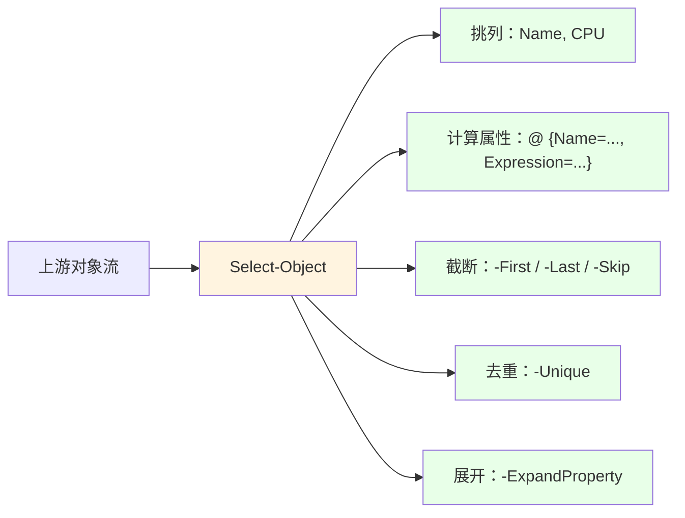
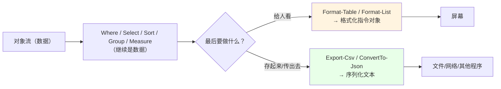
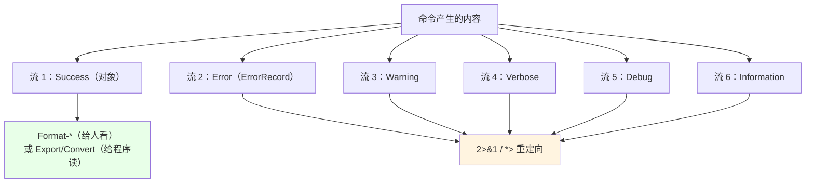

# 第 12 章 对象筛选、投影、排序与分组

> **本章定位**：这是第 2 部分的收尾章。前面我们讲了“命令怎么发现、对象怎么流动、参数怎么绑定”，这一章把“**拿到一堆对象之后怎么加工**”这件事做一个完整的收束：筛选（`Where-Object`）、投影（`Select-Object`）、排序（`Sort-Object`）、分组（`Group-Object`）、度量（`Measure-Object`），最后再讲一个大多数人会忽略、但极易翻车的领域——**格式化系统与多个输出流**。
>
> 一句话概括本章要建立的认知：**“数据处理”和“给人看”是两回事。** 筛选、投影、排序、分组、度量是在“处理数据”，而 `Format-Table` / `Format-List` 是在“给人看”。把这两件事混在一起，是 PowerShell 新手最常见、也最难自查的错误。

---

## 12.1 `Where-Object` 的两种形态与性能取舍

筛选，就是从一堆对象里“留下我要的”。`Where-Object` 有两种写法，各自的适用边界很清晰。

### 简化语法：属性名 + 比较运算符 + 值

PowerShell 3.0 起，`Where-Object` 支持一种“简化语法”：

```powershell
# 留下 Status 等于 Running 的进程
Get-Process | Where-Object Status -EQ 'Running'

# 也可以显式写 -Property
Get-Process | Where-Object -Property Status -EQ 'Running'
```

它的结构就是“**属性名 运算符 值**”三段式。支持的运算符包括 `-EQ`、`-NE`、`-GT`、`-GE`、`-LT`、`-LE`、`-Like`、`-NotLike`、`-Match`、`-NotMatch`、`-Contains`、`-NotContains`、`-In`、`-NotIn`。大小写随意，含义和第 3.2 节的一致。

简化语法的优点是**短**，缺点是**只能表达“一个属性、一个运算符、一个值”**：

- 不能做 `-and` / `-or` 组合；
- 不能调用方法（比如 `$_.Name.ToUpper()`）；
- 不能做复杂计算（比如“内存大于 100MB 且 CPU 大于 5”）。

### 脚本块语法：万能但稍长

一旦条件复杂，就必须用脚本块：

```powershell
Get-Process | Where-Object {
    $_.Status -eq 'Running' -and $_.WorkingSet64 -gt 100MB
}
```

花括号里的 `$_` 是当前对象，条件为真就“放行”。你可以在这里写任意表达式、调用任意方法：

```powershell
# 用方法：名字以 's' 开头的进程
Get-Process | Where-Object { $_.Name.StartsWith('s') }

# 组合多个条件
Get-ChildItem | Where-Object {
    $_.Extension -eq '.log' -and $_.Length -gt 1MB
}
```

用一张表把两种写法的边界摆清楚：

| 场景 | 用简化语法 | 用脚本块 |
|---|---|---|
| 单个属性、单个比较 | ✅ 短 | ✅ 也行 |
| 多个条件 `-and`/`-or` | ❌ 不支持 | ✅ |
| 调用方法 | ❌ 不支持 | ✅ |
| 计算后比较 | ❌ 不支持 | ✅ |
| 可读性（简单场景） | ✅ 好 | 一般 |

**性能上，两者差别不大**——真正的性能分水岭在“**筛选要不要尽早**”，而不是“用哪种语法”。一个实用的原则：**把 `Where-Object` 尽量放在管道靠前的位置**，让后面的 `Select-Object`、`Sort-Object` 少处理一些对象。比如：

```powershell
# 好：先筛，再投影
Get-Process | Where-Object { $_.WorkingSet64 -gt 100MB } | Select-Object Name, CPU

# 差：先投影（丢掉 CPU 之外的信息），再想筛就晚了
Get-Process | Select-Object Name | Where-Object { $_.CPU -gt 10 }
```

第二行还会暴露一个更隐蔽的问题：`Select-Object Name` 之后，对象上已经没有 `CPU` 属性了，后面的 `-gt 10` 会得到 `$null`，筛选结果不可控。**先筛后投，是管道的基本纪律。**

### 12.1 小结

1. **简化语法** `Where-Object 属性 运算符 值`：短，但只能单条件、不能调方法。
2. **脚本块语法** `Where-Object { ... }`：万能，支持组合条件与方法调用。
3. **性能关键不在语法，而在顺序**：尽量把筛选放在管道前面；先筛选、后投影。
4. 投影会丢字段，**先投影再筛常常筛不到想要的东西**。

---

## 12.2 `Select-Object`：属性投影与对象塑形

`Select-Object` 是“改变对象形状”的主力。它至少能完成四类任务：挑列、算新列、截断数量、展开单值。

### 挑列与计算属性

最基础的“挑列”：

```powershell
Get-Process | Select-Object Name, CPU, WorkingSet64
```

“计算属性”用来“从现有属性派生新属性”，写法是一个哈希表：

```powershell
Get-Process | Select-Object Name,
    @{ Name = 'MemMB'; Expression = { [math]::Round($_.WorkingSet64 / 1MB, 2) } }
```

`@{Name='MemMB'; Expression={...}}` 的意思是：“新建一列叫 MemMB，值由右边脚本块对每个对象算出来”。`$_` 指代当前对象。这就是第 11.2 节“延迟绑定脚本块”的直接应用——`Expression` 里的脚本块会对每个对象逐次执行。

### `-ExpandProperty`：把某一列“拆出来”

`-Property Name` 得到的是“一个只剩 Name 属性的对象”；`-ExpandProperty Name` 得到的是“**Name 这个值本身**”（比如字符串）：

```powershell
# 得到对象（有 Name 属性）
Get-Process | Select-Object -Property Name

# 得到字符串本身
Get-Process | Select-Object -ExpandProperty Name
```

什么时候用后者？当下游需要“纯粹的值”而不是“对象”时。比如你要把一串名字拼成字符串、或者直接喂给只接受字符串的命令。

### `-First` / `-Last` / `-Skip` / `-Unique`：改变数量

```powershell
Get-Process | Select-Object -First 5        # 前 5 个
Get-Process | Select-Object -Last 3         # 后 3 个
Get-Process | Select-Object -Skip 2 -First 3  # 跳过前 2 个，再取 3 个
Get-Process | Select-Object -Unique ProcessName  # 按某列去重
```

其中 **`-First N` 有一个非常重要的连带效果**：它拿够 N 个之后，会向上游发“停止”信号（第 4.3 节讲过）。这在大目录、大日志、网络探测场景里能省下大量时间：

```powershell
# 找到前 3 个 .log 就收工，后面的目录不再遍历
Get-ChildItem -Path C:\ -Recurse -Filter *.log | Select-Object -First 3
```

把 `Select-Object` 的几项能力画成图：



### 12.2 小结

1. **挑列**用属性名；**算新列**用 `@{Name=...; Expression={...}}`。
2. **`-Property` 得对象，`-ExpandProperty` 得值本身**。
3. **`-First/-Last/-Skip/-Unique`** 改变数量或去重；`-First` 会提前终止上游。
4. 先筛后投，别把要用的字段提前丢了。

---

## 12.3 排序、分组与度量

筛选、投影之后，常见需求是“排个序”“分个组”“算个总数”。这“三件套”和第 7 章的 LINQ 对照表是一一对应的。

### `Sort-Object`：单键与多键排序

```powershell
# 按 CPU 降序
Get-Process | Sort-Object CPU -Descending

# 按名字升序
Get-Process | Sort-Object Name
```

多键排序时，每个键可以单独控制升降序，写法是哈希表数组：

```powershell
# 先按长度降序，长度相同再按名字升序
Get-ChildItem |
    Sort-Object @{ Expression = 'Length'; Descending = $true }, Name
```

一开始容易写成 `Sort-Object Length, Name -Descending`——那会让**两个键都降序**。要“一升一降”，就必须用哈希表分别控制。

### `Group-Object`：按值归堆

`Group-Object` 按某个属性的值把对象“归堆”，每堆自带三个关键属性：

- `Name`：这一堆的分组键；
- `Count`：这一堆有几个对象；
- `Group`：这一堆的具体对象集合。

```powershell
Get-ChildItem | Group-Object Extension

# 输出类似：
# Count Name
# ----- ----
#    12 .txt
#     5 .log
#     2 .ps1
```

只想要“键 + 数量”、不想要具体对象时，加 `-NoElement`：

```powershell
Get-ChildItem | Group-Object Extension -NoElement
```

实战里最常用的组合是“**分组 + 对每组再聚合**”：

```powershell
Get-ChildItem |
    Group-Object Extension |
    ForEach-Object {
        $bytes = ($_.Group | Measure-Object Length -Sum).Sum
        [pscustomobject]@{
            Ext    = $_.Name
            Count  = $_.Count
            SizeMB = [math]::Round($bytes / 1MB, 2)
        }
    }
```

`$_.Group` 就是“这一堆里的全部对象”，你可以对它继续 `Measure-Object`、`Sort-Object`……这正是“分组”作为“二次加工入口”的价值。

### `Measure-Object`：聚合终点站

`Measure-Object` 负责“算总数、平均值、最大最小”：

```powershell
# 对数值属性做聚合
Get-Process | Measure-Object WorkingSet64 -Sum -Average -Maximum -Minimum

# 只数个数
Get-ChildItem | Measure-Object

# 统计文本的单词数、行数、字符数
'Hello world' | Measure-Object -Word -Line -Character
```

它是“聚合型终点站”——必须把整条管道跑完才能出结果（不像 `Where-Object` 那样逐个放行）。所以把它放在管道最后，别在它后面再接“逐对象”的操作（它输出的已经不是对象流，而是一个统计结果对象）。

### 12.3 小结

1. **`Sort-Object`**：单键直接写属性名；多键用哈希表数组，逐键控制升降序。
2. **`Group-Object`**：每堆有 `Name`/`Count`/`Group`；`-NoElement` 只留键和数量。
3. **`Measure-Object`**：`-Sum/-Average/-Maximum/-Minimum`，还能数 `-Word/-Line/-Character`；是聚合终点，放管道末尾。

---

## 12.4 格式化系统与输出流

这一节是本章的“防坑重点”。因为 PowerShell 里有一类操作，看起来像“继续处理数据”，实际上已经“把数据变成了给人看的画面”——**`Format-*` 系列命令**。

### `Format-Table` / `Format-List`：给“人看”的渲染

```powershell
# 表格视图
Get-Process | Format-Table Name, CPU -AutoSize

# 按某个属性分组显示
Get-ChildItem | Format-Table Name, Length -GroupBy Extension

# 内容太宽时换行显示
Get-Process | Format-Table Name, Path -Wrap

# 列表视图：把所有属性竖着列出来
Get-Process -Id $PID | Format-List -Property *
```

常用参数：

- **`-AutoSize`**：按内容自动调整列宽（输出前要先收集全部数据，所以在很大的数据上会先“卡一下”）。
- **`-GroupBy 属性`**：按属性分组显示（只是“显示分组”，不是 `Group-Object` 那种数据结构分组）。
- **`-Wrap`**：列太宽时换行，而不是截断。
- **`Format-List -Property *`**：把一个对象的所有属性竖着列出来，排查问题时最常用。

### 格式化对象“不可逆”：`Format-*` 之后不再是原对象

这是 PowerShell 里最容易踩的坑之一。看这个实验：

```powershell
$ft = Get-Process -Id $PID | Format-Table Name, Id
$ft.GetType().FullName
```

输出会是 `System.Object[]`——但里面装的**不是 `Process` 对象**，而是一组“**格式化指令对象**”（如 `FormatStartData`、`FormatEntryData`、`FormatEndData` 等）。也就是说：

> **`Format-Table` / `Format-List` 不是“把对象换个样子继续用”，而是“把对象交给格式化系统，产出一串‘怎么画在屏幕上’的指令”。**

后果是什么？**在 `Format-*` 之后再想把结果当数据用，就会出错或拿到莫名其妙的东西。** 比如：

```powershell
# 错误：Format-Table 之后已经没有 Process 的属性了
Get-Process | Format-Table Name |
    Where-Object { $_.CPU -gt 10 }      # $_.CPU 基本拿不到原对象的值

# 错误：Format-* 之后再 Export-Csv，导出的不是数据
Get-Process | Format-Table Name | Export-Csv out.csv
```

**铁律**：`Format-*` 只能放在管道的**最后**（用于“显示”），绝对不能夹在中间。要“处理数据”，用 `Select-Object`；要“存数据”，用 `Export-Csv` / `ConvertTo-Json`。

我们用图把“数据处理”和“渲染显示”分开：



### 序列化 vs 渲染：`Export-Csv` / `ConvertTo-Json`

“存数据”用序列化，不用 `Format-*`：

```powershell
# CSV：适合表格数据，人能直接看，程序也能读
Get-Process -Id $PID |
    Select-Object Name, Id, CPU |
    Export-Csv -Path 'D:\demo\proc.csv' -NoTypeInformation

# 读回来
$rows = Import-Csv 'D:\demo\proc.csv'
$rows[0].Name
$rows[0].Id.GetType().Name        # String！类型已经退化了
```

这里要重点说 **CSV 的“类型退化”**：CSV 是纯文本格式，导出时所有值都变成字符串，**导入时还原不成原来的类型**。实测确认：`Id` 本来是 `Int32`，`Import-Csv` 之后变成 `String`。所以：

- **要跨程序交换数据、且不要求类型精确 → CSV**；
- **要保留类型、层级、数组 → JSON（或 CLIXML）**。

JSON 的往返：

```powershell
$json = Get-Process -Id $PID | Select-Object Name, Id | ConvertTo-Json
$obj  = $json | ConvertFrom-Json

$obj.Name
$obj.Id.GetType().Name        # 数字类型保留得比 CSV 好，但仍需注意 JSON 只有“数字”概念
```

`ConvertTo-Json` 有两个高频参数：

- **`-Depth`**：默认只序列化 2 层，嵌套深了会被截断。遇到“导出的 JSON 里对象变成一串字符串/空对象”，先加 `-Depth 10` 试试。
- **`-AsHashtable`**（PowerShell 6+）：把结果序列化成哈希表（而不是 `PSCustomObject`），有时更方便按键取值。

`ConvertFrom-Json` 也有 `-AsHashtable`，以及**默认把 JSON 对象转成 `PSCustomObject`**（实测确认）。如果下游要用 `-contains` 之类对“字典”更友好的操作，`-AsHashtable` 可能更顺手。

**一句话对比**：`Format-*` 产出“给人看的画面”，`Export-Csv`/`ConvertTo-Json` 产出“给程序读的数据”。**两者不能互相替代。**

### 输出流：六个通道与重定向

PowerShell 不止一个“输出通道”。除了你平时看到的“成功输出”，还有错误、警告、详细、调试、信息等通道：

| 流 | 编号 | 典型命令 | 默认是否显示 |
|---|---|---|---|
| Success（成功） | 1 | `Write-Output` | 显示 |
| Error（错误） | 2 | `Write-Error` | 显示（红色） |
| Warning（警告） | 3 | `Write-Warning` | 显示（黄色） |
| Verbose（详细） | 4 | `Write-Verbose` | **默认不显示**（需 `-Verbose`） |
| Debug（调试） | 5 | `Write-Debug` | **默认不显示**（需 `-Debug`） |
| Information（信息） | 6 | `Write-Information` | **默认不显示**（需 `$InformationPreference='Continue'` 或 `6>&1`） |

我们实测确认了：`Write-Verbose 'x' -Verbose` 会显示，`Write-Information 'x'` 默认**不显示**。这一点很多人会踩——以为 `Write-Information` 和 `Write-Output` 一样，其实它默认是“静默”的。

重定向的常见写法：

```powershell
# 2>&1：把错误流并入成功流（排错时常用）
Get-Item 'C:\nope' 2>&1

# 3>&1：把警告流并入成功流
Get-Process -Name 'nope' -ErrorAction SilentlyContinue 3>&1

# *>：把所有流都重定向到文件
Get-Item 'C:\nope' *> 'D:\demo\all.txt'

# 6>&1：把信息流并入成功流（让 Write-Information 的内容出现在正常输出里）
Write-Information 'hello' 6>&1
```

`>` 和 `Out-File` 都能“写文件”，但要注意**默认编码**：PowerShell 7 默认是 UTF-8（无 BOM），而 Windows PowerShell 5.1 的 `>` / `Out-File` 默认是 UTF-16LE（Unicode），这是“同一段脚本在 5.1 和 7 上生成的文件编码不一样、被别的程序读成乱码”的经典来源。**跨版本脚本，写文件时请显式 `-Encoding utf8`。**

把“数据 → 显示/存储”的路径和“多个输出流”画在一起：



### 12.4 小结

1. **`Format-Table` / `Format-List`** 是“渲染给人看”的最后一步，支持 `-AutoSize`、`-GroupBy`、`-Wrap`、`-Property *`。
2. **`Format-*` 之后的对象不再是原对象**，而是一组“格式化指令对象”；**绝不能夹在管道中间**当数据处理。
3. **存数据用序列化**：`Export-Csv`（类型退化为字符串）、`ConvertTo-Json -Depth`（保层级，注意深度）；`Format-*` 与序列化不能混用。
4. **六个输出流**：1 Success、2 Error、3 Warning、4 Verbose（默认隐藏）、5 Debug（默认隐藏）、6 Information（默认隐藏）；重定向用 `2>&1`、`3>&1`、`6>&1`、`*>`。
5. **写文件注意编码**：PS7 默认 UTF-8，5.1 默认 UTF-16LE；跨版本用 `-Encoding utf8`。

---

## 本章总结

第 12 章把第 2 部分的“对象加工”收束成一条完整流水线：

- **12.1 筛选**：`Where-Object` 简化语法（短、单条件）vs 脚本块（万能）；**先筛后投**是管道纪律。
- **12.2 投影**：`Select-Object` 挑列、计算属性、`-First/-Last/-Skip/-Unique`、`-ExpandProperty`；`-First` 提前终止上游。
- **12.3 排序分组度量**：`Sort-Object` 多键、`Group-Object` 的 `Name/Count/Group`、`Measure-Object` 聚合。
- **12.4 格式化与流**：`Format-*` 只用于显示、之后对象不可逆；序列化用 `Export-Csv`/`ConvertTo-Json`；六个输出流与重定向；注意编码差异。

一句话记住全章：**“Where 筛、Select 塑、Sort 排、Group 组、Measure 算”，最后才轮到“Format 给人看 / Export 给程序读”，两者绝不混用。**

到这里，**第 2 部分（对象管道与命令体系）**就结束了。你已经掌握了 PowerShell 作为“壳”的核心机制：命令发现、提供程序、对象流、参数绑定、筛选投影、格式化与输出流。从下一章起，我们进入**第 3 部分：.NET 运行时设施**——开始真正“伸手去够”CLR 提供的能力。

**下一章预告**：第 13 章《程序集、类型发现与反射》。我们会讲清 `Add-Type` 怎么把新类型“带进”当前会话、`[Reflection.Assembly]::LoadFrom()` 怎么加载程序集、`GetType()` / `GetMember()` / `InvokeMember()` 这套反射三件套怎么用，以及 `New-Object` 与 `[type]::new()` 的分工。这是从“用 PowerShell 的能力”走向“调用整个 .NET 世界”的入口。

---

> **动手练习**
>
> 1. 分别用简化语法和脚本块写一个“筛选出 CPU 大于 0 且内存大于 100MB 的进程”，体会两种写法的边界。
> 2. 用 `Select-Object` 给 `Get-Process` 加一列 `MemMB`（计算属性），再分别用 `-Property Name` 和 `-ExpandProperty Name` 观察结果类型差异。
> 3. 用 `Sort-Object` 做“先按 Length 降序、再按 Name 升序”的多键排序。
> 4. 用 `Group-Object Extension` 统计一个目录里每种扩展名的文件数，再对每组 `Measure-Object Length -Sum` 算出总大小。
> 5. 运行 `$ft = Get-Process -Id $PID | Format-Table Name, Id; $ft.GetType().FullName`，再试着对 `$ft` 做 `Where-Object`，体会“格式化之后不再是原对象”。
> 6. 把一个对象导出为 CSV 再导入，检查某个数字列的类型是否变成了 `String`；再导出为 JSON、用 `-Depth 10` 导入，对比类型保留情况。
> 7. 运行 `Write-Information 'hello'` 和 `Write-Information 'hello' 6>&1`，观察信息流默认是否显示。
