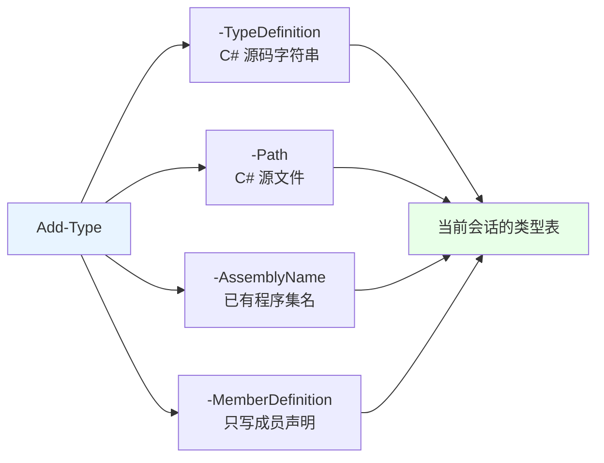
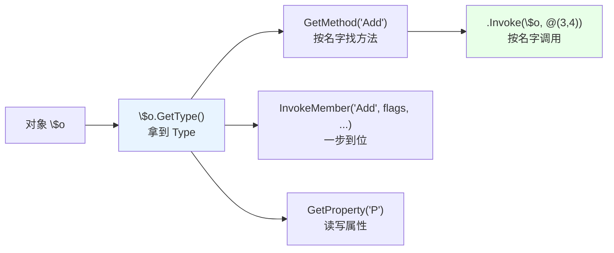
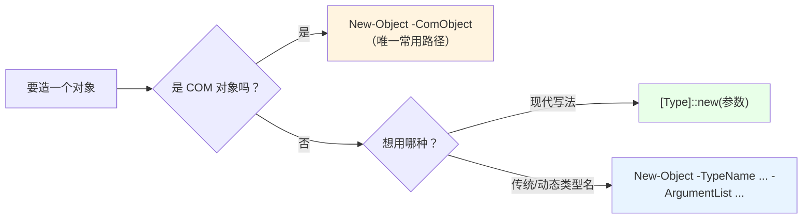

# 第 13 章 程序集、类型发现与反射

> **本章定位**：从这里开始，我们进入**第 3 部分：.NET 运行时设施**。前两部分讲的是“PowerShell 自己的语言和壳”；这一部分开始“**伸手去够 CLR**”——程序集怎么加载、类型怎么发现、方法怎么反射调用、IO/网络/文本/线程/图形界面怎么从脚本里直接使用。
>
> 本章是第 3 部分的“基础设施章”，对标《CLR via C#》第 23 章“程序集加载和反射”和第 2–3 章“生成/打包/部署程序集”。它回答三个问题：**怎么把新类型“带进”当前会话（`Add-Type`）？怎么“看透”一个对象（反射）？怎么“造对象”（`New-Object` / `[type]::new()`）？** 这三个能力，是后面第 14–19 章几乎所有 .NET 调用的共同入口。

---

## 13.1 程序集加载与 `Add-Type`

先建立一个概念：**“程序集”（assembly）是 .NET 的“代码集装箱”**。你在 PowerShell 里能用 `[System.IO.File]`、`[System.Net.Http.HttpClient]`，是因为对应的程序集已经加载进了当前进程；你想用一个“当前没加载”的类型，就得先把它的程序集“搬进来”。

`Add-Type` 就是 PowerShell 里“把新类型/新程序集带进当前会话”的主要入口。它有四种输入源，分别对应四种“我要的东西从哪里来”。

### 程序集：.NET 的“代码集装箱”

程序集通常是一个 `.dll` 或 `.exe`，里面装着：
- 类型定义（类、结构、接口、枚举）；
- 元数据（类型之间怎么引用、方法签名是什么）；
- 可执行代码（IL，运行时再 JIT 成机器码）。

PowerShell 本身就是跑在 .NET 上的，所以它“天然认识”已经加载的程序集。你可以先看看当前进程里装了哪些程序集：

```powershell
# 当前 AppDomain 里已加载的程序集
[AppDomain]::CurrentDomain.GetAssemblies() |
    Select-Object -First 10 FullName
```

不认识的类型，用 `[类型名]` 会直接报“找不到类型”。这时候就轮到 `Add-Type` 了。

### `Add-Type` 的四种输入源

**输入源一：`-TypeDefinition`——直接写 C# 源码。**

```powershell
$code = @'
public class DemoX {
    public int Add(int a, int b) { return a + b; }
    public static string Hello() { return "hi"; }
}
'@
Add-Type -TypeDefinition $code

$o = [DemoX]::new()
$o.Add(1, 2)          # 3
[DemoX]::Hello()      # hi
```

`-TypeDefinition` 会在当前进程里**动态编译**这段 C#，然后把 `DemoX` 这个类型带进会话。这是 PowerShell 最常用的“现场造类型”方式——不需要 Visual Studio、不需要单独编译 DLL。

> 注意 `[DemoX]::Hello()` 里的**括号**：`[DemoX]::Hello`（不带括号）只是“看一眼方法签名”（会显示 `static string Hello()`），**只有 `::Hello()` 才是真正调用**。这个细节我们实测确认过，初学者很容易漏括号。

**输入源二：`-Path`——从 C# 源文件编译。**

```powershell
Add-Type -Path 'D:\src\MyLib.cs'
```

适合“C# 代码比较长、放文件里更舒服”的场景。`-Path` 可以一次给多个 `.cs` 文件。

**输入源三：`-AssemblyName`——加载一个已存在的程序集。**

```powershell
# 加载 Windows Forms（第 19 章会用到）
Add-Type -AssemblyName System.Windows.Forms
Add-Type -AssemblyName System.Drawing
```

这是“把一个已经编译好的程序集按名字加载进来”。名字可以是简单名（如 `System.Windows.Forms`），也可以是完整名。加载后，该程序集里的类型就能用 `[System.Windows.Forms.Form]` 这样直接引用了。

**输入源四：`-MemberDefinition`——只写“成员”，让 PowerShell 帮你生成类。**

```powershell
# 生成一个叫 Win32、命名空间是 Native 的类，里面放这个 P/Invoke 声明
Add-Type -MemberDefinition @'
[DllImport("user32.dll")]
public static extern bool ShowWindow(IntPtr hWnd, int nCmdShow);
'@ -Name Win32 -Namespace Native

# 然后就能这样调用
# [Native.Win32]::ShowWindow($handle, 0)
```

`-MemberDefinition` 适合“我只想加几个 `DllImport` 方法”的场景——它会自动生成一个模板类，把里面的成员塞进去。第 4 部分（Win32）会大量使用它。

把四种输入源画成一张图：



除了 `Add-Type`，加载程序集还有一条更“底层”的路：

```powershell
# 从文件路径加载
[System.Reflection.Assembly]::LoadFrom('D:\libs\MyLib.dll')

# 按程序集名加载（PowerShell 7 推荐用 Add-Type -AssemblyName 代替旧写法）
[System.Reflection.Assembly]::LoadWithPartialName('System.Windows.Forms')   # 遗留写法
```

`LoadWithPartialName` 是 .NET Framework 时代的“按部分名加载”，在 .NET Core / PowerShell 7 里已经不推荐；新代码优先用 `Add-Type -AssemblyName` 或 `LoadFrom`。

### 类型一经加载，不可卸载；同名不同类型会报错

这是 `Add-Type` 最需要记住的“会话级”限制。我们实测确认了两种情形：

1. **重复添加完全相同的源码**：PowerShell 会复用已有类型，**不会报错**；
2. **同名类型但定义不同**：会直接报“**类型名称“DemoY”已存在**”（后面还可能跟一句“出现编译错误”）。

```powershell
Add-Type -TypeDefinition 'public class DemoY { public int A(){return 1;} }'
Add-Type -TypeDefinition 'public class DemoY { public int A(){return 1;} }'   # 相同：可复用

Add-Type -TypeDefinition 'public class DemoY { public int A(){return 2;} }'   # 不同：报错
# 无法添加类型。类型名称"DemoY"已存在。
```

也就是说：**类型一旦“进了”会话，就没有“卸下/卸载”这回事。** 想用新定义覆盖它，只能：
- **开一个新会话**（关掉重开）；
- 或者**改个类名**。

这也是为什么第 6 章的 PowerShell 类“不可重定义”、第 32 章的 P/Invoke“类型不可重定义”都是同一个根因——**类型是会话级的，进去了就钉死了。** 写脚本时，尽量把“类型定义”当成“一次性初始化”：定义一次、复用，而不是反复 `Add-Type` 同一批东西。

### `-OutputAssembly`：把动态程序集持久化成 DLL

`Add-Type` 默认是“编译到内存”。如果你想把这段 C# 变成**可以反复加载的 DLL**，用 `-OutputAssembly`：

```powershell
Add-Type -TypeDefinition $code `
    -OutputAssembly 'D:\libs\DemoX.dll' `
    -OutputType Library

# 以后别的会话可以直接加载这个 DLL
Add-Type -Path 'D:\libs\DemoX.dll'
```

`-OutputType` 常用 `Library`（类库）、`ConsoleApplication`、`WindowsApplication`。这是“脚本里现场造一个可分发 DLL”的捷径——第 33 章讲“什么时候该下沉到 C#”时，会再次用到这个思路。

### 13.1 小结

1. **程序集是 .NET 的代码集装箱**；用 `Add-Type` 把新类型/程序集带进会话。
2. **四种输入源**：`-TypeDefinition`（C# 源码）、`-Path`（源文件）、`-AssemblyName`（已有程序集）、`-MemberDefinition`（只写成员）。
3. **类型一经加载不可卸载**；相同源码可复用，**同名不同定义会报“类型名称已存在”**，需新会话或改名。
4. **`-OutputAssembly`** 把动态程序集持久化成 `.dll`，供以后加载。
5. `[类型]::方法()` 才是调用；不带括号只是看签名。

---

## 13.2 反射：`GetType()`、`GetMember()`、`InvokeMember()`

“反射”（reflection）听起来高深，其实就是：**在运行时“看透”一个对象/类型——它是什么类型、有哪些属性、有哪些方法、每个方法的参数是什么——并且可以“按名字”去调用它们，而不必在写代码时就知道名字。**

PowerShell 的 `Get-Member` 是反射的“平民版”；这一节要学的是底层那套 `System.Reflection`，它更完整、更“程序化”，也是后面很多高级用法的地基。

### `GetType()`：拿到运行时类型

每个对象都有 `GetType()`，它返回一个 `System.Type` 对象——这是“类型”这个事物的“元对象”：

```powershell
$o = [DemoX]::new()
$t = $o.GetType()

$t.FullName        # DemoX
$t.Name            # DemoX
$t.IsClass         # True
$t.BaseType.Name   # Object
```

`Type` 对象上有一大批“探针”：

```powershell
$t.GetMethods()      # 所有方法
$t.GetProperties()   # 所有属性
$t.GetFields()       # 所有字段
$t.GetConstructors() # 所有构造函数
$t.GetInterfaces()   # 实现了哪些接口
```

### `GetMethods()` / `GetProperties()` 与 `BindingFlags`

默认情况下，`GetMethods()` 等只返回**公共**成员。要控制“看哪些”（公共/非公共、实例/静态），用 `BindingFlags`：

```powershell
$flags = [System.Reflection.BindingFlags]::Public -bor [System.Reflection.BindingFlags]::Instance

$t.GetMethods($flags)
$t.GetMethods([System.Reflection.BindingFlags]::NonPublic -bor [System.Reflection.BindingFlags]::Instance)
$t.GetMethods([System.Reflection.BindingFlags]::Public -bor [System.Reflection.BindingFlags]::Static)
```

常用的 `BindingFlags`：

| 标志 | 含义 |
|---|---|
| `Public` | 公共成员 |
| `NonPublic` | 非公共成员 |
| `Instance` | 实例成员 |
| `Static` | 静态成员 |
| `FlattenHierarchy` | 连同继承来的（静态成员）一起看 |

用 `-bor` 把多个标志“按位或”起来，就是“既要 A 又要 B”。比如 `Public -bor Instance` 就是“所有公共实例成员”。

一个很实用的筛选例子：

```powershell
# 找出名字里带 Add 的方法
$t.GetMethods() | Where-Object Name -like '*Add*' |
    Select-Object Name, ReturnType
```

### `InvokeMember()` 与 `MethodInfo.Invoke()`：后期绑定调用

反射的“杀手锏”是：**方法名可以是一个运行时才确定的字符串，你也能调用它。** 这叫“后期绑定”（late binding）。

**路径一：拿到 `MethodInfo` 再 `.Invoke()`。** 这是我们实测通过的写法：

```powershell
$o = [DemoX]::new()
$m = $o.GetType().GetMethod('Add')     # 按名字找方法
$m.Invoke($o, @(3, 4))                 # 7 —— 按名字调用
```

`.Invoke(对象, 参数数组)`：第一个参数是“在哪个实例上调用”（静态方法传 `$null`），第二个参数是参数数组。

**路径二：`Type.InvokeMember()`，一步到位。** 它把“找成员 + 调用”合在一起：

```powershell
$flags = [System.Reflection.BindingFlags]::InvokeMethod -bor
         [System.Reflection.BindingFlags]::Public -bor
         [System.Reflection.BindingFlags]::Instance

$o.GetType().InvokeMember('Add', $flags, $null, $o, @(1, 2))   # 3
```

参数依次是：成员名、`BindingFlags`、`Binder`（一般 `$null`）、目标对象、参数数组。`InvokeMember` 能做的不止“调方法”，加上 `GetProperty` / `SetProperty` 标志还能读写属性。

**为什么反射有用？** 举三个真实场景：

1. **类型/方法名在运行时才知道**：比如“根据配置文件里写的类名去实例化对象”；
2. **批量操作对象**：比如“把对象上所有 `string` 类型的属性都做一次替换”；
3. **访问“非公共”成员**：有些库把关键方法藏成 `private`，反射能绕过（但要谨慎，属于“明知故犯”的用法）。

把反射的调用链画出来：



### `[type]::GetType()` 与程序集限定名

反射还能“**按名字找类型**”，而不必先有一个对象：

```powershell
[type]::GetType('System.String')          # System.String
[type]::GetType('System.Int32')           # System.Int32
```

这在“类型名来自配置/用户输入”时很有用。但要注意：**有些类型需要“程序集限定名”才能找到**，也就是“类型全名 + 逗号 + 程序集全名”：

```powershell
# 简单名找不到时，用程序集限定名
[type]::GetType('System.String, System.Private.CoreLib')
```

在 PowerShell 7（.NET Core/5+）里，核心类型住在 `System.Private.CoreLib`；在 Windows PowerShell 5.1（.NET Framework）里，它们住在 `mscorlib`。**跨版本脚本里“按名字找类型”要小心这个差异。** 更稳的做法，是优先用 `[类型加速器]`（如 `[string]`）或 `Add-Type -AssemblyName` 把程序集先加载进来。

### 13.2 小结

1. **`GetType()`** 返回运行时 `Type` 对象；`GetMethods/GetProperties/GetFields/GetConstructors/GetInterfaces` 是探针。
2. **`BindingFlags`** 控制“看公共还是非公共、实例还是静态”，用 `-bor` 组合。
3. **反射调用**：`GetMethod('名字').Invoke($obj, @(参数))`，或 `InvokeMember('名字', flags, $null, $obj, @(参数))`。
4. **`[type]::GetType('名字')`** 按名字找类型；必要时用“程序集限定名”（注意 5.1 与 7 的程序集不同）。

---

## 13.3 `New-Object`、`[type]::new()` 与构造函数选择

造对象有两条常用路径，它们在“能不能造 COM”“性能”“探索式编码”上各有分工。

### 两条对象创建路径

**路径一：`New-Object`（传统、通用）。**

```powershell
# 用 -TypeName + -ArgumentList 调构造函数
$f = New-Object -TypeName System.IO.FileInfo -ArgumentList 'C:\demo\x.txt'
$f.Name
```

**路径二：`[type]::new()`（PowerShell 5.0+，现代、推荐）。**

```powershell
$f = [System.IO.FileInfo]::new('C:\demo\x.txt')
$f.Name
```

两者都能调构造函数、都支持参数。日常写脚本，**优先用 `[type]::new()`**：它更短、更明确，而且通常比 `New-Object` 少一层参数绑定开销。

下面两个例子等价：

```powershell
# New-Object
$sb = New-Object System.Text.StringBuilder -ArgumentList 100

# ::new()
$sb = [System.Text.StringBuilder]::new(100)
```

把两条路径和“COM 特例”画在一起：



### `[type]::new()` 的探索式用法：不带括号看重载

`[type]::new`**不带括号**时，不会造对象，而是**列出可用的构造函数重载**。这是一个很好的“探索工具”：

```powershell
[System.IO.FileInfo]::new
# 输出类似：
# OverloadDefinitions
# -------------------
# System.IO.FileInfo new(string fileName)
# System.IO.FileInfo new(string fileName, string originalPath)
```

实测确认：`[DemoX]::new` 会显示 `DemoX new()`。**带括号 `::new()` 才是真正构造。** 这一点和前面 `[类型]::方法` vs `::方法()` 是同一个规律：**不带括号 = 看签名；带括号 = 真调用。**

### COM 对象只能 `New-Object -ComObject`

这是 `[type]::new()` 的硬边界：**它造不了 COM 对象。** COM 对象没有“托管类型”可 new，必须走 COM 激活路径：

```powershell
# 经典 COM 组件：WScript.Shell
$ws = New-Object -ComObject WScript.Shell
$ws.SpecialFolders('Desktop')
```

`New-Object -ComObject` 会通过 ProgID（如 `WScript.Shell`）去激活 COM 组件，返回一个“运行时可调用包装器”（RCW）。第 32.2 节会专门讲“COM 对象用完怎么释放”，那是另一个大坑。

如果你就是想“用类型名动态造对象”（比如类型名来自配置），`New-Object -TypeName $typeName` 仍然是最直接的：它接受字符串形式的类型名。`[type]::new()` 则要求你在写代码时就知道类型。

### 13.3 小结

1. **两条创建路径**：`New-Object -TypeName ... -ArgumentList ...` 与 `[类型]::new(参数)`；日常优先后者。
2. **`[类型]::new`（不带括号）** 列出构造函数重载；**带括号才是构造**。
3. **COM 对象只能 `New-Object -ComObject`**（ProgID 激活），`[type]::new()` 造不了。
4. 类型名是运行时字符串时，用 `New-Object -TypeName $name` 更合适。

---

## 本章总结

第 13 章是“伸向 CLR”的三把钥匙：

- **13.1 程序集与 Add-Type**：程序集是代码集装箱；`Add-Type` 四种输入源（`-TypeDefinition` / `-Path` / `-AssemblyName` / `-MemberDefinition`）；**类型一经加载不可卸载、同名不同定义报错**；`-OutputAssembly` 可持久化 DLL。
- **13.2 反射**：`GetType()` + `GetMethods/GetProperties/...` + `BindingFlags`；`GetMethod().Invoke()` 与 `InvokeMember()` 做后期绑定；`[type]::GetType()` 按名字找类型（注意程序集限定名）。
- **13.3 造对象**：`New-Object` 与 `[type]::new()` 两条路径，优先后者；`::new` 不带括号看重载；**COM 只能 `New-Object -ComObject`**。

一句话记住全章：**`Add-Type` 把类型“搬进来”，反射把对象“看透并按名字调用”，`New-Object` / `::new()` 把对象“造出来”。** 这三件事，是后面所有 .NET 设施调用的“起手式”。

**下一章预告**：第 14 章《网络：从应用层 HTTP 到传输层 Socket》。我们会从最常用的 `Invoke-RestMethod` / `Invoke-WebRequest` 讲起，再下沉到 `HttpClient`、`HttpListener`（在脚本里启动 HTTP 服务）、`TcpClient` / `TcpListener` / `UdpClient`，最后落到 `IPAddress`、`IPEndPoint`、`Uri` 这些“地址与端点的底层表示”。这一章的核心判断线是：**“取数据”优先用 cmdlet，“控协议/建服务/走 TCP”才下沉到 .NET 类。**

---

> **动手练习**
>
> 1. 用 `Add-Type -TypeDefinition` 定义一个带 `Add(int,int)` 和静态 `Hello()` 的类，验证调用；再**故意**用不同函数体重定义同名类，观察“类型名称已存在”报错。
> 2. 用 `$obj.GetType().GetMethods()` 列出某个 .NET 对象（如 `[System.IO.FileInfo]::new('x')`）的所有公共方法，再用 `Where-Object Name -like '*Name*'` 筛几个。
> 3. 用 `GetMethod('方法名').Invoke($obj, @(参数))` 反射调用一个方法；再用 `InvokeMember` 写一遍，对比两种写法。
> 4. 运行 `[System.IO.FileInfo]::new`（不带括号）看构造函数重载，再运行 `[System.IO.FileInfo]::new('x')` 真正构造。
> 5. 用 `New-Object -TypeName System.Text.StringBuilder -ArgumentList 100` 和 `[System.Text.StringBuilder]::new(100)` 各造一个，确认等价。
> 6. 用 `New-Object -ComObject WScript.Shell` 造一个 COM 对象，读一下 `SpecialFolders('Desktop')`（只读，不修改）；体会它与 `[type]::new()` 的区别。
