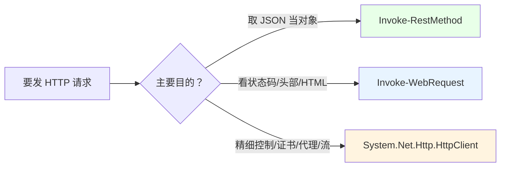
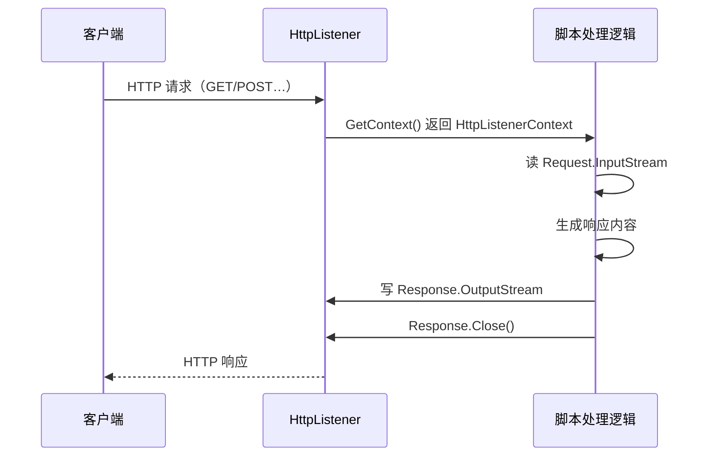
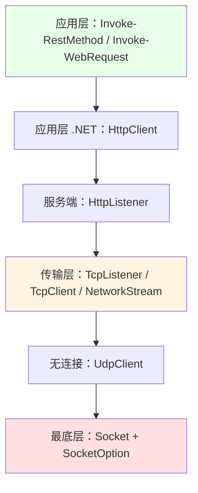
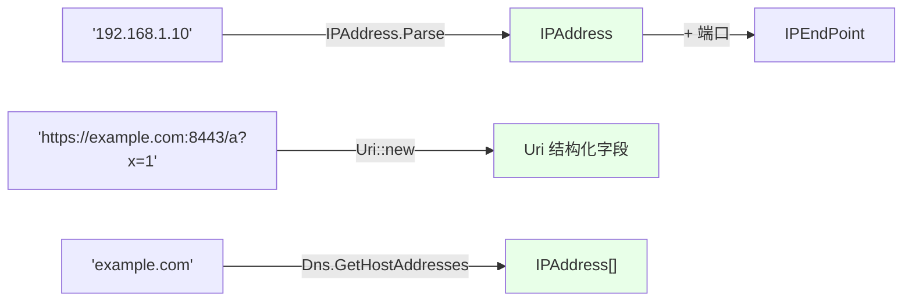

# 第 14 章 网络：从应用层 HTTP 到传输层 Socket

> **本章定位**：.NET 在 `System.Net.*` 和 `System.Net.Sockets.*` 里提供了**分层**的网络能力：应用层有 `WebClient`、`HttpClient`、`HttpListener`；传输层有 `TcpClient` / `TcpListener` / `UdpClient` / `Socket`。PowerShell 同时提供了 cmdlet 封装（`Invoke-RestMethod`、`Invoke-WebRequest`），但 cmdlet 与裸 .NET 类在**响应形态、可配置性、异步模型**上有明确分工。
>
> 本章的核心判断线索只有一条：**“取数据”优先用 cmdlet，“控协议 / 建服务 / 走 TCP”才下沉到 .NET 类。** 沿着这条线，我们从最上层的 HTTP 请求，一路下沉到最底层的地址与端点。

---

## 14.1 `Invoke-RestMethod` / `Invoke-WebRequest` 与 `HttpClient` 的分工

用 PowerShell 发 HTTP 请求，第一反应应该是 cmdlet：`Invoke-RestMethod` 和 `Invoke-WebRequest`。它们足够日常使用；只有当你需要“精细控制请求管道/证书/代理/连接复用”时，才轮到 `HttpClient`。

### `Invoke-RestMethod`：直接拿到“对象化”的响应体

`Invoke-RestMethod`（别名 `irm`）的特点是：**它会自动把 JSON/XML 响应体反序列化成 PowerShell 对象**，直接还给你。你拿到的不是“一坨字符串”，而是“能 `.属性` 的对象”。

```powershell
# 调一个返回 JSON 的 API
$data = Invoke-RestMethod -Uri 'https://api.example.com/items' -Method Get

# $data 已经是对象/对象数组，可以直接用
$data | Select-Object -First 1
$data[0].name
```

发送 POST 也很自然：

```powershell
$body = @{
    name  = 'demo'
    value = 42
} | ConvertTo-Json

$result = Invoke-RestMethod -Uri 'https://api.example.com/items' `
    -Method Post `
    -ContentType 'application/json' `
    -Body $body
```

**适用场景**：调用 REST API、取 JSON 数据、把返回值当对象继续加工。**它就是“取数据”的首选。**

### `Invoke-WebRequest`：拿到带状态码与头部的响应对象

`Invoke-WebRequest`（别名 `iwr`）返回的不是“响应体”，而是一个**完整的响应对象**（在 PowerShell 7 里是 `BasicHtmlWebResponseObject` 之类）。它的 `.Content` 恒为**字符串**，但你能同时拿到状态码、头部、原始字节等元信息：

```powershell
$resp = Invoke-WebRequest -Uri 'https://example.com'

$resp.StatusCode        # 200
$resp.StatusDescription # OK
$resp.Headers           # 响应头
$resp.Content           # 字符串形式的响应体（HTML）
$resp.Content.Length
$resp.RawContentStream  # 原始流
```

**适用场景**：你要检查状态码、读取头部、处理 HTML、下载文件、看重定向——这些“不只是取 JSON”的需求，用 `Invoke-WebRequest`。而要“把 JSON 变成对象”，用 `Invoke-RestMethod` 更省事。

两个 cmdlet 的关系，记成一句话就好：**`Invoke-RestMethod` 关心“body 是什么对象”，`Invoke-WebRequest` 关心“整个响应长什么样”。**

### `HttpClient`：需要精细控制与生命周期时的 .NET 路线

cmdlet 很方便，但它是“一层封装”，有些事它不让你管：连接池、超时、证书校验回调、自定义头部、流式上传下载……这时候就用 `System.Net.Http.HttpClient`。

```powershell
$client = [System.Net.Http.HttpClient]::new()

try {
    # 同步阻塞地等结果（.Result）
    $json = $client.GetStringAsync('https://api.example.com/items').Result
    $obj  = $json | ConvertFrom-Json
    $obj | Select-Object -First 1
}
finally {
    $client.Dispose()      # HttpClient 实现了 IDisposable，用完要释放
}
```

`HttpClient` 的几个关键点：

1. **它实现了 `IDisposable`**，用完要 `Dispose()`（或长期复用同一个实例）。反复 `new` 又不释放，会占着连接资源。
2. **`.GetStringAsync(...)` 返回 `Task<string>`**；在 PowerShell 里用 `.Result` 是“阻塞等待”。这在控制台里通常没事，但**在带 UI 消息泵的线程（比如 WinForms）里，`.Result` 可能死锁**——因为 UI 线程在等任务，而任务又想回到 UI 线程完成。遇到这种场景，要么用 `await`（PowerShell 没有原生 await），要么把网络调用放到后台线程/线程任务里（第 17 章）。
3. **`HttpClientHandler`** 用来控制代理、证书校验等底层行为：

```powershell
$handler = [System.Net.Http.HttpClientHandler]::new()

# 自定义证书校验：这里只是演示“怎么接回调”，真实场景别无条件返回 true
$handler.ServerCertificateCustomValidationCallback = {
    param($request, $cert, $chain, $errors)
    return $true
}

$client = [System.Net.Http.HttpClient]::new($handler)
```

4. **PowerShell 7 的 cmdlet 还提供了 `-SkipCertificateCheck`**，做自签名证书的临时测试比手写回调更简单：

```powershell
Invoke-RestMethod -Uri 'https://localhost:8443/api' -SkipCertificateCheck
```

把三条 HTTP 路线放在一起对比：



### 14.1 小结

1. **`Invoke-RestMethod`**：自动把 JSON/XML 反序列化成对象，是“取数据”首选。
2. **`Invoke-WebRequest`**：返回带状态码、头部、字符串 `.Content` 的响应对象，适合检查元信息/处理 HTML。
3. **`HttpClient`**：需要连接复用、超时、证书/代理精细控制时用；注意 `Dispose()` 和 `.Result` 的死锁风险。
4. PowerShell 7 可用 `-SkipCertificateCheck` 简化自签名证书测试。

---

## 14.2 `HttpListener`：在脚本中启动 HTTP 服务

上一节我们是“客户端”；这一节反过来，让 PowerShell 脚本**当服务器**。`HttpListener` 是 .NET 里一个轻量的 HTTP 服务宿主，非常适合“接收回调”“做本地 mock”“给别的程序提供一个临时接口”。

### 用 `HttpListener` 起一个最小 HTTP 服务

最小骨架是这样的：

```powershell
$listener = [System.Net.HttpListener]::new()
$listener.Prefixes.Add('http://localhost:8080/')   # 注意结尾的 /

$listener.Start()
try {
    while ($true) {
        $ctx = $listener.GetContext()      # 阻塞：等一个请求进来

        # 读请求体
        $reader = [System.IO.StreamReader]::new($ctx.Request.InputStream)
        $body = $reader.ReadToEnd()
        $reader.Dispose()

        # 写响应
        $text  = "收到：$body"
        $bytes = [System.Text.Encoding]::UTF8.GetBytes($text)
        $ctx.Response.StatusCode = 200
        $ctx.Response.ContentType = 'text/plain; charset=utf-8'
        $ctx.Response.OutputStream.Write($bytes, 0, $bytes.Length)
        $ctx.Response.Close()
    }
}
finally {
    $listener.Stop()
    $listener.Close()
}
```

几个必须记住的细节：

1. **`Prefixes` 必须以 `/` 结尾**。`http://localhost:8080/` 可以，`http://localhost:8080` 不行。
2. **非回环地址需要权限**。绑 `localhost` 一般没问题；绑 `http://+:8080/` 或局域网 IP，通常需要**管理员权限**或提前配置 **URL ACL**（`netsh http add urlacl ...`）。
3. **`GetContext()` 是阻塞的**：没有请求进来，它就“停在那里等”。放在主线程里，整个脚本就冻结了。
4. **响应写完要 `Close()`**，否则客户端可能一直等。

### 前缀、权限与非回环地址

`HttpListener` 的“能绑哪些地址”由 `Prefixes` 决定，但“绑得成绑不成”由**操作系统的 URL ACL** 决定：

- `http://localhost:8080/`：通常回环地址可以直接绑；
- `http://127.0.0.1:8080/`：同上；
- `http://+:8080/`（所有接口）：通常需要管理员或 URL ACL；
- `https://...`：还需要绑定证书。

如果你写的是一个“只在本机测试”的工具，**优先用 `localhost` 或 `127.0.0.1`**，最不容易踩权限坑。

### 阻塞的 `GetContext()` 与异步配合

因为 `GetContext()` 会阻塞，真要在脚本里“一边跑服务、一边干别的”，就得把服务放到**后台线程任务**里。最简单的是 `Start-ThreadJob`（第 17 章会系统讲并发）：

```powershell
$listener = [System.Net.HttpListener]::new()
$listener.Prefixes.Add('http://localhost:8080/')
$listener.Start()

$job = Start-ThreadJob -ArgumentList $listener -ScriptBlock {
    param($listener)
    while ($listener.IsListening) {
        $ctx = $listener.GetContext()
        $bytes = [System.Text.Encoding]::UTF8.GetBytes('ok')
        $ctx.Response.StatusCode = 200
        $ctx.Response.OutputStream.Write($bytes, 0, $bytes.Length)
        $ctx.Response.Close()
    }
}

# 主线程里可以继续做别的事；结束时清理
# $job | Stop-Job; Remove-Job $job
# $listener.Stop(); $listener.Close()
```

用一张流程图画清楚“请求进来 → 读 → 写 → 关”：



### 14.2 小结

1. **`HttpListener` 让脚本当 HTTP 服务器**：`Prefixes.Add(...)` → `Start()` → `GetContext()` → 读请求/写响应 → `Close()`。
2. **前缀必须以 `/` 结尾**；非回环地址通常需要管理员或 URL ACL。
3. **`GetContext()` 阻塞**；要“边服务边干别的”，把循环放进 `Start-ThreadJob` 等后台任务。
4. 用完 `Stop()` + `Close()`。

---

## 14.3 `TcpClient` / `TcpListener` / `UdpClient`：传输层直接控制

HTTP 是“应用层协议”。当你要实现非 HTTP 协议、做端口探测、或者原始套接字通信时，就得越过 cmdlet 和 HTTP 封装，直接用 `System.Net.Sockets`。

### `TcpListener`：监听与接受连接

TCP 是“面向连接”的：先监听，再接受连接，然后在一个“流”上读写。

```powershell
$listener = [System.Net.Sockets.TcpListener]::new([System.Net.IPAddress]::Loopback, 9000)
$listener.Start()
try {
    "等待连接……"
    $client = $listener.AcceptTcpClient()      # 阻塞，直到有客户端连进来

    $stream = $client.GetStream()
    $reader = [System.IO.StreamReader]::new($stream)
    $writer = [System.IO.StreamWriter]::new($stream)
    $writer.AutoFlush = $true

    $line = $reader.ReadLine()                 # 读一行（以换行符为界）
    "服务端收到：$line"
    $writer.WriteLine("服务端回显：$line")    # 回写一行

    $reader.Dispose()
    $writer.Dispose()
    $client.Close()
}
finally {
    $listener.Stop()
}
```

`AcceptTcpClient()` 也是**阻塞**的：没人连进来，它就一直等。所以真实服务端通常也要放到后台线程/线程任务里。

### `TcpClient` + `NetworkStream`：文本协议的读写

客户端这边，`TcpClient.GetStream()` 返回一个 `NetworkStream`——它本质是“**字节流**”，但你可以用 `StreamReader` / `StreamWriter` 在它上面做“文本协议”的读写：

```powershell
$client = [System.Net.Sockets.TcpClient]::new('127.0.0.1', 9000)

try {
    $stream = $client.GetStream()
    $writer = [System.IO.StreamWriter]::new($stream)
    $reader = [System.IO.StreamReader]::new($stream)
    $writer.AutoFlush = $true

    $writer.WriteLine('hello')
    $reply = $reader.ReadLine()
    "客户端收到：$reply"

    $reader.Dispose()
    $writer.Dispose()
}
finally {
    $client.Close()
}
```

要点：

- **`NetworkStream` 是字节流**，`StreamReader`/`StreamWriter` 是“字节 → 字符”的适配层（第 18 章会系统讲“流”）。
- **`StreamWriter.AutoFlush = $true`**：否则写出去的内容可能还在缓冲区，对端读不到（“为什么我发了对方没收到”多半是这个）。
- **`ReadLine()` 会阻塞**，直到读到换行或连接关闭。做协议时，要约定好“消息边界”（换行、定长、长度前缀），否则会“读到一堆粘在一起的数据”。

### `UdpClient`：无连接的收发

UDP 是“无连接”的：发出去就不管，收的时候也不知道是谁发的（除非你看远端端点）。它适合“低延迟、可丢包”的场景（如探测、日志、游戏）。

```powershell
# 绑定一个本地端口
$udp = [System.Net.Sockets.UdpClient]::new(9001)

try {
    $remote = [System.Net.IPEndPoint]::new([System.Net.IPAddress]::Loopback, 9001)
    $bytes = [System.Text.Encoding]::UTF8.GetBytes('hello udp')

    # 发送
    $udp.Send($bytes, $bytes.Length, $remote) | Out-Null

    # 接收（阻塞）。用 [ref] 接住“对面是谁”
    $from = [System.Net.IPEndPoint]::new([System.Net.IPAddress]::Any, 0)
    $data = $udp.Receive([ref]$from)
    $text = [System.Text.Encoding]::UTF8.GetString($data)
    "收到来自 $($from.ToString()) 的：$text"
}
finally {
    $udp.Close()
}
```

`Receive()` 同样**阻塞**；“发给自己再收”这种自测能帮你理解“无连接”的含义（没有 `Accept`，没有连接状态，就是一个一个数据报）。

### `SocketOption`：超时、缓冲区与 `NoDelay`

`TcpClient` / `UdpClient` 上有一批“调优参数”，常见的有：

```powershell
$client = [System.Net.Sockets.TcpClient]::new('127.0.0.1', 9000)

$client.ReceiveTimeout = 5000      # 读超时（毫秒）
$client.SendTimeout = 5000         # 写超时
$client.NoDelay = $true            # 禁用 Nagle 算法：小包立即发，适合交互式协议
$client.SendBufferSize = 8192
$client.ReceiveBufferSize = 8192
```

更底层的 `SocketOption`（比如 `SocketOptionName` 的各种设置）要通过 `$client.Client.SetSocketOption(...)` 或直接使用 `System.Net.Sockets.Socket` 来做。日常脚本里，上面这几个属性已经能覆盖大多需求。

把三层网络能力摆成一张“下沉图”：



往下沉一层，你就多一分控制，也多一分“要自己处理协议细节”的责任。

### 14.3 小结

1. **`TcpListener`**：`Start()` → `AcceptTcpClient()`（阻塞）→ 拿 `NetworkStream` 读写。
2. **`TcpClient` + `NetworkStream`**：用 `StreamReader`/`StreamWriter` 做文本协议；`AutoFlush` 要打开；`ReadLine` 会阻塞，需约定消息边界。
3. **`UdpClient`**：无连接，`Send` / `Receive([ref]$remote)`；接收也阻塞。
4. **调优**：`ReceiveTimeout` / `SendTimeout` / `NoDelay` / 缓冲区大小；更底层用 `SocketOption`。

---

## 14.4 地址、端点与 `Uri` 的底层表示

网络编程里，“地址”和“端点”不是字符串。PowerShell 的字符串宽松性在地址解析上会**隐藏错误**——延后到运行时才炸；直接用 `IPAddress`、`IPEndPoint`、`Uri` 这些类型，能“早失败、早发现”。

### `IPAddress` 与 `IPEndPoint`

`IPAddress` 表示一个 IP 地址；`IPEndPoint` 是“IP + 端口”的组合。

```powershell
# 从字符串解析（IPv4/IPv6 都支持）
$ip = [System.Net.IPAddress]::Parse('192.168.1.10')
$ip.ToString()               # 192.168.1.10
$ip.AddressFamily            # InterNetwork（IPv4）

# 从字节数组构造
$ip2 = [System.Net.IPAddress]::new([byte[]]@(127, 0, 0, 1))
$ip2.ToString()              # 127.0.0.1

# 常用特殊地址
[System.Net.IPAddress]::Any      # 0.0.0.0（代表“所有接口”）
[System.Net.IPAddress]::Loopback # 127.0.0.1

# 端点：地址 + 端口
$ep = [System.Net.IPEndPoint]::new($ip, 8080)
$ep.ToString()               # 192.168.1.10:8080
$ep.Address
$ep.Port
```

几个要点：

- **`Parse()` 失败会抛异常**（比如传 `'999.1.1.1'`），这是“早失败”的好处；
- **IPv6 字符串在 URI 里要加方括号**：`http://[::1]:8080/`；
- **`IPEndPoint` 的 `Address` 和 `Port` 是分开的两个属性**，很多 API 都接受它。

### `Uri` 的结构化解析

`Uri` 把“一串 URL”拆成结构化字段。这比你自己用 `-split '[:/]'` 去切，可靠得多：

```powershell
$u = [System.Uri]::new('https://example.com:8443/a/b?x=1#frag')

$u.Scheme        # https
$u.Host          # example.com
$u.Port          # 8443
$u.AbsolutePath  # /a/b
$u.LocalPath     # /a/b（对文件 URI 更常用）
$u.Query         # ?x=1
$u.Fragment      # #frag
$u.IsLoopback    # False

([System.Uri]::new('http://localhost/')).IsLoopback   # True
```

几个细节：

- **默认端口**：不写端口时，`https` 的 `Port` 是 443，`http` 是 80。
- **`LocalPath` vs `AbsolutePath`**：对 `file://` URI，`LocalPath` 会给出本地文件路径，更适合“把 URI 当文件路径用”的场景。
- **`IsLoopback`**：判断是不是回环地址（`localhost`、`127.0.0.1`）；写“只允许本机访问”的检查时很有用。

### `Dns` 解析

域名 → IP 地址，用 `System.Net.Dns`：

```powershell
# 解析一个主机名，返回 IPAddress[]
[System.Net.Dns]::GetHostAddresses('localhost')
# ::1
# 127.0.0.1

[System.Net.Dns]::GetHostAddresses('example.com')
```

`GetHostAddresses` 返回的是 `IPAddress[]`，可能包含 IPv4 和 IPv6 多条。你可以直接把它喂给 `TcpClient` 或 `IPEndPoint`。

把“字符串 → 类型”的解析路径画出来：



### 14.4 小结

1. **`IPAddress.Parse`** 从字符串解析 IP；也可用字节数组构造；`Any`/`Loopback` 是常用特殊地址。
2. **`IPEndPoint`** 是“IP + 端口”的组合，`.Address` / `.Port` 分开。
3. **`Uri`** 把 URL 拆成 `Scheme`/`Host`/`Port`/`AbsolutePath`/`LocalPath`/`Query`/`Fragment`/`IsLoopback`。
4. **`Dns.GetHostAddresses`** 做域名解析，返回 `IPAddress[]`。

---

## 本章总结

第 14 章沿着“应用层 → 传输层 → 地址层”走了一遍：

- **14.1 HTTP 客户端**：`Invoke-RestMethod`（自动对象化，取数据首选）、`Invoke-WebRequest`（要看状态码/头部/HTML）、`HttpClient`（精细控制；注意 `Dispose` 和 `.Result` 死锁）。
- **14.2 HTTP 服务端**：`HttpListener` 让脚本当服务器；前缀以 `/` 结尾、非回环要权限、`GetContext()` 阻塞（配后台任务）。
- **14.3 传输层**：`TcpListener`/`TcpClient`+`NetworkStream` 做文本协议（注意 `AutoFlush` 与消息边界）；`UdpClient` 无连接收发（`Receive` 阻塞）；`NoDelay`/超时/缓冲区调优。
- **14.4 地址与端点**：`IPAddress`、`IPEndPoint`、`Uri` 的结构化解析、`Dns` 解析——用类型代替字符串，早失败、可组合。

一句话记住全章：**“取数据”用 cmdlet，“建服务/控协议/走 TCP”用 .NET 类，“地址/端点/URI”一律用强类型对象，别拿字符串硬拼。**

**下一章预告**：第 15 章《文本与正则：`String` 不可变性、`StringBuilder` 与 `RegularExpressions`》。我们会讲清“为什么循环里 `+=` 拼字符串会越来越慢”、`-match` / `-replace` 与 .NET `Regex` 的语义差异（尤其 `-replace` 里 `$1` 的“插值冲突”）、以及给正则加超时防“灾难性回溯”。这一章是“PowerShell 字符串陷阱最密集”的地方之一。

---

> **动手练习**
>
> 1. 用 `Invoke-RestMethod` 调一个公开的 JSON API（或本地服务），把返回对象用 `Select-Object` 挑几列；再用 `Invoke-WebRequest` 调同一个地址，对比 `.Content`、`.StatusCode`、`.Headers`。
> 2. 用 `HttpClient` 发一次 `GetStringAsync`，并 `Dispose()`；体会它与 `Invoke-RestMethod` 的写法差异。
> 3. 用 `HttpListener` 起一个只回 `"ok"` 的本地服务（绑 `http://localhost:8080/`），用另一个 PowerShell 窗口 `Invoke-WebRequest` 访问；观察 `GetContext()` 的阻塞行为。
> 4. 用 `TcpListener` + `TcpClient` 在本机 9000 端口做一次“客户端发一行、服务端回一行”的往返（可分两个窗口/两个后台任务）。
> 5. 用 `UdpClient` 在本机收发自测，打印收到的字符串和来源端点。
> 6. 用 `[System.Uri]::new(...)` 解析一个带 scheme/端口/路径/查询/片段的 URL，把每个字段打印出来；再用 `IsLoopback` 判断 `localhost` 与 `example.com`。
