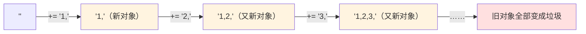
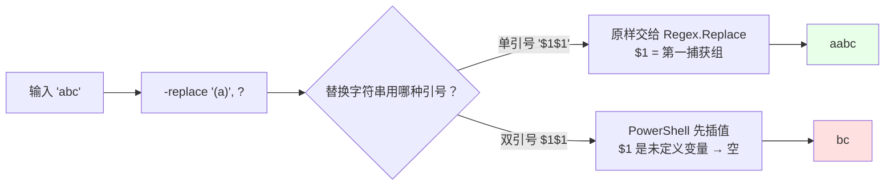
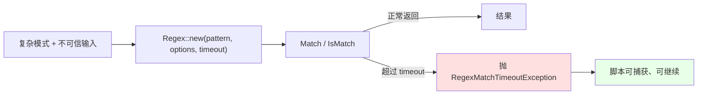

# 第 15 章 文本与正则：`String` 不可变性、`StringBuilder` 与 `RegularExpressions`

> **章内定位**：对标《CLR via C#》第 14 章“字符、字符串和文本处理”。PowerShell 表面上让字符串操作“很轻松”，但 `-match` / `-replace` 的隐式行为（**大小写不敏感、`$matches` 副作用、替换字符串中 `$` 的变量插值冲突**）恰恰是脚本 bug 的高发区。本章的教学目标是：**用 .NET 的显式类型，纠正 PowerShell 运算符的“方便但不精确”。**
>
> 这一章我们讲四件事：字符串为什么“越拼越慢”、`-match`/`-replace`/`-split` 与 .NET `Regex` 的语义差异、动态正则与超时、以及“区域文化”对文本处理的影响。

---

## 15.1 字符串不可变性与 `StringBuilder`

先记住一句话：**.NET 的 `String` 是不可变的（immutable）**。你看着像“在原来的字符串上改”，实际上每一次“修改”都会**创建一个全新的字符串对象**，旧的被丢弃。理解这一点，你才能解释“为什么循环里拼字符串会越来越慢”。

### 字符串是不可变的：每次“修改”都产生新对象

```powershell
$s = 'abc'
$t = $s.ToUpper()      # 产生一个新字符串 "ABC"
$s                     # 还是 "abc"，原字符串没变
$t                     # "ABC"
```

`ToUpper()` 不会“把 `$s` 变成大写”，而是**新造一个**大写字符串交给你。`Replace`、`Substring`、`Trim`、`+` 拼接，全都是“返回新字符串”。

这带来两个直接后果：

1. **安全**：字符串可以作为“值”到处传，不会被别人偷偷改掉（和第 2 章“值/引用的区别”呼应）；
2. **性能陷阱**：在循环里反复“改”字符串，会反复创建新对象。

### 循环里 `+=` 的 O(n²) 行为

看这段代码：

```powershell
$result = ''
foreach ($i in 1..10000) {
    $result += "$i,"
}
```

它看起来“就是往后面接东西”，但实际发生了什么？

- 第 1 次：创建一个长度 1 的字符串；
- 第 2 次：把“旧字符串 + 新内容”复制成一个新字符串（长度 2）；
- 第 3 次：再复制成一个新字符串（长度 3）；
- ……

第 k 次要复制 k 个字符，总共复制约 1+2+…+n = n(n+1)/2 个字符——也就是 **O(n²)**。数据量一大，这段代码会慢得离谱，而且中间会产生大量“垃圾字符串”，给垃圾回收添负担。

用一张图看“每次 `+=` 都在造新对象”：



### `StringBuilder` 的摊销 O(1) 与容量预分配

`StringBuilder` 就是为了解决这个问题而生的：它内部维护一块**可增长的缓冲区**，`Append` 只是往缓冲区末尾写，大多数时候是 **O(1) 的摊销成本**；只有缓冲区不够时才扩容（扩容会复制，但次数是对数级的）。

```powershell
$sb = [System.Text.StringBuilder]::new(100)   # 预分配 100 个字符的容量

for ($i = 1; $i -le 10000; $i++) {
    [void]$sb.Append($i).Append(',')
}

$result = $sb.ToString()
```

要点：

1. **构造时给个 `capacity`（如 100、1024）**：能减少扩容次数；不确定就估算一个，比“每次扩容都翻倍复制”要好。
2. **`Append` 返回 `StringBuilder` 本身**（可以链式调用），但在 PowerShell 里它的返回值会“漏”到输出流，所以常用 `[void]` 或 `$null =` 吃掉（第 5.1 节讲过的坑）。
3. **`AppendLine()`** 追加一行并带换行符。
4. **最后用 `.ToString()` 一次性拿到结果**。
5. 实测确认：`[System.Text.StringBuilder]::new(100)` 的 `Capacity` 是 100；`Append('a')`、`Append('b')` 后 `ToString()` 得到 `"ab"`。

### 已知片段用 `String.Join` / `Concat`

如果你的拼接是“把一堆已知的片段用分隔符连起来”，根本不需要 `StringBuilder`，直接用 `[string]::Join`：

```powershell
$parts = 1..5 | ForEach-Object { "$_" }
[string]::Join(',', $parts)      # 1,2,3,4,5

# 或者用 PowerShell 的 -join 运算符
$parts -join ','
```

`[string]::Concat()` 则是“无分隔符连接”。原则是：

- **已知有限片段 → `Join` / `Concat`**（最简单）；
- **循环中动态累积 → `StringBuilder`**（避免 O(n²)）；
- **少量拼接 → 直接 `+`**（别过度优化）。

### 15.1 小结

1. **`String` 不可变**：每次“修改”都返回新对象，原对象不变。
2. **循环里 `+=` 是 O(n²)**，会产生大量临时字符串。
3. **`StringBuilder`** 用可增长缓冲区做到摊销 O(1)；构造时给 `capacity`；`Append` 返回值用 `[void]` 吃掉；最后 `ToString()`。
4. **已知片段用 `[string]::Join` / `-join`**，别把简单问题复杂化。

---

## 15.2 `-match` / `-replace` / `-split` 与 `Regex` 类的语义对照

PowerShell 的 `-match` / `-replace` / `-split` 很方便，但它们的“默认行为”和 .NET `Regex` 并不完全一致。这一节把差异逐个点出来，尤其是 **`-replace` 替换字符串里的 `$` 插值冲突**——这是本章最重要的坑。

### `-match`：默认不区分大小写 + `$matches` 副作用

```powershell
'ABC' -match 'abc'     # True —— 默认不区分大小写
'ABC' -cmatch 'abc'    # False —— -c 前缀强制区分
'ABC' -imatch 'abc'    # True —— -i 前缀强制不区分
```

这和 .NET `Regex` 的默认行为**相反**：`[regex]::new('abc').IsMatch('ABC')` 默认是 **False**（区分大小写）。所以“同一个模式，为什么 `-match` 能匹配、`Regex` 不能”，根源就在这里。

`-match` 还有一个**副作用**：匹配成功时，它会自动填充 `$matches` 自动变量：

```powershell
'abc123' -match '(\d+)' | Out-Null
$matches[0]     # 123（整体匹配）
$matches[1]     # 123（第一捕获组）
$matches.Count  # 2
```

命名捕获组也能用名字取：

```powershell
'order-2026-11-08' -match 'order-(?<date>\d{4}-\d{2}-\d{2})' | Out-Null
$matches['date']    # 2026-11-08
```

注意两个细节：

1. **`$matches` 只在“匹配成功”时被填充**；匹配失败时它可能还是上一次的值。**别在失败分支里读 `$matches`。**
2. **`$matches` 是“副作用”**：它不通过管道传递，也不属于返回值。写函数时，如果函数内部用了 `-match`，会“污染”调用者的 `$matches`——要小心。

### `-replace`：替换字符串的 `$` 插值冲突（重点）

`-replace` 的语法是 `输入 -replace 模式, 替换字符串`。它默认**不区分大小写**（`-creplace` 才区分）。

问题出在“替换字符串”上：**如果替换字符串用双引号，PowerShell 会先做变量插值，再把结果交给 `Regex.Replace()`。** 而正则的替换占位符恰好也是 `$1`、`$2`、`$&` 这种“美元开头”的写法——于是 `$1` 被 PowerShell 当成“变量 `$1`”（通常不存在 → 空字符串）先替换掉，正则根本收不到 `$1`。

我们实测验证了这个坑：

```powershell
# 单引号：替换字符串原样交给正则，$1 生效
'abc' -replace '(a)', '$1$1'
# aabc

# 双引号：PowerShell 先把 "$1$1" 插值成空字符串，再交给正则
'abc' -replace '(a)', "$1$1"
# bc   ← 'a' 被替换成空，只剩 'bc'
```

**结论：`-replace` 的替换字符串，要用单引号（或对 `$` 做转义），否则 `$1` 会“消失”。**

把这两阶段画出来：



`-replace` 常用的替换占位符（都建议放在单引号里）：

| 占位符 | 含义 |
|---|---|
| `$1`、`$2`… | 第 1、2… 个捕获组 |
| `${name}` | 命名捕获组 |
| `$&` | 整个匹配 |
| `$$` | 一个字面量 `$` |

```powershell
'2026-11-08' -replace '(?<y>\d{4})-(?<m>\d{2})-(?<d>\d{2})', '${d}/${m}/${y}'
# 08/11/2026
```

### `-split` 与 `[regex]::Split`

`-split` 默认按**正则表达式**切分（不是按字面量），返回字符串数组：

```powershell
'a,b,c' -split ','          # a b c
'a1b22c' -split '\d+'       # a b c（按“数字串”切）
'a,b;c' -split '[,;]'       # a b c（按逗号或分号切）
'a,b,c' -split ',', 2       # a 和 "b,c"（限制最多切 2 段）
```

`-split` 默认不区分大小写（`-csplit` 区分）。对应 .NET 的 `[regex]::Split()`。

如果只是“按一个固定字符切”，用 `-split ','` 就够了；如果要用字面量里的“特殊字符”（`.`、`|`、`\` 等），记得先 `[regex]::Escape()`（下一节讲）。

### `Select-String` 的 `MatchInfo` 与 `[regex]::Matches` 的 `MatchCollection`

“在一个字符串/文件里找所有匹配”，有两条路：

**`Select-String`** 返回的是 `MatchInfo` 对象，带 `Line`、`LineNumber`、`Matches`、`Path` 等“上下文信息”，适合“搜文件”：

```powershell
Get-Content 'D:\demo\app.log' | Select-String 'ERROR'

# 每个结果有：
#   .Line        整行文本
#   .LineNumber  行号
#   .Matches     该行的匹配集合
```

**`[regex]::Matches()`** 返回的是裸 `MatchCollection`（.NET 集合），里面的每个 `Match` 有 `Value`、`Groups`、`Index`：

```powershell
$matchesAll = [regex]::Matches('a1 b2 c3', '\d')
$matchesAll.Count          # 3
$matchesAll[0].Value       # 1
$matchesAll[0].Index       # 1
```

两者怎么选：**要在文件/多行里搜、要行号和上下文 → `Select-String`；要对单个字符串做“精确的、程序化的匹配处理” → `[regex]::Matches`。** 前者是 PowerShell 的“包装”，后者是“裸 .NET”，后者更“类型化”，也更容易和 C# 代码对照。

### 15.2 小结

1. **`-match` 默认不区分大小写**，`-cmatch` 区分；成功后填充 `$matches`（有副作用，失败时别信它）。
2. **`-replace` 默认不区分大小写**；**替换字符串必须用单引号（或转义 `$`）**，否则 `$1` 会被 PowerShell 先插值成空。
3. **`-split` 默认按正则切分**，返回数组；固定字符切分直接用即可。
4. **`Select-String` 返回 `MatchInfo`**（带行号/上下文），**`[regex]::Matches` 返回 `MatchCollection`**（裸 .NET）。

---

## 15.3 动态正则、超时与灾难性回溯

当“模式”不是写死的，而是来自变量/用户输入，正则就多了一层风险：**元字符注入**与**灾难性回溯**。这一节讲怎么防。

### `[regex]::Escape`：把字面量变成安全的模式

假设你要“查找用户输入的那段文字”，而用户输入里包含 `.`、`*`、`(` 这些正则元字符。如果你直接把用户输入拼进模式，它就不是“字面量”，而可能变成“通配/分组”，甚至导致语法错误。

```powershell
$literal = 'a.b'

# 错误：'.' 在正则里是“任意字符”，会匹配 'axb'
'axb' -match $literal        # True（不是我们想要的“字面量 a.b”）

# 正确：先把字面量 escape 成安全模式
$pattern = [regex]::Escape($literal)   # a\.b
'axb' -match $pattern        # False
'a.b' -match $pattern        # True
```

实测确认 `[regex]::Escape('a.b')` 得到 `a\.b`。**规则**：模式来自“用户输入/配置里的字面量”时，一律先 `Escape`；模式是“你自己写的真正则”时，才不 escape。

### `Regex` 构造的超时参数

复杂正则在“不可信输入”上可能触发**灾难性回溯**——某些模式（比如嵌套量词 `(a+)+`）在特定字符串上会指数级地尝试各种匹配路径，导致 CPU 飙满、脚本卡死。PowerShell 的 `-match` 默认**没有超时保护**。

办法是：**用 `Regex` 构造函数，显式给一个超时**。

```powershell
$pattern = '^(a+)+$'
$regex = [System.Text.RegularExpressions.Regex]::new(
    $pattern,
    [System.Text.RegularExpressions.RegexOptions]::None,
    [timespan]::FromSeconds(1)      # 1 秒超时
)

try {
    $regex.IsMatch('aaaaaaaaaaaaaaaaaaaaaaaaab')
}
catch [System.Text.RegularExpressions.RegexMatchTimeoutException] {
    '正则匹配超时，已中止'
}
```

要点：

- **第三个构造参数是 `TimeSpan`**：超过这个时间就抛 `RegexMatchTimeoutException`；
- **它是“硬上限”**：脚本不会被一个恶意输入拖死；
- 处理“不可信输入”（用户提交、网络来的文本）时，**建议所有复杂正则都加超时**。

把“超时保护”画成图：



### 命名捕获组

正则里的捕获组用 `(?<name>...)` 命名，比“数第几个括号”可读得多：

```powershell
$pattern = '(?<year>\d{4})-(?<month>\d{2})-(?<day>\d{2})'

if ('2026-11-08' -match $pattern) {
    $matches['year']    # 2026
    $matches['month']   # 11
    $matches['day']     # 08
}
```

在 `-replace` 的替换串里也能用 `${name}`：

```powershell
'2026-11-08' -replace '(?<y>\d{4})-(?<m>\d{2})-(?<d>\d{2})', '${d}/${m}/${y}'
# 08/11/2026
```

### `RegexOptions.Compiled` 的取舍

`RegexOptions.Compiled` 会让正则“预编译成 IL”，理论上匹配更快，但**编译本身有成本**。

- **在长生命周期、被反复调用的场景**（比如服务端每个请求都用同一个模式）：`Compiled` 可能划算；
- **在 PowerShell 的一次性脚本里**：编译成本往往超过收益，**不建议**默认加 `Compiled`。

一句话：**“跑很多次”才考虑编译；“跑一次/几次”就别折腾。**

### 15.3 小结

1. **`[regex]::Escape`** 把字面量变成安全模式；来自用户/配置的模式必须 escape。
2. **给 `Regex` 构造加 `TimeSpan` 超时**，防灾难性回溯；`-match` 默认没有超时保护。
3. **命名捕获组 `(?<name>...)`** 让提取字段更可读；`-replace` 里用 `${name}`。
4. **`RegexOptions.Compiled`** 只在高频复用场景才划算。

---

## 15.4 区域性敏感的文本处理：`CultureInfo` 与 `IFormattable`

文本处理还有一个“隐形变量”：**区域文化（culture）**。同样的数字、日期，在不同区域下“写法”不同；如果脚本的输出要跨机器、跨区域复现，就必须把文化“显式化”。

### 隐式 invariant vs 显式 `CultureInfo`

PowerShell 在多数“隐式字符串化”场景下，倾向于用**不区分区域（invariant）**的格式。但一旦你**显式**调用 `ToString(format, provider)`，就可以用任意 `CultureInfo`：

```powershell
# 隐式：invariant 风格
(1234.5).ToString([cultureinfo]::InvariantCulture)     # 1234.5

# 显式德语区域：小数点是逗号、千分位是点
(1234.5).ToString('N2', [cultureinfo]::GetCultureInfo('de-DE'))   # 1.234,50
```

实测确认：德语区域下 `1234.5` 格式化成 `1.234,50`。**注意这个“反向”**——德语里 `1,5` 才是“一点五”。如果你的脚本把数字写成字符串再读回来、又跨了区域，就可能“差 1000 倍”。

### `IFormattable` 契约

`IFormattable` 是“**接受格式字符串和区域性的类型**”的契约（第 6.4.2 节见过）：

```csharp
string ToString(string format, IFormatProvider formatProvider);
```

`DateTime`、各种数值类型、`enum`、`Guid` 等，都实现了它。所以你才能写：

```powershell
$dt = [datetime]'2026-11-08'
$dt.ToString('yyyy-MM-dd', [cultureinfo]::InvariantCulture)   # 2026-11-08

(1234.5).ToString('C', [cultureinfo]::GetCultureInfo('zh-CN'))  # ¥1,234.50
```

当 `-f` 格式化、`"$($x)"` 字符串化时，底层都会走 `IFormattable`（对实现了它的类型）。**你的自定义类如果实现了 `IFormattable`，也能参与这套“格式 + 区域”的机制**（第 6 章的自定义异常/格式化类就是这么做的）。

### 日期、数字与枚举的区域性

几个容易出问题的点：

1. **日期格式**：`yyyy-MM-dd` 这种“年-月-日”是固定的；但 `d`（短日期）在不同区域下完全不同。**跨机器输出日期，请用显式模板 + `InvariantCulture`。**
2. **数字格式**：小数字/千分位在 `en-US` 与 `de-DE` 下相反；解析/格式化时要么显式指定文化，要么确保输入输出都用 invariant。
3. **枚举**：`[DayOfWeek]::Monday.ToString()` 是英文；想本地化显示，需要额外的资源/映射，别指望 `ToString()` 自动翻译。

```powershell
# 一个“跨区域可复现”的日期输出习惯
$now = Get-Date
$stamp = $now.ToString('yyyy-MM-dd HH:mm:ss', [cultureinfo]::InvariantCulture)
$stamp
```

### 15.4 小结

1. **PowerShell 隐式字符串化倾向 invariant**；显式 `ToString(format, provider)` 可用任意 `CultureInfo`。
2. **`IFormattable`** 是“接受格式字符串 + 区域”的契约，`DateTime`/数值/枚举都实现了。
3. **日期、数字的区域性差异**会导致“跨机器输出不可复现”；跨机脚本用显式模板 + `InvariantCulture`。
4. 枚举的 `ToString()` 不会自动本地化。

---

## 本章总结

第 15 章是“字符串与正则的防坑指南”：

- **15.1 不可变与 StringBuilder**：`String` 不可变，循环 `+=` 是 O(n²)；`StringBuilder` 摊销 O(1)，预分配容量；已知片段用 `Join`。
- **15.2 运算符与 Regex**：`-match` 默认不区分大小写 + `$matches` 副作用；**`-replace` 替换串用单引号，否则 `$1` 被插值吞掉**；`-split` 按正则；`Select-String` vs `[regex]::Matches`。
- **15.3 动态正则与超时**：`[regex]::Escape` 防元字符注入；`Regex` 构造加 `TimeSpan` 超时防回溯；命名组；`Compiled` 的取舍。
- **15.4 区域性**：隐式 invariant、显式 `CultureInfo`、`IFormattable`；日期/数字跨区域要显式化。

一句话记住全章：**“拼字符串用 StringBuilder，替换字符串用单引号，动态模式先 Escape，复杂正则加超时，跨区域输出用 Invariant。”**

**下一章预告**：第 16 章《容器：从 `ArrayList` 的遗留教训到并发集合》。我们会讲清“普通 `List<T>` / `Hashtable` 在并行脚本块里为什么不能直接写”、`ConcurrentDictionary` / `BlockingCollection` 怎么用、以及为什么 `$using:` 只能传“只读快照”、并发集合必须“传引用”。这是从“单线程脚本”走向“并发脚本”的关键一章。

---

> **动手练习**
>
> 1. 用 `+=` 和 `StringBuilder` 各拼 10000 个字符串，用 `Measure-Command` 比较耗时；观察差距。
> 2. 运行 `'abc' -replace '(a)', '$1$1'` 和 `'abc' -replace '(a)', "$1$1"`，解释为什么结果不同。
> 3. 用 `-match` 提取一个日期字符串里的年/月/日（命名捕获组），再用 `$matches['name']` 读出来。
> 4. 用 `[regex]::Escape('a.b')` 把字面量变成模式，验证 `'axb'` 不匹配、`'a.b'` 匹配。
> 5. 用 `[regex]::new($pattern, 'None', [timespan]::FromSeconds(1))` 给一个复杂模式加超时，并捕获 `RegexMatchTimeoutException`。
> 6. 用 `(1234.5).ToString('N2', [cultureinfo]::GetCultureInfo('de-DE'))` 输出德语格式，再用 `InvariantCulture` 输出一次，对比差异。
