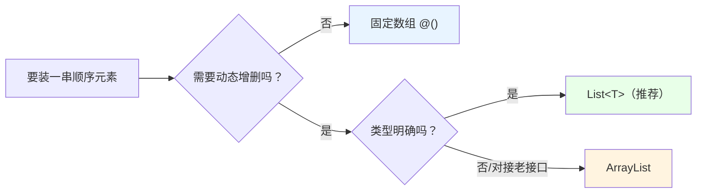
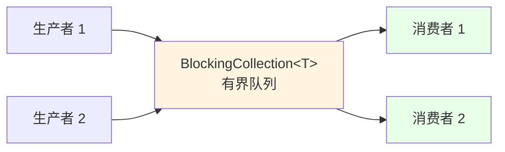
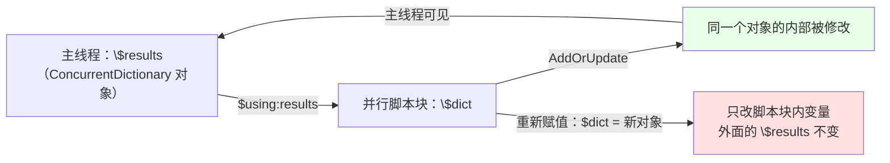

# 第 16 章 容器：从 `ArrayList` 的遗留教训到并发集合

> **章内定位**：对标《C# 本质论》“泛型集合”章和《CLR via C#》第 12 章“泛型”。PowerShell 的数组是**固定大小**的，`+=` 每次创建新数组，在循环中性能急剧退化。本章按“**顺序容器 → 关联容器 → 并发容器**”三层组织，核心判断线是：**单线程用泛型集合，多线程/并行脚本块必须用 `System.Collections.Concurrent`。**
>
> 这一章和上一章（字符串）有一个共同主角：**“看起来很方便的写法，在循环里可能很贵；在并发里可能很危险。”** 我们逐层拆开。

---

## 16.1 顺序容器：`ArrayList` vs `List<T>` 的选型与代价

“顺序容器”就是“按顺序装一串东西”的容器。PowerShell 的 `@()` 数组是固定大小的；要动态增删，就得用 `ArrayList` 或 `List<T>`。它们差在哪？一个字：**类型**。

### `ArrayList`：非泛型的遗留教训

`ArrayList` 是 .NET 早期的“什么都能塞”的列表。它的毛病，我们实测确认了第一条：

```powershell
$al = [System.Collections.ArrayList]::new()
$al.Add('x')     # 返回值是 0（新元素的索引）
```

**`Add()` 会返回“索引号”**。如果你在函数或管道里调用它却不“接住”，这个 `0` 就会**漏进输出流**，变成“函数莫名其妙多返回了一个数字”。正确的写法是用 `[void]` 或 `$null =` 把返回值吃掉：

```powershell
$al = [System.Collections.ArrayList]::new()
[void]$al.Add('x')
[void]$al.Add('y')
$al.Count        # 2
```

`ArrayList` 还有两个根本问题：

1. **不检查类型**：往里塞字符串、数字、对象都行；取出来时都是 `object`，得自己转；
2. **值类型会装箱**：存 `int` 时会被“装箱”成对象（第 2 章讲过），有额外开销。

### `List<T>`：类型安全、干净的现代选择

`List<T>` 是泛型版本：类型参数在**声明时**就定死，存进去的必须是指定类型，读出来也直接是那个类型。

```powershell
$list = [System.Collections.Generic.List[int]]::new()
$list.Add(1)
$list.Add(2)
$list.Add(3)

$list.Count     # 3
$list[0]        # 1（直接是 int，不用转）
```

和 `ArrayList` 的关键区别：

- **`Add()` 返回 `void`**，不会污染输出流（实测确认：`Add` 之后不会多出索引）；
- **类型安全**：塞错类型会报错，而不是“默默收下”；
- **值类型不装箱**：`List<int>` 内部存的就是 int，没有装箱开销。

日常脚本，**新代码一律优先 `List<T>`**；`ArrayList` 只留给“对接老接口、非要 `ArrayList`”的场景。

### `FindAll`、`Sort`、`Reverse`：Predicate 与就地修改

`List<T>` 上有一批高频方法：

```powershell
$list = [System.Collections.Generic.List[int]]::new()
$list.AddRange([int[]]@(5, 3, 8, 1))

# 查找所有满足条件的元素：FindAll 接受 Predicate<T>，PowerShell 里用脚本块传
$big = $list.FindAll({ param($x) $x -gt 4 })    # 5, 8

# 就地排序（升序）与反转
$list.Sort()       # 1, 3, 5, 8
$list.Reverse()    # 8, 5, 3, 1
```

两个“就地修改”的细节要记牢：

- **`Sort()` / `Reverse()` 直接改原列表**，不返回新列表；
- **`AddRange()`** 用来批量添加（参数是 `IEnumerable<T>`，比如 `int[]`）。

### 装箱与选型边界

“装箱”这个词，前面的章节提过，这里再落到“容器”上：

- `ArrayList` 存值类型（`int`、`DateTime`、`bool`）时，每个元素都要**装箱**成一个对象；
- `List<T>` 存值类型时，**直接按值存**，没有装箱。

对“几万条数值”的场景，这个差异会变成真实的性能与内存差距。选型边界：

| 场景 | 推荐 |
|---|---|
| 新代码、类型明确 | **`List<T>`** |
| 需要对接老 API（参数是 `ArrayList`） | `ArrayList` |
| 混合类型、且不在乎类型安全 | `ArrayList`（但通常 `List<object>` 更明确） |
| 只是“读一读、传一传”的固定数据 | 普通数组 `@()` 即可 |

把“顺序容器”的选择画成图：



### 16.1 小结

1. **`ArrayList.Add()` 返回索引**，会污染输出流；用 `[void]` / `$null =` 吃掉。
2. **`List<T>` 类型安全、`Add` 返回 void、值类型不装箱**，是首选。
3. **`AddRange` 批量添加；`FindAll` 用脚本块当 `Predicate<T>`；`Sort`/`Reverse` 就地修改。**
4. 选型：动态增删且类型明确 → `List<T>`；对接老接口 → `ArrayList`；固定数据 → 普通数组。

---

## 16.2 关联容器：`Hashtable`、`Dictionary<TKey,TValue>` 与 `[ordered]`

“关联容器”是“按钥匙找东西”的容器。PowerShell 里三个主角：`@{}`（哈希表）、`[ordered]@{}`（有序字典）、`Dictionary<TKey,TValue>`（泛型字典）。

### `@{}` 哈希表：键大小写不敏感、不保序

```powershell
$h = @{
    Name = 'WEB-01'
    Port = 8080
}

$h['Name']        # WEB-01
$h.Name           # 也可以点号访问（键名像属性名时）
$h['name']        # WEB-01 —— 键大小写不敏感（实测确认）
```

两个性格：

1. **键大小写不敏感**：`$h['name']` 与 `$h['Name']` 是同一个键；
2. **不保证顺序**：你写键的顺序，它不保证按那个顺序输出。

### `[ordered]@{}` 与 `OrderedDictionary`：保序

```powershell
$o = [ordered]@{ z = 1; a = 2; m = 3 }
$o.Keys          # z, a, m —— 保持插入顺序（实测确认）
```

`[ordered]@{}` 产生 `System.Collections.Specialized.OrderedDictionary`。它唯一的“溢价”就是保序；如果只是查数据、不在乎顺序，普通 `@{}` 更快。

### `Dictionary<TKey,TValue>`：强类型键、性能

```powershell
$d = [System.Collections.Generic.Dictionary[string,int]]::new()
$d['apple'] = 3
$d['banana'] = 5

$d['apple']            # 3
$d.ContainsKey('apple')  # True
$d.Count               # 2
```

和 `@{}` 的区别：

- **键和值都强类型**（这里是 `string → int`）；
- **键的相等性默认是“区分大小写”的**（`"Apple"` 与 `"apple"` 是两个键），除非你显式传比较器；
- 大量键值查询时，泛型字典通常更快、更省内存。

### `TryGetValue` / `ContainsKey`：避免异常与 `$null`

“读一个可能不存在的键”是关联容器的高频场景。三种写法，后果不同：

```powershell
$d = [System.Collections.Generic.Dictionary[string,int]]::new()
$d['a'] = 1

# 写法一：直接读 —— 键不存在时返回默认值 0（不抛异常）
$d['b']              # 0

# 写法二：ContainsKey 先判断，再读
if ($d.ContainsKey('b')) { $d['b'] } else { '没有 b' }

# 写法三：TryGetValue —— 一步完成“判断 + 取值”
$v = $null
$ok = $d.TryGetValue('b', [ref]$v)      # False；$v 保持默认值
```

**`TryGetValue` 的关键细节**：第二个参数是 `[ref]`，它要求那个变量**提前存在**。实测确认：如果直接写 `[ref]$v` 而 `$v` 还没定义，会报“[ref] 不能应用于不存在的变量”。正确姿势是先 `$v = $null`（或给个初值），再传 `[ref]$v`。

`TryGetValue` 的好处是：**不用“先 ContainsKey 再读”两次查找**，一次就完成。大量查询时更高效，也更不容易写错。

### 16.2 小结

1. **`@{}` 哈希表**：键大小写不敏感、不保序，查数据首选。
2. **`[ordered]@{}`**：保序，底层 `OrderedDictionary`，输出配置/CSV 时有用。
3. **`Dictionary<TKey,TValue>`**：强类型键、默认区分大小写、查询高效。
4. **`TryGetValue`** 一次完成“判断 + 取值”，但 `[ref]` 变量必须**先声明**；`ContainsKey` 也可靠。

---

## 16.3 并发集合：`ConcurrentDictionary`、`BlockingCollection`、`ConcurrentQueue`

这一节是“容器”走向“并发”的分水岭。先记住一句结论：**普通的 `List<T>` / `Hashtable` / `Dictionary` 在多个线程同时写时，是不安全的**——它们没有内部锁，两个线程同时 `Add` 可能把内部结构写坏、丢数据、甚至抛异常。并行脚本块里要收集结果，必须用 `System.Collections.Concurrent` 下的并发集合。

### 为什么普通集合在并行脚本块里不安全

`ForEach-Object -Parallel`（第 4.3 节）会让多个脚本块在**不同线程/运行空间**里同时跑。如果它们同时往同一个普通 `List<int>` 里 `Add`，就可能出现“竞态”（race condition）：

- 两个线程同时读到“当前长度=5”，都以为“下一个位置是 5”，都往 5 写——一个覆盖另一个；
- 内部数组扩容时，一个线程正在复制、另一个线程正在写——直接损坏。

而且这种 bug **不一定每次复现**（取决于调度），最难排查。所以并发场景的纪律是：**共享的可变状态，一律用并发集合（或显式锁，见第 17 章）。**

### `ConcurrentDictionary`：`AddOrUpdate` / `GetOrAdd` 的原子语义

`ConcurrentDictionary<TKey,TValue>` 是线程安全的字典。它的“原子方法”是关键：

```powershell
$cd = [System.Collections.Concurrent.ConcurrentDictionary[string,int]]::new()

# AddOrUpdate：键不存在就“加”，存在就“更新”——整个动作是原子的
$cd.AddOrUpdate('k', 1, { param($key, $old) $old + 1 })
$cd.AddOrUpdate('k', 1, { param($key, $old) $old + 1 })
$cd['k']       # 2（实测确认）

# GetOrAdd：键不存在就“用工厂函数造一个并加入”，存在就直接返回
$cd.GetOrAdd('m', { param($key) 100 })
$cd['m']       # 100
```

要点：

- **`AddOrUpdate` 的参数**：键、键不存在时的初始值、键存在时的更新函数（函数收到 `key` 和 `oldValue`）；
- **`GetOrAdd` 的工厂**：只在“键不存在”时执行，避免“先查再建”的竞态窗口；
- 这两个方法**不会**像“`if (!ContainsKey) Add`”那样有“检查-写入”之间的竞态。

我们实测在 `ForEach-Object -Parallel` 里用 `$using:` 传入同一个 `ConcurrentDictionary`，5 个并行任务并发 `AddOrUpdate`，最终计数正好是 5——说明“并发写共享字典”这件事成立。

### `BlockingCollection<T>`：有界队列与生产者-消费者

`BlockingCollection<T>` 是“**阻塞队列**”：生产者 `Add`、消费者 `Take`，队列空时 `Take` 会等，队列满时 `Add` 会等。它非常适合“生产者-消费者”模式。

```powershell
# 容量上限 5（有界）
$bc = [System.Collections.Concurrent.BlockingCollection[int]]::new(5)

# 生产者
$bc.Add(1)
$bc.Add(2)

# 告诉队列“不会再有新元素了”
$bc.CompleteAdding()

# 消费者：取到没有为止
$taken = @()
while (-not $bc.IsCompleted) {
    $item = 0
    if ($bc.TryTake([ref]$item)) { $taken += $item }
}
$taken        # 1, 2（实测确认）
```

关键 API：

- **构造时给 `boundedCapacity`**：有界队列能“反压”生产者，避免内存无限增长；
- **`Add()`**：队列满时会阻塞（有界时）；
- **`Take()`**：队列空时会阻塞；
- **`CompleteAdding()`**：标记“不再添加”；之后消费者会用 `IsCompleted` / `TryTake` 把剩下的取完；
- **`GetConsumingEnumerable()`**：一个“可枚举的消费循环”，常配合 `foreach` 用。

一个典型的生产者-消费者结构：



### `ConcurrentQueue<T>` / `ConcurrentStack<T>`：无阻塞模式

如果不需要“阻塞等待”，只是“多线程往队列里塞、另一个线程往外取”，用更轻的 `ConcurrentQueue<T>` / `ConcurrentStack<T>`：

```powershell
$cq = [System.Collections.Concurrent.ConcurrentQueue[int]]::new()
$cq.Enqueue(10)
$cq.Enqueue(20)

$item = 0
$ok = $cq.TryDequeue([ref]$item)   # True
$item                              # 10（实测确认）
$cq.Count                          # 1
```

- **`ConcurrentQueue`**：先进先出，`Enqueue` / `TryDequeue`；
- **`ConcurrentStack`**：后进先出，`Push` / `TryPop`；
- **`TryDequeue` / `TryPop` 是“非阻塞”的**：没有元素时返回 `$false`，不等待。

“阻塞 vs 非阻塞”怎么选：**需要“等” → `BlockingCollection`；只是“有就拿、没有就算” → `ConcurrentQueue`。**

### `$using:` 与并发集合：引用传递的正确姿势

并行脚本块里怎么“把外面的集合传进去”？用 `$using:`。但要理解它的真实语义，别被“只读快照”这句话带偏。

- **对值类型**（`int`、`bool`、`DateTime` 等）：`$using:` 传的是**副本**，你在脚本块里改它，外面看不到；
- **对引用类型**（`ConcurrentDictionary`、`List<T>` 等）：`$using:` 传的是**引用**，你通过这个引用修改**对象内部**，外面**看得到**；但你在脚本块里“重新赋值 `$dict = 别的对象`”，不会改变外面的变量。

所以“用并发集合收集结果”的标准姿势是：

```powershell
$results = [System.Collections.Concurrent.ConcurrentDictionary[string,int]]::new()

1..5 | ForEach-Object -Parallel {
    $dict = $using:results          # 拿到同一个对象的引用
    [void]$dict.AddOrUpdate('count', 1, { param($k, $old) $old + 1 })
} -ThrottleLimit 5

$results['count']    # 5
```

要点：

1. **必须用并发集合**（`ConcurrentDictionary` / `ConcurrentQueue` / `BlockingCollection`），不能用普通 `List` / `Hashtable`——后者没有线程安全保证；
2. **`$using:` 传引用类型时，改对象内部可见**；但“重新赋值变量”不会回传；
3. **共享的可变状态越少越好**：能“每个任务返回结果、主线程汇总”就别“共享一个可变集合”；后者更容易出错。

用一张图把“引用传递”说清楚：



### 16.3 小结

1. **普通集合在多线程写时不安全**；并发场景必须用 `System.Collections.Concurrent`。
2. **`ConcurrentDictionary`** 的 `AddOrUpdate`/`GetOrAdd` 是原子操作，适合“并发计数/缓存”。
3. **`BlockingCollection<T>`** 是阻塞队列，`Add`/`Take` 会在满/空时等待；有界容量能做反压；`CompleteAdding` 标记结束。
4. **`ConcurrentQueue`/`ConcurrentStack`** 用 `TryDequeue`/`TryPop` 非阻塞地取。
5. **`$using:` 对引用类型传引用**：改对象内部可见，重新赋值不回传；并发集合仍要靠它“传引用”而不是“复制”。

---

## 本章总结

第 16 章把“装东西”讲成了三层：

- **16.1 顺序容器**：`ArrayList.Add` 返回索引（会污染输出）、值类型装箱；`List<T>` 类型安全、`Add` 返回 void；`FindAll`/`Sort`/`Reverse`；选型优 `List<T>`。
- **16.2 关联容器**：`@{}` 键大小写不敏感、不保序；`[ordered]@{}` 保序；`Dictionary<TKey,TValue>` 强类型、默认区分大小写；`TryGetValue` 一步判断+取值（`[ref]` 变量要先声明）。
- **16.3 并发容器**：普通集合并发写不安全；`ConcurrentDictionary` 的原子 `AddOrUpdate`/`GetOrAdd`；`BlockingCollection` 的阻塞队列与生产者-消费者；`ConcurrentQueue`/`ConcurrentStack` 的非阻塞 `TryDequeue`/`TryPop`；`$using:` 传引用类型的正确姿势。

一句话记住全章：**“单线程用 `List<T>` / `Dictionary` / `@{}`；并发共享用 `Concurrent*`；`$using:` 传引用、改内部可见、重赋值不回头。”**

**下一章预告**：第 17 章《线程与并发：`Thread` / `ThreadPool` / `Task` 与 PowerShell 运行空间》。这一章会把“并发”从“容器”推进到“执行模型”：PowerShell 的**四层并发栈**（`Start-Job` → `Start-ThreadJob` → `ForEach-Object -Parallel` → 裸 `Runspace`/`Task`）各有什么代价、`$using:` 为什么是“只读快照”的常见说法、以及 `Monitor` / `Interlocked` / `SemaphoreSlim` 这组同步原语怎么用。

---

> **动手练习**
>
> 1. 用 `ArrayList` 和 `List<int>` 各加 10 个元素，注意 `ArrayList.Add` 的返回值是否“漏”出来；用 `[void]` 修正。
> 2. 用 `List<int>` 的 `AddRange` 批量加 1..10，再 `FindAll` 筛出偶数，最后 `Sort`/`Reverse` 观察就地修改。
> 3. 用 `@{}`、`[ordered]@{}`、`Dictionary[string,int]` 各放同样的三个键，比较 `Keys` 的顺序，以及 `$dict['KEY']` 是否区分大小写。
> 4. 用 `TryGetValue` 读一个不存在的键：先不声明 `[ref]` 变量看报错，再声明 `$v = $null` 后重试。
> 5. 用 `ForEach-Object -Parallel` + `$using:` 一个 `ConcurrentDictionary`，让 10 个任务并发 `AddOrUpdate` 同一个键，最后检查计数是否为 10。
> 6. 用 `BlockingCollection<int>`（容量 3）模拟一个生产者加 5 个元素、消费者取 5 个元素；体会 `CompleteAdding` 和 `TryTake` 的配合。
