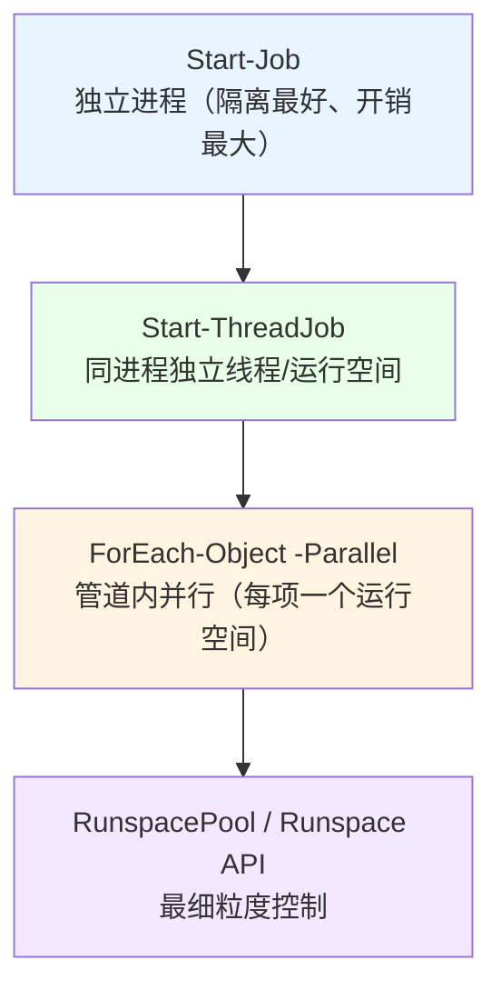
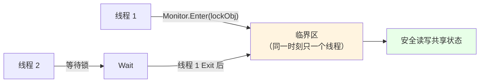

# 第 17 章 线程与并发：`Thread` / `ThreadPool` / `Task` 与 PowerShell 运行空间

> **章内定位**：对标《CLR via C#》第 26–30 章“线程基础 / 计算限制的异步操作 / I/O 限制的异步操作”。PowerShell 的并发栈有四层：**进程隔离的 `Start-Job` → 线程级 `Start-ThreadJob` → 管道并行 `ForEach-Object -Parallel` → 裸 `Runspace` API 和最底层的 .NET `Thread` / `ThreadPool` / `Task`**。本章的写作原则是：**先讲清每层的抽象代价和隔离边界，再落到 .NET 原语。**
>
> 本章有一个“反直觉”的重点：**在 PowerShell 里，直接拿 .NET 的 `Thread` / `Task.Run` 去跑 PowerShell 脚本块，是危险甚至错误的。** 我们把这条边界放在最前面讲。

---

## 17.1 `Thread`、`ThreadPool` 与 `Task` 在 PowerShell 中的可用性与边界

在 C# 里，`new Thread(...)`、`Task.Run(...)` 是家常便饭。但它们跑的是 **C# 代码**，不需要“PowerShell 运行空间”。PowerShell 的脚本块不一样：它必须在一个“运行空间”里执行（第 1 章讲过）。**裸线程上没有运行空间**——这就是所有问题的根源。

### 为什么“裸线程跑 PowerShell 脚本块”是禁区

我们做了一个实测：用 `[System.Threading.Thread]::new([System.Threading.ThreadStart]{ ... })` 造一个线程，里面跑一个 PowerShell 脚本块。结果不是“跑得慢”，而是直接抛异常，最坏时**整个 PowerShell 进程崩溃退出**：

```text
Unhandled exception. System.Management.Automation.PSInvalidOperationException:
此线程中没有可用于运行脚本的运行空间。可以在 System.Management.Automation.Runspaces.Runspace
类型的 DefaultRunspace 属性中提供一个。
```

`Task.Run([Action]{ ... })` 跑脚本块，也一样：

```text
调用"Wait"并发生异常："One or more errors occurred. (此线程中没有可用于运行脚本的运行空间……)"
```

**结论要刻进脑子**：

> **`Thread` / `ThreadPool` / `Task.Run` 只适合执行“纯 .NET 代码”，绝不适合直接执行 PowerShell `ScriptBlock`。** 在 PowerShell 里做并发，优先用 `Start-ThreadJob` / `ForEach-Object -Parallel` / `Runspace` API——它们会替你准备好运行空间。

### `Thread`：OS 级原语，手动 `Start` / `Join`

`Thread` 是操作系统级线程，创建成本高（比线程池的“复用线程”贵）：

```powershell
# 只做示范：线程函数最好只调用 .NET 方法，不要跑 PowerShell 脚本块
$thread = [System.Threading.Thread]::new([System.Threading.ThreadStart]{
    # 这里如果跑 PowerShell 脚本块，就会遇到“没有运行空间”
})
$thread.Start()
$thread.Join()      # 等它结束
```

- **`Start()`**：启动线程；
- **`Join()`**：阻塞等待线程结束；
- **`IsBackground`**：是否是后台线程（前台线程会让进程“等它结束”）。

再次强调：在 PowerShell 里，`ThreadStart` 里放脚本块基本等于“踩雷”。如果你真的需要“裸线程”级的控制，通常要把“要执行的东西”写成 C#（`Add-Type`）再调，或者用 `Runspace` API。

### `ThreadPool` 与 `Task`：回收线程 + 标准抽象

`ThreadPool` 是“线程池”：线程用完不销毁，而是回收复用，避免频繁创建线程的开销。`Task.Run` 是建立在它之上的标准抽象：

```powershell
# 同样：这里适合包装 .NET 调用，不适合跑 PowerShell 脚本块
$task = [System.Threading.Tasks.Task]::Run([Action]{
    # .NET 调用
})
$task.Wait()
```

`Task` 的价值在于：

1. **`Wait()` / `.Result`**：同步等待（注意第 14 章说过 `.Result` 在 UI 线程上的死锁风险）；
2. **`ContinueWith` / `WhenAll`**：任务编排；
3. **异常会“收集”在 Task 里**：`Wait()` 时以 `AggregateException` 抛出。

但重申：**`Task` 适合包装“单个 .NET 方法调用”（尤其是异步 I/O），而不是执行 `ScriptBlock`。** 如果你在 PowerShell 里想“并行跑一段脚本”，请用 `Start-ThreadJob` 或 `ForEach-Object -Parallel`。

### `Task` 的正确用法：包装 .NET 调用，而不是包装 `ScriptBlock`

“包装 .NET 调用”是什么意思？比如你要异步调一个 .NET 的 IO 方法，可以用 `Task` 拿到它的 `Task` 返回，再 `.Result` 等待：

```powershell
# 例：用 HttpClient 的异步方法（这里只示意“等待 Task 结果”的形态）
$client = [System.Net.Http.HttpClient]::new()
try {
    $task = $client.GetStringAsync('https://example.com')
    $html = $task.Result          # 同步等待
}
finally { $client.Dispose() }
```

这里的“异步方法”是 .NET 自己实现的，`Task` 只是“结果的载体”，不涉及“在别的线程上跑 PowerShell 脚本”。**这才是 `Task` 在 PowerShell 里的正确位置。**

### `ApartmentState` 与 STA 的关系

`ApartmentState` 是“线程单元”的概念，和 COM / WinForms 直接相关：

```powershell
[System.Threading.Thread]::CurrentThread.ApartmentState
# STA 或 MTA
```

- **STA（单线程单元）**：COM 组件、WinForms 通常要求 STA；
- **MTA（多线程单元）**：普通后台线程常用。

**不同的 PowerShell 宿主/启动方式，默认单元可能不同**（我们实测的这个会话就是 `STA`）。所以第 19 章讲 WinForms 时，判断“要不要 `pwsh -STA` 启动”，不能靠猜，要**先用 `[Thread]::CurrentThread.ApartmentState` 检测**当前单元。

### 17.1 小结

1. **裸 `Thread` / `ThreadPool` / `Task.Run` 不能直接跑 PowerShell `ScriptBlock`**——会报“没有可用运行空间”，甚至让进程崩溃。
2. **`Thread`** 是 OS 级原语（`Start`/`Join`），创建成本高；**`ThreadPool`** 回收线程；**`Task`** 是标准抽象。
3. **`Task` 的正确用法是包装 .NET 方法调用**（尤其异步 I/O），不是执行脚本块。
4. **`ApartmentState`（STA/MTA）要检测**，WinForms/COM 通常要 STA；不同宿主默认可能不同。

---

## 17.2 `Start-ThreadJob`、`ForEach-Object -Parallel` 与 `Runspace` 的选型

既然裸线程不行，PowerShell 给了你“带运行空间的并发”工具。它们从“重隔离”到“细控制”排成四层。

### 四层并发栈：进程隔离 → 线程 → 管道并行 → Runspace



选型的直觉：

- **任务可能崩溃、需要强隔离 → `Start-Job`**（进程隔离，一个崩了不影响主进程）；
- **任务多、要快、能接受共享进程 → `Start-ThreadJob`**（线程/运行空间级，启动快、资源小）；
- **手上就是一个管道，想每项并行 → `ForEach-Object -Parallel`**；
- **要自己管理“线程池、任务队列、结果回收” → `RunspacePool`**。

### `Start-ThreadJob`：轻量后台线程任务

`Start-ThreadJob`（来自 `ThreadJob` 模块）在**同一个进程**里开一个独立线程 + 运行空间：

```powershell
$job = Start-ThreadJob -ScriptBlock {
    Start-Sleep -Milliseconds 200
    2 + 2
}

# 等它完成并取结果
$result = Receive-Job $job -Wait
$result        # 4

# 取完清理
Remove-Job $job
```

实测确认 `Start-ThreadJob -ScriptBlock { 2 + 2 }` 经 `Receive-Job -Wait -AutoRemoveJob` 得到 `4`。

要点：

- **启动比 `Start-Job` 快**（不用起进程）；
- **运行空间独立**：线程任务里定义变量、改函数，不影响主线程；
- **`Receive-Job -Wait`** 等结果；**`Remove-Job`** 清理；
- **跨线程传数据**用 `-ArgumentList` 传参，或者用“并发集合”接收结果（第 16 章）。**不要直接改主线程的普通变量**（改不到）。

### `ForEach-Object -Parallel`：管道内并行

如果你有“一堆对象，每个都要做一件耗时的事”，`ForEach-Object -Parallel` 是最顺手的：

```powershell
1..5 | ForEach-Object -Parallel {
    Start-Sleep -Milliseconds 200
    $_ * 2
} -ThrottleLimit 3
```

- **`-ThrottleLimit`** 控制“同时最多几个在跑”，默认 5；
- **`$_`** 是当前项；
- **外部变量**用 `$using:` 传（值类型是快照、引用类型是引用，见第 16 章）；
- **每个并行脚本块跑在自己的运行空间里**：别指望在其中改主线程的普通变量能回传。

**典型陷阱**：在并行块里直接改一个普通 `List` / `Hashtable`——会竞态。要么用并发集合，要么“让每个任务返回结果，主线程汇总”。

### `RunspacePool`：最细粒度控制

当你需要“自己控制并发度、异步提交、批量回收”时，用 `RunspacePool`。它也是 `ForEach-Object -Parallel` 内部的“底座”。

```powershell
# 创建一个容量 1~3 的运行空间池
$pool = [System.Management.Automation.Runspaces.RunspaceFactory]::CreateRunspacePool(1, 3)
$pool.Open()

try {
    $ps = [System.Management.Automation.PowerShell]::Create()
    $ps.RunspacePool = $pool
    $null = $ps.AddScript('3 * 3')

    $result = $ps.Invoke()      # 同步执行
    $result                     # 9

    $ps.Dispose()
}
finally {
    $pool.Close()
    $pool.Dispose()
}
```

实测确认：`CreateRunspacePool(1, 3)` → `Open()` → `PowerShell.Create()` → `.AddScript('3 * 3')` → `.Invoke()` 得到 `9`。

要点：

- **`CreateRunspacePool(min, max)`** 指定池的大小；
- **`PowerShell.Create()`** 造一个“执行器”，把 `RunspacePool` 挂上去；
- **`.Invoke()`** 同步，**`.BeginInvoke()`** 异步（配合 `EndInvoke`）；
- 用完 **`Dispose()` / `Close()`**，别让池泄漏。

### `$using:` 与 `-ThrottleLimit`

`$using:` 的精确语义，上一章讲过，这里再点一次：

- **值类型**：传“只读快照”，脚本块里改它，外面看不到；
- **引用类型**：传“引用”，改对象内部外面看得到；但“重新赋值变量”不回传。

`-ThrottleLimit` 是“并发上限”，不是“总数”。它对应的是“同一时刻最多几个工作单元在跑”。**数字不是越大越好**——超过 CPU 核数太多，反而因为上下文切换变慢；而且如果你的任务在等网络/磁盘，适度并发才划算。

### 17.2 小结

1. **四层并发栈**：`Start-Job`（进程）→ `Start-ThreadJob`（线程）→ `ForEach-Object -Parallel`（管道）→ `RunspacePool`（细控制）。
2. **`Start-ThreadJob`**：同进程、启动快；`Receive-Job -Wait` 取结果，`Remove-Job` 清理；跨线程用参数/并发集合传数据。
3. **`ForEach-Object -Parallel`**：`-ThrottleLimit` 控并发，`$using:` 传外部变量；别直接改普通共享集合。
4. **`RunspacePool`**：`CreateRunspacePool` → `Open` → `PowerShell.Create()` → `.Invoke()`；用完释放。

---

## 17.3 同步原语：`Monitor`、`Interlocked` 与异步等待

并发一旦“共享状态”，就需要“协调”。PowerShell 没有 `lock` 关键字，所以要用 .NET 的同步原语：`Interlocked`、`Monitor`、`SemaphoreSlim`、`Mutex`。

### `Interlocked`：单一数值的原子操作

如果共享状态只是“一个计数器”，`Interlocked` 是最轻的选择：

```powershell
$counter = 0
[System.Threading.Interlocked]::Increment([ref]$counter) | Out-Null
$counter        # 1
```

实测确认 `Increment([ref]$counter)` 后 `$counter` 变成 1。

常用方法：

| 方法 | 作用 |
|---|---|
| `Increment([ref]$x)` | 原子 +1 |
| `Decrement([ref]$x)` | 原子 -1 |
| `Add([ref]$x, $n)` | 原子加 n |
| `Exchange([ref]$x, $v)` | 原子交换 |
| `CompareExchange([ref]$x, $new, $old)` | 原子“比较并交换”（CAS） |

`Interlocked` 只适合“单一数值”。多个字段要一起改，就得上锁。

### `Monitor`：临界区（必须 `try/finally`）

`Monitor` 是 `lock` 的底层实现。进入临界区、执行、退出——**必须成对，并且要放在 `try/finally` 里**，否则一旦中间抛异常，锁就永远不释放：

```powershell
$lockObj = [object]::new()

[System.Threading.Monitor]::Enter($lockObj)
try {
    # 临界区：同一时刻只有一个线程能进来
    # 在这里安全地读写共享状态
}
finally {
    [System.Threading.Monitor]::Exit($lockObj)
}
```

实测确认 `Enter` / `Exit` 配对可用。要点：

1. **锁对象必须是“所有线程都看得见的同一个对象”**（通常用一个专门的 `[object]::new()`）；
2. **不要在临界区里做耗时操作**（会拖住别人）；
3. **异常安全**：`Enter` 后一定要 `try/finally` 包住 `Exit`。

用图表示“临界区只放一个人进”：



### `SemaphoreSlim`：限制并发数

`Semaphore` 是“计数信号量”：令牌数决定“同时能进几个”。`SemaphoreSlim` 是更轻的版本，适合“限制并发访问数”：

```powershell
# 初始 1 个令牌，最多 1 个
$sem = [System.Threading.SemaphoreSlim]::new(1, 1)

$sem.Wait()       # 拿一个令牌
try {
    # 只有拿到令牌的线程才能进来
}
finally {
    $sem.Release()   # 还回去
}
```

实测确认 `Wait()` / `Release()` 后 `CurrentCount` 回到 1。

`SemaphoreSlim` 和 `Monitor` 的区别：

- `Monitor` 是“**互斥**”：同一时刻只允许 1 个；
- `SemaphoreSlim(3,3)` 是“**限流**”：同一时刻最多 3 个。

它还有一个“异步友好”的 `WaitAsync()`（返回 `Task`），适合和 `Task` 配合。

### `Mutex`：跨进程命名互斥体

如果你的“并发”不是“多线程”，而是“**多个 PowerShell 脚本实例/多个进程**”同时跑，`Monitor` 管不到别的进程——这时用**命名 Mutex**：

```powershell
# 命名互斥体：名字里带 Global\ 表示跨会话（需要权限），Local\ 表示当前会话
$mutex = [System.Threading.Mutex]::new($false, 'Global\MyApp-Mutex')

$mutex.WaitOne()
try {
    # 同一时刻，全机器只有一个脚本能进这里
}
finally {
    $mutex.ReleaseMutex()
    $mutex.Dispose()
}
```

要点：

- **`Global\` 前缀**：跨登录会话可见；**`Local\`**：当前会话可见（默认）；
- **必须在 `finally` 里 `ReleaseMutex()`**；
- 它适合“防止两个脚本实例同时做同一件事”（如定时清理任务的重入保护）。

### 17.3 小结

1. **`Interlocked`**：单一数值的原子操作（`Increment`/`Add`/`Exchange`/`CompareExchange`），最轻。
2. **`Monitor`**：临界区，`Enter`/`Exit` 必须配对、放 `try/finally`。
3. **`SemaphoreSlim`**：限流（同一时刻最多 N 个），`Wait`/`Release`，还有异步版 `WaitAsync`。
4. **`Mutex`**：跨进程的命名互斥体，`Global\`/`Local\` 前缀；防止多脚本实例重入。

---

## 本章总结

第 17 章把“并发”从“容器”推进到“执行模型”：

- **17.1 原生线程的边界**：裸 `Thread` / `ThreadPool` / `Task.Run` **不能直接跑 PowerShell 脚本块**（没有运行空间，会报错甚至崩溃）；`Task` 适合包装 .NET 调用；`ApartmentState` 要检测。
- **17.2 四层并发栈**：`Start-Job`（进程）→ `Start-ThreadJob`（线程）→ `ForEach-Object -Parallel`（管道）→ `RunspacePool`（细控制）；`-ThrottleLimit` 控并发、`$using:` 传外部变量。
- **17.3 同步原语**：`Interlocked`（单一数值原子）、`Monitor`（临界区，try/finally）、`SemaphoreSlim`（限流）、`Mutex`（跨进程）。

一句话记住全章：**“并发要带运行空间，别拿裸 Thread/Task 跑脚本；共享状态要协调：数值用 Interlocked、互斥用 Monitor、限流用 SemaphoreSlim、跨进程用 Mutex。”**

**下一章预告**：第 18 章《IO 深化：流、编码与大文件处理》。第 10 章讲了 cmdlet 级的文件操作；这一章处理 cmdlet 覆盖不了的部分：**大文件流式读取（`File.ReadLines()`）、显式编码控制、`Stream` 的组合与包装、以及“管道对象流”和“字节流”为什么不能自动桥接。**

---

> **动手练习**
>
> 1. 用 `[System.Threading.Thread]::new([System.Threading.ThreadStart]{ ... })` 试着在裸线程里跑一个 PowerShell 脚本块，观察“没有可用运行空间”的报错（注意：这可能会让进程崩溃，最好在独立窗口试）。
> 2. 用 `Start-ThreadJob -ScriptBlock { 2 + 2 }` 起一个线程任务，`Receive-Job -Wait` 取结果，再 `Remove-Job`。
> 3. 用 `ForEach-Object -Parallel` 对 1..10 做一个耗时操作，分别设 `-ThrottleLimit 2` 和 `5`，用 `Measure-Command` 比较耗时。
> 4. 用 `Interlocked.Increment([ref]$counter)` 在一个小循环里累加，检查结果。
> 5. 用 `Monitor.Enter/Exit` 写一个 `try/finally` 临界区；再用 `SemaphoreSlim(2,2)` 限制“每次最多两个”访问。
> 6. 用 `[System.Threading.Mutex]::new($false, 'Global\Test-Mutex')` 造一个命名互斥体，`WaitOne` / `ReleaseMutex` 各一次，体会跨进程同步的形态。
