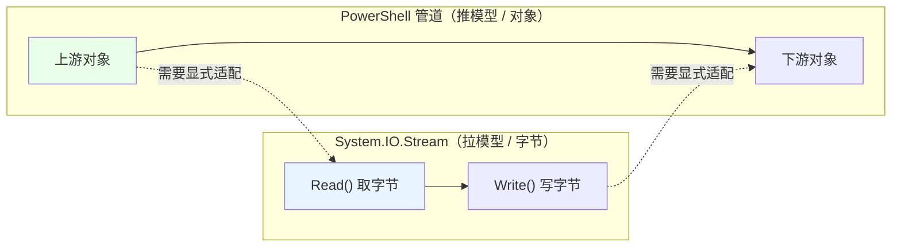

# 第 18 章 IO 深化：流、编码与大文件处理

> **章内定位**：第 10 章已在“提供程序”层面讨论了 cmdlet 级的文件操作。本章处理 cmdlet 无法覆盖的场景：**大文件流式读取、显式编码控制、`Stream` 的组合与包装、管道与流的桥接**。对标《CLR via C#》第 14 章中“流”作为字节抽象与字符抽象的层次关系：`FileStream` 是字节流，`StreamReader` / `StreamWriter` 是字符层的适配器。
>
> 一句话概括本章：**“小文件用 `Get-Content`，大文件用流；文本要显式编码，字节要显式流；管道是对象流，和字节流之间没有自动桥。”**

---

## 18.1 `StreamReader` / `StreamWriter` 与 `File.ReadLines()` 的流式语义

`Get-Content` 适合交互，但在大文件上“一次性加载”会耗尽内存。这一节讲三种“流式”读写方式，重点是“**一次只取一行/一块，不把整个文件装进内存**”。

### `File.ReadLines()`：延迟枚举、逐行取

`[System.IO.File]::ReadLines($path)` 返回一个**延迟求值**的 `IEnumerable<string>`：你 `foreach` 一次，它才去读一行——**不是“先把整个文件读进数组”**。

```powershell
foreach ($line in [System.IO.File]::ReadLines('D:\logs\big.log')) {
    if ($line -match 'ERROR') {
        $line
    }
}
```

实测确认：写三行 `a/b/c` 后，`foreach` 能逐行读到。要点：

- **延迟执行**：`foreach` 走到哪，才读到哪；内存里只有“当前这一行 + 一个读缓冲”；
- 适合“**超大文件 + 逐行过滤/统计**”；
- 与 `Get-Content` 的区别：`Get-Content` 默认也是逐行流式，但 `File.ReadLines()` 更“纯 .NET”、更适合和 C# 代码对照；处理编码时也更明确。

### `StreamReader`：显式控制缓冲区与编码

如果你需要“按行读、并且显式指定编码/缓冲区”，用 `StreamReader`：

```powershell
$reader = [System.IO.StreamReader]::new('D:\logs\big.log')
try {
    while (-not $reader.EndOfStream) {
        $line = $reader.ReadLine()
        # 处理 $line
    }
}
finally {
    $reader.Dispose()      # 必须在 finally 里释放
}
```

实测确认 `EndOfStream` + `ReadLine()` 的循环能逐行读完。

要点：

1. **`ReadLine()` 到达文件末尾时返回 `$null`**（而 `EndOfStream` 会变成 `$true`）；
2. **`Dispose()` 必须放在 `finally`**——文件句柄不释放，别的进程可能改不了/删不掉这个文件；
3. 构造函数可以传 `Encoding`、`detectEncodingFromByteOrderMarks`、`bufferSize`（18.2 节细讲）；
4. **`ReadToEnd()` 只适合小文件**——它会把整个文件读成一个字符串，大文件照样爆内存。

### `StreamWriter` 与 `Dispose` / `AutoFlush`

写文件用 `StreamWriter`：

```powershell
$writer = [System.IO.StreamWriter]::new('D:\logs\out.log', $false, [System.Text.Encoding]::UTF8)
try {
    $writer.WriteLine('第一行')
    $writer.WriteLine('第二行')
    $writer.Flush()          # 把缓冲区刷到文件
}
finally {
    $writer.Dispose()
}
```

要点：

- **第二个参数 `$false`** 表示“覆盖”（`$true` 是追加）；
- **`Flush()`** 把内部缓冲区写出去；**`Dispose()`** 也会自动 Flush 并释放句柄；
- **`AutoFlush = $true`** 会让每次写入都立刻刷盘（更安全，但更慢）；
- **写完不 `Dispose()` / `Flush()`，可能“文件是空的/少了几行”**——这是“我明明写了，怎么没内容”的经典原因。

### 18.1 小结

1. **`File.ReadLines()`** 延迟枚举、逐行读，适合大文件；`foreach` 用到哪读到哪。
2. **`StreamReader`**：`EndOfStream` + `ReadLine()` 循环；`Dispose()` 放 `finally`；`ReadToEnd()` 只适合小文件。
3. **`StreamWriter`**：`WriteLine`/`Flush`/`Dispose`；不 Flush 可能丢内容；`AutoFlush` 更安全但更慢。

---

## 18.2 编码、`Stream` 组合与 `FileStream`

文本文件的读写错误中，相当比例源于**编码不匹配**。这一节把“字节层”和“字符层”分开看。

### `FileStream`：字节层的 `FileMode` / `FileAccess` / `FileShare`

`FileStream` 是“字节流”的直接载体，三个构造参数决定了“怎么打开”：

```powershell
$fs = [System.IO.FileStream]::new(
    'D:\logs\data.bin',
    [System.IO.FileMode]::Open,       # 打开已有文件；不存在会报错
    [System.IO.FileAccess]::Read,     # 只读
    [System.IO.FileShare]::ReadWrite  # 允许别人同时读写
)

$fs.Length
$fs.Dispose()
```

实测确认这种组合可用：`CanRead=True`、`Length` 是字节数。

三个参数的常见取值：

| 参数 | 取值 | 含义 |
|---|---|---|
| `FileMode` | `Create` / `CreateNew` / `Open` / `OpenOrCreate` / `Append` / `Truncate` | 文件怎么打开/创建 |
| `FileAccess` | `Read` / `Write` / `ReadWrite` | 读、写、还是读写 |
| `FileShare` | `None` / `Read` / `Write` / `ReadWrite` | 允许别的进程同时做什么 |

**`FileShare` 是“并发写”的关键**：如果你打开文件时用 `FileShare.None`，别的进程就完全打不开；用 `ReadWrite` 才允许别人同时读/写。文件被占用（“另一个程序正在使用此文件”）经常就是 `FileShare` 没设对。

### `StreamReader` / `StreamWriter` 作为“字节 → 字符”适配层

`FileStream` 给你的是**字节**；要读“一行文字”，得在它上面套一个 `StreamReader`：

```powershell
$fs = [System.IO.FileStream]::new('D:\logs\big.log', 'Open', 'Read', 'ReadWrite')
$reader = [System.IO.StreamReader]::new($fs, [System.Text.Encoding]::UTF8)

try {
    while (-not $reader.EndOfStream) {
        $reader.ReadLine()
    }
}
finally {
    $reader.Dispose()   # 关闭 reader 也会关闭底下的 FileStream
}
```

这条“包装链”就是 CLR 里流的经典层次：


### UTF-8 的 BOM 问题：`Encoding.UTF8` vs `UTF8Encoding($false)`

这是“跨平台脚本乱码”的高发区。我们实测确认：

```powershell
([System.Text.Encoding]::UTF8).GetPreamble().Length        # 3（带 BOM）
([System.Text.UTF8Encoding]::new($false)).GetPreamble().Length  # 0（不带 BOM）
```

也就是说：

- **`[System.Text.Encoding]::UTF8` 默认会写 BOM**（那 3 个字节 `EF BB BF`）；
- **想要“无 BOM 的 UTF-8”，用 `[System.Text.UTF8Encoding]::new($false)`**。

为什么这很重要？**BOM 对很多程序是“合法的文件头”，但对另一些程序（尤其是把文件当纯文本/配置解析的、或某些命令行工具）就是“多余的三个字节”，会导致第一行解析失败。** 跨平台脚本约定俗成推荐“UTF-8 无 BOM”。

顺带对比一下 PowerShell cmdlet 的默认值：

- **PowerShell 7 的 `Set-Content -Encoding utf8`** 默认是 **UTF-8 无 BOM**；
- **Windows PowerShell 5.1 的 `>` / `Out-File`** 默认是 **UTF-16LE（Unicode）**。

所以“同一段脚本在 5.1 和 7 上生成的文件编码不一样”，是真实存在的坑。**跨版本写文件，显式 `-Encoding utf8` / 显式 `UTF8Encoding($false)`。**

### `MemoryStream`：内存中的流适配器

当某个 API 要“Stream”，但你手里只有“字节数组”时，用 `MemoryStream` 包一层：

```powershell
$bytes = [System.IO.File]::ReadAllBytes('D:\logs\data.bin')
$ms = [System.IO.MemoryStream]::new($bytes)

$ms.Length        # 字节数
$ms.Position = 0  # 如果要重新从头读，先归零
# 把 $ms 传给需要 Stream 的 API……

$ms.Dispose()
```

实测确认 `MemoryStream($bytes).Length` 等于字节数。它常用于：把“字节数组 → 流”、把“流 → 字节数组”（`ToArray()`）、以及测试时“用内存代替文件”。

### 18.2 小结

1. **`FileStream`** 是字节流；`FileMode`/`FileAccess`/`FileShare` 决定“怎么打开、能不能并发”。
2. **`StreamReader`/`StreamWriter`** 是“字节 → 字符”的适配层；关掉 reader 也会关掉底层流。
3. **`Encoding.UTF8` 默认带 BOM（3 字节）**；无 BOM 用 `UTF8Encoding($false)`；PS7 的 `-Encoding utf8` 是无 BOM，5.1 的默认是 UTF-16LE。
4. **`MemoryStream`** 是“字节数组 ↔ 流”的适配器。

---

## 18.3 管道与流的桥接：`$input`、`Stream` 与外部命令

最后一节讲一个“模型冲突”：**PowerShell 管道是“对象流”，`System.IO.Stream` 是“字节流”，两者没有自动桥接。** 理解这个冲突，能帮你避免一堆“为什么接不上”的问题。

### 管道是对象流，`Stream` 是字节流：两套模型

- **PowerShell 管道**：推模型（push）。上游“产出一个对象”，下游“处理一个对象”；对象是 .NET 对象，不是字节。
- **`System.IO.Stream`**：拉模型（pull）。你调 `Read()`，它才给你下一块字节；你调 `Write()`，它才写出去。

这两套模型**方向相反、单位不同**：

- 单位：对象 vs 字节；
- 方向：管道是“上游推”，流是“下游拉”。

所以**不要指望“把管道对象直接 Cast 成 Stream”**，也不要指望“管道会按 Stream 的延迟读取语义工作”。要桥接，得**显式写适配层**。

### 读外部命令的 `BaseStream`

外部命令（`cmd.exe`、`git` 等）的输出，在 .NET 里是 `Process.StandardOutput`。它既能被 `StreamReader` 包，也能拿到 `BaseStream`：

```powershell
$psi = [System.Diagnostics.ProcessStartInfo]::new('cmd.exe', '/c echo hello')
$psi.RedirectStandardOutput = $true
$psi.UseShellExecute = $false
$psi.CreateNoWindow = $true

$p = [System.Diagnostics.Process]::Start($psi)
try {
    # BaseStream 是底层的 Stream（实测类型是 FileStream）
    $p.StandardOutput.BaseStream.GetType().Name

    # 更常用的还是直接用 StandardOutput 读文本
    $text = $p.StandardOutput.ReadToEnd()
    $text.Trim()      # hello
}
finally {
    $p.WaitForExit()
    $p.Dispose()
}
```

实测确认 `BaseStream` 的类型是 `FileStream`，`ReadToEnd()` 拿到 `hello`。要点：

- **想“按字符读”就包 `StreamReader`（或直接用 `StandardOutput`）**；
- **想“按字节读”才去碰 `BaseStream`**；
- **重定向输出后要读干净，否则子进程可能因为管道缓冲区满而阻塞**；
- 用完 `WaitForExit()` + `Dispose()`。

### `NamedPipeServerStream`：进程间通信的“流”

命名管道也是 `Stream`，可以用于两个进程之间的字节通信：

```powershell
# 服务端
$server = [System.IO.Pipes.NamedPipeServerStream]::new('MyPipe')
$server.WaitForConnection()

$reader = [System.IO.StreamReader]::new($server)
$line = $reader.ReadLine()
$reader.Dispose()
$server.Dispose()
```

```powershell
# 客户端
$client = [System.IO.Pipes.NamedPipeClientStream]::new('.', 'MyPipe')
$client.Connect()

$writer = [System.IO.StreamWriter]::new($client)
$writer.AutoFlush = $true
$writer.WriteLine('hello pipe')
$writer.Dispose()
$client.Dispose()
```

要点：**命名管道是“字节流 + 连接”模型**，`AutoFlush`、消息边界、连接等待（`WaitForConnection` / `Connect` 都是阻塞）这些问题，和第 14 章的 TCP 是同一类。日常脚本里，跨进程通信优先考虑“临时文件 / 标准输入输出 / HTTP”，命名管道属于“更底层”的选项。

### 为什么不能把管道对象 `Cast` 成 `Stream`

再强调一次这个“边界”：

```powershell
# 错误想法：把管道里的字符串/对象直接当 Stream 用
Get-Content 'a.txt' | ForEach-Object {
    # $_ 是字符串，不是 Stream
}
```

管道里流的是**对象**（字符串、`FileInfo`、`Process`……），不是字节流。你要“把管道内容写进流”，只能显式做“对象 → 字节/字符”的转换，再 `Write`：

```powershell
Get-Content 'a.txt' | ForEach-Object {
    [Console]::WriteLine($_)     # 显式写出
}
```

反过来，“把流的内容送进管道”，也要显式“读一行/一块 → 输出”：

```powershell
$reader = [System.IO.StreamReader]::new($someStream)
try {
    while (-not $reader.EndOfStream) {
        $reader.ReadLine()        # 每读一行，就作为对象进入管道
    }
}
finally { $reader.Dispose() }
```

把两套模型画在一起：



### 18.3 小结

1. **管道是对象流（推模型），`Stream` 是字节流（拉模型）**，两者没有自动桥接。
2. **读外部命令**：`StandardOutput` 读文本，`BaseStream` 拿底层流；读完要 `WaitForExit`/`Dispose`，防子进程因缓冲区满阻塞。
3. **`NamedPipeServerStream`** 是“字节流 + 连接”的进程间通信，`WaitForConnection`/`Connect` 阻塞，注意 `AutoFlush` 与消息边界。
4. **别把管道对象 Cast 成 `Stream`**；对象 ↔ 字节/字符要显式转换。

---

## 本章总结

第 18 章把“IO”从“cmdlet 便利层”推进到“流与编码”：

- **18.1 流式读取**：`File.ReadLines()` 延迟枚举；`StreamReader` 的 `EndOfStream`/`ReadLine`/`Dispose`；`StreamWriter` 的 `Flush`/`Dispose`/`AutoFlush`。
- **18.2 编码与流组合**：`FileStream` 的 `FileMode`/`FileAccess`/`FileShare`；`StreamReader`/`StreamWriter` 是字节→字符适配；**`Encoding.UTF8` 带 BOM，无 BOM 用 `UTF8Encoding($false)`**；`MemoryStream` 做适配。
- **18.3 管道与流**：推模型 vs 拉模型；读外部命令的 `StandardOutput`/`BaseStream`；命名管道；**绝不能把管道对象 Cast 成 Stream**。

一句话记住全章：**“大文件用流、文本显式编码、字节显式流；管道和流是两套模型，桥接必须自己写。”**

**下一章预告**：第 19 章《图形界面：Windows Forms 与 PowerShell 的 STA 约束》。我们会用 `Add-Type` 加载 `System.Windows.Forms`/`System.Drawing`，从零搭一个窗体；重点讲清 **`ShowDialog()` 的模态阻塞、`Show()` 与消息泵、以及 PowerShell 默认的线程单元（MTA/STA）与 WinForms 的冲突**——这决定了你的窗口是“正常显示”还是“一闪而过/脚本假死”。

---

> **动手练习**
>
> 1. 用 `[System.IO.File]::ReadLines()` 逐行读一个文本文件，只打印包含某个关键字的行。
> 2. 用 `StreamReader` 的 `EndOfStream`/`ReadLine()` 再读一遍同一个文件，比较两种写法。
> 3. 用 `StreamWriter` 写三行到文件，**故意不 Flush/Dispose**，另开一个窗口读它，观察内容是否完整；再补上 `Dispose()` 对比。
> 4. 用 `[System.Text.Encoding]::UTF8` 和 `[System.Text.UTF8Encoding]::new($false)` 各写一个文件，用十六进制查看前三个字节，确认 BOM 差异。
> 5. 用 `FileStream` + `StreamReader` 组合读文件；再 `File.ReadAllBytes` + `MemoryStream` 把字节数组变成流。
> 6. 用 `ProcessStartInfo` 跑一个 `cmd /c echo hello`，分别用 `StandardOutput.ReadToEnd()` 和 `BaseStream` 观察输出。
