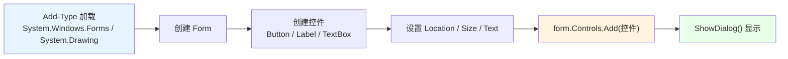
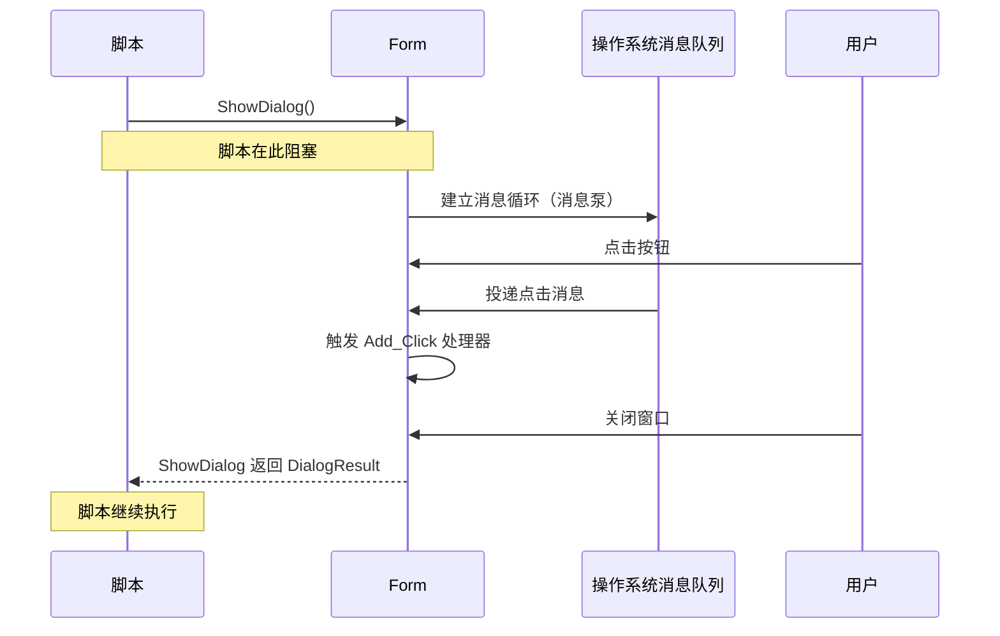
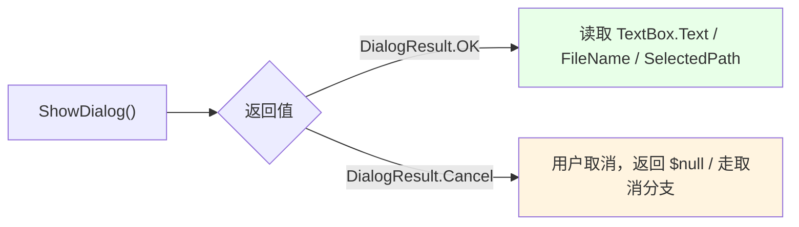

# 第 19 章 图形界面：Windows Forms 与 PowerShell 的 STA 约束

> **章内定位**：Windows Forms 是 .NET Framework 时代的 UI 框架，但它在 PowerShell 脚本工具化中仍有不可替代的位置：**无需创建完整项目，即可为脚本快速添加输入框、进度窗口和文件选择对话框**。本章的核心约束不是控件 API 本身，而是 PowerShell 的**线程单元（STA/MTA）**与 WinForms 要求的 STA 之间的冲突——不理解 STA 和消息泵，WinForms 在 PowerShell 中就会表现为“窗口一闪而过”或“脚本假死”。
>
> 本章不追求“做一个完整应用”，而是教你脚本工具最常用的两个模式：**输入框**和**文件选择**。这两样能在二三十行内完成，而且能直接封装成可复用函数。

---

## 19.1 程序集加载、`Form` 与基本控件构建

一个 PowerShell WinForms 脚本的最小骨架只有五步：**加载程序集 → 创建 Form → 创建控件 → 加进 Controls → 显示**。

### 最小骨架：`Add-Type` → `Form` → 控件 → `Controls.Add` → 显示

```powershell
# 1. 加载程序集
Add-Type -AssemblyName System.Windows.Forms
Add-Type -AssemblyName System.Drawing

# 2. 创建窗体
$form = [System.Windows.Forms.Form]::new()
$form.Text = '我的工具'

# 3. 创建控件
$button = [System.Windows.Forms.Button]::new()
$button.Text = '点我'

# 4. 把控件加进窗体
$form.Controls.Add($button)

# 5. 显示（模态）
$form.ShowDialog() | Out-Null
$form.Dispose()
```

要点：

1. **必须加载 `System.Windows.Forms` 和 `System.Drawing` 两个程序集**——前者是控件，后者是 `Point`/`Size`/`Color` 等绘图类型。
2. **`Add-Type -AssemblyName`** 是第 13 章讲的“按名字加载已有程序集”。
3. **`Form` 和控件都是 .NET 对象**，用 `[类型]::new()` 创建即可。
4. **`Controls.Add()`** 把控件“挂”到窗体上；没有布局管理器时，就是“按绝对坐标摆放”。

### `Form` 的标题、尺寸、启动位置

```powershell
$form = [System.Windows.Forms.Form]::new()
$form.Text = 'Demo'
$form.Size = [System.Drawing.Size]::new(400, 300)
$form.StartPosition = [System.Windows.Forms.FormStartPosition]::CenterScreen
```

- **`Text`**：窗口标题（也是任务栏上显示的文字）；
- **`Size`**：窗口的宽 × 高（`[System.Drawing.Size]::new(宽, 高)`）；
- **`StartPosition = CenterScreen`**：启动时居中，避免“窗口开在屏幕角落看不见”。

### 控件的位置 / 尺寸 / 文本

控件基本都是 `Location`（左上角坐标）、`Size`（宽高）、`Text`（显示文字）三件套：

```powershell
$label = [System.Windows.Forms.Label]::new()
$label.Text = 'Name:'
$label.Location = [System.Drawing.Point]::new(20, 20)
$label.Size = [System.Drawing.Size]::new(60, 23)

$textBox = [System.Windows.Forms.TextBox]::new()
$textBox.Location = [System.Drawing.Point]::new(90, 20)
$textBox.Size = [System.Drawing.Size]::new(200, 23)

$button = [System.Windows.Forms.Button]::new()
$button.Text = 'OK'
$button.Location = [System.Drawing.Point]::new(140, 90)
$button.Size = [System.Drawing.Size]::new(75, 25)
```

实测确认：`Controls.Add` 之后 `$form.Controls.Count` 等于控件数量；`button.Text` 等属性都能正常设置。

> **`Point` 和 `Size` 别搞混**：`Point(x, y)` 是“坐标”，`Size(width, height)` 是“尺寸”。`Location` 用 `Point`，`Size` 属性用 `Size`。

把“构建流程”画成图：



### 19.1 小结

1. **五步骨架**：`Add-Type` → `Form` → 控件 → `Controls.Add` → 显示。
2. **必须加载 `System.Windows.Forms` 和 `System.Drawing`**。
3. **`Form`** 用 `Text`/`Size`/`StartPosition`；**控件**用 `Location`（Point）/`Size`（Size）/`Text`。
4. **`Controls.Add` / `AddRange`** 把控件挂上去；无布局管理器时按绝对坐标摆放。

---

## 19.2 `ShowDialog()`、STA 模式与消息泵

这一段是本章的“灵魂”。很多人在 PowerShell 里写 WinForms，会遇到两个经典现象：

1. **窗口一闪而过**（`Show()` 之后脚本继续跑，窗口立刻被销毁）；
2. **脚本假死**（窗口出来了，但点按钮没反应，或者脚本卡住）。

根因都在“**消息泵**”和“**线程单元**”上。

### `ShowDialog()`：模态阻塞，但带来消息泵

`ShowDialog()` 有“两副面孔”，而且都是好事：

- **它是“模态”的**：它会**阻塞**脚本执行，直到窗体关闭；
- **它同时从操作系统获得“消息泵”**：窗体上的按钮点击、重绘等事件能被正常处理。

```powershell
$result = $form.ShowDialog()
# 这一行会“停住”，直到窗口被关闭
$result   # 返回 DialogResult（OK / Cancel / …）
```

**对脚本工具来说，`ShowDialog()` 通常是正确选择**：你本来就想“弹出窗口、让用户操作、拿到结果再继续”。它阻塞是特性，不是 bug。

### `Show()` 与消息泵：为什么窗口会“一闪而过”

`Show()` 是“非模态”：它把窗口显示出来就立刻返回，脚本继续往下跑。但 **PowerShell 控制台线程默认不提供消息泵**——没有消息泵，窗口就收不到“绘制/点击”等消息，于是：

- 窗口可能**一闪而过**（脚本结束、对象被回收）；
- 或者**画不出来/点了没反应**（没有消息循环在转）。

所以：**在 PowerShell 脚本里，优先 `ShowDialog()`；不要随便 `Show()`。**

如果你确实需要“非模态 + 不阻塞”，通常要用 `[System.Windows.Forms.Application]::Run($form)` 来接管消息循环（但它会“接管脚本控制流”，直到窗口关闭），或者用 `DoEvents()` 在循环里“手动抽一下消息”——后者要谨慎，容易把逻辑写乱。

### STA 约束与 `pwsh -STA`

WinForms（以及很多 COM 组件）要求**STA（单线程单元）**。而 PowerShell 的默认单元取决于宿主/启动方式：

```powershell
[System.Threading.Thread]::CurrentThread.ApartmentState
# STA 或 MTA
```

**先检测，再决定**。如果不是 STA，可以用：

```powershell
pwsh -STA -File .\gui.ps1
```

`-STA` 让 PowerShell 以 STA 启动，WinForms 才能可靠工作。Windows PowerShell 5.1 的控制台默认通常是 STA；PowerShell 7 的某些宿主/启动方式可能是 MTA——**所以别猜，用 `ApartmentState` 检测**（这也是第 17.1 节强调过的）。

### `Application.Run` / `DoEvents`

两个“消息循环”相关的 API，简单认识一下：

```powershell
# 接管消息循环：会阻塞到窗体关闭
[System.Windows.Forms.Application]::Run($form)

# 在自写循环里“抽一下消息”（谨慎使用）
[System.Windows.Forms.Application]::DoEvents()
```

- **`Application.Run($form)`**：标准 WinForms 消息循环，适合“真正的事件驱动应用”；
- **`DoEvents()`**：在“脚本自己的循环”里让 UI 有机会响应，但容易和“阻塞逻辑”搅在一起，脚本工具里少用为妙。

对脚本工具，**`ShowDialog()` 往往比 `Application.Run` 更省心**：你不需要自己写“关闭时退出循环”的逻辑。

把 `ShowDialog` 的“阻塞 + 消息泵”画出来：



### 19.2 小结

1. **`ShowDialog()` 模态阻塞，但提供消息泵**，是脚本工具的正确选择。
2. **`Show()` 非模态 + 控制台线程无消息泵**，容易出现“一闪而过/没反应”。
3. **WinForms 要求 STA**；先 `ApartmentState` 检测，必要时 `pwsh -STA` 启动。
4. **`Application.Run`** 接管消息循环；**`DoEvents`** 谨慎使用。

---

## 19.3 事件绑定：`Add_<EventName>` 与 `ScriptBlock`

WinForms 控件的事件，在 PowerShell 里用 `Add_<事件名>({ 脚本块 })` 来绑定。这是 `ScriptBlock` 作为“委托”的又一实用形态（第 5 章讲过）。

### `Add_Click` / `Add_Shown` / `Add_FormClosing`

```powershell
$button.Add_Click({
    # 点击按钮时执行
    $form.Close()
})

$form.Add_Shown({
    # 窗体首次显示后执行
    $textBox.Select()
})

$form.Add_FormClosing({
    # 窗体关闭时执行（可以用来做“确认退出”）
    # $_.Cancel = $true 可以取消关闭
})
```

实测确认 `$button.Add_Click({ ... })` 能正常绑定（不触发，只绑定）。

常用事件：

| 事件 | 触发时机 | 典型用途 |
|---|---|---|
| `Click` | 点击 | 执行主逻辑 |
| `Shown` | 窗体首次显示后 | 设置焦点、初始化 |
| `FormClosing` | 关闭前 | 确认、清理 |
| `TextChanged` | 文本变化 | 实时校验/联动 |

### 事件处理器的 `$this`

在事件处理器里，**`$this` 指代“触发事件的那个对象”**（等价于 C# 的 `sender`）：

```powershell
$button.Add_Click({
    $this.Text = '已点击'      # $this 就是那个按钮
})
```

而你在脚本里定义的外部变量（`$form`、`$textBox`），脚本块也能“看得见”（作用域捕获）。**但要注意**：事件处理器运行在 UI 线程上，别在里面做长时间阻塞操作（会卡死界面）。

### 作用域捕获与“不要阻塞 UI 线程”

看一个“能跑但会卡”的例子：

```powershell
$button.Add_Click({
    Start-Sleep -Seconds 10      # 错误：UI 线程被阻塞 10 秒
    $form.Close()
})
```

点了按钮之后，窗口会“假死”10 秒——因为 UI 线程在 `Sleep`，消息泵转不动。

正确做法是：**把耗时逻辑放到后台（`Start-ThreadJob` 等），UI 线程只负责“更新界面”**。这也是为什么第 17 章的并发知识对 GUI 同样重要。

### 19.3 小结

1. **事件用 `Add_<事件名>({ ... })` 绑定**：`Add_Click`、`Add_Shown`、`Add_FormClosing` 等。
2. **处理器里的 `$this` 是触发事件的对象**（对应 C# 的 `sender`）。
3. 处理器能捕获脚本里的外部变量；但**不要在里面做长阻塞操作**，否则 UI 假死。

---

## 19.4 常用控件组合与“输入框 / 文件选择”模式

脚本工具最常用的两个 WinForms 模式，其实都不到 30 行：**自定义输入框**和**文件/文件夹选择**。

### 输入框模式：`Label` + `TextBox` + OK/Cancel + `ShowDialog` 返回值

```powershell
Add-Type -AssemblyName System.Windows.Forms
Add-Type -AssemblyName System.Drawing

$form = [System.Windows.Forms.Form]::new()
$form.Text = '请输入'
$form.Size = [System.Drawing.Size]::new(360, 160)
$form.StartPosition = [System.Windows.Forms.FormStartPosition]::CenterScreen

$label = [System.Windows.Forms.Label]::new()
$label.Text = '名称：'
$label.Location = [System.Drawing.Point]::new(20, 25)
$label.Size = [System.Drawing.Size]::new(60, 23)

$textBox = [System.Windows.Forms.TextBox]::new()
$textBox.Location = [System.Drawing.Point]::new(85, 25)
$textBox.Size = [System.Drawing.Size]::new(230, 23)

$ok = [System.Windows.Forms.Button]::new()
$ok.Text = '确定'
$ok.Location = [System.Drawing.Point]::new(120, 70)
$ok.Size = [System.Drawing.Size]::new(75, 25)
$ok.Add_Click({ $form.DialogResult = [System.Windows.Forms.DialogResult]::OK; $form.Close() })

$cancel = [System.Windows.Forms.Button]::new()
$cancel.Text = '取消'
$cancel.Location = [System.Drawing.Point]::new(210, 70)
$cancel.Size = [System.Drawing.Size]::new(75, 25)
$cancel.Add_Click({ $form.DialogResult = [System.Windows.Forms.DialogResult]::Cancel; $form.Close() })

$form.Controls.AddRange([System.Windows.Forms.Control[]]@($label, $textBox, $ok, $cancel))
$form.AcceptButton = $ok       # 回车 = 确定
$form.CancelButton = $cancel   # Esc = 取消

$result = $form.ShowDialog()
if ($result -eq [System.Windows.Forms.DialogResult]::OK) {
    $value = $textBox.Text
    "你输入了：$value"
} else {
    '已取消'
}
$form.Dispose()
```

要点：

- **`$form.DialogResult = [DialogResult]::OK`**：设置后，`ShowDialog()` 会返回这个值；
- **`AcceptButton` / `CancelButton`**：绑定回车和 Esc，体验更“像对话框”；
- **`ShowDialog()` 返回值**判断用户是“确定”还是“取消”。

### 文件选择：`OpenFileDialog` / `FolderBrowserDialog` / `SaveFileDialog`

这三个“系统对话框”不需要自己摆控件，直接用：

```powershell
# 选文件
$ofd = [System.Windows.Forms.OpenFileDialog]::new()
$ofd.Filter = 'Text files|*.txt|All files|*.*'
$ofd.Multiselect = $true
$ofd.InitialDirectory = 'C:\'

if ($ofd.ShowDialog() -eq [System.Windows.Forms.DialogResult]::OK) {
    $ofd.FileNames      # 多选时是一个数组
}

# 选文件夹
$fbd = [System.Windows.Forms.FolderBrowserDialog]::new()
if ($fbd.ShowDialog() -eq [System.Windows.Forms.DialogResult]::OK) {
    $fbd.SelectedPath
}

# 保存文件
$sfd = [System.Windows.Forms.SaveFileDialog]::new()
$sfd.Filter = 'Log|*.log'
$sfd.DefaultExt = 'log'
$sfd.AddExtension = $true
if ($sfd.ShowDialog() -eq [System.Windows.Forms.DialogResult]::OK) {
    $sfd.FileName
}
```

实测确认 `OpenFileDialog.Filter` 能正常设置、`FolderBrowserDialog` 类型可用、`DialogResult.OK` 存在。

### 封装成可复用函数

把“输入框”和“选文件”包成函数，以后脚本里一行调用：

```powershell
function Show-InputBox {
    param([string]$Title = '请输入', [string]$Prompt = '值：')

    Add-Type -AssemblyName System.Windows.Forms
    Add-Type -AssemblyName System.Drawing

    $form = [System.Windows.Forms.Form]::new()
    $form.Text = $Title
    $form.Size = [System.Drawing.Size]::new(360, 160)
    $form.StartPosition = [System.Windows.Forms.FormStartPosition]::CenterScreen

    $label = [System.Windows.Forms.Label]::new()
    $label.Text = $Prompt
    $label.Location = [System.Drawing.Point]::new(20, 25)
    $label.Size = [System.Drawing.Size]::new(60, 23)

    $box = [System.Windows.Forms.TextBox]::new()
    $box.Location = [System.Drawing.Point]::new(85, 25)
    $box.Size = [System.Drawing.Size]::new(230, 23)

    $ok = [System.Windows.Forms.Button]::new()
    $ok.Text = '确定'
    $ok.Location = [System.Drawing.Point]::new(120, 70)
    $ok.Size = [System.Drawing.Size]::new(75, 25)
    $ok.Add_Click({ $form.DialogResult = [System.Windows.Forms.DialogResult]::OK; $form.Close() })

    $cancel = [System.Windows.Forms.Button]::new()
    $cancel.Text = '取消'
    $cancel.Location = [System.Drawing.Point]::new(210, 70)
    $cancel.Size = [System.Drawing.Size]::new(75, 25)
    $cancel.Add_Click({ $form.DialogResult = [System.Windows.Forms.DialogResult]::Cancel; $form.Close() })

    $form.Controls.AddRange([System.Windows.Forms.Control[]]@($label, $box, $ok, $cancel))
    $form.AcceptButton = $ok
    $form.CancelButton = $cancel

    $r = $form.ShowDialog()
    $value = if ($r -eq [System.Windows.Forms.DialogResult]::OK) { $box.Text } else { $null }
    $form.Dispose()
    return $value
}

$name = Show-InputBox -Title '请输入名称' -Prompt '名称：'
"收到：$name"
```

把“对话框结果”的流向画出来：



### 19.4 小结

1. **输入框模式**：`Label` + `TextBox` + OK/Cancel；`DialogResult` 决定 `ShowDialog()` 返回什么；`AcceptButton`/`CancelButton` 绑回车/Esc。
2. **文件选择**：`OpenFileDialog`（`Filter`/`Multiselect`/`InitialDirectory`）、`FolderBrowserDialog`（`SelectedPath`）、`SaveFileDialog`（`DefaultExt`/`AddExtension`）。
3. **封装成函数**（`Show-InputBox` / `Select-File`）后，脚本里一行调用即可复用。

---

## 本章总结

第 19 章把“脚本 + 图形界面”讲完了，也收束了第 3 部分：

- **19.1 构建**：`Add-Type` 加载程序集 → `Form` → 控件 → `Controls.Add` → 显示；`Form` 的 `Text`/`Size`/`StartPosition`，控件的 `Location`/`Size`/`Text`。
- **19.2 显示与线程**：`ShowDialog()` 模态阻塞但提供消息泵，是脚本工具首选；`Show()` 非模态 + 无消息泵易“一闪而过”；**WinForms 要求 STA**，先检测 `ApartmentState`，必要时 `pwsh -STA`。
- **19.3 事件**：`Add_<事件名>({ ... })`；`$this` 是触发者；别在 UI 线程做长阻塞。
- **19.4 两个模式**：输入框（`DialogResult` 判断）与文件选择（`OpenFileDialog`/`FolderBrowserDialog`/`SaveFileDialog`），都能封装成函数复用。

一句话记住全章：**“WinForms 五步搭、`ShowDialog` 来显示、STA 先检测、事件别阻塞、对话框看 `DialogResult`。”**

至此，**第 3 部分（.NET 运行时设施）**结束。你已经能在 PowerShell 里调用 CLR 的程序集、反射、网络、文本正则、容器、线程并发、IO 流、图形界面。接下来进入**第 4 部分：Win32 API 编程**——从 `Add-Type` 的 P/Invoke 声明开始，一路到进程、线程、同步、内存、DLL、窗口消息和 GDI。

**下一章预告**：第 20 章《基础必备知识：错误处理、字符字符串与内核对象》。这是第 4 部分的“共同语法课”：`SetLastError` 与 `GetLastWin32Error`、`CharSet` 与 `StringBuilder` 封送、`IntPtr` 句柄与 `CloseHandle`、`[StructLayout]` 与 `Marshal.PtrToStructure`。不先把这四样搞明白，后面所有 Win32 调用都会“莫名其妙失败”。

---

> **动手练习**
>
> 1. 用 `Add-Type` 加载 WinForms/Drawing，创建一个带 `Label` + `TextBox` + `Button` 的窗体（只构建、不显示），检查 `Controls.Count`。
> 2. 在窗体上绑定 `Add_Click`，让按钮点击时改 `$this.Text`；再绑定 `Add_FormClosing` 打印一句话。
> 3. 用 `[Thread]::CurrentThread.ApartmentState` 检测当前单元；如果是 MTA，用 `pwsh -STA -File` 再试一次。
> 4. 运行 19.4 的 `Show-InputBox` 函数，输入一个值并点“确定”；再点“取消”，观察返回值差异。
> 5. 用 `OpenFileDialog` 选一个 `.txt` 文件（`Filter` 设好），打印 `FileName`；再用 `FolderBrowserDialog` 选一个文件夹，打印 `SelectedPath`。
> 6. 故意在一个 `Add_Click` 里 `Start-Sleep -Seconds 5`，观察窗口“假死”；再想想正确的后台处理方式。
