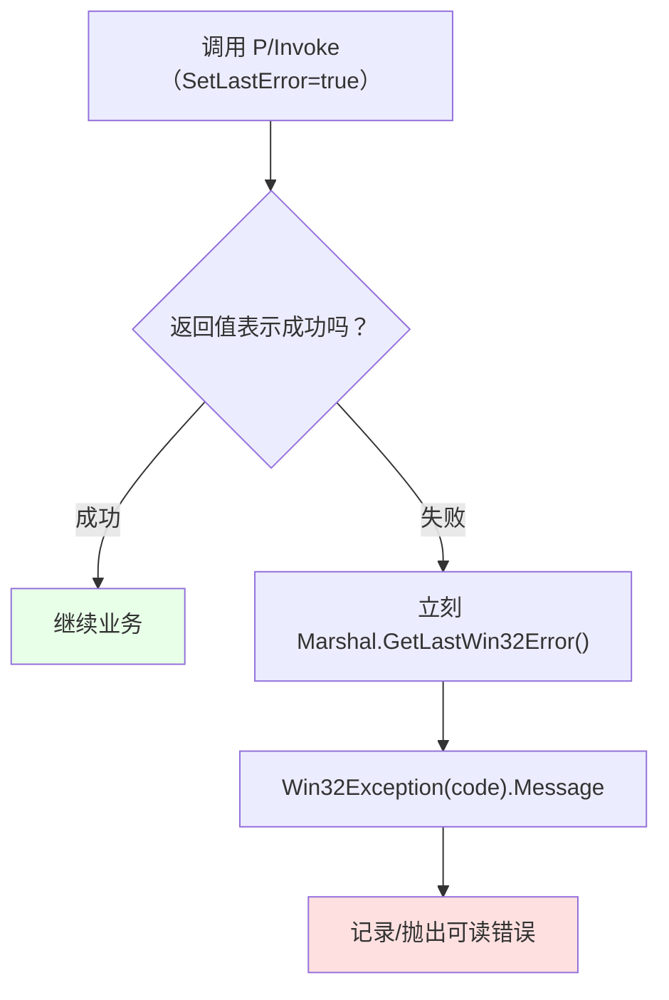

# 第 20 章 基础必备知识：错误处理、字符字符串与内核对象

> **章内定位**：对应《Windows 核心编程》第 I 部分“必备知识”（错误处理、字符和字符串处理、内核对象）。这三项是后续所有 Win32 调用的共同基础设施：**不声明 `SetLastError` 就无法诊断失败，不指定 `CharSet` 就会在 ANSI/Unicode 之间静默出错，不理解内核对象句柄的“可等待/可关闭”语义就无法安全地跨 API 管理资源**。PowerShell 的 `Add-Type` 和 `Marshal` 是这套基础设施在脚本层的实现载体。
>
> 第 4 部分从这里开始。后面第 21–29 章的所有 P/Invoke，都会反复用到本章的四样东西：**错误码、字符封送、句柄、结构体封送**。把这一章当成“Win32 语法的共同入口”。

---

## 20.1 错误处理：`SetLastError`、`GetLastWin32Error` 与 `Win32Exception`

Win32 API 的错误报告机制很“老派”：**函数返回失败，同时把错误码写进“当前线程的最后一个错误”**。它不是抛异常，所以你**必须主动去读**。

### 为什么 `SetLastError = true` 是前提

`DllImport` 里有一个关键参数：`SetLastError = true`。

```csharp
[DllImport("kernel32.dll", CharSet = CharSet.Auto, SetLastError = true)]
public static extern IntPtr GetModuleHandle(string name);
```

**只有声明了它，.NET 才会在调用前后“保存/恢复”那个“最后一个错误码”**，你才能在调用后用 `Marshal.GetLastWin32Error()` 读到。没有它，读到的可能是**上一次其他调用残留的旧值**，完全没法用。

记住：**凡是“可能失败、并且你想知道为什么”的 Win32 调用，`SetLastError = true` 都是必须的。**

### 失败后必须“立刻”读错误码

“当前线程的最后一个错误”是**线程级、易被覆盖**的。你在调用失败后，**应该立刻**读：

```powershell
$h = [PInvokeTest.K32]::GetModuleHandle('nonexistent_module_xyz')

# 紧跟着读！中间不要再插入别的 P/Invoke 调用
$code = [System.Runtime.InteropServices.Marshal]::GetLastWin32Error()

"handle is zero: $($h -eq [IntPtr]::Zero)"
"error code: $code"
```

> **重要提醒**：PowerShell 里**没有 `[Marshal]` 这个类型加速器**（这是 C# 里 `using static` 的简写，PowerShell 不认）。必须写全名 **`[System.Runtime.InteropServices.Marshal]`**。本书后面的 `Marshal` 调用都按全名写。

我们实测确认：`GetModuleHandle('nonexistent_module_xyz')` 返回 `0`（`IntPtr.Zero`），`GetLastWin32Error()` 读到 `126`。

### 用 `Win32Exception` 把错误码变人话

错误码 `126` 本身没意义；`System.ComponentModel.Win32Exception` 能把它翻成系统消息：

```powershell
$code = 126
[System.ComponentModel.Win32Exception]::new($code).Message
# 找不到指定的模块。（实测确认）
```

于是“诊断失败”的标准套路是：

```powershell
if ($h -eq [IntPtr]::Zero) {
    $code = [System.Runtime.InteropServices.Marshal]::GetLastWin32Error()
    $msg  = [System.ComponentModel.Win32Exception]::new($code).Message
    throw "GetModuleHandle 失败（错误码 $code）：$msg"
}
```

### `$?` 不可靠，别拿它替代显式检查

PowerShell 的 `$?` 表示“上一条命令是否成功”。但对 P/Invoke 调用，它**并不可靠**：

- 如果函数返回的是 `bool`，`$?` 可能碰巧能反映；
- 如果函数返回的是**非布尔值**（比如 `IntPtr`、`uint`），`$?` 的判断规则和你想要的可能完全不是一回事。

**所以：不要用 `$?` 判断 Win32 调用成败；每次都显式检查返回值，并立刻读 `GetLastWin32Error()`。**

把“调用 → 失败 → 读码 → 翻译”的流程画出来：



### 20.1 小结

1. **`SetLastError = true`** 是可靠读取错误码的前提。
2. **失败后立刻**用 `[System.Runtime.InteropServices.Marshal]::GetLastWin32Error()` 读码（PowerShell **没有 `[Marshal]` 加速器**）。
3. **`Win32Exception(code).Message`** 把错误码翻成人话。
4. **`$?` 对非布尔返回值的 P/Invoke 不可靠**，必须显式检查返回值。

---

## 20.2 字符与字符串封送：`CharSet`、`StringBuilder` 与 `Marshal`

Win32 API 的字符串参数有 **ANSI（`A` 后缀）** 和 **Unicode（`W` 后缀）** 两个版本。.NET 的 P/Invoke 通过 `CharSet` 决定用哪个，以及“托管字符串 ↔ 非托管字符串”怎么翻译。

### `CharSet.Auto`：ANSI 与 Unicode 的自动选择

```csharp
[DllImport("kernel32.dll", CharSet = CharSet.Auto, SetLastError = true)]
public static extern uint GetModuleFileName(
    IntPtr hModule,
    System.Text.StringBuilder buffer,
    uint size);
```

- **`CharSet.Auto`**：在 Windows NT 系上映射到 **Unicode（`W`）**，在老的 9x 系上映射到 ANSI（`A`）。现代 Windows 上，`Auto` 的实际效果就是“走 Unicode”；
- **`CharSet.Unicode`**：明确走 `W` 版本；
- **`CharSet.Ansi`**：明确走 `A` 版本。

**默认是什么？** 不写 `CharSet` 时，默认是 `Ansi`。这在中文/日文等非 ASCII 文本上会产生“乱码/截断”的经典问题。**所以：处理文本的 Win32 调用，显式写 `CharSet = CharSet.Auto`（或 `Unicode`）**，不要赌默认值。

### 输入字符串直接传 `string`；输出缓冲区用 `StringBuilder`

封送字符串有两条方向：

**方向一：你传给 API 的“输入字符串”**——直接用 PowerShell 的 `string` 就行，.NET 会自动封送：

```csharp
[DllImport("kernel32.dll", CharSet = CharSet.Auto, SetLastError = true)]
public static extern IntPtr GetModuleHandle(string name);
```

调用时传 `'kernel32.dll'` 这类字符串，PowerShell 会自动转成非托管字符串。

**方向二：API 要“往你的缓冲区里写字符串”**——**不能用 `string`**！因为 .NET 的 `string` 是不可变的（第 15 章），API 没法往里写。要用 **`StringBuilder`**，并**预先分配容量**：

```powershell
$sb = [System.Text.StringBuilder]::new(260)   # 预分配 260 个字符
$len = [PInvokeTest.K32]::GetModuleFileName([IntPtr]::Zero, $sb, 260)
$sb.ToString()
# C:\Program Files\PowerShell\7\pwsh.exe（实测确认）
```

要点：

- **`StringBuilder` 的容量要够大**（Win32 的路径上限常用 260/MAX_PATH，新 API 用 32767）；
- **传 `260` 作为 size**，告诉 API“缓冲区最多写这么多”；
- 返回值 `$len` 是写入的字符数（不含结尾的 `\0`）。

### 非托管往返：`StringToHGlobalAuto` / `PtrToStringAuto` / `FreeHGlobal`

有些 API 需要“非托管内存里的字符串指针”，而不是 `StringBuilder`。这时用 `Marshal` 做“托管 ↔ 非托管”往返：

```powershell
$M = [System.Runtime.InteropServices.Marshal]

# 托管字符串 → 非托管内存
$ptr = $M::StringToHGlobalAuto('hello')
try {
    # 把 $ptr 传给需要 LPCSTR/LPCWSTR 的 API……
    # 再转回来看看
    $M::PtrToStringAuto($ptr)      # hello
}
finally {
    $M::FreeHGlobal($ptr)          # 必须释放！
}
```

**`StringToHGlobalAuto` 分配的是“非托管内存”，GC 不会替你回收**。不 `FreeHGlobal`，就是内存泄漏。所以**分配后一律 `try/finally` + `FreeHGlobal`**。

### `GetModuleFileName` 的完整示例

把上面几块拼起来，就是一个“标准 P/Invoke + 字符串缓冲区”的完整例子：

```powershell
Add-Type -MemberDefinition @'
[DllImport("kernel32.dll", CharSet=CharSet.Auto, SetLastError=true)]
public static extern uint GetModuleFileName(
    IntPtr hModule,
    System.Text.StringBuilder buffer,
    uint size);
'@ -Name K32 -Namespace PInvokeTest

$M = [System.Runtime.InteropServices.Marshal]
$sb = [System.Text.StringBuilder]::new(260)
$len = [PInvokeTest.K32]::GetModuleFileName([IntPtr]::Zero, $sb, 260)

if ($len -eq 0) {
    $code = $M::GetLastWin32Error()
    throw "GetModuleFileName 失败：$([System.ComponentModel.Win32Exception]::new($code).Message)"
}

"当前进程路径：$($sb.ToString())"
```

`[IntPtr]::Zero` 作为 `hModule`，表示“当前进程的可执行文件”。实测输出就是当前 `pwsh.exe` 的路径。

### 20.2 小结

1. **`CharSet.Auto`** 在现代 Windows 上走 Unicode；**不写时默认 `Ansi`**，处理文本要显式写 `Auto`/`Unicode`。
2. **输入字符串直接传 `string`**；**输出缓冲区用 `StringBuilder` 并预分配容量**（`string` 不可变，写不进去）。
3. **`StringToHGlobalAuto` / `PtrToStringAuto`** 做非托管往返；**`FreeHGlobal` 必须在 `finally`**。
4. **`GetModuleFileName`** 是“字符串缓冲区封送”的标准范例。

---

## 20.3 内核对象与句柄：`IntPtr`、`CloseHandle` 与可等待语义

在 Win32 里，**进程、线程、文件、事件、互斥体、信号量都是“内核对象”**。你通过**句柄（`HANDLE`）** 引用它们；每个内核对象有一个“使用计数”，`CloseHandle` 递减计数，归零时对象销毁。

### 句柄是 `IntPtr`，不是 `int`

PowerShell 里，句柄用 **`IntPtr`** 表示：

```powershell
[IntPtr]::Zero     # 空句柄（NULL）
```

**千万不要把句柄 `[int]` 强转**——在 64 位系统上，句柄是 64 位宽，`[int]` 会截断，变成“看起来有值、其实是错的句柄”。所有句柄参数/返回值，一律用 `IntPtr`。

### `CloseHandle` 必须在 `finally`

```powershell
$M = [System.Runtime.InteropServices.Marshal]

$handle = [PInvokeTest.K32]::CreateEvent([IntPtr]::Zero, $false, $true, $null)

try {
    # 用 $handle 做点什么……
}
finally {
    [void][PInvokeTest.K32]::CloseHandle($handle)
}
```

- **`CreateEvent` 返回句柄**；`[IntPtr]::Zero` 表示“没有名字的事件”；
- **`CloseHandle` 必须在 `finally`**：中间抛异常也要释放，否则句柄泄漏；
- **`CloseHandle` 失败也可以读 `GetLastWin32Error()`**（同样要 `SetLastError=true`）。

我们实测确认：`CreateEvent` 返回非零句柄；`WaitForSingleObject` 返回 `0`（`WAIT_OBJECT_0`）；`CloseHandle` 正常关闭。

### 内核对象是“可等待”的：`WaitForSingleObject`

内核对象最强大的特性之一是“**可等待**”：它有“已信号（signaled）/ 未信号（non-signaled）”状态。`WaitForSingleObject` 会阻塞，直到对象变成“已信号”或超时：

```powershell
$ev = [PInvokeTest.K32]::CreateEvent([IntPtr]::Zero, $false, $true, $null)
try {
    $result = [PInvokeTest.K32]::WaitForSingleObject($ev, 1000)   # 最多等 1 秒
    # 0 = WAIT_OBJECT_0（等到了）；0x102 = WAIT_TIMEOUT（超时）
    "wait result: $result"
}
finally {
    [void][PInvokeTest.K32]::CloseHandle($ev)
}
```

- **`INFINITE`（`0xFFFFFFFF`）**：一直等；
- **返回值**：`WAIT_OBJECT_0`（0）、`WAIT_TIMEOUT`（258）、`WAIT_ABANDONED`（128）等。

`CreateEvent` 的第二个参数 `manualReset` 决定“信号发出后是否自动复位”：`$false` 是自动复位（等到一次就复位），`$true` 是手动复位（要显式 `ResetEvent`）。

### .NET 替代：`WaitHandle.WaitAny`

很多时候，你不必完全下沉到 Win32——.NET 的 `System.Threading.WaitHandle` 也能“等待多个句柄”：

```powershell
# 概念示意：WaitHandle.WaitAny(句柄数组, 超时)
# [System.Threading.WaitHandle]::WaitAny($handles, 1000)
```

`WaitHandle` 能封装的包括 `EventWaitHandle`、`Mutex`、`Semaphore` 等（第 17 章讲过）。**判断准则**：如果 .NET 已经提供了你要的同步语义，优先用 .NET（更安全、自动释放）；只有需要“Win32 特有行为/跨进程命名对象/精细控制”时，才用 `CreateEvent` / `WaitForSingleObject` 这条路径。

把“句柄生命周期”画出来：


### 20.3 小结

1. **句柄用 `IntPtr`**，`[IntPtr]::Zero` 是 NULL；**绝不能用 `[int]` 强转**（64 位会截断）。
2. **`CloseHandle` 必须在 `finally`**；失败也能读 `GetLastWin32Error`。
3. 内核对象是**可等待**的：`WaitForSingleObject(handle, 超时)`，`0` 表示等到了。
4. **能 .NET 就 .NET**：`WaitHandle.WaitAny` 等替代；需要 Win32 特有语义再下沉。

---

## 20.4 结构体封送：`StructLayout` 与 `Marshal.PtrToStructure`

大量 Win32 API 需要“传一个结构体指针，让 API 往里面填数据”（`SYSTEM_INFO`、`STARTUPINFO`、`PROCESSENTRY32`……）。在 PowerShell 里，这套动作是：**定义结构体 → 分配非托管内存 → 调用 API → `PtrToStructure` 转回托管对象 → `FreeHGlobal`**。

### `[StructLayout(LayoutKind.Sequential)]`

结构体必须按“内存里字段的顺序布局”来定义，否则封送会错位：

```csharp
[StructLayout(LayoutKind.Sequential)]
public struct SYSTEM_INFO {
    public ushort wProcessorArchitecture;
    public ushort wReserved;
    public uint dwPageSize;
    public IntPtr lpMinimumApplicationAddress;
    public IntPtr lpMaximumApplicationAddress;
    public UIntPtr dwActiveProcessorMask;
    public uint dwNumberOfProcessors;
    public uint dwProcessorType;
    public uint dwAllocationGranularity;
    public ushort wProcessorLevel;
    public ushort wProcessorRevision;
}
```

`LayoutKind.Sequential` 表示“按声明顺序排”，这是和 C 结构体对齐的前提。

### `[MarshalAs(UnmanagedType.ByValTStr, SizeConst = ...)]`

如果结构体里有“定长字符数组”（比如 `char szName[260]`），在 C# 里要这样声明：

```csharp
[MarshalAs(UnmanagedType.ByValTStr, SizeConst = 260)]
public string szName;
```

- **`ByValTStr`**：按“值”内嵌在结构体里的字符串（不是指针）；
- **`SizeConst`**：数组/缓冲区的固定长度（要和 C 结构体里一致）。

如果写错 `SizeConst`，结构体的大小就对不上，`PtrToStructure` 会“读出垃圾”。

### `cb` 字段先赋 `Marshal.SizeOf`

很多 Win32 结构体有一个 `cb`（count of bytes）字段，要求你**先把它设成结构体大小**，API 才知道“这个结构体版本有多大”：

```powershell
$M = [System.Runtime.InteropServices.Marshal]
$size = $M::SizeOf([type][STARTUPINFO])
$si = [STARTUPINFO]::new()
$si.cb = $size
```

**不设 `cb`，API 可能返回“参数无效”**——这是 `STARTUPINFO`/`PROCESS_INFORMATION` 类调用最常见的失败原因。

### 分配 → 调用 → 转回 → `FreeHGlobal`：`SYSTEM_INFO` 完整示例

```powershell
Add-Type -TypeDefinition @'
using System;
using System.Runtime.InteropServices;

[StructLayout(LayoutKind.Sequential)]
public struct SYSTEM_INFO {
    public ushort wProcessorArchitecture;
    public ushort wReserved;
    public uint dwPageSize;
    public IntPtr lpMinimumApplicationAddress;
    public IntPtr lpMaximumApplicationAddress;
    public UIntPtr dwActiveProcessorMask;
    public uint dwNumberOfProcessors;
    public uint dwProcessorType;
    public uint dwAllocationGranularity;
    public ushort wProcessorLevel;
    public ushort wProcessorRevision;
}

public class SysInfoTest {
    [DllImport("kernel32.dll")]
    public static extern void GetSystemInfo(IntPtr info);
}
'@

$M = [System.Runtime.InteropServices.Marshal]
$size = $M::SizeOf([type][SYSTEM_INFO])
$ptr = $M::AllocHGlobal($size)

try {
    [SysInfoTest]::GetSystemInfo($ptr)
    $si = $M::PtrToStructure($ptr, [type][SYSTEM_INFO])
    "处理器数：$($si.dwNumberOfProcessors)"
    "页大小：$($si.dwPageSize)"
}
finally {
    $M::FreeHGlobal($ptr)
}
```

实测确认：`SYSTEM_INFO` 大小为 **48 字节**，读出 **16 个处理器**、**页大小 4096**。

把“结构体封送”的内存流程画出来：


### 20.4 小结

1. **`[StructLayout(LayoutKind.Sequential)]`** 让字段按声明顺序布局，和 C 结构体对齐。
2. **定长字符数组**用 `[MarshalAs(UnmanagedType.ByValTStr, SizeConst = N)]`。
3. **`cb` 字段**先赋 `Marshal.SizeOf`，否则 API 可能报“参数无效”。
4. **四步走**：`SizeOf` → `AllocHGlobal` → 调用 API → `PtrToStructure`，**`FreeHGlobal` 放 `finally`**。

---

## 本章总结

第 20 章是第 4 部分所有 Win32 调用的“共同语法课”：

- **20.1 错误处理**：`SetLastError=true` 是前提；失败后立刻用 `[System.Runtime.InteropServices.Marshal]::GetLastWin32Error()` 读码（**没有 `[Marshal]` 加速器**）；`Win32Exception` 翻译；`$?` 不可靠。
- **20.2 字符串封送**：`CharSet.Auto`；输入传 `string`、输出用 `StringBuilder`；`StringToHGlobalAuto`/`PtrToStringAuto`/`FreeHGlobal`；`GetModuleFileName` 范例。
- **20.3 内核对象与句柄**：`IntPtr`（不能 `[int]`）；`CloseHandle` 放 `finally`；`WaitForSingleObject` 的可等待语义；优先 `WaitHandle`。
- **20.4 结构体封送**：`StructLayout Sequential`、`MarshalAs ByValTStr`、`cb = SizeOf`；`SizeOf` → `AllocHGlobal` → 调用 → `PtrToStructure` → `FreeHGlobal`。

一句话记住全章：**“错误码要立刻读、字符串用 StringBuilder、句柄用 IntPtr 且 finally 关闭、结构体四步走并 finally 释放。”**

**下一章预告**：第 21 章《进程与作业》。我们会用 `CreateProcess` + `STARTUPINFO`/`PROCESS_INFORMATION` 演示“挂起启动/窗口站控制”，再讲作业对象（Job Object）怎么限制进程组的 CPU/内存、并在作业关闭时终止所有关联进程。这一章会大量复用本章的“句柄 + 结构体封送”套路。

---

> **动手练习**
>
> 1. 用 `Add-Type -MemberDefinition` 声明 `GetModuleHandle`（带 `SetLastError=true`），调用一个不存在的模块名，立刻读 `[System.Runtime.InteropServices.Marshal]::GetLastWin32Error()`，再用 `Win32Exception` 翻译。
> 2. 用 `StringBuilder` + `GetModuleFileName` 读出当前 `pwsh.exe` 的路径。
> 3. 用 `StringToHGlobalAuto` 分配一个字符串，`PtrToStringAuto` 读回来，最后 `FreeHGlobal`（放 `finally`）。
> 4. 用 `CreateEvent` 创建一个“已信号”的事件，`WaitForSingleObject` 等 1 秒，读返回值；最后 `CloseHandle`。
> 5. 编译 `SYSTEM_INFO` 结构体，用 `SizeOf`/`AllocHGlobal`/`GetSystemInfo`/`PtrToStructure` 读出处理器数和页大小，最后 `FreeHGlobal`。
> 6. 故意去掉 `SetLastError=true` 或去掉 `FreeHGlobal`，观察行为差异（错误码读到旧值；内存泄漏）。
