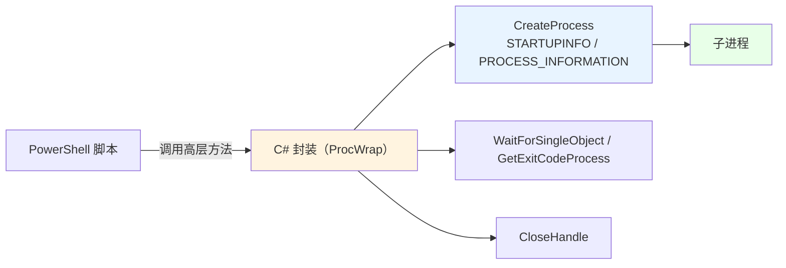
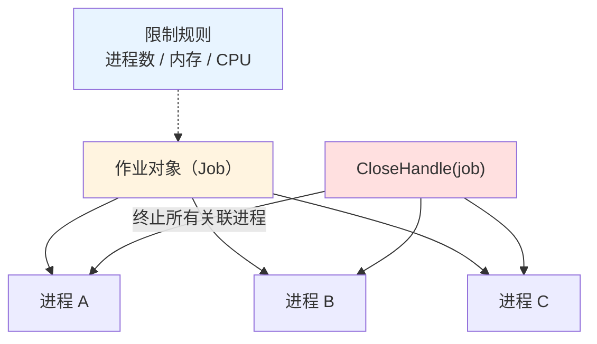

# 第 21 章 进程与作业

> **章内定位**：对应《Windows 核心编程》第 4–5 章“进程”与“作业”。PowerShell 的 `Start-Process`、`Get-Process` 和 `[System.Diagnostics.Process]` 已经覆盖了进程的创建与查询，但 Win32 路径在**挂起启动、句柄继承控制、作业对象（Job Object）的 CPU/内存限制**这些场景下不可替代。
>
> 本章有一条重要的“工程经验”要先说：**`CreateProcess` 这类带 `ref` / `out` 结构体的复杂 P/Invoke，在 PowerShell 里直接调用很容易“封送翻车”**（我们实测就遇到了 `CreateProcess` 返回 False、错误码却是 0 的情况）。正确姿势是：**把复杂 P/Invoke 封装成一个 C# 方法（`Add-Type -TypeDefinition`），PowerShell 只调那个“高层方法”。** 这也正是本章要教的“脚本与 C# 的分工”。

---

## 21.1 进程创建：`CreateProcess` 与 `STARTUPINFO`

先给结论：**90% 的“启动一个程序”需求，用 `Start-Process` 就够了**；只有当你需要“挂起启动 / 指定窗口站 / 拿到进程句柄做后续操作”时，才值得下沉到 `CreateProcess`。

### 为什么 90% 的场景用 `Start-Process` 就够了

```powershell
# 启动一个程序
Start-Process notepad.exe

# 启动并拿到 Process 对象（后面可以操作它）
$p = Start-Process -FilePath notepad.exe -PassThru

# 带参数、隐藏窗口、以管理员启动
Start-Process -FilePath 'cmd.exe' -ArgumentList '/c echo hi' -WindowStyle Hidden
Start-Process -FilePath 'powershell.exe' -Verb RunAs
```

`Start-Process` 的优点是：**它是 PowerShell 的“亲儿子”**，参数绑定、错误处理、返回 `Process` 对象（`-PassThru`）都很顺。绝大多数“启程序、等它、看它退出”的需求，用它就够了。

**`-PassThru` 特别重要**：它让你拿到 `System.Diagnostics.Process` 对象，进而能用：

```powershell
$p = Start-Process -FilePath $env:ComSpec -ArgumentList '/c timeout /t 10 /nobreak >nul' -PassThru
$p.Id          # 进程 ID
$p.Handle      # 原生句柄（IntPtr），可以传给 Win32 API！
$p.HasExited
$p.WaitForExit()
```

我们实测确认：`Start-Process -PassThru` 的 `$p.Handle` 可以直接用来做作业对象的分配（21.2 节会用到）。

### `CreateProcess` 的必要场景

什么时候必须用 `CreateProcess`？三类：

1. **需要“挂起启动”**：先以 `CREATE_SUSPENDED` 创建，做完准备（如修改内存、注入参数）再 `ResumeThread` 让它跑；
2. **需要指定 `STARTUPINFO` 的桌面/窗口站/标准句柄**：控制子进程显示在哪个桌面、把标准输入输出重定向到指定句柄；
3. **需要拿到进程句柄做后续内存操作**：第 24 章的跨进程内存读写，往往需要先用 `CreateProcess` 拿到带完整权限的 `hProcess`。

### `STARTUPINFO` / `PROCESS_INFORMATION` 与 `cb`

`CreateProcess` 需要两个结构体：

- **`STARTUPINFO`**：描述“新进程的启动外观/标准句柄”；**`cb` 字段必须先赋成结构体大小**（第 20.4 节的“cb 约定”）；
- **`PROCESS_INFORMATION`**：输出参数，API 填好后告诉你 `hProcess`、`hThread`、`dwProcessId`、`dwThreadId`。

```csharp
[StructLayout(LayoutKind.Sequential, CharSet = CharSet.Unicode)]
struct STARTUPINFO {
    public int cb;
    public string lpReserved;
    public string lpDesktop;
    public string lpTitle;
    public int dwX, dwY, dwXSize, dwYSize, dwXCountChars, dwYCountChars, dwFillAttribute, dwFlags;
    public short wShowWindow;
    public short cbReserved2;
    public IntPtr lpReserved2;
    public IntPtr hStdInput, hStdOutput, hStdError;
}

[StructLayout(LayoutKind.Sequential)]
struct PROCESS_INFORMATION {
    public IntPtr hProcess;
    public IntPtr hThread;
    public int dwProcessId;
    public int dwThreadId;
}
```

要点：

- **`si.cb = Marshal.SizeOf(typeof(STARTUPINFO))`**，不设会“参数无效”；
- **`PROCESS_INFORMATION` 里的 `hProcess` / `hThread` 用完必须 `CloseHandle`**；
- **`CREATE_SUSPENDED`（`0x4`）** 与 **`ResumeThread`** 配合：先挂着建，再恢复。

### 一个可用的封装：把复杂 P/Invoke 写进 C# 方法

**这是本章最重要的一段。** 我们实测发现：在 PowerShell 里直接调用带 `ref STARTUPINFO` / `out PROCESS_INFORMATION` 的 `CreateProcess`，会出现“返回 False、错误码却是 0”的诡异情况（PowerShell 对 `ref/out` 结构体的封送和 C# 不完全一致）。

**稳妥做法**：把整个调用（含结构体初始化、错误检查、句柄关闭）写进一个 C# 静态方法，PowerShell 只调“高层方法”：

```powershell
Add-Type -TypeDefinition @'
using System;
using System.Runtime.InteropServices;

public class ProcWrap {
    [StructLayout(LayoutKind.Sequential, CharSet=CharSet.Unicode)]
    struct STARTUPINFO {
        public int cb; public string lpReserved; public string lpDesktop; public string lpTitle;
        public int dwX, dwY, dwXSize, dwYSize, dwXCountChars, dwYCountChars, dwFillAttribute, dwFlags;
        public short wShowWindow; public short cbReserved2; public IntPtr lpReserved2;
        public IntPtr hStdInput, hStdOutput, hStdError;
    }

    [StructLayout(LayoutKind.Sequential)]
    struct PROCESS_INFORMATION {
        public IntPtr hProcess; public IntPtr hThread;
        public int dwProcessId; public int dwThreadId;
    }

    [DllImport("kernel32.dll", CharSet=CharSet.Unicode, SetLastError=true)]
    static extern bool CreateProcess(string app, string cmd, IntPtr pa, IntPtr ta,
        bool inherit, uint flags, IntPtr env, string dir,
        ref STARTUPINFO si, out PROCESS_INFORMATION pi);

    [DllImport("kernel32.dll", SetLastError=true)] static extern uint WaitForSingleObject(IntPtr h, uint ms);
    [DllImport("kernel32.dll", SetLastError=true)] static extern bool GetExitCodeProcess(IntPtr h, out uint code);
    [DllImport("kernel32.dll", SetLastError=true)] static extern bool CloseHandle(IntPtr h);

    public static int Run(string cmd) {
        var si = new STARTUPINFO();
        si.cb = Marshal.SizeOf(typeof(STARTUPINFO));

        PROCESS_INFORMATION pi;
        if (!CreateProcess(null, cmd, IntPtr.Zero, IntPtr.Zero, false, 0,
                           IntPtr.Zero, null, ref si, out pi)) {
            throw new System.ComponentModel.Win32Exception(Marshal.GetLastWin32Error());
        }

        WaitForSingleObject(pi.hProcess, 5000);
        uint code;
        GetExitCodeProcess(pi.hProcess, out code);

        CloseHandle(pi.hThread);
        CloseHandle(pi.hProcess);
        return (int)code;
    }
}
'@

# PowerShell 这边只调一个“高层方法”
$code = [ProcWrap]::Run('cmd.exe /c exit 0')
"子进程退出码：$code"      # 0（实测确认）
```

这个封装的好处：

1. **复杂封送留在 C# 里**：PowerShell 不用碰 `ref/out` 结构体；
2. **错误检查/句柄关闭都在 C# 内部完成**：PowerShell 拿到的只是“退出码”或异常；
3. **可复用**：以后要 `CREATE_SUSPENDED` 或自定义 `STARTUPINFO`，只改 C# 方法的参数即可。

把“脚本 → C# 封装 → CreateProcess”画出来：



### 21.1 小结

1. **90% 场景用 `Start-Process`**（`-PassThru` 拿 `Process` 对象，`.Handle` 可用于 Win32）。
2. **`CreateProcess` 的不可替代场景**：挂起启动、`STARTUPINFO` 桌面/句柄控制、拿进程句柄做后续内存操作。
3. **`STARTUPINFO.cb` 先赋 `Marshal.SizeOf`**；`PROCESS_INFORMATION` 的句柄用完 `CloseHandle`。
4. **复杂 `ref/out` 结构体，封装进 C# 方法**再让 PowerShell 调——这比在 PowerShell 里硬调稳得多。

---

## 21.2 作业对象：`CreateJobObject` 与资源限制

“作业对象”（Job Object）把**一组进程**当成一个单元管理：可以限制它们的 **CPU 时间、内存、进程数**，并且**作业关闭时终止所有关联进程**。PowerShell 没有作业对象的直接 cmdlet，Win32 是唯一选择。

### 作业对象是什么

把它想象成一个“篮子”：

- 你把若干个进程“放进篮子”（`AssignProcessToJobObject`）；
- 可以给篮子设置“规则”：最多几个进程、总内存上限、CPU 时间上限；
- **篮子一销毁（`CloseHandle`），里面的进程全被终止**——这是它最实用的“兜底”语义。



### `CreateJobObject` / `AssignProcessToJobObject` / `TerminateJobObject`

先看“创建 → 分配 → 终止”的最小流程。我们发现：**用 `Start-Process -PassThru` 拿到的 `Process.Handle`，可以直接传给 `AssignProcessToJobObject`**：

```powershell
Add-Type -MemberDefinition @'
[DllImport("kernel32.dll", CharSet=CharSet.Auto, SetLastError=true)]
public static extern IntPtr CreateJobObject(IntPtr attrs, string name);
[DllImport("kernel32.dll", SetLastError=true)]
public static extern bool AssignProcessToJobObject(IntPtr job, IntPtr process);
[DllImport("kernel32.dll", SetLastError=true)]
public static extern bool TerminateJobObject(IntPtr job, uint exitCode);
[DllImport("kernel32.dll", SetLastError=true)]
public static extern bool CloseHandle(IntPtr h);
'@ -Name JobTest -Namespace PInvokeTest

# 启动一个“跑一会儿”的子进程
$p = Start-Process -FilePath $env:ComSpec `
    -ArgumentList '/c timeout /t 10 /nobreak >nul' -PassThru

# 创建作业对象
$job = [PInvokeTest.JobTest]::CreateJobObject([IntPtr]::Zero, $null)

try {
    # 把进程“放进篮子”
    $assigned = [PInvokeTest.JobTest]::AssignProcessToJobObject($job, $p.Handle)
    "分配到作业：$assigned"        # True（实测确认）

    # 终止整个作业（里面的所有进程都会被终止）
    $terminated = [PInvokeTest.JobTest]::TerminateJobObject($job, 1)
    "终止作业：$terminated"        # True（实测确认）

    Start-Sleep -Milliseconds 300
    "进程是否已退出：$($p.HasExited)"   # True（实测确认）
}
finally {
    [void][PInvokeTest.JobTest]::CloseHandle($job)
    $p.Dispose()
}
```

要点：

- **`CreateJobObject([IntPtr]::Zero, $null)`**：无属性、无名字的作业；
- **`AssignProcessToJobObject(job, processHandle)`**：把进程加入作业；
- **`TerminateJobObject(job, exitCode)`**：终止作业内的所有进程；
- **`CloseHandle(job)`**：释放作业句柄；**作业句柄关闭时，里面的进程也会被终止**（这一点在“兜底清理”时特别有用）；
- **`$p.Handle`** 是 `IntPtr`（第 20.3 节讲过：句柄不能用 `[int]`）。

### `SetInformationJobObject` 与资源限制（CPU/内存/进程数）

如果只是“进程组一起终止”，上面的流程就够了。要“限制资源”，还得 `SetInformationJobObject`。它需要一个**扩展限制结构体** `JOBOBJECT_EXTENDED_LIMIT_INFORMATION`，信息类是 `JobObjectExtendedLimitInformation`（值 `9`）。

下面是一个 C# 封装，设置“最多 3 个进程 + 作业总内存 100MB”：

```csharp
[StructLayout(LayoutKind.Sequential)]
struct IO_COUNTERS {
    public ulong ReadOperationCount, WriteOperationCount, OtherOperationCount;
    public ulong ReadTransferCount, WriteTransferCount, OtherTransferCount;
}

[StructLayout(LayoutKind.Sequential)]
struct JOBOBJECT_BASIC_LIMIT_INFORMATION {
    public long PerProcessUserTimeLimit;
    public long PerJobUserTimeLimit;
    public uint LimitFlags;
    public UIntPtr MinimumWorkingSetSize;
    public UIntPtr MaximumWorkingSetSize;
    public uint ActiveProcessLimit;
    public UIntPtr Affinity;
    public uint PriorityClass;
    public uint SchedulingClass;
}

[StructLayout(LayoutKind.Sequential)]
struct JOBOBJECT_EXTENDED_LIMIT_INFORMATION {
    public JOBOBJECT_BASIC_LIMIT_INFORMATION BasicLimitInformation;
    public IO_COUNTERS IoInfo;
    public UIntPtr ProcessMemoryLimit;
    public UIntPtr JobMemoryLimit;
    public UIntPtr PeakProcessMemoryUsed;
    public UIntPtr PeakJobMemoryUsed;
}

// 限制标志
const uint JOB_OBJECT_LIMIT_ACTIVE_PROCESS = 0x00000008;
const uint JOB_OBJECT_LIMIT_JOB_MEMORY    = 0x00000200;
const int  JobObjectExtendedLimitInformation = 9;

[DllImport("kernel32.dll", SetLastError=true)]
static extern bool SetInformationJobObject(
    IntPtr job, int infoClass, IntPtr info, uint infoLength);
```

用法（C# 方法内部）：

```csharp
var info = new JOBOBJECT_EXTENDED_LIMIT_INFORMATION();
info.BasicLimitInformation.LimitFlags =
    JOB_OBJECT_LIMIT_ACTIVE_PROCESS | JOB_OBJECT_LIMIT_JOB_MEMORY;
info.BasicLimitInformation.ActiveProcessLimit = 3;
info.JobMemoryLimit = (UIntPtr)(100L * 1024 * 1024);

int size = Marshal.SizeOf(typeof(JOBOBJECT_EXTENDED_LIMIT_INFORMATION));
IntPtr ptr = Marshal.AllocHGlobal(size);
try {
    Marshal.StructureToPtr(info, ptr, false);
    if (!SetInformationJobObject(job, JobObjectExtendedLimitInformation, ptr, (uint)size))
        throw new System.ComponentModel.Win32Exception(Marshal.GetLastWin32Error());
}
finally {
    Marshal.FreeHGlobal(ptr);
}
```

几个关键点：

- **`LimitFlags` 决定“哪些限制生效”**：你不设 `JOB_OBJECT_LIMIT_ACTIVE_PROCESS`，`ActiveProcessLimit` 就不管用；
- **`JobMemoryLimit` 是“整个作业的总内存”**；`ProcessMemoryLimit` 是“每个进程的限制”；
- **`StructureToPtr` / `AllocHGlobal` / `FreeHGlobal`** 又是一次“结构体 ↔ 非托管内存”的往返（第 20.4 节）；
- **`infoLength` 必须是结构体大小**。

> **提醒**：作业对象的“资源限制”在不同 Windows 版本上细节略有差异，且超过限制时进程可能被直接终止（而不是“温柔地返回错误”）。生产脚本里，先用较小的限制做测试，别一上来就卡死关键进程。

### `Process.Handle` 与 PowerShell 的配合

本节最重要的“实战结论”是：**PowerShell 里不需要为了“作业对象”去用 `CreateProcess`**。用 `Start-Process -PassThru` 得到 `Process`，它的 `.Handle` 就是原生进程句柄，可以直接传给 `AssignProcessToJobObject`——我们实测走通了整条链路（分配 True、终止 True、进程退出 True）。

这也印证了第 20 章的判断：**能用 .NET/PowerShell 高层 API 拿到的句柄，就别自己 `CreateProcess` 造。** 作业对象的价值在于“限制 + 兜底终止”，而不是“代替 `Start-Process`”。

### 21.2 小结

1. **作业对象 = 一组进程的“篮子”**：可限制进程数/内存/CPU，**关闭作业时终止所有关联进程**。
2. **最小流程**：`CreateJobObject` → `AssignProcessToJobObject` → `TerminateJobObject` → `CloseHandle`。
3. **资源限制**：`SetInformationJobObject` + `JOBOBJECT_EXTENDED_LIMIT_INFORMATION`（信息类 `9`），用 `LimitFlags` 选择生效项。
4. **`Start-Process -PassThru` 的 `.Handle`** 可直接用于作业分配，不必 `CreateProcess`。

---

## 本章总结

第 21 章把“进程”与“作业”讲成了两条线：

- **21.1 进程创建**：90% 用 `Start-Process`（`-PassThru` 拿 `Process`/`.Handle`）；`CreateProcess` 只在挂起启动/窗口站/后续内存操作时用；`STARTUPINFO.cb` 要先赋 `SizeOf`；**复杂 `ref/out` 结构体封装进 C# 方法**再让 PowerShell 调。
- **21.2 作业对象**：`CreateJobObject` → `AssignProcessToJobObject`（可用 `Process.Handle`）→ `TerminateJobObject` → `CloseHandle`；`SetInformationJobObject` 做资源限制（进程数/内存/CPU）；作业关闭即终止所有关联进程。

一句话记住全章：**“启进程先 `Start-Process`，要句柄就 `-PassThru`；复杂 `CreateProcess` 封进 C#；要限制/兜底就用作业对象，`Process.Handle` 直接分配。”**

**下一章预告**：第 22 章《线程基础与调度》。对应《Windows 核心编程》第 6–7 章。我们会讲 `CreateThread` 在 PowerShell 里的“边界”（函数指针 + 委托 + `GetFunctionPointerForDelegate`），以及 `SetThreadPriority` / `SetThreadAffinityMask` 这些“线程级”控制——并再次强调：**PowerShell 的 `Start-ThreadJob` 才是更安全的线程抽象，Win32 线程只适合“纯本机回调”**。

---

> **动手练习**
>
> 1. 用 `Start-Process -PassThru` 启动 `cmd /c timeout /t 10`，打印 `$p.Id`、`$p.Handle`，再 `$p.WaitForExit()`。
> 2. 用 21.1 的 C# 封装 `ProcWrap.Run('cmd.exe /c exit 0')`，确认返回 0；再把命令改成 `cmd.exe /c exit 5`，看退出码。
> 3. 用 `CreateJobObject` + `AssignProcessToJobObject($job, $p.Handle)` + `TerminateJobObject` 终止一个子进程，验证 `$p.HasExited`。
> 4. 用 `JOBOBJECT_EXTENDED_LIMIT_INFORMATION` + `SetInformationJobObject` 给作业设置“最多 2 个进程”，然后尝试启动第 3 个进程，观察被限制时的行为（小心测试）。
> 5. 对比 `Start-Process` 与 `CreateProcess` 的写法，用自己的话总结“什么时候该用哪个”。
