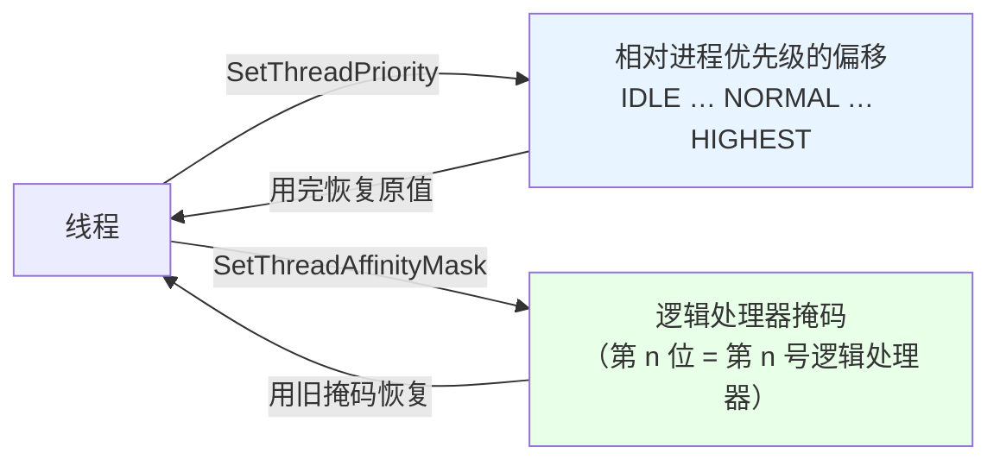

# 第 22 章 线程基础与调度

> **章内定位**：对应《Windows 核心编程》第 6–7 章“线程基础”与“线程调度、优先级和亲和性”。PowerShell 的并发模型（运行空间、`ForEach-Object -Parallel`）是**任务级**抽象，而 Win32 线程 API 提供的是**线程级**控制：创建挂起线程、设置优先级、绑定 CPU 亲和性。本章的价值在于揭示“**PowerShell 的并行脚本块之下，操作系统线程发生了什么**”。
>
> 一句话先立个规矩：**在 PowerShell 里，`CreateThread` 用来“执行纯本机回调或 .NET 方法”，而不是“跑 PowerShell 脚本块”**——第 17 章已经验证过，裸线程跑脚本块会报“没有运行空间”，甚至让进程崩溃。

---

## 22.1 线程创建与 `CreateThread` 的 PowerShell 边界

`CreateThread` 创建操作系统线程，返回线程句柄。但它的 `lpStartAddress`（线程入口）是一个**函数指针**——这正好戳中 PowerShell 的短板：PowerShell 没有“取函数地址”的语法。解决办法是：**定义委托 + `Marshal.GetFunctionPointerForDelegate()`**。

### `CreateThread` 的“函数指针 + 委托”机制

`CreateThread` 的原型（相关部分）：

```csharp
[DllImport("kernel32.dll", SetLastError = true)]
static extern IntPtr CreateThread(
    IntPtr attrs,        // NULL
    UIntPtr stackSize,   // 0 = 用默认大小
    IntPtr startAddr,    // 线程入口：函数指针
    IntPtr param,        // 传给线程函数的参数
    uint flags,          // 0 或 CREATE_SUSPENDED（0x4）
    out uint threadId);  // 输出线程 ID
```

`startAddr` 是 `IntPtr`，但我们要让线程跑“我们的函数”。流程是：

1. 定义一个**委托**（`delegate`）匹配线程函数签名；
2. 把要执行的**静态方法**包成该委托；
3. `Marshal.GetFunctionPointerForDelegate(委托)` 拿到函数指针；
4. 把指针传给 `CreateThread`。

**关键陷阱**：托管委托如果被垃圾回收，函数指针会“变空”，线程一启动就崩。所以**必须让委托活到线程结束**（用 `GC.KeepAlive` 或静态引用）。

### 一个可用的 C# 封装

这正是第 21 章“复杂 P/Invoke 封装进 C#”原则的又一次实践。我们把整套“委托 → 指针 → 创建 → 恢复 → 等待 → 关闭”写进一个 C# 方法：

```powershell
Add-Type -TypeDefinition @'
using System;
using System.Runtime.InteropServices;

public class ThreadTest {
    public delegate uint ThreadProc(IntPtr param);

    [DllImport("kernel32.dll", SetLastError=true)]
    public static extern IntPtr CreateThread(IntPtr attrs, UIntPtr stackSize,
        IntPtr startAddr, IntPtr param, uint flags, out uint threadId);

    [DllImport("kernel32.dll", SetLastError=true)]
    public static extern uint ResumeThread(IntPtr hThread);

    [DllImport("kernel32.dll", SetLastError=true)]
    public static extern uint WaitForSingleObject(IntPtr h, uint ms);

    [DllImport("kernel32.dll", SetLastError=true)]
    public static extern bool CloseHandle(IntPtr h);

    public static int Counter = 0;

    // 线程入口（纯 .NET 代码）
    public static uint Worker(IntPtr p) {
        System.Threading.Thread.Sleep(200);
        Counter = 42;
        return 0;
    }

    // 高层方法：PowerShell 只调这个
    public static int RunWorker() {
        ThreadProc proc = Worker;
        IntPtr fn = Marshal.GetFunctionPointerForDelegate(proc);

        uint tid;
        IntPtr h = CreateThread(IntPtr.Zero, UIntPtr.Zero,
            fn, IntPtr.Zero, 0x4 /*CREATE_SUSPENDED*/, out tid);
        if (h == IntPtr.Zero)
            throw new System.ComponentModel.Win32Exception(Marshal.GetLastWin32Error());

        ResumeThread(h);
        WaitForSingleObject(h, 5000);
        CloseHandle(h);

        GC.KeepAlive(proc);      // 撑住委托，防止被回收
        return Counter;
    }
}
'@

$result = [ThreadTest]::RunWorker()
"线程执行结果：$result"      # 42（实测确认）
```

要点：

- **`CREATE_SUSPENDED`（`0x4`）**：线程一创建就“挂着”，先做别的准备，再 `ResumeThread` 恢复；
- **`WaitForSingleObject(hThread, 超时)`**：等线程退出；
- **`CloseHandle(hThread)`**：线程退出后，句柄仍要关闭；
- **`GC.KeepAlive(proc)`**：防止委托被回收——这是最容易漏的一步。

### 线程的生命周期与“句柄 ≠ 线程”

再强调一次 Win32 的心智模型（第 20.3 节也讲过的“内核对象”思想）：

- **线程退出 ≠ 句柄失效**：线程函数返回后线程终止了，但它这个“内核对象”还活着（引用计数没到 0），`CloseHandle` 才把它销毁；
- 所以流程是：创建 → （恢复）→ 用完句柄 → `WaitForSingleObject` 等它 → `CloseHandle`。

### `Start-ThreadJob` 才是 PowerShell 首选的线程抽象

既然 Win32 线程这么绕、又只能跑“纯本机/纯 .NET 回调”，那“让 PowerShell 代码在后台线程跑”到底该用什么？

**用 `Start-ThreadJob`**（第 17 章讲过）：

```powershell
$job = Start-ThreadJob -ScriptBlock { Start-Sleep -Seconds 1; 2 + 2 }
$r = Receive-Job $job -Wait -AutoRemoveJob
$r     # 4
```

它帮你把“运行空间 + 线程 + 结果回收”全部封装好了，还能跑 PowerShell 脚本块。**结论**：

- 想让 **PowerShell 脚本**并行 → `Start-ThreadJob` / `ForEach-Object -Parallel`；
- 想执行**纯本机回调**（比如线程函数就是“调一个 Win32 API / 改一个共享计数”）→ `CreateThread` + 委托。

### 22.1 小结

1. **`CreateThread` 需要函数指针**：委托 + `Marshal.GetFunctionPointerForDelegate()`，且**必须 `GC.KeepAlive` 撑住委托**。
2. **`CREATE_SUSPENDED` + `ResumeThread`**：先挂起建线程，再恢复。
3. **线程退出 ≠ 句柄失效**：`WaitForSingleObject` 等它退，`CloseHandle` 关句柄。
4. **PowerShell 脚本并行用 `Start-ThreadJob`**，`CreateThread` 只给“纯本机/纯 .NET 回调”。

---

## 22.2 线程优先级与亲和性：`SetThreadPriority` / `SetThreadAffinityMask`

PowerShell 没有暴露这层控制；`SetThreadPriority` 调整线程相对进程优先级的偏移，`SetThreadAffinityMask` 把线程限制在指定 CPU 核心集合上跑。它们适合“**性能敏感的脚本做 CPU 绑核**”或“**实时性调试**”。

### `GetCurrentThread` 伪句柄

要操作“当前线程自己”，Win32 提供 `GetCurrentThread()`——它返回一个**伪句柄**：

```powershell
$h = [ThreadTest]::GetCurrentThread()
$h.ToInt64()      # -2（实测确认）
```

注意两个特殊性：

1. **伪句柄的值是固定的 `-2`**，不用（也不能）`CloseHandle`；
2. 它只对“当前线程”有效，别的线程拿到也用不了。

### 优先级常量与 `SetThreadPriority`

```powershell
# THREAD_PRIORITY_* 常量
# THREAD_PRIORITY_IDLE          = -15
# THREAD_PRIORITY_LOWEST        = -2
# THREAD_PRIORITY_BELOW_NORMAL  = -1
# THREAD_PRIORITY_NORMAL        = 0
# THREAD_PRIORITY_ABOVE_NORMAL  = 1
# THREAD_PRIORITY_HIGHEST       = 2

$h = [ThreadTest]::GetCurrentThread()

$old = [ThreadTest]::GetThreadPriority($h)     # 先记住原值（实测：0）
[void][ThreadTest]::SetThreadPriority($h, -1)  # 降到 Below Normal
[ThreadTest]::GetThreadPriority($h)            # -1（实测确认）
[void][ThreadTest]::SetThreadPriority($h, $old) # 用完恢复
```

要点：

- **“相对进程优先级”的偏移**：它不是在全局定基准，而是在线程所在进程优先级的基础上偏移几档；
- **用完恢复**：调完别把主线程压在低优先级不管；先读 `GetThreadPriority` 存原值，结束再还原。

### 亲和性掩码与 `SetThreadAffinityMask`

`SetThreadAffinityMask(hThread, mask)` 的 **`mask` 是一个位掩码**：第 `n` 位为 1，表示线程可以跑在逻辑处理器 `n` 上。

```powershell
# UIntPtr 掩码：只允许在 0 号、2 号逻辑处理器（0b101 = 5）
$mask = [System.UIntPtr]::new(5)
$old = [ThreadTest]::SetThreadAffinityMask($h, $mask)   # 返回旧掩码

# ...使用后，用旧掩码恢复
[ThreadTest]::SetThreadAffinityMask($h, $old) | Out-Null
```

注意：

- **`SetThreadAffinityMask` 返回“旧的掩码”**，不是布尔——用它来恢复；
- 掩码的位对应“**逻辑处理器**”（含超线程），不是物理核心；
- **绑定亲和性属于低层调优**：普通脚本别乱绑；绑错了可能让线程在超负载的核心上打转。

### `GetSystemInfo` 的 `dwActiveProcessorMask`

想“程序化”地知道“这台机器有哪些逻辑处理器可用”，用第 20 章已经能读到的 `SYSTEM_INFO.dwActiveProcessorMask`：

```powershell
$si = [Marshal]::PtrToStructure($ptr, [type][SYSTEM_INFO])
$si.dwActiveProcessorMask      # UIntPtr：可用处理器掩码
```

（`GetSystemInfo` 的取数路径见第 20.4 节。）它能帮助你“只在当前可用的处理器子集内绑核”，避免绑到一个不存在的核心。

把“优先级/亲和性”的作用画出来：



### 22.2 小结

1. **`GetCurrentThread()` 返回伪句柄 `-2`**，不用 `CloseHandle`，只对当前线程有效。
2. **`SetThreadPriority(句柄, 常量)`**：相对进程优先级的偏移（`THREAD_PRIORITY_NORMAL=0` 等）；**先读原值、用完恢复**。
3. **`SetThreadAffinityMask(句柄, 掩码)`**：位掩码对应逻辑处理器，**返回旧掩码用于恢复**。
4. **`SYSTEM_INFO.dwActiveProcessorMask`** 提供“可用处理器”的信息，避免绑到不存在的核心。

---

## 本章总结

第 22 章把“Win32 线程级控制”讲成了两条线：

- **22.1 线程创建**：`CreateThread` 需要**委托 + `GetFunctionPointerForDelegate`**（必须 `KeepAlive`）；`CREATE_SUSPENDED`+`ResumeThread`；线程退出后仍要 `CloseHandle`；PowerShell 脚本并行用 `Start-ThreadJob`，`CreateThread` 只给纯本机/纯 .NET 回调。
- **22.2 调度控制**：`GetCurrentThread` 的伪句柄；`SetThreadPriority` 调整优先级偏移（用完恢复）；`SetThreadAffinityMask` 绑核（旧掩码恢复）；`SYSTEM_INFO.dwActiveProcessorMask` 提供可用处理器信息。

一句话记住全章：**“`CreateThread` 要委托+函数指针还要 KeepAlive；线程句柄线程退出后仍要关；优先级/亲和性调完必须恢复。”**

**下一章预告**：第 23 章《线程同步：用户模式与内核对象》。对应《Windows 核心编程》第 8–9 章。我们会讲 `CRITICAL_SECTION`（比 `Monitor` 更轻的用户模式临界区）、`SRWLOCK`（读写锁），以及可跨进程的**命名 Mutex / Event / Semaphore** 和 `WaitForSingleObject` / `WaitForMultipleObjects`。这一章的判断线是：**能 .NET（`Monitor`/`SemaphoreSlim`）就先 .NET；需要跨进程或用 Win32 原生对象时，才下沉到内核对象同步。**

---

> **动手练习**
>
> 1. 用 22.1 的 C# 封装 `[ThreadTest]::RunWorker()`，把 `Counter` 改成别的结果，验证线程确实执行了。
> 2. 把 `GC.KeepAlive(proc)` 注释掉试试（在独立会话里），观察是否会出现“随机崩溃/找不到入口”——理解 KeepAlive 的意义。
> 3. 用 `GetCurrentThread()` 读伪句柄，确认 `ToInt64()` 是 `-2`；再用 `SetThreadPriority` 降到 `-1` 再恢复，观察 `GetThreadPriority` 的变化。
> 4. 用 `SetThreadAffinityMask` 把当前线程绑到 0 号核，读完旧掩码后恢复。
> 5. 对比 `CreateThread` 与 `Start-ThreadJob`：同一个“后台做点事”的任务，分别用两种方式，体会“纯回调 vs PowerShell 脚本”的边界。