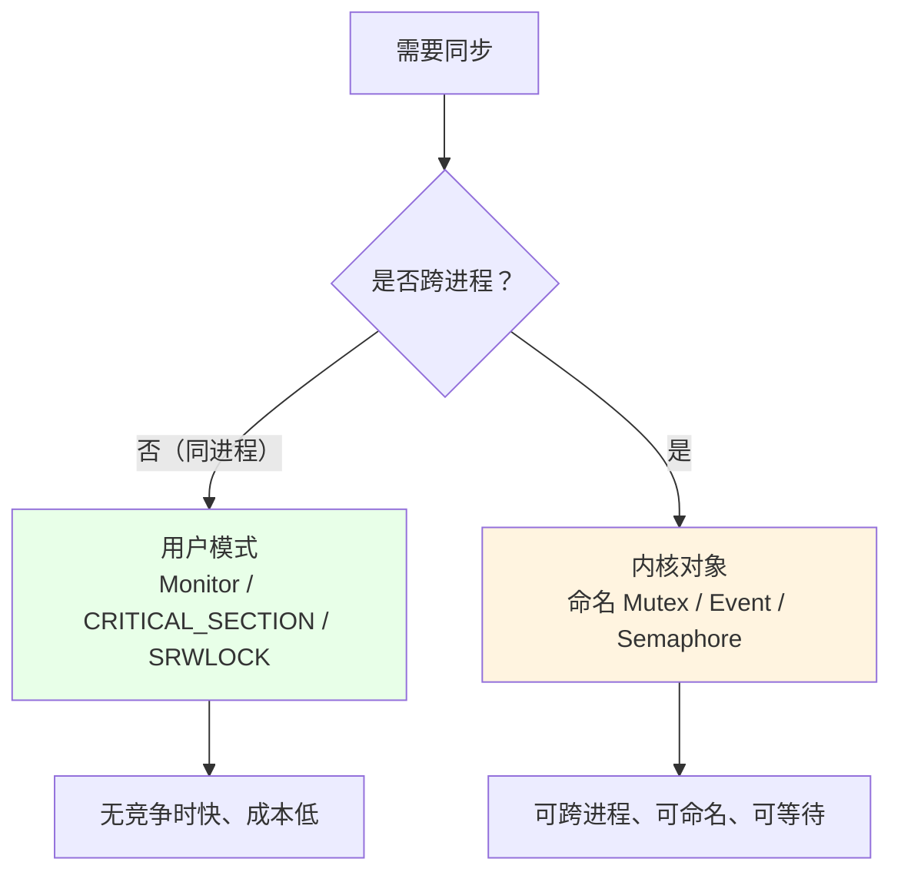
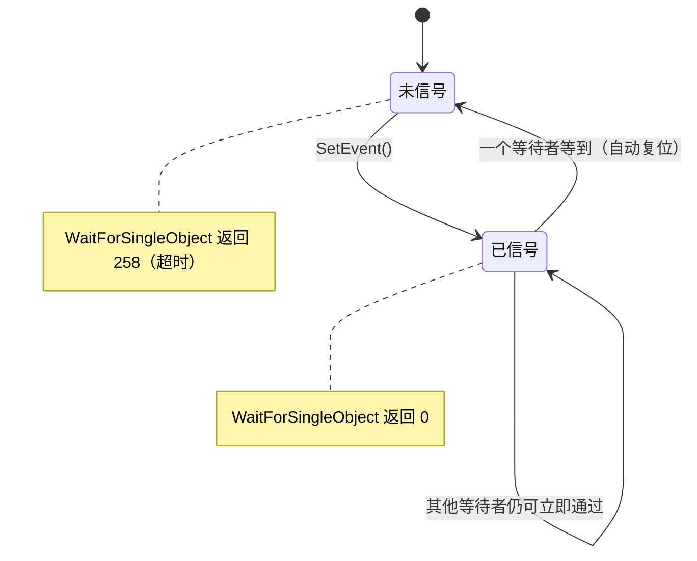

# 第 23 章 线程同步：用户模式与内核对象

> **章内定位**：对应《Windows 核心编程》第 8–9 章“用户模式下的线程同步”与“用内核对象进行线程同步”。PowerShell 没有 `lock` 关键字，第 17 章已经介绍了 `Monitor` / `Interlocked` / `SemaphoreSlim`。本章补充的是 **Win32 特有的同步原语**：`CRITICAL_SECTION`（用户模式临界区，比 `Monitor` 更轻）、`SRWLOCK`（读写锁），以及可跨进程的**命名 Mutex / Event / Semaphore**。理解“用户模式同步”与“内核对象同步”的分界，是写出正确并行 PowerShell 代码的关键。
>
> 一句判断线先放这里：**能 .NET（`Monitor` / `SemaphoreSlim` / `Mutex`）就先 .NET；需要跨进程、或需要 Win32 原生对象语义时，才下沉到内核对象。**

---

## 23.1 用户模式同步：`CRITICAL_SECTION` 与 `SRWLOCK`

“用户模式同步”的意思是：**无竞争时，整个加锁/解锁完全在用户态完成，不陷入内核**。只有真的发生竞争、需要等待时，才转去内核。这让它在“短临界区、低竞争”场景下比内核对象轻很多。

### 为什么还要学 `CRITICAL_SECTION`（`Monitor` 已经够用？）

`Monitor`（第 17 章）在功能上和 `CRITICAL_SECTION` 很像，而且 PowerShell 直接用 `[System.Threading.Monitor]::Enter/Exit` 就能用。那为什么还要学 `CRITICAL_SECTION`？

原因是：

1. 它是 **Windows 原生**的、更底层的临界区，理解它有助于看懂 C/C++ 代码和《Windows 核心编程》；
2. 在某些“极短临界区”场景，它比 `Monitor` 的开销更可预测；
3. 你要和“别人的本机代码”共用同一套同步机制时，可能需要它。

> **但注意**：`CRITICAL_SECTION` 是“非托管结构”，**初始化/进入/离开/删除必须严格配对**，没有异常安全（没有 `try/finally` 帮你自动 `Leave`）。在 PowerShell 里，写错一步就可能死锁。所以**能用 `Monitor` 的地方，优先 `Monitor`**。

### `InitializeCriticalSection` / `Enter` / `Leave` / `Delete`

`CRITICAL_SECTION` 是一个结构体（在 x64 上通常是 40 字节）。我们可以按经典布局声明它：

```csharp
[StructLayout(LayoutKind.Sequential)]
public struct CRITICAL_SECTION {
    public IntPtr DebugInfo;
    public int LockCount;
    public int RecursionCount;
    public IntPtr OwningThread;
    public IntPtr LockSemaphore;
    public UIntPtr SpinCount;
}

[DllImport("kernel32.dll")] public static extern void InitializeCriticalSection(ref CRITICAL_SECTION cs);
[DllImport("kernel32.dll")] public static extern void EnterCriticalSection(ref CRITICAL_SECTION cs);
[DllImport("kernel32.dll")] public static extern void LeaveCriticalSection(ref CRITICAL_SECTION cs);
[DllImport("kernel32.dll")] public static extern void DeleteCriticalSection(ref CRITICAL_SECTION cs);
```

使用顺序（**必须严格配对**）：

```powershell
$cs = [CRITICAL_SECTION]::new()

[SyncTest]::InitializeCriticalSection([ref]$cs)   # 1. 初始化
try {
    [SyncTest]::EnterCriticalSection([ref]$cs)    # 2. 进入临界区
    try {
        # 临界区：同一时刻只有一个线程能进
    }
    finally {
        [SyncTest]::LeaveCriticalSection([ref]$cs)  # 3. 离开（必须配 finally）
    }
}
finally {
    [SyncTest]::DeleteCriticalSection([ref]$cs)    # 4. 删除
}
```

实测确认：`Initialize` → `Enter` → `Leave` → `Delete` 这一套能正常执行。

几个关键点：

- **`InitializeCriticalSection` 必须在任何 `Enter` 之前**；
- **`Enter` / `Leave` 必须严格配对**，而且要用 `try/finally` 保证“中途抛异常也会 Leave”；
- **`DeleteCriticalSection` 在不再使用后调用**；不要在还有线程可能进入时删除；
- **同一线程可以递归进入**（`RecursionCount` 会增加），但每次 `Enter` 都要对应一次 `Leave`。

### `SRWLOCK`：共享读 / 独占写

普通临界区是“互斥”的：读和读之间也互相挡。`SRWLOCK`（Slim Reader/Writer Lock）区分两种模式：

- **共享模式（shared）**：多个读线程可以同时持有；
- **独占模式（exclusive）**：写线程独占，和任何其他持有者互斥。

```csharp
[DllImport("kernel32.dll")] public static extern void InitializeSRWLock(out IntPtr srw);
[DllImport("kernel32.dll")] public static extern void AcquireSRWLockExclusive(ref IntPtr srw);
[DllImport("kernel32.dll")] public static extern void ReleaseSRWLockExclusive(ref IntPtr srw);
```

```powershell
$srw = [IntPtr]::Zero
[SyncTest]::InitializeSRWLock([ref]$srw)   # 初始化
try {
    [SyncTest]::AcquireSRWLockExclusive([ref]$srw)  # 独占（写）
    try {
        # 写临界区
    }
    finally {
        [SyncTest]::ReleaseSRWLockExclusive([ref]$srw)
    }
}
finally {
    # SRWLOCK 不需要 DeleteSRWLock
}
```

实测确认“初始化 → 独占获取 → 释放”可用。`SRWLOCK` 的特点是：

- **没有 `Delete`**：它不需要显式销毁；
- **读写分离**：适合“读多写少”的场景（多个读者并发，写者独占）；
- 但**默认不保证公平性**，长期饥饿（写者一直拿不到）是可能的；需要公平性时要另想办法。

### 用户模式 vs 内核模式的代价

把两者对比一下：

| 维度 | 用户模式（`CRITICAL_SECTION` / `Monitor` / `SRWLOCK`） | 内核对象（Mutex / Event / Semaphore） |
|---|---|---|
| 无竞争时 | 几乎不陷入内核，很快 | 每次都要系统调用，较慢 |
| 有竞争时 | 可能短暂自旋，再转内核等待 | 直接内核等待 |
| 跨进程 | **不行**（只在当前进程内） | **可以**（命名对象） |
| 异常安全 | 需要自己 `try/finally` | 同样需要 `try/finally` |
| 典型用途 | 同进程内的短临界区 | 跨进程、长时间等待、事件通知 |



### 23.1 小结

1. **`CRITICAL_SECTION`** 是用户模式临界区：`Initialize` → `Enter` → `Leave` → `Delete`，**严格配对 + `try/finally`**。
2. **`SRWLOCK`** 提供共享读 / 独占写，**不需要 Delete**，适合读多写少。
3. **用户模式同步不跨进程**；无竞争时快，有竞争才转内核。
4. **能 `Monitor` 就 `Monitor`**：`CRITICAL_SECTION` 没有异常安全，写错就死锁。

---

## 23.2 内核对象同步：`WaitForSingleObject` / `WaitForMultipleObjects` 与命名对象

“内核对象同步”的主角是**可等待内核对象**：Mutex、Event、Semaphore、Waitable Timer。它们都有“已信号 / 未信号”状态，`WaitForSingleObject` 会阻塞到“已信号”或超时。**命名对象还能跨进程**——这是 PowerShell 协调多个脚本实例的底层机制。

### 可等待内核对象与 `WaitForSingleObject`

```powershell
$result = [SyncTest]::WaitForSingleObject($handle, 1000)   # 最多等 1 秒
```

返回值：

| 值 | 常量 | 含义 |
|---|---|---|
| `0` | `WAIT_OBJECT_0` | 等到了（对象已信号） |
| `258`（`0x102`） | `WAIT_TIMEOUT` | 超时 |
| `128`（`0x80`） | `WAIT_ABANDONED` | 互斥体被“遗弃”（所有者线程死了） |
| `0xFFFFFFFF` | `WAIT_FAILED` | 调用失败（读 `GetLastWin32Error`） |

`INFINITE` 是 `0xFFFFFFFF`（一直等）。注意：`INFINITE` 和 `WAIT_FAILED` 的值一样，靠“上下文/错误码”区分——所以**别把 `INFINITE` 当返回值来比较**。

### `CreateEvent` / `SetEvent`：手动复位 vs 自动复位（实测）

Event 是最常用的“通知”内核对象：

```csharp
[DllImport("kernel32.dll", SetLastError=true)]
public static extern IntPtr CreateEvent(IntPtr attrs, bool manualReset, bool initialState, string name);
[DllImport("kernel32.dll", SetLastError=true)] public static extern bool SetEvent(IntPtr h);
[DllImport("kernel32.dll", SetLastError=true)] public static extern bool ResetEvent(IntPtr h);
```

```powershell
$e = [SyncTest]::CreateEvent([IntPtr]::Zero, $false /*autoReset*/, $false /*initialState*/, $null)

$w1 = [SyncTest]::WaitForSingleObject($e, 100)   # 258 = 超时（还没信号）
[void][SyncTest]::SetEvent($e)                   # 设为已信号
$w2 = [SyncTest]::WaitForSingleObject($e, 100)   # 0 = 等到了
$w3 = [SyncTest]::WaitForSingleObject($e, 100)   # 258 = 自动复位后又没信号了
```

我们实测确认了这条“**258 → 0 → 258**”的序列：

- **自动复位（`manualReset=$false`）**：一个等待者等到后，事件**自动回到未信号**，下一个等待者会继续等；
- **手动复位（`manualReset=$true`）**：`SetEvent` 后一直保持已信号，直到你显式 `ResetEvent`。

“自动复位”适合“**一对一通知**”（生产者发一次、消费者收一次）；“手动复位”适合“**广播**”（一个事件通知所有等待者）。

把自动复位事件的状态变化画出来：



### `CreateMutex` / `ReleaseMutex`：互斥与递归获取

Mutex 是“互斥体”：同一时刻只有一个线程/进程能“拥有”它。

```csharp
[DllImport("kernel32.dll", CharSet=CharSet.Auto, SetLastError=true)]
public static extern IntPtr CreateMutex(IntPtr attrs, bool initialOwner, string name);
[DllImport("kernel32.dll", SetLastError=true)] public static extern bool ReleaseMutex(IntPtr h);
```

```powershell
# initialOwner = $false：创建时不拥有
$m = [SyncTest]::CreateMutex([IntPtr]::Zero, $false, 'Local\PSDeepDiveTestMutex')

$w = [SyncTest]::WaitForSingleObject($m, 1000)   # 0 = 拿到了
try {
    # 临界区
}
finally {
    [void][SyncTest]::ReleaseMutex($m)           # 必须释放
    [void][SyncTest]::CloseHandle($m)
}
```

几个必须记牢的点：

1. **Mutex 是“可递归”的**：同一个线程可以多次 `WaitForSingleObject` 成功，但**每次获取都要对应一次 `ReleaseMutex`**；
2. **所有者线程退出时，Mutex 会变成“遗弃”状态**，下一个等待者会得到 `WAIT_ABANDONED`（128）——这通常意味着“上一个持锁者异常退出了”，要检查共享状态；
3. **命名 Mutex（`Local\` / `Global\`）可跨进程**，是“防止两个脚本实例同时跑”的经典手段。

> 注意：**不能拿“同一线程再等一次”来演示 `WAIT_TIMEOUT`**——因为同一线程对已拥有的 Mutex 是“递归获取”，会立刻成功（我们实测就是 `0`）。想看超时，需要“另一个线程/进程持有 Mutex”。

### `CreateSemaphore` / `ReleaseSemaphore`：计数信号量

Semaphore 是“计数信号量”：有一个当前计数，`WaitForSingleObject` 成功会把计数减 1，`ReleaseSemaphore` 加回去。

```csharp
[DllImport("kernel32.dll", CharSet=CharSet.Auto, SetLastError=true)]
public static extern IntPtr CreateSemaphore(IntPtr attrs, int initialCount, int maxCount, string name);
[DllImport("kernel32.dll", SetLastError=true)]
public static extern bool ReleaseSemaphore(IntPtr h, int releaseCount, out int previousCount);
```

```powershell
# 初始 3、最多 3：同一时刻最多 3 个“拿到令牌”
$s = [SyncTest]::CreateSemaphore([IntPtr]::Zero, 3, 3, $null)

$w = [SyncTest]::WaitForSingleObject($s, 1000)   # 0 = 拿到一个令牌
try {
    # 受限的操作
}
finally {
    $prev = 0
    [void][SyncTest]::ReleaseSemaphore($s, 1, [ref]$prev)   # 还一个令牌
    [void][SyncTest]::CloseHandle($s)
}
```

- **`CreateSemaphore(初始计数, 最大计数, 名字)`**：初始 3 表示“一开始就有 3 个令牌”；
- **`ReleaseSemaphore(handle, 1, [ref]$prev)`**：把计数 +1，`$prev` 是“加之前的值”；
- **初始计数为 0 的信号量**常用来“等某个初始化完成”（先 `Wait` 阻塞，初始化完再 `Release`）。

### `WaitForMultipleObjects`：等待多个（任一 / 全部）

当你需要“同时等好几个对象”，用 `WaitForMultipleObjects`：

```csharp
[DllImport("kernel32.dll", SetLastError=true)]
public static extern uint WaitForMultipleObjects(
    uint count, IntPtr[] handles, bool waitAll, uint milliseconds);
```

```powershell
$handles = [IntPtr[]]@($h1, $h2, $h3)

# waitAll = $false：任一对象变为已信号就返回
$r = [SyncTest]::WaitForMultipleObjects(3, $handles, $false, 5000)

# waitAll = $true：全部对象都变为已信号才返回
$r = [SyncTest]::WaitForMultipleObjects(3, $handles, $true, 5000)
```

返回值：`WAIT_OBJECT_0 + 索引` 表示“第几个对象触发了”；`WAIT_TIMEOUT`（258）表示超时。限制：一次最多等 `MAXIMUM_WAIT_OBJECTS`（64）个句柄。

### 命名对象与跨进程同步（`Global\` / `Local\`）

命名对象的名字可以带前缀：

- **`Local\Name`**：只在当前登录会话可见（默认）；
- **`Global\Name`**：跨登录会话可见（通常需要更高权限）。

这带来两个典型用法：

**用法一：单实例脚本（防止两个实例同时跑）**

```powershell
$mutex = [System.Threading.Mutex]::new($false, 'Global\MyScript-Mutex')
if (-not $mutex.WaitOne(0)) {
    '已有另一个实例在运行'
    exit
}
try {
    # 脚本主体
}
finally {
    $mutex.ReleaseMutex()
}
```

**用法二：跨进程通知**

一个进程 `CreateEvent('Global\MyEvent')` 并等待；另一个进程 `OpenEvent` 后 `SetEvent`——这就是“事件通知”的跨进程形态。

> **能用 .NET 的 `System.Threading.Mutex` / `EventWaitHandle` 时，优先用它们**：它们会帮你管理句柄、实现 `IDisposable`、跨平台行为也更一致。只有需要 Win32 特有语义（`WAIT_ABANDONED` 的精确处理、与原生代码共享对象）时，才用 `CreateMutex` / `CreateEvent`。

### 23.2 小结

1. **`WaitForSingleObject`**：`0` = 等到了、`258` = 超时、`128` = 遗弃、`0xFFFFFFFF` = 失败。
2. **Event**：自动复位“等到即复位”（258→0→258 实测），手动复位“一直保持到 `ResetEvent`”。
3. **Mutex**：同一线程可递归获取（配对 `ReleaseMutex`）；所有者退出变“遗弃”；命名 Mutex 可跨进程。
4. **Semaphore**：计数信号量，`Wait` 减、`ReleaseSemaphore` 加，适合限流。
5. **`WaitForMultipleObjects`**：等多个对象（任一/全部，最多 64 个）；**命名对象**（`Global\`/`Local\`）用于跨进程。

---

## 本章总结

第 23 章把“同步”分成了“用户模式”和“内核对象”两层：

- **23.1 用户模式**：`CRITICAL_SECTION`（严格配对 + `try/finally`）、`SRWLOCK`（共享读/独占写，无需 Delete）；无竞争快、不跨进程；能 `Monitor` 就 `Monitor`。
- **23.2 内核对象**：`WaitForSingleObject` 的返回值语义；Event 的自动/手动复位；Mutex 的递归与遗弃；Semaphore 的计数；`WaitForMultipleObjects`；命名对象跨进程。

一句话记住全章：**“同进程短临界区用 `Monitor`/`CRITICAL_SECTION`；跨进程/事件通知用命名 `Mutex`/`Event`/`Semaphore`；`Enter`/`Wait` 和 `Leave`/`Release`/`CloseHandle` 必须配对。”**

**下一章预告**：第 24 章《内存管理：虚拟内存、堆与内存映射文件》。对应《Windows 核心编程》第 III 部分“内存管理”。我们会讲 `VirtualQuery` 查内存区域状态、`VirtualAlloc`/`VirtualFree` 的保留/提交语义、以及 `CreateFileMapping`/`MapViewOfFile` 做“大文件随机访问”和“跨进程共享内存”。本章的 `Marshal.AllocHGlobal` 只是“托管堆外的一小块”，而 `VirtualAlloc` 才是“直接向操作系统要地址空间”。

---

> **动手练习**
>
> 1. 用 23.1 的 `CRITICAL_SECTION` 结构体，走一遍 `Initialize`→`Enter`→`Leave`→`Delete`，体会“必须配对”。
> 2. 用 `SRWLOCK` 做一次独占获取/释放；再想想“多个读者并发”的场景为什么它能省。
> 3. 用 `CreateEvent`（自动复位）验证“258 → SetEvent → 0 → 再等 → 258”的序列。
> 4. 用 `CreateMutex` + `WaitForSingleObject` + `ReleaseMutex` 写一个“单实例”检查；试试同时开两个 PowerShell 窗口跑同一段，观察第二个是否被挡住。
> 5. 用 `CreateSemaphore(3,3)` 模拟“同一时刻最多 3 个”的令牌；体会 `ReleaseSemaphore` 的 `[ref]` 前值参数。
> 6. 对比 `Monitor`（第 17 章）与 `CRITICAL_SECTION`，列出“各自的异常安全 / 跨进程 / 易用性”差异。
