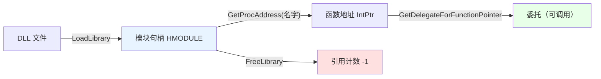
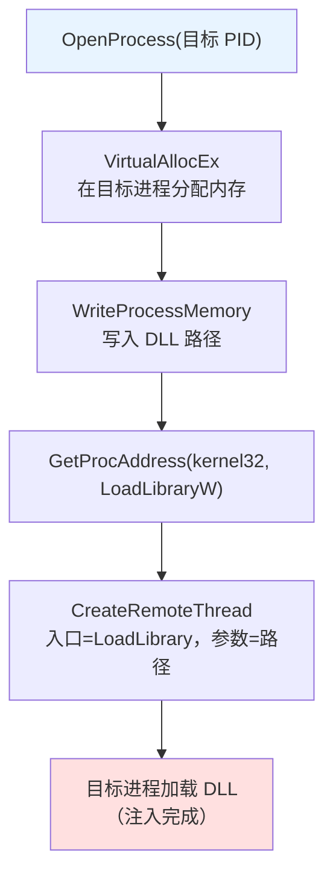

# 第 25 章 动态链接库：基础、高级技术与注入

> **章内定位**：对应《Windows 核心编程》第 IV 部分“动态链接库”（第 19–22 章：DLL 基础、DLL 高级技术、线程局部存储、DLL 注入和 API 拦截）。PowerShell 中 `Add-Type -Path` 和 `[Reflection.Assembly]::LoadFrom()` 已经覆盖了**托管 DLL** 的加载。本章关注的是**非托管 DLL**：`LoadLibrary` / `GetProcAddress` 的运行时动态加载、导出函数的调用、以及 DLL 注入这一高风险操作的**边界**。
>
> 本章的立场要先说清楚：**DLL 注入在 PowerShell 脚本里是“高风险且通常不必要”的操作**。本章教它的目的，是让你**理解机制、看懂安全告警、能做防御与诊断**，而不是鼓励你在脚本里实施注入。

---

## 25.1 非托管 DLL 的动态加载：`LoadLibrary` / `GetProcAddress` / `FreeLibrary`

先区分两种“绑定”：

- **编译时绑定（`DllImport`）**：你在 C# 里写 `[DllImport("user32.dll")]`，编译时就确定了“哪个 DLL、哪个函数”。第 20–24 章用的都是这种；
- **运行时动态绑定（`LoadLibrary` + `GetProcAddress`）**：脚本运行时才决定“加载哪个 DLL、取哪个函数”。适合**函数名在编写时未知**、或**DLL 路径在运行时才确定**的场景。

### `LoadLibrary`：把 DLL 映射进当前进程

```csharp
[DllImport("kernel32.dll", CharSet=CharSet.Auto, SetLastError=true)]
public static extern IntPtr LoadLibrary(string path);
```

`LoadLibrary` 会：

1. 按搜索路径找到 DLL；
2. 把它映射进**当前进程**的地址空间；
3. 执行它的 `DllMain`（初始化）；
4. 返回一个 `HMODULE`（模块句柄，`IntPtr`）。

```powershell
$h = [DllTest]::LoadLibrary('user32.dll')
if ($h -eq [IntPtr]::Zero) {
    $code = [System.Runtime.InteropServices.Marshal]::GetLastWin32Error()
    throw "LoadLibrary 失败：$([System.ComponentModel.Win32Exception]::new($code).Message)"
}
```

实测：加载 `user32.dll` 返回非零句柄；加载一个不存在的 DLL 返回 `IntPtr.Zero`，错误码 **126**（“找不到指定的模块。”）。

### `GetProcAddress`：按名字找导出函数

```csharp
[DllImport("kernel32.dll", CharSet=CharSet.Ansi, SetLastError=true)]
public static extern IntPtr GetProcAddress(IntPtr module, string procName);
```

`GetProcAddress` 按**函数名**（或序号）在模块里找导出函数，返回它的**地址**（`IntPtr`）。找不到返回 `IntPtr.Zero`。

```powershell
$p = [DllTest]::GetProcAddress($h, 'GetSystemMetrics')
# $p 是函数地址；$p -eq [IntPtr]::Zero 表示没找到
```

### `GetDelegateForFunctionPointer`：把函数地址变成可调用委托

拿到地址还不能直接调——PowerShell 不会“执行一个 `IntPtr`”。要把地址“翻译”成一个**委托**，再通过委托调用：

```csharp
public delegate int GetSystemMetricsProc(int index);
```

```powershell
$d = [System.Runtime.InteropServices.Marshal]::GetDelegateForFunctionPointer(
    $p, [type][DllTest+GetSystemMetricsProc])

$width  = $d.Invoke(0)    # SM_CXSCREEN
$height = $d.Invoke(1)    # SM_CYSCREEN
"屏幕：$width x $height"
```

我们实测得到 `1280 x 720`——这说明整条“LoadLibrary → GetProcAddress → 委托 → 调用”链路是通的。

> **关键点**：**委托的签名必须和本机函数完全一致**（参数类型、返回类型、调用约定）。签名错一点，轻则结果乱、重则崩溃——因为参数是按“二进制约定”传的，没有类型检查。

### `FreeLibrary`：引用计数与配对

```csharp
[DllImport("kernel32.dll", SetLastError=true)]
public static extern bool FreeLibrary(IntPtr module);
```

`FreeLibrary` **递减模块的引用计数**；计数归零时，DLL 从进程卸载。所以 **`LoadLibrary` 和 `FreeLibrary` 必须配对**：

```powershell
$h = [DllTest]::LoadLibrary('user32.dll')
try {
    # 用模块……
}
finally {
    [void][DllTest]::FreeLibrary($h)   # 实测 True
}
```

注意：很多系统 DLL（`kernel32`、`user32`）本身已经被进程加载了，`LoadLibrary` 只是“引用计数 +1”，`FreeLibrary` 是“-1”，不会真的把它们卸载掉。

### 一个完整例子（`GetSystemMetrics` 实测）

```powershell
Add-Type -TypeDefinition @'
using System;
using System.Runtime.InteropServices;
public class DllTest {
    [DllImport("kernel32.dll", CharSet=CharSet.Auto, SetLastError=true)]
    public static extern IntPtr LoadLibrary(string path);
    [DllImport("kernel32.dll", CharSet=CharSet.Ansi, SetLastError=true)]
    public static extern IntPtr GetProcAddress(IntPtr module, string procName);
    [DllImport("kernel32.dll", SetLastError=true)]
    public static extern bool FreeLibrary(IntPtr module);
    public delegate int GetSystemMetricsProc(int index);
}
'@

$h = [DllTest]::LoadLibrary('user32.dll')
try {
    $p = [DllTest]::GetProcAddress($h, 'GetSystemMetrics')
    $d = [System.Runtime.InteropServices.Marshal]::GetDelegateForFunctionPointer(
        $p, [type][DllTest+GetSystemMetricsProc])
    "屏幕：$($d.Invoke(0)) x $($d.Invoke(1))"   # 1280 x 720（实测）
}
finally {
    [void][DllTest]::FreeLibrary($h)
}
```

把这条“动态绑定”链路画出来：



### 搜索路径与 `LoadLibraryEx`（安全）

`LoadLibrary('xxx.dll')` 会按“**应用程序目录 → 系统目录 → … → PATH**”的顺序搜索。这带来一个经典安全问题：**DLL 劫持**——如果攻击者把一个同名的恶意 DLL 放到“更早被搜索到的目录”，你本来想加载正常 DLL，却加载了恶意的。

更安全的做法：

1. **传完整路径**：`LoadLibrary('C:\Windows\System32\user32.dll')`；
2. **用 `LoadLibraryEx` + `LOAD_LIBRARY_SEARCH_*` 标志**，明确限定搜索范围（比如只搜 System32）；
3. **`AddDllDirectory` / `SetDefaultDllDirectories`** 在进程级收窄搜索路径。

```csharp
[DllImport("kernel32.dll", CharSet=CharSet.Auto, SetLastError=true)]
public static extern IntPtr LoadLibraryEx(string path, IntPtr file, uint flags);
```

这是第 29 章“Win32 安全清单”里会强调的一条：**动态加载 DLL 时，路径要显式、搜索范围要收窄。**

### 25.1 小结

1. **`DllImport` 是编译时绑定**；**`LoadLibrary` + `GetProcAddress` 是运行时动态绑定**。
2. **`LoadLibrary`** 把 DLL 映射进进程、返回 `HMODULE`；失败读 `GetLastWin32Error`（126 = 找不到模块）。
3. **`GetProcAddress`** 按名字找导出函数，返回地址；**`GetDelegateForFunctionPointer`** 把地址变成可调用委托，**签名必须与本机函数一致**。
4. **`LoadLibrary` / `FreeLibrary` 配对**；**搜索路径要显式**（防 DLL 劫持），优先完整路径或 `LoadLibraryEx`。

---

## 25.2 DLL 注入与 API 拦截的边界

“DLL 注入”是指：**把一个 DLL 强行加载到“另一个进程”里**，让它在该进程内执行代码。理解它，对于“看懂安全软件告警、排查异常加载、做防御”很有价值。

### 经典注入路径：`CreateRemoteThread` + `LoadLibrary`

最经典的注入链路是这样的（**仅讲机制，不提供可执行脚本**）：

1. `OpenProcess` 打开目标进程，拿到 `hProcess`（需要 `PROCESS_CREATE_THREAD | PROCESS_VM_OPERATION | PROCESS_VM_WRITE` 等权限）；
2. `VirtualAllocEx` 在**目标进程**里分配一块内存；
3. `WriteProcessMemory` 把“DLL 路径字符串”写进目标进程；
4. 在**当前进程**里用 `GetProcAddress(GetModuleHandle('kernel32'), 'LoadLibraryW')` 找到 `LoadLibrary` 的地址（`kernel32` 在各进程里的加载基址通常一致）；
5. `CreateRemoteThread` 在目标进程里开一个线程，**入口就是 `LoadLibrary`，参数是 DLL 路径**；
6. 目标进程被调度执行这个线程时，就“自己把 DLL 加载了”——注入完成。

用一张图表示这条链：



### `SetWindowsHookEx`：另一种注入机制

`SetWindowsHookEx` 是“全局钩子”机制：当你设置一个“全局钩子”（比如 `WH_KEYBOARD`）时，**Windows 会把这个钩子 DLL 映射到所有 GUI 进程**，让它们都能回调你的钩子函数。这本来是为了“输入监控/辅助功能”，但它同时也是一种“注入机制”。

```csharp
[DllImport("user32.dll", SetLastError=true)]
public static extern IntPtr SetWindowsHookEx(int hookType, IntPtr hookProc, IntPtr module, uint threadId);
```

它的代价与限制：**需要把钩子 DLL 注入所有目标 GUI 进程**，兼容性、位数（32/64 位）、权限、安全软件告警都是问题。

### 为什么 PowerShell 里做注入是高风险且通常不必要

把“注入”放到 PowerShell 脚本里，会叠加上一堆额外风险：

1. **需要高权限句柄**：`PROCESS_ALL_ACCESS` 之类的权限，普通用户往往拿不到；
2. **安全软件必然告警**：`VirtualAllocEx` + `WriteProcessMemory` + `CreateRemoteThread` 是恶意软件的“标准三连”，EDR/杀软会重点盯；
3. **位数/会话/UIPI 限制**：32 位 PowerShell 注入不了 64 位进程；服务会话操作不了交互式桌面；低完整性进程碰不了高完整性进程；
4. **PowerShell 运行空间模型**：注入进去的是“本机 DLL 的代码”，它和 PowerShell 的运行空间、脚本块没有关系；想从注入的 DLL “回调到 PowerShell”，极其困难且脆弱；
5. **稳定性**：注入失败/时机不对，可能导致目标进程崩溃——这是“别人的进程”，崩了后果不可控。

**结论**：**如果脚本需要“扩展某个程序的行为”，优先找该程序自己的“插件 / 扩展 / 宏 / API”机制**，而不是注入。注入应该是“最后、最不情愿”的选项。

### 把“理解”用于防御与诊断

既然我们不在脚本里做注入，那学它有什么用？三个实在的用途：

1. **看懂告警**：安全软件报“进程 A 对进程 B 执行了 `CreateRemoteThread` + `WriteProcessMemory`”，你知道这是什么行为模式；
2. **排查“异常加载”**：用 `Get-Process -Module`（或 `[System.Diagnostics.Process]::GetCurrentProcess().Modules`）看某个进程加载了哪些 DLL，发现可疑路径；
3. **加固自己的脚本**：动态加载 DLL 时用完整路径/`LoadLibraryEx`，避免被“同名 DLL”劫持（25.1 节讲过）。

```powershell
# 看一个进程加载了哪些模块（诊断用途）
(Get-Process -Id $PID).Modules | Select-Object -First 10 ModuleName, FileName
```

### 25.2 小结

1. **经典注入链路**：`OpenProcess` → `VirtualAllocEx` → `WriteProcessMemory` → `CreateRemoteThread(LoadLibrary)`。
2. **`SetWindowsHookEx`** 是另一种“全局钩子”注入机制。
3. **PowerShell 里做注入高风险且通常不必要**：权限、告警、位数/会话限制、运行空间无关、稳定性差。
4. **优先用目标程序自己的扩展机制**；学注入是为了**看懂告警、排查异常加载、加固自己的 DLL 加载**。

---

## 本章总结

第 25 章把“DLL”讲成了两条线：

- **25.1 动态加载**：`LoadLibrary`（映射 + 引用计数）、`GetProcAddress`（按名字找函数）、`GetDelegateForFunctionPointer`（地址 → 委托，**签名必须一致**）、`FreeLibrary`（配对）；**搜索路径要显式**，防 DLL 劫持。
- **25.2 注入边界**：经典 `CreateRemoteThread + LoadLibrary` 链路、`SetWindowsHookEx`；**PowerShell 里注入高风险且不必要**；把理解用于“看告警、查加载、加固加载路径”。

一句话记住全章：**“`LoadLibrary` 映射、`GetProcAddress` 找地址、`GetDelegateForFunctionPointer` 变委托；注入要懂但别在脚本里做，路径要显式防劫持。”**

**下一章预告**：第 26 章《结构化异常处理与错误报告》。对应《Windows 核心编程》第 V 部分“结构化异常处理”。我们会讲清 **SEH 的 `__try` / `__except` / `__finally` 与 .NET 托管异常、C++ 异常之间的层次关系**，`AddVectoredExceptionHandler` 的“进程级最后防线”，以及为什么**本机 DLL 抛出的 SEH 异常会绕过 PowerShell 的 `try/catch`、甚至直接终止进程**——这对于“调用不可信本机代码”的边界判断非常关键。

---

> **动手练习**
>
> 1. 用 25.1 的 `DllTest` 加载 `user32.dll`，`GetProcAddress('GetSystemMetrics')`，用委托读出屏幕宽高，最后 `FreeLibrary`。
> 2. 故意加载一个不存在的 DLL，读 `GetLastWin32Error`（应为 126）并用 `Win32Exception` 翻译。
> 3. 把 `LoadLibrary('user32.dll')` 换成完整路径 `C:\Windows\System32\user32.dll`，体会“显式路径”为什么更安全。
> 4. 用 `(Get-Process -Id $PID).Modules` 看看当前 PowerShell 进程加载了哪些模块，找找 `kernel32`、`user32`。
> 5. 用一张纸画出“`CreateRemoteThread` + `LoadLibrary`”的注入链路，并在每个 API 旁边标注“需要什么权限/会触发什么告警”。
