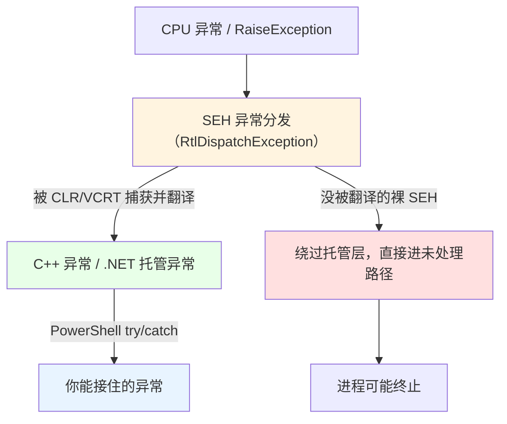
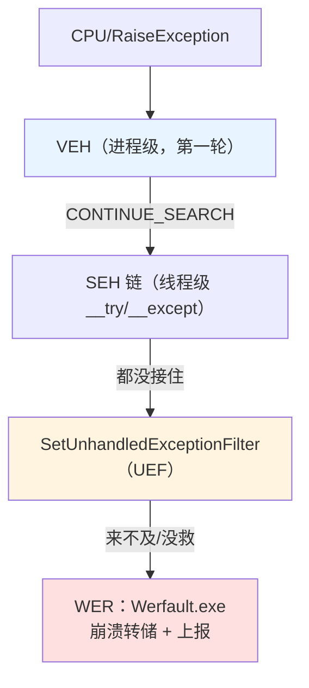

# 第 26 章 结构化异常处理与错误报告

> **章内定位**：对应《Windows 核心编程》第 V 部分“结构化异常处理”（第 23–26 章：终止处理程序、异常处理程序与软件异常、未处理异常/向量化异常处理、错误报告与应用程序恢复）。PowerShell 的 `try/catch/finally` 和 `trap` 已经在语言层覆盖了**托管异常**处理（第 8 章）。本章关注的是 **Windows 结构化异常处理（SEH）的底层机制**，以及一个对 PowerShell 至关重要的边界：**为什么本机 DLL 抛出的 SEH 异常会绕过你的 `try/catch`，甚至直接终止进程。**

---

## 26.1 结构化异常处理（SEH）：底层异常模型

在 Windows 上，“异常”的最底层形态不是 C++ 异常、也不是 .NET 异常，而是 **SEH（Structured Exception Handling，结构化异常处理）**——由 CPU 触发（如除零、访问违规）或由 `RaiseException` 抛出的“异常事件”。

### SEH、C++ 异常与 .NET 托管异常的层次关系

三者的关系是“**地基与楼房**”：

- **SEH** 是 Windows **最底层**的异常机制：某个指令出错了（除零、访问违规 `0xC0000005`、非法指令），CPU 发异常，Windows 按“异常分发链”去派发；
- **C++ 异常**（`throw`）和 **.NET 托管异常**（`throw` Exception）都**构建在 SEH 之上**——它们本质上是通过 `RaiseException` 发起的一个“软件异常”，再由各自的运行时去解包、翻译成程序员看到的形式；
- **.NET 的 `try/catch`** 捕捉的是“被 CLR 翻译过的托管异常”；而“还没被翻译的裸 SEH 异常”，脚本层是直接摸不到的。

你平时在 PowerShell 里 `try/catch` 接住的 `.Exception`，是 CLR **翻译后的结果**。这条“翻译链”要理解清楚：



所以本章讲的是 **S 到 B 这条“脚本管不到、但会导致进程崩溃”的路径**——理解它，才能对“调用不可信本机代码”做出正确判断。

### 终止处理程序与异常处理程序（`__try / __finally`、`__try / __except`）

C/C++ 里，SEH 用两对关键字组织：

- **`__try / __finally`（终止处理程序）**：保证“不管怎么退出 `__try`，`__finally` 都执行”。它对应的，就是 .NET/PowerShell 里的 `try/finally`——只是 SEH 版本作用在“本机栈帧”上；
- **`__try / __except`（异常处理程序）**：`__except` 里有一个“过滤表达式”，返回“处理/继续搜索”等决定。它对应的，是 .NET 的 `catch`——更难写，也更危险（写错一个栈指针就可能继续崩溃）。

对 PowerShell 用户来说，**你不需要直接写 `__try`**；但你写过的每条 `try/finally` 在“底层世界”里，本质上都在借 SEH 的机制。理解这一点，你就能看懂为什么“本机代码崩溃会带着整个进程走”。

---

## 26.2 进程级兜底：向量化异常处理与未处理异常过滤

当异常“逃过”所有 `__try / __except` 后，Windows 还有两道**进程级**的最后防线：**向量化异常处理（VEH）** 和 **未处理异常过滤器（UEF）**。

### `AddVectoredExceptionHandler`：进程级“第一轮”

**向量化异常处理（VEH）** 和 SEH 的区别在于“作用域和时机”：

- **SEH 是“线程级”的**：挂在调用栈上，跟着当前线程走；
- **VEH 是“进程级”的**：进程里注册一次，**对任何线程的异常都生效**，而且在 SEH 链**之前**被回调——它处理的是“第一轮异常”。

```csharp
[DllImport("kernel32.dll")]
public static extern IntPtr AddVectoredExceptionHandler(uint first, IntPtr handler);
```

- **`first = 1`**：把这个处理器放到 VEH 链的最前（先被调用）；
- 处理器是**函数指针**：需要委托 + `GetFunctionPointerForDelegate`（第 22、25 章的动作）；
- 处理器返回两个值之一：`EXCEPTION_CONTINUE_EXECUTION`（0，继续执行）/ `EXCEPTION_CONTINUE_SEARCH`（1，继续找下一个处理器）。

> **用 VEH 写“跳过硬错误”的代码极其危险**（比如“读到非法地址就跳过那条指令继续跑”），这是反调试/容错工具的领域。在 PowerShell 脚本里，**几乎不需要也不应该注册 VEH**。讲它，是为了让你在“别人的代码/安全工具”里看到 `AddVectoredExceptionHandler` 时不陌生，也知道它是“进程级、先于 SEH”的存在。

### `SetUnhandledExceptionFilter` 与 WER

如果异常一路都没人接，Windows 会调用**未处理异常过滤器（UEF）**——用 `SetUnhandledExceptionFilter` 注册的那个回调：

```csharp
[DllImport("kernel32.dll")]
public static extern IntPtr SetUnhandledExceptionFilter(IntPtr filter);
```

- 这是“**最后一次机会**”：回调执行完，进程基本就没了；
- 回调里**只能做超轻量的事**（写个日志、抓个 minidump），**不能做复杂操作**——因为此时栈可能已损坏、堆可能不一致、锁可能死锁；
- 回调没有及时处理，**Windows 错误报告（WER，`Werfault.exe`）** 会接管：弹“程序已停止工作”、生成崩溃转储。

所以“崩溃处理”的哲学是：

> **能接的（托管异常）在语言层接；接不到的（裸 SEH）最后靠 UEF/WER 记日志——但不要指望“救回来”。**

把“异常逃生路径”从底到顶画出来：



---

## 26.3 PowerShell 的边界：SEH 与 `try/catch` 的关系

这一节是本章的重点，直接关系到“**在脚本里调用本机代码**”的工程判断。

### 为什么本机 SEH 会绕过 PowerShell 的 `try/catch`

PowerShell 的 `try/catch` 只能接住 **CLR 翻译过的托管异常**。但如果你用 `Add-Type` 的 `DllImport` 调了一个本机函数，而**这个函数内部发生了裸 SEH 异常**（比如它崩了、除零了、调用了不可信 DLL 且出错），那么：

- 它**不会**变成“下一个托管异常交给你”；
- 它按上一节的路径往下走：VEH → SEH → UEF → **可能直接终止 powershell 进程**；
- 你的 `catch [System.Exception]` **接不住，甚至根本不会触发**。

**我们实测过最极端的情况**（第 17 章）：在裸线程里跑 PowerShell 脚本块导致 `PSInvalidOperationException`，是“未处理的本机异常”，**直接让进程退出**。本机 SEH 异常对脚本层就是这么“不讲理”。

结论：**`try/catch` 是你的“托管安全带”，但它管不到“别人（本机代码）在自己世界里摔跤”。**

### 不可信本机 DLL 必须隔离在独立进程中

正因为本机 SEH 异常会绕过脚本的防御、甚至带走整个进程，**调用不可信/未充分验证的本机 DLL 时，最正确的方法是把调用隔离在“另一个进程”里**：

```powershell
# 弱隔离：把有风险的调用放进一个“一次性”子进程
$psi = [System.Diagnostics.ProcessStartInfo]::new('pwsh.exe',
    '-NoProfile -Command "& { try { <# 调本机DLL #> } catch { exit 2 } }"')
$psi.UseShellExecute = $false
$p = [System.Diagnostics.Process]::Start($psi)
$p.WaitForExit()

if ($p.ExitCode -ne 0) {
    '本机调用出错/崩溃，但主进程还在'
}
```

思路是：**就算那个 DLL 把子进程搞崩了，也只是崩掉“隔离用的子进程”，不会牵连你的主 PowerShell 会话。** 这也是第 17 章“进程隔离 > 线程隔离”的判断在“本机代码风险”上的延伸。

### `AppDomain.CurrentDomain.UnhandledException` 兜底

对“托管异常没接住、进程即将终止”的情形，.NET 给了你一个“临终记录日志”的钩子：

```powershell
$handler = [System.EventHandler]{
    param($sender, $e)
    $ex = $e.ExceptionObject
    Add-Content -Path 'D:\logs\crash.log' -Value "[$(Get-Date)] $($ex.GetType().FullName): $($ex.Message)"
}
[System.AppDomain]::CurrentDomain.add_UnhandledException($handler)
```

注意两点：

1. **它只是“临终记录”**：事件触发后，进程仍然会终止，你救不回来；
2. **它只能兜“托管”未处理异常**：对“绕过托管层的裸 SEH”，它也不一定能触发。

所以它的价值是：**让崩溃留下线索**（错误类型、消息、时间），而不是“防止崩溃”。

### 26.3 小结

1. **`try/catch` 只接托管异常**；本机**裸 SEH 异常会绕过它**，甚至直接终止进程（我们实测过的崩溃就是例子）。
2. **调用不可信本机 DLL，隔离进独立子进程**——崩也只崩子进程。
3. **`AppDomain.UnhandledException` 是托管层的“临终记录”**，只能留日志，不能救回。

---

## 本章总结

第 26 章把“异常”讲到了 Windows 的最底层：

- **26.1 SEH**：SEH 是 C++/C# 异常的共同地基；`__try/__finally`、`__try/__except` 是本机版 `try/finally`、`try/catch`。
- **26.2 进程级兜底**：VEH（进程级、第一轮）→ SEH（线程级）→ `SetUnhandledExceptionFilter`（最后一次机会）→ WER（Werfault 接管）。
- **26.3 PowerShell 边界**：本机 SEH **绕过托管 `try/catch`** 甚至终止进程；**不可信本机调用隔离到独立进程**；`AppDomain.UnhandledException` 只能“留临终日志”。

一句话记住全章：**“SEH 是最底层的异常地基，VEH→SEH→UEF→WER 是逃生链；PowerShell 的 try/catch 接不住裸 SEH，所以不可信本机代码要隔离进子进程。”**

**下一章预告**：第 27 章《窗口、消息与输入》。进入《Windows 程序设计》的“窗口/消息/输入”主线。我们会讲 `FindWindow` / `FindWindowEx` / `EnumWindows` 怎么“找到别人的窗口”，`ShowWindow` / `SetForegroundWindow` 怎么控制窗口状态，以及 `SendMessage` / `PostMessage` 怎么“给窗口发消息”。这是第 4 部分里“和已有窗口交互”的最高频用法，也是脚本自动化里最有“实感”的一章。

---

> **动手练习**
>
> 1. 用 `[System.AppDomain]::CurrentDomain.add_UnhandledException(...)` 注册一个“临终日志”，然后故意抛一个没人接的 `throw`，观察日志被记录、进程继续终止。
> 2. 在作图解释“VEH → SEH → UEF → WER”逃生链，标出“哪一段是 PowerShell 的 try/catch 覆盖得到的”。
> 3. 写一个“隔离调用”的函数：用 `pwsh -Command` 跑一段会 `throw` 的本机调用，捕获子进程退出码。
> 4. 查资料确认：为什么 `SetUnhandledExceptionFilter` 的回调不能做复杂操作（栈/堆/锁的状态）。
> 5. 思考题：你的脚本要调用一个来历不明的第三方 `.dll`，你会怎么安排“隔离”？把方案写下来。