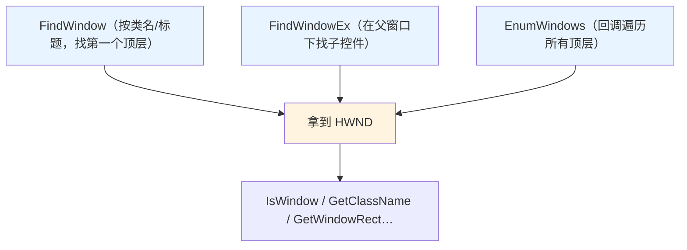

# 第 27 章 窗口、消息与输入

> **章内定位**：进入《Windows 程序设计》的“窗口/消息/输入”主线。对应王艳平版第 3 章“Win32 程序的执行单元”（消息循环）、第 6 章“框架中的窗口”、第 7 章“用户界面设计”，以及 Petzold 第 5 版基础知识部分的窗口与消息、键盘、鼠标章节。第 19 章已经用 WinForms 封装了 UI 构建；本章回到 **Win32 消息机制本身**：窗口句柄的查找、消息的发送与投递、输入模拟。**PowerShell 脚本与已有窗口交互的最高频用途集中于此。**
>
> 这一章很有“实感”——你会真的“看到”并操作别的窗口（比如任务栏）。但请记住：**低完整性进程无法向高完整性窗口发消息**（UIPI），跨会话的窗口操作也会被隔离。这些边界，我们最后会专门讲。

---

## 27.1 窗口查找：`FindWindow` / `FindWindowEx` / `EnumWindows`

要操作一个窗口，第一件事是拿到它的 **`HWND`（窗口句柄）**。它和你给 `CloseHandle` 的那些句柄不一样：**窗口句柄属于系统，你不该也不能“关闭”它**，只能“用”。

### `HWND`：窗口的句柄

在 PowerShell 里，`HWND` 就是 `IntPtr`：

```powershell
$h = [WinTest]::FindWindow('Shell_TrayWnd', $null)   # 任务栏
$h.GetType().Name    # IntPtr
```

**黄金规则**：窗口句柄**不需要 `CloseHandle`**，也**绝不能用 `[int]` 强转**（64 位截断的老话）。它就是“一个窗户的编号”，你拿到它只是为了“找它 / 问它 / 叫它做事”。

### `FindWindow`：按类名/标题找顶层窗口

```csharp
[DllImport("user32.dll", CharSet=CharSet.Auto, SetLastError=true)]
public static extern IntPtr FindWindow(string className, string windowName);
```

- **`className`**：窗口类名（可以用 `GetClassName` 或 Spy++ 查）；
- **`windowName`**：窗口标题；
- 两个参数都可以传 `$null`（表示“匹配任意”）；
- 只找到**第一个**匹配的顶层窗口。

我们实测：`FindWindow('Shell_TrayWnd', $null)` 能拿到任务栏窗口句柄；`IsWindow` 返回 `True`、`IsWindowVisible` 返回 `True`。再验证它的类名：

```powershell
$h = [WinTest]::FindWindow('Shell_TrayWnd', $null)
$sb = [System.Text.StringBuilder]::new(256)
[void][WinTest]::GetClassName($h, $sb, 256)
$sb.ToString()     # Shell_TrayWnd（实测确认）
```

> **注意**：窗口类名不是内置的“类型”。大多数窗口的类名要么是系统给的（`Shell_TrayWnd`、`Button`、`Edit`…），要么是程序自己注册的（经常是类似 `Chrome_WidgetWin_1` 这种）。查类名，就靠 `GetClassName` 或 Spy++。

### `FindWindowEx`：在父窗口下找子控件

`FindWindow` 只看顶层窗口；要找“某个顶层窗口里的子控件”（比如对话框里的按钮、输入框），用 `FindWindowEx`：

```csharp
[DllImport("user32.dll", CharSet=CharSet.Auto, SetLastError=true)]
public static extern IntPtr FindWindowEx(
    IntPtr parent, IntPtr childAfter, string className, string windowName);
```

- 从 `parent` 的直接子窗口里找；
- `childAfter` 传 `IntPtr.Zero` 表示“从头找起”；
- 配合“先找顶层窗口 → 再往下找子控件”的套路，就能定位到“按钮/编辑框/列表”：

```powershell
$main = [WinTest]::FindWindow($null, '记事本')       # 假设打开了一个记事本
$btn  = [WinTest]::FindWindowEx($main, [IntPtr]::Zero, 'Button', '确定')
```

### `EnumWindows`：扫描所有顶层窗口

`FindWindow` 只能“按名字找”，当你需要“**遍历所有顶层窗口、按条件筛选**”时，用 `EnumWindows`——它通过**回调**一个窗口一个窗口地交给你。

它需要一个回调委托（第 22、25 章的“函数指针”套路）：

```csharp
public delegate bool EnumWindowsProc(IntPtr hwnd, IntPtr lParam);

[DllImport("user32.dll")]
public static extern bool EnumWindows(EnumWindowsProc cb, IntPtr lParam);
```

在 PowerShell 里，把“遍历 + 统计”封装进 C# 方法最稳（第 21 章的教训）：

```csharp
public static int Count;
public static bool Cb(IntPtr h, IntPtr l) { Count++; return true; }
public static int EnumCount() {
    Count = 0;
    EnumWindowsProc d = Cb;
    EnumWindows(d, IntPtr.Zero);
    GC.KeepAlive(d);
    return Count;
}
```

调用得到“顶层窗口总数”（我们实测是 **973** 个）。回调返回 `true` 表示“继续枚举”，返回 `false` 表示“提前停止”——用这个特性可以做“找到就停”的条件扫描。

把窗口查找的三件套画出来：



### 27.1 小结

1. **`HWND` 是窗口句柄（`IntPtr`）**：属于系统，**不 CloseHandle、不 [int]**。
2. **`FindWindow`** 按类名/标题找第一个顶层窗口；参数可传 `$null` 表示任意。
3. **`FindWindowEx`** 在父窗口下找子控件（两层定位）。
4. **`EnumWindows`** 用回调遍历所有顶层窗口，用 `GC.KeepAlive` 撑住委托。

---

## 27.2 窗口状态与控制：`ShowWindow` / `SetForegroundWindow` / `IsWindowVisible`

拿到 `HWND` 之后，怎么“控制它”？这一节讲“显示/最小化/前置/判断”。

### `ShowWindow` 与 `nCmdShow` 常量

```csharp
[DllImport("user32.dll")]
public static extern bool ShowWindow(IntPtr hWnd, int nCmdShow);
```

`nCmdShow` 的常用值：

| 常量 | 值 | 含义 |
|---|---|---|
| `SW_HIDE` | 0 | 隐藏 |
| `SW_SHOWNORMAL` | 1 | 正常显示/恢复 |
| `SW_SHOW` | 5 | 显示 |
| `SW_MINIMIZE` | 6 | 最小化 |
| `SW_RESTORE` | 9 | 从最小化恢复 |

```powershell
[WinTest]::ShowWindow($hwnd, 9)   # 恢复（参数是代码里约定的数值）
```

### `ShowWindowAsync`：跨进程更安全

`ShowWindow` 是“同步”的（会等窗口处理完）；从别的进程去操作窗口时，**用 `ShowWindowAsync` 更安全**——它不等待，不会因为“目标窗口在忙”而卡住你：

```csharp
[DllImport("user32.dll")]
public static extern bool ShowWindowAsync(IntPtr hWnd, int nCmdShow);
```

> 规则：**同进程用 `ShowWindow`；跨进程操作优先 `ShowWindowAsync`。**

### `SetForegroundWindow` 与前台锁

```csharp
[DllImport("user32.dll")]
public static extern bool SetForegroundWindow(IntPtr hWnd);
```

它的作用是“把这个窗口拉到前台”。但 Windows 有**前台锁（foreground lock）**规则：**一个进程通常不能把前台从“另一个进程的窗口”抢走**。所以 `SetForegroundWindow` **经常静默返回失败**（返回值 `$false`，或者窗口没到前台）。

**PowerShell 边界提醒**：你无法可靠地用 `SetForegroundWindow` 把“别的程序”抢成前台。很多人会试各种“提前 `keybd_event(Alt)` 骗过前台锁”的花招——不稳定，也不建议。**要模拟用户输入，主角是第 27.3 节的 `SendInput`，而不是抢前台。**

### `IsWindowVisible`、`GetWindowRect` / `GetClientRect`

查询类 API 值得单独讲：

- **`IsWindowVisible(hWnd)`**：返回是否“可见”。注意：**最小化窗口也返回 `True`**（它“可见但缩进了任务栏”），只有“隐藏窗口”才返回 `False`：
- **`GetWindowRect`**：整个窗口在**屏幕坐标**下的矩形（含边框/标题栏）；
- **`GetClientRect`**：**客户区**（不含边框）的大小。

```csharp
[StructLayout(LayoutKind.Sequential)]
public struct RECT { public int Left; public int Top; public int Right; public int Bottom; }
```

```powershell
$r = [RECT]::new()
[void][WinTest]::GetWindowRect($taskbar, [ref]$r)
"任务栏矩形：$($r.Left),$($r.Top) - $($r.Right),$($r.Bottom)"
```

实测（1280×720 屏幕）：任务栏矩形是 `0,680 - 1280,720`——正好是屏幕底部的一条。

### 27.2 小结

1. **`ShowWindow`** 控制显示态（`SW_HIDE 0 / SW_RESTORE 9 …`）；**跨进程优先 `ShowWindowAsync`**。
2. **`SetForegroundWindow` 受前台锁限制**，跨进程抢前台往往静默失败。
3. **`IsWindowVisible`** 对最小化窗口返回 `True`；**`GetWindowRect`** 给屏幕坐标、**`GetClientRect`** 给客户区。

---

## 27.3 消息发送：`SendMessage` / `PostMessage` 与输入模拟

“窗口”是“收消息的”，你把消息发给它，它就按消息做事。这是 Win32 UI 自动化的核心动作。

### `SendMessage` vs `PostMessage`

```csharp
[DllImport("user32.dll", CharSet=CharSet.Auto)]
public static extern IntPtr SendMessage(IntPtr hWnd, uint msg, IntPtr wParam, IntPtr lParam);

[DllImport("user32.dll", SetLastError=true)]
public static extern bool PostMessage(IntPtr hWnd, uint msg, IntPtr wParam, IntPtr lParam);
```

| | `SendMessage` | `PostMessage` |
|---|---|---|
| 语义 | **同步**：等窗口处理完才返回 | **异步**：放进消息队列立刻返回 |
| 适合 | 需要“结果/确认”时（如 `WM_GETTEXT`） | 不需要结果的“通知”式消息 |
| 跨进程 | 会阻塞等待（目标忙则卡） | 不会卡 |

一句话：**要结果用 `SendMessage`，点一下就走的用 `PostMessage`。**

### `WM_SETTEXT` / `BM_CLICK` / `WM_CLOSE` 的常用配对

三个最常用的“窗口自动化”消息：

| 消息 | 值 | 用途 |
|---|---|---|
| `WM_SETTEXT` | `0x0C` | 设置窗口/控件文本（`lParam` 是字符串指针） |
| `BM_CLICK` | `0x00F5` | 模拟按钮点击（`wParam`/`lParam` 都是 0） |
| `WM_CLOSE` | `0x0010` | 请求关闭窗口（`WM_DESTROY` 才是实际销毁） |

```csharp
public const uint WM_SETTEXT = 0x000C;
public const uint BM_CLICK  = 0x00F5;
public const uint WM_CLOSE  = 0x0010;

// 方便版：给 WM_SETTEXT 传字符串
[DllImport("user32.dll", CharSet=CharSet.Unicode)]
public static extern IntPtr SendMessageString(IntPtr hWnd, uint msg, IntPtr wParam, string lParam);
```

用法：

```powershell
[WinTest]::SendMessage($hwnd, 0x0010, [IntPtr]::Zero, [IntPtr]::Zero)   # WM_CLOSE
[WinTest]::SendMessageString($btn, 0x000C, [IntPtr]::Zero, '新文本')    # WM_SETTEXT
[WinTest]::SendMessage($btn, 0x00F5, [IntPtr]::Zero, [IntPtr]::Zero)    # BM_CLICK
```

要点：

- **`WM_SETTEXT` 的 `lParam` 是字符串指针** —— 用“字符串重载”的 `SendMessageString` 最省事；
- **`BM_CLICK` 的 `wParam`/`lParam` 都是 0**；
- **`WM_CLOSE` 是“礼貌的关闭请求”**，程序可以弹“确认退出”或取消；`WM_DESTROY` 才是“直接销毁窗口”。

### `SendInput` / `keybd_event` / `mouse_event` 与 UIPI

更低层的“模拟输入”有三种：

- **`SendInput`**（现代、推荐）：用 `INPUT` 结构数组，可以精确模拟键盘/鼠标；
- **`keybd_event` / `mouse_event`**（遗留）：老 API，功能弱一些；
- `SendInput` 需要声明 `INPUT`、`KEYBDINPUT`、`MOUSEINPUT` 等结构体（第 20.4 节的封送活）。

但 **模拟输入有硬边界——UIPI（用户界面特权隔离）**：**低完整性进程无法向高完整性窗口发送输入/消息**。典型场景：

- 你的 PowerShell（普通权限）想点“UAC 确认框”（高完整性）里的按钮 → **被 UIPI 拦截**；
- 你自己 start 的同权限窗口 → 可以；
- 管理员 PowerShell（高完整性）操作低/中完整性窗口 → 可以。

**结论**：**别指望用 `SendInput` 去点 UAC、去操作更高权限的窗口。** 权限不到就是不到。

### PowerShell 边界：完整性级别、会话隔离与位数

“窗口自动化”在 PowerShell 里，最常见的三类失败都来自同一批边界：

| 边界 | 表现 |
|---|---|
| **UIPI（完整性级别）** | 低完整性向高完整性 `SendMessage`/`SendInput` 被静默拦截 |
| **会话隔离** | 服务会话里跑的脚本，操作不了交互式桌面上的窗口 |
| **位数** | 32 位进程给 64 位进程发消息时，`lParam` 的“指针/尺寸”打包可能不一致 |

**工程建议**：

1. **目标程序是自己的、拖进来一起玩的** → 用消息整套没问题；
2. **目标程序是 UAC / 别的完整性级别更高的** → 走 UI 自动化框架或干脆放弃模拟；
3. **从“服务”里自动化桌面** → 换成在交互式会话里跑脚本（`-A`/计划任务的“交互式”配置）。

### 27.3 小结

1. **`SendMessage` 同步要结果，`PostMessage` 异步不等待**。
2. **三件套**：`WM_SETTEXT`（设文本，`lParam` 是字符串指针）、`BM_CLICK`（点按钮，w/l 参数 0）、`WM_CLOSE`（礼貌关闭）。
3. **`SendInput`** 是现代输入模拟，但**受 UIPI 限制**——低完整性碰不了高完整性。
4. **边界**：完整性级别、会话隔离、位数，都会让“窗口自动化”静默失败。

---

## 本章总结

第 27 章把“窗口、消息、输入”讲成了三步：

- **27.1 查找**：`FindWindow`（顶层）→ `FindWindowEx`（子控件）→ `EnumWindows`（遍历）；`HWND` 是系统句柄，不关闭、不截断。
- **27.2 控制**：`ShowWindow`/`ShowWindowAsync`（显示态）、`SetForegroundWindow`（受前台锁限制）、`IsWindowVisible`/`GetWindowRect`（查询）。
- **27.3 消息与输入**：`SendMessage`/`PostMessage`、`WM_SETTEXT`/`BM_CLICK`/`WM_CLOSE`；`SendInput` 受 UIPI 限制；完整性/会话/位数是三层边界。

一句话记住全章：**“`FindWindow` 找窗、`ShowWindow` 控制、`SendMessage` 发消息；窗口句柄不关闭，模拟输入要看完整性级别。”**

**下一章预告**：第 28 章《图形与文本输出：GDI 与设备上下文》。对应 Petzold 第 5 版的 GDI 部分和《Windows程序设计》的图形主线。我们会讲 **`HDC`（设备上下文）、`CreateCompatibleDC`/`BitBlt`（窗口截图）、`CreatePen`/`CreateSolidBrush`/`TextOut`（画图和文字）**。但也会反复提醒：**PowerShell 里图形优先用 `System.Drawing`，裸 GDI 只在“托管封装不够用”（比如窗口截图、遗留兼容）时才有价值。**

---

> **动手练习**
>
> 1. 用 `FindWindow('Shell_TrayWnd', $null)` 找到任务栏，再用 `GetClassName`/`GetWindowRect`/`IsWindowVisible` 读出它的类名、矩形和可见性。
> 2. 用 `EnumWindows`（封装进 C#）统计顶层窗口数；再改成“遇到标题含某个词的窗口就停止”（回调返回 `false`）。
> 3. 打开你的“记事本”，用 `FindWindow` + `SendMessage(WM_CLOSE)` 看它是否弹“是否保存”的确认（这正说明 `WM_CLOSE` 是“请求”不是“强杀”）。
> 4. 试一下 `SetForegroundWindow`，观察它对“别的程序窗口”是否可靠（多半不行）。
> 5. 用一张表列出“UIPI/会话/位数”三个边界，每个配一个“会怎么静默失败”的例子。