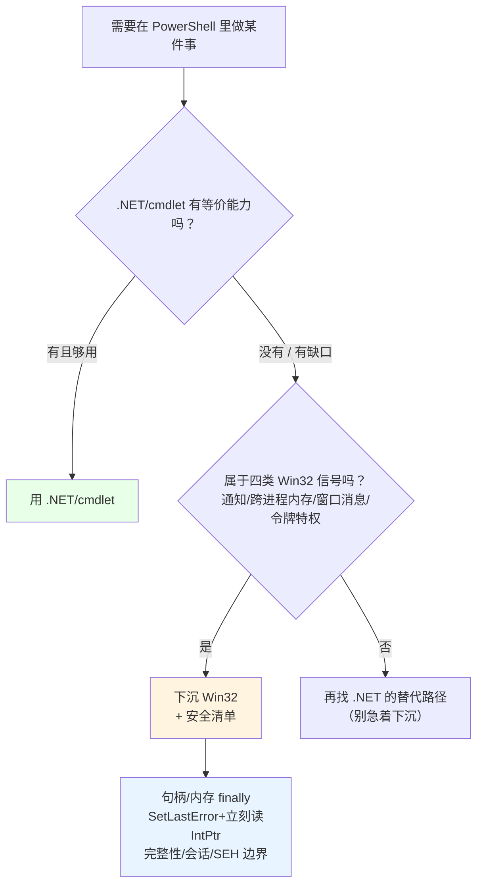

# 第 29 章 使用边界：PowerShell 中 Win32 调用的工程判断

> **章内定位**：本部分的收束章，呼应第 5 部分“什么时候不该用 PowerShell”的工程判断。Win32 API 在 PowerShell 中的代价不只是“多写几行 `Add-Type`”：**会话级类型不可重定义、手动内存/句柄管理、封送错误、UIPI 与会话隔离、以及 32/64 位句柄宽度差异**。本章给出**四条判断信号**和**安全清单**，将前九章的机制知识收束为可操作的工程决策。
>
> 一句话提纲：**先在 .NET/cmdlet 层找答案；找不到、或确有“功能缺口”时，才带着清单下沉 Win32。**

---

## 29.1 优先使用 .NET / cmdlet 的判据

判断“要不要用 Win32”，其实只有一个核心问题：**.NET 是否暴露了等价能力，并且没有功能缺口？** 如果等价能力存在且够用，Win32 路径只会增加复杂性和故障面。

### 一条判断线索：.NET 有没有等价能力

先问三个问题：

1. **.NET 有没有直接做这件事的类/方法？**（比如 `Process`、`MemoryMappedFile`、`System.Drawing`）
2. **如果有，它的能力够不够？**（能不能设置你要的参数、拿到你要的结果、覆盖你要的边界？）
3. **如果不够，缺的是“功能”还是“便利”？**（“缺功能”才值得下沉；“只是写法麻烦”不该下沉）

只有当第 2 问是“不够”、且第 3 问是“缺功能”时，才轮到 Win32。否则，**留在 .NET 层**。

### 对照表：进程/线程/同步/内存/窗口/版本

把本书讲过的“对照关系”集中列出来：

| 需求 | .NET / cmdlet 侧（优先） | Win32 侧（兜底） |
|---|---|---|
| 启动进程 | `Start-Process`、`[System.Diagnostics.Process]` | `CreateProcess` |
| 线程/并行 | `Start-ThreadJob`、`ForEach-Object -Parallel`、`Task` | `CreateThread` |
| 同步 | `Monitor`、`SemaphoreSlim`、`Mutex`、`Interlocked` | `CRITICAL_SECTION`、`WaitForSingleObject` |
| 内存分配 | `Marshal.AllocHGlobal`、`MemoryMappedFile` | `VirtualAlloc`、`CreateFileMapping` |
| 窗口（自己的 UI） | WinForms / WPF | — |
| 窗口（别人的窗口） | —（没有等价物） | `FindWindow`、`SendMessage` |
| 文件通知 | `FileSystemWatcher` | `ReadDirectoryChangesW` |
| 注册表通知 | —（没有等价物） | `RegNotifyChangeKeyValue` |
| 系统版本 | `[System.Environment]::OSVersion` | `GetVersionEx`（不推荐） |
| 图形绘制 | `System.Drawing`（GDI+） | `gdi32.dll` |
| 令牌特权 | `WindowsIdentity`/`Principal`（部分） | `AdjustTokenPrivileges` |

这张表有两个“重点”：

- **进程、线程、同步、内存、自己 UI、图形，都有成熟的 .NET 等价物**——**默认都该留在 .NET 层**；
- **“别人的窗口”“注册表通知”“令牌特权调整”这几类，.NET 没有等价物**——才是 Win32 的“真信号”。

### 一个“反例”：`GetVersionEx` 为什么不推荐

`GetVersionEx` 是“用 Win32 反而更不可靠”的经典例子：它受“应用程序兼容性 manifest”影响，**在你没声明支持新系统时，可能返回一个“假的老版本号”**。相比之下：

```powershell
[System.Environment]::OSVersion.Version
```

更直接、更少“兼容性谎言”。这个例子说明：**不是“越底层越准确”，而是“用对的那一层”。**

### 29.1 小结

1. **核心判断**：.NET 有没有等价能力；有，能力够不够；不够，是缺功能还是缺便利。
2. **默认留在 .NET**：进程、线程、同步、内存、自己 UI、图形。
3. **Win32 真信号**：别人的窗口、注册表通知、令牌特权等 .NET 没覆盖的“功能缺口”。
4. **别迷信底层**：`GetVersionEx` 这类“兼容性谎言”说明“用对层”比“用得深”重要。

---

## 29.2 “必须用 Win32”的信号与安全清单

### 四类必须用 Win32 的信号

当出现下面四类需求时，.NET 基本没有等价物（或等价物能力明显不足），Win32 是合理选择：

1. **通知机制（`RegNotifyChangeKeyValue`）**：监听注册表键变化。. NET 有 `FileSystemWatcher` 监听文件，但**没有**“监听注册表键变化”的托管等价物。
2. **跨进程内存访问（`ReadProcessMemory` / `VirtualAllocEx`）**：读取/写入**别的进程**的内存。. NET 没有等价 API（这是调试器/注入类工具的地盘）。
3. **窗口消息交互（`FindWindowEx` / `SendMessage`）**：和**别人的窗口**交互——找控件、设文本、点按钮。. NET 的 WinForms 只能管“自己的窗口”。
4. **令牌特权调整（`AdjustTokenPrivileges`）**：启用/禁用进程令牌里的特定特权（如备份特权）。. NET 的 `WindowsIdentity`/`Principal` 覆盖了“身份/组”，但**没有**覆盖“启用某特权”这层。

**这四类出现时，才值得为 Win32 付出“封送 + 句柄 + 完整性”的代价。**

### 安全清单：照着做，能避开 90% 的坑

一旦决定调用 Win32，下面这份清单请当成“检查表”：

#### 1）句柄释放：全部放 `finally`

这些都要配对释放，**放 `finally`**：

- `CloseHandle`（进程/线程/事件/互斥体/映射对象/文件句柄）
- `ReleaseDC`（`GetDC` 拿的）
- `DeleteDC`（`CreateCompatibleDC` 拿的）
- `DeleteObject`（画笔/画刷/位图等 GDI 对象）
- `FreeLibrary`（`LoadLibrary` 拿的模块）
- `VirtualFree` / `UnmapViewOfFile`

**窗口句柄 `HWND` 例外**：它属于系统，不 `CloseHandle`。

#### 2）内存释放：分配的必须还

- `Marshal.AllocHGlobal` → `FreeHGlobal`
- `VirtualAlloc` → `VirtualFree`
- `StringToHGlobalAuto` → `FreeHGlobal`
- 映射视图 → `UnmapViewOfFile`

**GC 不会回收非托管内存**；所有 `Alloc` 都要配对 `Free`，且放 `finally`。

#### 3）错误路径：`SetLastError` + 立刻读

- 每个“可能失败”的 `DllImport` 都写 `SetLastError = true`；
- 失败后**立刻**用 `[System.Runtime.InteropServices.Marshal]::GetLastWin32Error()`（PowerShell **没有 `[Marshal]` 加速器**）；
- 用 `Win32Exception(code).Message` 翻译；
- **别用 `$?` 判断**非布尔返回值的调用。

#### 4）架构安全：句柄/指针一律 `IntPtr`

- 句柄、指针、`SIZE_T` 用 `IntPtr` / `UIntPtr`，**绝不 `[int]`**（64 位会截断）；
- 结构体里指针字段同样用 `IntPtr`；
- 需要跨 32/64 位交互时，特别小心 `lParam` 的“指针/整数”打包差异。

#### 5）完整性级别：UIPI 是硬墙

- **低完整性进程无法向高完整性窗口发送消息/输入**（UIPI 拦截）；
- 典型表现：普通 PowerShell 点不了 UAC 确认框；
- 解决思路不是“绕过 UIPI”，而是“**在正确的权限/会话里跑脚本**”。

#### 6）会话隔离：服务会话 ≠ 交互式桌面

- 在“服务会话”（Session 0）里跑的脚本，**操作不了用户交互式桌面上的窗口**；
- 从服务自动化桌面，要换成“在交互式会话里运行”的机制（计划任务的交互式配置等）。

#### 7）非托管异常：本机 SEH 绕过 `try/catch`

- 本机 DLL 抛出的裸 SEH 异常**会绕过 PowerShell 的 `try/catch`**，甚至直接终止进程（第 26 章）；
- **不可信本机 DLL 的调用，隔离到独立子进程**（崩也只崩子进程）；
- 对“托管未处理异常”可以注册 `AppDomain.UnhandledException` 留临终日志（但救不回来）。

把“安全调用”的模板写出来，一眼就能照着用：

```powershell
# 1. 加载类型时：绑最新的“错误捕获 + 明确封送”
Add-Type -MemberDefinition @'
[DllImport("kernel32.dll", CharSet=CharSet.Auto, SetLastError=true)]
public static extern IntPtr CreateEvent(IntPtr attrs, bool manualReset, bool initialState, string name);
[DllImport("kernel32.dll", SetLastError=true)]
public static extern bool CloseHandle(IntPtr h);
'@ -Name K32 -Namespace SafeDemo

$M = [System.Runtime.InteropServices.Marshal]

# 2. 调用时：先判失败，再立刻读码
$h = [SafeDemo.K32]::CreateEvent([IntPtr]::Zero, $false, $false, $null)
if ($h -eq [IntPtr]::Zero) {
    $code = $M::GetLastWin32Error()
    throw "CreateEvent 失败（$code）：$([System.ComponentModel.Win32Exception]::new($code).Message)"
}

# 3. 资源必须放 finally
try {
    # 使用句柄……
}
finally {
    [void][SafeDemo.K32]::CloseHandle($h)
}
```

把“判断 + 清单”画成一张决策图：



### 29.2 小结

1. **四类“必须用 Win32”的信号**：注册表通知、跨进程内存、别人的窗口消息、令牌特权调整。
2. **安全清单七条**：句柄 `finally`、内存配对释放、`SetLastError`+立刻读、`IntPtr`、UIPI、会话隔离、SEH 边界。
3. **模板**：加载时声明清楚 → 调用后判失败读码 → 资源放 `finally`。
4. **不可信本机 DLL 隔离子进程**；`AppDomain.UnhandledException` 只能留日志。

---

## 本章总结

第 29 章是第 4 部分的“工程决策收束”：

- **29.1 判据**：.NET 有等价能力且够用，就别下沉；只有“功能缺口”才值得 Win32；别迷信 `GetVersionEx` 这种“底层反而不可靠”的例子。
- **29.2 信号与清单**：四类必须用 Win32 的信号；安全清单（句柄/内存/错误/架构/完整性/会话/SEH）；模板化写法。

一句话记住全章：**“能用 .NET 就不碰 Win32；必须碰时，带上‘句柄 finally、内存配对、错误立刻读、指针用 IntPtr、想清 UIPI/会话/SEH’这五件护身符。”**

到这里，**第 4 部分（Win32 API 编程）**就结束了。你从“错误码、字符串封送、句柄、结构体”这些共同语法起步，走过了进程、作业、线程、同步、内存、DLL、SEH、窗口消息和 GDI。**你不需要成为 Win32 专家，但你现在能判断“什么时候该用它、用的时候怎么不翻车”。**

**下一章预告**：第 30 章《模块化：函数、脚本与模块》。进入第 5 部分“工程化与互操作”。我们会把一个 `.ps1` 脚本，一步步演进成“函数化 → 点源共享 → `.psm1` 模块 → `.psd1` 清单”的可分发工具，讲清 `Export-ModuleMember` 的公开/私密边界、`$env:PSModulePath` 的查找机制，以及第 6 章定义的 PowerShell 类在模块里的 `using module` 问题。

---

> **动手练习**
>
> 1. 拿你写过的任意一个 `Add-Type` 脚本，对照“安全清单七条”逐条检查：句柄有没有 `finally`？内存有没有配对？`SetLastError` 有没有写？句柄有没有用 `IntPtr`？
> 2. 用 `[System.Environment]::OSVersion.Version` 与（如果愿意）`GetVersionEx` 对比一下，理解“底层不一定更准”。
> 3. 列出你脚本里“.NET 没有等价物、只能 Win32”的功能，判断它们属于四类信号里的哪一类。
> 4. 把 29.2 的“安全模板”抄一遍，改成你自己的命名空间与函数，作为以后写 P/Invoke 的脚手架。
> 5. 思考：如果你的脚本要“监听注册表变化”，为什么 `FileSystemWatcher` 帮不上忙？你打算用 `RegNotifyChangeKeyValue` 还是“定时轮询”？各有什么代价？