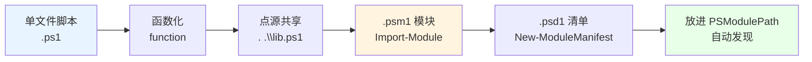

# 第 30 章 模块化：函数、脚本与模块

> **章内定位**：进入**第 5 部分：工程化与互操作**。前四部分回答“怎么写”，本部分回答“**怎么交付、怎么安全地跨越边界**”。一个 `.ps1` 脚本在规模增长后，会经历“函数化 → 点源共享 → `.psm1` 模块化 → `.psd1` 清单”的自然演进，每一步都解决前一阶段的可复用性或可分发性问题。本章把这条演进路径讲清楚，并重点讲“**公开接口与内部实现的边界**”——因为 PowerShell 模块没有 C# 的 `public` / `internal`，这个边界完全靠你自己划。

---

## 30.1 从脚本到函数到模块的演进路径

### 第一步：单文件脚本

最开始的形态，就是一个 `backup.ps1`：从头到尾一串命令，跑完就完事。

```powershell
# backup.ps1
$source = 'D:\data'
$target = 'D:\backup'
Copy-Item -Path $source -Destination $target -Recurse
Write-Output '备份完成'
```

**优点**：直接、好懂。**缺点**：所有逻辑混在一起，改一处要通读全文；想在别的脚本里复用，只能复制粘贴。

### 第二步：函数化（把逻辑包成函数）

把“一个动作”抽成函数，是第一次结构性升级：

```powershell
# backup.ps1
function Backup-Folder {
    param(
        [Parameter(Mandatory)]
        [string]$Source,
        [Parameter(Mandatory)]
        [string]$Target
    )
    Copy-Item -Path $Source -Destination $Target -Recurse
    "已备份：$Source -> $Target"
}

Backup-Folder -Source 'D:\data' -Target 'D:\backup'
```

**进步**：逻辑有了名字、有了参数、可以反复调用（第 5 章的成果）。

### 第三步：点源共享（`. .\lib.ps1`）

当多个脚本都要用同一批函数时，把它们放进一个“函数库”，用**点源**“借”进来：

```powershell
# lib.ps1
function Backup-Folder { param($Source, $Target) ... }
function Test-Backup     { ... }
```

```powershell
# other.ps1
. .\lib.ps1          # 点源：lib.ps1 里的函数“落进”当前作用域
Backup-Folder -Source 'D:\data' -Target 'D:\backup'
```

**点源的关键**（第 3.1、5.3 节讲过）：`.` 会在**当前作用域**执行脚本，所以函数、变量都会“留下来”；而 `& .\lib.ps1` 会新建一层作用域，函数**带不出来**。

**进步**：一套函数多处复用。**缺点**：**依赖路径**——`lib.ps1` 必须放在“相对当前目录”或“你硬编码的路径”，换台机器/换个目录就找不到；而且函数全进了“全局命名空间”，容易和别人的函数**重名冲突**。

### 第四步：`.psm1` 模块（`Import-Module`）

把函数库升级成**模块**：一个 `.psm1` 文件（PowerShell 模块文件），通过 `Import-Module` 加载。

```powershell
# MyModule.psm1
function Public-Function { "public says $($args -join ',')" }
function Private-Function { 'private' }

# 只导出 Public-Function
Export-ModuleMember -Function Public-Function
```

```powershell
Import-Module .\MyModule.psm1
Public-Function ok        # public says ok（实测）
Private-Function          # 报错：术语不被识别（没导出，实测确认）
```

**模块解决了两个问题**：

1. **命名空间**：模块里的函数默认**进模块作用域**，不会一股脑污染全局；只有 `Export-ModuleMember` 导出的才“露出来”；
2. **加载机制**：`Import-Module` 会“登记”模块、管理它的生命周期；`Remove-Module` 能整体卸下。

**进步**：有了“公开/私有”的雏形。**缺点**：分发时还是“一个文件”，别人得知道你该把 `.psm1` 放哪、怎么 `Import-Module`。

### 第五步：`.psd1` 清单（`New-ModuleManifest`）

给模块加一份**清单文件**（`.psd1`），声明“它叫什么、版本多少、根模块是哪个、导出哪些函数、依赖哪些模块”。

```powershell
# 生成清单（这一步会“写文件”，本身通常没有返回值）
New-ModuleManifest `
    -Path (Join-Path $dir 'MyModule.psd1') `
    -RootModule 'MyModule.psm1' `
    -ModuleVersion '1.0.0' `
    -FunctionsToExport @('Public-Function')

# 按清单路径导入（不要拿“New-ModuleManifest 的返回值”当路径）
Import-Module (Join-Path $dir 'MyModule.psd1')
```

> **实测提醒**：`New-ModuleManifest` 是“**生成文件**”的命令，它本身通常**不返回** `$path`。别写 `$manifest = New-ModuleManifest ...; Import-Module $manifest`——这样 `$manifest` 是 `$null`，`Import-Module` 会报“参数为 null”。**用你传进去的 `-Path` 去导入。**

清单的常见字段：

| 字段 | 作用 |
|---|---|
| `RootModule` | 主 `.psm1`（或 `.dll`）文件 |
| `ModuleVersion` | 模块版本 |
| `FunctionsToExport` | 导出哪些函数 |
| `AliasesToExport` | 导出哪些别名 |
| `VariablesToExport` | 导出哪些变量 |
| `RequiredModules` | 依赖哪些模块 |

### 模块自动加载与 `$env:PSModulePath`

`.psd1` 的真正威力在于：**把模块放进 `$env:PSModulePath` 里的某个目录，PowerShell 就能“按名字自动发现、自动加载”**，不用写路径：

```powershell
$env:PSModulePath -split ';'
# 例如：
# C:\Users\你\Documents\PowerShell\Modules
# C:\Program Files\PowerShell\Modules
# ...
```

模块的“标准摆法”是：**目录名 = 模块名，里面放 `模块名.psd1` + `模块名.psm1`**。放好之后：

```powershell
Import-Module MyModule      # 不用路径，PowerShell 会自动去 PSModulePath 里找
Get-Module -ListAvailable MyModule   # 看看它能被发现吗
```

把这条演进路径画出来：



### 30.1 小结

1. **演进路径**：单文件 → 函数化 → 点源共享 → `.psm1` 模块 → `.psd1` 清单 → `PSModulePath` 自动加载。
2. **点源** `.` 把函数留进当前作用域；`&` 是新建作用域（函数带不出来）。
3. **`.psm1` 模块**解决命名空间与加载管理；`Export-ModuleMember` 决定导出什么。
4. **`.psd1` 清单**声明元数据与依赖；**`New-ModuleManifest` 只生成文件**，导入用 `-Path`；放进 `$env:PSModulePath` 后可按名字自动发现。

---

## 30.2 模块设计原则：公开接口与内部实现的边界

模块有了，接下来是“工程问题”：**哪些函数该让别人用，哪些是“内部实现”、不该暴露？** 这就是模块设计的核心。

### `Export-ModuleMember`：公开/私密的边界

PowerShell 模块的“公开/私有”完全由 `Export-ModuleMember` 决定：

```powershell
# MyModule.psm1
function Get-Thing   { ... }      # 想公开
function Invoke-Helper { ... }    # 内部辅助，不想公开

Export-ModuleMember -Function Get-Thing
```

我们实测确认：

- 导出后，`Get-Thing` 在模块外**可用**，`(Get-Command Get-Thing).ModuleName` 显示 `MyModule`；
- 未导出的 `Invoke-Helper`，在模块外 **“术语不被识别”**（`Get-Command` 找不到）。

**这就是 PowerShell 模块的“公开/私有”边界**：不是靠 `private` 关键字，而是靠“**导不导出**”。

### 默认行为：模块内函数默认不导出

这里有一个容易踩的“默认值”要点：

- **如果用 `Export-ModuleMember` 明确写了导出列表** → 没列出的都**不导出**；
- **如果模块里完全没有 `Export-ModuleMember`** → 情况会因加载方式而不同（有的会把所有函数都当导出），所以**最稳妥的做法是显式写 `Export-ModuleMember`**，把“公开清单”说死。

> **模块设计箴言**：**默认私有，显式公开。** 把“我要给别人用的”写进 `Export-ModuleMember`；其余的，就留在模块内部。

### 模块作用域与 `$script:`（模块级状态）

模块里的 `$script:` 变量，指的是“**模块自己的作用域**”，而不是“调用者脚本的作用域”。这非常适合做“模块级状态”（比如缓存、计数器）：

```powershell
# MyModule.psm1
$script:counter = 0

function Increment-Counter {
    $script:counter++
    return $script:counter
}

Export-ModuleMember -Function Increment-Counter
```

调用两次 `Increment-Counter` 会得到 1、2——因为 `$script:counter` 被模块“记住”了。这正是第 3 章“作用域”知识在模块里的应用。

### 类在模块中：`using module`

第 6 章说过：**模块里定义的 PowerShell 类，默认不随 `Import-Module` 导出**。要在别的脚本里用模块里的类，得用 `using module`：

```powershell
# ClassModule.psm1
class Greeter {
    [string] Hi() { return "hi" }
}
```

```powershell
# 使用方脚本（必须是脚本的第一条语句）
using module .\ClassModule.psm1

$g = [Greeter]::new()
$g.Hi()
```

要点：

1. **`using module` 必须是脚本/模块的“第一条语句”**（前面只能有注释）；
2. 它和 `Import-Module` 的区别是：`using module` 在**解析时**就导入类型，所以类能用于类型标注/实例化；
3. 类也受“模块级类型”约束（第 6 章：会话级、不可重定义）。

### 模块卸载与清理：`Remove-Module`

模块是可以卸载的：

```powershell
Remove-Module MyModule
# 之后 Get-Thing 就不可用了
```

但要注意：

- **`Remove-Module` 移除了“命令的可见性”，不等于“把模块里的所有状态清干净”**；有些模块会在卸载时通过 `OnRemove` 做清理；
- **类/类型一旦加载，仍然不可卸载**（第 6、13 章的老结论）；
- 反复 `Import-Module -Force` 会重新加载模块，但不会帮你“清掉旧类”。

### 30.2 小结

1. **公开/私有 = 导不导出**：`Export-ModuleMember` 就是边界，没有 `private` 关键字。
2. **默认私有、显式公开**：显式写 `Export-ModuleMember`，把公开清单说死。
3. **`$script:` 是模块级状态**（模块自己的作用域），适合缓存/计数器。
4. **`using module` 是“类模块”的入口**，且必须是脚本第一条语句；类不可卸载。
5. **`Remove-Module` 卸载命令，不等于清空所有类型状态**。

---

## 本章总结

第 30 章把“从脚本到可交付模块”讲成了两步：

- **30.1 演进路径**：单文件 → 函数化 → 点源 → `.psm1` → `.psd1` → `PSModulePath` 自动加载；点源 `.` 与 `&` 的作用域差别；清单的 `RootModule`/`FunctionsToExport`/`RequiredModules`。
- **30.2 设计原则**：`Export-ModuleMember` 划公开/私密；默认私有显式公开；`$script:` 做模块级状态；`using module` 导入类；`Remove-Module` 的清理边界。

一句话记住全章：**“函数化解决复用，点源解决共享，`.psm1` 解决命名空间，`.psd1` 解决分发；公开靠导出、私有靠不导出，类靠 `using module`。”**

**下一章预告**：第 31 章《脚本安全与执行策略》。我们会讲清“执行策略不是安全边界，只是防止误执行的用户体验层”；`Set-/Get-AuthenticodeSignature` 的签名与信任、`Unblock-File` 解除下载标记、组策略对执行策略的覆盖。这一章会帮你建立“脚本从哪来、该不该信”的判断力。

---

> **动手练习**
>
> 1. 写一个 `MyModule.psm1`，其中两个函数，用 `Export-ModuleMember` 只导出其中一个；`Import-Module` 后验证另一个确实“找不到”。
> 2. 用 `New-ModuleManifest` 生成 `.psd1`，再用 `-Path` 导入清单；确认 `Get-Module MyModule` 能看到它。
> 3. 把模块目录放进 `$env:PSModulePath`（或放到已存在的用户模块目录），用名字 `Import-Module MyModule` 试试自动发现。
> 4. 写一个带 `class` 的 `.psm1`，在另一个脚本里用 `using module` 导入并实例化；再试着把 `using module` 挪到第二行，观察报错。
> 5. 用 `$script:counter` 做一个“模块级计数器”，调用两次看结果。
> 6. 用 `Remove-Module` 卸载模块，再检查原函数还能不能用、类还能不能实例化。