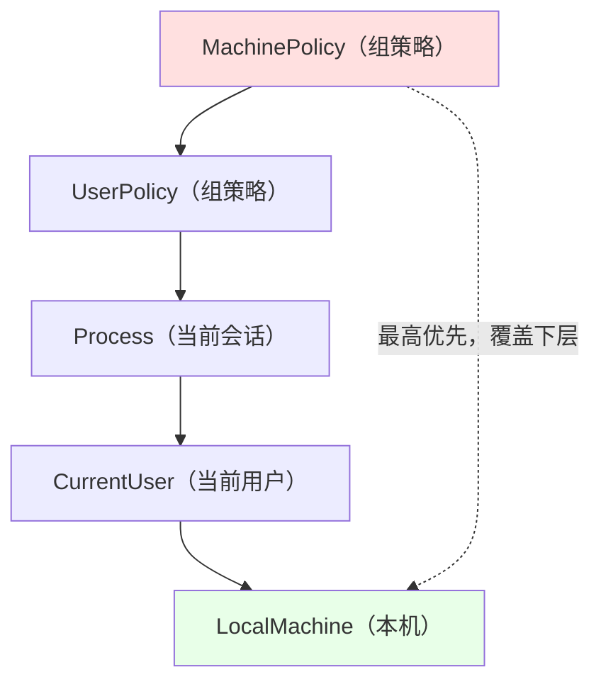
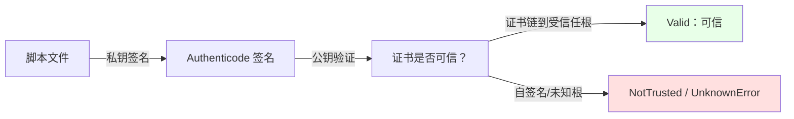

# 第 31 章 脚本安全与执行策略

> **章内定位**：这一章回答一个很现实的问题：**你的脚本从哪来、该不该让它跑？** PowerShell 的执行策略（ExecutionPolicy）经常被误当成“安全边界”，但它其实只是“**防止你不小心双击了一个来路不明的脚本**”的用户体验层；真正的代码信任，靠的是 **Authenticode 签名**。本章把“执行策略、签名与信任、下载标记、组策略”讲清楚，帮你建立一套“该不该跑、怎么安全地跑”的判断。

---

## 31.1 执行策略、签名与信任

### 执行策略是什么：防止意外执行的“用户体验层”，不是安全边界

先看它到底控制什么：

```powershell
Get-ExecutionPolicy
# 例如：RemoteSigned
```

执行策略决定“**在当前机器/用户/会话下，哪些脚本允许运行**”。它的存在意义是：**防止你别不小心运行了一个下载来的恶意脚本**。

但请记住微软自己反复强调的一句话：

> **执行策略不是安全边界（security boundary）。** 一个懂行的人可以用 `-ExecutionPolicy Bypass`、`-Command`、管道、`Invoke-Expression` 等方式绕开它。

所以，**不要把“执行策略设为 Restricted”当成“我的机器就安全了”**。它挡的是“手滑”，不是“攻击者”。真正的安全边界是：**账户权限、文件权限、签名与信任、应用控制策略**。

我们实测 `Get-ExecutionPolicy -List` 的结果：

```text
        Scope ExecutionPolicy
        ----- ---------------
MachinePolicy       Undefined
   UserPolicy       Undefined
      Process       Undefined
  CurrentUser       Undefined
 LocalMachine    RemoteSigned
```

在“其他作用域都没设”的情况下，生效的是 `LocalMachine` 的 `RemoteSigned`（实测有效值就是 `RemoteSigned`）。

### 执行策略的取值

| 值 | 含义 |
|---|---|
| `Restricted` | 不允许运行任何脚本（只能交互式命令） |
| `AllSigned` | 只允许运行**已签名**的脚本（且签名要可信） |
| `RemoteSigned` | 本地脚本可运行；**从网上下载**的脚本必须签名 |
| `Unrestricted` | 所有脚本可运行（下载的可能提示确认） |
| `Bypass` | 什么都不拦、也不提示（“完全放行”） |
| `Undefined` | 该作用域“没有设置”（不覆盖下一级） |

`RemoteSigned` 是很多环境的“默认推荐”：**自己写的本地脚本直接跑，下载来的就得有签名**——既方便，又不至于“下载即执行”。

### 作用域：五个层级与优先级

执行策略可以设在五个“作用域”上，优先级从高到低：

1. **`MachinePolicy`**（计算机组策略）
2. **`UserPolicy`**（用户组策略）
3. **`Process`**（当前进程/会话，用 `-ExecutionPolicy` 启动参数或 `Set-ExecutionPolicy -Scope Process`）
4. **`CurrentUser`**（当前用户）
5. **`LocalMachine`**（本机）

**前两个（组策略）会“压住”后面所有作用域**：如果域管理员用组策略把执行策略设成 `AllSigned`，你在本机 `Set-ExecutionPolicy` 是改不动的（会报“被组策略覆盖”）。这就是为什么“我明明设成 Bypass 了，怎么还是 AllSigned”——先去看组策略。

设置当前用户的执行策略（**不需要管理员**）：

```powershell
Set-ExecutionPolicy -Scope CurrentUser -ExecutionPolicy RemoteSigned
```

> **提示**：改执行策略是“用户级/系统级”的配置变更。写脚本时，**优先用 `-Scope CurrentUser`**，别一上来就动 `LocalMachine`（那会影响整台机器、需要管理员）。

把优先级画成一张“压栈图”：



### 签名与信任：Authenticode 签名

执行策略里的 `AllSigned` / `RemoteSigned` 都绕不开“**签名**”。Windows 用 **Authenticode** 给代码签名：用证书的私钥给文件生成一个“数字指纹”，别人可以用公钥验证“**这文件确实是你签的、而且没被改过**”。

查看一个文件的签名状态：

```powershell
$sig = Get-AuthenticodeSignature -FilePath '.\myscript.ps1'
$sig.Status          # Valid / NotSigned / HashMismatch / NotTrusted ...
$sig.SignerCertificate
$sig.GetType().FullName
```

我们实测：一个普通 `.ps1` 的签名状态是 **`NotSigned`**，`SignerCertificate` 为空，返回类型是 `System.Management.Automation.Signature`。

给脚本签名（需要一个**代码签名证书**）：

```powershell
# 找代码签名证书（需要证书存储里有）
$cert = Get-ChildItem -Path Cert:\CurrentUser\My -CodeSigningCert

# 签名
Set-AuthenticodeSignature -FilePath '.\myscript.ps1' -Certificate $cert
```

签名之后：

- **`AllSigned`** 环境下，签名的脚本才能运行；
- 但**“签名有效” ≠ “证书可信”**：如果证书不是来自受信任的根，`Get-AuthenticodeSignature` 会显示 `NotTrusted`（甚至 `UnknownError`）——这时脚本仍然可能被拦。

**信任链**是这样的：



### `Unblock-File` 与“下载标记”（Mark of the Web）

从浏览器/邮件下载的文件，Windows 会给它打一个“**来自互联网**”的标记（存在 NTFS 的“备用数据流”里，叫 Zone.Identifier）。带这个标记的脚本，在 `RemoteSigned` 下会被拦——**因为它“来自网上”**。

`Unblock-File` 就是“**去掉这个下载标记**”：

```powershell
Unblock-File -Path '.\downloaded.ps1'
```

我们实测 `Unblock-File -WhatIf` 能正常显示“将要解除阻止”。它的真实语义是：**你明确表示“我知道这个文件是从网上下载的，我信任它”**。

> **安全提醒**：`Unblock-File` 不是“签名”，也不是“安全扫描”。它只是“把‘来自互联网’的标签撕掉”。**在 `Unblock-File` 之前，最好先看一眼脚本内容、确认来源可信。**

### 组策略的优先覆盖

最后强调组策略的“最高权力”：

- 组策略路径：**计算机配置 → 管理模板 → Windows 组件 → Windows PowerShell → 打开脚本执行**；
- 由组策略设定的执行策略，会出现在 `Get-ExecutionPolicy -List` 的 `MachinePolicy` / `UserPolicy` 行；
- **一旦组策略设了，`Set-ExecutionPolicy` 就无效**（会报“被组策略覆盖”）；
- 企业环境里，“为什么我的脚本跑不了”十有八九是组策略。

### 31.1 小结

1. **执行策略不是安全边界**，只是“防止意外执行”的用户体验层；懂行的人能绕过。
2. **取值**：`Restricted` / `AllSigned` / `RemoteSigned` / `Unrestricted` / `Bypass` / `Undefined`。
3. **五个作用域**：`MachinePolicy > UserPolicy > Process > CurrentUser > LocalMachine`；组策略压住一切。
4. **签名与信任**：`Get-/Set-AuthenticodeSignature`；`Status` 有 `Valid`/`NotSigned`/`HashMismatch`/`NotTrusted` 等；“签名有效”还要“证书可信”。
5. **`Unblock-File` 去掉下载标记**（Zone.Identifier），不等于“安全扫描”；组策略优先级最高。

---

## 本章总结

第 31 章把“脚本该不该跑”讲成了一句话：

> **执行策略管“手滑”，签名管“信任”，组策略管“企业纪律”。**

- 执行策略是 UX 层，不是安全边界；
- `RemoteSigned` 是常见平衡点：本地跑、下载的要签名；
- 真正判断“这脚本可不可信”，看 Authenticode 签名与证书链；
- `Unblock-File` 只是撕掉“来自互联网”的标签，不是“安全认证”；
- 企业环境里，组策略优先于一切本机设置。

一句话记住全章：**“执行策略防手滑、签名定信任、组策略压一切；`Unblock-File` 只是撕标签，不等于安全。”**

**下一章预告**：第 32 章《P/Invoke 与 COM 互操作》。我们会把第 4 部分的 P/Invoke 经验“工程化”：`Add-Type -MemberDefinition` 的模板机制、`DllImport` 的关键参数、把 P/Invoke 声明组织成可复用的模块函数；再讲 COM 的 `New-Object -ComObject`、RCW 引用计数、`ReleaseComObject` 与“Excel 自动化残留进程”的经典事故。

---

> **动手练习**
>
> 1. 用 `Get-ExecutionPolicy -List` 看你这台机器的五层作用域，判断“为什么生效的是这个值”。
> 2. 用 `Get-AuthenticodeSignature` 查看一个普通 `.ps1`，确认状态是 `NotSigned`；再看一个系统自带的已签名脚本，对比状态。
> 3. 用 `Unblock-File -WhatIf` 对一个下载来的（或你自己造的）脚本试试，理解“下载标记”是怎么回事。
> 4. 用 `Get-ChildItem Cert:\CurrentUser\My -CodeSigningCert` 看看你有没有代码签名证书；没有的话，思考“为什么需要它”。
> 5. 查一下你所在环境的组策略是否设置了执行策略（`Get-ExecutionPolicy -List` 的 MachinePolicy/UserPolicy 行）。