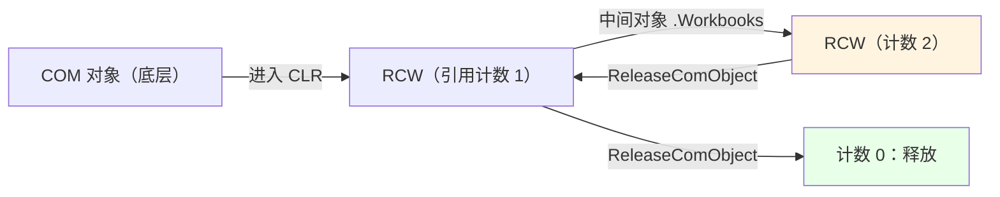

# 第 32 章 P/Invoke 与 COM 互操作

> **章内定位**：本章把第 4 部分的 P/Invoke 经验“工程化”：`Add-Type -MemberDefinition` 的模板机制、`DllImport` 的关键参数、把 P/Invoke 声明组织成可复用的模块函数；再讲 COM 的 `New-Object -ComObject`、RCW 引用计数、`ReleaseComObject` 与“Excel 自动化残留进程”的经典事故。这是从“能调用”到“能交付、能收场”的最后一课。
>
> 一句话提纲：**P/Invoke 要“声明一次、封装复用”；COM 要“拿一个、放一个”，别让 RCW 在后台偷偷攒着。**

---

## 32.1 通过 `Add-Type -MemberDefinition` 调用 Win32 API

第 13、20 章已经用过 `Add-Type` 的几种输入源。这一节专门把 **`-MemberDefinition`** 讲透，因为它是“在脚本里临时加几个 Win32 调用”的最短路径。

### `-MemberDefinition` 的模板机制

`-MemberDefinition` 的用法是：**只写“成员声明”（方法、字段等），让 Add-Type 帮你生成一个类**。

```powershell
Add-Type -MemberDefinition @'
[DllImport("user32.dll")]
public static extern int GetSystemMetrics(int n);
'@ -Name Win32 -Namespace Native

[Native.Win32]::GetSystemMetrics(0)
```

我们实测：`GetSystemMetrics(0)` 返回 `1280`（屏幕宽度）。这条命令背后，`Add-Type` 帮你生成了类似这样的 C# 类：

```csharp
namespace Native {
    public class Win32 {
        // 你写的那行 DllImport 声明被塞进这里
        [DllImport("user32.dll")]
        public static extern int GetSystemMetrics(int n);
    }
}
```

所以：

- **`-Name`**：生成的类名（这里是 `Win32`）；
- **`-Namespace`**：命名空间（这里是 `Native`）；
- 调用时用 **`[命名空间.类名]::方法()`**；
- 它适合“**少量、零散**”的 Win32 声明；如果声明很多，用 `-TypeDefinition` 写完整 C# 更清楚。

`-MemberDefinition` 还有两个常用参数：

- **`-UsingNamespace`**：相当于 C# 的 `using`（比如 `System.Runtime.InteropServices`）；
- **`-ReferencedAssemblies`**：额外引用的程序集（比如 `System.Windows.Forms`）。

### `DllImport` 的关键参数

`DllImport` 不是只有“DLL 名”一个参数。四个关键参数，少一个都可能出问题：

| 参数 | 作用 | 典型值 |
|---|---|---|
| **`CharSet`** | 字符串按 ANSI 还是 Unicode 封送 | `CharSet.Auto` / `Unicode` / `Ansi` |
| **`SetLastError`** | 是否保存“最后一个错误码” | `true`（要读错误码时必须） |
| **`CallingConvention`** | 调用约定 | `StdCall`（Win32 默认）/ `Cdecl`（很多 C 库） |
| **`EntryPoint`** | 指定“导出的函数名” | 比如 `EntryPoint = "GetSystemMetrics"` |

再加两个“细节参数”：

- **`ExactSpelling`**：是否严格按名字匹配（避免 `A`/`W` 自动后缀）；
- **`BestFitMapping` / `ThrowOnUnmappableChar`**：ANSI 映射的细节（一般不用管）。

一句话：**文本相关写 `CharSet.Auto`，要错误码写 `SetLastError=true`，C 库注意 `CallingConvention.Cdecl`。**

### 类型不可重定义的会话限制

第 13、20 章反复强调过：**类型一旦加载，会话内不可卸载/重定义**。

- 同一会话里，**同名类、不同定义**会报“类型名称已存在”；
- 想改声明，只能**开新会话**或**改类名/命名空间**。

所以 `-MemberDefinition` 的工程纪律是：**给每个“功能域”一个固定名字（如 `Native.Win32`），声明一次、复用到底**；不要在 `for` 循环里反复 `Add-Type` 同名类。

### 把 P/Invoke 组织成可复用模块函数

“能调用”之后，下一步是“能交付”。推荐的做法是：**把 `Add-Type` 和调用包装成一个模块函数**，用的时候只调函数，不直接碰 `[Native.Win32]`：

```powershell
function Get-ScreenWidth {
    # 只在需要时加载（模块级只加载一次）
    if (-not ('Native.Win32' -as [type])) {
        Add-Type -MemberDefinition @'
[DllImport("user32.dll")]
public static extern int GetSystemMetrics(int n);
'@ -Name Win32 -Namespace Native
    }
    return [Native.Win32]::GetSystemMetrics(0)
}
```

要点：

1. **先判断“类型是否已存在”**（`'Native.Win32' -as [type]`），避免重复 `Add-Type` 报错；
2. **把细节藏进函数**，调用方只看到 `Get-ScreenWidth`，不关心 P/Invoke；
3. 这个函数放进 `.psm1` 模块（第 30 章），就是“可交付的 Win32 工具函数”。

把这条“从声明到交付”的链路画出来：


### 32.1 小结

1. **`-MemberDefinition`** 只写成员声明，Add-Type 生成类；`-Name`/`-Namespace` 决定类型全名；适合少量声明。
2. **`DllImport` 四参数**：`CharSet`、`SetLastError`、`CallingConvention`、`EntryPoint`；文本用 `Auto`、要错误码用 `true`、C 库注意 `Cdecl`。
3. **类型不可重定义**：同名不同定义报错；声明一次、复用到底。
4. **包装成函数 + 类型存在性检查**，再放进模块，才是“可交付”的 P/Invoke。

---

## 32.2 COM 对象操作与释放

COM（Component Object Model）是 Windows 上更老的“组件互操作”标准。PowerShell 用它自动化 Excel、WScript、文件系统对象等。**它能用，但它的“引用计数”会咬人。**

### `New-Object -ComObject` 与 `__ComObject`

创建 COM 对象只能用：

```powershell
$ws = New-Object -ComObject WScript.Shell
```

第 13 章讲过：**`[type]::new()` 造不了 COM 对象**，必须走 `New-Object -ComObject`（ProgID 激活）。

我们实测：`$ws.GetType().FullName` 是 **`System.__ComObject`**——这是 .NET 里“COM 对象被包装后的统一外观”。你看到的“属性/方法”，其实是 RCW 把 COM 的 `IDispatch` 接口“翻译”过来的。

`WScript.Shell` 的常用功能：

```powershell
$ws.SpecialFolders('Desktop')   # 桌面路径（实测）
$ws.ExpandEnvironmentStrings('%TEMP%')
```

### RCW 与引用计数

**.NET 用 RCW（Runtime Callable Wrapper）包住 COM 对象**。关键机制是：

- **每次一个 COM 接口“进入 CLR”，RCW 的内部引用计数 +1**；
- **`ReleaseComObject(obj)` 让计数 -1**；
- **计数归零，RCW 才真正释放底层 COM 对象**。

我们实测：对一个 `WScript.Shell` 调 `ReleaseComObject`，返回 `0`——表示“计数已经归零、对象已释放”。

```powershell
$rc = [System.Runtime.InteropServices.Marshal]::ReleaseComObject($ws)
$rc      # 0（实测）
```

### 中间对象产生的不可见 RCW：Excel 残留进程的元凶

**这是 COM 自动化最经典的坑。** 看这行“看起来正常”的代码：

```powershell
$excel = New-Object -ComObject Excel.Application
$excel.Workbooks.Open('C:\data.xlsx')   # 这里产生了一个“临时 RCW”
$excel.Quit()
```

`$excel.Workbooks` 是一个**中间 COM 对象**，`.Open(...)` 又返回一个 Workbook。**这些“中间对象”每一个都会+1 引用计数**，而你**没有变量接住它们、也没 `ReleaseComObject`**——它们就“挂在”RCW 里，Excel 进程退不干净。

表现就是：**任务管理器里 `EXCEL.EXE` 残留、越积越多。** 这是 Office 自动化脚本最常见的“生产事故”。

正确的收场套路是：

1. **把每个中间对象都赋值给变量**（这样你才有东西可释放）；
2. **从内到外逐个 `ReleaseComObject`**；
3. 最后 `Quit()` + 释放 `Application`；
4. 必要时 `GC.Collect()` + `WaitForPendingFinalizers()`。

```powershell
$excel = New-Object -ComObject Excel.Application
$workbooks = $excel.Workbooks
$workbook = $workbooks.Open('C:\data.xlsx')

try {
    # 使用……
}
finally {
    # 从内到外释放
    if ($workbook)  { [void][System.Runtime.InteropServices.Marshal]::ReleaseComObject($workbook) }
    if ($workbooks) { [void][System.Runtime.InteropServices.Marshal]::ReleaseComObject($workbooks) }
    if ($excel) {
        $excel.Quit()
        [void][System.Runtime.InteropServices.Marshal]::ReleaseComObject($excel)
    }
    [System.GC]::Collect()
    [System.GC]::WaitForPendingFinalizers()
}
```

`FinalReleaseComObject` 是“**一次性把计数清零**”的更强版本；它不管当前计数多少，直接归零。**但它更危险**：如果还有别人在用这个 RCW，会“提前释放”导致后续调用崩溃。日常更推荐“逐个 `ReleaseComObject`”，`FinalReleaseComObject` 留给“确定要彻底丢掉”的终局清理。

把“引用计数”画成图：



### 无人值守场景下 Office COM 自动化的风险

最后是一条“工程红线”：

- **微软不推荐/不支持“无人值守（服务/计划任务）场景下的 Office COM 自动化”**；
- Office 需要“交互式桌面/用户配置”，在服务会话里容易卡死、弹框、报错；
- 更稳的替代：**Open XML SDK、ClosedXML、EPPlus、Python 的 openpyxl** 等“直接读写文件格式”的方案，不需要启动 Excel 进程。

所以，**脚本工具里“临时打开 Excel 看一眼”可以；把它当成“后台批量处理引擎”就要慎重。**

### 32.2 小结

1. **COM 对象只能 `New-Object -ComObject`**；类型显示为 `System.__ComObject`。
2. **RCW 引用计数**：每次 COM 接口进入 CLR +1，`ReleaseComObject` -1，归零才释放。
3. **中间对象（`$excel.Workbooks`、`.Open()` 返回值）是残留进程元凶**：每个都赋值、逐个 `ReleaseComObject`、最后 `Quit` + GC。
4. **`FinalReleaseComObject`** 是“清零”的强手段，但更危险；**无人值守场景别用 Office COM**，改用 Open XML/ClosedXML 等。

---

## 本章总结

第 32 章把“跨边界调用”收束成两条：

- **32.1 P/Invoke 工程化**：`-MemberDefinition` 生成类、`DllImport` 四参数、类型不可重定义、包装成模块函数 + 类型存在性检查。
- **32.2 COM 互操作**：`New-Object -ComObject`、RCW 引用计数、中间对象的 `ReleaseComObject`、Excel 残留进程、`FinalReleaseComObject`、无人值守风险。

一句话记住全章：**“P/Invoke 声明一次、封装复用；COM 拿一个放一个、中间对象也要释放；无人值守别碰 Office COM。”**

**下一章预告**：第 33 章《与 C# 的协作边界：什么时候不该用 PowerShell》——全书的收尾。我们会把“脚本的边界”讲成一张决策图：什么时候继续用 PowerShell、什么时候把核心逻辑下沉成 C# 类库、什么时候干脆换语言。会把第 6 章“PowerShell 类无法真正封装”、第 29 章“Win32 调用边界”、第 32 章“P/Invoke/COM 工程化”串成一条完整的工程判断线。

---

> **动手练习**
>
> 1. 用 `Add-Type -MemberDefinition` 声明 `GetSystemMetrics`，读屏幕宽高；再把它包装成 `Get-ScreenSize` 函数（带类型存在性检查）。
> 2. 用 `New-Object -ComObject WScript.Shell` 读桌面路径，`ReleaseComObject`，再 `GC.Collect()`，观察返回的引用计数。
> 3. 用 `Scripting.FileSystemObject` 读一个盘符名，释放它；思考“中间对象”在哪些调用里会被创建。
> 4. 写一个“安全释放多个 COM 对象”的辅助函数：接收一组对象，从内到外逐个 `ReleaseComObject`。
> 5. 查资料了解 ClosedXML / Open XML SDK，思考“为什么它们比 COM 自动化更适合无人值守场景”。