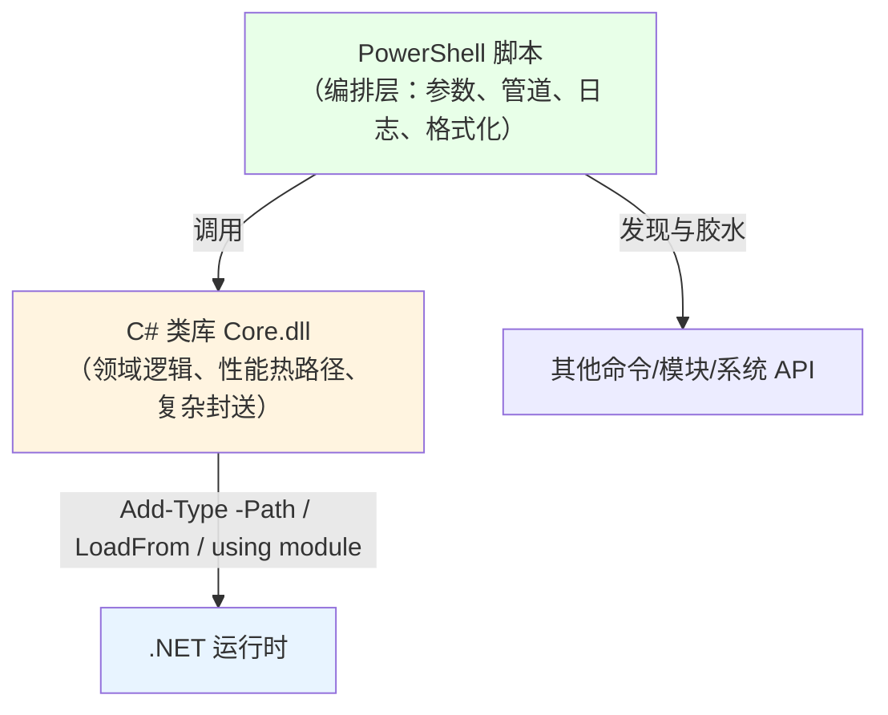
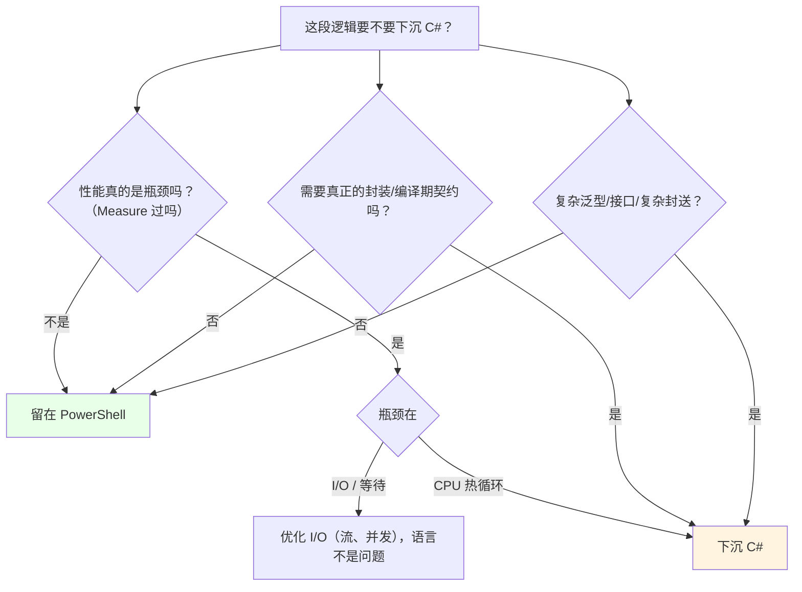

# 第 33 章 与 C# 的协作边界：什么时候不该用 PowerShell

> **章内定位**：全书的收尾。对标《CLR via C#》和《C# 本质论》的工程判断：当**类型安全、性能关键路径、复杂泛型算法或强编译期检查**成为主导需求时，PowerShell 的“运行时绑定”优势会转为劣势，应当把核心逻辑**下沉到 C# 程序集**，PowerShell 只保留**编排层**。
>
> 这一章不教你“怎么把整本书改写成 C#”，而是给你一张**决策图**：什么时候继续用 PowerShell，什么时候写一个 C# 类库、再用 PowerShell 包一层，什么时候干脆换语言。

---

## 33.1 脚本的边界与“下沉到 C#”的信号

### PowerShell 的解释开销与参数绑定开销

PowerShell 是**解释执行**的：每一行命令，都要经过“解析 → 绑定参数 → 执行”的过程。单次调用看起来很快，但在“百万次循环”里，这些开销会累积得非常可观：

- **参数绑定**：每次调用函数，都要做“按名/按位置/按管道”的匹配；
- **对象包装**：管道里的对象要经过 `PSObject` 适配（第 2 章），有额外开销；
- **动态类型**：没有编译期类型，很多工作在运行时才做。

一个粗略的直觉：**“脚本级”的循环，比“编译级”的循环慢一两个数量级**。当然，**大多数脚本是 I/O 密集的**（读文件、发请求、等进程），性能瓶颈在 I/O 而不在语言——这种情况下，PowerShell 的开销根本无所谓。**别过早优化**：先用 `Measure-Command` 量一量，确认“真的是这里慢”，再谈下沉。

### `Add-Type` 动态编译的启动成本

第 13 章的 `Add-Type -TypeDefinition` 是“现场编译 C#”。它很方便，但**编译本身要启动 Roslyn、生成程序集**，在“每次运行都要编译”的场景下，这一下可能就是几百毫秒。

优化办法：

- **`-OutputAssembly` 持久化成 DLL**（第 13 章），以后用 `Add-Type -Path` 直接加载，不再编译；
- 或者一开始就用 `dotnet build` 构建好类库。

### 强类型契约 vs `Get-Member` 可发现性

这是 PowerShell 与 C# 最本质的“取舍”，没有绝对好坏：

| 维度 | PowerShell | C# |
|---|---|---|
| **发现性** | `Get-Member`、`Get-Command` 随查随用 | 需要文档/IDE/编译 |
| **契约** | 运行时才校验（传错参数/属性，跑起来才知道） | **编译期**就报错 |
| **重构** | 改个函数名，靠搜索替换 | IDE 全局重构、编译器保证 |
| **上手** | 极快（不需要建项目） | 需要项目、编译、部署 |

PowerShell 的强项是“**探索与编排**”：你拿到一个陌生环境，`Get-Command`/`Get-Member` 一查就能开始干活；C# 的强项是“**契约与性能**”：大型代码库、多人协作、性能关键路径，编译器和类型系统会帮你兜底。

### 第 6 章“PowerShell 类无法真正封装”的工程后果

第 6 章讲过：PowerShell 类的 `hidden` **不是 `private`**——外部照样能调用；没有 `virtual`/`override`，没有编译期契约；接口实现漏了成员，是**解析时的运行时错误**。

这些“缺的”恰好是 C# 领域模型最看重的：

- 真正的封装边界（`private`、`internal`）；
- 继承契约（`abstract`、`virtual`、`override`）；
- 接口的编译期检查；
- 泛型约束。

所以：**如果你的“对象模型”开始需要这些，就该考虑下沉 C#**。PowerShell 类适合“轻量的、脚本内的类型”；不适合“要长期维护、多人协作的领域模型”。

### 第 29 章“Win32 调用边界”的工程后果

第 29 章总结过：Win32 调用在 PowerShell 里要自己管**句柄、内存、错误码、封送、完整性/会话**。当这些“手工活”变多时，脚本会变得又长又脆。

**下沉 C# 能让这些“手工活”变成“类型化的安全代码”**：

- `SafeHandle` 自动释放句柄；
- `IDisposable` / `using` 管资源；
- 编译期检查封送签名；
- 把 P/Invoke 封在类库内部，PowerShell 只调“方法”。

### 混合架构：C# 类库 + PowerShell 编排

这是最推荐的“中间路线”：**核心逻辑用 C# 写成类库，PowerShell 负责“编排、参数、管道、输出”**。



**加载 C# 类库的三种方式**：

**方式一：`Add-Type -Path`（最直接）**

```powershell
Add-Type -Path 'C:\libs\Core.dll'

$engine = [Core.Engine]::new()
$result = $engine.Process('D:\data')
```

**方式二：`[Reflection.Assembly]::LoadFrom()`（更底层）**

```powershell
$asm = [System.Reflection.Assembly]::LoadFrom('C:\libs\Core.dll')
$type = $asm.GetType('Core.Engine')
$engine = [System.Activator]::CreateInstance($type)
```

**方式三：模块 + `using module`（静态导入类）**

```powershell
# CoreModule.psm1
Add-Type -Path "$PSScriptRoot\Core.dll"
function Invoke-Core {
    param([string]$Path)
    $e = [Core.Engine]::new()
    $e.Process($Path)
}
Export-ModuleMember -Function Invoke-Core
```

```powershell
# 使用方
using module .\CoreModule.psm1
Invoke-Core -Path 'D:\data'
```

**分工原则**：

- **C# 负责**：性能热路径、复杂算法、真正的封装/继承/接口、复杂 P/Invoke 封送、并发底层；
- **PowerShell 负责**：`param()` 参数绑定、管道、`Where-Object`/`Select-Object` 等“数据流转”、日志、格式化、调用外部命令、给用户一个“好用的命令”。

一个具体的“何时下沉”决策图：



### 33.1 小结

1. **PowerShell 有解释/绑定开销**，但**多数脚本是 I/O 密集的**，先 `Measure` 再谈下沉。
2. **`Add-Type` 动态编译有启动成本**；用 `-OutputAssembly` 持久化 DLL 或 `dotnet build`。
3. **取舍**：PowerShell 强在**发现性与编排**，C# 强在**契约与性能**。
4. **信号**：需要真正封装/编译期检查/复杂泛型/复杂封送/CPU 热路径 → 下沉 C#。
5. **混合架构**：C# 类库 + PowerShell 编排；用 `Add-Type -Path`、`LoadFrom`、`using module` 加载。

---

## 全书总结：从语法到运行时，再到系统编程

写到这里，这本书就走完了五个部分。让我们回头看看这张“地图”，它其实是一条**由浅入深的认知路径**：

**第 1 部分 语言基础与类型系统（第 1–8 章）**
从“一次执行发生在什么容器里”讲到“对象是什么类型、怎么存、怎么算、怎么控制流、怎么包成函数、怎么定义类、怎么处理集合与异常”。核心认知是：**PowerShell 的语法是 C# 语法的“对象化变体”，但又处处不同。**

**第 2 部分 对象管道与命令体系（第 9–12 章）**
从“命令怎么发现”讲到“对象怎么在管道里流动、参数怎么绑定、怎么筛选投影排序分组、怎么格式化和输出”。核心认知是：**管道是 PowerShell 的发动机，对象流 + 参数绑定是它区别于普通 shell 的灵魂。**

**第 3 部分 .NET 运行时设施（第 13–19 章）**
从“程序集与反射”讲到网络、文本正则、容器、线程并发、IO 流、WinForms。核心认知是：**PowerShell 直接跑在 CLR 上，整个 .NET 类库都是你的工具箱——关键是知道“用什么、怎么用、边界在哪”。**

**第 4 部分 Win32 API 编程（第 20–29 章）**
从“错误码、字符串封送、句柄、结构体”这些共同语法，讲到进程、线程、同步、内存、DLL、SEH、窗口消息、GDI，最后收束为“四条信号 + 安全清单”。核心认知是：**Win32 是“.NET 没覆盖、或覆盖得不够底层”时的最后手段；用它可以，但要带着安全和边界的意识。**

**第 5 部分 工程化与互操作（第 30–33 章）**
从模块化、脚本安全，讲到 P/Invoke/COM 互操作，最后落到“什么时候不该用 PowerShell”。核心认知是：**从“能写”到“能交付”，中间隔着模块化、安全、资源管理和工程判断。**

如果要用一句话概括全书，那就是：

> **PowerShell 是一门“以对象为血液、以管道为血管、以 CLR 为身体、以 Win32 为骨骼”的脚本语言；学会它，不是背命令，而是理解这套“血液—血管—身体—骨骼”如何协同，并且知道什么时候该借 C# 的“肌肉”。**

### 给读者的三条“退场建议”

1. **先用 PowerShell 把事做完**。它上手快、发现性强，绝大多数“自动化、运维、胶水”任务，它都能胜任。
2. **遇到“性能/封装/契约/复杂封送”的硬墙，再下沉 C#**。不是“PowerShell 不好”，而是“每种工具都有它最合适的位置”。
3. **永远把“边界”放在心上**：类型边界（CLR/PSObject）、并发边界（运行空间）、系统边界（Win32/完整性/会话）、互操作边界（P/Invoke/COM）。**你在这本书里学到的每一个“边界”，都是为了让你在踩线之前，先看见那条线。**

感谢你读到这里。希望这本书不仅让你“会用 PowerShell”，更让你**看懂它为什么是这样、以及什么时候该换一把更合适的工具**。

---

> **动手练习（也是全书的收尾练习）**
>
> 1. 用 `Measure-Command` 量一段“脚本循环”和一段“C# 循环”（`Add-Type` 写一个简单方法）的耗时，算一算“解释 vs 编译”的差距，体会“什么时候值得下沉”。
> 2. 把你写过的一个 `.ps1` 脚本，拆成“C# 类库（核心逻辑）+ PowerShell 模块（编排）”两层，用 `Add-Type -Path` 加载。
> 3. 列出你工作里“最该下沉 C#”的三段逻辑，并写出理由（性能？封装？复杂封送？）。
> 4. 用一张图（纸笔或 Mermaid）画出你理解中的“PowerShell—CLR—Win32”三层关系，标出本书每一部分对应哪一层。
> 5. 回头翻一翻你最初觉得“最难懂”的那一章，看看现在的自己能不能用三句话把它讲给别人听——如果讲得清，你就真的学会了。
