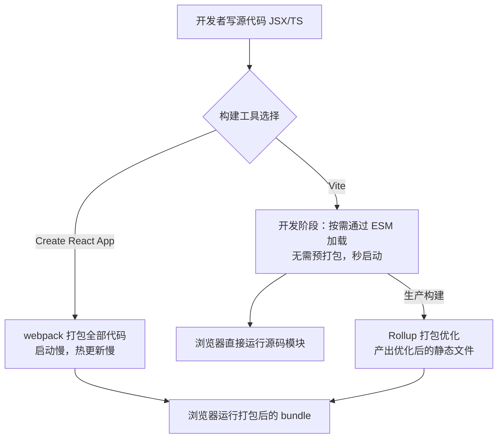
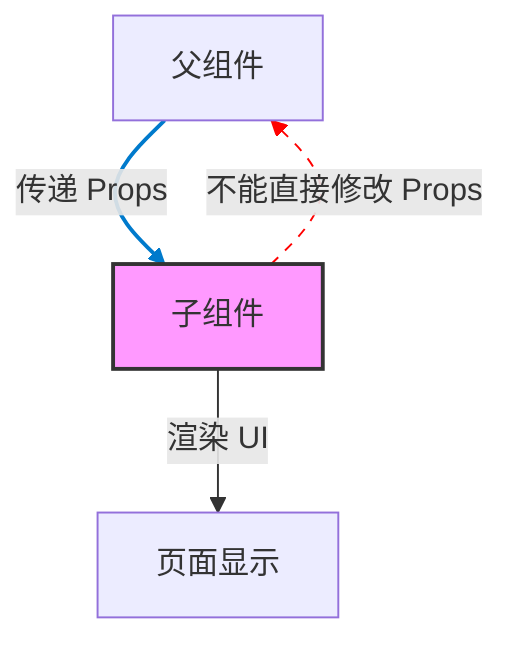
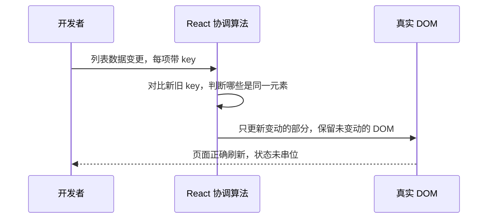
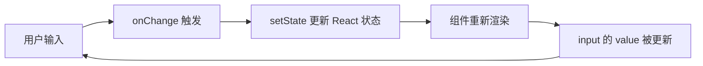

# 第1章 React 核心组件与渲染模型

**本章概述**：React 是目前最主流的前端 UI 库之一。本章我们从零开始，搭建一个 React 项目，认识函数组件、JSX、Props，弄清楚列表渲染里的 `key` 到底是干什么的，以及表单里“受控”和“非受控”到底受不受谁的控。

**读者对象**：你已经会写 JavaScript（变量、函数、数组、对象、箭头函数这些基础都懂），但没有学过任何其他编程语言，也没接触过 React。没问题，我们从最简单的地方开始，一步步来。

---

## 1.1 React 项目初始化：从 Create React App 到 Vite

早年间，如果你想创建一个 React 项目，官方推荐的工具叫 **Create React App**，简称 **CRA**。一条命令 `npx create-react-app my-app`，它会帮你把 webpack、Babel、各种配置都封装好，你只需要写业务代码。这在当时叫做“零配置脚手架”，对新手非常友好。

但是，时间到了 **2025 年 2 月**，React 官方正式宣布弃用 CRA。原因很简单：CRA 内部依赖的 webpack 构建速度慢，配置难以定制，而且生态已经有了更好的选择。今天，React 官方推荐的起点是 **Vite**。

Vite 是什么？简单来说，它是一个前端构建工具，负责把你写的 JSX、TypeScript、CSS 等源码，编译成浏览器能直接运行的静态文件。它的最大特点是**“快”**——启动开发服务器几乎是秒开，修改代码后页面秒级更新，这是因为它在开发阶段利用浏览器原生支持的 ESM（ES Module）特性，不需要把所有代码打包成一个巨大的 bundle。

### 从 CRA 迁移到 Vite（不重写业务代码）

如果你已经有一个 CRA 项目，不想重写业务代码，只想换掉构建器，可以把项目迁移到 Vite。迁移时有三个常见的坑：

1. **入口 `index.html` 从 `public/` 移到根目录**：CRA 默认把 HTML 放在 `public/` 目录下，Vite 期望 `index.html` 放在项目根目录，作为入口。
2. **删除 `%PUBLIC_URL%` 占位符**：CRA 里图片、公共资源经常写成 `%PUBLIC_URL%/logo.png`，Vite 里没有这个占位符，直接写相对路径或放到 `public/` 目录下引用即可。
3. **环境变量前缀变了**：CRA 的环境变量必须以 `REACT_APP_` 开头，在代码里用 `process.env.REACT_APP_Xxx` 读取。Vite 里环境变量以 `VITE_` 开头，读取方式变成 `import.meta.env.VITE_Xxx`。

### 今天从零开始的标准命令

现在创建一个 React 19 + Vite 项目的标准做法是：

```bash
npm create vite@latest my-react-app -- --template react-ts
cd my-react-app
npm install
npm run dev
```

这里用到了 `react-ts` 模板，意味着自带 TypeScript 支持。安装完成后，`npm run dev` 启动开发服务器，通常会输出类似 `http://localhost:5173` 的地址，打开浏览器就能看到 React 欢迎页面。

项目初始化后，目录大致长这样：

```
my-react-app/
├── index.html          # 入口 HTML（根目录，注意别放 public/ 里）
├── package.json
├── tsconfig.json
├── vite.config.ts      # Vite 配置文件
├── public/             # 静态公共资源
└── src/
    ├── main.tsx        # 应用入口，渲染根组件
    └── App.tsx         # 根组件
```

`vite.config.ts` 大概长这样：

```ts
import { defineConfig } from 'vite'
import { pluginReact } from '@vitejs/plugin-react'

export default defineConfig({
  plugins: [pluginReact()],
})
```

`defineConfig` 是 Vite 提供的辅助函数，主要作用是给配置文件加上 TypeScript 的类型提示，让你写配置的时候编辑器能智能补全，不至于写错字段而不知道。

环境变量的用法对比：

```ts
// CRA 写法（已过时）
const apiUrl = process.env.REACT_APP_API_URL

// Vite 写法（推荐）
const apiUrl = import.meta.env.VITE_API_URL
```

`import.meta.env` 是浏览器原生提供的对象，Vite 在构建时会把 `VITE_` 开头的变量替换进代码。注意，只有以 `VITE_` 开头的变量才会被暴露给前端代码，这是出于安全考虑，防止你不小心把服务器的私密密钥泄露到前端包里。

> **小结**：今天学 React，直接用 Vite 脚手架，不再推荐 CRA。记住三个迁移坑：`index.html` 位置、`%PUBLIC_URL%`、环境变量前缀和读取方式。

#### CRA 与 Vite 的构建流程对比



---

## 1.2 函数组件与 JSX 运行时

React 的核心思想是“**组件**”。你可以把组件理解为一个自定义的 HTML 标签，它内部封装了结构、样式和行为。比如你可以定义一个 `<Welcome />` 组件，里面渲染欢迎语，然后在页面上像用原生 HTML 标签一样使用它。

在 React 19 之前，组件有两种写法：类组件（class component）和函数组件（function component）。类组件需要继承 `React.Component`，写 `render` 方法，代码比较啰嗦。函数组件就是一个普通的 JavaScript 函数，返回 JSX，代码更简洁。

从 React 19 开始，配合 **React Compiler**（`babel-plugin-react-compiler`），React 会自动给函数组件做 memoization（记忆化/缓存），也就是说，在很多情况下你不再需要手动写 `React.memo` 或 `useMemo` 来优化性能，编译器会在构建时自动帮你完成。这使得函数组件在 2026 年依然是 React 的默认选择和推荐写法。

### 函数组件长什么样

```tsx
import React from 'react'

function Welcome(props: { name: string }) {
  return <h1>你好，{props.name}</h1>
}

export default Welcome
```

这里的 `Welcome` 就是一个函数组件。它接收一个 `props` 参数（属性对象），返回一个 JSX 表达式。JSX 看起来像 HTML，但实际上它是 JavaScript 的语法扩展，在构建阶段会被编译成 `React.createElement` 的调用。

上面的代码编译后大致相当于：

```js
function Welcome(props) {
  return React.createElement('h1', null, '你好，', props.name)
}
```

### React.FC 和 JSX.Element（React 19 中的变化）

在老的 TypeScript 写法里，你可能会看到函数组件被标注成 `React.FC`：

```tsx
// React 18 及更早的常见写法（React 19 中已不再推荐显式标注）
const Welcome: React.FC<{ name: string }> = ({ name }) => {
  return <h1>你好，{name}</h1>
}
```

`React.FC` 是函数组件的类型别名，`JSX.Element` 表示 JSX 表达式的返回类型。但在 React 19 中，官方不再推荐强制给函数组件标注 `React.FC`，因为它会带来一些类型上的小麻烦（比如默认包含 `children` 属性，有时不需要）。直接写普通的 TypeScript 函数即可。

React Compiler 是什么？它是一个 Babel 插件（`babel-plugin-react-compiler`），在构建时分析你的组件代码，自动追踪哪些数据变了、哪些没变，从而自动插入缓存逻辑。换句话说，它让“性能优化”从手动变成了自动。作为初学者，你只需要知道：现在的 React 函数组件已经够快了，不用过早地去优化。

### 代码示例：一个带状态的函数组件

```tsx
import { useState } from 'react'

function Counter() {
  const [count, setCount] = useState(0)

  return (
    <div>
      <p>当前计数：{count}</p>
      <button onClick={() => setCount(count + 1)}>加 1</button>
    </div>
  )
}

export default Counter
```

这个 `Counter` 组件用到了 `useState` Hook（后面章节会详细讲），它能让组件“记住”一个数值。点击按钮，`count` 增加，React 会自动重新渲染组件，页面上的数字也随之变化。

> **小结**：函数组件是 React 的基础单元，就是一个返回 JSX 的函数。JSX 在本质上会被编译成 `React.createElement`。React 19 的 React Compiler 会自动帮你做性能优化，不用过早手写 memo。

#### JSX 到真实 DOM 的转换过程

```mermaid
flowchart LR
    A[JSX 代码<br/><h1>你好 {name}</h1>] --> B[Babel 编译]
    B --> C[React.createElement('h1', null, '你好 ', name)]
    C --> D[React 创建虚拟 DOM 对象]
    D --> E[React DOM 渲染<br/>生成真实 DOM 节点]
    E --> F[浏览器页面显示]
```

---

## 1.3 Props 设计与组件契约

**Props** 是 “properties” 的缩写，中文可以叫“属性”。它是 React 组件之间**唯一的公开接口**。父组件通过 Props 把数据传给子组件，子组件通过 Props 接收并渲染。

你可以把 Props 想象成函数的参数。就像你调用一个函数 `add(a, b)` 传入 `a` 和 `b` 一样，父组件使用子组件时，通过 Props 传入数据。

### 配置型 Props 与数据型 Props

在 TypeScript 里设计 Props 时，可以把 Props 分为两类：

1. **配置型 Props**：用来配置组件的行为或外观，比如 `size: 'small' | 'medium'`、`variant: 'primary' | 'secondary'`。这类 Props 通常是固定的几个可选值。
2. **数据型 Props**：用来传递实际的业务数据，比如 `user: { name: string; age: number }`、`items: string[]`。这类 Props 的内容是多变的，取决于业务数据。

配置型 Props 像开关和旋钮，数据型 Props 像原材料。

### 什么时候用 children 而非具名 Props

有时子组件需要接收“子内容”，也就是放在组件标签内部的内容。这时候可以用 React 的特殊 Prop `children`。

```tsx
// 用 children 传递子内容
function Card({ children }: { children: React.ReactNode }) {
  return <div className="card">{children}</div>
}

// 使用
<Card>
  <h2>标题</h2>
  <p>这是卡片里的内容。</p>
</Card>
```

`React.ReactNode` 是 TypeScript 里的一个类型，表示“可以渲染的任何东西”，包括字符串、数字、JSX 元素、数组等。

如果你用具名 Props 传子内容，比如 `<Card content="..." />`，只能传字符串，不够灵活。所以，当需要传递“结构化内容”时，优先用 `children`。

`React.PropsWithChildren` 是一个辅助类型，可以自动给你的 Props 类型加上 `children`：

```tsx
import { PropsWithChildren } from 'react'

function Card(props: PropsWithChildren<{ title: string }>) {
  return (
    <div>
      <h2>{props.title}</h2>
      {props.children}
    </div>
  )
}
```

### ComponentPropsWithoutRef：复用已有组件的 Props 类型

有时候你写的组件要包装一个已有的原生元素或组件，比如你要写一个 `MyButton`，它本质上就是一个 `<button>`，应该支持原生 button 的所有属性（如 `type`、`disabled`、`onClick`）。这时不用手动定义这些 Props，可以用 `React.ComponentPropsWithoutRef` 自动推导：

```tsx
import { ComponentPropsWithoutRef } from 'react'

type MyButtonProps = ComponentPropsWithoutRef<'button'> & {
  variant?: 'primary' | 'ghost'
}

function MyButton({ variant = 'primary', ...props }: MyButtonProps) {
  return <button variant={variant} {...props} />
}
```

这里 `ComponentPropsWithoutRef<'button'>` 自动包含了 `<button>` 的所有标准属性，你只需要额外定义自己特有的 `variant`，其余属性通过 `...props` 透传给原生按钮。

### propTypes 在 2026 年还有价值吗？

`propTypes` 是 React 早期提供的运行时类型检查工具，在 TypeScript 流行之前很常用。比如：

```tsx
import PropTypes from 'prop-types'

function Welcome({ name }) {
  return <h1>你好，{name}</h1>
}

Welcome.propTypes = {
  name: PropTypes.string.isRequired,
}
```

在 2026 年，如果你的项目已经在用 TypeScript，`propTypes` 基本没有存在价值了，因为 TypeScript 的类型检查在编译阶段就能完成，更准确、更完整，不需要运行时开销。只有在纯 JavaScript 项目且不想引入 TypeScript 时，`propTypes` 才还有一点意义。

> **小结**：Props 是组件之间的“合同”。TypeScript 能在编写代码时就检查 Props 是否正确。配置型 Props 控制行为，数据型 Props 传递内容；需要传结构化子内容时用 `children`；包装原生元素时用 `ComponentPropsWithoutRef`。TypeScript 项目里基本不用 `propTypes` 了。

#### Props 单向数据流



---

## 1.4 条件渲染、列表与 key 的深层语义

在 React 里，你可以根据条件决定渲染什么内容，也可以根据数组渲染列表。这两个功能看似简单，但里面藏着一些容易踩的坑，尤其是 `key`。

### 条件渲染

React 的条件渲染本质上就是 JavaScript 的条件语句。你可以用 `if`、`三元运算符`、`&&` 等方式决定渲染什么。

```tsx
function Greeting({ isLoggedIn }) {
  if (isLoggedIn) {
    return <h1>欢迎回来</h1>
  }
  return <h1>请先登录</h1>
}

// 三元运算符写法
function GreetingShort({ isLoggedIn }) {
  return isLoggedIn ? <h1>欢迎回来</h1> : <h1>请先登录</h1>
}

// && 写法：只在条件成立时渲染
function UnreadBadge({ unreadCount }) {
  return (
    <div>
      {unreadCount > 0 && <span className="badge">{unreadCount}</span>}
    </div>
  )
}
```

### 列表渲染与 map

要把数组渲染成一组元素，用 JavaScript 的 `Array.prototype.map`：

```tsx
function UserList({ users }) {
  return (
    <ul>
      {users.map((user) => (
        <li key={user.id}>{user.name}</li>
      ))}
    </ul>
  )
}
```

这里的 `key={user.id}` 非常关键。很多初学者以为 `key` 只是用来“消除 React 控制台警告”的开关，实际上不是。

### key 不是消除警告的开关，而是身份标识

`key` 是 React **协调算法**（reconciliation，也叫 diff 算法）的身份标识。当列表发生变化（新增、删除、排序）时，React 通过 `key` 判断哪个元素是“同一个”，哪个是“新来的”。

如果不给 `key` 或者给错 `key`（比如都用数组下标 `index`），React 可能会错误地复用 DOM 节点，导致：
- 输入框内容串位（比如你在第一行输入，结果第三行也跟着变）
- 动画错误触发
- 组件内部状态被错误保留

```tsx
// ❌ 不推荐：用数组下标作为 key（列表顺序变化时会出问题）
{users.map((user, index) => (
  <li key={index}>{user.name}</li>
))}

// ✅ 推荐：用唯一的业务 ID 作为 key
{users.map((user) => (
  <li key={user.id}>{user.name}</li>
))}
```

### 列表虚拟化与 key 策略

如果列表非常长（比如几千行），一次性渲染所有 DOM 会卡顿。这时候可以用列表虚拟化，只渲染可见区域内的行。社区成熟的库有 `@tanstack/react-virtual`。虚拟列表里，`key` 依然应该用数据项的唯一 ID，不要用在窗口中的相对索引，因为滚动时索引会变，但数据项的身份不变。

```tsx
import { useRef } from 'react'
import { useVirtual } from '@tanstack/react-virtual'

function VirtualList({ items }) {
  const parentRef = useRef(null)
  const virtualRowItems = useVirtual({
    size: items.length,
    parentRef,
    estimateSize: () => 40,
  })

  return (
    <div ref={parentRef} className="list">
      <div style={{ height: virtualRowItems.getTotalSize() }}>
        {virtualRowItems.map((virtualItem) => {
          const item = items[virtualItem.index]
          return (
            <div
              key={item.id}
              style={{
                position: 'absolute',
                top: 0,
                left: 0,
                width: '100%',
                height: virtualItem.size,
                transform: `translateY(${virtualItem.start}px)`,
              }}
            >
              {item.name}
            </div>
          )
        })}
      </div>
    </div>
  )
}
```

> **小结**：条件渲染用普通 JS 条件语句即可；列表渲染用 `map`，且必须给每项一个稳定的、唯一的 `key`（推荐用业务 ID，不要用数组下标）。`key` 让 React 知道哪个元素是“同一个”，避免状态串位和渲染错误。

#### key 在列表更新时的协调过程



---

## 1.5 合成事件与受控/非受控模式

### React 的事件系统：合成事件与根容器委托

在原生 DOM 里，点击按钮会触发 `click` 事件。在 React 里，你写的是 `onClick={handler}`。React 并不是在每个按钮上直接监听原生事件，而是使用**事件委托**：所有事件最终都委托给根容器（React 17 以后是挂载容器的根节点）统一处理，然后再由 React 分发给对应的组件。

React 把原生事件包装成**合成事件**（Synthetic Event），这是一个跨浏览器统一的事件对象。比如 `React.ChangeEvent` 表示表单输入变化事件，它在不同浏览器上的行为保持一致，不用担心兼容性问题。

### 受控组件：值由 React 状态掌控

在 HTML 里，`<input>` 有自己的内部状态（用户输入什么，输入框里就显示什么）。在 React 里，如果你给 `<input>` 加上 `value` 属性，并用 `onChange` 事件同步状态，这个输入框就变成了**受控组件**——它的值完全受 React 状态控制。

```tsx
import { useState } from 'react'

function ControlledInput() {
  const [text, setText] = useState('')

  return (
    <div>
      <input
        value={text}
        onChange={(e) => setText(e.target.value)}
        placeholder="请输入内容"
      />
      <p>你输入了：{text}</p>
    </div>
  )
}
```

这里 `e` 是 `React.ChangeEvent<HTMLInputElement>`，`e.target.value` 是输入框当前的值。每次用户按键，状态更新，React 重新渲染，输入框的 `value` 也跟着更新。

受控组件的优点是：值始终和 React 状态同步，方便做校验、禁用提交按钮等。缺点是：每次输入都会触发状态更新和重渲染，如果输入频繁且组件很大，会有性能代价。

### 非受控组件：让 DOM 自己管自己的值

如果你不给 `<input>` 传 `value`，而是只给 `defaultValue`（初始值），那么输入框的值就由浏览器 DOM 自己管理，React 不干预。这就是**非受控组件**。

```tsx
import { useRef } from 'react'

function UncontrolledInput() {
  const inputRef = useRef<HTMLInputElement>(null)

  const handleSubmit = () => {
    const value = inputRef.current?.value
    alert('提交内容：' + value)
  }

  return (
    <div>
      <input
        ref={inputRef}
        defaultValue="初始内容"
        placeholder="请输入内容"
      />
      <button onClick={handleSubmit}>提交</button>
    </div>
  )
}
```

这里 `useRef` 拿到一个指向 DOM 节点的引用，提交时直接读 `inputRef.current.value`。`defaultValue` 只设置初始值，之后用户怎么改，React 都不管。

非受控组件的优点是：不需要为每次输入都更新状态，性能更好，适合简单的表单或不需要实时校验的场景。缺点是：你不能轻易在代码里“读取”或“重置”当前值，必须通过 ref 去操作 DOM。

### 什么时候切换到非受控模式

一般来说，默认优先用受控组件，因为数据和状态同步更可控。但在以下情况可以考虑非受控：
- 表单字段很多，且不需要实时响应每次输入
- 需要集成非 React 的第三方库（比如某些日期选择器）
- 对输入性能非常敏感，不想每次按键都触发重渲染

> **小结**：React 事件通过根容器委托，统一成合成事件，跨浏览器行为一致。受控组件的值由 React `state` 控制，适合需要同步和校验的场景；非受控组件用 `defaultValue` + `ref`，值由 DOM 自身管理，适合性能敏感或简单表单。二者选其一，不要在同一个输入框上同时用 `value` 和 `defaultValue`，否则 React 会报警告。

#### 受控组件的数据流向



---

## 本章小结

本章我们完成了 React 学习的第一步：

1. 用 Vite 而不是已弃用的 Create React App 初始化项目，并了解了迁移时的三个坑（`index.html` 位置、`%PUBLIC_URL%`、环境变量前缀和读取方式）。
2. 认识了函数组件和 JSX，知道 JSX 本质上会被编译成 `React.createElement`，React 19 的 React Compiler 会自动帮你做性能优化。
3. 掌握了 Props 设计：配置型 vs 数据型，`children` vs 具名 Props，`ComponentPropsWithoutRef` 自动推导原生属性，TypeScript 项目里基本不再需要 `propTypes`。
4. 弄清了 `key` 的真正含义：它是 React 协调算法的身份标识，不是消除警告的开关，列表渲染应使用稳定的业务 ID。
5. 区分了受控组件和非受控组件，知道何时使用 `value` + `onChange`，何时使用 `defaultValue` + `ref`。

下一章我们将进入状态管理，学习 `useState`、`useReducer`，以及如何把状态拆分到不同的工具里。