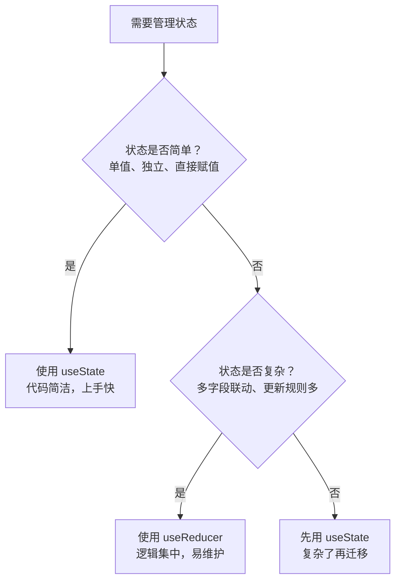
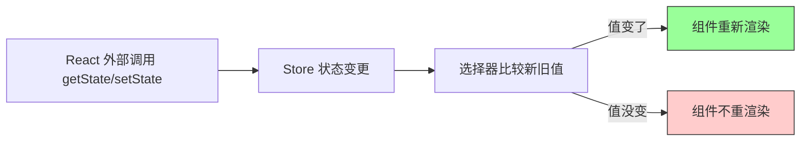
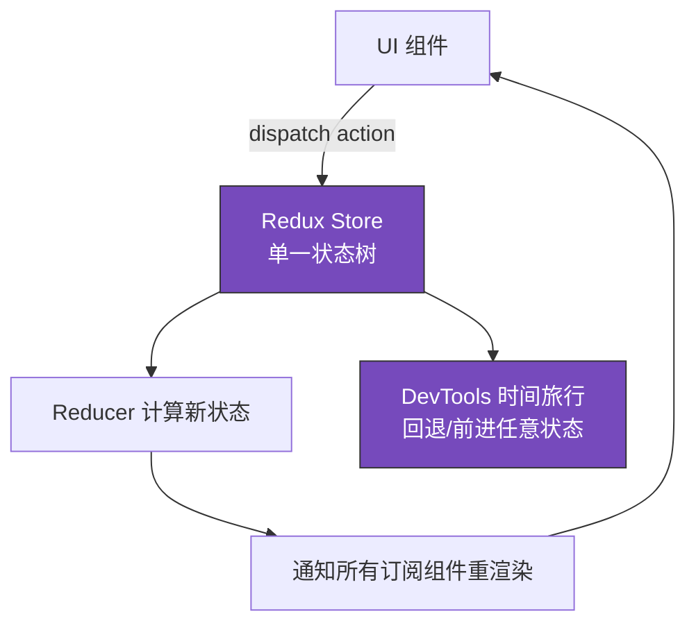

# 第2章 状态管理：客户端状态与服务端状态的分离

**本章概述**：状态是 React 组件的“记忆”。没有状态，组件就像一张张静态照片，永远不会变；有了状态，组件才能响应用户操作、显示新数据、切换页面。本章我们学习 React 自带的 `useState`、`useReducer`、`Context`，以及社区流行的 Zustand、Redux Toolkit、Jotai，并弄清楚什么是“客户端状态”、什么是“服务端状态”，两者该如何分工。

**读者对象**：你已经会写 JavaScript，知道变量、函数、对象、数组，也读完了第1章的组件基础。如果你还没接触过状态管理，没关系，我们从最简单的计数器开始，一步步讲清楚。

---

## 2.1 局部状态：useState 与 useReducer 的适用边界

### 什么是状态？

状态（state）可以理解为组件“记得”的信息。比如一个计数器组件，它记得当前数字是多少；一个登录组件，它记得用户是否已经登录；一个购物车组件，它记得用户选了哪些商品。

在 React 的函数组件里，如果你直接用普通变量存数据：

```tsx
function BadCounter() {
  let count = 0
  return (
    <div>
      <p>当前：{count}</p>
      <button onClick={() => { count = count + 1 }}>加 1</button>
    </div>
  )
}
```

点击按钮，`count` 虽然会变成 1，但页面**不会重新渲染**，你看到的数字还是 0。这是因为 React 不知道状态变了，不会刷新组件。

React 提供了 `useState` 来解决这个问题。它告诉 React：“这个数值是状态，它变了请重新渲染组件。”

### useState：适合简单、独立的状态

`useState` 是 React 最基础的 Hook，返回一个数组：当前状态值，和一个更新这个状态的函数。

```tsx
import { useState } from 'react'

function Counter() {
  const [count, setCount] = useState(0)

  return (
    <div>
      <p>当前计数：{count}</p>
      <button onClick={() => setCount(count + 1)}>加 1</button>
      <button onClick={() => setCount(0)}>重置</button>
    </div>
  )
}

export default Counter
```

这里 `useState(0)` 的意思是：初始状态是 0。`count` 是当前值，`setCount` 是修改函数。点击“加 1”，`setCount(count + 1)` 会触发组件重新渲染，页面上的数字也跟着变。

`useState` 最适合的场景是：**单值、独立、简单更新**。比如：
- 一个开关是否打开（`true` / `false`）
- 一个输入框的当前文本
- 一个模态框是否显示（`true` / `false`）

如果你的状态只有一个值，而且更新逻辑很简单（直接赋新值），用 `useState` 就够了，不要为了好看而用更复杂的工具。

### useReducer：适合多字段联动、更新逻辑可命名

当状态变得复杂，比如一个表单里有姓名、年龄、性别、城市等多个字段，或者状态的更新规则比较复杂（比如“只能在某些条件下才能修改”），`useState` 就会显得力不从心，代码容易变得杂乱。

这时候可以用 `useReducer`。它的核心思想是：**“派发动作（action），由 reducer 函数决定怎么更新状态”**。这很像 Redux，但更轻量，不需要额外安装库。

```tsx
import { useReducer } from 'react'

// 1. 定义初始状态
const initialState = { name: '', age: 0, city: '' }

// 2. 定义 reducer 函数：(当前状态, 动作) => 新状态
function userReducer(state, action) {
  switch (action.type) {
    case 'setName':
      return { ...state, name: action.payload }
    case 'setAge':
      return { ...state, age: action.payload }
    case 'setCity':
      return { ...state, city: action.payload }
    case 'reset':
      return initialState
    default:
      return state
  }
}

function UserForm() {
  // 3. 使用 useReducer，返回当前状态和 dispatch 函数
  const [state, dispatch] = useReducer(userReducer, initialState)

  return (
    <div>
      <p>姓名：{state.name}</p>
      <p>年龄：{state.age}</p>
      <p>城市：{state.city}</p>

      <button onClick={() => dispatch({ type: 'setName', payload: '张三' })}>
        设置姓名
      </button>
      <button onClick={() => dispatch({ type: 'setAge', payload: 25 })}>
        设置年龄
      </button>
      <button onClick={() => dispatch({ type: 'reset' })}>
        重置
      </button>
    </div>
  )
}

export default UserForm
```

`useReducer` 返回两个值：`state`（当前状态）和 `dispatch`（派发动作的函数）。你不需要直接修改状态，而是派发一个动作（比如 `{ type: 'setName', payload: '张三' }`），reducer 函数根据动作类型计算出新状态。

`useReducer` 最适合的场景是：**多字段联动、更新逻辑可命名**。比如：
- 一个复杂表单，有多个输入框互相影响
- 一个购物车，需要添加、删除、修改数量、清空等多种操作
- 状态的更新规则比较复杂，需要用 switch 或 if-else 来处理

### 怎么选：useState 还是 useReducer？

判断标准很简单：

| 场景 | 推荐 |
|------|------|
| 状态只有一个值，更新很简单 | `useState` |
| 状态有多个字段，且它们会联动更新 | `useReducer` |
| 更新逻辑复杂，需要命名（比如 "setName"、"reset"） | `useReducer` |
| 不确定用哪个 | 先用 `useState`，复杂了再换 `useReducer` |

> **小结**：`useState` 适合简单、独立的单值状态；`useReducer` 适合多字段联动、更新逻辑可命名的复杂状态。不要急着把状态提升到全局，先在组件内部用好局部状态，这是状态管理的第一原则。

#### useState 与 useReducer 的选择流程



---

## 2.2 Context 的正确用途与性能陷阱

### Context 不是状态管理器，而是依赖注入机制

很多初学者一听到“跨组件传数据”，就想到 Context，以为它就是 React 的状态管理工具。实际上，**Context 的本质是“依赖注入”**——它让你在组件树中任意深处获取某个值，而不需要一层层通过 Props 传递（这叫“Props 钻取”）。

想象一下，你有一个主题颜色（浅色/深色），几乎每个组件都需要知道。如果不用 Context，你得把 `theme` 作为 Props 从最外层一层层传下来：

```tsx
// 糟糕：Props 钻取，中间组件根本不用 theme，却得传递
<App theme="dark">
  <Layout theme="dark">
    <Header theme="dark">
      <Button theme="dark">点我</Button>
    </Header>
  </Layout>
</App>
```

中间的 `Layout`、`Header` 明明不关心主题，却被迫接收并转发 `theme` Props，代码很啰嗦。用 Context 就可以跳过中间组件，直接在 `Button` 里读取主题。

### 创建和使用 Context

```tsx
import { createContext, useContext, useState, ReactNode } from 'react'

// 1. 创建 Context，默认值是 "light"
const ThemeContext = createContext<'light' | 'dark'>('light')

// 2. 提供者组件：包住需要读取主题的子树
function ThemeProvider({ children }: { children: ReactNode }) {
  const [theme, setTheme] = useState<'light' | 'dark'>('light')

  return (
    <ThemeContext.Provider value={{ theme, setTheme }}>
      {children}
    </ThemeContext.Provider>
  )
}

// 3. 消费者组件：直接读取主题，不用Props传递
function Button() {
  const { theme, setTheme } = useContext(ThemeContext)
  return (
    <button
      onClick={() => setTheme(theme === 'light' ? 'dark' : 'light')}
      style={{ background: theme === 'dark' ? '#333' : '#fff', color: theme === 'dark' ? '#fff' : '#000' }}
    >
      当前主题：{theme}，点击切换
    </button>
  )
}
```

`createContext` 创建一个 Context，`ThemeContext.Provider` 提供值，`useContext` 在子组件里读取值。中间组件完全不需要知道主题的存在。

### Context 的性能陷阱：高频变更会导致整棵子树重渲染

Context 非常方便，但有一个大坑：**Context 的值一旦变化，所有使用 `useContext` 读取它的组件都会重新渲染，不管它们用没用到变化的那部分。**

比如上面的 `ThemeProvider`，`value` 是一个对象 `{ theme, setTheme }`。当 `theme` 从 `'light'` 变成 `'dark'` 时，`value` 对象变了，所有订阅了这个 Context 的组件（比如 `Button`）都会重渲染。如果子树里有几百个组件都用了 `useContext(ThemeContext)`，主题切换一次就会让几百个组件重渲染，性能很差。

**Context 适合“低频变更”的数据**，比如：
- 主题颜色（很少切换）
- 用户身份/登录状态（很少变）
- 语言设置（很少变）

**Context 不适合“高频变更”的 UI 状态**，比如：
- 输入框的当前文字（每按一个键都变）
- 鼠标坐标（移动就变）
- 计时器的秒数（每秒都变）

如果你把高频状态放进 Context，每次按键都会导致整棵子树重渲染，页面会卡顿。

### React 19 中的 use() 读取语义

React 19 引入了 `use()` 函数，可以读取 Context 或 Promise。和 `useContext` 类似，`use(ThemeContext)` 也能读取 Context 值。区别是 `use()` 可以在条件分支和循环里调用（而 Hooks 必须在组件顶层调用），更加灵活。

```tsx
// React 19 的 use() 读取 Context
function Button() {
  const { theme } = use(ThemeContext)
  return <button>当前主题：{theme}</button>
}
```

作为初学者，你可以先熟练 `useContext`，`use` 可以在后面接触 React 19 新特性时再深入。

### 怎么用好 Context

1. **只放低频变更的全局配置**：主题、语言、用户信息等。
2. **值拆分得越细越好**：不要把所有东西塞进一个 Context。把主题、用户、语言分成不同的 Context，避免一个变了导致不相关的组件都重渲染。
3. **高频状态留在组件内部或用 Zustand/Jotai**：不需要全局共享的状态，就不要放进 Context。

> **小结**：Context 是依赖注入机制，不是状态管理器。适合低频变更的全局配置（主题、语言、用户身份），不适合高频变更的 UI 状态（输入文字、计时器）。值变化时所有订阅组件都会重渲染，所以要拆分 Context，避免大 Context。

#### Context 数据流向与重渲染陷阱

```mermaid
flowchart TD
    A[ThemeProvider 值变化] --> B[ThemeContext.Provider]
    B --> C[所有 useContext(ThemeContext) 的组件]
    C --> D[组件重新渲染]
    E[未订阅 Context 的中间组件] -.->|不重渲染| F[跳过]
    style A fill:#ff9999,stroke:#333
    style D fill:#ff9999,stroke:#333
    linkStyle 0 stroke:#ff0000,stroke-width:2px
    linkStyle 1 stroke:#ff0000,stroke-width:2px
```

---

## 2.3 Zustand：轻量外部 store 与选择器订阅

### 为什么需要外部 store？

`useState` 只能在组件内部用，多个组件共享状态很麻烦。`Context` 可以共享，但高频变更会导致性能问题。Redux 功能强大，但配置繁琐，对小型项目来说太重了。

**Zustand**（发音类似“措尚德”）是一个轻量级的状态管理库，核心思路是：**在模块级别创建一个 store，组件通过选择器订阅自己需要的状态切片，不需要 Provider，不包裹整个应用。**

### 创建和使用 Zustand store

```tsx
import { create } from 'zustand'

// 1. 创建 store：一个普通的 JavaScript 对象，里面有状态和更新函数
interface TaskState {
  tasks: string[]
  addTask: (task: string) => void
  removeTask: (index: number) => void
}

const useTaskStore = create<TaskState>((set) => ({
  tasks: [],
  addTask: (task) => set((state) => ({ tasks: [...state.tasks, task] })),
  removeTask: (index) =>
    set((state) => ({
      tasks: state.tasks.filter((_, i) => i !== index),
    })),
}))
```

这里 `create` 接收一个函数，函数里用 `set` 来更新状态。`useTaskStore` 就是一个 Hook，组件调用它就能获取状态和更新函数。

### 组件中使用：选择器订阅

```tsx
import { useTaskStore } from './store'

function TaskList() {
  // 2. 用选择器只订阅需要的部分，不需要的部分变了不会重渲染
  const tasks = useTaskStore((state) => state.tasks)
  const addTask = useTaskStore((state) => state.addTask)
  const removeTask = useTaskStore((state) => state.removeTask)

  return (
    <div>
      <ul>
        {tasks.map((task, i) => (
          <li key={i}>
            {task}
            <button onClick={() => removeTask(i)}>删除</button>
          </li>
        ))}
      </ul>
      <button
        onClick={() => {
          const task = prompt('请输入任务')
          if (task) addTask(task)
        }}
      >
        添加任务
      </button>
    </div>
  )
}
```

注意 `useTaskStore((state) => state.tasks)`，括号里是**选择器**，只取 `tasks`。这样如果 `addTask` 变了（虽然函数引用通常不变），但 `tasks` 没变，组件就不会重渲染。这就是 Zustand 的“选择器订阅”特性。

### persist 中间件：状态持久化

刷新页面后，Zustand 的状态会丢失（因为它存在内存里）。如果你希望关掉页面再打开，状态还在，可以用 `persist` 中间件把状态存到 `localStorage`。

```tsx
import { create } from 'zustand'
import { persist } from 'zustand/middleware'

const useTaskStore = create<TaskState>()(
  persist(
    (set) => ({
      tasks: [],
      addTask: (task) => set((state) => ({ tasks: [...state.tasks, task] })),
    }),
    {
      name: 'task-storage', // localStorage 的 key
    }
  )
)
```

`persist` 会自动把状态保存到 `localStorage`，页面刷新后自动恢复。

### 在 React 外部直接读取和修改状态

Zustand 的 store 就是一个普通对象，你可以在组件外面（比如路由 loader、工具函数）直接调用 `getState()` 和 `setState()`：

```tsx
import { useTaskStore } from './store'

// 在组件外直接读取
const currentTasks = useTaskStore.getState().tasks

// 在组件外直接修改
useTaskStore.setState({ tasks: [] })
```

这在路由的 `loader` 里非常有用：在组件渲染之前，就可以从 store 里读取数据。

### shallow 比较：避免无关重渲染

如果你选择的状态是一个对象或数组，即使内容没变，引用变了也会导致重渲染。可以用 `shallow` 比较：

```tsx
import { create } from 'zustand'
import { shallow } from 'zustand/shallow'

interface AppState {
  user: { name: string; age: number }
  count: number
}

const useAppStore = create<AppState>((set) => ({
  user: { name: '张三', age: 25 },
  count: 0,
  increment: () => set((state) => ({ count: state.count + 1 })),
}))

function UserName() {
  // 只有 user.name 或 user.age 变了才重渲染
  const user = useAppStore((state) => state.user, shallow)
  return <div>用户：{user.name}</div>
}
```

`shallow` 会做浅层比较，只有选出的值真的变了，组件才重渲染。

> **小结**：Zustand 是轻量外部 store，无需 Provider，组件用 `useStore(selector)` 订阅切片，只在选中的状态变化时重渲染。`persist` 中间件可持久化到 `localStorage`，`shallow` 比较可避免无关重渲染，还可以在 React 外部用 `getState()`/`setState()` 直接操作状态。

#### Zustand 订阅与重渲染机制



---

## 2.4 Redux Toolkit：可审计的单一状态树

### Redux Toolkit 的定位

Redux 是 React 生态中最早的状态管理库，核心思想是**单一状态树**（全局只有一个 store）和**纯函数 reducer**。但原生 Redux 配置繁琐、样板代码多，初学者很难上手。

**Redux Toolkit（RTK）** 是 Redux 的官方推荐写法，它封装了常用工具，大幅减少样板代码。RTK 的定位已经很清晰：**不是默认起点，而是企业级审计与时间旅行调试的标杆**。如果你的项目需要严格的状态变更追踪（比如谁在什么时候改了什么数据），或者需要“时间旅行调试”（可以回到之前的状态查看），RTK 是值得的选择。但对于普通中小型项目，Zustand 或 Jotai 往往更轻便。

### 核心概念：createSlice、configureStore、createSelector

RTK 的核心是 `createSlice`，它把“状态 + reducer + action”打包在一起：

```tsx
import { createSlice, configureStore } from '@reduxjs/toolkit'

// 1. 创建 slice：定义初始状态和 reducer
const counterSlice = createSlice({
  name: 'counter',
  initialState: { value: 0 },
  reducers: {
    increment: (state) => {
      state.value += 1  // RTK 内部用 Immer，可以直接“修改”状态，不用手动返回新对象
    },
    decrement: (state) => {
      state.value -= 1
    },
    incrementByAmount: (state, action) => {
      state.value += action.payload
    },
  },
})

export const { increment, decrement, incrementByAmount } = counterSlice.actions

// 2. 创建 store：把所有 slice 汇总
const store = configureStore({
  reducer: {
    counter: counterSlice.reducer,
  },
})

// 导出类型，供组件使用
export type RootState = ReturnType<typeof store.getState>
export type AppDispatch = typeof store.dispatch
```

RTK 内部集成了 **Immer** 库，所以 reducer 里可以直接写 `state.value += 1`，看起来像直接修改状态，但实际上 Immer 会帮你生成不可变的新状态。这避免了手写 `return { ...state, value: state.value + 1 }` 的麻烦。

### 在组件中使用：useSelector 与 useDispatch

```tsx
import { useDispatch, useSelector } from 'react-redux'
import { increment, decrement } from './counterSlice'

function Counter() {
  // 从 store 读取状态
  const count = useSelector((state: RootState) => state.counter.value)
  const dispatch = useDispatch()

  return (
    <div>
      <p>当前计数：{count}</p>
      <button onClick={() => dispatch(increment())}>加 1</button>
      <button onClick={() => dispatch(decrement())}>减 1</button>
    </div>
  )
}
```

`useSelector` 从 store 读取数据，`useDispatch` 派发 action。RTK 的 action 是通过 slice 自动生成的，不需要手动写 `{ type: 'increment' }` 这种对象。

### createSelector：记忆化选择器

如果你需要从 store 里计算派生数据（比如根据多个字段算出总价），可以用 `createSelector`，它会缓存计算结果，只有依赖的数据变了才重新计算。

```tsx
import { createSelector } from '@reduxjs/toolkit'

const selectCartItems = (state: RootState) => state.cart.items
const selectCartDiscount = (state: RootState) => state.cart.discount

const selectCartTotal = createSelector(
  [selectCartItems, selectCartDiscount],
  (items, discount) => {
    const subtotal = items.reduce((sum, item) => sum + item.price, 0)
    return subtotal - discount
  }
)

// 组件中使用
const total = useSelector(selectCartTotal)
```

> **小结**：Redux Toolkit 适合需要审计、时间旅行调试的企业级项目。核心工具是 `createSlice`、`configureStore`、`createSelector`，组件里用 `useSelector` 和 `useDispatch`。样板代码比原生 Redux 少很多，但仍比 Zustand/Jotai 重，不是每个项目都需要。

#### Redux 单一状态树与时间旅行



---

## 2.5 Jotai：原子化状态与细粒度渲染

### 什么是原子化状态？

Zustand 的 store 是一个大对象，Redux 的 store 也是一个大状态树。而 **Jotai** 把状态拆成一个个最小的单位，叫做 **atom**（原子）。每个 atom 只代表一个独立的状态片段，组件只订阅自己需要的 atom，渲染爆炸半径最小。

你可以把 atom 想象成“一个个独立的小开关”，每个开关控制一小块状态。组件只关心自己关心的开关，其他开关怎么变都不影响它。

### 创建和使用 atom

```tsx
import { atom, useAtom } from 'jotai'

// 1. 定义 atom：每个 atom 是一个独立状态
const countAtom = atom(0)
const nameAtom = atom('张三')

// 2. 派生 atom：通过 get 组合其他 atom
const doubledCountAtom = atom((get) => get(countAtom) * 2)

// 3. 组件中使用
function Counter() {
  const [count, setCount] = useAtom(countAtom)
  const doubled = useAtom(doubledCountAtom)[0] // 只读派生值

  return (
    <div>
      <p>计数：{count}</p>
      <p>两倍计数：{doubled}</p>
      <button onClick={() => setCount((c) => c + 1)}>加 1</button>
    </div>
  )
}
```

`countAtom` 是基本 atom，`doubledCountAtom` 是派生 atom，它通过 `get(countAtom)` 读取基本 atom 的值，然后乘以 2。当 `countAtom` 变化时，`doubledCountAtom` 会自动重新计算，依赖关系由 Jotai 自动追踪。

### 异步 atom

Jotai 的 atom 还可以是异步的，比如从接口获取数据：

```tsx
import { atom, useAtom } from 'jotai'

const userIdAtom = atom(1)
const userAtom = atom(async (get) => {
  const id = get(userIdAtom)
  const response = await fetch(`https://api.example.com/users/${id}`)
  return response.json()
})

function UserProfile() {
  const [user] = useAtom(userAtom)
  return <div>用户名：{user.name}</div>
}
```

`userAtom` 是一个异步 atom，组件用 `useAtom` 读取时，Jotai 会自动处理加载状态，不需要手动写 `useEffect` 获取数据。

### atomWithStorage：本地持久化

如果你希望 atom 的状态刷新后还在，可以用 `atomWithStorage`：

```tsx
import { atomWithStorage } from 'jotai/utils'

const nameAtom = atomWithStorage('user-name', '张三')
```

第一个参数 `'user-name'` 是 `localStorage` 的 key，第二个参数是默认值。状态会自动持久化。

### 核心 API：atom、useAtom、useAtomValue、useSetAtom、atomWithStorage

| API | 作用 |
|-----|------|
| `atom(initialValue)` | 创建一个基本 atom |
| `atom((get) => ...)` | 创建一个派生/异步 atom |
| `useAtom(atom)` | 在组件中读取和修改 atom（返回 `[value, setValue]`） |
| `useAtomValue(atom)` | 只读取 atom 的值，不修改 |
| `useSetAtom(atom)` | 只获取修改 atom 的函数，不读取值 |
| `atomWithStorage(key, defaultValue)` | 自动持久化到 localStorage |

### 怎么选：Jotai vs Zustand vs Redux Toolkit

- **Jotai**：适合状态碎片化、派生状态多、想要细粒度渲染的场景。原子越小，重渲染越精准。
- **Zustand**：适合中小型项目，上手快，API 简单，不需要 Provider。
- **Redux Toolkit**：适合大型企业级项目，需要审计、时间旅行调试、严格的状态变更追踪。

> **小结**：Jotai 以 `atom` 为最小状态单位，派生 atom 通过 `get` 组合，依赖关系自动追踪。`useAtom`、`useAtomValue`、`useSetAtom` 分别对应读写、只读、只写。`atomWithStorage` 可持久化。Jotai 的优势是渲染爆炸半径最小，适合状态细分比较多的场景。

#### Jotai 原子依赖与渲染

```mermaid
flowchart LR
    A[countAtom<br/>基本原子] --> B[doubledCountAtom<br/>派生原子]
    A --> C[Counter 组件<br/>useAtom(countAtom)]
    B --> D[Display 组件<br/>useAtom(doubledCountAtom)]
    A -->|变化触发| B
    style A fill:#f96,stroke:#333
    style B fill:#f96,stroke:#333
```

---

## 本章小结

本章我们学习了 React 生态中的主要状态管理方案：

1. **useState**：适合简单、独立、单值的局部状态，是所有状态管理的起点。
2. **useReducer**：适合多字段联动、更新逻辑可命名的复杂局部状态，避免状态逻辑分散。
3. **Context**：不是状态管理器，而是依赖注入机制。适合低频变更的全局配置（主题、语言、用户身份），不适合高频变更的 UI 状态。
4. **Zustand**：轻量外部 store，无需 Provider，组件用 `useStore(selector)` 订阅切片，`persist` 可持久化，`shallow` 可避免无关重渲染，还可在 React 外部直接读写状态。
5. **Redux Toolkit**：企业级单一状态树，适合需要审计和时间旅行调试的项目，核心是 `createSlice`、`configureStore`、`createSelector`。
6. **Jotai**：原子化状态，`atom` 是最小单位，派生 atom 自动追踪依赖，渲染爆炸半径最小，适合状态碎片化的场景。

**状态管理的核心原则**：不要急着上全局状态，先在组件内部用 `useState`/`useReducer` 解决；真正需要跨组件共享时，再根据变更频率和复杂度选择 Context、Zustand、Redux Toolkit 或 Jotai。

下一章我们将进入 React Hooks 深度与自定义 Hook 设计，学习如何用 `useEffect`、`useRef` 编写更强大的组件逻辑，以及如何封装自己的 Hook。