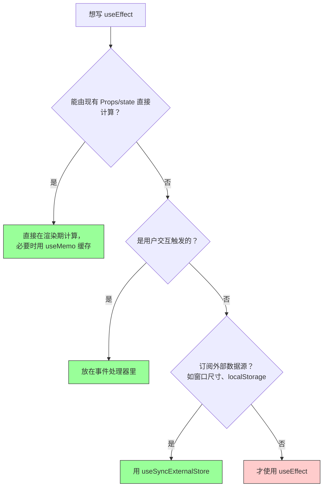
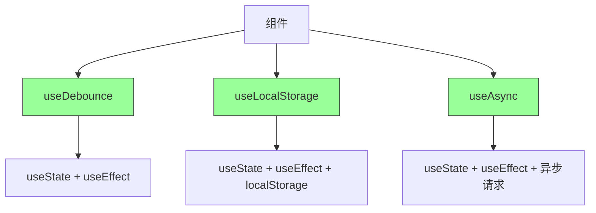
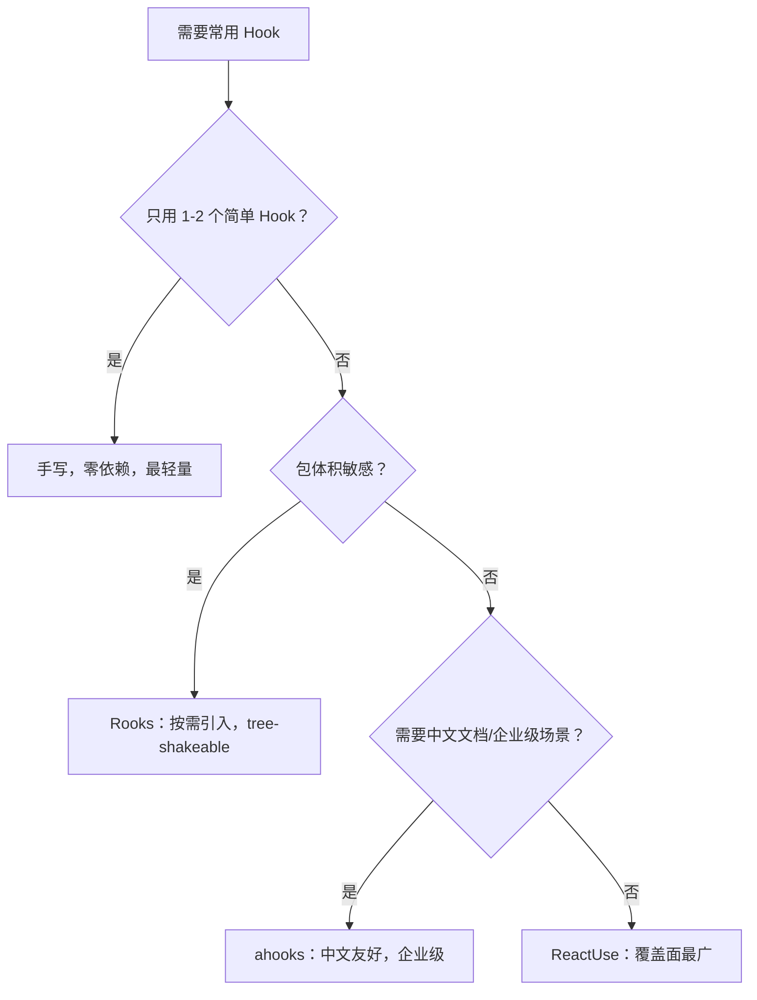

# 第3章 React Hooks 深度与自定义 Hook 设计

**本章概述**：Hook 是 React 函数组件的灵魂，它让你在不写类组件的情况下，也能使用状态、副作用、引用等能力。本章我们深入学习 `useEffect`、`useRef`、`useMemo`、`useCallback`，理解“并不是所有事情都需要 useEffect”，再学习如何用 `useImperativeHandle` 暴露命令式 API，最后掌握自定义 Hook 的设计原则，并了解社区成熟的 Hook 集合库。

**读者对象**：你已经会写 JavaScript，读完了第1、2章的组件和状态基础。如果你之前听过“Hook 很难”，没关系，我们用大白话逐条拆解，边写代码边理解。

---

## 3.1 useEffect 的替代思维：事件驱动与派生状态

### 什么是 useEffect？

`useEffect` 是 React 用来处理“副作用”的 Hook。副作用简单说，就是跟组件渲染本身无关、但又需要做的操作，比如：
- 组件挂载后发送网络请求获取数据
- 组件卸载时清除定时器
- 手动修改 DOM（比如聚焦输入框）

```tsx
import { useState, useEffect } from 'react'

function Timer() {
  const [seconds, setSeconds] = useState(0)

  useEffect(() => {
    const interval = setInterval(() => {
      setSeconds((s) => s + 1)
    }, 1000)

    return () => {
      clearInterval(interval) // 组件卸载时清理定时器
    }
  }, [])

  return <p>已经过了 {seconds} 秒</p>
}
```

上面的代码中，`useEffect` 里的函数会在组件渲染后执行，启动一个每秒加 1 的定时器。返回的函数是“清理函数”，组件销毁时会调用它，清除定时器，防止内存泄漏。

### useEffect 很容易被滥用

很多初学者一遇到“需要根据某个状态更新另一个状态”的场景，就条件反射地用 `useEffect`。比如：

```tsx
// ❌ 不推荐：用 useEffect 做派生状态
function FullName({ firstName, lastName }) {
  const [fullName, setFullName] = useState('')

  useEffect(() => {
    setFullName(`${firstName} ${lastName}`)
  }, [firstName, lastName])

  return <p>姓名：{fullName}</p>
}
```

这段代码能工作，但有问题：
1. `fullName` 本可以直接算出来，不需要单独存一个状态；
2. 每次 `firstName` 或 `lastName` 变化，都要先重渲染一次（`fullName` 还是旧值），然后 `useEffect` 再触发第二次重渲染；
3. 如果忘了加依赖数组 `[firstName, lastName]`，`fullName` 就不会更新，出现 Bug。

### 替代思维：先问是否真的需要 Effect

React 官方现在的建议是：**在写 useEffect 之前，先问自己“这个效果能不能不通过 Effect 实现？”** 绝大多数情况下，答案是yes。常见的替代方案有三种：

#### 1. 派生状态用渲染期计算，不用 useEffect

如果一个值可以由已有的 Props 或状态直接计算出来，就不需要单独存 state，直接在渲染时计算：

```tsx
// ✅ 推荐：直接计算，不需要 useEffect
function FullName({ firstName, lastName }) {
  return <p>姓名：{firstName} {lastName}</p>
}
```

如果计算比较复杂，可以用 `useMemo` 缓存，避免每次渲染都重新计算：

```tsx
import { useMemo } from 'react'

function OrderList({ items, filter }) {
  const filteredItems = useMemo(() => {
    return items.filter((item) => item.status === filter)
  }, [items, filter])

  return <ul>{filteredItems.map(item => <li key={item.id}>{item.name}</li>)}</ul>
}
```

#### 2. 用户交互用事件处理器，不用 useEffect

如果是因为用户点击了按钮、输入了文字，那就应该在事件处理器里处理，而不是在 `useEffect` 里监听状态变化。

```tsx
// ❌ 不推荐：监听输入状态变化
function Search({ query }) {
  const [results, setResults] = useState([])

  useEffect(() => {
    fetchResults(query).then(setResults) // 每次 query 变都会发请求，包括初始渲染
  }, [query])

  return <div>{results.map(...)}</div>
}

// ✅ 推荐：在用户提交时才发请求
function Search() {
  const [query, setQuery] = useState('')
  const [results, setResults] = useState([])

  const handleSubmit = async (e) => {
    e.preventDefault()
    const data = await fetchResults(query)
    setResults(data)
  }

  return (
    <form onSubmit={handleSubmit}>
      <input value={query} onChange={(e) => setQuery(e.target.value)} />
      <button type="submit">搜索</button>
    </form>
  )
}
```

#### 3. 外部同步用 useSyncExternalStore，不用 useEffect

如果你需要订阅外部数据源（比如浏览器的 `localStorage` 变化、窗口尺寸变化），React 18 提供了 `useSyncExternalStore`，专门用来替代 `useEffect` + `addEventListener` 的模式。

```tsx
import { useSyncExternalStore } from 'react'

function useWindowWidth() {
  return useSyncExternalStore(
    (callback) => {
      window.addEventListener('resize', callback)
      return () => window.removeEventListener('resize', callback)
    },
    () => window.innerWidth,
    () => window.innerWidth // 服务端渲染时的值
  )
}

function WindowSize() {
  const width = useWindowWidth()
  return <p>窗口宽度：{width}px</p>
}
```

### 决策流程：要不要写 useEffect？

每次想写 `useEffect` 时，按这个顺序想：

1. **这个值能由现有的 Props/state 直接计算出来吗？** → 能，直接算，不要 `useEffect`，也不要单独存 `state`。
2. **这是用户点击/输入等交互触发的吗？** → 是，放在事件处理器里，不要 `useEffect`。
3. **是否需要订阅外部数据源（非 React 管理的东西）？** → 是，优先考虑 `useSyncExternalStore`。
4. **以上都不是，真的需要在组件挂载/卸载/依赖变化时做副作用？** → 才用 `useEffect`。

> **小结**：`useEffect` 是 React 的“逃生舱”，不是默认选项。派生状态用渲染期计算（必要时配合 `useMemo`），用户交互用事件处理器，外部同步用 `useSyncExternalStore`。只在真正需要与外部系统同步时，才使用 `useEffect`。

#### useEffect 的替代决策流程



---

## 3.2 useRef、useImperativeHandle 与命令式逃生舱

### useRef 不只是 DOM 引用

很多人第一次接触 `useRef`，以为它就是用来获取 DOM 元素的。其实 `useRef` 有两个用途：

1. **获取 DOM 引用**：通过 `ref` 属性绑定到 DOM 元素，拿到真实的 DOM 节点。
2. **存储可变值**：返回一个对象，有一个 `current` 属性，你可以随时读写它，修改 `current` **不会**触发组件重渲染。

```tsx
import { useRef, useState } from 'react'

function RefDemo() {
  const [count, setCount] = useState(0)
  const refCount = useRef(0)

  return (
    <div>
      <p>状态：{count}</p>
      <p>Ref：{refCount.current}</p>
      <button onClick={() => {
        setCount(count + 1)
        refCount.current = refCount.current + 1
      }}>
        同时更新状态和 Ref
      </button>
    </div>
  )
}
```

点击按钮，`count` 变化会触发重渲染，但 `refCount.current` 的变化不会。你会看到状态数字在变，但 Ref 数字虽然在 `current` 里变了，页面上显示的数字不会因为 `refCount.current` 的变化而重新渲染（除非 `count` 也变了带着一起渲染）。

**什么时候用可变值？** 比如：
- 存储定时器 ID（`setInterval` 返回的 ID），方便后面 `clearInterval`
- 存储上一次的某个值，用于对比
- 存储不需要影响 UI 的临时数据

### 命令式逃生舱：useImperativeHandle

默认情况下，父组件无法直接调用子组件内部的函数，也不能直接操作子组件的 DOM。React 鼓励“声明式”编程：通过 Props 和状态驱动 UI，而不是直接命令子组件做什么。

但有时候，我们确实需要父组件调用子组件的某个方法，比如：
- 父组件点击一个按钮，让子组件里的输入框自动聚焦
- 父组件告诉子组件滚动到顶部

这时候可以用 `useImperativeHandle`，配合 `forwardRef`，让子组件“暴露”出一些命令式方法给父组件。这被称为“命令式逃生舱”——逃出声明式编程的限制，直接做命令式操作。

```tsx
import { forwardRef, useRef, useImperativeHandle, useState } from 'react'

// 子组件：暴露 focus 方法
const TextInput = forwardRef((props, ref) => {
  const inputRef = useRef<HTMLInputElement>(null)

  // 向父组件暴露 focus 方法
  useImperativeHandle(ref, () => ({
    focus() {
      inputRef.current?.focus()
    },
    clear() {
      inputRef.current?.value = ''
    },
  }))

  return <input ref={inputRef} {...props} />
})

// 父组件：调用子组件暴露的方法
function Parent() {
  const inputRef = useRef<TextInput>(null)

  return (
    <div>
      <TextInput ref={inputRef} placeholder="请输入" />
      <button onClick={() => inputRef.current?.focus()}>聚焦输入框</button>
      <button onClick={() => inputRef.current?.clear()}>清空内容</button>
    </div>
  )
}

export default Parent
```

这里 `TextInput` 通过 `forwardRef` 接收父组件传来的 `ref`，然后用 `useImperativeHandle` 定义这个 `ref` 指向什么对象。父组件通过 `inputRef.current.focus()` 就可以直接调用子组件的 `focus` 方法。

### 何时应该拒绝命令式接口？

`useImperativeHandle` 很强大，但也很容易被滥用。如果你发现自己频繁地用父组件去“命令”子组件做这个做那个，通常说明你的组件设计有问题，应该重新考虑声明式方案。

**应该拒绝命令式接口的信号：**
- 父组件频繁调用子组件的暴露方法来同步状态
- 子组件暴露的方法越来越多，像是在暴露整个内部实现
- 可以通过 Props 或状态就能实现的功能，非要用命令式

**保持声明式契约的原则：**
- 父组件通过 Props 告诉子组件“显示什么”
- 子组件通过事件回调告诉父组件“发生了什么”
- 尽量不要直接命令子组件“去做某个动作”

> **小结**：`useRef` 既能获取 DOM 引用，也能存储不会触发重渲染的可变值。`useImperativeHandle` 配合 `forwardRef` 让子组件向父组件暴露命令式 API，是“命令式逃生舱”，适合聚焦、滚动等偶尔需要的场景，但日常开发应优先保持声明式契约，不要滥用。

#### useRef 与 useImperativeHandle 的作用域

```mermaid
flowchart LR
    A[父组件] -->|ref| B[子组件 forwardRef]
    B -->|useImperativeHandle| C{暴露命令式方法<br/>focus() / clear()}
    C -->|父组件调用| A
    D[useRef 存储可变值] -.->|不触发重渲染| B
    style C fill:#ffcccc,stroke:#333
    linkStyle 2 stroke:#ff0000,stroke-dasharray: 5 5
```

---

## 3.3 自定义 Hook 的设计原则：组合、命名与副作用隔离

### 自定义 Hook 的价值不在于“复用代码”

很多初学者自定义 Hook 的动机是“这段代码在多个组件里都要写，我抽成 Hook 避免重复”。这是一种误解。自定义 Hook 的真正价值在于**复用状态逻辑的契约**——不仅是代码，还有状态的生命周期、副作用的清理、依赖的处理方式。

你可以把自定义 Hook 理解为“可复用的状态逻辑插件”，而不是简单的“函数提取”。

### 命名规范：必须以 use 开头

自定义 Hook 的函数名必须以 `use` 开头，这是 React 的强制约定，不是建议。React 依据函数名是否以 `use` 开头，来判断这个函数里是否可以安全地调用其他 Hook（如 `useState`、`useEffect`）。

```tsx
// ✅ 正确
function useDebounce(value: string, delay: number) { ... }
function useLocalStorage(key: string, initialValue: any) { ... }

// ❌ 错误：React 会报错，无法在内部使用 Hook
function debounce(value: string, delay: number) { ... }
```

### 一个 Hook 只做一件事

不要把多个不相关的功能塞进一个 Hook。一个 Hook 应该有单一的职责，比如：
- `useDebounce`：只做防抖
- `useLocalStorage`：只做 localStorage 同步
- `useAsync`：只做异步请求状态管理

如果你发现一个 Hook 里既有定时器、又有网络请求、还有表单校验，应该把它拆分成多个 Hook，在组件里组合使用。

### 返回值形态：元组 vs 对象

自定义 Hook 的返回值可以是元组（数组）或对象，没有绝对的标准，但要保持一致性。

**元组风格**（类似 `useState`）：

```tsx
const [value, setValue] = useLocalStorage('theme', 'light')
```

**对象风格**（更易扩展，命名自明）：

```tsx
const { value, setValue, isLoading } = useAsync(fetchUser)
```

建议：如果返回值只有 1-2 个，可以用元组；如果返回值多于 2 个，或者以后可能增加，用对象更清晰，不容易因为位置错乱而出 Bug。

### 副作用清理的边界

如果自定义 Hook 内部用了 `useEffect`、`addEventListener`、`setInterval` 等需要清理的操作，必须在清理函数里把它们撤销，否则会造成内存泄漏或意外行为。

```tsx
function useInterval(callback: () => void, delay: number) {
  useEffect(() => {
    const id = setInterval(callback, delay)
    return () => clearInterval(id) // 必须清理
  }, [callback, delay])
}
```

### 示例：useDebounce

```tsx
import { useState, useEffect } from 'react'

function useDebounce(value: string, delay: number): string {
  const [debouncedValue, setDebouncedValue] = useState(value)

  useEffect(() => {
    const handler = setTimeout(() => {
      setDebouncedValue(value)
    }, delay)

    return () => {
      clearTimeout(handler)
    }
  }, [value, delay])

  return debouncedValue
}

// 使用：搜索框输入时，停止输入 500ms 后才发请求
function SearchBox() {
  const [query, setQuery] = useState('')
  const debouncedQuery = useDebounce(query, 500)

  useEffect(() => {
    if (!debouncedQuery) return
    fetchResults(debouncedQuery)
  }, [debouncedQuery])

  return <input value={query} onChange={(e) => setQuery(e.target.value)} />
}
```

### 示例：useLocalStorage

```tsx
import { useState, useEffect } from 'react'

function useLocalStorage<T>(key: string, initialValue: T) {
  const [value, setValue] = useState<T>(() => {
    try {
      const stored = localStorage.getItem(key)
      return stored ? JSON.parse(stored) : initialValue
    } catch {
      return initialValue
    }
  })

  useEffect(() => {
    localStorage.setItem(key, JSON.stringify(value))
  }, [key, value])

  return [value, setValue] as const
}

// 使用
function ThemeToggle() {
  const [theme, setTheme] = useLocalStorage('theme', 'light')
  return (
    <button onClick={() => setTheme(theme === 'light' ? 'dark' : 'light')}>
      当前主题：{theme}
    </button>
  )
}
```

### 示例：useAsync（手写实现）

```tsx
import { useState, useEffect } from 'react'

function useAsync<T>(asyncFunction: () => Promise<T>, dependencies: any[] = []) {
  const [data, setData] = useState<T | null>(null)
  const [loading, setLoading] = useState(true)
  const [error, setError] = useState<Error | null>(null)

  useEffect(() => {
    let cancelled = false

    async function run() {
      try {
        setLoading(true)
        setError(null)
        const result = await asyncFunction()
        if (!cancelled) {
          setData(result)
        }
      } catch (err) {
        if (!cancelled) {
          setError(err instanceof Error ? err : new Error(String(err)))
        }
      } finally {
        if (!cancelled) {
          setLoading(false)
        }
      }
    }

    run()

    return () => {
      cancelled = true // 组件卸载或依赖变更时取消，防止状态更新报错
    }
  }, dependencies)

  return { data, loading, error }
}
```

注意这里的 `cancelled` 标志位：如果组件在异步请求完成前就卸载了，或者依赖变了导致 Effect 重跑，之前的请求结果不应该再更新状态，否则 React 会报警告（“对已卸载组件的状态更新”）。

> **小结**：自定义 Hook 必须以 `use` 开头，一个 Hook 只做一件事，返回值用元组或对象保持一致，内部副作用必须有清理函数。自定义 Hook 的核心是复用状态逻辑的契约，而不仅仅是复用代码片段。

#### 自定义 Hook 的组合关系



---

## 3.4 生产级 Hook 集合库的取舍：Rooks、ReactUse、ahooks

### 直接使用成熟库，还是手写？

写完上面的 `useDebounce`、`useLocalStorage` 后，你可能会想：“这些常用的 Hook 我每次都要自己写吗？” 不需要。社区已经有很多成熟的 Hook 集合库，可以直接安装使用。

但是，引入第三方库也有代价：
- 包体积增加：即使 tree-shakeable，引入整个库还是比手写几个 Hook 大
- 行为假设：库里的 Hook 可能和你预期的边界行为不完全一致
- 维护成本：库更新可能带来破坏性变更

所以选择时要权衡：**手写 vs 引入**。如果项目只需要 1-2 个常用 Hook，手写更轻量；如果需要大量常用 Hook（防抖、节流、请求、本地存储、媒体查询等），引入成熟库更高效。

### Rooks：125+ hooks，tree-shakeable，TypeScript-first

Rooks 是一个模块化的 Hook 集合库，每个 Hook 可以单独安装和引入，支持 tree-shaking，不会把不用的 Hook 打进包里。它用 TypeScript 编写，类型定义完善。

常用 Hook：
- `useDebounce`、`useThrottle`：防抖、节流
- `useLocalStorage`、`useSessionStorage`：本地存储
- `useInterval`、`useTimeout`：定时器
- `useMount`、`useUnmount`：挂载/卸载生命周期

```tsx
import { useDebounce } from 'rooks'

function Search() {
  const [query, setQuery] = useState('')
  const debounced = useDebounce(query, 300)
  // ...
}
```

Rooks 的优点是按需引入，包体积可控；缺点是 Hook 数量多，文档质量参差不齐，部分 Hook 边界行为需要自己查清楚。

### ReactUse：110+ hooks

ReactUse 是另一个大型 Hook 集合库，覆盖面非常广，除了常用的状态 Hook，还有很多浏览器 API 的封装（如 `useMousePosition`、`useGeolocation`、`useNetworkState` 等）。

ReactUse 的 Hook 通常直接从主包引入：

```tsx
import { useLocalStorage, useDebounce } from '@react-use/core'

// 使用方式类似 Rooks
```

ReactUse 的优点是应有尽有，几乎能想到的浏览器 API 都有对应 Hook；缺点是包体积较大，如果不做 tree-shaking 会显著增加包大小。

### ahooks：阿里巴巴出品，中文文档友好

ahooks 是蚂蚁集团（阿里巴巴）开源的 React Hook 库，中文文档非常完善，适合中文读者。它在国内企业级项目中使用很广。

常用 Hook：
- `useRequest`：封装网络请求，自动处理 loading、错误、刷新
- `useDebounceFn`：函数防抖
- `useInterval`：定时器
- `useLocalStorageState`：本地存储状态

```tsx
import { useRequest } from 'ahooks'

function UserProfile({ userId }) {
  const { data, loading, error } = useRequest(() => fetchUser(userId), {
    manual: false, // 自动执行
  })
  // ...
}
```

ahooks 的优点是中文社区活跃、文档详细、企业级场景考虑周全；缺点是有些 Hook 的行为比较“重”，可能包含你不需要的功能。

### 三者选型对比

| 库 | Hook 数量 | 特点 | 适合场景 |
|----|---------|------|---------|
| Rooks | 125+ | 模块化、tree-shakeable、TypeScript-first | 包体积敏感，想按需引入 |
| ReactUse | 110+ | 覆盖面广，浏览器 API 封装多 | 需要各种浏览器 API Hook |
| ahooks | 80+ | 中文文档友好，企业级场景多 | 中文团队，国内企业项目 |

### 判断框架：手写 vs 引入

```
需要某个常用 Hook
    ↓
这个 Hook 是否只在 1-2 个地方用？
    ├─ 是 → 手写，简单直接，零依赖
    └─ 否 → 这个功能是否复杂（如带取消、重试、loading 状态）？
        ├─ 复杂 → 引入成熟库（ahooks/Rooks/ReactUse）
        └─ 简单 → 手写，维护成本更低
```

> **小结**：Rooks 适合包体积敏感、想按需引入的项目；ReactUse 覆盖面最广，适合需要各种浏览器 API Hook 的场景；ahooks 中文文档友好，适合中文团队和企业级项目。如果只用 1-2 个简单 Hook，手写更轻量；如果需要大量常用 Hook，引入成熟库更高效。

#### Hook 集合库选型决策树



---

## 本章小结

本章我们深入学习了 React Hooks：

1. **useEffect**：不是默认选项。派生状态用渲染期计算（可配合 `useMemo`），用户交互用事件处理器，外部同步用 `useSyncExternalStore`，只有真正需要与外部系统同步时才用 `useEffect`。
2. **useRef**：既能获取 DOM 引用，也能存储不会触发重渲染的可变值。
3. **useImperativeHandle**：配合 `forwardRef` 让子组件向父组件暴露命令式 API，是“命令式逃生舱”，适合聚焦、滚动等偶尔需要的场景，日常应保持声明式契约。
4. **自定义 Hook**：必须以 `use` 开头，一个 Hook 只做一件事，返回值用元组或对象保持一致，内部副作用必须有清理函数。核心是复用状态逻辑的契约，而不仅是复用代码。
5. **Hook 集合库**：Rooks（模块化、tree-shakeable）、ReactUse（覆盖面广）、ahooks（中文友好、企业级）。只用 1-2 个简单 Hook 建议手写，需要大量常用 Hook 可引入成熟库。

下一章我们将进入路由部分，学习 React Router v7 的数据模式，包括 `createBrowserRouter`、`RouterProvider`、`loader`、`action` 等核心概念。