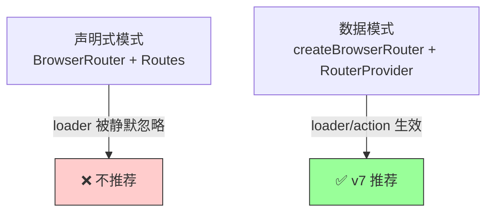
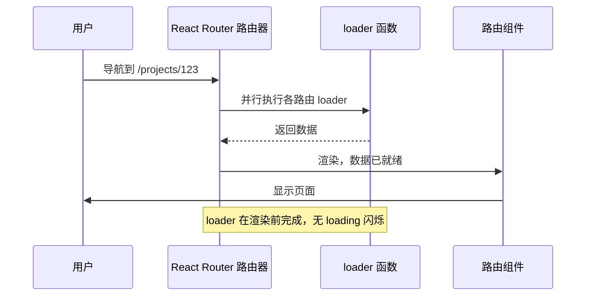

# 第4章 路由：React Router v7 数据模式

**本章概述**：单页应用（SPA）离不开路由。本章我们学习 React Router v7 的“数据模式”（Data Mode），理解为什么 v7 强制推荐 `createBrowserRouter` + `RouterProvider`，如何用 `loader` 在渲染前获取数据，如何用 `action` 和 `<Form>` 处理表单提交，如何用 `useFetcher` 做乐观 UI，以及路由级懒加载、错误边界和受保护路由怎么做。

**读者对象**：你已经会写 React 函数组件，读完了第1–3章。如果你之前只用过 `<BrowserRouter>` + `<Routes>` 的声明式写法，本章会让你了解为什么 v7 的数据模式更好，以及怎么迁移。

---

## 4.1 为什么必须使用 Data Mode：createBrowserRouter 与 RouterProvider

### 两种路由写法

React Router 有两种主要的使用方式：

1. **声明式模式（老写法）**：用 `<BrowserRouter>` + `<Routes>` + `<Route>` 声明路由，组件里通过 `useParams`、`useNavigate` 等 Hook 完成导航和数据获取。
2. **数据模式（Data Mode，v7 推荐）**：用 `createBrowserRouter` + `<RouterProvider>` 创建路由器，每个路由可以配置 `loader`（渲染前获取数据）和 `action`（处理数据变更），数据获取和导航紧密结合。

### 声明式模式的陷阱：loader 会被静默忽略

在 React Router v6/v7 中，如果你用 `<BrowserRouter>` + `<Routes>`，然后在 `<Route>` 上加 `loader` prop，**这个 `loader` 会被 React Router 静默忽略**，不会报错，也不会生效。这是最常见的路由迁移陷阱。

很多初学者从 v5 升级到 v6/v7，看到文档里到处是 `loader` 和 `action`，就往 `<Route>` 上加，结果数据怎么也不加载，排查半天才发现是写法不对。

**数据模式才是 `loader`/`action` 生效的唯一方式。** 必须用 `createBrowserRouter` 创建路由器，配置 `RouteObject`（路由对象数组），再用 `<RouterProvider>` 把路由器挂到应用根节点。

### 基本用法

```tsx
import { createBrowserRouter, RouterProvider } from 'react-router/dom'
import Root from './routes/Root'
import Home from './routes/Home'
import About from './routes/About'

// 1. 定义路由对象数组（RouteObject）
const router = createBrowserRouter([
  {
    path: '/',
    element: <Root />,
    children: [
      { index: true, element: <Home /> },
      { path: 'about', element: <About /> },
    ],
  },
])

// 2. 用 RouterProvider 挂载
function App() {
  return <RouterProvider router={router} />
}

export default App
```

这里有几个关键点：
- `createBrowserRouter` 接收一个路由对象数组，而不是 JSX 的 `<Route>`。
- `RouterProvider` 从 `react-router/dom` 导入（注意不是 `react-router-dom`，v7 数据模式的入口变了）。
- 路由嵌套用 `children` 数组，`index: true` 表示索引路由（匹配父路径时渲染）。

### 数据模式的优势

1. **渲染前加载数据**：`loader` 在组件渲染之前就运行，数据准备好了再显示页面，不用在组件里再写 `useEffect` 获取数据。
2. **并行加载**：嵌套路由的多个 `loader` 可以并行执行，比一个个串行获取更快。
3. **自动重新验证**：表单提交后，React Router 会自动重新调用相关路由的 `loader`，保持数据和 UI 一致。
4. **错误边界**：每个路由可以配置 `errorElement`，某个路由的 `loader` 失败时，只显示该路由的错误页面，不会替换整个应用。

> **小结**：React Router v7 推荐使用 `createBrowserRouter` + `<RouterProvider>` 的数据模式。声明式模式下的 `loader` 会被静默忽略，迁移时务必注意。`createBrowserRouter` 接收 `RouteObject` 数组，`<RouterProvider>` 挂载路由器。

#### 数据模式与声明式模式的路由配置对比



---

## 4.2 loader：渲染前数据获取与并行加载

### 什么是 loader？

`loader` 是路由上配置的一个函数，会在路由组件渲染**之前**执行，用来获取该路由需要的数据。拿到数据后，组件通过 `useLoaderData` Hook 读取。

在 React Router v7 中，`loader` 返回一个普通对象就可以了（v6 里还需要包装成 `json()`，v7 已移除了 `json()` 和 `defer()`）。

### 基本用法

```tsx
// routes/Home.tsx
import { useLoaderData, LoaderFunctionArgs } from 'react-router/dom'

// loader 在组件渲染前运行，获取数据
export const loader = async ({ params }: LoaderFunctionArgs) => {
  const response = await fetch('/api/home')
  return response.json() // 返回普通对象
}

type HomeData = {
  title: string
  items: string[]
}

function Home() {
  // 用 useLoaderData 读取 loader 返回的数据
  const data = useLoaderData() as HomeData

  return (
    <div>
      <h1>{data.title}</h1>
      <ul>
        {data.items.map((item) => (
          <li key={item}>{item}</li>
        ))}
      </ul>
    </div>
  )
}
```

`LoaderFunctionArgs` 是 TypeScript 类型，包含 `params`（路由参数）、`request`、`context` 等信息。

### 根路由 loader：全局数据

根路由的 `loader` 可以用来获取全局共享数据，比如当前用户信息、导航菜单、设置等。子路由的组件可以通过 `useRouteLoaderData('root')` 读取根路由的数据。

```tsx
// routes/Root.tsx
import { useRouteLoaderData, Outlet } from 'react-router/dom'

export const loader = async () => {
  const response = await fetch('/api/user')
  return response.json()
}

type RootData = { user: { name: string } }

function Root() {
  const data = useRouteLoaderData('root') as RootData

  return (
    <div>
      <header>欢迎，{data.user.name}</header>
      <Outlet /> {/* 子路由渲染在这里 */}
    </div>
  )
}
```

### 嵌套路由的并行 loader

嵌套路由的多个 `loader` 可以**并行执行**。比如用户访问 `/projects/123/tasks`，React Router 会同时调用：
- 根路由的 `loader`（获取用户信息）
- `projects` 路由的 `loader`（获取项目列表）
- `projects/:projectId` 路由的 `loader`（获取项目详情）
- `tasks` 路由的 `loader`（获取任务列表）

这些 `loader` 互不等待，全部并行发请求，等所有数据都回来后，才渲染页面。这比在组件里一个个 `useEffect` 获取数据要快得多。

```tsx
// 路由配置示例
const router = createBrowserRouter([
  {
    path: '/',
    element: <Root />,
    loader: rootLoader, // 获取用户信息
    children: [
      {
        path: 'projects',
        element: <Projects />,
        loader: projectsLoader, // 获取项目列表
        children: [
          {
            path: ':projectId',
            element: <ProjectDetail />,
            loader: projectLoader, // 获取项目详情
          },
        ],
      },
    ],
  },
])
```

上面的四个 `loader` 会在导航到 `/projects/123` 时并行执行。

### useLoaderData 的类型化读取

`useLoaderData()` 返回的是 `any` 类型，在 TypeScript 项目里，建议自己定义数据类型并做类型断言，或者使用泛型（如果 React Router 版本支持）。

```tsx
const data = useLoaderData() as { title: string; items: string[] }
```

更好的做法是定义一个类型别名，在 `loader` 和组件里共用，保持类型一致。

```tsx
// routes/Home.tsx
export type HomeData = { title: string; items: string[] }

export const loader = async (): Promise<HomeData> => {
  const res = await fetch('/api/home')
  return res.json()
}

function Home() {
  const data = useLoaderData() as HomeData
  // ...
}
```

> **小结**：`loader` 在路由组件渲染前运行，返回普通对象，组件通过 `useLoaderData` 读取。根路由 `loader` 获取全局数据，嵌套路由的多个 `loader` 并行执行，比组件内逐个 `useEffect` 获取数据更快。v7 中已移除 `json()` 和 `defer()`，直接返回对象即可。

#### loader 数据流向



---

## 4.3 action、Form 与 useFetcher：变更与乐观 UI

### 什么是 action？

`action` 处理非 GET 请求（POST、PUT、DELETE 等），用于数据的创建、更新、删除。当用户提交带 `method="POST"` 的 `<Form>` 时，React Router 会自动调用对应路由的 `action`，提交完成后自动重新验证（重新调用）相关路由的 `loader`，保持数据和 UI 一致。

### 基本用法：Form + action

```tsx
// routes/TaskEdit.tsx
import { Form, useActionData, ActionFunctionArgs, redirect } from 'react-router/dom'

export const action = async ({ request }: ActionFunctionArgs) => {
  const formData = await request.formData()
  const title = formData.get('title')

  // 调用 API 更新任务
  await fetch(`/api/tasks/${id}`, {
    method: 'PUT',
    body: JSON.stringify({ title }),
  })

  // 提交成功后重定向回列表页
  return redirect('/tasks')
}

type ActionData = { error?: string }

function TaskEdit() {
  const actionData = useActionData() as ActionData | undefined

  return (
    <Form method="POST">
      <input name="title" defaultValue="任务标题" />
      {actionData?.error && <p style={{ color: 'red' }}>{actionData.error}</p>}
      <button type="submit">保存</button>
    </Form>
  )
}
```

这里有几个关键点：
- `<Form method="POST">` 提交时，会自动触发同路由的 `action`。
- `action` 里用 `await request.formData()` 读取表单数据。
- `action` 返回数据后，组件通过 `useActionData()` 读取（比如错误信息）。
- `redirect('/tasks')` 表示提交成功后跳转到列表页。

### useFetcher：不导航地加载或提交数据

有时候你不想提交表单后跳转页面，只想在当前页面更新数据，这时候用 `useFetcher`。它允许在不导航的情况下加载或提交数据，是实现**乐观 UI** 的关键工具。

```tsx
import { useFetcher, Form } from 'react-router/dom'

function TaskItem({ task }) {
  const fetcher = useFetcher()

  const handleDelete = () => {
    if (window.confirm('确定删除？')) {
      fetcher.submit(null, {
        method: 'delete',
        action: `/api/tasks/${task.id}`,
      })
    }
  }

  return (
    <div>
      <span>{task.title}</span>
      <button onClick={handleDelete}>删除</button>
      {fetcher.state === 'submitting' && <span>删除中...</span>}
    </div>
  )
}
```

`fetcher.state === 'submitting'` 表示请求正在进行中，可以用来显示加载状态。

### useNavigation：展示全局提交状态

`useNavigation` 可以获取当前导航状态，比如是否正在提交表单。常用于显示全局的加载指示器。

```tsx
import { useNavigation } from 'react-router/dom'

function GlobalLoadingIndicator() {
  const navigation = useNavigation()

  if (navigation.state === 'submitting') {
    return <div className="loading">保存中...</div>
  }
  return null
}
```

### 乐观 UI：onMutate + 回滚

乐观 UI 是指：用户操作后，界面立即更新，假设操作会成功；如果后台请求失败，再回滚到之前的状态。React Router 的 `action` 配合 `useFetcher` 可以实现简单的乐观更新。

```tsx
function TaskList() {
  const fetcher = useFetcher()

  const handleToggle = async (task) => {
    // 乐观更新：立即修改 UI
    fetcher.submit(null, {
      method: 'post',
      action: `/api/tasks/${task.id}/toggle`,
    })
    // 这里可以配合 Zustand 或本地状态立即反映变更
    // 如果请求失败，需要在 fetcher 的回滚逻辑中恢复
  }

  return (
    <button onClick={() => handleToggle(task)}>
      {task.done ? '已完成' : '未完成'}
    </button>
  )
}
```

> **小结**：`action` 处理 POST/PUT/DELETE 变更，`<Form method="POST">` 提交后自动触发 `action` 并重新验证 `loader`。`useFetcher` 允许不导航地提交数据，是实现乐观 UI 的关键。`useNavigation` 的 `state === 'submitting'` 可用于显示全局提交状态。`action` 返回数据后，组件用 `useActionData` 读取。

#### action 与 loader 的数据流

```mermaid
sequenceDiagram
    participant 用户
    participant Form as <Form method="POST">
    participant Action as action 函数
    participant Loader as loader 函数
    participant 组件 as 路由组件
    
    用户->>Form: 提交表单
    Form->>Action: 自动触发 action
    Action->>Action: 执行变更（POST/PUT/DELETE）
    Action-->>组件: 返回 actionData
    Action->>Loader: 自动重新验证 loader
    Loader-->>组件: 返回最新数据
    组件->>用户: 页面刷新显示新数据
```



---

## 4.4 懒加载、错误边界与受保护路由

### route.lazy：路由级代码分割

随着应用变大，把所有路由组件都打包进一个 bundle 会导致首屏加载慢。`route.lazy` 可以实现路由级代码分割：只有当用户真正访问该路由时，才下载对应的组件代码。

```tsx
const router = createBrowserRouter([
  {
    path: '/',
    element: <Root />,
    children: [
      { index: true, element: <Home /> },
      {
        path: 'settings',
        lazy: () => import('./routes/Settings'), // 只在访问 /settings 时加载
      },
    ],
  },
])
```

配合 `<Suspense>` 和加载骨架，用户在路由切换时能看到加载状态，而不是白屏。

```tsx
import { Suspense } from 'react'

function App() {
  return (
    <RouterProvider router={router}>
      <Suspense fallback={<div>加载中...</div>}>
        {/* 路由内容会在这里渲染 */}
      </Suspense>
    </RouterProvider>
  )
}
```

**`route.lazy` 与 `React.lazy` 的区别：**
- `React.lazy` 是组件级懒加载，配合 `<Suspense>` 在组件树内部使用。
- `route.lazy` 是路由级懒加载，配置在路由对象里，React Router 会自动处理路由切换时的加载和 Suspense 集成。

### 错误边界：errorElement

每个路由可以配置 `errorElement`，当该路由的 `loader` 或 `action` 抛出错误时，渲染错误界面。错误会沿着路由层级向上冒泡，直到找到最近的 `errorElement`。

根路由的 `errorElement` 是错误冒泡的最终捕获点。如果根路由没有配置 `errorElement`，单个 `loader` 失败会导致整个应用崩溃（显示 React 错误边界的白屏或报错页面）。

```tsx
const router = createBrowserRouter([
  {
    path: '/',
    element: <Root />,
    errorElement: <RootError />, // 捕获子路由错误
    loader: rootLoader,
    children: [
      {
        path: 'projects',
        element: <Projects />,
        loader: projectsLoader,
        errorElement: <ProjectsError />, // 只捕获 projects 路由错误
      },
    ],
  },
])
```

在错误组件里，可以用 `useRouteError` 读取错误信息，`isRouteErrorResponse` 判断是不是路由错误响应。

```tsx
import { useRouteError, isRouteErrorResponse } from 'react-router/dom'

function RootError() {
  const error = useRouteError()

  if (isRouteErrorResponse(error)) {
    return <div>错误 {error.status}: {error.statusText}</div>
  }

  return <div>发生错误：{error instanceof Error ? error.message : String(error)}</div>
}
```

### 受保护路由：loader 中做鉴权

受保护路由是指只有登录用户才能访问的页面。在 React Router 数据模式里，**鉴权应该在 `loader` 层完成，而不是在组件内用 `useEffect` 检查登录状态。**

做法：在根布局路由的 `loader` 里读取会话，如果未登录，抛出 `redirect('/login')`；子路由继承这个布局，自动受保护。

```tsx
// routes/Root.tsx
import { redirect } from 'react-router/dom'

export const loader = async () => {
  const token = localStorage.getItem('token')
  if (!token) {
    throw redirect('/login') // 未登录，重定向到登录页
  }
  return { user: await fetchUser(token) }
}
```

登录成功后，可以重定向回用户原来想访问的页面：

```tsx
// routes/Login.tsx
import { action, redirect } from 'react-router/dom'

export const action = async ({ request }: ActionFunctionArgs) => {
  const formData = await request.formData()
  // 验证用户名密码...
  const from = formData.get('from') || '/'
  return redirect(from) // 登录成功后跳回原路径
}
```

### Outlet：渲染子路由

布局路由里用 `<Outlet>` 渲染子路由内容。比如根路由渲染侧边栏和顶栏，子路由页面通过 `<Outlet>` 填充中间内容区。

```tsx
function Root() {
  return (
    <div>
      <Sidebar />
      <main>
        <Outlet /> {/* 子路由页面渲染在这里 */}
      </main>
    </div>
  )
}
```

> **小结**：`route.lazy` 实现路由级代码分割，配合 `<Suspense>` 显示加载骨架；`errorElement` 是错误边界，根路由的 `errorElement` 是最终捕获点，缺失会导致单个 loader 失败就替换整个应用；受保护路由通过 `loader` 中 `throw redirect('/login')` 实现，鉴权在 loader 层完成，不在组件内用 `useEffect`。

#### 受保护路由的鉴权流程

```mermaid
flowchart TD
    A[用户访问受保护路由] --> B[根布局 loader 执行]
    B --> C{有登录会话？}
    C -- 否 --> D[throw redirect('/login')<br/>重定向到登录页]
    C -- 是 --> E[返回用户数据]
    E --> F[渲染子路由组件]
    D --> G[用户登录]
    G --> H[redirect('/from')<br/>跳回原路径]
    H --> F
    style D fill:#ffcccc,stroke:#333
    style F fill:#99ff99,stroke:#333
```

---

## 本章小结

本章我们学习了 React Router v7 的数据模式：

1. **createBrowserRouter + RouterProvider**：数据模式的核心，声明式模式下的 `loader` 会被静默忽略，必须用数据模式才能生效。
2. **loader**：渲染前获取数据，返回普通对象，组件用 `useLoaderData` 读取。根路由 `loader` 获取全局数据，嵌套路由的多个 `loader` 并行执行。
3. **action 与 Form**：`action` 处理 POST/PUT/DELETE，`<Form method="POST">` 提交后自动触发 `action` 并重新验证 `loader`。组件用 `useActionData` 读取返回数据。
4. **useFetcher**：不导航地加载或提交数据，实现乐观 UI 的关键工具。`useNavigation` 的 `state === 'submitting'` 可用于全局提交状态。
5. **route.lazy**：路由级代码分割，配合 `<Suspense>` 和加载骨架。
6. **errorElement**：路由错误边界，根路由的 `errorElement` 是最终捕获点。
7. **受保护路由**：在 `loader` 中 `throw redirect('/login')` 做鉴权，不在组件内用 `useEffect`。

下一章我们将进入网络与数据层，学习 TanStack Query + HTTP 客户端，理解服务端状态和客户端状态的分离。