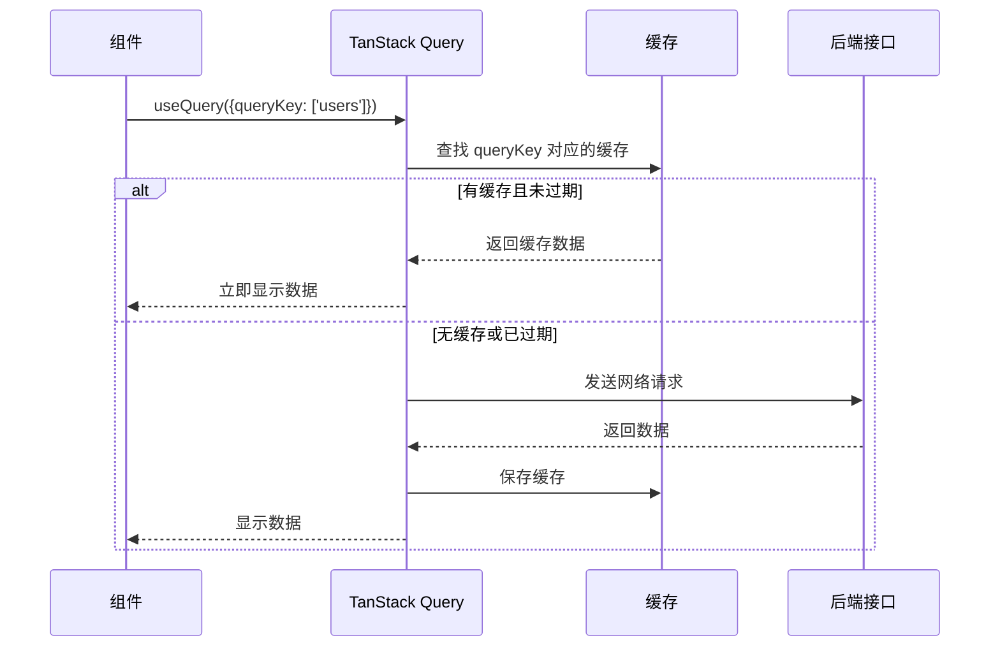
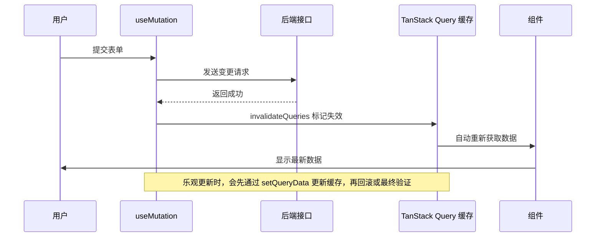
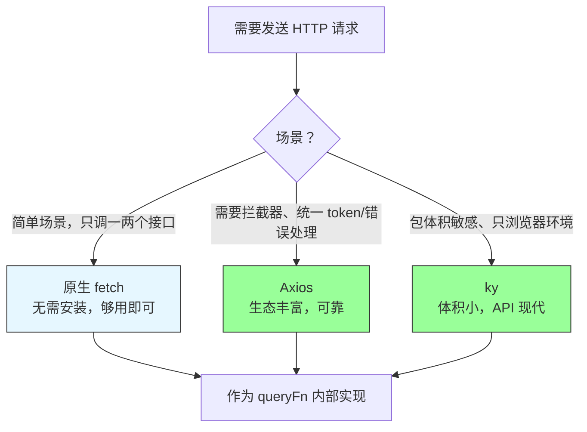
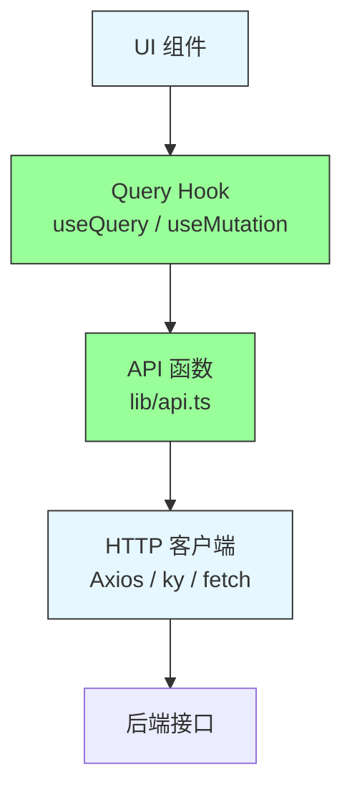

# 第5章 网络与数据层：TanStack Query + HTTP 客户端

**本章概述**：前端应用离不开和后端接口打交道。本章我们学习 TanStack Query（以前叫 React Query），理解为什么“服务端状态不是客户端状态”，如何用 `useQuery` 获取数据、用 `useMutation` 变更数据、如何做缓存失效和乐观更新。然后学习 HTTP 客户端的选型：Axios、ky 和原生 fetch 三者的区别，以及如何把 Axios 实例注入 TanStack Query 的 `queryFn`。最后学习数据层架构：把 API 调用收敛到集中式 API 模块，组件只消费 Hook，不直接接触 HTTP 客户端。

**读者对象**：你已经会写 React 函数组件，读完了第1–4章。如果你之前是在组件里直接写 `useEffect` + `fetch` 获取数据，本章会让你了解更专业的做法。

---

## 5.1 服务端状态不是客户端状态：为什么需要 TanStack Query

### 什么是服务端状态，什么是客户端状态？

在前端应用里，状态可以分为两大类：

1. **客户端状态（Client State）**：完全在前端掌控的状态，比如输入框的文字、模态框是否打开、当前选中的标签页。这些状态的生命周期由组件自己决定，用 `useState`、`useReducer`、Zustand、Jotai 等管理即可。

2. **服务端状态（Server State）**：存储在服务器上的数据，通过网络接口获取和修改，比如用户信息、文章列表、订单数据。服务端状态有以下特点：
   - 需要通过网络请求获取，有加载时间；
   - 可能被其他用户修改，本地缓存可能过期；
   - 需要处理缓存、失效、重试、轮询等问题；
   - 需要处理加载中、错误、空数据等多种状态。

很多初学者把服务端状态也存进 `useState` 或 Zustand，代码大概长这样：

```tsx
// ❌ 不推荐：用 useState 管理服务端状态
function UserList() {
  const [users, setUsers] = useState([])
  const [loading, setLoading] = useState(true)
  const [error, setError] = useState(null)

  useEffect(() => {
    fetch('/api/users')
      .then(res => res.json())
      .then(data => { setUsers(data); setLoading(false) })
      .catch(err => { setError(err); setLoading(false) })
  }, [])

  if (loading) return <div>加载中...</div>
  if (error) return <div>出错了：{error.message}</div>

  return <ul>{users.map(u => <li key={u.id}>{u.name}</li>)}</ul>
}
```

这段代码有很多问题：
- 每次组件重新挂载都要重新发请求；
- 没有缓存，切换页面再回来数据还得重新加载；
- 没有自动重试，网络抖动就直接报错；
- 没有后台更新，数据变了页面不会自动刷新；
- 多个组件获取同一份数据，会发多次重复请求。

### TanStack Query 的核心理念

**架构共识是：服务端状态（接口数据、缓存、轮询、失效重试）交给 TanStack Query，客户端状态才进入 Zustand/Redux/Jotai。**

TanStack Query（`@tanstack/react-query`）专门处理服务端状态，它负责：
- **缓存**：请求过的数据缓存起来，相同请求不重复发送；
- **自动重新获取**：窗口重新聚焦、网络恢复时自动刷新数据；
- **重试**：请求失败自动重试，可配置重试次数；
- **加载/错误状态**：自动提供 `isLoading`、`isError`、`data`，不用手动维护三个 `useState`；
- **失效重试**：数据变更后，相关缓存失效，自动重新获取。

### 基本用法：useQuery

```tsx
import { useQuery } from '@tanstack/react-query'

function UserList() {
  const { data, isLoading, isError, error } = useQuery({
    queryKey: ['users'],        // 缓存的 key，用于标识这组数据
    queryFn: async () => {      // 获取数据的函数
      const res = await fetch('/api/users')
      return res.json()
    },
  })

  if (isLoading) return <div>加载中...</div>
  if (isError) return <div>出错了：{error.message}</div>

  return (
    <ul>
      {data.map((user) => (
        <li key={user.id}>{user.name}</li>
      ))}
    </ul>
  )
}
```

`queryKey` 是这组数据的唯一标识，TanStack Query 根据它来做缓存。`queryFn` 是获取数据的函数，返回 Promise 即可。

`useQuery` 返回的状态包括：
- `data`：获取到的数据，还没拿到时是 `undefined`
- `isLoading`：第一次加载中
- `isError`：是否出错
- `error`：错误对象
- `isRefetching`：后台重新获取中（页面可能已经显示旧数据，正在偷偷更新）

### QueryClient 和 QueryClientProvider

`useQuery` 需要一个 `QueryClient` 来管理缓存，通常在应用入口处创建一次，通过 `QueryClientProvider` 提供给全应用。

```tsx
import { QueryClient, QueryClientProvider } from '@tanstack/react-query'

const queryClient = new QueryClient({
  defaultOptions: {
    queries: {
      staleTime: 1000 * 60 * 5, // 5 分钟内数据视为新鲜，不重新请求
      gcTime: 1000 * 60 * 10,   // 10 分钟后从缓存中移除（v5 叫 cacheTime）
      retry: 3,                 // 失败重试 3 次
    },
  },
})

function App() {
  return (
    <QueryClientProvider client={queryClient}>
      <YourApp />
    </QueryClientProvider>
  )
}
```

### staleTime、gcTime、retry 的语义

| 配置 | 含义 |
|------|------|
| `staleTime` | 数据被认为“新鲜”的时间。在这个时间内，组件再次请求同样的 key，直接从缓存返回，不发网络请求 |
| `gcTime` | 缓存数据在内存中保留的时间。过了这个时间没有组件使用，缓存会被垃圾回收（v5 版本叫 `cacheTime`） |
| `retry` | 请求失败后自动重试的次数 |

> **小结**：服务端状态不是客户端状态，不要把接口数据存进 `useState` 或 Zustand。TanStack Query 专门处理服务端状态，负责缓存、重试、自动更新、加载/错误状态管理。`useQuery` 获取数据，`queryKey` 标识缓存，`QueryClient` + `QueryClientProvider` 配置全局默认行为。

#### TanStack Query 的请求生命周期



---

## 5.2 useMutation 与缓存失效：变更后的正确收尾

### 什么是 useMutation？

`useQuery` 用于获取数据（GET），`useMutation` 用于修改数据（POST/PUT/DELETE）。调用 `useMutation` 后，会得到一个 `mutate` 函数，调用它就会发送变更请求。

### 基本用法

```tsx
import { useMutation, useQueryClient } from '@tanstack/react-query'

function CreateUser() {
  const queryClient = useQueryClient()

  const mutation = useMutation({
    mutationFn: async (newUser: { name: string }) => {
      const res = await fetch('/api/users', {
        method: 'POST',
        headers: { 'Content-Type': 'application/json' },
        body: JSON.stringify(newUser),
      })
      return res.json()
    },
    onSuccess: () => {
      // 变更成功后，让相关查询失效，自动重新获取
      queryClient.invalidateQueries({ queryKey: ['users'] })
    },
  })

  return (
    <form
      onSubmit={(e) => {
        e.preventDefault()
        const name = (e.target as any).elements.name.value
        mutation.mutate({ name })
      }}
    >
      <input name="name" placeholder="姓名" />
      <button type="submit" disabled={mutation.isPending}>
        {mutation.isPending ? '提交中...' : '创建用户'}
      </button>
      {mutation.isError && <p>创建失败：{mutation.error.message}</p>}
    </form>
  )
}
```

`useMutation` 返回的状态包括：
- `mutate`：触发变更的函数
- `isPending`：是否正在进行中
- `isError`：是否出错
- `error`：错误对象
- `isSuccess`：是否成功

### 缓存失效：onSuccess 中调用 invalidateQueries

变更完成后，之前的缓存数据可能已经过期。正确的做法是在 `onSuccess` 回调中调用 `queryClient.invalidateQueries`，让相关查询失效，TanStack Query 会自动重新获取数据。

```tsx
onSuccess: () => {
  queryClient.invalidateQueries({ queryKey: ['users'] })
}
```

`invalidateQueries` 不会立即获取数据，只是标记缓存为“过期”。下次组件渲染或窗口聚焦时，TanStack Query 会自动重新请求。

### 乐观更新：onMutate + 回滚

乐观更新是指：在发送请求之前，先假设请求会成功，立即更新界面；如果请求失败，再回滚到之前的状态。这样用户感觉响应更快。

```tsx
const mutation = useMutation({
  mutationFn: async (updatedUser: { id: number; name: string }) => {
    const res = await fetch(`/api/users/${updatedUser.id}`, {
      method: 'PUT',
      body: JSON.stringify(updatedUser),
    })
    return res.json()
  },
  onMutate: async (updatedUser) => {
    // 1. 取消正在进行的相关查询，避免覆盖乐观更新
    await queryClient.cancelQueries({ queryKey: ['users'] })

    // 2. 读取之前的缓存数据
    const previousUsers = queryClient.getQueryData(['users'])

    // 3. 乐观地更新缓存
    queryClient.setQueryData(['users'], (old: any[]) =>
      old.map((u) => (u.id === updatedUser.id ? updatedUser : u))
    )

    // 4. 返回上下文，用于回滚
    return { previousUsers }
  },
  onError: (err, updatedUser, context) => {
    // 请求失败，回滚到之前的缓存
    queryClient.setQueryData(['users'], context?.previousUsers)
  },
  onSettled: () => {
    // 无论成功失败，都重新获取数据，保证最终一致性
    queryClient.invalidateQueries({ queryKey: ['users'] })
  },
})
```

乐观更新的四个步骤：
1. `cancelQueries`：取消正在进行的相关查询，防止它们把乐观更新覆盖掉；
2. `getQueryData`：读取之前的缓存，备份；
3. `setQueryData`：立即更新缓存，界面同步变化；
4. `onError` 中回滚：请求失败，恢复备份；`onSettled` 中重新验证：无论成功失败，最后都获取一次真实数据。

> **小结**：`useMutation` 处理 POST/PUT/DELETE，`onSuccess` 中调用 `queryClient.invalidateQueries` 让相关查询失效并自动重新获取。乐观更新用 `onMutate` + `setQueryData` 先更新界面，`onError` 回滚，`onSettled` 最终重新验证。

#### useMutation 与缓存失效流程



---

## 5.3 HTTP 客户端选型：Axios、ky 与 fetch

获取数据需要 HTTP 客户端。主流的选择有三种：Axios、ky、原生 fetch。

### Axios：拦截器、自动 JSON 转换、取消请求

Axios 是最成熟、最常用的 HTTP 客户端之一，基于 Promise，支持浏览器和 Node.js。

优点：
- **请求/响应拦截器**：可以在请求发出前统一加 token，在响应回来后统一处理错误；
- **自动 JSON 转换**：发送和解析 JSON 不需要手动 `JSON.stringify` 和 `res.json()`；
- **取消请求**：支持 `AbortController`，可以取消不需要的请求；
- **宽松的错误处理**：HTTP 状态码非 2xx 也会抛出错误，容易统一处理。

```tsx
import axios from 'axios'

const instance = axios.create({
  baseURL: 'https://api.example.com',
  timeout: 10000,
})

// 请求拦截器：统一加 token
instance.interceptors.request.use((config) => {
  const token = localStorage.getItem('token')
  if (token) {
    config.headers.Authorization = `Bearer ${token}`
  }
  return config
})

// 响应拦截器：统一处理错误
instance.interceptors.response.use(
  (res) => res.data,
  (err) => {
    if (err.response?.status === 401) {
      window.location.href = '/login'
    }
    return Promise.reject(err)
  }
)

export default instance
```

缺点：包体积较大（相比 fetch 和 ky）。

### ky：更小的 fetch 封装

ky 是一个更小巧、更现代的 fetch 封装，API 设计更简洁，只支持浏览器环境。

```tsx
import ky from 'ky'

const api = ky.create({
  prefixUrl: 'https://api.example.com',
  timeout: 10000,
  hooks: {
    beforeRequest: [
      (request) => {
        const token = localStorage.getItem('token')
        if (token) {
          request.headers.set('Authorization', `Bearer ${token}`)
        }
      },
    ],
  },
})

// 使用
const users = await api.get('users').json()
```

ky 的优点是体积小、API 现代，但生态和中文资料不如 Axios 丰富。

### 原生 fetch：浏览器内置，无需安装

fetch 是浏览器原生提供的 API，不需要安装任何库。

```tsx
const res = await fetch('/api/users', {
  method: 'GET',
  headers: { 'Content-Type': 'application/json' },
})
const data = await res.json()
```

fetch 的问题：
- 非 2xx 状态码**不会**抛出错误（只有网络异常才会），需要手动检查 `res.ok`；
- 没有自动 JSON 转换，每次都要 `res.json()`；
- 没有拦截器，统一加 token 或处理错误比较麻烦；
- 取消请求需要用 `AbortController`，用法较啰嗦。

对于简单场景（比如只调一两个接口），原生 fetch 足够了；对于需要拦截器、统一错误处理的中大型项目，Axios 或 ky 更合适。

### 选型矩阵

| 需求 | 推荐 |
|------|------|
| 快速原型、只调一两个接口 | 原生 fetch |
| 需要拦截器、统一 token/错误处理、生态丰富 | Axios |
| 包体积敏感、只浏览器环境、喜欢现代 API | ky |
| 与 TanStack Query 配合 | 任选其一作为 `queryFn` 内部实现 |

### 将 Axios 实例注入 TanStack Query 的 queryFn

TanStack Query 的 `queryFn` 只需要返回一个 Promise，内部用 Axios、ky 还是 fetch 都可以。

```tsx
import { useQuery } from '@tanstack/react-query'
import api from './lib/api' // 已配置拦截器的 Axios 实例

function UserList() {
  const { data } = useQuery({
    queryKey: ['users'],
    queryFn: async () => {
      const res = await api.get('/users')
      return res.data // Axios 的响应数据在 res.data 里
    },
  })
  // ...
}
```

> **小结**：Axios 提供拦截器、自动 JSON 转换和取消请求，是“熟悉的可靠选择”；ky 是更小的 fetch 封装；原生 fetch 已足够用于简单场景。三者都可以作为 TanStack Query 的 `queryFn` 内部实现。Axios 实例可以配置 `baseURL`、`timeout`、请求/响应拦截器，在 `queryFn` 里调用。

#### HTTP 客户端选型对比



---

## 5.4 数据层架构：从组件散落到集中式 API 模块

### 问题：API 调用散落在组件里

很多初学者写代码时，直接在组件里写 `fetch` 或 `axios.get`：

```tsx
// ❌ 不推荐：API 调用散落在组件里
function UserProfile({ userId }) {
  const { data } = useQuery({
    queryKey: ['user', userId],
    queryFn: async () => {
      const res = await fetch(`/api/users/${userId}`)
      return res.json()
    },
  })
  // ...
}
```

这样写有几个问题：
- 接口 URL 硬编码在组件里，后端换域名时要改很多地方；
- 请求头、token、超时等配置重复写；
- 组件既负责渲染 UI，又负责数据获取，职责不单一；
- 测试困难，不能轻松 Mock 接口。

### 解决方案：API 函数 → Query Hook → 组件（三层结构）

把数据获取收敛到集中式 API 模块，组件只消费 Hook，不直接接触 HTTP 客户端。

#### 第一层：API 函数（lib/api.ts）

只负责发送 HTTP 请求，返回原始数据，不关心缓存和 UI。

```ts
// lib/api.ts
import api from './axios' // 已配置 baseURL、拦截器的 Axios 实例

export const userApi = {
  getList: () => api.get('/users').then((res) => res.data),
  getDetail: (id: number) => api.get(`/users/${id}`).then((res) => res.data),
  create: (data: { name: string }) =>
    api.post('/users', data).then((res) => res.data),
  update: (id: number, data: { name: string }) =>
    api.put(`/users/${id}`, data).then((res) => res.data),
  remove: (id: number) => api.delete(`/users/${id}`).then((res) => res.data),
}
```

#### 第二层：Query Hook（hooks/useUsers.ts）

封装 TanStack Query 的 `useQuery`/`useMutation`，组件直接调用 Hook。

```ts
// hooks/useUsers.ts
import { useQuery, useMutation, useQueryClient } from '@tanstack/react-query'
import { userApi } from '@/lib/api'

export function useUsers() {
  return useQuery({
    queryKey: ['users'],
    queryFn: userApi.getList,
  })
}

export function useCreateUser() {
  const queryClient = useQueryClient()
  return useMutation({
    mutationFn: userApi.create,
    onSuccess: () => {
      queryClient.invalidateQueries({ queryKey: ['users'] })
    },
  })
}
```

#### 第三层：组件

只负责渲染 UI，调用 Hook 获取数据。

```tsx
// components/UserList.tsx
import { useUsers, useCreateUser } from '@/hooks/useUsers'

function UserList() {
  const { data: users, isLoading } = useUsers()
  const createUser = useCreateUser()

  if (isLoading) return <div>加载中...</div>

  return (
    <div>
      <ul>
        {users.map((u) => <li key={u.id}>{u.name}</li>)}
      </ul>
      <button onClick={() => createUser.mutate({ name: '新用户' })}>
        创建用户
      </button>
    </div>
  )
}
```

### queryOptions：类型安全模式

TanStack Query 提供 `queryOptions` 辅助函数，可以为查询定义类型，避免 `useQuery` 里反复写类型断言。

```ts
// hooks/useUsers.ts
import { queryOptions } from '@tanstack/react-query'
import { userApi } from '@/lib/api'

export const usersQueryOptions = () =>
  queryOptions({
    queryKey: ['users'],
    queryFn: userApi.getList,
  })

export function useUsers() {
  return useQuery(usersQueryOptions())
}
```

### 在 React Native 中复用同一套数据层

数据层（API 函数 + Query Hook）不依赖 DOM，可以在 Web 和 React Native 中复用。React Native 里没有 `localStorage`，token 可以用 `expo-secure-store` 存储，Axios 的请求拦截器里从 `expo-secure-store` 读取 token 即可，其余代码完全相同。

> **小结**：把 API 调用收敛到 `lib/api.ts` 或 `api/` 目录，组件只消费 Hook，不直接接触 HTTP 客户端。三层结构是“API 函数 → Query Hook → 组件”。`queryOptions` 提供类型安全。这套数据层在 React Native 中可以复用，只需替换存储方式（如 `expo-secure-store`）。

#### 数据层三层架构



---

## 本章小结

本章我们学习了网络与数据层：

1. **服务端状态不是客户端状态**：接口数据、缓存、轮询、失效重试交给 TanStack Query，客户端状态才进入 Zustand/Redux/Jotai。
2. **useQuery**：在渲染前获取数据，自动处理缓存、加载状态、错误状态、重试。`queryKey` 标识缓存，`staleTime`/`gcTime`/`retry` 控制缓存行为。
3. **useMutation**：处理 POST/PUT/DELETE，`onSuccess` 中调用 `queryClient.invalidateQueries` 让相关查询失效并自动重新获取。乐观更新用 `onMutate` + `setQueryData` + `onError` 回滚 + `onSettled` 最终验证。
4. **HTTP 客户端选型**：Axios（拦截器、自动 JSON、可靠）、ky（体积小、现代 API）、原生 fetch（简单场景够用）。Axios 实例可配置 `baseURL`、拦截器，在 `queryFn` 里调用。
5. **数据层架构**：API 函数 → Query Hook → 组件三层结构，组件不直接接触 HTTP 客户端。`queryOptions` 提供类型安全。同一套数据层可在 Web 和 React Native 中复用。

下一章我们将进入样式与组件库，学习 Bootstrap 和 Ant Design 在 React 中的使用。