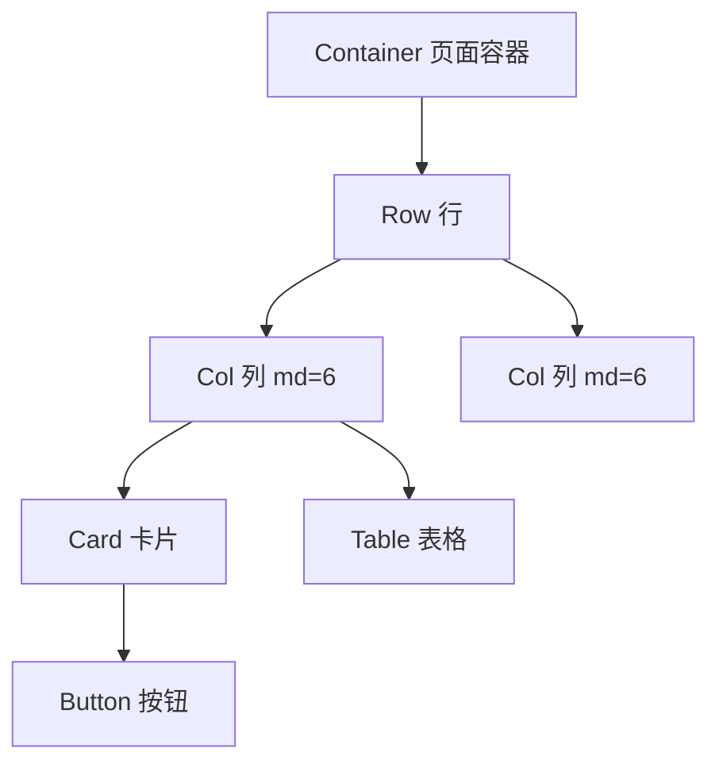
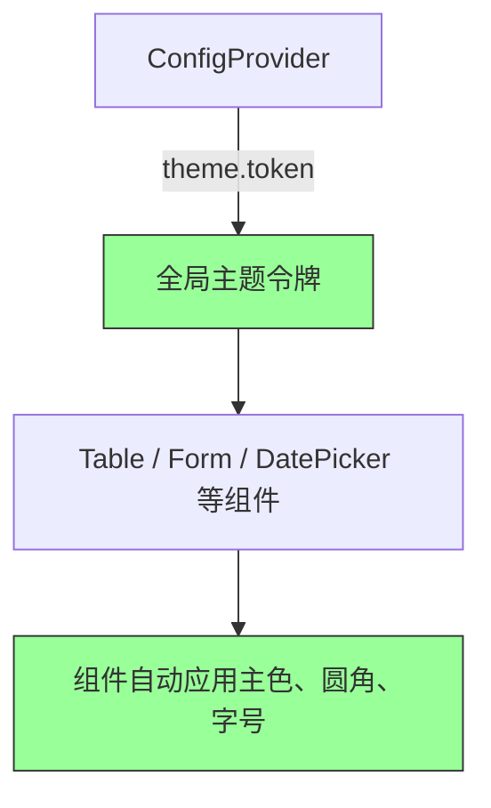
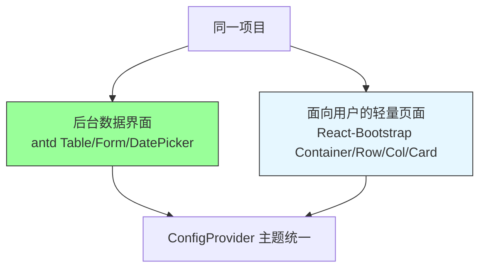

# 第6章 样式与组件库：Bootstrap 与 Ant Design

**本章概述**：React 应用不仅需要逻辑，还需要好看的界面。本章我们学习两种主流的 UI 组件库：React-Bootstrap 和 Ant Design。React-Bootstrap 适合内容型页面和轻量界面，Ant Design 适合数据密集型的后台管理界面。本章还会讲解两者如何在同一个项目中共存，以及如何避免设计语言冲突。

**读者对象**：你已经会写 React 函数组件，读完了第1–5章。如果你以前只写过原生 CSS 或简单的内联样式，本章会让你了解如何用成熟的组件库快速搭建界面。

---

## 6.1 React-Bootstrap：工具类优先的轻量接入

### 什么是 React-Bootstrap？

Bootstrap 是最流行的前端 CSS 框架之一，提供了按钮、表格、导航栏、栅格系统等现成样式。原生 Bootstrap 需要在 HTML 上写很多 class 名，比如 `<button class="btn btn-primary">`。

**React-Bootstrap** 把 Bootstrap 的 CSS 类映射为 React 组件。你不需要再记一大堆 class 名，而是直接用 `<Button variant="primary">` 这样的 JSX 写法，更符合 React 的组件化思维。

### 安装和基本用法

```bash
npm install react-bootstrap bootstrap
```

在入口文件（如 `main.tsx` 或 `App.tsx`）里引入 Bootstrap 的 CSS：

```tsx
import 'bootstrap/dist/css/bootstrap.min.css'
```

然后就可以在组件里使用 React-Bootstrap 的组件了：

```tsx
import { Button, Container, Row, Col, Card, Table } from 'react-bootstrap'

function HomePage() {
  return (
    <Container>
      <Row>
        <Col md={6}>
          <Card>
            <Card.Body>
              <Card.Title>欢迎</Card.Title>
              <Card.Text>这是一个使用 React-Bootstrap 构建的页面。</Card.Text>
              <Button variant="primary">点击我</Button>
            </Card.Body>
          </Card>
        </Col>
        <Col md={6}>
          <Table striped bordered hover>
            <thead>
              <tr>
                <th>#</th>
                <th>姓名</th>
                <th>角色</th>
              </tr>
            </thead>
            <tbody>
              <tr>
                <td>1</td>
                <td>张三</td>
                <td>管理员</td>
              </tr>
              <tr>
                <td>2</td>
                <td>李四</td>
                <td>编辑</td>
              </tr>
            </tbody>
          </Table>
        </Col>
      </Row>
    </Container>
  )
}
```

常用组件包括：
- `Container`：页面容器，居中并设置最大宽度
- `Row` / `Col`：栅格系统，用于分栏布局
- `Card`：卡片容器，常用于展示信息块
- `Button`：按钮，`variant` 可选 `primary`、`secondary`、`success`、`danger` 等
- `Table`：表格，支持 `striped`（斑马纹）、`bordered`（带边框）、`hover`（悬停高亮）

### 定制方式：Sass 变量或 CSS 覆盖

React-Bootstrap **没有 JavaScript 主题引擎**。如果你想修改主题色、间距、圆角等，有两种常见方式：

1. **用 Sass 变量定制**：如果你的项目用 Sass，可以在引入 Bootstrap 之前修改它的 Sass 变量，比如把主色从蓝色改成紫色，然后重新编译。
2. **CSS 覆盖**：在自己的 CSS 文件里写更具体的选择器，覆盖 Bootstrap 的默认样式。

```css
/* 覆盖 Bootstrap 按钮的主色 */
.btn-primary {
  background-color: #6c5ce7;
  border-color: #6c5ce7;
}
```

React-Bootstrap 适合**内容型页面**和**对 Bootstrap 网格/工具类已有依赖的项目**。比如博客、文档站、展示型官网，不需要复杂的交互和数据展示。

### 对应类/函数/库

- `react-bootstrap` 的 `Button`、`Table`、`Container`、`Row`、`Col`、`Card`

#### React-Bootstrap 布局示意图



---

## 6.2 Ant Design：企业级数据密集型 UI

### 什么是 Ant Design？

**Ant Design**（简称 antd）是蚂蚁集团开源的企业级 UI 设计语言和 React 组件库。它的定位是**数据密集型后台与管理界面**，比如后台管理系统、数据看板、电商后台、企业内部工具等。

相比 Bootstrap，antd 的组件更完整、更专业。`Table`、`Form`、`DatePicker`、`Modal`、`Select` 等组件内置了排序、筛选、分页、校验、日期选择等复杂功能，开箱即用。

### 安装和基本用法

```bash
npm install antd
```

在入口文件引入 antd 的样式：

```tsx
import 'antd/dist/reset.css'
```

使用 antd 组件：

```tsx
import { Button, Table, Card, Input, Space } from 'antd'

function UserPage() {
  const columns = [
    { title: '姓名', dataIndex: 'name', key: 'name' },
    { title: '年龄', dataIndex: 'age', key: 'age' },
    { title: '操作', key: 'action', render: () => <Button>编辑</Button> },
  ]

  const data = [
    { key: '1', name: '张三', age: 25 },
    { key: '2', name: '李四', age: 30 },
  ]

  return (
    <Space direction="vertical" style={{ padding: 24 }}>
      <Card title="用户列表">
        <Table dataSource={data} columns={columns} rowKey="key" />
      </Card>
      <Input.Search placeholder="搜索用户" />
      <Button type="primary">新建用户</Button>
    </Space>
  )
}
```

### 表单：Form 与 Form.Item

antd 的 `Form` 是其最强大的组件之一，支持受控校验、字段联动、异步校验等。

```tsx
import { Form, Input, Button, message } from 'antd'

function LoginForm() {
  const [form] = Form.useForm()

  const onFinish = (values: { username: string; password: string }) => {
    message.success(`登录成功：${values.username}`)
  }

  return (
    <Form
      form={form}
      layout="vertical"
      onFinish={onFinish}
      autoComplete="off"
    >
      <Form.Item
        label="用户名"
        name="username"
        rules={[{ required: true, message: '请输入用户名' }]}
      >
        <Input />
      </Form.Item>
      <Form.Item
        label="密码"
        name="password"
        rules={[{ required: true, message: '请输入密码' }]}
      >
        <Input.Password />
      </Form.Item>
      <Form.Item>
        <Button type="primary" htmlType="submit">
          登录
        </Button>
      </Form.Item>
    </Form>
  )
}
```

`Form.Item` 的 `rules` 属性用于定义校验规则，比如 `required` 表示必填。表单提交时，antd 会自动校验所有字段，校验通过才会调用 `onFinish`。

### 表格：Table 的排序、筛选、分页

antd 的 `Table` 内置了排序、筛选、分页，不需要手写复杂逻辑。

```tsx
const columns = [
  {
    title: '姓名',
    dataIndex: 'name',
    key: 'name',
    sorter: (a, b) => a.name.localeCompare(b.name), // 排序
    filterOptions: [{ text: '张三', value: '张三' }], // 筛选
    onFilter: (value, record) => record.name.includes(value),
  },
  {
    title: '年龄',
    dataIndex: 'age',
    key: 'age',
    sorter: (a, b) => a.age - b.age,
  },
]

function UserTable() {
  const [pagination, setPagination] = useState({ current: 1, pageSize: 10 })

  return (
    <Table
      dataSource={data}
      columns={columns}
      rowKey="key"
      pagination={pagination}
      onChange={pagination => setPagination(pagination)}
    />
  )
}
```

### 主题定制：ConfigProvider 的 theme.token

antd 的主题定制通过 `ConfigProvider` 的 `theme.token` 完成。`token` 是 antd 5.x 引入的设计令牌系统，可以统一修改主色、字体、圆角等。

```tsx
import { ConfigProvider } from 'antd'

function App() {
  return (
    <ConfigProvider
      theme={{
        token: {
          colorPrimary: '#6c5ce7', // 主色
          borderRadius: 8,        // 圆角
          fontSize: 14,           // 基础字号
        },
      }}
    >
      <YourApp />
    </ConfigProvider>
  )
}
```

`ConfigProvider` 包裹的所有子组件都会应用这个主题，实现全局统一定制。

### 对应类/函数/库

- `antd` 的 `ConfigProvider`、`Table`、`Form`、`Form.Item`、`DatePicker`、`theme`

#### Ant Design 主题定制流程



---

## 6.3 两者共存与边界划分

### 同一项目中可以并存 React-Bootstrap 和 antd

同一个 React 项目里，既可以用 React-Bootstrap，也可以用 antd。两者的 CSS 作用域不同，通常不会直接冲突。但关键问题是：**不要在同一个页面、同一个区域里混用两套设计语言。** 如果一半按钮是 Bootstrap 风格、一半按钮是 antd 风格，界面会显得割裂、不专业。

### 边界划分方案

推荐的做法是**按功能区域划分**：

| 区域 | 推荐组件库 | 理由 |
|------|-----------|------|
| 后台数据界面（表格、表单、数据看板） | antd | 组件完整，内置排序/筛选/分页/校验 |
| 面向用户的轻量页面（官网、博客、内容页） | React-Bootstrap | 轻量、工具类优先、适合内容展示 |

例如，一个电商项目可以这样划分：
- 后台管理系统（商品管理、订单管理、用户管理）：用 antd 的 `Table`、`Form`、`DatePicker`
- 面向客户的商品预览页、首页：用 React-Bootstrap 的 `Container`、`Row`、`Col`、`Card`

### 目录隔离与主题变量协调

为了避免两套组件库混用，可以在目录层面做隔离：

```
src/
  ├── components/
  │   ├── admin/          # 后台区域，只用 antd
  │   └── public/         # 面向用户区域，只用 React-Bootstrap
  ├── layouts/
  │   ├── AdminLayout.tsx  # 用 antd Layout
  │   └── PublicLayout.tsx # 用 React-Bootstrap Container
```

如果两个区域需要色彩统一，可以用 **CSS 变量桥接**：在 `ConfigProvider` 的 `token` 里定义主色，同时让 Bootstrap 的 Sass 变量使用相同的颜色值。或者更简单地，在全局 CSS 里定义 CSS 变量，两套组件库都引用这些变量。

```css
:root {
  --brand-primary: #6c5ce7;
}

/* antd 主题 */
<ConfigProvider theme={{ token: { colorPrimary: 'var(--brand-primary)' } }}>

/* Bootstrap 覆盖 */
.btn-primary {
  background-color: var(--brand-primary);
}
```

> **小结**：同一项目中可以并存 React-Bootstrap 与 antd，但要明确边界：用 antd 处理后台数据界面，用 React-Bootstrap 处理面向用户的轻量页面。避免两套设计语言在同一屏内混用。可通过目录隔离与主题变量协调来保持一致性。

#### 两者边界划分示意图



---

## 本章小结

本章我们学习了 React 中两种主流 UI 组件库：

1. **React-Bootstrap**：把 Bootstrap CSS 类映射为 React 组件，没有 JavaScript 主题引擎，定制通过 Sass 变量或 CSS 覆盖。适合内容型页面和对 Bootstrap 网格/工具类已有依赖的项目。常用组件：`Button`、`Table`、`Container`、`Row`、`Col`、`Card`。

2. **Ant Design**：企业级数据密集型 UI，`Table`、`Form`、`DatePicker` 等组件完整度远超 Bootstrap 生态。主题定制通过 `ConfigProvider` 的 `theme.token` 完成。`Table` 支持排序/筛选/分页，`Form` 支持受控校验。常用组件：`ConfigProvider`、`Table`、`Form`、`Form.Item`、`DatePicker`、`theme`。

3. **两者共存**：同一项目可并存，但要按功能区域划分边界。后台数据界面用 antd，面向用户的轻量页面用 React-Bootstrap。避免两套设计语言在同一屏内混用，可用目录隔离和 CSS 变量桥接来协调主题。

下一章我们将进入测试策略，学习从组件到端到端的完整测试方法。