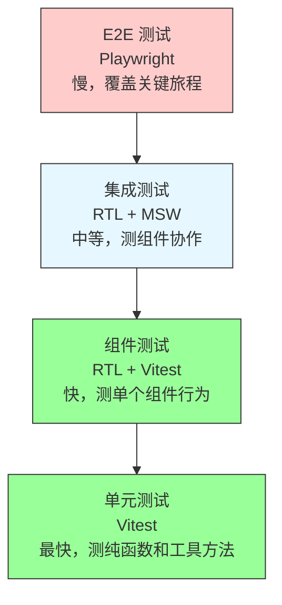
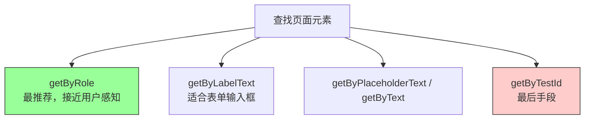
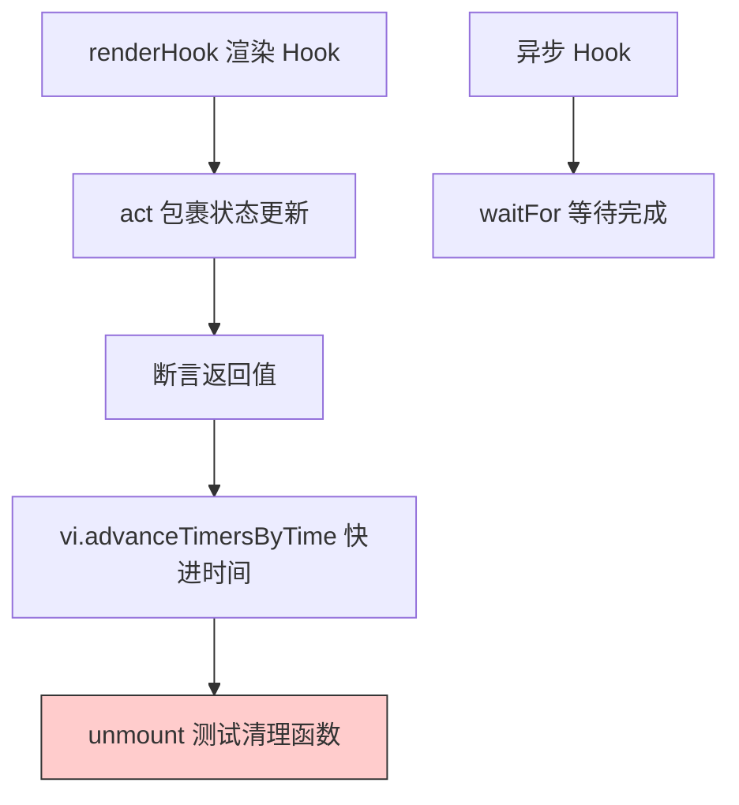
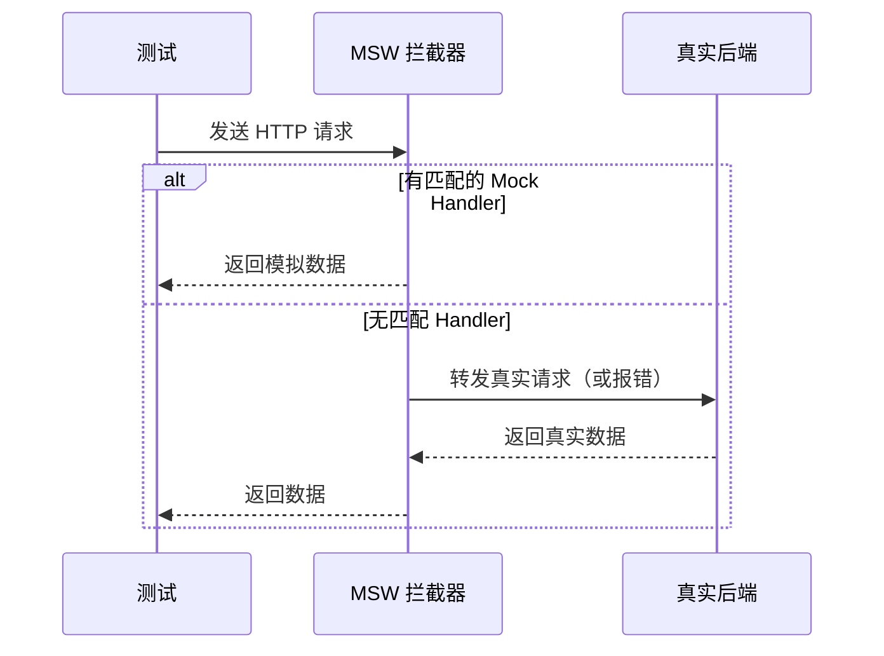
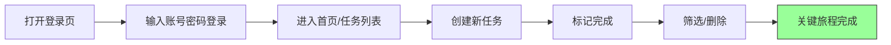
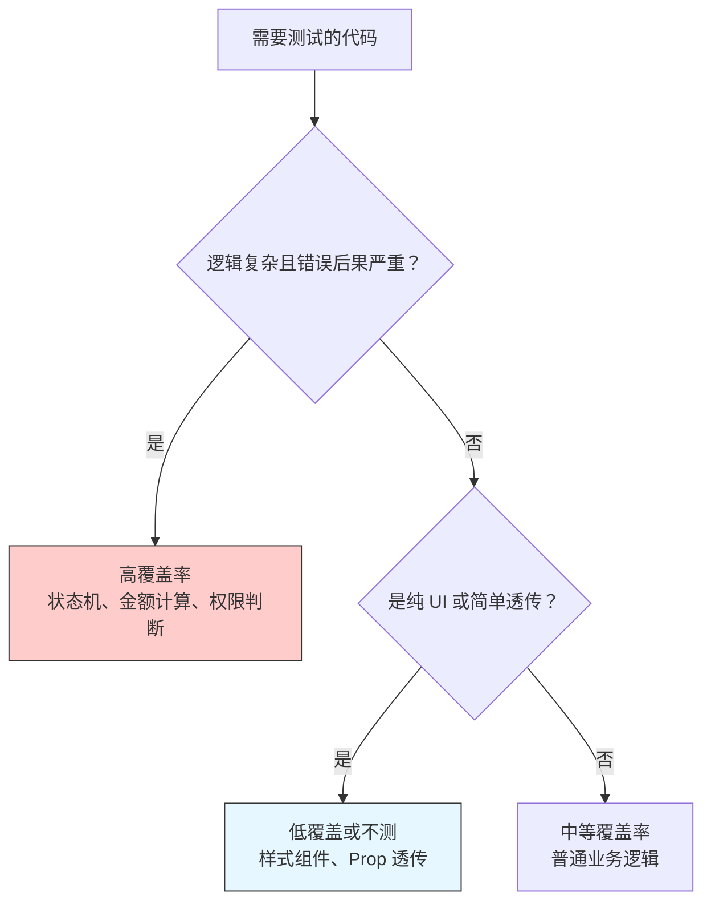

# 第7章 测试策略：从组件到端到端

**本章概述**：测试不是“一个工具打天下”，而是分层的。本章我们学习 React 应用的完整测试体系：单元/组件测试用 Vitest + React Testing Library，API 层用 MSW 拦截请求，端到端测试用 Playwright。每一层该测什么、不该测什么，如何编写可维护的测试，以及覆盖率该怎么看。

**读者对象**：你已经会写 React 函数组件，读完了第1–6章。如果你以前没写过自动化测试，没关系，我们从最简单的断言开始，一步步讲清楚。

---

## 7.1 测试分层与工具选型

### 为什么测试要分层？

很多初学者觉得“写测试就是给每个组件写几个用例”，但实际上，不同的测试层解决的问题不同：

- **单元测试**：测试单个函数、单个工具方法，比如“金额计算函数是否正确”、“日期格式化是否正确”。速度快，运行成本低。
- **组件测试**：测试单个 React 组件，比如“点击按钮后是否显示弹窗”、“表单提交时是否校验”。速度中等。
- **集成测试**：测试多个组件配合，或者组件与路由、数据层的配合，比如“点击列表项后跳转详情页，详情页显示正确数据”。
- **端到端测试（E2E）**：在真实浏览器里模拟用户操作，比如“登录 → 创建任务 → 标记完成 → 删除”，覆盖完整的用户旅程。速度慢，但最接近真实使用场景。

测试金字塔的原则是：**底层测试多、快；顶层测试少、慢**。不要试图用 E2E 测试覆盖所有逻辑，那样测试会非常慢且难以维护。

### 工具选型

本章推荐的工具链是目前 React 生态中比较主流的组合：

| 测试层 | 工具 | 作用 |
|--------|------|------|
| 单元/组件测试 | **Vitest** | 测试运行器，基于 Vite，启动快，支持 TypeScript |
| 组件测试 | **React Testing Library (RTL)** | 渲染组件，模拟用户交互，断言用户能看到的内容 |
| API 层拦截 | **MSW (Mock Service Worker)** | 在网络层拦截 HTTP 请求，返回模拟数据，不依赖真实后端 |
| 端到端测试 | **Playwright** | 真实浏览器自动化，模拟完整用户旅程 |

为什么选 Vitest 而不是 Jest？Vitest 基于 Vite，配置简单，启动速度快，天然支持 TypeScript 和 ESM，和 React + Vite 项目搭配最顺手。

安装命令：

```bash
npm install -D vitest @testing-library/react @testing-library/jest-dom @testing-library/user-event msw @playwright/test
```

> **小结**：测试不是一个工具打天下，而是分层的。单元/组件测试用 Vitest + React Testing Library，API 层用 MSW 拦截，端到端用 Playwright。每层测不同的内容，避免重复和过度测试。

#### 测试分层示意图



---

## 7.2 组件测试：以用户行为为断言中心

### Testing Library 的核心原则

React Testing Library（RTL）的核心原则是：**“测试用户能看到和做到的事”，而不是测试组件内部实现。**

这意味着：
- 不要测试组件内部的 state 值（比如 `wrapper.state().count`）；
- 不要测试组件内部调用了哪个函数；
- 要测试：用户点击按钮后，页面上是否显示了预期的文字；用户输入后，是否出现了错误提示。

### 基本用法：render, screen, getByRole, userEvent

```tsx
// Button.test.tsx
import { render, screen } from '@testing-library/react'
import { Button } from './Button'

test('按钮点击后显示点击次数', () => {
  render(<Button />)

  // 用 role 查找按钮，而不是 class 名或 data-testid
  const button = screen.getByRole('button', { name: /点击我/i })

  // 模拟用户点击
  fireEvent.click(button)

  // 断言页面上出现了预期文字
  expect(screen.getByText('已点击 1 次')).toBeInTheDocument()
})
```

关键 API：
- `render(<Component />)`：把组件渲染到测试 DOM 里。
- `screen.getByRole('button', { name: '...' })`：通过 ARIA role 和可访问名称查找元素，这是最推荐的查询方式，因为它和屏幕阅读器使用的方式一致。
- `fireEvent.click()` / `userEvent.click()`：模拟用户点击。
- `expect(...).toBeInTheDocument()`：断言元素存在于 DOM 中（需要引入 `@testing-library/jest-dom`）。

### 为什么优先用 role/label 查询而非 data-testid？

很多初学者喜欢给元素加 `data-testid` 然后查找：

```tsx
// ❌ 不推荐：依赖 data-testid
<button data-testid="submit-btn">提交</button>
screen.getByTestId('submit-btn')
```

问题在于，`data-testid` 是只给测试用的属性，真实用户看不见，也和无障碍无关。如果你重构组件，不小心删掉了 `data-testid`，测试就会失败，但实际上用户体验没任何变化。这叫“测试过度耦合内部实现”。

优先查询顺序（从最推荐到最不推荐）：
1. `getByRole`：按角色和名称查找，最接近用户感知；
2. `getByLabelText`：按标签文字查找，适合表单输入框；
3. `getByPlaceholderText`：按占位符查找；
4. `getByText`：按显示文字查找；
5. `getByTestId`：最后手段，只有上述都不行时才用。

### 使用 userEvent 模拟真实交互

`@testing-library/user-event` 提供的 `userEvent` 比 `fireEvent` 更接近真实浏览器行为。比如 `userEvent.click` 会先检查元素是否可点击、是否被禁用，而 `fireEvent.click` 只是直接触发事件。

```tsx
import { render, screen } from '@testing-library/react'
import userEvent from '@testing-library/user-event'
import { LoginForm } from './LoginForm'

test('登录表单提交后显示欢迎信息', async () => {
  const user = userEvent.setup()
  render(<LoginForm />)

  const usernameInput = screen.getByLabelText(/用户名/i)
  const passwordInput = screen.getByLabelText(/密码/i)
  const submitButton = screen.getByRole('button', { name: /登录/i })

  await user.type(usernameInput, '张三')
  await user.type(passwordInput, '123456')
  await user.click(submitButton)

  expect(screen.getByText('欢迎，张三')).toBeInTheDocument()
})
```

> **小结**：组件测试以用户行为为断言中心。优先用 `getByRole`、`getByLabelText` 等无障碍查询方式，避免依赖 `data-testid` 和内部状态。用 `userEvent` 模拟真实浏览器交互。

#### 组件测试查询优先级



---

## 7.3 Hook 测试：renderHook 与副作用清理

### 为什么 Hook 需要独立测试？

自定义 Hook 里的状态逻辑可能比组件更复杂，直接在组件里测不够直接。React Testing Library 提供了 `renderHook`，可以单独渲染一个 Hook，测试它的状态流转和副作用清理。

### 基本用法：renderHook + act + waitFor

```tsx
// useDebounce.test.tsx
import { renderHook, act } from '@testing-library/react'
import { useDebounce } from './useDebounce'

test('useDebounce 应该在延迟后更新值', () => {
  const { result, rerender } = renderHook(
    ({ value, delay }) => useDebounce(value, delay),
    { initialProps: { value: 'hello', delay: 1000 } }
  )

  // 初始值应该立即等于输入值
  expect(result.current).toBe('hello')

  // 更新输入值，防抖值不应立即变化
  act(() => {
    rerender({ value: 'world', delay: 1000 })
  })
  expect(result.current).toBe('hello') // 还没到时间，还是旧值

  // 快进时间
  act(() => {
    vi.advanceTimersByTime(1000)
  })
  expect(result.current).toBe('world') // 延迟后更新
})
```

关键点：
- `renderHook` 接收 Hook 函数和初始参数，返回 `result`（当前返回值）和 `rerender`（重新渲染）。
- `act()` 把状态更新包起来，确保 React 完成所有更新后再断言。
- `vi.advanceTimersByTime` 用于快进时间，需要配合 `vi.useFakeTimers()` 模拟定时器。

### 副作用清理必须被断言覆盖

如果 Hook 里用了 `setInterval`、`setTimeout`、`addEventListener`、`AbortController`，组件卸载时必须清理，否则会造成内存泄漏或意外行为。

```tsx
// useInterval.test.tsx
import { renderHook, act } from '@testing-library/react'
import { useInterval } from './useInterval'

test('useInterval 卸载时应该清除定时器', () => {
  const callback = vi.fn()
  const { unmount } = renderHook(
    ({ delay }) => useInterval(callback, delay),
    { initialProps: { delay: 100 } }
  )

  vi.advanceTimersByTime(300)
  expect(callback).toHaveBeenCalledTimes(3)

  unmount() // 卸载 Hook

  vi.advanceTimersByTime(1000)
  expect(callback).toHaveBeenCalledTimes(3) // 卸载后不应再调用
})
```

测试清理函数的方法是：先让 Hook 运行一段时间，然后调用 `unmount()`，再快进时间，断言副作用没有继续执行。

### 测试异步 Hook：useAsync

```tsx
// useAsync.test.tsx
import { renderHook, act } from '@testing-library/react'
import { useAsync } from './useAsync'

test('useAsync 应该处理加载、成功和错误状态', async () => {
  const fetchData = vi.fn().mockResolvedValue({ data: '结果' })

  const { result, waitFor } = renderHook(
    ({ fn }) => useAsync(fn),
    { initialProps: { fn: fetchData } }
  )

  // 初始状态：加载中
  expect(result.current.loading).toBe(true)
  expect(result.current.data).toBeNull()

  // 等待异步完成
  await waitFor(() => expect(result.current.isSuccess).toBe(true))

  expect(result.current.data).toEqual({ data: '结果' })
  expect(result.current.error).toBeNull()
})
```

`waitFor` 用于等待异步操作完成，轮询检查断言条件，直到超时。

> **小结**：Hook 测试用 `renderHook` 独立渲染 Hook，`act` 包裹状态更新，`waitFor` 等待异步完成。清理函数（`clearTimeout`、`AbortController`）必须被断言覆盖，防止内存泄漏。

#### Hook 测试流程



---

## 7.4 路由与数据层集成测试：MSW 与 loader/action

### 为什么路由测试不能打真实接口？

路由的 `loader` 和 `action` 依赖网络请求。如果测试里直接打真实后端接口，会有以下问题：
- 网络不稳定，测试忽快忽慢、时过时不；
- 后端接口可能还没写，或者数据不对；
- 测试运行需要联网，CI 环境可能无法访问。

解决方案是用 **MSW (Mock Service Worker)** 在网络层拦截请求，返回模拟数据。测试不需要真实后端，也能验证 `loader` 返回数据、错误边界和重定向逻辑。

### MSW 基本用法

```tsx
// src/mocks/handlers.ts
import { http, HttpResponse } from 'msw'

export const handlers = [
  http.get('/api/users', () => {
    return HttpResponse.json([
      { id: '1', name: '张三' },
      { id: '2', name: '李四' },
    ])
  }),

  http.post('/api/users', async ({ request }) => {
    const body = await request.json()
    return HttpResponse.json({ id: '3', name: body.name }, { status: 201 })
  }),
]
```

```tsx
// src/mocks/server.ts
import { setupServer } from 'msw/node'
import { handlers } from './handlers'

export const server = setupServer(...handlers)
```

在测试文件里启动和关闭服务器：

```tsx
import { server } from '@/mocks/server'

beforeAll(() => server.listen())
afterEach(() => server.resetHandlers())
afterAll(() => server.close())
```

### 测试 loader：用 createMemoryRouter

React Router 提供了 `createMemoryRouter`，可以创建不依赖浏览器地址栏的路由器，适合在测试环境里渲染路由。

```tsx
// UserList.test.tsx
import { render, screen } from '@testing-library/react'
import { RouterProvider } from 'react-router/dom'
import { createMemoryRouter } from 'react-router/dom'
import { server } from '@/mocks/server'
import { userListRoute } from '@/routes/userList'

test('loader 应该在组件渲染前获取用户列表', async () => {
  const router = createMemoryRouter([
    {
      path: '/users',
      element: <UserList />,
      loader: userListLoader,
    },
  ])

  render(
    <RouterProvider router={router}>
      <UserList />
    </RouterProvider>
  )

  // 等待 loader 完成，数据渲染出来
  expect(await screen.findByText('张三')).toBeInTheDocument()
  expect(await screen.findByText('李四')).toBeInTheDocument()
})
```

`createMemoryRouter` 配合 `RouterProvider`，可以在测试中完整渲染路由，验证 `loader` 数据是否正确传递给组件。

### 测试错误边界和重定向

可以用 MSW 模拟接口返回 500 错误，验证 `errorElement` 是否正确渲染：

```tsx
test('loader 失败时应该显示错误页面', async () => {
  server.use(
    http.get('/api/users', () => {
      return new HttpResponse(null, { status: 500 })
    })
  )

  const router = createMemoryRouter([
    {
      path: '/users',
      element: <UserList />,
      errorElement: <ErrorPage />,
      loader: userListLoader,
    },
  ])

  render(
    <RouterProvider router={router}>
      <UserList />
    </RouterProvider>
  )

  expect(await screen.findByText('加载失败')).toBeInTheDocument()
})
```

测试未登录重定向：

```tsx
test('未登录访问受保护路由应重定向到登录页', async () => {
  const router = createMemoryRouter([
    {
      path: '/dashboard',
      element: <Dashboard />,
      loader: protectedLoader, // 里面会 throw redirect('/login')
    },
  ], {
    initialEntries: ['/dashboard'],
  })

  render(
    <RouterProvider router={router}>
      <Dashboard />
    </RouterProvider>
  )

  expect(await screen.findByRole('heading', { name: /登录/i })).toBeInTheDocument()
})
```

> **小结**：路由的 `loader`/`action` 依赖网络，用 MSW 在 Node 侧拦截请求，配合 `createMemoryRouter` 测试 loader 返回、错误边界和重定向。测试不需要真实后端，更稳定、更快速。

#### MSW 拦截请求流程



---

## 7.5 端到端测试：Playwright 与关键用户旅程

### 什么是 E2E 测试？

端到端测试（E2E）在真实浏览器里运行，模拟真实用户的完整操作旅程。比如：
1. 打开登录页；
2. 输入用户名密码，点击登录；
3. 跳转到首页，看到任务列表；
4. 创建一个新任务；
5. 标记任务完成；
6. 删除任务。

E2E 测试最接近真实使用场景，能发现组件测试和集成测试发现不了的问题（比如跨页面状态不同步、浏览器兼容性问题）。

但 E2E 测试也最慢、最脆弱，所以**只覆盖关键用户旅程，不追求覆盖率**。

### Playwright 基本用法

```tsx
// e2e/task-flow.spec.ts
import { test, expect } from '@playwright/test'

test('创建 → 筛选 → 完成 → 删除 任务主旅程', async ({ page }) => {
  // 1. 打开首页
  await page.goto('http://localhost:5173')

  // 2. 输入任务标题并提交
  await page.getByPlaceholder('请输入任务').fill('学习 React')
  await page.getByRole('button', { name: '添加任务' }).click()

  // 3. 断言任务出现在列表中
  await expect(page.getByText('学习 React')).toBeVisible()

  // 4. 标记完成
  await page.getByRole('checkbox', { name: '学习 React' }).check()

  // 5. 筛选已完成
  await page.getByRole('button', { name: '已完成' }).click()
  await expect(page.getByText('学习 React')).toBeVisible()

  // 6. 删除任务
  await page.getByRole('button', { name: '删除', exact: true }).click()
  await expect(page.getByText('学习 React')).not.toBeVisible()
})
```

关键 API：
- `page.goto(url)`：打开页面；
- `page.getByRole()` / `page.getByPlaceholder()`：查找元素；
- `page.fill()`：输入文本；
- `page.click()`：点击；
- `expect(...).toBeVisible()`：断言元素可见；
- `expect(...).not.toBeVisible()`：断言元素不可见。

### Trace 回放

Playwright 支持录制测试执行的 trace，失败时可以回放查看发生了什么：

```tsx
// playwright.config.ts
import { defineConfig, devices } from '@playwright/test'

export default defineConfig({
  use: {
    trace: 'on-first-retry', // 失败时录制 trace
  },
})
```

运行测试后，可以用 `npx playwright show-trace` 查看 trace 文件，看到每一步的截图、DOM 快照和控制台日志。

### CI 中的并行与重试

CI 环境下，E2E 测试运行时间长，需要配置并行和重试：

```tsx
// playwright.config.ts
export default defineConfig({
  fullyParallel: true, // 并行运行测试文件
  retries: 2, // 失败时重试 2 次
  workers: process.env.CI ? 4 : undefined, // CI 中使用 4 个 worker
})
```

> **小结**：E2E 只覆盖关键用户旅程（登录、下单、发布），不追求覆盖率。Playwright 提供 `page.goto`、`getByRole`、`expect(...).toBeVisible()` 等 API，支持 trace 回放和 CI 并行/重试配置。

#### E2E 关键旅程示意图



---

## 7.6 覆盖率的合理边界

### 覆盖率是信号而非目标

很多团队犯的错误是“追求 100% 代码覆盖率”。覆盖率只能告诉你“哪些代码被测试跑过”，不能告诉你“测试是否有意义”。100% 覆盖率不代表没有 Bug，只代表你没有遗漏任何一行代码——哪怕那行代码是无意义的样式代码。

### 哪些代码值得 100% 覆盖，哪些不值得

| 代码类型 | 建议覆盖率 | 理由 |
|----------|-----------|------|
| 状态机、金额计算、权限判断 | 应接近 100% | 逻辑复杂，错误后果严重 |
| 纯函数（格式化、验证） | 应接近 100% | 易测试，价值高 |
| UI 组件（样式、布局） | 无需高覆盖 | 测试 UI 像素边际收益低，E2E 覆盖关键路径即可 |
| 简单的 Prop 透传组件 | 无需测试 | 逻辑太简单，测试成本高于收益 |
| 第三方库代码 | 无需测试 | 库本身已有测试 |

### 如何在 Vitest 中开启覆盖率

```bash
npx vitest run --coverage
```

需要安装覆盖率插件：

```bash
npm install -D @vitest/coverage-v8
```

在 `vitest.config.ts` 中配置阈值：

```ts
import { defineConfig } from 'vitest/config'

export default defineConfig({
  test: {
    coverage: {
      provider: 'v8',
      thresholds: {
        lines: 80,
        functions: 80,
        branches: 70,
        statements: 80,
      },
    },
  },
})
```

`thresholds` 设置覆盖率门槛，如果低于这个阈值，CI 会失败。建议设置得保守一点（比如 70%-80%），不要一上来就要求 100%。

### 把覆盖率门槛写进 CI

在 GitHub Actions 里运行测试并检查覆盖率：

```yaml
# .github/workflows/test.yml
- name: 运行测试和覆盖率
  run: |
    npm install
    npm run test -- --coverage
```

不要让覆盖率拖慢迭代：如果某个新组件暂时不需要测试，可以在覆盖率配置里排除，而不是强行写无意义的测试来凑数字。

> **小结**：覆盖率是信号而非目标。状态机、金额计算等核心逻辑值得高覆盖率；纯 UI 组件和简单透传组件不需要高覆盖率。用 `vitest --coverage` 和 `@vitest/coverage-v8` 衡量，在 CI 中设置合理阈值，避免为了凑数字写无意义测试。

#### 覆盖率决策示意图



---

## 本章小结

本章我们学习了 React 应用的完整测试体系：

1. **测试分层**：单元/组件测试、集成测试、端到端测试分工不同，遵循“底层多快、顶层少慢”的金字塔原则。
2. **工具选型**：Vitest 作为测试运行器，React Testing Library 做组件测试，MSW 拦截 API 请求，Playwright 做 E2E 测试。
3. **组件测试**：以用户行为为断言中心，优先用 `getByRole`/`getByLabelText` 查询，避免依赖 `data-testid` 和内部状态；用 `userEvent` 模拟真实交互。
4. **Hook 测试**：用 `renderHook` 独立测试 Hook，`act` 包裹更新，`waitFor` 等待异步，清理函数（`clearTimeout`、`AbortController`）必须被断言覆盖。
5. **路由与数据层集成测试**：用 MSW 拦截网络请求，配合 `createMemoryRouter` 测试 `loader` 返回、错误边界和重定向，不依赖真实后端。
6. **端到端测试**：Playwright 覆盖关键用户旅程，支持 `getByRole`、`toBeVisible()`、trace 回放，CI 中配置并行与重试。
7. **覆盖率边界**：覆盖率是信号而非目标，核心逻辑值得高覆盖率，纯 UI 组件不需要。用 `vitest --coverage` 和 `@vitest/coverage-v8` 测量，CI 中设置合理阈值。

下一章我们将进入项目实战一：单页面应用（SPA），把第1–7章的知识收束为一个可上线的任务管理应用。