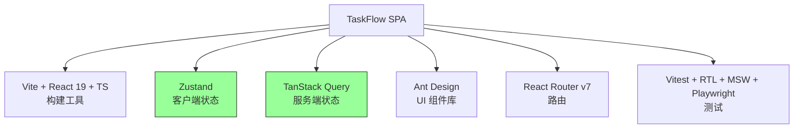
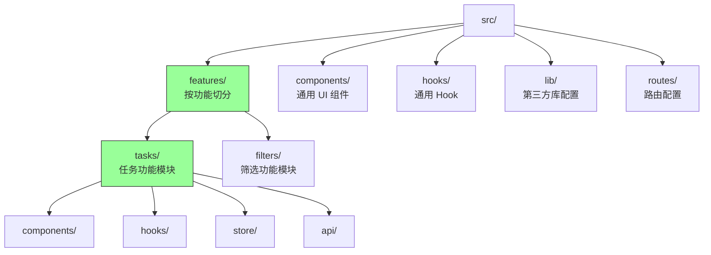
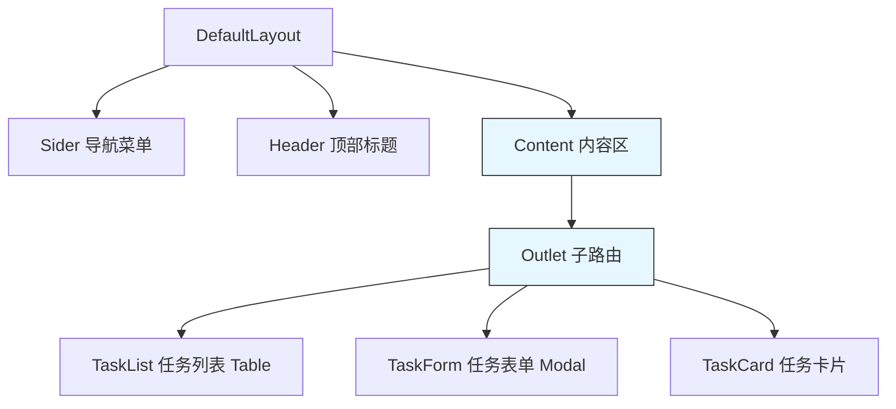
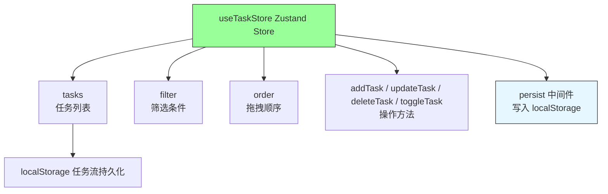
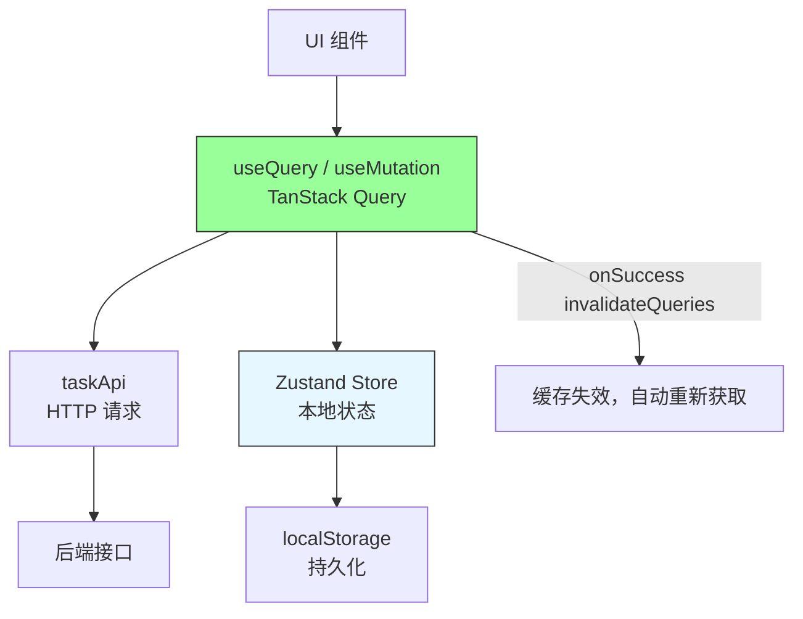
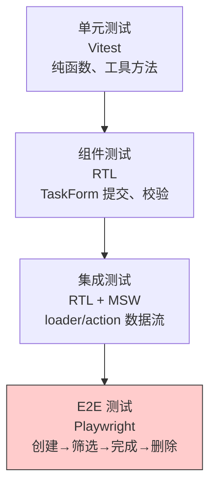
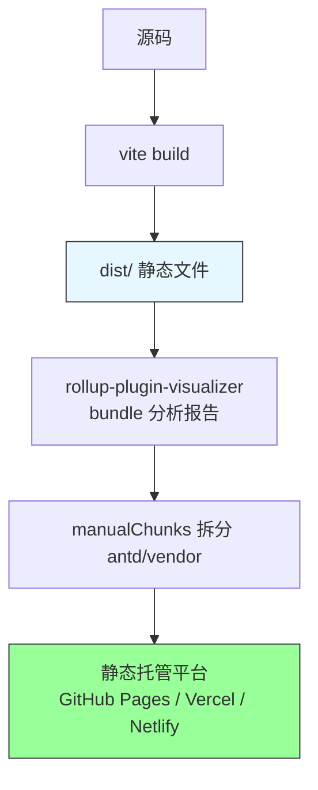

# 第8章 项目实战一：单页面应用（SPA）

**本章概述**：本章把第1–7章的知识收束为一个可上线的单页面应用。选题为**个人任务管理应用（TaskFlow）**：单路由树、客户端状态为主、服务端状态通过 TanStack Query 接入、样式用 Ant Design，最终配齐组件测试与 E2E 测试。我们会从需求分析、技术选型开始，一步步搭建项目架构、组件骨架、状态设计、数据层接入、测试、构建与部署。

**读者对象**：你已经读完了第1–7章，掌握了 React 组件、状态管理、Hooks、路由、网络数据层、样式组件库和测试的基础。本章是把这些知识点串联起来的第一个完整项目。

---

## 8.1 需求分析与技术选型

### 项目选题：TaskFlow 个人任务管理应用

TaskFlow 是一个单页面任务管理应用，核心功能包括：

- **任务 CRUD**：创建、查看、编辑、删除任务
- **任务状态切换**：标记任务完成/未完成
- **标签筛选**：按“全部/进行中/已完成”筛选任务
- **拖拽排序**：调整任务显示顺序
- **本地持久化**：刷新页面后任务数据不丢失

这是一个典型的 SPA：只有一个 HTML 页面，所有页面切换通过客户端路由完成，无需刷新整个页面。

### 技术选型矩阵

| 层级 | 技术选型 | 理由 |
|------|---------|------|
| 构建工具 | Vite + React 19 + TypeScript | 启动快，HMR 优秀，React 19 最新特性 |
| 客户端状态 | Zustand | 轻量，无需 Provider，支持选择器订阅和 persist 持久化 |
| 服务端状态 | TanStack Query | 缓存、重试、失效重试、自动更新 |
| UI 组件库 | Ant Design | Table、Form、Modal 等组件完整，适合数据密集界面 |
| 路由 | React Router v7 数据模式 | loader/action 数据流，createBrowserRouter |
| 测试 | Vitest + React Testing Library + MSW + Playwright | 分层测试体系 |
| 构建与部署 | vite build + 静态托管 | 产物是静态文件，可部署到任何静态托管平台 |

### 为什么不用 Redux？

TaskFlow 的状态比较简单：一个任务列表、一个筛选条件、一个拖拽顺序。这些状态可以用 Zustand 的轻量 store 搞定，不需要 Redux Toolkit 的单一状态树、action、reducer 等样板代码。Redux 适合需要审计、时间旅行调试的大型企业项目，TaskFlow 这种中小型 SPA 用 Redux 属于过度设计。

> **小结**：TaskFlow 是一个以 Zustand 管理客户端状态、TanStack Query 管理服务端状态、Ant Design 提供 UI、Vite 构建的单页面应用。不需要 Redux，状态规模不大。

#### 技术选型对照表



---

## 8.2 项目初始化与目录架构

### 初始化项目

沿用第1章的 Vite 初始化命令：

```bash
npm create vite@latest taskflow -- --template react-ts
cd taskflow
npm install
npm install zustand @tanstack/react-query antd react-router-dom @tanstack/react-query-devtools
npm install -D vitest @testing-library/react @testing-library/jest-dom @testing-library/user-event msw @playwright/test
npm run dev
```

### 目录架构：按功能切分，而非按文件类型切分

很多初学者按文件类型切分目录：

```
src/
  components/
  hooks/
  utils/
  pages/
```

这种方式在项目小的时候没问题，但项目变大后，一个功能相关的文件分散在不同目录，维护困难。

TaskFlow 采用**按功能切分（feature-based）**的目录结构：

```
src/
  ├── features/
  │   ├── tasks/              # 任务功能模块
  │   │   ├── components/     # 任务相关组件（TaskList, TaskForm, TaskItem）
  │   │   ├── hooks/          # 任务相关 Hook（useTasks, useTaskFilters）
  │   │   ├── store/          # 任务相关 Zustand store
  │   │   ├── api/            # 任务相关 API 函数
  │   │   └── types.ts        # 任务类型定义
  │   └── filters/            # 筛选功能模块
  ├── components/             # 通用 UI 组件（按钮、模态框等）
  ├── hooks/                  # 通用 Hook（useDebounce 等）
  ├── lib/                    # 第三方库配置（axios 实例，queryClient）
  ├── routes/                 # 路由配置
  ├── App.tsx
  └── main.tsx
```

这样每个功能模块内聚性高，修改任务功能时只需要在 `features/tasks/` 内部操作，不需要在全项目跳来跳去。

### 路径别名与 TypeScript 路径映射

在 `vite.config.ts` 和 `tsconfig.json` 中配置路径别名 `@` 指向 `src`，避免深层相对路径（如 `../../../components/Button`）：

```ts
// vite.config.ts
import { defineConfig } from 'vite'
import { pluginReact } from '@vitejs/plugin-react'
import path from 'path'

export default defineConfig({
  plugins: [pluginReact()],
  resolve: {
    alias: {
      '@': path.resolve(__dirname, './src'),
    },
  },
})
```

```json
// tsconfig.json
{
  "compilerOptions": {
    "paths": {
      "@/*": ["./src/*"]
    }
  }
}
```

### ESLint flat config 与 TypeScript 严格模式

使用 ESLint flat config（`eslint.config.js`），开启 `eslint-plugin-react-hooks` 规则（如 `rules-of-hooks`、`exhaustive-deps`），TypeScript 开启 `strict` 模式，确保代码质量。

> **小结**：项目初始化用 Vite + react-ts 模板；目录按功能切分（`features/tasks/` 等），提高内聚性；配置路径别名 `@`、ESLint flat config 和 TypeScript strict 模式。

#### 项目目录架构



---

## 8.3 组件骨架与 Ant Design 布局

### 应用外壳：Layout、Menu、Card

用 Ant Design 的 `Layout`、`Menu`、`Card` 搭建应用外壳。左侧导航菜单，顶部标题，中间内容区。

```tsx
// src/layouts/DefaultLayout.tsx
import { Layout, Menu } from 'antd'
import { Outlet, Link } from 'react-router/dom'
import { MinusSquareOutlined, CheckSquareOutlined, ClockCircleOutlined } from '@ant-design/icons'

const { Sider, Header, Content } = Layout

export default function DefaultLayout() {
  return (
    <Layout>
      <Sider width={220}>
        <Menu mode="inline" defaultSelectedKeys={['1']} items={[
          { key: '1', label: '任务列表', icon: <MinusSquareOutlined /> },
          { key: '2', label: '已完成', icon: <CheckSquareOutlined /> },
        ]} />
      </Sider>
      <Layout>
        <Header style={{ background: '#fff', padding: 0 }}>
          <div style={{ display: 'flex', alignItems: 'center', gap: 16, padding: 16 }}>
            <h2 style={{ margin: 0 }}>TaskFlow</h2>
          </div>
        </Header>
        <Content style={{ padding: 24, background: '#f5f5f5', minHeight: 280 }}>
          <Outlet /> {/* 子路由渲染在这里 */}
        </Content>
      </Layout>
    </Layout>
  )
}
```

### 任务列表页：Table + Card

用 Ant Design 的 `Table` 展示任务列表，`Card` 包装内容块。

```tsx
// src/features/tasks/components/TaskList.tsx
import { Table, Card, Button, Space, Tag } from 'antd'
import { PlusOutlined } from '@ant-design/icons'
import { useTasks } from '../hooks/useTasks'
import { Task } from '../types'

const columns = [
  { title: '标题', dataIndex: 'title', key: 'title' },
  { title: '状态', dataIndex: 'done', key: 'done', render: (done: boolean) =>
    <Tag color={done ? 'green' : 'blue'}>{done ? '已完成' : '进行中'}</Tag> },
  { title: '操作', key: 'action', render: (_, record: Task) => (
    <Space>
      <Button size="small" onClick={() => editTask(record.id)}>编辑</Button>
      <Button size="small" danger onClick={() => deleteTask(record.id)}>删除</Button>
    </Space>
  ) },
]

export default function TaskListPage() {
  const { tasks, isLoading } = useTasks()

  return (
    <Card title="任务管理" extra={<Button type="primary" icon={<PlusOutlined />}>新建任务</Button>}>
      <Table dataSource={tasks} columns={columns} rowKey="id" loading={isLoading} />
    </Card>
  )
}
```

### 任务创建/编辑表单：Form + Form.Item + Modal

用 Ant Design 的 `Form` 实现任务创建表单，用 `Modal` 实现编辑弹窗。

```tsx
// src/features/tasks/components/TaskForm.tsx
import { Modal, Form, Input, Button, DatePicker } from 'antd'
import { useTaskForm } from '../hooks/useTaskForm'

interface TaskFormProps {
  visible: boolean
  onCancel: () => void
  onSuccess: () => void
  initialData?: Task
}

export default function TaskForm({ visible, onCancel, onSuccess, initialData }: TaskFormProps) {
  const [form] = Form.useForm()
  const { mutate, isPending } = useTaskForm()

  return (
    <Modal
      title={initialData ? '编辑任务' : '新建任务'}
      open={visible}
      onCancel={onCancel}
      footer={[
        <Button key="cancel" onClick={onCancel}>取消</Button>,
        <Button key="submit" type="primary" htmlType="submit" loading={isPending}>保存</Button>,
      ]}
    >
      <Form form={form} initialValues={initialData} layout="vertical" onFinish={mutate}>
        <Form.Item label="标题" name="title" rules={[{ required: true, message: '请输入任务标题' }]}>
          <Input />
        </Form.Item>
        <Form.Item label="描述" name="description">
          <Input.TextArea />
        </Form.Item>
        <Form.Item label="到期时间" name="dueDate">
          <DatePicker />
        </Form.Item>
      </Form>
    </Modal>
  )
}
```

### 避免表单状态双写：Zustand store 对接受控表单

`TaskForm` 使用 `form` 实例管理表单的受控状态，提交时调用 `mutate`（基于 Zustand store 或 TanStack Query 的 mutation），避免在组件内部同时维护一套表单状态（双写）。

> **小结**：应用外壳用 Ant Design 的 `Layout`、`Menu`、`Card`；任务列表用 `Table`；创建/编辑用 `Form` + `Form.Item` + `Modal`；表单状态由 `Form` 管理，提交时对接 Zustand store，避免“表单状态双写”。

#### 组件骨架布局



---

## 8.4 Zustand 状态设计与持久化

### 把任务列表、筛选条件、拖拽顺序拆成独立 slice

Zustand 的 store 可以拆成多个 slice，每个 slice 管理一块独立的状态。TaskFlow 的 store 设计如下：

```tsx
// src/features/tasks/store/useTaskStore.ts
import { create } from 'zustand'
import { persist } from 'zustand/middleware'
import { createJSONStorage } from 'zustand/middleware'
import { Task } from '../types'

interface TaskState {
  tasks: Task[]
  filter: 'all' | 'active' | 'completed'
  order: string[] // 任务 ID 的排序顺序
  addTask: (task: Omit<Task, 'id'>) => void
  updateTask: (id: string, patch: Partial<Task>) => void
  deleteTask: (id: string) => void
  toggleTask: (id: string) => void
  setFilter: (filter: TaskState['filter']) => void
  reorderTasks: (ids: string[]) => void
}

export const useTaskStore = create<TaskState>()(
  persist(
    (set) => ({
      tasks: [],
      filter: 'all',
      order: [],

      addTask: (task) => set((state) => {
        const newTask: Task = { ...task, id: crypto.randomUUID(), done: false }
        return {
          tasks: [...state.tasks, newTask],
          order: [...state.order, newTask.id],
        }
      }),

      updateTask: (id, patch) => set((state) => ({
        tasks: state.tasks.map((t) => t.id === id ? { ...t, ...patch } : t),
      })),

      deleteTask: (id) => set((state) => ({
        tasks: state.tasks.filter((t) => t.id !== id),
        order: state.order.filter((tid) => tid !== id),
      })),

      toggleTask: (id) => set((state) => ({
        tasks: state.tasks.map((t) =>
          t.id === id ? { ...t, done: !t.done } : t
        ),
      })),

      setFilter: (filter) => set({ filter }),

      reorderTasks: (ids) => set({ order: ids }),
    }),
    {
      name: 'taskflow-storage', // localStorage 的 key
      storage: createJSONStorage(() => localStorage),
    }
  )
)
```

### 用 persist 中间件写入 localStorage

`persist` 中间件会自动把 store 状态序列化到 `localStorage`，页面刷新后自动恢复。`name` 是 `localStorage` 的 key，`storage` 指定存储方式（这里用 `createJSONStorage(() => localStorage)`）。

### 用 shallow 比较避免无关重渲染

组件只订阅自己需要的状态切片，避免整个 store 变化都导致重渲染：

```tsx
// 组件中
const tasks = useTaskStore((state) => state.tasks)
const filter = useTaskStore((state) => state.filter)
const addTask = useTaskStore((state) => state.addTask)
```

如果只订阅了 `tasks`，`filter` 变化不会导致该组件重渲染。

> **小结**：Zustand 把任务列表、筛选条件、拖拽顺序拆成独立 slice；`persist` 中间件持久化到 `localStorage`，刷新后数据不丢失；组件用选择器订阅切片，配合 `shallow` 避免无关重渲染。

#### Zustand store 结构



---

## 8.5 TanStack Query 接入服务端数据

### 用 useQuery 拉取任务列表、useMutation 处理变更

虽然本地状态用 Zustand 管理，但任务数据也需要同步到服务端。服务端数据交给 TanStack Query 管理。

```tsx
// src/features/tasks/api/taskApi.ts
import api from '@/lib/api'

export const taskApi = {
  getList: () => api.get('/tasks').then((res) => res.data),
  create: (task: Omit<Task, 'id'>) => api.post('/tasks', task).then((res) => res.data),
  update: (id: string, task: Partial<Task>) => api.put(`/tasks/${id}`, task).then((res) => res.data),
  remove: (id: string) => api.delete(`/tasks/${id}`).then((res) => res.data),
}
```

```tsx
// src/features/tasks/hooks/useTasks.ts
import { useQuery, useMutation, useQueryClient } from '@tanstack/react-query'
import { taskApi } from '../api/taskApi'
import { useTaskStore } from '../store/useTaskStore'

export function useTasks() {
  return useQuery({
    queryKey: ['tasks'],
    queryFn: taskApi.getList,
  })
}

export function useTaskMutations() {
  const queryClient = useQueryClient()
  const { addTask, updateTask, deleteTask, toggleTask } = useTaskStore()

  const createMutation = useMutation({
    mutationFn: taskApi.create,
    onSuccess: (newTask) => {
      addTask(newTask) // 同步到本地 Zustand
      queryClient.invalidateQueries({ queryKey: ['tasks'] })
    },
  })

  const updateMutation = useMutation({
    mutationFn: ({ id, patch }: { id: string; patch: Partial<Task> }) =>
      taskApi.update(id, patch),
    onSuccess: (_, { id, patch }) => {
      updateTask(id, patch)
      queryClient.invalidateQueries({ queryKey: ['tasks'] })
    },
  })

  const deleteMutation = useMutation({
    mutationFn: taskApi.remove,
    onSuccess: (_, id) => {
      deleteTask(id)
      queryClient.invalidateQueries({ queryKey: ['tasks'] })
    },
  })

  return { createMutation, updateMutation, deleteMutation }
}
```

### onSuccess 中 invalidateQueries 刷新缓存

变更成功后，调用 `queryClient.invalidateQueries({ queryKey: ['tasks'] })`，让任务列表查询失效，TanStack Query 自动重新获取最新数据，保持本地缓存和服务端一致。

### 乐观更新：onMutate + 回滚实现拖拽排序即时反馈

拖拽排序需要即时反馈，不能等服务端返回才更新界面。使用乐观更新：

```tsx
const reorderMutation = useMutation({
  mutationFn: ({ ids }: { ids: string[] }) => taskApi.reorder(ids),
  onMutate: async ({ ids }) => {
    await queryClient.cancelQueries({ queryKey: ['tasks'] })
    const previousOrder = useTaskStore.getState().order
    useTaskStore.getState().reorderTasks(ids) // 乐观更新本地顺序
    return { previousOrder }
  },
  onError: (_, { ids }, context) => {
    useTaskStore.getState().reorderTasks(context?.previousOrder) // 回滚
  },
  onSettled: () => {
    queryClient.invalidateQueries({ queryKey: ['tasks'] })
  },
})
```

### MSW 在开发环境模拟接口

开发环境可能没有真实后端，用 MSW 拦截请求返回模拟数据：

```tsx
// src/mocks/handlers.ts
import { http, HttpResponse } from 'msw'

export const handlers = [
  http.get('/api/tasks', () => {
    return HttpResponse.json([
      { id: '1', title: '学习 React', done: false, dueDate: null },
      { id: '2', title: '写项目文档', done: true, dueDate: null },
    ])
  }),
  http.post('/api/tasks', async ({ request }) => {
    const body = await request.json()
    return HttpResponse.json({ id: '3', ...body, done: false }, { status: 201 })
  }),
]
```

> **小结**：`useQuery` 拉取任务列表，`useMutation` 处理创建/更新/删除，`onSuccess` 中 `invalidateQueries` 刷新缓存。乐观更新用 `onMutate` + 回滚实现拖拽排序即时反馈。MSW 在开发环境模拟接口，无需真实后端。

#### TanStack Query 与 Zustand 协同



---

## 8.6 组件测试与 E2E 测试

### 组件测试：任务表单

用 React Testing Library 测试任务表单的提交、校验、错误提示。

```tsx
// src/features/tasks/components/TaskForm.test.tsx
import { render, screen } from '@testing-library/react'
import userEvent from '@testing-library/user-event'
import { TaskForm } from './TaskForm'

test('任务表单提交成功后应调用 onSuccess', async () => {
  const user = userEvent.setup()
  const onSuccess = vi.fn()
  const onCancel = vi.fn()

  render(<TaskForm visible onCancel={onCancel} onSuccess={onSuccess} />)

  const titleInput = screen.getByLabelText(/标题/i)
  await user.type(titleInput, '学习 React')

  const submitButton = screen.getByRole('button', { name: /保存/i })
  await user.click(submitButton)

  expect(onSuccess).toHaveBeenCalled()
})
```

### E2E 测试：创建 → 筛选 → 完成 → 删除

用 Playwright 覆盖主旅程。

```tsx
// e2e/task-flow.spec.ts
import { test, expect } from '@playwright/test'

test('创建 → 筛选 → 完成 → 删除 任务主旅程', async ({ page }) => {
  await page.goto('http://localhost:5173')

  // 创建任务
  await page.getByRole('button', { name: /新建任务/ }).click()
  await page.getByLabelText(/标题/i).fill('学习 React')
  await page.getByRole('button', { name: /保存/ }).click()
  await expect(page.getByText('学习 React')).toBeVisible()

  // 筛选已完成
  await page.getByRole('button', { name: /已完成/ }).click()

  // 标记完成
  await page.getByRole('checkbox', { name: '学习 React' }).check()

  // 删除
  await page.getByRole('button', { name: /删除/ }).click()
  await expect(page.getByText('学习 React')).not.toBeVisible()
})
```

> **小结**：组件测试用 React Testing Library 测试表单提交、校验、错误提示；E2E 测试用 Playwright 覆盖“创建→筛选→完成→删除”主旅程。测试反过来约束组件 Props 设计，确保组件可测试、可维护。

#### 测试层协同



---

## 8.7 构建、性能检查与部署

### 执行 vite build 分析产物体积

```bash
npm run build
```

`vite build` 会把源码编译成静态文件到 `dist/` 目录。查看产物大小，确认没有意外的大文件。

### 用 rollup-plugin-visualizer 定位 Ant Design 按需引入问题

安装并配置 `rollup-plugin-visualizer`，生成 bundle 分析报告：

```ts
// vite.config.ts
import { visualizer } from 'rollup-plugin-visualizer'

export default defineConfig({
  plugins: [pluginReact(), visualizer()],
  build: {
    rollupOptions: {
      output: {
        manualChunks: {
          antd: ['antd'], // 将 antd 单独拆成一个 chunk
          vendor: ['react', 'react-dom', 'zustand', '@tanstack/react-query'],
        },
      },
    },
  },
})
```

`manualChunks` 把第三方依赖拆成独立 chunk，避免所有代码打进一个大文件，提高缓存命中率。

Ant Design 默认会引入全部组件样式，体积较大。可以用 `antd` 的按需引入插件（如 `unplugin-auto-import` 或手动按需引入）减少体积，或者确认打包报告中 antd 的占比是否合理。

### 部署到静态托管平台

Vite 构建产物是纯静态文件（HTML、CSS、JS），可以部署到：
- GitHub Pages
- Vercel
- Netlify
- 阿里云 OSS + CDN
- 任何支持静态托管的服务器

部署命令通常是 `npm run build` 后上传 `dist/` 目录。

> **小结**：`vite build` 构建产物，用 `rollup-plugin-visualizer` 分析 bundle，`manualChunks` 拆分第三方依赖，解决 Ant Design 按需引入问题，最终部署到静态托管平台。

#### 构建产物分析



---

## 本章小结

第8章是第一个完整项目实战，我们把第1–7章的知识收束为 TaskFlow 任务管理 SPA：

1. **需求分析与技术选型**：Vite + React 19 + TypeScript、Zustand 管客户端状态、TanStack Query 管服务端状态、Ant Design 提供 UI，不需要 Redux。
2. **项目初始化与目录架构**：按功能切分目录（`features/tasks/` 等），配置路径别名 `@`、ESLint flat config、TypeScript strict。
3. **组件骨架与 Ant Design 布局**：用 `Layout`、`Menu`、`Card`、`Table`、`Form`、`Modal` 搭建界面，避免表单状态双写。
4. **Zustand 状态设计与持久化**：拆分 slice，`persist` 写入 `localStorage`，选择器订阅避免无关重渲染。
5. **TanStack Query 接入服务端数据**：`useQuery` 拉取列表，`useMutation` 处理变更，`invalidateQueries` 刷新缓存，`onMutate` + 回滚做乐观更新，MSW 模拟接口。
6. **组件测试与 E2E 测试**：RTL 测试表单，Playwright 测试主旅程。
7. **构建、性能检查与部署**：`vite build`、`rollup-plugin-visualizer` 分析 bundle，`manualChunks` 拆分依赖，部署到静态托管平台。

下一章是项目实战二：多页面应用（复杂路由与架构），进一步深化路由与样式库的使用。